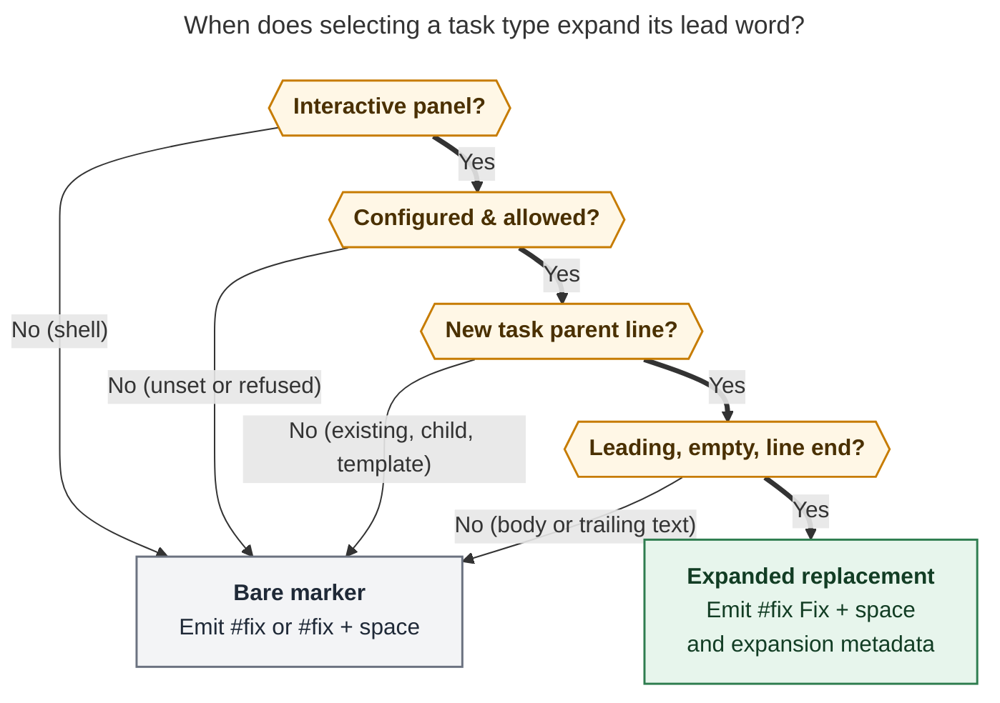

# Configurable Task-Type Lead-Word Expansion in Capture Completion

**Date:** 2026-11-27  
**Scope:** `bob-cli`, `bob-mac-capture`, `chezmoi`  
**Governing decisions:** `decisions:mac-capture-is-a-thin-client`, `decisions:capture-sigils-say-where-what-how`, `decisions:capture-reserves-clock-tags`, `decisions:capture-bullets-mirror-the-task-block`, `decisions:bob-cli-releases-ride-a-daily-train`, `decisions:theme-hue-is-config-pin-exempt-area-hash`

---

## Executive Summary

**Verdict on the idea:** Building a configurable, Bob-authored lead-word expansion for `#<type>` completion is a **good idea** — *provided* it ships with a one-tap Backspace peel, two-step Undo, truthful menu preview, and strict eligibility guards. However, an empirical census of all **5,478 `#task` items** in your live vault reveals a sharp surprise about the requested five-type configuration:

- **`#fix` → `Fix ` is a clear, immediate win:** Since `#<type>` shipped on 2026-10-31, **81 of 165 (49.1%)** explicitly typed `FIX` tasks start with `Fix ` — and **81 of 81 (100.0%)** recent `Fix ...` tasks are `FIX`.
- **`#plan` → `Plan ` is borderline:** Only **3 of 16 (18.8%)** explicitly typed `PLAN` tasks start with `Plan `. It breaks even *only* when rejecting an unwanted expansion costs one keystroke (atomic Backspace), and loses keystrokes without it.
- **`#build`, `#write`, and `#read` have a 0.0% historical hit rate:** Literally **0 of 5,478** `#task` rows in your entire vault start with `Build ` (your `BUILD` verbs are `Add`, `Make`, `Migrate`, `Create`, `Use`), **0 of 17** explicit `WRITE` tasks start with `Write ` (`sase_blog` uses `Draft` and `Convert`), and **0 of 1** explicit `READ` tasks start with `Read ` (reading tasks come from `bob ref` via `plan.reading_type`, while recent `Read ...` rows are all recurring `Read Email` chores).

**Recommended solution:**

1. **Config in `chezmoi` under `capture.type_expansions:`** (not nested inside `types:` — older `bob` builds strictly reject non-scalar values in `types:` and drop the entire vocabulary block, whereas unknown keys inside `capture:` are ignored safely across the daily release train). Store trimmed strings (`FIX: Fix`) and have Bob append the separating space deterministically.
2. **Start `chezmoi` with `FIX: Fix` (and optionally `PLAN: Plan`)**, leaving `BUILD`, `READ`, and `WRITE` unconfigured unless you intentionally want them (or want a non-matching verb such as `WRITE: Draft`).
3. **Keep `bob-cli` as the sole semantic authority** (`decisions:mac-capture-is-a-thin-client`): Bob gates expansion to non-refused interactive `task_type` completions on a **new task's empty, end-of-line parent edge** (including after `@@route`, in bulk item 2+, and after leading markers like `@sase #f`, while excluding shell completion, existing tasks, populated bodies, nested bullets, project notes, and `%t` templates).
4. **Extend `TaskTypeCandidate` additively at `schema_version: 1`:** set `replacement: "#fix Fix "`, `cursor_after: 9`, and an optional `expansion: { marker, text, range }` object so older clients still splice cleanly and updated Bob Mac Capture paints a quiet `→ Fix` preview, applies a two-step native Undo edit, arms a one-Backspace atomic peel, and guards `⌘↩`/`⌃↩` against accidentally capturing a one-word `"Fix"` task.

---

## 1. Critique & Empirical Reality Check

### 1.1 Live Vault Census (`bob query`)

To test how well `#fix`, `#build`, `#plan`, `#read`, and `#write` match your real task-authoring habits, we queried your full Bob vault via `bob query` across **7,828** task lines (**5,478 `#task` rows**, including **3,943** archived in `done/` and `*_done.md`, **291** with explicit `[type::]` / `[theme::]` fields, and **1,240** created on or after **2026-10-31**, when `#<type>` completion landed).

| Configured type (`bob types list`) | Explicit `[type::]` since 2026-10-31 | Starts with matching word | Hit rate | Actual top first words (explicit tasks) | All-time `#task` rows starting with word (of 5,478) |
| --- | ---: | ---: | ---: | --- | ---: |
| **`FIX`** (red) | 165 | 81 (`Fix`) | **49.1%** | `fix` (81), `make` (18), `add` (5), `stop` (4), `restart` (4) | 245 (4.5%) — **81/81 recent are `FIX`** |
| **`PLAN`** (exempt) | 16 | 3 (`Plan`) | **18.8%** | `create` (4), `plan` (3), `add` (3), `mark`/`run`/`split` (1) | 8 (0.1%) |
| **`WRITE`** (violet) | 11 | 0 (`Write`) | **0.0%** | `add` (5), `create` (2), `agents`/`sort`/`merge`/`require` (1) | 14 (0.3%) — 3 recent, none `WRITE` |
| **`BUILD`** (yellow) | 4 | 0 (`Build`) | **0.0%** | `use` (2), `make` (1), `add` (1) | **0 (0.0%)** (0 `Building` too) |
| **`READ`** (green) | 1 | 0 (`Read`) | **0.0%** | `prepare` (1) | 239 (4.4%) — 28/28 recent are `Read Email` |
| `CHORE` (magenta) | 8 | 0 (`Chore`) | 0.0% | `set` (2), `restart` (2), `reboot`/`find`/`prepare` (1) | 0 (0.0%) |
| `MEET` (blue) | 62 | 0 (`Meet`) | 0.0% | `**HHMM-HHMM**` calendar spans (61), `cold` (1) | 0 (0.0%) |

Checking inherited-default notes (tasks with no explicit `[type::]` override created since 2026-10-01) confirms the same pattern:

- **`dev*` (`task_type: BUILD`, n = 18):** 0% start with `Build`; top verbs are `add`, `migrate`, `write`, `investigate`, `create`, `switch`. Across all 5,478 vault tasks, **`Add` (690)** is your #1 verb, followed by `Review` (306), `Fix` (245), `Read` (239), `Make` (188), `Migrate` (174), and `Create` (71).
- **`gtd*` (`task_type: PLAN`, n = 43):** 0% start with `Plan`; top verbs are `run`, `review`, `brush`, `take`, `read`, `check`.
- **`sase_blog*` (`task_type: WRITE`, n = 54):** 0% start with `Write`; top verbs are `draft` (28) and `convert` (17).
- **`job*` (`task_type: WRITE`, n = 31):** 0% start with `Write`; top verbs are `apply`, `email`, `send`, `create`.

**Why `#fix` dominates explicit type captures:** 97.7% (168/172) of all explicit `FIX` tasks live under `dev` (`bob.md`, `sase.md`, `dev.md` and their `done/` archives), where the inherited note default is `BUILD`. You therefore *must* type `#f` on every bug fix, and roughly half the time you immediately follow `#fix ` with `Fix `. Conversely, `BUILD`, `WRITE`, and `READ` are almost always inherited from note defaults (`dev`, `job`, `sase_blog`) or `bob ref` (`plan.reading_type: READ`), so you rarely type `#build`, `#write`, or `#read` at all — and when you do, you do not begin the title with that word.

### 1.2 Keystroke Economics: Why Ergonomic Rejection Matters

Let $p$ be the hit rate (fraction of `#<type>` picks where you want the lead word), $L$ the length of the inserted text including its trailing space (`"Fix "` has $L = 4$; `"Plan "` has $L = 5$; `"Build "` / `"Write "` have $L = 6$), and $E$ the keystroke cost to remove it when you do not want it. Expected net keystrokes saved per selection are:

$$\mathbb{E}[\Delta k] = p \cdot L - (1 - p) \cdot E, \qquad p_{\text{break-even}} = \frac{E}{L + E}$$

| Rejection UX | Erase cost $E$ | Break-even $p$ for `"Fix "` ($L=4$) | Net keys saved on `#fix` ($p=49.1\%$) | Net keys saved on `#plan` ($p=18.8\%$) | Net keys saved on `#build`/`#write` ($p \approx 0\%$) |
| --- | ---: | ---: | ---: | ---: | ---: |
| Naive (`⌫` × $L$ chars) | 4–6 | 50.0% | **−0.07** (net loss!) | **−3.12** (loss) | **−6.00** (pure friction) |
| Word delete (`⌥⌫` chord) | 2 | 33.3% | **+0.95** | **−0.68** (loss) | **−2.00** (loss) |
| **Atomic 1-`⌫` peel (recommended)** | **1** | **20.0%** | **+1.45** (~120 keys/mo) | **+0.13** (near break-even) | **−1.00** (loss unless habit changes) |

Two critical insights fall straight out of this math:

1. **Without atomic single-Backspace peel, even `#fix` barely breaks even** because 50.9% of `#fix` captures start with another verb (`Make`, `Add`, `Stop`, `Restart`). With atomic single-Backspace peel ($E = 1$), `#fix` becomes a decisive daily win (+1.45 keys per capture, zero chords to memorize).
2. **Configuring `#build`, `#write`, and `#read` for symmetry will actively fight you** unless you deliberately intend to start writing `"Build ..."` / `"Read ..."` / `"Write ..."` tasks. The right design makes the *engine* general and config-driven, while keeping your initial `chezmoi` mapping lean (`FIX: Fix`, and optionally `PLAN: Plan`).

---

## 2. Evaluation of Alternative Approaches

Before committing to eager completion expansion, we evaluated three alternative approaches:

| Approach | How it works | Pros | Cons / Why not recommended as primary |
| --- | --- | --- | --- |
| **A. Auto-infer type from leading verb** (`Fix ...` → implicit `FIX`) | Typing `Fix settings widget` without `#f` automatically tags `[type:: FIX]` | Saves `#f` + `⏎` too on `Fix ` tasks (81/81 recent `Fix ` tasks were `FIX`) | Violates `docs/task-types.md` (*"Task fields are written only by an explicit type choice"*) and `decisions:capture-sigils-say-where-what-how`. Fails on other verbs: `"Plan badge should count open pomodoros"` (not `PLAN`), `"Read email"` (`CHORE`, not `READ`), `"Write script..."` in `dev.md` (`BUILD`, not `WRITE`). Still requires `#f` for the 50.9% of `FIX` tasks starting with `Make`/`Add`/`Stop`. |
| **B. Bare `#fix ` + inline ghost text** (`#fix \|` + dimmed `Fix `; `⇥`/`→` accepts) | Selecting `#fix` inserts `#fix `; ghost `Fix ` vanishes if you type anything else, commits on `⇥` | Zero penalty on misses ($E = 0$); safe even for 5% hit-rate types | Contradicts the desired one-step flow (`#f` `⏎` → `#fix Fix `). Forces a *second* `Tab` right after pressing `Tab`/`⏎` to pick `#fix`. Requires custom `NSTextView` ghost-text layout/VoiceOver overlay, adding heavy Swift UI complexity for a thin client. |
| **C. Split accept keys** (`⏎` bare `#fix `, `⇧⏎` or `⌥⏎` expanded — or vice versa) | Two accept keys choose bare vs expanded | Explicit per-pick choice with no post-insert deletion | `Shift-Return` and `Option-Return` already insert a newline while completion is visible (`bob-mac-capture: docs/keyboard.md:101`). Forces deciding *before* accepting and memorizing a second chord, whereas atomic Backspace peel lets you accept reflexively and tap `⌫` on misses. |
| **D. Eager Bob-authored expansion + menu preview + atomic 1-`⌫` peel + 2-step Undo (Recommended)** | Bob returns `#fix Fix ` plus structured `expansion` metadata; menu shows `→ Fix`; immediate `⌫` peels `Fix ` in one tap | Matches `#f` → `#fix Fix ` directly; zero extra keys on hits; 1 natural key on misses; reuses Bob Mac Capture's exact existing atomic-Backspace and `CaptureNativeRewriteEdit` plumbing; backward-compatible | Still costs 1 Backspace on misses (mitigated by keeping low-hit types out of `chezmoi` config). |

*(Note: Approach A's 100% precision on `Fix ...` is interesting enough to note as a separate future possibility — e.g., a settled, non-binding preview chip offering one-key `#fix` when a title starts with `Fix `, analogous to `decisions:similar-tasks-are-a-settled-heads-up` — but it should not replace explicit `#` completion expansion.)*

---

## 3. Recommended Adjustments to the Requirements

Every adjustment below is called out explicitly against the original prompt:

1. **Trim the initial `chezmoi` configuration from 5 types to `FIX` (and optionally `PLAN`), while keeping the config mechanism fully general.**  
   *Justification:* Vault data shows 0% `Build `/`Write `/`Read ` starts on explicit captures. Keeping the config map string-valued (`TYPE: <word>`) lets you add `BUILD: Build`, `WRITE: Draft`, or `READ: Read` in one YAML line anytime without changing code, without imposing daily Backspace friction on Day 1.
2. **Generalize "empty capture panel" to "start of any new-task item (with empty body and no trailing text on its line)".**  
   *Justification:* In Bob's grammar (`glossary:Bulk Capture`), `@@sase\n#f`, the second item of a bulk draft (`Buy milk\n\n#f`), and a leading-marker new task (`@sase #f`, `#off #f`) are all brand-new tasks where the caret is at the start of the task title. Conversely, `#f Fix it` (editing an already-written title), `Parent\n  - #f` (nested child bullet, which `type_marker.rs` currently marks `leading = true`!), `@sase:id #f` (retyping an existing task), `@sase^id@ #f` (project note), and `%t #f` (template) must **never** expand.
3. **Configure the lead word without requiring a trailing space in YAML (`FIX: Fix`), with Bob always appending one separating space.**  
   *Justification:* Unquoted YAML strips trailing spaces (`FIX: Fix ` parses as `"Fix"`), and editors/formatters frequently strip trailing whitespace. Trimming outer whitespace in Bob and emitting `<word> ` guarantees `#fix Fix ` reliably with zero missing-space or double-space bugs.
4. **Add three ergonomic guardrails in Bob Mac Capture:**  
   - **Atomic single-Backspace peel** right after accepting (matching existing atomic Backspace for `[ ] `, `****`, `,<digit>`, and `- `).
   - **Two-step native Undo** (`⌘Z` peels `Fix ` → `#fix `; second `⌘Z` restores `#f`).
   - **`⌘↩` / `⌃↩` bare-lead-word submit guard** so pressing `⌘↩` on `#f` expands `#fix Fix ` and keeps the editor open instead of immediately submitting a one-word task titled `"Fix"` (verified via `bob capture --dry-run -- '#fix Fix '`, which otherwise succeeds as `- [ ] #task Fix [type:: FIX]`).
5. **Keep shell completion (`bob __complete`) bare (`#fix`).**  
   *Justification:* `src/native/capture_complete/shell.rs:882-907` consumes `task_types::build_for_shell` and treats `replacement.trim_end()` as one shell argument. Including `"#fix Fix"` would cause zsh/bash to escape the space (`\#fix\ Fix`), which is awkward on the CLI and outside the prompt's capture-panel scope.

---

## 4. Recommended Solution Design

### 4.1 Configuration Schema & Rollout Safety (`chezmoi` + `bob-cli`)

#### Why `capture.type_expansions:` beats nesting inside `types:`

A natural first instinct is to extend `types:` in `~/.config/bob/config.yml` from scalar colors to rich objects (`FIX: { color: red, expand: Fix }`). **Do not do this.** Inspection of `src/native/config/themes.rs:218-240` shows that `parse_themes_config` strictly requires every value under `types:` to be a string (`Hue` / `auto`) or `null`, and any `serde_yaml::Value::Mapping` fails validation and **drops the entire `types:` vocabulary block** (`docs/task-types.md` PT12). Because `chezmoi` syncs `config.yml` across hosts independently of `bob-cli`'s daily release train (`decisions:bob-cli-releases-ride-a-daily-train`), introducing a mapping under `types:` would break task-type recognition and trigger `themes_config_invalid` warnings on every host still running an older `bob` build.

By contrast, `src/native/config/capture.rs` loads each `capture:` key independently and ignores unknown keys — the exact pattern already documented in your `chezmoi` `config.yml` for `capture.clipboard_history`, `plugins.sync`, and `stats.period_strip`. (We also verified that no plugin in `bob-plugins` parses `types:` directly from `config.yml`; plugins read `configured_themes` from `bob types list --format json`.)

#### Schema

```yaml
capture:
  clipboard_history: alfred
  # Auto-insert a starting word when selecting these task types from `#`
  # completion at the start of an empty new-task capture item. Bob appends
  # one trailing space automatically. Older bob builds ignore this key.
  type_expansions:
    FIX: Fix
    # PLAN: Plan    # ~19% vault hit rate; safe with 1-Backspace peel
    # BUILD: Build  # 0% historical vault hit rate; add if desired
    # READ: Read    # 0% historical vault hit rate (bob ref inherits READ)
    # WRITE: Write  # 0% historical vault hit rate (or e.g. Draft)
```

#### Parsing, Validation & Rename Integration (`src/native/config/capture.rs`)

- **Independent loader:** Add `load_type_expansions_config(path: &Path) -> Result<TypeExpansionsConfig, ConfigError>` (and `parse_type_expansions_config`) alongside `load_capture_config` and `load_clipboard_history_config`. A malformed `type_expansions:` block degrades to an empty map with a bounded warning surfaced through `capture-complete`'s `warnings` array; it never breaks `max_saved_templates`, `clipboard_history`, or `types:`.
- **Key rules:** Must be a YAML mapping of string keys to string (or null, meaning disabled) values. Normalize each key with `plan_budget::normalize_component`. Reject:
  - multi-component (`+`) or blank type names;
  - reserved clock-tag spellings (`OFF`, `ON`, `OFFCLOCK`, `OFF-CLOCK`, `UNTRACKED` — per `decisions:capture-reserves-clock-tags`);
  - duplicate normalized keys (e.g., `FIX` and `fix`), naming both.
- **Value rules:** Trim leading/trailing ASCII whitespace; reject empty strings (suggest removing the key or setting `null`), strings containing `\n`/`\r`/control characters, or strings starting with a capture sigil that could collide with marker parsing? Actually, plain words/phrases (`"Fix"`, `"Draft"`, `"Prep for"`) are all safe; reject only empty or control/multiline strings and cap at a sensible bound (e.g. 64 chars) so a bad edit cannot inject a paragraph.
- **Cross-check with `types:`:** If a `types:` vocabulary is configured and a key in `capture.type_expansions` is not in `types:`, emit a non-fatal warning (`capture.type_expansions.FOO is not in types:`) rather than dropping the map, matching Bob's warn-and-preserve style.
- **`bob types rename OLD NEW`:** Extend `config_reference()` in `src/native/pomodoro_themes/rename.rs:1126-1220` to check `capture.type_expansions` just like `types:`, `plan.exempt`, `plan.reading_theme`, and `stats` filters, refusing with `config_reference` if `OLD` has an expansion and `NEW` does not yet.

---

### 4.2 Eligibility Gate in `bob-cli`

Today, `src/native/capture_complete/task_types.rs:444-451` computes each candidate's replacement as:

```rust
let mut replacement = replacement_for(&name, &key);
let next_is_whitespace = raw_text
    .get(field.replacement.1..)
    .and_then(|rest| rest.chars().next())
    .is_some_and(char::is_whitespace);
if leading && !next_is_whitespace {
    replacement.push(' ');
}
```

Reusing `leading` alone is **not sufficient** — live `bob capture-complete` probes revealed four cases where `leading == true` but expanding a lead word would corrupt the draft:
1. `#f Fix it` (body already exists after `#f`);
2. `@dev:foo #f` and `@dev+foo #f` (`subject == "existing"`, where inserting `"Fix "` turns an existing-task retype into body text);
3. `Parent\n  - #f` (nested child bullet, where `type_marker::scan_line_with_positions` strips `  - ` and marks the bullet's `#f` as `leading = true`);
4. `@dev^foo@ #f` (project note) and `%t #f` (template draft).

Instead, `task_types::build` should apply a crisp, four-gate predicate in Rust (never in Swift):



*Figure 1 — Eligibility decision flow in `bob-cli` (`task_types::build`). Any `No` branch exits immediately to the bare `#<type>` marker; all four checks must pass to emit an expanded lead word and its metadata.*

#### Concrete Rust Conditions

An interactive (`!include_all_visible`, i.e., `build` and never `build_for_shell`) `TaskTypeCandidate` expands iff **all** of the following hold:

1. **Candidate allowed & configured:** `refused.is_none()` and `expansions.get(&key)` returns `Some(lead_word)`.
2. **New-task item on its parent line:**
   - `subject == "new"`;
   - The draft is not a `%t` template (`capture_language::template::analyze(raw_text).directive.is_none()`);
   - `editor_item` is not a non-task mode (exclude `ProjectNote`, `PomodoroProjectNote`, `Notebook`, `Record`, and any item with `type_marker_not_applicable` — note that live probing showed `@dev^foo@ #f` currently reports `refused: null` on completion even though `bob capture` refuses it with `type_marker_not_applicable`; checking `editor_item.mode` protects against expanding on project notes too);
   - The `#<type>` replacement span lies within the item's **first (parent) physical line** (`item.lines[0]`), never a nested child bullet line.
3. **Leading, empty body, at end of line:**
   - `marker.leading == true` (only whitespace and leading transparent markers such as `@sase`, `@sase^id`, `#off`, `$1` precede it on the parent line);
   - `editor_item.body.trim().is_empty()` (with `#<type>` masked out, the item has no task text yet);
   - `raw_text[field.replacement.1..parent_line_end].trim().is_empty()` (nothing non-whitespace follows the marker on the parent line).

#### Full Case Matrix (Verified Against Live `bob capture-complete`)

| Draft (caret at `\|`) | Gate result | Emitted `replacement` | `cursor_after` | `expansion` emitted? |
| --- | --- | --- | ---: | :---: |
| `#f\|` | **Expand** | `"#fix Fix "` | 9 | Yes |
| `#\|` (user selects `FIX`) | **Expand** | `"#fix Fix "` | 9 | Yes |
| `#fix\|` (menu still open; user hits `⏎`) | **Expand** | `"#fix Fix "` | 9 | Yes |
| `@@sase\n#f\|` | **Expand** | `"#fix Fix "` | 15 | Yes |
| `Buy milk\n\n#f\|` | **Expand** | `"#fix Fix "` | 19 | Yes |
| `@sase #f\|` | **Expand** | `"#fix Fix "` | 14 | Yes |
| `@sase^id #f\|` | **Expand** | `"#fix Fix "` | 17 | Yes |
| `#off #f\|` | **Expand** | `"#fix Fix "` | 14 | Yes |
| `#f\| Fix it` | Bare (body non-empty) | `"#fix"` | 4 | No |
| `#f\| Make it work` | Bare (body non-empty) | `"#fix"` | 4 | No |
| `Fix it #f\|` | Bare (trailing, body non-empty) | `"#fix"` | 11 | No |
| `#f\| @sase` | Bare (trailing token on line) | `"#fix"` | 4 | No |
| `@sase:foo #f\|` | Bare (`subject == "existing"`) | `"#fix "` | 15 | No |
| `@sase+foo #f\|` | Bare (`subject == "existing"`) | `"#fix "` | 15 | No |
| `@sase^foo@ #f\|` | Bare (project note) | `"#fix "` | 16 | No |
| `Parent\n  - #f\|` | Bare (nested child bullet) | `"#fix "` | 16 | No |
| `%t #f\|` | Bare (template draft) | `"#fix "` | 8 | No |
| `bob capture #f<TAB>` (zsh/bash) | Bare (`build_for_shell`) | `"#fix"` | n/a | No |

Notice one subtle bonus of requiring `#` completion selection: if you ever know up front you do *not* want `Fix `, simply typing `#fix ` (Space dismisses the menu without selecting) bypasses expansion naturally — zero extra keystrokes.

---

### 4.3 Additive Wire Contract (`bob capture-complete --format json`)

Keep `schema_version: 1` and `grammar` unchanged. Add one optional field `expansion` to `TaskTypeCandidate` (`src/native/capture_complete/model.rs:949-973`), omitted (`skip_serializing_if = "Option::is_none"`) whenever a candidate does not expand:

```rust
#[derive(Debug, Clone, PartialEq, Eq, Serialize)]
pub(super) struct TaskTypeExpansion {
    /// The marker-plus-space prefix (`"#fix "`) before the expanded text.
    pub(super) marker: String,
    /// The auto-inserted lead text including its trailing space (`"Fix "`).
    pub(super) text: String,
    /// UTF-8 byte range of `text` inside the post-accept draft.
    pub(super) range: Replacement,
}
```

Example JSON candidate for `#f` (cursor `2`, `replacement: { "start": 0, "end": 2 }`):

```json
{
  "replacement": "#fix Fix ",
  "cursor_after": 9,
  "name": "FIX",
  "key": "fix",
  "themes": [
    { "key": "fix", "name": "FIX", "hue": "red", "hue_source": "config", "configured": true }
  ],
  "origin": "configured",
  "last_used": "2026-11-27",
  "days_used": 35,
  "effect": "set",
  "expansion": {
    "marker": "#fix ",
    "text": "Fix ",
    "range": { "start": 5, "end": 9 }
  }
}
```

**Why include `"Fix "` in `replacement` *and* expose `expansion`:**

| Client / `bob` pairing | Behavior |
| --- | --- |
| **New `bob` + New Mac Capture** | Menu renders quiet `→ Fix` preview; accept applies two-step native Undo (`#fix `, then `Fix `), arms atomic 1-`⌫` peel using `expansion.range`, and guards `⌘↩`/`⌃↩` auto-submit. |
| **New `bob` + Old Mac Capture** | App ignores unknown `expansion` key, splices `replacement` (`"#fix Fix "`) and `cursor_after` (`9`) directly — core expansion already works without crashing or requiring a lockstep release. |
| **Old `bob` + New Mac Capture** | App decodes `expansion == nil` via `decodeIfPresent`, rendering and behaving identically to today. |
| **`bob capture-complete --format human`** | `render.rs::task_type_line` displays the bare marker (`#fix`) in column 1 and appends `· expands "Fix "` in the detail column so human CLI output stays crisp and scannable. |

---

### 4.4 Intuitive, Reliable, Beautiful UX in Bob Mac Capture

#### 1. Quiet, Truthful Menu Preview (`CaptureTaskTypeMenuView` + `CaptureTaskTypeMenuPresentation`)

Today, `CaptureTaskTypeMenuView.swift:66-126` renders each row with an 8 pt swatch, a soft-tinted type pill (`FIX`), optional metadata badges, a flexible spacer, and a tertiary right-aligned usage caption (`today`). Per `docs/task-types.md` PT6 (*"Names wear a tint; places wear a dot"*), tinted pills belong exclusively to task types and should not be diluted by a second pill.

When `candidate.expansion != nil`, render a calm inline lead-word cue right beside the type pill (only on rows that will actually expand at the current caret):

```text
TASK TYPE                                      ● gtd suggests PLAN
──────────────────────────────────────────────────────────────────
■ [ FIX ]    → Fix                                           today
■ [ BUILD ]                                                  today
■ [ CHORE ]                                                37 days
■ [ MEET ]                                                   today
■ [ PLAN ]   → Plan     from gtd · Exempt                    today
■ [ READ ]                                                   today
■ [ WRITE ]                                                  today
──────────────────────────────────────────────────────────────────
inserts “Fix ” · this task becomes FIX        ⏎ choose   ⌃D hide
```

Visual and accessibility details:
- **Inline row cue:** `HStack(spacing: 3)` with `Text("→")` in `Color(nsColor: .tertiaryLabelColor)` and `Text(trimmedExpansion)` (e.g., `Fix`) in `.caption` `.secondary` (never bold, never tinted, never boxed). Because `expansion` is `nil` whenever the eligibility gate fails (`Fix it #f`, `@dev:foo #f`, `#f Make it`), the presence of `→ Fix` is a **100% truthful contract**: if you see `→ Fix`, accepting inserts `Fix `; if you do not see it, accepting inserts only `#fix`.
- **Selected-row footer (`CaptureTaskTypeMenuPresentation.footer`):** Prefix Bob's existing effect copy with `inserts “Fix ” · ` (e.g., `inserts “Fix ” · this task becomes FIX · gtd suggests PLAN`). Keeps the compact 28 pt footer height and avoids adding extra keycaps.
- **VoiceOver (`accessibilityLabel`):** Append `", inserts Fix "` to the row's spoken label so assistive tech announces the expansion clearly.
- **Editor feedback after accept:** Immediately after insertion, `bob capture-parse` paints `#fix` with its red theme pill while `Fix ` stays crisp normal-ink task text — instant, calm visual separation with no distracting flash animation (matching `docs/capture-panel.md`'s unanimated layout ethos).

#### 2. Two-Step Native Undo (`CaptureNativeRewriteEdit`)

Currently, `CapturePanelModel.applySelectedCompletionReplacement` (`CapturePanelModel.swift:15269-15314`) updates `plainDraft` via `setPlainDraft(...)`, bypassing `NSTextView`'s undo stack. For an expanded `task_type` candidate, apply the splice through `CapturePanelController`'s existing native `NSTextView` edit path (`breakUndoCoalescing()` + `insertText(_:replacementRange:)`, modeled on `CapturePanelController.swift:1460-1488`) in **two undo-broken steps**:

1. Replace `[replacement.start, replacement.end)` with `expansion.marker` (`"#fix "`), `breakUndoCoalescing()`.
2. Insert `expansion.text` (`"Fix "`) at the caret, `breakUndoCoalescing()`, set caret to `cursorAfter`.

Result:
- First **`⌘Z`** peels `"Fix "` and leaves `#fix |` (preserving the task type you intentionally picked).
- Second **`⌘Z`** restores `#f|`.
- **`⇧⌘Z`** steps forward cleanly through both steps.

*(Fallback: if no editable `NSTextView` matches — e.g., headless unit tests — fall back cleanly to `setPlainDraft`, preserving testability in `CaptureCoreTests`.)*

#### 3. One-Tap Atomic Backspace Peel (Matching Bob Mac Capture's Backspace Family)

Bob Mac Capture already owns a clean, provenance-guarded atomic Backspace chain in `CapturePanelController.swift:2305-2327` for every auto-inserted helper token (`[ ] `, `****`, `,<digit>`, and unused `- `). Add **`deleteTaskTypeExpansionInEditableTextView`** to that exact chain:

- **Arming:** Right after accepting a `task_type` candidate with `expansion`, `CapturePanelModel` stores one lightweight arm:
  ```swift
  struct TaskTypeExpansionPeelArm: Equatable {
      let expectedDraft: String
      let peelRangeUTF8: CaptureRange // expansion.range, e.g. 5..<9 ("Fix ")
      let expectedCaretUTF8: Int      // cursorAfter, e.g. 9
  }
  ```
- **Firing:** When the **very next keystroke** is an unmodified `Backspace` (collapsed caret at `expectedCaretUTF8`, `textView.string == expectedDraft`, `!textView.hasMarkedText()`), delete `peelRangeUTF8` as one native undo-broken edit (`breakUndoCoalescing()` → `insertText("", replacementRange: utf16Range)` → `breakUndoCoalescing()`), leaving `#fix |`, and clear the arm.
- **Immediate disarm:** Any other character typed, caret motion, selection change, paste, Undo, `setPlainDraft`, or draft mismatch immediately sets `taskTypeExpansionPeelArm = nil`. Once you type `#fix Fix widget`, backspacing back into `Fix` is 100% ordinary character-by-character Backspace.
- **No word-overtype magic:** We deliberately do *not* try to swallow a typed `"Fix "` after expansion. Swallowing multi-character words breaks on titles like `"Fix fixtures"` or `"Fixed-width..."`; the `→ Fix` menu cue plus immediate `#fix Fix |` text builds muscle memory in a handful of captures without fragile heuristics.

#### 4. Guarding `⌘↩` / `⌃↩` Against Accidental `"Fix"` Captures

Look at `CapturePanelModel.swift:14701-14711`: `acceptSelectedCompletionThenSubmitAndOpen()` calls `acceptSelectedCompletion()` and immediately triggers `submitAfterCurrentAnalysis(openAfterCapture: true)`. Today, pressing `⌘↩` on `#f` in an empty panel produces `#fix `, which `bob capture` safely refuses as an empty task. With expansion, `#f` becomes `#fix Fix ` — which `bob capture --dry-run` **accepts** as `- [ ] #task Fix [type:: FIX]`.

**Guard:** When `acceptSelectedCompletion()` accepted a `task_type` candidate with `expansion != nil`, `acceptSelectedCompletionThenSubmitAndOpen()` must **stop after accepting** (keeping the panel open with the caret at `#fix Fix |` and announcing nothing intrusive, or a quiet status `"Type the task after Fix "` if desired). Because `expansion` is only ever emitted when the item body was empty before accepting, stopping auto-submit on `candidate.expansion != nil` is exact, zero-heuristic, and never blocks `⌘↩` on already-titled tasks like `Fix settings #f`.

---

## 5. Implementation & Rollout Plan

Because the contract is additive and `capture.type_expansions` is ignored by older `bob` builds, the three repositories can ship cleanly in order with zero cross-host breakage:

1. **Phase 1 — `bob-cli` (core config, eligibility gate, wire contract, rename guard):**
   - `src/native/config/capture.rs`: add `TypeExpansionsConfig`, `load_type_expansions_config`, independent YAML parsing + validation + unit tests.
   - `src/native/capture_complete/model.rs`: add `TaskTypeExpansion` struct and optional `expansion` field on `TaskTypeCandidate`.
   - `src/native/capture_complete/task_types.rs`: load expansions in `build` (skip in `build_for_shell`), implement the 4-gate eligibility predicate (verifying parent-line span, `subject == "new"`, non-template/non-project-note mode, `leading`, empty body, empty line tail), populate `replacement`, `cursor_after`, and `expansion`.
   - `src/native/capture_complete/render.rs`: keep human column 1 as bare marker and append `· expands "<word> "` to detail.
   - `src/native/pomodoro_themes/rename.rs`: include `capture.type_expansions` in `config_reference()`.
   - Update `docs/capture.md`, `docs/task-types.md`, and `docs/reference/json-outputs.md`.
   - Tests: full 16-case matrix in `src/native/capture_complete/tests/`, shell-completion regression test verifying `bob __complete` emits bare `#fix`, config parser tests (whitespace trimming, reserved clock tags, duplicates, fault isolation from `clipboard_history`), and `bob types rename` refusal test.

2. **Phase 2 — `bob-mac-capture` (thin-client preview, two-step Undo, atomic Backspace peel, `⌘↩` guard):**
   - `Sources/CaptureCore/CaptureModels.swift`: decode optional `expansion` (`marker`, `text`, `range`) on `CaptureCompletionCandidate`.
   - `Sources/CaptureCore/CaptureTaskTypeMenuPresentation.swift` & `Sources/BobMacCapture/CaptureTaskTypeMenuView.swift`: add `expansionPreview: String?` on `Row`, paint `→ Fix` beside the pill, update selected footer & VoiceOver label.
   - `Sources/BobMacCapture/CapturePanelModel.swift` & `CapturePanelController.swift`:
     - two-step native `NSTextView` apply on expanded `task_type` accept;
     - `TaskTypeExpansionPeelArm` + `deleteTaskTypeExpansionInEditableTextView` in the `.deleteBackward` chain;
     - suppress immediate submit in `acceptSelectedCompletionThenSubmitAndOpen()` when the accepted candidate expanded a lead word.
   - Update `docs/capture-panel.md`, `docs/keyboard.md`, `docs/protocol.md`, and add Swift tests in `Tests/CaptureCoreTests/CaptureTaskTypeTests.swift` plus render fixtures and macOS CI check.

3. **Phase 3 — `chezmoi` (user config):**
   - Add `capture.type_expansions:` to `home/dot_config/bob/config.yml` starting with `FIX: Fix` (plus `PLAN: Plan` if desired, and commented notes for the other types so expanding or tweaking later is a one-line edit). Safe to land before or after Phase 1 reaches every host.
