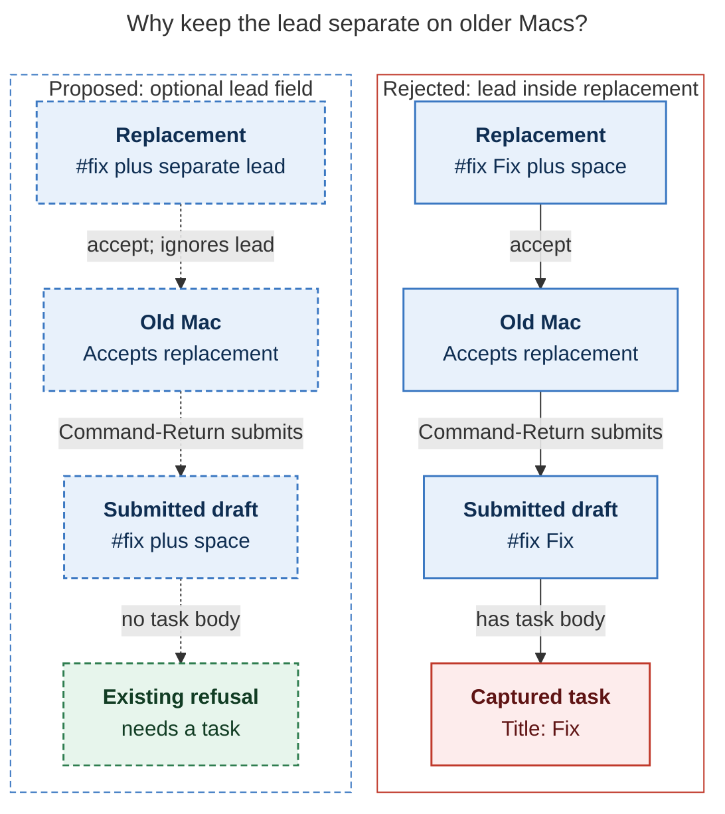
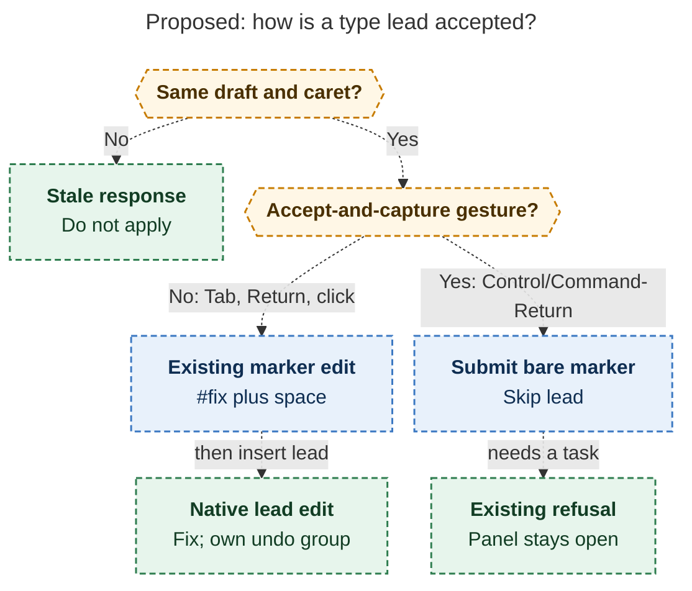

# Diagram proposals: Type lead words in the capture panel

Proposals for the swarm linker, not a report. Each diagram restates only what the source
report says.

```yaml
source: research:202611/capture_type_lead_words/capture_type_lead_words__final.md
producer: research.6p.image
check: "mmdc 12.0.0 with the PDF-mirroring config and Puppeteer --no-sandbox rendered 2 of 2 Mermaid diagrams"
```

## older-mac-fallback

```yaml
anchor: |-
  submission proceeds with `#fix ` and bob's existing "needs a task" refusal.
question: |-
  Why does a separate lead field prevent one-word tasks when an older Mac accepts and submits?
illustrates: |-
  With a separate lead field, an older Mac submits the bare marker and preserves the existing needs-a-task refusal; baking in the lead captures Fix.
caption: "On older Macs, a separate lead field preserves the existing refusal; baking the lead into replacement can capture a one-word task."
review: "603.016x673 px, fit 100%; question and visual checks passed; 0 revisions"
```



## acceptance-paths

```yaml
anchor: |-
  Acceptance stays bound to the exact draft/caret snapshot the response was computed for
question: |-
  For an eligible #f response carrying a lead, how does proposed acceptance branch on snapshot validity and gesture?
illustrates: |-
  Snapshot-bound acceptance applies the marker before a native lead edit; accept-then-capture skips the lead and preserves the existing refusal.
caption: "For an offered lead on #f, stale responses never apply; ordinary acceptance inserts undoable text, while accept-and-capture preserves the existing refusal."
review: "620.324x762 px, fit 100%; question and visual checks passed; 1 revision to clarify the title"
```


