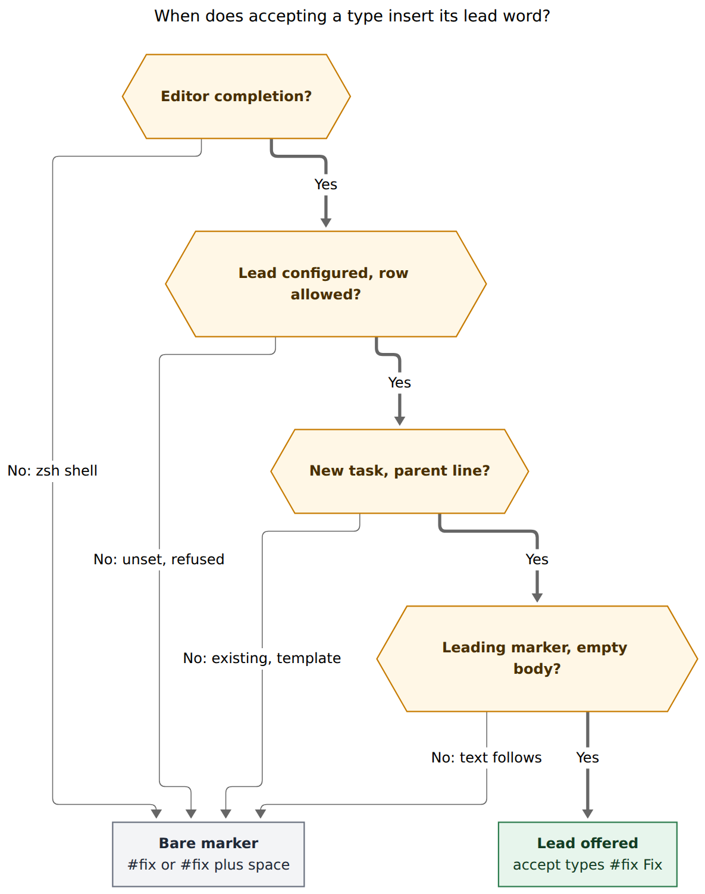
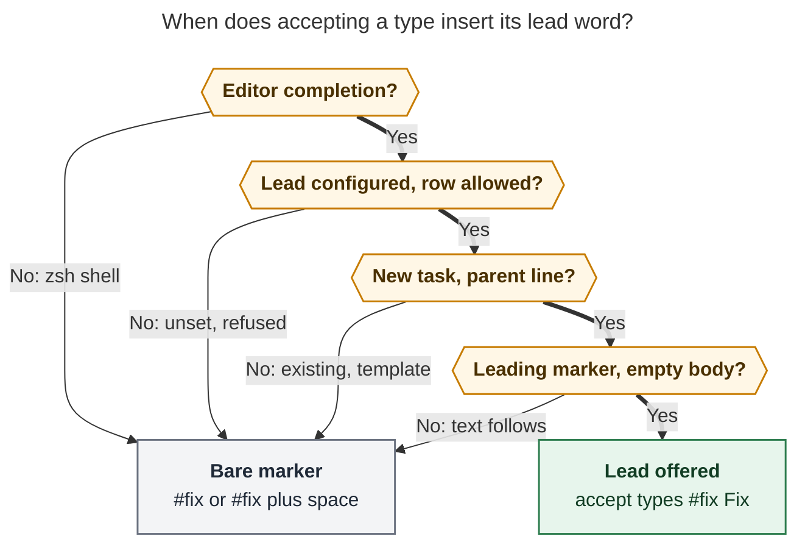

# Type lead words: `#f` ⇥ → `#fix Fix ▌` in the capture panel

*Consolidated research report · 2026-11-27 · bob-cli, Bob Mac Capture, chezmoi*

**Question.** Should accepting certain task types from the capture panel's `#`
completion at the start of a capture also type the matching word (`#f`, accept FIX →
`#fix Fix `), how should it be built, and is the plan as requested a good one?

**Sources.** Five independent swarm reports — [cdx](capture_type_lead_words__cdx.md),
[cld](capture_type_lead_words__cld.md), [grk](capture_type_lead_words__grk.md),
[mus](capture_type_lead_words__mus.md), [gem](capture_type_lead_words__gem.md) — plus
the lead researcher's own verification of every load-bearing claim against the bob-cli
checkout (`dbdc7d24`), the bob-mac-capture checkout (via `sase repo open`), the
decisions roster, and the docs. Where this report cites a file and line, the lead
re-checked it directly; disagreements between reports are resolved explicitly in §4.

**Short answer.** Yes, build it — all five researchers independently reached the same
verdict, and so do I. Call the inserted word a **type lead**: plain draft text that the
Mac panel types for you when you accept a `#` row at the start of an empty new-task
item. Configure it as a new `capture.type_leads` map in the chezmoi-managed
`~/.config/bob/config.yml` — never inside `types:`. Bob decides when a lead applies and
what it says; the Mac only renders and applies it. Two adjustments to the request are
justified and called out in §3: "start of the capture" should mean *the start of any
empty new-task item* (not just an empty panel), and the five-type configuration should
ship with open eyes — your own vault history says `FIX` will hit about half the time
while `BUILD`, `READ`, and `WRITE` have never once matched. The full recommendation is
in §5; the one genuine design disagreement among the researchers (where the lead rides
on the wire) is adjudicated in §4.

---

## 1. What every report independently established

All five researchers, working without seeing each other's reports, converged on these
facts and conclusions. The lead verified each one.

- **The splice machinery already exists.** `bob capture-complete` context `task_type`
  returns one replacement range per marker and, per candidate, a `replacement` string
  plus `cursor_after` (UTF-8 byte offset). Leading markers already grow a trailing
  space: `src/native/capture_complete/task_types.rs:449` reads
  `if leading && !next_is_whitespace { replacement.push(' '); }`, so `#f` at the start
  already completes to `#fix ` with the caret ready for the title. The requested
  feature is a configurable generalization of this exact line's effect.
- **The redundancy is real and documented.** `docs/capture.md`'s own first example for
  typing tasks with `#<type>` is `#fix Fix it`. The marker sets `[type:: FIX]`; the
  verb stays in the task text. A lead changes nothing about what is stored — it only
  saves typing the verb.
- **The config must not live under `types:`.** `parse_themes_config`
  (`src/native/config/themes.rs`) accepts only a palette slot, `auto`, or null as a
  type's value; a mapping value fails with "must be … got mapping" and **drops the
  entire vocabulary block**. Because chezmoi syncs `config.yml` to every host
  independently of bob-cli's daily release train, object-valued `types:` entries would
  break type colors and the configured menu on any host running an older bob. Unknown
  keys under `capture:` are ignored by every current loader
  (`src/native/config/capture.rs` parses each key independently), so a new `capture.*`
  map is deploy-safe in any order. Four of five reports recommended this; mus preferred
  extending `types:` to string-or-mapping for locality but acknowledged the parser
  break — the deploy-safety argument wins (see §6).
- **Explicit strings, not derived title-case.** All five leads happen to be the type
  name in title case, but `SASE`, `DEEP WORK`, or `MEET` would title-case wrongly, and
  a value like `WRITE: Draft` or `MEET: Meet with` should be expressible. The config
  value is the word; omitting the entry disables that type.
- **Editor completion only.** zsh shell completion shares the candidate builder
  (`shell.rs:885` calls `task_types::build_for_shell` and turns
  `item.replacement.trim_end()` into shell words), so the lead must attach only in the
  editor `build` path — otherwise zsh would offer escaped `#fix\ Fix` suggestions.
  Likewise `bob capture`, `capture-parse`, paste, piped stdin, and templates never add
  leads: the feature exists only at the completion-accept gesture, the user's explicit
  consent. Typing `#fix` plus Space never accepts a row, which leaves a natural,
  zero-cost way to say "just the type, no lead."
- **`leading` alone is not a sufficient gate.** Live probes (run independently by cdx,
  cld, and gem) show `leading == true` in several cases where inserting a word would
  corrupt the draft: `#f Fix it` (title already present), `@dev:foo #f` /
  `@dev+foo #f` (`subject == "existing"` — the word would become body text on a
  retype), and nested child bullets (`Parent\n  - #f`), which `type_marker.rs`
  currently marks `leading = true`. The full predicate is in §5.3.
- **Thin-client boundary.** Per `decisions:mac-capture-is-a-thin-client`, Bob computes
  whether a lead applies, its text, and its byte offsets; Swift renders and applies
  them and never reads YAML or re-derives grammar.
- **Release shape.** Additive `feat` at `schema_version: 1`, no grammar bump, no `!`,
  no version or `CHANGELOG.md` edits (`decisions:bob-cli-releases-ride-a-daily-train`).

## 2. What your vault says about the five requested types

cld and gem independently censused the vault (different cohorts, consistent results).
gem's cohort — explicitly typed `[type::]` tasks since `#<type>` completion shipped on
2026-10-31 — is the cleanest predictor of this feature's hit rate; cld's lifetime
explicit-field numbers agree.

| Type | Explicit captures since 2026-10-31 | Start with the lead word | Hit rate | Actual top first words |
| --- | ---: | ---: | ---: | --- |
| FIX | 165 | 81 | **≈49%** (cld lifetime: 51%) | Fix, Make, Add, Stop |
| PLAN | 16 | 3 | ≈19% | Create, Plan, Add |
| WRITE | 11 | 0 | 0% | Add, Create (sase_blog uses Draft, Convert) |
| BUILD | 4 | 0 | 0% | Use, Make, Add (0 of 5,478 all-time tasks start "Build") |
| READ | 1 | 0 | 0% | reading tasks arrive via `bob ref`, not typed `#read` |

Two structural reasons, not just habit: `FIX` is the one type you *must* type
explicitly (97.7% of explicit FIX tasks live under `dev` notes whose inherited default
is BUILD), and roughly half the time you then type `Fix ` by hand — the exact
redundancy this feature deletes. Conversely BUILD/WRITE/READ are almost always
inherited from note defaults, so you rarely type those markers at all — which cuts both
ways: the lead will rarely fire, so a configured miss costs little in absolute terms.

gem's keystroke model makes the ergonomic stakes precise: with hit rate *p*, insertion
length *L*, and erase cost *E*, break-even is *p = E/(L+E)*. With a one-key atomic
rejection (*E* = 1), "Fix " breaks even at a 20% hit rate and FIX nets ≈+1.45 keys per
capture; with naive character-by-character Backspace (*E* = 4–6), even FIX is a net
loss. **The one-key peel/undo in §5.5 is therefore part of the feature, not
decoration.**

## 3. Critique and requirement adjustments (explicitly called out)

The idea is good: it makes the documented happy path (`#fix Fix it`) cost nothing
extra, nudges task titles toward verb-first next-action phrasing, and adds no new
grammar — the expanded draft parses byte-identically to hand-typed text. The risks are
equally clear: "choose a type" quietly gains a side effect, and a wrong lead that is
annoying to remove turns a convenience into a tax. Every adjustment below exists to
keep the trigger explicit, the consequence visible, and the rejection one key.

1. **"Start of the capture" → "start of any empty new-task item."** (cld, grk, mus,
   gem; cdx dissented.) The empty panel is the motivating example, but the same help is
   right for `@cash #f` (route first), for the second item of a bulk draft, and after a
   leading clock tag — Bob already treats all of these as leading. cdx's
   narrower "fresh single-line draft only" rule is easier to state but would make
   common route-first captures feel arbitrarily broken; the majority scope is still a
   crisp predicate (§5.3) because Bob, not the Mac, evaluates it. Adopted: the broader
   scope.
2. **Keep all five types in config, but with open eyes.** The request names five
   types; the vault data (§2) predicts three of them will essentially never hit. gem
   recommended shipping only `FIX` (plus optionally `PLAN`); cld recommended shipping
   all five and rechecking. Adopted: **ship all five as you asked** — the mechanism
   must be general anyway, misses cost one key, and the nudge itself may change how
   you phrase BUILD/READ/WRITE tasks — but treat BUILD as the canary. Recheck after
   two weeks of real use; if you keep deleting "Build", delete that line (or try
   `BUILD: Add` / `WRITE: Draft`, which match your actual verbs). This is a one-line
   YAML edit either way.
3. **Explicit per-type strings, no derived title-casing, no snippet syntax.** Values
   are literal single-line words or short phrases; no variables, tab stops, or
   interpolation. Short phrases (`MEET: Meet with`) fit the same model.
4. **Name it a "lead", not an "expansion".** In Bob's sigil grammar `%` already "says
   how the draft expands" (`decisions:capture-sigils-say-where-what-how`); "type lead"
   — the word a task of this type leads with — avoids overloading that vocabulary.
5. **Accept-and-capture gestures must never mint a one-word task.** `bob capture
   --dry-run '#fix Fix '` *succeeds* as `- [ ] #task Fix [type:: FIX]`, so an unguarded
   ⌃↩/⌘↩ on `#f` would silently capture a task titled "Fix". Today that gesture yields
   `#fix ` → bob's "needs a task" refusal, which is the correct outcome and must be
   preserved (§5.5).
6. **The menu must show the consequence before you accept.** A row that will insert a
   lead shows it (`FIX  → Fix`); a row that won't, doesn't. Nothing hidden, nothing
   animated into the vault.

## 4. The one real disagreement: where the lead rides on the wire

The swarm split three ways, and this is the decision that shapes everything else:

- **Bake the lead into `replacement`** (`"#fix Fix "`, `cursor_after: 9`) — grk and
  mus, and cdx with optional display metadata. Merit: zero required Mac change; any
  client that splices `replacement` gets the feature.
- **Bake it in *and* emit structured metadata** (`expansion: {marker, text, range}`) —
  gem. Old Macs still expand via `replacement`; new Macs use the metadata for preview,
  two-step undo, Backspace peel, and a ⌘↩ guard.
- **Leave `replacement` alone and add an optional `lead` object** that the Mac applies
  as its own second edit — cld.

**Adopted: cld's separate `lead` field.** The lead researcher verified the three facts
that decide it:

1. **The ⌘↩ hazard is real and structural.**
   `CapturePanelModel.swift:14701` (`acceptSelectedCompletionThenSubmitAndOpen`) calls
   `acceptSelectedCompletion()` and immediately submits. With the lead baked into
   `replacement`, *any* Mac build without a new guard — including every existing
   install — turns ⌘↩ on `#f` into a captured one-word "Fix" task. With a separate
   `lead` field, a client that doesn't know the field simply doesn't insert it:
   submission proceeds with `#fix ` and bob's existing "needs a task" refusal.
   **Version-skew degrades to today's behavior instead of to junk tasks, in both
   directions, in any rollout order across the three repos.**
2. **The "one atomic undoable replacement" premise of the baked design is unproven.**
   Today's task-type accept runs through `applySelectedCompletionReplacement` →
   `setPlainDraft` (`CapturePanelModel.swift:15269`), a programmatic draft swap that
   bypasses `NSTextView` undo coalescing — exactly the uncertainty cdx flagged. The
   baked design would need the whole accept path migrated to the native-edit lane to
   honor "one ⌘Z restores the pre-accept draft". The separate-field design leaves the
   existing accept path untouched and inserts the lead through the native lane that
   already exists and is already used for sigil-alias rewrites
   (`applyNativeRewriteEdit` → `applyNativeRewriteToDraftEditor`,
   `CapturePanelController.swift:1495`, with `breakUndoCoalescing`), giving the lead
   its own proven undo group for free — ⌘Z peels exactly the lead.
3. **The beautiful version requires Mac work in every design anyway.** Menu preview,
   VoiceOver announcement, atomic Backspace peel, and the submit guard all need the
   Mac to know the lead's text and range. "Zero Mac change" buys only an intermediate
   state that works but is hazardous — not the shipped feature. Once Mac work is on
   the critical path regardless, the cleaner contract wins.

One correction to cld's argument for the record: the PT8 sentence "in a `#` field,
replacement covers just the name" (`docs/task-types.md:232`) governs Pomodoro-name
completion fields, not the capture `task_type` context — whose replacement already
extends past the name with the leading-edge space. The documented-contract argument is
weaker than cld stated; the adopted contract stands on points 1–3 above, which the
lead verified directly. The baked-plus-metadata hybrid (gem) remains the runner-up and
becomes attractive only if a second editor client ever appears that cannot be updated
in step; today the Mac panel is the only editor client (bob-plugins has no capture
editor), and the chezmoi map is the activation switch either way.

## 5. Recommended design

### 5.1 Meaning

**Type lead** — the text Bob offers to type right after a `#<type>` marker you accept
at the start of an empty new-task item. Once inserted it is ordinary, editable body
text with no lasting link to the type, no placeholder behavior, and no effect on
parsing, storage, or `[type::]` semantics.

### 5.2 Config (chezmoi `home/dot_config/bob/config.yml`)

```yaml
capture:
  clipboard_history: alfred
  # Type leads: accepting one of these from the # menu at the start of an
  # empty new-task capture item also types its lead — `#f` ⇥ → `#fix Fix ▌`.
  # Backspace right away (or ⌘Z) removes just the lead. Older bob builds
  # ignore this key.
  type_leads:
    BUILD: Build   # 0% historical hit rate — the canary; recheck in two weeks
    FIX: Fix
    PLAN: Plan
    READ: Read
    WRITE: Write   # your WRITE tasks historically start "Draft"
```

Rules (merged from cdx, cld, gem — the strictest coherent set):

- A mapping from type name to a non-empty single-line string; `null` disables an entry
  without deleting the line; a missing or `{}` map disables the feature. Bob trims
  outer whitespace and owns all separator spacing (unquoted YAML strips trailing
  spaces anyway, so values never carry them).
- Keys normalize through the existing type identity (`normalize_component`);
  normalized duplicates (`FIX` and `fix`) are rejected naming both; reserved clock-tag
  spellings are rejected (`decisions:capture-reserves-clock-tags`); a key outside a
  configured `types:` vocabulary gets a non-fatal stale-config warning.
- Values are validated **by Bob's own parser, not a character blocklist**: parse a
  probe draft `#<type> <lead> x` and require the lead to come back as plain body text
  — no route, marker, directive, relation, or close span — so a lead like `@home`
  can't change grammar. Cap length (~64 chars); reject control characters and
  newlines. Never interpolate or execute anything.
- An invalid entry drops **only itself** with a bounded warning; a malformed map drops
  only the map. Lead config errors must never touch `types:` colors,
  `clipboard_history`, or `max_saved_templates` — the loader is a sibling of
  `load_clipboard_history_config`, parsed independently like every other `capture:`
  key. Surface warnings where type-config problems already appear (`bob types list`).
- A lead can never add a candidate, change ranking, revive a hidden type, or rescue a
  `type_not_configured` refusal; it decorates an independently offered and accepted
  row only. Hidden types accepted by exact name keep their lead
  (`decisions:theme-hide-is-recent-only`).
- `bob types rename OLD NEW` extends its existing `config_reference()` check
  (`src/native/pomodoro_themes/rename.rs:1126`) to cover `capture.type_leads`, so a
  rename can't silently orphan an entry.

### 5.3 Eligibility: Bob decides, with one crisp predicate



Rendered size: 789.7 × 1002 px; fit scale: 82.7%.

**Caption:** A lead is offered only when every gate passes — editor completion, a
configured lead on a non-refused row, a new task's parent line, and a leading marker
with nothing but whitespace after it. Any single "No" (the converging arrows mean
*any*) keeps today's bare `#fix` / `#fix ` splice.



Spelled out, a `task_type` candidate carries a `lead` iff **all** of these hold
(evaluated in `task_types.rs::build`, never in Swift, never in `build_for_shell`):

1. The candidate is not refused and its normalized key has a configured lead.
2. `subject == "new"` — never an existing-task retype, link, or toggle.
3. The draft item is a plain new task: not a `%t` template, project note, notebook, or
   record mode. (gem found that `@dev^foo@ #f` currently reports `refused: null` on
   completion even though capture refuses it — gate on the item mode, not `refused`
   alone, and see §8.)
4. The marker sits on the item's **first physical line** — never a nested child bullet,
   which `type_marker.rs` deceptively marks `leading = true`.
5. `marker.leading == true` (whitespace and transparent tokens such as routes may
   precede) **and** nothing but whitespace follows the marker on that line **and** the
   item body is empty. grk alone would have allowed `#f @inbox` (trailing route, empty
   body) to expand; adopted the 3-to-1 stricter line-tail rule for v1 — it is easier
   to trust, and can be widened deliberately later if route-after-marker captures turn
   out to want it.

Worked cases (verified against live `bob capture-complete` by three researchers;
`▌` is the caret):

| Draft at accept | Result | Why |
| --- | --- | --- |
| `#f` in an empty panel | `#fix Fix ▌` | The motivating case |
| bare `#`, choose FIX | `#fix Fix ▌` | Same gates |
| `/f` via the hash-menu alias | `#fix Fix ▌` | Alias rewrote `/` → `#` first |
| `@cash #f` | `@cash #fix Fix ▌` | Route is leading-transparent |
| `Buy milk` ⏎⏎ `#w` | second item `#write Write ▌` | Each bulk item is its own start |
| `#off #f` | `#fix Fix ▌` | Clock tag is a task tag, not a title |
| `#f Fix it` | `#fix▌ Fix it` | Body exists — never interleave |
| `Fix it #f` | `Fix it #fix` | Trailing marker; title already there |
| `#f @sase` | `#fix` only | Text follows the marker (v1 rule) |
| `@sase:foo #f` / `@sase+foo #f` | retype only | `subject == "existing"` |
| `@sase^foo@ #f` / `%t #f` | bare | Project note / template |
| `Parent` ⏎ `  - #f` | bare | Child bullet, despite `leading = true` |
| `#c` → CHORE | `#chore ▌` | No lead configured |
| `#fix` typed, then Space | unchanged | No row accepted — the opt-out |
| zsh `bob capture #f<TAB>` | bare `#fix` | Shell builder never carries leads |

All five configured outcomes: `#fix Fix `, `#build Build `, `#plan Plan `,
`#read Read `, `#write Write `.

### 5.4 Wire contract (additive, `schema_version: 1`)

Add one optional object to `TaskTypeCandidate` (`model.rs:949`), omitted via
`skip_serializing_if` exactly like the struct's other optional fields; `replacement`
and `cursor_after` keep today's bytes in every case:

```json
{"name": "FIX", "replacement": "#fix ", "cursor_after": 5,
 "lead": {"text": "Fix", "insert_at": 5, "insertion": "Fix ", "cursor_after": 9}}
```

- `text` is the display form for the menu row; `insertion` is the exact bytes to
  insert; `insert_at` / `cursor_after` are UTF-8 byte offsets **in the
  post-replacement draft**. Bob computes them, reusing any whitespace already present
  as the separator, so the Mac never decides spacing and double spaces cannot occur;
  any extra authored whitespace simply stays after the caret, where the parser ignores
  it. Offsets stay byte offsets even for non-ASCII leads; Swift keeps its existing
  byte↔UTF-16 conversions.
- No `grammar` bump, no new refusal code, no change to any other completion context.
  Fixtures without the config stay byte-identical. The existing `effect`
  (`set`/`keep`/`clear`) is untouched — a lead is about text, not the type field, so
  an inherited type (`effect: keep`) still gets its lead.

### 5.5 Mac presentation — the intuitive, reliable, beautiful part

**Preview (intuitive).** In `CaptureTaskTypeMenuView`, a row whose candidate carries
`lead` shows it right after the tinted type pill, in tertiary caption text — the row
looks like the draft it produces, and its absence is equally truthful:

```text
TASK TYPE                                        ● ◆ PLAN · from gtd
  ◆ BUILD  Build…                                             3 days
  ◆ CHORE                                                      today
  ◆ FIX    Fix…                                                today
  ◆ PLAN   Plan…   from gtd                                    today
```

Do not put the lead inside the pill (names wear the tint; the lead is body prose), add
no second color or animation, and keep the footer single-line — prefix Bob's existing
effect copy (`types "Fix" · this task becomes FIX`). VoiceOver appends "types Fix" to
the row label. At narrow widths the lead hint outranks the usage caption.

**Accept (reliable).** Tab, Return, or a click applies `replacement` exactly as today,
then inserts `lead.insertion` at `lead.insert_at` through the existing
`applyNativeRewriteEdit` lane as **its own undo group**, caret to `lead.cursor_after`.
Acceptance stays bound to the exact draft/caret snapshot the response was computed for
(cdx): a response generated for `#f` must never fire after further typing or caret
movement, and a config edit mid-menu either honors the displayed snapshot or refreshes
the menu. After accept, normal parse/preview reschedules; `#fix` wears its red tint and
`Fix` renders as ordinary ink — instant, calm separation with no flash.

**Reject in one key (the economics of §2).**

- **Backspace immediately after an untouched lead removes the whole lead**
  (`#fix Fix ▌` → `#fix ▌`), joining the Mac's existing atomic-Backspace family
  (`,<digit>` pairs, empty `****` skeletons — `docs/keyboard.md`,
  `CapturePanelController.swift:2305`). Arm it with the same provenance pattern:
  fires only while the draft still equals the post-insertion draft with the caret at
  its end; any typing, caret motion, paste, or undo disarms it, after which Backspace
  is 100% ordinary.
- **⌘Z** peels exactly the lead (its own native undo group); a second ⌘Z addresses the
  marker accept, whose undo behavior is today's status quo (see §8).
- **⌃↩ / ⌘↩ (accept-then-capture) skip the lead entirely.** Submission proceeds with
  `#fix ` and bob's existing "needs a task" refusal keeps the panel open — identical
  to today, and structurally incapable of minting a one-word "Fix" task. (gem's
  variant — insert the lead and suppress the submit — is defensible but changes the
  gesture's meaning; adopted cld's skip for v1.)

**What does not change.** `bob capture`, `capture-parse`, dry-run, paste, stdin,
templates, drawer bullets, clock tags, shell completion, type ranking, hues, hide
state, and every other completion context. A body that is only a lead ("Fix") must not
trigger the Similar-tasks band (`decisions:similar-tasks-are-a-settled-heads-up`) —
add the test cld proposed.

## 6. Alternatives considered and rejected

| Approach | Why it loses |
| --- | --- |
| Bake the lead into `replacement` (grk, mus; gem with metadata) | Runner-up. Verified ⌘↩ hazard on any guardless client; requires migrating the accept path for honest undo; the polished version needs Mac work anyway (§4) |
| Keystroke/auto rewrite (typing `#fix` + Space expands) | Fires without the offer-accept consent gesture; corrupts `#fix Parser panics`; surprises CLI/paste/stdin; rewrite is for sigil aliases |
| Infer the type from the verb ("Fix the bug" → FIX) | Inverts metadata authority ("task fields are written only by an explicit type choice"); mis-types "Fix dinner"; gem notes recent `Fix …` tasks were 81/81 FIX, so a *non-binding* suggestion chip is a separate future idea, not this feature |
| Ghost text after `#fix ` (Tab to keep) | An extra key on every hit; wins only when leads miss more than half the time — the config opt-in makes that the wrong default; heavy NSTextView overlay work |
| Split accept keys (⇧⏎ for expanded) | ⇧⏎/⌥⏎ already insert newlines during completion; forces a pre-decision plus a chord where peel allows a reflex-accept |
| Extend `types:` to `{color, lead}` (mus) | Older bobs drop the whole vocabulary on any mapping value (verified); chezmoi syncs ahead of the release train; locality not worth the blast radius |
| Hardcode the five verbs in Rust | The request says configurable; CHORE/MEET in the same vocabulary prove the list is personal |
| macOS text replacement / TextExpander / `%t` templates | No parsed task-type or new-task context; second grammar outside Bob; templates are for multi-row structure |

## 7. Implementation plan

Order-independent across the three repos — the Mac ignores an unknown `lead` field,
older bobs ignore the config key, and nothing activates until both the bob loader and
the chezmoi map exist — but the natural sequence is:

1. **bob-cli** (one daily-train `feat`, no `!`): `capture.rs` sibling loader with
   probe-parser validation; `model.rs` optional `lead`; `task_types.rs` gates in
   `build` only; `types rename` config-reference; render/shell detail line
   (`· types "Fix"`); docs (`docs/capture.md` typing + contract sections,
   `docs/task-types.md` PT12 cross-ref, config reference — read `sase/memory/docs.md`
   first). Tests: every row of the §5.3 table, byte offsets in a later bulk item, a
   multibyte lead, `#"DEEP WORK"` literals, invalid/duplicate/reserved config entries
   degrading per-entry, independence of `types:` colors and clipboard settings, shell
   fixtures never carrying leads, dry-run byte-identity of expanded vs hand-typed
   drafts, and no Similar-tasks band for a lead-only body.
2. **bob-mac-capture**: decode `lead` (`decodeIfPresent`); row hint + footer +
   VoiceOver in `CaptureTaskTypeMenuPresentation` / `CaptureTaskTypeMenuView`; native
   lead insert + peel arm + ⌃↩/⌘↩ skip in `CapturePanelModel` /
   `CapturePanelController`; docs (`capture-panel.md`, `keyboard.md` Backspace row,
   `protocol.md` capability row); hosted tests for keyboard and mouse accept, one-key
   peel, undo, disarm-on-edit, and stale-response suppression. Compile per that repo's
   AGENTS.md and watch the exact-SHA macOS CI run to green.
3. **chezmoi**: the §5.2 block (then `chezmoi update -a --force` per that repo's
   workflow). Safe to land first or last.
4. **SASE memory** (via `/sase_memory_write`, at implementation time): a decision
   record — *Type leads are editor text*: inserted only on an accepted `#` row at the
   start of an empty new-task item, visible before accept, removable with one key,
   never added at write time, configured in `capture.type_leads`; reopened by any
   future verb-based type suggestion — plus a **Type Lead** glossary term.

## 8. Risks and follow-ups

- **BUILD/READ/WRITE are predicted misses** (§2). Recheck after two weeks; prune or
  re-word (`WRITE: Draft`) as one-line config edits. This is the designed-in escape
  hatch, not a failure mode.
- **Marker-accept undo is today imperfect**: the accept path's `setPlainDraft` bypass
  means the *second* ⌘Z (restoring `#f`) may not work now. Not required for this
  feature — the lead's own undo group is — but worth a follow-up task bead; migrating
  task-type accepts to the native lane would fix it for all completions.
- **Latent inconsistency found by gem**: `@dev^foo@ #f` (project note) reports
  `refused: null` on completion while `bob capture` refuses it
  (`type_marker_not_applicable`). The §5.3 mode gate defends this feature against it;
  the inconsistency itself deserves its own small fix or test.
- **Scope creep** is the real long-term risk: per-type snippets, placeholders, cursor
  templates, route-specific leads. v1's closed semantics (one literal word, one
  insertion point) is deliberate; `CandidateContinuation` is the natural future home
  for anything fancier (mus), and the grk `#f @route` widening waits for demonstrated
  need.
- **No telemetry needed**: a lightweight manual trial decides the config set; if
  everyday use means deleting lead words, delete mappings rather than adding
  heuristics (cdx).

## 9. Governing decisions

`decisions:mac-capture-is-a-thin-client` (Bob owns grammar, text, and offsets);
`decisions:capture-sigils-say-where-what-how` (no new syntax; `%` owns "expands",
hence "lead"); `decisions:capture-reserves-clock-tags` (clock spellings rejected as
lead keys); `decisions:capture-bullets-mirror-the-task-block` (no leads on drawer
bullets); `decisions:theme-hide-is-recent-only` (hidden types keep leads when typed);
`decisions:similar-tasks-are-a-settled-heads-up` (lead-only bodies stay below the
band's bars); `decisions:bob-cli-releases-ride-a-daily-train` (additive feat, no
version/changelog edits).

---

## Appendix: provenance and conflict resolution

| Contribution | Source | Lead's disposition |
| --- | --- | --- |
| Verdict "yes, build it" | all five | Adopted unanimously |
| Vault census and keystroke economics | cld, gem (independent, consistent) | Merged; gem's since-launch cohort primary |
| Separate `lead` wire field, "type lead" naming, ⌃↩ skip, decision record + glossary | cld | Adopted (§4 verification) |
| Baked `replacement` (+ metadata) | grk, mus, cdx / gem | Rejected as primary; runner-up (§4, §6) |
| Four-gate predicate, child-bullet / project-note / template traps, case matrix, peel arm mechanics, ⌘↩ hazard proof, rename integration | gem (traps also cld, cdx) | Adopted |
| Probe-parser config validation, per-entry degradation, snapshot-bound acceptance, narrow-width and accessibility rules, "config before enablement" rollout note | cdx | Adopted |
| Route-first and bulk-item scope; menu-pill purity ("the pill is the type; the title is the sentence") | grk | Adopted; grk's `#f @route` expansion case deferred (3-to-1) |
| `types:` Option A nesting; `CandidateContinuation` as future caret-template home; rename semantics | mus | Nesting rejected (verified parser break); the rest adopted |
| cdx's empty-panel-only scope | cdx | Rejected for the majority scope (§3.1) |
| cld's PT8 citation against baked replacement | cld | Corrected: PT8 governs Pomodoro-name fields (§4) |
