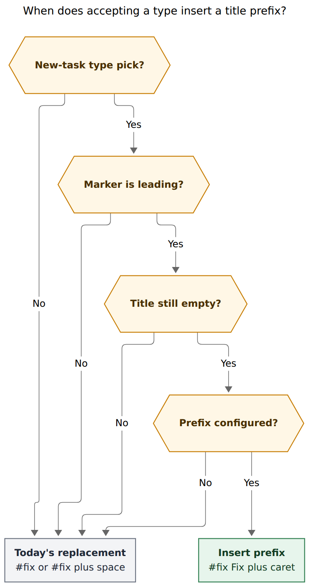
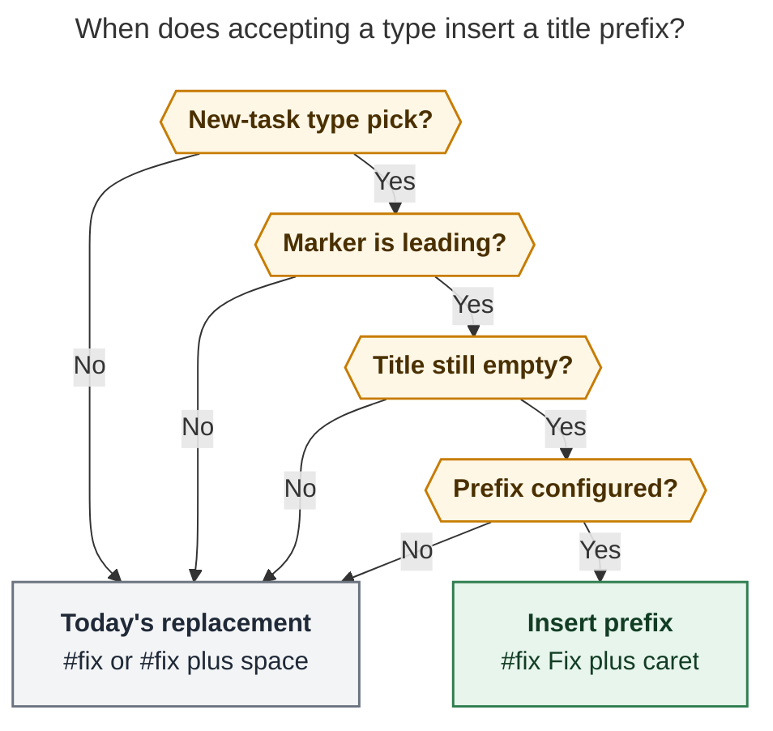
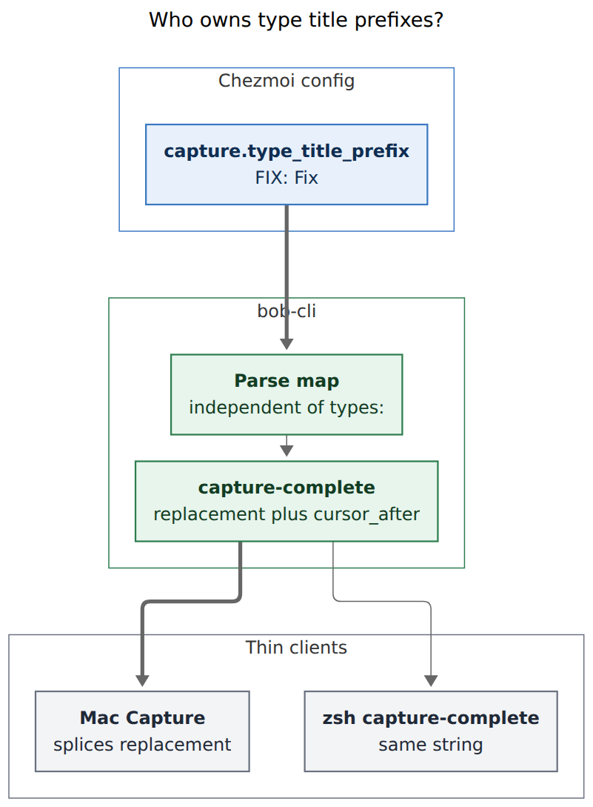
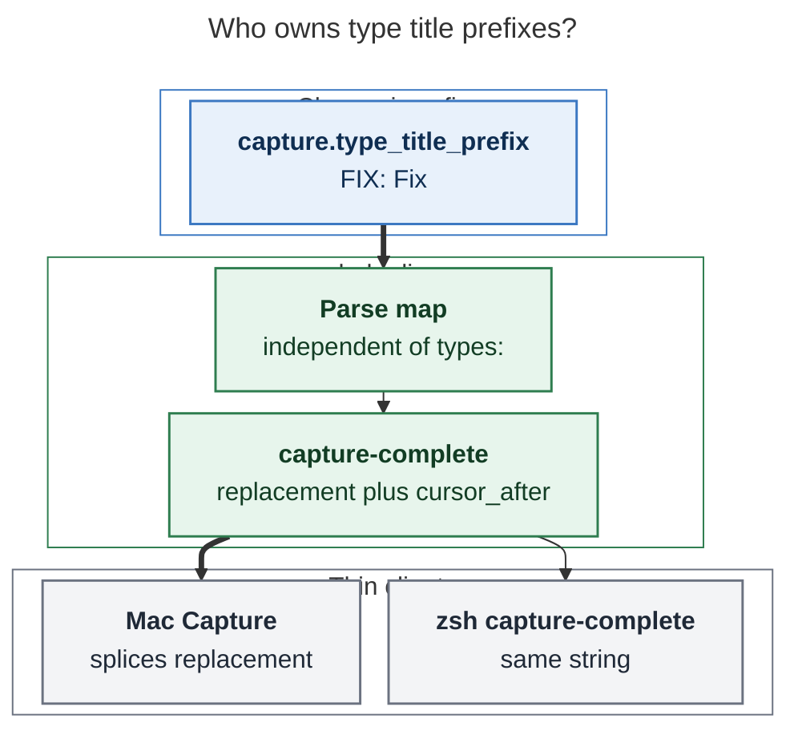

# Configurable task-type title prefixes in capture

| | |
| --- | --- |
| **Researcher** | grk · 2026-11-27 |
| **Question** | How should `#fix` completion at the start of a capture expand to `#fix Fix `, and is that a good idea? |
| **Governing decisions** | `decisions:mac-capture-is-a-thin-client`, `decisions:capture-sigils-say-where-what-how`, `decisions:capture-reserves-clock-tags`, `decisions:capture-bullets-mirror-the-task-block` |
| **Recommendation** | Yes, as a capture-complete affordance. Bake the prefix into `replacement` / `cursor_after`. Configure it under `capture.type_title_prefix` in chezmoi. Leave grammar, Mac parsing, and `types:` colors alone. |

---

## Verdict

The incoming idea is right, and the first shape that comes to mind is the wrong place to put it.

**Right:** leading `#fix Fix it` is already the documented happy path (`docs/capture.md`, "Typing tasks with `#<type>`"). Picking FIX from the `#` menu and then typing `Fix ` by hand is the same word twice. Five of Bryan's seven configured types are verbs. Completing the type should leave the caret on the title.

**Wrong homes for it:** a grammar rewrite of typed `#fix`, a Mac-side snippet, a hardcoded list of five verbs in bob-cli, auto title-case of every configured type, and a nested object under `types:` that would replace today's `FIX: red` color map.

The feature is small, high-leverage, and easy to make unreliable. Reliability comes from four gates, all evaluated in `bob capture-complete` at candidate-build time. Beauty comes from leaving the type menu's hue pills as `FIX` / `BUILD` and putting the extra words only in the splice the caret already applies.

I did not read peer swarm reports.

---

## Critique of the incoming plan

The prompt asks for configurable expansion when a `#` completion row is selected at the start of a capture, with chezmoi wiring `#fix`, `#build`, `#plan`, `#read`, and `#write` to insert the matching word. That is a good idea. I would ship it. I would change the trigger, the config key, and the empty-panel restriction.

### This is a good idea

Capture already treats a leading type as a first-class edge marker. The docs' own example is `#fix Fix it`. The Mac type menu is the consent gesture: Tab, Return on a highlighted row, or a click. Today's leading completion already appends a trailing space (`#f` → `#fix `) so the caret is ready for a title (`src/native/capture_complete/task_types.rs`, `if leading && !next_is_whitespace`). Extending that splice from one space to ` Fix ` is the same kind of help, for the types that actually start their titles with the type's verb.

Chezmoi already lists exactly the vocabulary this should care about:

```yaml
types:
  BUILD: yellow
  CHORE: magenta
  FIX: red
  MEET: blue
  PLAN: auto
  READ: green
  WRITE: violet
```

FIX, BUILD, PLAN, READ, and WRITE want a verb prefix. CHORE and MEET usually do not (`Standup with Sam`, `Pay the electric bill`). Per-type config is the whole point.

The keystroke win is modest (`Fix ` is four characters). The flow win is larger: pick the type, and the draft is already in the documented form, caret in the title, hue pill already painted on `#fix`.

### Adjustments I would make

These are deliberate requirement changes. Each one is what keeps the feature intuitive.

1. **Fire on completion accept, never on typed `#fix` plus Space.** The prompt already says "by selecting an entry offered by `#` completion". Keep that as a hard rule. Typing `#fix Parser panics` must stay a legal title that does not start with `Fix`. Space after a complete marker is title entry; Tab / Return / click is the expand gesture.

2. **Treat "start of the capture" as "this new item still has no title", not "the panel is empty".** An empty panel is the motivating example. The same help is correct for `@inbox #f`, for a later blank-line item in a bulk draft, and for `#f` after a transparent leading route. Restricting the feature to a completely empty `NSTextView` would make those common cases feel broken.

3. **Never prefix an existing-task retype.** `@dev+current #fi` already completes to `#fix ` with `subject: "existing"` (`tests/cli/capture/complete_task_types.rs`). Inserting `Fix ` there would dump title text onto a retype-only item.

4. **Never prefix a trailing marker.** `Fix the parser #f` stays `Fix the parser #fix`. The title is already there.

5. **Never prefix when title text already follows the marker.** `@dev^new-id #f Fix the parser` must stay `#fix` in the replacement, or the splice becomes `#fix Fix  Fix the parser`.

6. **Store an explicit prefix string, never a boolean title-case of the type name.** `SASE` would become `Sase`. `DEEP WORK` would become `Deep Work`. `Meet` is a type Bryan is leaving unprefixed. The config value is the word.

7. **Put the map under `capture.type_title_prefix`, not under `types:`.** `types:` is the vocabulary-and-palette block (PT12). A nested mapping value today fails the whole vocabulary (`src/native/config/themes.rs`: a non-slot value drops `types:`). Chezmoi already documents that older bob ignores unknown `capture` keys (`home/dot_config/bob/config.yml`, the `clipboard_history: alfred` comment). That is the deploy-safe home.

8. **bob-cli ships no default prefixes.** The five verbs live in chezmoi. Other bob users keep today's `#fix `.

9. **No grammar bump, no `schema_version` bump, no required Mac change.** This is candidate text. Mac Capture already splices `replacement` and `cursor_after` exactly (`docs/capture-panel.md`, Inline completion). That is `decisions:mac-capture-is-a-thin-client`.

---

## What exists today

### Type markers

A free-standing `#<type>` at either item edge types a new task or retypes the item's existing subject (`decisions:capture-sigils-say-where-what-how`). A first-level `- #name` is a drawer, never a type (`decisions:capture-bullets-mirror-the-task-block`). `#off` / `#on` / `#offclock` / `#off-clock` / `#untracked` are clock tags, never types (`decisions:capture-reserves-clock-tags`). Mid-line `#`, `#` plus a digit, and glued `@route+id#drawer` stay out of this feature.

The shared lexer already reports whether a completable marker is **leading** (`TypeMarkerCompletion.leading` in `src/native/capture_language/type_marker.rs`). Leading means the run from the start of the parent line to the marker is only whitespace and transparent tokens (routes, and so on). A type after `@dev` is leading. A type after `Fix the parser` is trailing.

### Completion splice

`bob capture-complete` context `task_type` returns one replacement range for the marker and, per row, a `replacement` string plus `cursor_after`. Leading rows already grow a trailing space when the next character is not whitespace:

```text
@dev #"     →  candidate replacement "#build "  (cursor after the space)
Fix it #fix →  candidate replacement "#fix"
#"DEEP WORK" at the start →  "#\"DEEP WORK\" "
```

Mac Capture paints the compact TASK TYPE menu from `candidate.name` (the `FIX` hue pill), not from `replacement` (`CaptureTaskTypeMenuPresentation`, `emphasizedName`). Changing the splice string does not clutter the pills. The footer today says `this task becomes FIX · default type suggests BUILD`.

Accepting a row is one native AppKit edit. Undo restores `#f`.

The `/` → `#` sigil alias rewrites first (`AliasId::HashMenu`). `/f` becomes `#f`, then the type menu opens. Prefix insertion still runs on accept.

### Config

`types:` is a mapping from type name to palette slot, `auto`, or empty. Identity, hue, hide, and `type_not_configured` all hang off that block. Capture-adjacent typing conveniences already live under `capture:` (`max_saved_templates`, `clipboard_history`). Chezmoi already has:

```yaml
capture:
  clipboard_history: alfred
```

### Clients

Bob Mac Capture is the capture panel (`glossary:Capture Panel`). bob-plugins has no capture editor; Obsidian type pickers write `[type::]` / note `task_type:` and are out of scope. zsh `capture-complete` uses the same `candidate()` builder (`build_for_shell`). Piped `bob capture '#fix Parser panics'` never sees completion and must keep the text.

---

## When the prefix should insert

**Reader question:** When does accepting a type insert a title prefix?

**Caption:** Insert the prefix only when the pick is a new-task leading type, the title is still empty, and that type has a configured prefix. Every other accept keeps today's `#fix` / `#fix ` splice.



Rendered size: 514.4 × 974 px; fit scale: 91.7%.



Worked cases, all with `FIX: Fix` configured:

| Draft at accept (caret at `|`) | Result | Why |
| --- | --- | --- |
| `#f|` in an empty panel | `#fix Fix \|` | Motivating case |
| `/f|` after the hash-menu alias | `#fix Fix \|` | Alias rewrote `/` to `#` first |
| `@inbox #f|` | `@inbox #fix Fix \|` | Leading after a route, no title yet |
| blank-line second item `#b|` | `#build Build \|` | Each bulk item is its own start |
| `#f|` with child notes already under it | `#fix Fix \|` then the notes | Parent title is still empty; caret stays on the parent |
| `Fix the parser #f|` | `Fix the parser #fix` | Trailing marker |
| `@dev+current #fi|` | `@dev+current #fix ` | `subject` is `existing` |
| `@dev^new-id #f| Fix the parser` | `@dev^new-id #fix Fix the parser` | Title already follows |
| `#fix Parser panics` typed, no accept | unchanged | Completion never ran |
| `#c|` → CHORE | `#chore ` | No prefix configured |
| piped `bob capture '#fix Parser'` | unchanged | Completion is editor-only |

"Title still empty" should mean the editor item's **body** is empty after stripping markers, not "the rest of the line is blank". `#f @inbox` has a trailing route and no title; it should still prefix. Use the parse the engine already has (`EditorItemParse` / item body), the same source that sets `subject` to `new` vs `existing`.

---

## Where the bytes should live

**Reader question:** Who owns type title prefixes?

**Caption:** Chezmoi stores the map. bob-cli `capture-complete` bakes the prefix into `replacement` and `cursor_after`. Mac Capture and zsh apply that string. Nobody else parses `#`.



Rendered size: 533.8 × 727 px; fit scale: 100%.



This is the same split as sigil aliases, drawer continuations, and directive rows: bob authors the splice, the app applies it, Undo is native.

Putting the extra words in a new JSON field that Mac must concatenate would require a Swift change and would silently no-op on today's app. Putting them in `replacement` works on the bob that ships the feature, including an older Mac.

---

## Config shape

### Recommended

```yaml
capture:
  clipboard_history: alfred
  type_title_prefix:
    BUILD: Build
    FIX: Fix
    PLAN: Plan
    READ: Read
    WRITE: Write
```

Rules:

- Mapping of type name → prefix word. Keys normalize like `types:` (`normalize_component`). Values are trimmed, nonempty, single line, no embedded newlines, cap around 40 characters. Strip a trailing space in the value; the engine owns spacing.
- Missing, null, or `{}` means no prefixes (today's behavior).
- Load in its own function next to `load_clipboard_history_config`, independent of `types:` and of `max_saved_templates`. A bad prefix map is a warning (`type_title_prefix_invalid`) and degrades to no prefixes. It must never drop the `types:` vocabulary.
- A prefix whose key is not a configured type is inert until a matching candidate appears (typed row or history). No need to fail the load.
- Old bob ignores the key. Chezmoi can land on any host before the daily train ships the parser. That matches the comment already above `capture.clipboard_history`.

### Dual-shape `types:` I would not use for v1

```yaml
types:
  FIX:
    color: red
    title_prefix: Fix
  CHORE: magenta
```

Colocation is pretty once every entry is a mapping. Until then it mixes scalars and maps, it changes PT12's documented "name → palette slot" shape, and a typo in `title_prefix` currently destroys the whole vocabulary. Prefixes are a capture-editor convenience. They never appear in `[type:: FIX]`, Stats, or Pomodoro names. Keep them next to the other capture typing keys.

A later dual-shape can still be added if Bryan wants one block to edit. v1 should not wait on it.

### Hardcoded verbs I would not use

Shipping `FIX/BUILD/PLAN/READ/WRITE` in Rust makes chezmoi a comment. The prompt asked for configuration. CHORE and MEET sitting in the same `types:` block are the proof that the list is personal.

---

## Splice algorithm

In `candidate()` after `replacement_for(&name, &key)`:

```text
prefix = configured prefix for this key, if any
expand = prefix is Some
      && leading
      && subject == "new"
      && item body has no title text

if expand:
    replacement = "#{slug} {prefix}"   # or the quoted #"NAME" form
    if next char is not whitespace:
        replacement += " "
else if leading && next char is not whitespace:
    replacement += " "                 # today's rule

cursor_after = replacement_range.start + replacement.len()
```

Quoted names (`#"DEEP WORK"`) follow the same rule if a prefix is configured for that key. Bryan's five verbs are all slug-spellable (`#fix`, `#build`, …).

Additive JSON on the candidate, `skip_serializing_if` empty:

```json
"title_prefix": "Fix"
```

`schema_version` stays `1`. Default fixtures without the map keep asserting `"#build "` and `"#fix"`. New tests cover the table above.

Human / zsh detail may append ` · Fix …` when `title_prefix` is present. The Mac pill stays `FIX`. A later Mac footer can read the additive field (`this task becomes FIX · starts Fix …`) without a protocol break; v1 does not need that Swift.

---

## Beauty

The type menu is already a compact hue-pill list. Do not put `Fix ` inside the pill. The pill is the type; the title is the sentence that follows.

After accept, the editor shows `#fix Fix |` with `#fix` in the type tint and `Fix` in body ink, caret after the space. That is the documented picture of a leading typed capture, one keystroke after picking the row.

Consent is visible: the menu is open, a row is highlighted, Return / Tab / click commits. Typing Space past `#fix` closes the menu (caret leaves the marker span) and leaves the title to Bryan.

Undo is one step. Escape commits nothing. CHORE and MEET look like themselves.

---

## Alternatives considered

| Approach | Why it loses |
| --- | --- |
| `capture-rewrite` as Bryan types `#fix` | Fires without consent; `#fix Parser panics` becomes `#fix Fix Parser panics`; rewrite is for sigil aliases (`expand_sigil_alias`), not vocabulary |
| Mac-local snippets / TextExpander | Second grammar; violates `decisions:mac-capture-is-a-thin-client` |
| Hardcoded five verbs in bob-cli | Chezmoi would be documentation; CHORE/MEET show the list is personal |
| Auto title-case of every `types:` entry | `SASE` / `MEET` / `DEEP WORK` get the wrong word |
| Nested object under `types:` in v1 | Breaks PT12's scalar color map; a bad extra field drops the vocabulary; chezmoi cannot land before the parser |
| `%t` templates as the only answer | Templates expand rows of a draft; they do not help the live `#` menu |
| Expand trailing markers | Title already exists |
| Expand existing-task retypes | Would insert a title into a retype-only item |
| Grammar change so `#fix` means `#fix Fix` | Piped capture, history, and already-typed titles would all shift; grammar bump for a typing convenience |

A generic capture-snippet language (`ff` → `#fix Fix `) would also work and would save the `#` key. It would duplicate type completion, add a second vocabulary, and hide the type menu's hue preview. The `#` menu is the right hook.

---

## Implementation sketch

**bob-cli (required, one daily-train slice)**

- `src/native/config/capture.rs`: `TypeTitlePrefixConfig` loader, same independence as clipboard history.
- `src/native/config/themes.rs`: leave PT12 parsing alone.
- `src/native/capture_complete/task_types.rs`: gates + splice in `candidate()`; thread `title_prefix` onto `TaskTypeCandidate`.
- `src/native/capture_complete/model.rs`: additive field.
- `src/native/capture_complete/render.rs` and `shell.rs`: optional ` · Fix …` detail.
- `tests/cli/capture/complete_task_types.rs`: empty-panel, routed leading, bulk later item, trailing, existing, body-already-there, unconfigured CHORE, invalid map degrades.
- Docs: `docs/reference/configuration.md` capture table; `docs/capture.md` typing section; `docs/completion.md` `#` paragraph. `just docs-check`.
- Help for `bob capture-complete`: one sentence that leading new-task accepts may insert a configured title prefix. No new subcommand (cli_rules: never add a subcommand under `bob capture`).
- Decision record: *Type title prefixes are a capture-complete affordance.* Applies to bob-cli and chezmoi; Mac inherits via replacement. Reopens if Bryan wants rewrite-on-type or prefixes inside `types:`.

**chezmoi (can land any day)**

- `home/dot_config/bob/config.yml` under the existing `capture:` block, with the five verbs. Comment that old bob ignores the key.

**bob-mac-capture (optional follow-up)**

- Footer reads additive `title_prefix`. Zero Swift required for v1.

**bob-plugins**

- No work. There is no capture panel.

**Release**

- Default replacement strings stay identical without the map: this is additive, config-gated behavior, `schema_version` 1, no `!` contract mark, no grammar revision. Agents still must not edit `Cargo.toml` versions or `CHANGELOG.md`.

---

## Risks

- **Titles that should not start with the verb.** Escape hatch is Undo once, or type the title and pick a trailing `#fix`. Completion-only consent keeps this rare.
- **Double `Fix`.** The empty-body gate is the whole defense. Test `@dev^new-id #f Fix the parser` first.
- **Whitespace after a route.** `#f @inbox` should become `#fix Fix @inbox` (no extra space) because the next character is already whitespace.
- **zsh.** Shell completion will insert `#fix Fix ` too. That is the same contract; call it out in the completion doc.
- **Invalid config.** Must warn and disable prefixes only. Never take down `types:`.
- **Child bullets under a bare `#f`.** Expanding still looks right: caret on `Fix `, notes stay nested.

---

## Recommended solution

Ship **configurable leading-type title prefixes** as a `bob capture-complete` splice.

Chezmoi:

```yaml
capture:
  clipboard_history: alfred
  type_title_prefix:
    BUILD: Build
    FIX: Fix
    PLAN: Plan
    READ: Read
    WRITE: Write
```

bob-cli, in `task_types.rs` `candidate()`: when the row is a **new-task**, **leading** type with **no title body yet** and a configured prefix, set `replacement` to `#fix Fix ` (trailing space only if needed) and `cursor_after` past that space. Publish additive `title_prefix`. Leave grammar, `types:` colors, Mac parsing, and unconfigured types alone.

Empty panel `#f` plus FIX becomes `#fix Fix `, caret ready. That is the feature. The rest of the design is the set of gates that keep it from firing anywhere else.
