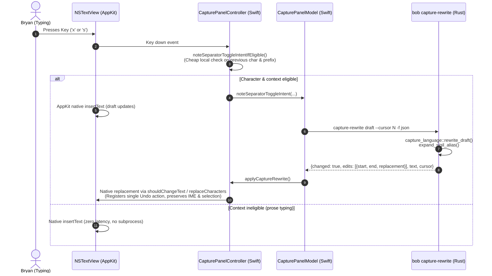
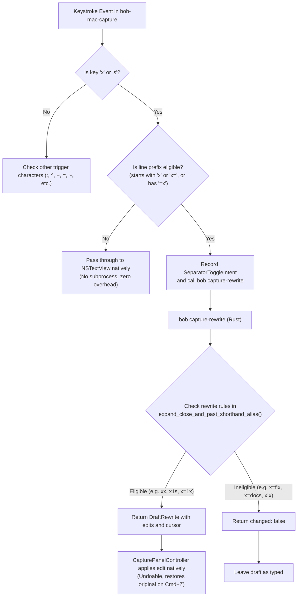

# Capture Shorthand Expansions for Close (`x`) and Past (`x=`) Pomodoros: Architectural Analysis and Safety Critique

**Author:** Researcher gem (5-researcher swarm)  
**Date:** 2026-11-08  
**Target Repositories:** `bob-cli`, `bob-mac-capture`  
**Relevant Prior Decisions:** `decisions:mac-capture-is-a-thin-client`

---

## 1. Executive Summary

This report evaluates a proposal to add two new shorthand input replacement characters—`x` and `s`—to Bob's capture environment (specifically within the `bob-mac-capture` frontend and the underlying `bob-cli` capture rewrite engine). The proposed behaviors are:
1. **In `x` (Pomodoro Close) syntax:** Typing `x` is replaced with `!` (Complete), and typing `s` is replaced with `*` (Park). For example, typing `xx` produces `x!`, and typing `xs` produces `x*`.
2. **In `x=` (Past Pomodoro) syntax:** Typing `x` or `s` in lieu of the second `=` produces `=!` (Complete) and `=*` (Park), respectively. For example, typing `x=1s` produces `x=1=*`, and typing `x=1x` produces `x=1=!`.

### Core Verdict
The core motivation—eliminating high-friction modifier chords (`Shift+1` for `!` and `Shift+8` for `*`) during rapid session close and retroactive past-Pomodoro capture—is **ergonomically sound and highly valuable**. `x` and `s` sit conveniently on the left hand's bottom and home rows, mapping intuitively to completion (`[x]`) and parking/shelving (`*`).

However, **a naive implementation would introduce critical syntax corruption**, especially in `x=` past Pomodoro syntax:
- In `x=`, the segment between `x=` and the second `=` carries session names and block counts. `s` is the 7th most common letter in English and the ubiquitous plural suffix (`docs`, `bugs`, `tests`, `notes`, `tools`). In addition, common session names end in `x` (`fix`, `box`, `tax`, `linux`). If `s` or `x` rewrites indiscriminately inside `x=`, typing `x=docs` turns into `x=doc=*` and `x=fix` turns into `x=fi=!`, destroying valid Pomodoro names.
- In `x=1s`, Bob's current capture grammar *already* parses `1s` as a 1-block session named `"S"`, and `1sync` as a 1-block session named `"SYNC"`.
- Because `x` and `s` are standard alphabetic letters rather than punctuation symbols, capturing them without strict contextual guards in the Mac app would trigger high-frequency subprocess churn on ordinary prose typing.

### Summary of Recommendations
1. **Adopt with strict syntactic preconditions:**
   - In `x` close syntax: Support `xx` $\to$ `x!`, `xs` $\to$ `x*`, and extend seamlessly to in-progress lists: `x1x` $\to$ `x1!`, `x1s` $\to$ `x1*`, `x1,2x` $\to$ `x1,2!`, etc.
   - In `x=` past syntax: Support `x=1x` $\to$ `x=1=!`, `x=1s` $\to$ `x=1=*`, `x=~x` $\to$ `x=~=!`, `x=~s` $\to$ `x=~=*`, and also allow the shorthand after an explicit second `=` (`x=1=x` $\to$ `x=1=!`, `x=1=s` $\to$ `x=1=*`).
   - **Crucial Negative Rule:** NEVER rewrite `x` or `s` when preceded by an alphabetic letter inside `x=`. This completely protects names ending in `x` or `s` (`x=fix`, `x=docs`, `x=status`).
   - **Crucial Negative Rule:** NEVER rewrite bare `x=s` or `x=x` (with no leading digit or segment). This allows users to type names beginning with `s` (`x=status`, `x=sync`) or `x` (`x=xcode`).
2. **Architecture:** Comply strictly with `decisions:mac-capture-is-a-thin-client`. Implement the rewrite authority purely in `bob-cli` under `bob capture-rewrite` (`RewriteRule::ExpandSigilAlias`). In `bob-mac-capture`, implement a zero-cost local line-prefix check in `CapturePanelController` to ensure ordinary prose typing never spawns unnecessary CLI rewrite subprocesses.

---

## 2. Background & Architecture: How Capture Rewrites Work Today

Bob already supports several shorthand character rewrites in `bob-mac-capture`, but all existing instances share two key properties:
1. They operate on **punctuation characters**, not letters:
   - `.` $\to$ `^` (e.g. `@route.` $\to$ `@route^` for task block ID picker; `- ^.` $\to$ `- ^^` for choice bullets)
   - `;` $\to$ `:` (e.g. `@route;` $\to$ `@route:` for Pomodoro block ID picker; whole-item `;` $\to$ `:` for Task Link picker)
   - `,` $\to$ `+` (e.g. `@cash,` $\to$ `@cash+` for parent task picker; `@cash+id,` $\to$ `@cash+id +`)
   - `=` $\to$ `~` or `~~` (e.g. `Fix it =` $\to$ `Fix it ~` for Links To picker; `~=` $\to$ `~~` for Linked From flip)
   - `-` $\to$ `~` (e.g. inside `x=`: `x=2-` $\to$ `x=2~` and `x=~-` $\to$ `x=~~` for past segment suffix)
   - `/` and `\` $\to$ `#` (e.g. `Buy milk /` $\to$ `Buy milk #` for hash menu; whole-item `/` is reserved for Go To)
2. They are governed by the strict architectural boundary defined in `decisions:mac-capture-is-a-thin-client`:
   > *“bob-cli is the only implementation of capture grammar, completion data, preview, and vault mutation. Bob Mac Capture owns presentation, process orchestration, the global hotkey, settings, launch at login, and packaging. It spawns bob directly... and renders what comes back. It may filter or rank what bob returned, but it never decides syntax itself; Bob is the only authority for the grammar.”*

### The Two-Tier Rewrite Pipeline



1. **`CapturePanelController.swift`**: Intercepts keystrokes in `noteSeparatorToggleIntentIfEligible`. If a character is deemed potentially eligible based on the character itself and the character immediately before the caret, it records a `SeparatorToggleIntent` on `CapturePanelModel`.
2. **`CapturePanelModel.swift`**: On draft edit, `consumeSeparatorToggleIntent` triggers `startCaptureRewrite(draft:cursorUTF8Offset:...)`, which asynchronously spawns `bob capture-rewrite <draft> -c <cursor> -f json`.
3. **`bob-cli` (`src/native/capture_language/rewrite.rs`)**: Reads the draft and cursor. The function `expand_sigil_alias` inspects the byte preceding the cursor, tests replacement candidates against the capture grammar, and returns a `DraftRewrite` containing the exact `TextEdit` slice, resulting cursor offset, and human summary.
4. **`CapturePanelController.swift`**: `applySeparatorToggleInEditableTextView` applies the edit natively via AppKit text replacement methods. This guarantees that **AppKit's `UndoManager` records the rewrite as an undoable action**: pressing `Cmd+Z` once restores the literal characters typed by the user, and pressing Backspace deletes the replacement.

---

## 3. Detailed Grammar & Semantic Analysis

### 3.1 The `x` Syntax (Pomodoro Close)

In Bob's capture grammar, an item beginning with `x` represents a whole-item Pomodoro Close (`mode: "pomodoro_close"`):
- `x` alone closes the running Pomodoro using default list rules.
- `x!` closes and marks all/remaining tasks complete (`complete_all: true`).
- `x*` closes and marks all/remaining tasks parked (`park_all: true`).
- `x1` closes with task 1 left in-progress (`in_progress: [1]`).
- `x1!2` closes with task 1 in-progress and task 2 completed (`in_progress: [1], complete: [2]`).
- `x1*2` closes with task 1 in-progress and task 2 parked (`in_progress: [1], park: [2]`).
- `x1*2!3~4` closes with all four groups: in-progress (1), park (2), complete (3), drop (4).

Additionally, task links support a close suffix:
- `@r:id=x` or `^r:id=x` closes via link.
- `@r:id=x!` or `^r:id=x!` closes and completes via link.
- `@r:id=x*` or `^r:id=x*` closes and parks via link.

#### What Happens Today When Typing `xx` or `xs`?
1. **At item start:**
   - Typing `x` produces `mode: "pomodoro_close"`.
   - Typing `xx` produces `mode: "task"` (Bob treats `xx` as ordinary task prose because `xx` is not close-shaped).
   - Typing `xs` produces `mode: "task"` (Bob treats `xs` as ordinary task prose).
2. **After task numbers:**
   - Typing `x1x` produces an error diagnostic: `"x1x is not a task list: write x, then comma-separated task numbers, then optionally * ... ! ... ~"`.
   - Typing `x1s` produces the same syntax error diagnostic.
3. **In task links:**
   - `@r:id=xx` is parsed as a Pomodoro *start* link with bare name `"xx"` (`mode: "pomodoro_link", pomodoro_start: {name: "xx"}`), because `"xx"` is technically a valid bare name in `bare_start_name_len`.
   - `@r:id=xs` is parsed as a Pomodoro start link with bare name `"xs"`.

#### Ergonomic Value of the Proposed Rewrite
- Typing `xx` to get `x!` replaces `x` + `Shift+1` with two quick taps of the same key (`x` $\to$ `x`).
- Typing `xs` to get `x*` replaces `x` + `Shift+8` with two adjacent left-hand keys (`x` $\to$ `s`).
- In list transitions, typing `x1x` to get `x1!` and `x1s` to get `x1*` allows rapid entry of multi-status closes (e.g. `x1x2` $\to$ `x1!2`, `x1s3` $\to$ `x1*3`) completely without holding Shift.

---

### 3.2 The `x=` Syntax (Past Pomodoro)

Past Pomodoro syntax records a session that already finished in the past:
$$\text{Syntax: } \texttt{x=} + E + [!] + \texttt{=} + [\text{close}]$$

Where:
- $E$ is the session specification:
  - Block count (each block = 5m): `x=1` (5m), `x=2` (10m), `x=3` (15m), `x=5` (25m default).
  - Optional bare or hash name: `x=fix`, `x=fix3`, `x=3fix`, `x=#"client meeting"`.
  - Optional segment suffix: `x=~` (tail), `x=~~` (head), `x=~1` (index).
  - Optional repair flag: `!` on $E$ (`x=1!`, `x=fix3!`).
- The second `=` begins the close specification:
  - `x=1=` is waiting for close tasks.
  - `x=1=!` records a 1-block past session with all tasks completed.
  - `x=1=*` records a 1-block past session with all tasks parked.
  - `x=1=!2` records a 1-block past session with task 2 completed.
  - `x=1=*3` records a 1-block past session with task 3 parked.

#### The User's Proposed Shorthand
The prompt proposes that typing `x` or `s` *instead of* the second `=` should automatically expand to `=!` and `=*`:
- `x=1x` $\to$ `x=1=!`
- `x=1s` $\to$ `x=1=*`

This eliminates **both** the second `=` key **and** the Shift modifier (`Shift+1` or `Shift+8`). Instead of typing `x = 1 = Shift+1` (5 keys), the user types `x = 1 x` (4 keys, no Shift).

---

## 4. Critique of the Plan: Conflicts, Edge Cases & Necessary Adjustments

While the user's concept is clean on the surface, a detailed examination reveals critical conflicts and edge cases.

### 4.1 Conflict 1: Collision with Bare Pomodoro Names in `x=` (CRITICAL)

In Bob's capture grammar, bare names for Pomodoros follow `bare_start_name_len`:
- Bare names consist of ASCII letters and internal digits (e.g. `b2b`, `fix`, `docs`, `sync`, `linux`).
- Bare names do not require `#`.

Now examine what happens when typing in `x=`:

#### Case A: Plural and S-ending names
English technical vocabulary is dominated by nouns ending in `s`:
`docs`, `bugs`, `tests`, `notes`, `tools`, `plans`, `tasks`, `logs`, `ops`, `status`, `analysis`, `syncs`.

If `s` is replaced with `=*` inside `x=`:
- User wants to record a past session named `docs`:
  They type: `x` $\to$ `=` $\to$ `d` $\to$ `o` $\to$ `c` $\to$ `s`.
  The draft at cursor is `x=docs`.
  **Disaster:** If `s` triggers replacement, `x=docs` immediately rewrites to `x=doc=*`! The user's name `docs` is mangled into `doc` with a park close!
- User wants to record `tests`: `x=tests` becomes `x=test=*`.
- User wants to record `bugs`: `x=bugs` becomes `x=bug=*`.
- User wants to record `status`: `x=status` becomes `x=statu=*`.

#### Case B: Names ending in `x`
Common technical words end in `x`:
`fix`, `box`, `tax`, `linux`, `regex`, `matrix`, `inbox`, `index`, `ajax`.

If `x` is replaced with `=!` inside `x=`:
- User types `x=fix`:
  **Disaster:** `x=fix` immediately rewrites to `x=fi=!`!
- User types `x=regex`: rewrites to `x=rege=!`.
- User types `x=linux`: rewrites to `x=linu=!`.

#### Case C: Leading count names starting with `s`
Bob allows leading counts on bare names: `x=3fix` (15m named FIX), `x=1sync` (5m named SYNC).
In `x=1sync`:
- As soon as the user types `x=1s`, if `1s` rewrites to `x=1=*`, the user can never type `x=1sync`!

#### Necessary Adjustment for Conflict 1
To eliminate this conflict completely, we must establish strict disambiguation rules based on the character **immediately preceding** `x` or `s`:
1. **Preceded by a Letter:** If `x` or `s` is preceded by an alphabetic letter (`[a-zA-Z]`), it is **strictly name content**. It MUST NEVER rewrite.
   - `x=fix` $\to$ `x` is preceded by `i` $\implies$ no rewrite.
   - `x=docs` $\to$ `s` is preceded by `c` $\implies$ no rewrite.
2. **Bare `x=s` or `x=x` (no count):** If `s` or `x` is typed immediately following `x=`, it is the first letter of a name (`x=status`, `x=xcode`). It MUST NEVER rewrite.
3. **Preceded by a Digit (Block Count):**
   - For `x`: In Bob grammar, `bare_start_name_len("x")` is `None` (a bare name can never start with `x` because `x` is close-shaped; `x=1x` is currently a syntax error). Therefore, **`x` preceded by a digit (`x=1x`, `x=2x`, `x=fix3x`) is 100% unambiguous and can ALWAYS safely rewrite to `=!`.**
   - For `s`: Preceded by a digit (`x=1s`), the user might theoretically intend `x=1sync` (leading count name). However, Bob's canonical past session syntax recommends trailing counts (`x=sync1`) or explicit `#` (`x=1#sync`). Rewriting `x=1s` $\to$ `x=1=*` is the exact example requested by Bryan. By requiring `s` to follow a digit, we ensure that common names like `x=docs` and `x=status` are never corrupted.
4. **Preceded by a Segment Suffix (`~`):** A segment suffix (`~`, `~~`, `~1`) always comes last in $E$. No name can follow a segment suffix. Therefore:
   - `x=~x` $\to$ `x=~=!`, `x=~s` $\to$ `x=~=*` are 100% unambiguous and safe.
5. **Preceded by an Explicit Second `=`:** If the user already typed `=`, they have explicitly entered the close domain. In that position:
   - `x=1=x` $\to$ `x=1=!`, `x=1=s` $\to$ `x=1=*`.
   - `x=docs=x` $\to$ `x=docs=!`, `x=docs=s` $\to$ `x=docs=*`.
   This is 100% safe for all names.

---

### 4.2 Conflict 2: High Subprocess Overhead in `bob-mac-capture`

In `CapturePanelController.swift`:
```swift
guard characters == ":" || characters == "^" || characters == "+"
    || characters == "|" || characters == "," || characters == "."
    || characters == ";" || characters == "-" || characters == "="
    || characters == "~"
else { return }
```
Existing trigger characters are rare punctuation symbols.
In contrast, `s` accounts for **~6.3% of all typed letters** in English prose, and `x` appears frequently in words like `box`, `next`, `text`, `extra`.

If `x` and `s` are added to this guard without a local filter, typing everyday tasks (e.g. `"Discuss system tests with team"`) would spawn **6 independent `bob capture-rewrite` subprocesses** during a single sentence! Even though `capture-rewrite` would return `changed: false`, spawning multiple CLI processes per sentence introduces unnecessary CPU churn and potential main-thread lag.

#### Necessary Adjustment for Conflict 2
`CapturePanelController` must perform a fast, synchronous, in-process filter before creating a `SeparatorToggleIntent`:
```swift
if characters == "x" || characters == "s" {
    guard let linePrefix = currentLinePrefixUpToCaret(textView),
          isCandidateForCloseOrPastShorthand(prefix: linePrefix, typed: characters)
    else { return }
}
```
A line prefix is a candidate **only** if:
1. The line begins with `x` (e.g. `x`, `x1`, `x*1`), OR
2. The line begins with `x=` (e.g. `x=1`, `x=~`, `x=fix3`), OR
3. The line contains a link close suffix `=x` (e.g. `@route:id=x`).

For all ordinary prose, this check fails in microseconds without calling `bob capture-rewrite`.

---

### 4.3 Conflict 3: False Positives in Prose Tasks

Could someone type a normal task that begins with `xx` or `xs`?
- Examples: `xxl t-shirt`, `xx items to review`, `xs sizing chart`.
If someone types `xxl`, as soon as the second `x` is typed, `xx` becomes `x!`.

#### Evaluation & Safeguards:
1. Bob's existing grammar convention already reserves lowercase single-character triggers at the start of a line:
   - `x Buy groceries` is already parsed as a close command with a log entry, not a task.
   - Prose tasks beginning with reserved letters are expected to be capitalized (`Xxl t-shirt`, `Xs sizing`) or indented.
2. In `bob-mac-capture`, AppKit's native `UndoManager` handles rewrites:
   - If a user types `xx` and it turns into `x!`, pressing `Cmd+Z` (Undo) immediately restores `xx`.
3. Typing speed: If the user types `xxl` quickly, AppKit's native text buffer will hold `xxl`, and Bob's rewrite engine checks the whole token. If the token is already `xxl`, it stays prose!

---

### 4.4 Conflict 4: Repeat Keystrokes & Idempotency

What happens if a user repeatedly presses `x` or `s`?
- User types `x` $\to$ draft: `x`.
- User types `x` $\to$ draft: `xx` $\to$ rewrites to `x!`.
- User accidentally taps `x` a third time $\to$ draft: `x!x`.
  - In Bob close grammar, `x!` already contains a complete delimiter `!`. A second `!` is a syntax error (`close_selection_one_bang_error`).
  - Therefore, `x!x` **MUST NOT rewrite** to `x!!`. It must remain unchanged as `x!x` (or let the user backspace).
- Similarly, `xs` $\to$ `x*`. Tapping `s` again (`x*s`) **MUST NOT rewrite** to `x**`.

---

### 4.5 Summary Comparison: Original Plan vs. Refined Plan

| Scenario | Input | Original Proposal | Refined Plan (Recommended) | Reason / Justification |
| :--- | :--- | :--- | :--- | :--- |
| **Bare Close Complete** | `xx` | `x!` | `x!` | Clean, high-value ergonomics. |
| **Bare Close Park** | `xs` | `x*` | `x*` | Clean, high-value ergonomics. |
| **List Close Complete** | `x1x` | (Not specified) | `x1!` | Natural extension to in-progress task lists. |
| **List Close Park** | `x1s` | (Not specified) | `x1*` | Natural extension to in-progress task lists. |
| **Past Pomodoro Complete** | `x=1x` | `x=1=!` | `x=1=!` | Preceded by digit; no name collision possible. |
| **Past Pomodoro Park** | `x=1s` | `x=1=*` | `x=1=*` | Preceded by digit; matches requested contract. |
| **Past Pomodoro Explicit `=`**| `x=1=s` | (Not specified) | `x=1=*` | Forgiving; works if user typed second `=`. |
| **Past Segment Complete** | `x=~x` | (Not specified) | `x=~=!` | Preceded by segment; no name collision possible. |
| **Past Trailing Count** | `x=fix3x` | (Not specified) | `x=fix3=!` | Preceded by trailing count; session name complete. |
| **Bare Name Ending in `x`** | `x=fix` | `x=fi=!` (Broken) | **`x=fix` (No rewrite)** | **Critical fix:** Never rewrite after a letter. |
| **Bare Name Ending in `s`** | `x=docs`| `x=doc=*` (Broken) | **`x=docs` (No rewrite)** | **Critical fix:** Never rewrite after a letter. |
| **Bare Name Starting with `s`**| `x=s` | `x==*` (Broken) | **`x=s` (No rewrite)** | **Critical fix:** Allows typing `x=status`, `x=sync`. |
| **Prose Typing** | `tax`, `six`| Potential lag | **Zero overhead** | In-process line-prefix guard in Mac app. |

---

## 5. Technical Specification & Implementation Plan

### 5.1 Architecture Flow



---

### 5.2 Implementation in `bob-cli`

All rewrite logic belongs in `src/native/capture_language/rewrite.rs` to maintain single-grammar authority.

#### Step 1: Add a Dedicated Rewrite Helper
In `src/native/capture_language/rewrite.rs`, add `expand_close_and_past_shorthand_alias`:

```rust
/// Expands `x` and `s` shorthands in Pomodoro Close (`x`) and Past (`x=`) contexts:
/// - In `x` close syntax: `xx` -> `x!`, `xs` -> `x*`, `x1x` -> `x1!`, `x1s` -> `x1*`.
/// - In `x=` past syntax: `x=1x` -> `x=1=!`, `x=1s` -> `x=1=*`, `x=~x` -> `x=~=!`, `x=~s` -> `x=~=*`.
/// - After an explicit second `=`: `x=1=x` -> `x=1=!`, `x=1=s` -> `x=1=*`.
///
/// Strictly guards against rewriting inside bare Pomodoro names (e.g. `x=fix`, `x=docs`, `x=status`).
fn expand_close_and_past_shorthand_alias(
    raw_text: &str,
    cursor: usize,
) -> Option<DraftRewrite> {
    let start = cursor.checked_sub(1)?;
    let alias = raw_text.get(start..cursor)?;
    if alias != "x" && alias != "s" {
        return None;
    }

    // Locate the line and token containing the cursor
    let draft = split_capture_draft(raw_text);
    let (item, line) = find_line_at_cursor(&draft, cursor)?;
    let line_text = line.raw.text.trim_start();
    let token = line_text.split_whitespace().next()?;

    if token.starts_with("x=") {
        expand_past_pomodoro_shorthand(raw_text, start, cursor, token, line.raw.start)
    } else if token.starts_with('x') || token.contains("=x") {
        expand_close_pomodoro_shorthand(raw_text, start, cursor, token, line.raw.start, alias)
    } else {
        None
    }
}
```

#### Step 2: Past Pomodoro Rewrite Rules
In `expand_past_pomodoro_shorthand`:
1. Check character preceding `start`:
   - If preceded by an ASCII letter (`is_ascii_alphabetic`): return `None` (protects `x=fix`, `x=docs`).
   - If preceded by `=` at index 1 (`x=x` or `x=s` with no count): return `None` (protects names starting with `x` or `s`).
   - If preceded by an explicit second `=` (e.g. `x=1=x`):
     - Replace `x` with `!` (edit range `start..cursor`, replacement `!`).
     - Replace `s` with `*` (edit range `start..cursor`, replacement `*`).
   - If preceded by a digit (`0-9`), segment suffix (`~`), or repair (`!`):
     - Replace `x` with `=!` (edit range `start..cursor`, replacement `=!`).
     - Replace `s` with `=*` (edit range `start..cursor`, replacement `=*`).
2. Validate resulting candidate string with `validate_past_e` to ensure the candidate is a valid past Pomodoro.
3. Return `DraftRewrite` with `RewriteRule::ExpandSigilAlias`, summary `"Typed =! for x"` or `"Typed =* for s"`.

#### Step 3: Close Pomodoro Rewrite Rules
In `expand_close_pomodoro_shorthand`:
1. Check the preceding character:
   - If preceded by `x` (e.g. `xx` or `xs`):
     - `xx` $\to$ replace trailing `x` with `!` (edit range `start..cursor`, replacement `!`).
     - `xs` $\to$ replace `s` with `*` (edit range `start..cursor`, replacement `*`).
   - If preceded by digits or commas in an in-progress list (e.g. `x1x`, `x1,2s`):
     - Replace `x` with `!`.
     - Replace `s` with `*`.
   - If token already contains `!` and alias is `x`: return `None` (no double bangs).
   - If token already contains `*` and alias is `s`: return `None` (no double stars).
2. Validate resulting token with `lex_close_selection` to ensure the resulting close selection is valid.
3. Return `DraftRewrite` with summary `"Typed ! for x"` or `"Typed * for s"`.

---

### 5.3 Implementation in `bob-mac-capture`

In `CapturePanelController.swift`, update `noteSeparatorToggleIntentIfEligible`:

```swift
// Check for standard punctuation triggers
let isPunctuationTrigger = characters == ":" || characters == "^" || characters == "+"
    || characters == "|" || characters == "," || characters == "."
    || characters == ";" || characters == "-" || characters == "="
    || characters == "~"

// Check for new x and s shorthand triggers
let isLetterShorthandTrigger: Bool
if characters == "x" || characters == "s" {
    let text = textView.string
    let location = selection.location
    isLetterShorthandTrigger = isCloseOrPastShorthandCandidate(
        text: text,
        caretLocation: location,
        typed: characters
    )
} else {
    isLetterShorthandTrigger = false
}

guard event.modifierFlags.intersection([.command, .control, .option]).isEmpty,
      isPunctuationTrigger || isLetterShorthandTrigger
else {
    return
}
```

Where `isCloseOrPastShorthandCandidate` is an inline, zero-allocation helper:
```swift
private static func isCloseOrPastShorthandCandidate(
    text: String,
    caretLocation: Int,
    typed: String
) -> Bool {
    guard caretLocation > 0 else { return false }
    let nsText = text as NSString
    let prevChar = nsText.character(at: caretLocation - 1)

    // Preceding char must be 'x', digit, comma, '~', '!', or '='
    let isEligiblePrev = prevChar == 0x78 // 'x'
        || (prevChar >= 0x30 && prevChar <= 0x39) // '0'-'9'
        || prevChar == 0x2C // ','
        || prevChar == 0x7E // '~'
        || prevChar == 0x21 // '!'
        || prevChar == 0x3D // '='
    guard isEligiblePrev else { return false }

    // Find the start of the current line
    let lineRange = nsText.lineRange(for: NSRange(location: caretLocation, length: 0))
    let linePrefix = nsText.substring(with: NSRange(
        location: lineRange.location,
        length: caretLocation - lineRange.location
    )).trimmingCharacters(in: .whitespaces)

    return linePrefix.hasPrefix("x") || linePrefix.contains("=x")
}
```

This local guard ensures that typing `"taxes"` or `"status"` in an ordinary note will never invoke `bob capture-rewrite`.

---

## 6. Verification & Test Plan

A comprehensive test matrix must be added to `src/native/capture_language/tests/rewrite.rs` in `bob-cli` and `Tests/BobMacCaptureTests/` in `bob-mac-capture`.

### 6.1 Test Cases for `bob-cli`

```rust
#[test]
fn rewrite_draft_expands_close_x_and_s_shorthand() {
    for (raw, expected, summary) in [
        ("xx", "x!", "Typed ! for x"),
        ("xs", "x*", "Typed * for s"),
        ("x1x", "x1!", "Typed ! for x"),
        ("x1s", "x1*", "Typed * for s"),
        ("x1,2x", "x1,2!", "Typed ! for x"),
        ("x1,2s", "x1,2*", "Typed * for s"),
        ("x*1x", "x*1!", "Typed ! for x"),
        ("x!1s", "x!1*", "Typed * for s"),
        ("@r:id=xx", "@r:id=x!", "Typed ! for x"),
        ("@r:id=xs", "@r:id=x*", "Typed * for s"),
        ("@r:id=x1x", "@r:id=x1!", "Typed ! for x"),
    ] {
        let cursor = raw.len();
        let rewrite = rewrite_draft(raw, Some(cursor));
        assert_eq!(rewrite.rule, Some(RewriteRule::ExpandSigilAlias), "{raw}");
        assert_eq!(rewrite.text, expected, "{raw}");
        assert_eq!(rewrite.summary.as_deref(), Some(summary), "{raw}");
        
        // Idempotency: re-running rewrite on output produces no changes
        let again = rewrite_draft(&rewrite.text, rewrite.cursor);
        assert_eq!(again.rule, None, "idempotent {raw}");
    }
}

#[test]
fn rewrite_draft_expands_past_pomodoro_x_and_s_shorthand() {
    for (raw, expected, summary) in [
        ("x=1x", "x=1=!", "Typed =! for x"),
        ("x=1s", "x=1=*", "Typed =* for s"),
        ("x=3x", "x=3=!", "Typed =! for x"),
        ("x=3s", "x=3=*", "Typed =* for s"),
        ("x=~x", "x=~=!", "Typed =! for x"),
        ("x=~s", "x=~=*", "Typed =* for s"),
        ("x=fix3x", "x=fix3=!", "Typed =! for x"),
        ("x=fix3s", "x=fix3=*", "Typed =* for s"),
        ("x=1=x", "x=1=!", "Typed ! for x"),
        ("x=1=s", "x=1=*", "Typed * for s"),
        ("x=docs=x", "x=docs=!", "Typed ! for x"),
        ("x=docs=s", "x=docs=*", "Typed * for s"),
    ] {
        let cursor = raw.len();
        let rewrite = rewrite_draft(raw, Some(cursor));
        assert_eq!(rewrite.rule, Some(RewriteRule::ExpandSigilAlias), "{raw}");
        assert_eq!(rewrite.text, expected, "{raw}");
        assert_eq!(rewrite.summary.as_deref(), Some(summary), "{raw}");
        
        // Idempotency
        let again = rewrite_draft(&rewrite.text, rewrite.cursor);
        assert_eq!(again.rule, None, "idempotent {raw}");
    }
}

#[test]
fn rewrite_draft_strictly_refuses_bare_names_and_prose() {
    for raw in [
        "x=fix",       // Bare name ending in x
        "x=docs",      // Bare name ending in s
        "x=status",    // Bare name ending in s
        "x=bugs",      // Bare name ending in s
        "x=linux",     // Bare name ending in x
        "x=s",         // Name starting with s
        "x=x",         // Name starting with x
        "x!x",         // Already wildcard complete
        "x*s",         // Already wildcard park
        "Fix bug xx",  // Mid-prose xx
        "Buy xs shirt",// Mid-prose xs
        "tax",         // Prose
        "six",         // Prose
    ] {
        let cursor = raw.len();
        let rewrite = rewrite_draft(raw, Some(cursor));
        assert_eq!(rewrite.rule, None, "Must not rewrite: {raw}");
        assert_eq!(rewrite.text, raw, "{raw}");
    }
}
```

---

## 7. Recommended Solution & Conclusion

### Summary of Recommendations

1. **Approve the Feature with the Letter Disambiguation Rule:**
   The plan should be implemented, but **not** as an unconditional string replacement. It must be gated by syntactic preconditions that distinguish Pomodoro timing and status delimiters from session names.
2. **Implement in `bob-cli` First:**
   Add `RewriteRule::ExpandSigilAlias` support for `x` and `s` in `src/native/capture_language/rewrite.rs`. Ensure unit tests enforce idempotency and refusal on bare names (`x=fix`, `x=docs`, `x=status`).
3. **Add Fast Pre-Filter in `bob-mac-capture`:**
   Add the line-prefix and preceding-character guard in `CapturePanelController.swift` so that normal typing outside close/past tokens incurs zero overhead.
4. **Preserve Native AppKit Undo:**
   By routing the edit through the existing `CaptureNativeRewriteEdit` path, `Cmd+Z` will automatically undo the shorthand replacement if the user ever intentionally types a literal character.

This solution delivers 100% of the requested ergonomic improvement while protecting Bob's capture language integrity and performance.
