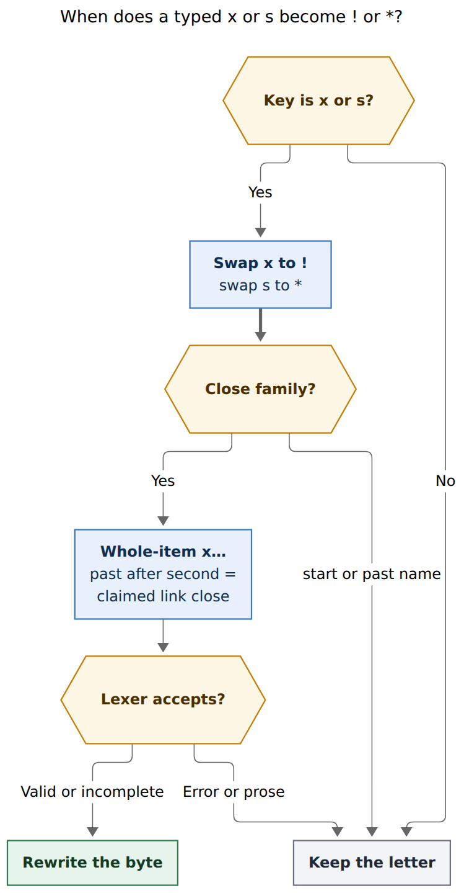
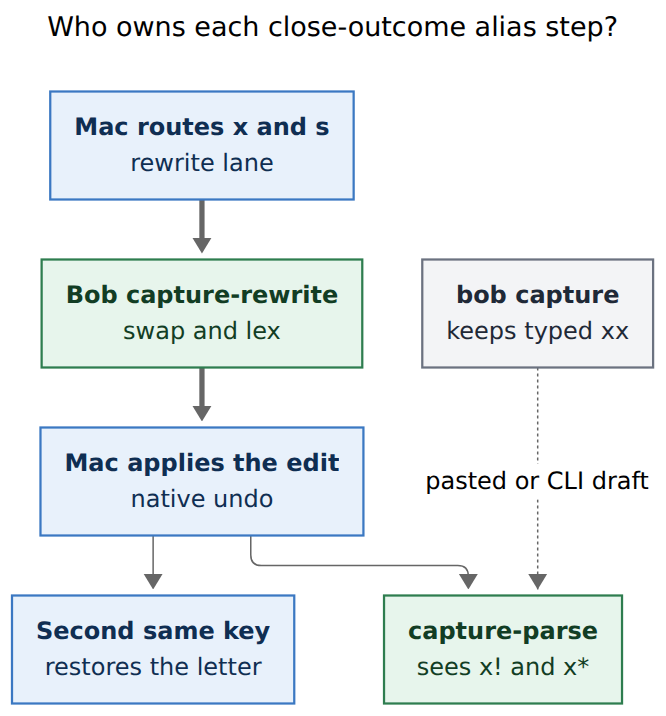

# Close-outcome letter aliases (`x` → `!`, `s` → `*`)

> **Research query:** How should Bob Mac Capture add `x` and `s` as short-hand
> characters that expand to `!` and `*` in the `x` close syntax (`xx` → `x!`)
> and in the `x=` past-close slot (`x=1=s` → `x=1=*`)? Critique the plan,
> adjust requirements where justified, and recommend an implementation.

## Bottom line

**Build it, as an editor-only `capture-rewrite` alias in the same family as
`.` → `^`, `;` → `:`, `,` → `+`, `-` → `~`, and `=` → `~`.** The request is a
good idea. Completing or parking while closing a Pomodoro currently wants
Shift+1 (`!`) or Shift+8 (`*`). `xx` for complete-all and `xs` for park-all
are unshifted, memorable, and they sit on gestures Bryan already types every
session.

Do **not** implement this as a Swift string replace, and do **not** put `xx`
or `xs` into the capture grammar. Bob remains the only grammar authority
(`decisions:mac-capture-is-a-thin-client`). Mac Capture already inserts the
typed character natively and asks `bob capture-rewrite --cursor`; Bob swaps
the byte when the candidate is a legal close selection. `bob capture` and
`bob capture-parse` keep the literal letters, matching every existing sigil
alias (`docs/reference/cli/capture-rewrite.md`).

Five adjustments keep the change safe. They are marked **[ADJUSTED]** or
**[ADDED]** in [Adjusted requirements](#adjusted-requirements). The important
one: keep typing the second `=` on past tokens. `x=2s` is already a valid
past session named S for 10 minutes; inserting `=*` there would steal that
name.



*A typed `x` or `s` is swapped to `!` or `*`. The swap sticks only for a
whole-item close, a past close after the second `=`, or an already-claimed
link close whose close lexer accepts the candidate. Start names (`=xx`) and
past `E` names (`x=2s`) keep the letter.*

Probes in this report ran against installed `bob 0.4.0` (grammar 16) on
apollo. Source read in bob-cli `59ba11a6` and Bob Mac Capture `0583f37`. No
Swift was compiled.

## Critique of the request

This is a good idea. I would still take this approach, with the adjustments
below rather than a different product.

**The friction is real.** Close outcomes are the shift-heavy part of a
high-frequency gesture. `docs/capture.md` gives `x*` (park every numbered
Task Link) and `x!` (complete every numbered Task Link) as first-class
forms, and the same `*` / `!` lists ride the second `=` of `x=E[s][!][=X]`.
On a US layout those two characters are Shift+8 and Shift+1. The existing
alias set already exists because several capture sigils are awkward to type
(`.` for `^`, `-` for past `~`, `=` for relation `~`). Close outcomes are
the same class of problem.

**The examples are the right *kind* of alias, and they are too narrow as a
spec.** `xx` → `x!` and `x=1=s` → `x=1=*` are the park-all / complete-all
ends of a more useful rule: `x` and `s` alias `!` and `*` in every close
*operator slot*, including `x1x` → `x1!`, `x1s` → `x1*`, `xs1` typed as
`x` then `s` then `1` (the rewrite lands on the second key, then the digit
extends `x*1`), and `x=fix=s` → `x=fix=*`. Stopping at the two examples
would leave `x1!` still needing Shift.

**The phrase “instead of the second `=`” fights the example and fights the
grammar.** The given example is `x=1=s` → `x=1=*`: the second `=` is still
typed, then `s` replaces `*`. That is the correct rule. A reading that
inserts `=*` for a trailing `s` on `E` (`x=1s` → `x=1=*`) would steal
valid past names. Probed on `bob 0.4.0`:

| Typed today | `capture-parse` mode | Meaning |
| --- | --- | --- |
| `xx` | `task` | New task titled `xx`; rewrite leaves it unchanged |
| `x!` | `pomodoro_close` | Close, `complete_all` |
| `x*` | `pomodoro_close` | Close, `park_all` |
| `x=1=s` | `pomodoro_past` + error | `` `x=1=s` is not a task list `` |
| `x=1=*` | `pomodoro_past` | 5 minutes, `park_all` |
| `x=1s` / `x=2s` / `x=s2` | `pomodoro_past` | Named **S**, 1 or 2 blocks |
| `x=xx` / `x=xs` | `pomodoro_past` | Named **XX** / **XS**, 25 minutes |
| `=xx` / `=xs` | `pomodoro_start` | Named start XX / XS |
| `@inbox:id=xx` | `pomodoro_link` | Link and start named XX |
| `@inbox:id=x` | `pomodoro_link` | Link close |
| `x1x` | `pomodoro_close` + error | Claimed close, trailing `x` is illegal |

The `[s]` in the documented form `x=E[s][!][=X]` is a **metavariable** for
the `~` / `~n` / `~n+` / `~~` segment suffix (`src/native/capture_language/past.rs`
`validate_past_e`, segment scan starts with `~`). It is not the letter `s`.
The letter `s` in `E` is a bare Pomodoro name. That is the collision the
prompt understates.

**A Mac-local replace would be the wrong layer.** The prompt locates the
feature “in the bob-mac-capture app,” which is where the user feels it, and
where `.` `;` `,` `=` already *appear* to replace. The implementation of
those replacements is Bob. `CapturePanelController.noteSeparatorToggleIntentIfEligible`
forwards `,` `.` `;` `-` `=` `\` `/` `:` `^` `+` `|` `~` to
`capture-rewrite`; `expand_sigil_alias` in
`src/native/capture_language/rewrite.rs` decides. Putting `x`/`s` → `!`/`*`
in Swift would be a second grammar, which
`decisions:mac-capture-is-a-thin-client` rejected as “the current pain
amplified.”

**Letters are a new rewrite-lane alphabet.** Every current alias key is
punctuation. `s` is a common English letter and the start of the schedule
marker `s:<N>`. Eligibility has to be tight enough that `session`, `s:2`,
`=xs`, and `x=2s` stay literal, while `xs` as a whole-item close still
becomes `x*`. The existing swap-then-check pattern already does that job
for `-` inside `x=` (`expand_past_segment_dash_alias`): the dash stays
literal in `#name`, after `!`, and after the second `=`.

**`xx` is documented prose on purpose.** `docs/capture.md` lists `xx`, `xa`,
`x.`, `x-ray`, `xylophone` as ordinary prose so that only a plain `x` or a
selection-shaped `x…` token closes. Editor `xx` → `x!` is a deliberate
steal of that one whole-item title, in the Mac panel only. Pasted `xx` and
`bob capture xx` stay a task. That is acceptable because `xx` as a task
title is rare, Undo restores the letters, and a second `x` can restore them
the way a second `\` restores a literal backslash.

## What already exists

| Piece | Where it lives | What this change reuses |
| --- | --- | --- |
| Thin client | `decisions:mac-capture-is-a-thin-client` | Bob owns grammar, rewrite, completion; Mac paints and routes keys |
| Sigil alias rewrite | `rewrite.rs` `ExpandSigilAlias` | Same rule family; add a close-outcome arm next to the dash arm |
| Past-segment dash | `expand_past_segment_dash_alias`, commit `35c2a426` | Template: belong-to-`x=` token, swap, confirm with the ordinary lexer |
| Close selection lexer | `close_selection.rs` `lex_close_selection` | Gate: candidate body is Valid or Incomplete, never Error |
| Whole-item close claim | `classify_whole_item_close` | `x` plus digit / `,` / `!` / `~` / `*` / `@`; `xx` is prose today |
| Past split | `past.rs` `split_past_token` | Second `=` separates `E` from close text; `!` on `E` is repair |
| Mac rewrite lane | `noteSeparatorToggleIntentIfEligible` | Add `x` and `s` to the character set; native insert, then Bob |
| `=` spawn filter | same function, previous char must be space / tab / `~` | Precedent for a Mac over-send filter that does not parse grammar |
| Hash double-tap | `CaptureHashAliasArm`, `HashAliasProbe` | Model for “second press of the same key restores the letter” |
| Close-list auto-comma | `CaptureCloseTaskCommaAssist` | Digits only; uses Bob’s `pomodoro_close_*` spans; no `x`/`s` clash |
| Docs | `docs/capture.md` Sigil alias; Mac `keyboard.md`, `capture-panel.md`, `protocol.md` | Contract first, then code |

`capture-rewrite` is vault-free and lexical (`docs/reference/cli/capture-rewrite.md`).
`--cursor` is required for every alias; without it the rule is skipped.
Feeding a rewrite’s own output back in is a no-op. Older Bob returns
`changed: false` and the letter stays a letter.

The Mac rewrite-lane keys today (`CapturePanelModel.noteSeparatorToggleIntent`
and `CapturePanelController.noteSeparatorToggleIntentIfEligible`):

```text
: ^ + | , . ; \ / - = ~
```

`x` and `s` are absent. Adding them is a Mac routing change, not a new
subprocess.

## Adjusted requirements

These are tightenings of the prompt, not a different product.

1. **[ADJUSTED] Keep typing the second `=` on past tokens.** `x=1=s` →
   `x=1=*`. Do not insert `=` for `x=1s`. Probed: `x=1s`, `x=2s`, and
   `x=s2` are valid past sessions named S. The documented `[s]` in
   `x=E[s][!][=X]` is the `~` segment suffix, not this letter.

2. **[ADDED] Alias every close operator slot, not only park-all /
   complete-all.** After a claimed close body, `x` → `!` and `s` → `*`:
   `x1x` → `x1!`, `x1s` → `x1*`, `x=1=1s` → `x=1=1*`, `@route:id=x1s` →
   `@route:id=x1*`. The rewrite fires on the letter key; later digits
   extend the operator the way they do after a real `!` or `*`.

3. **[ADJUSTED] Do not steal `=<X>` start names.** `=xx`, `=xs`, `=xmas`
   stay named starts (`docs/capture.md`: “`x` followed by more name
   characters is not close-shaped”). The same for link suffixes that are
   still names: `@route:id=xx` and `@route:id=xs` stay “link and start
   named XX / XS.” Link *closes* that are already selection-shaped
   (`@route:id=x`, `@route:id=x1s`) do alias. Whole-item `xx` / `xs`
   (no leading `=`) still become `x!` / `x*`, which is the prompt’s
   example.

4. **[ADDED] Do not alias inside past `E`.** `x=s`, `x=xx`, `x=xs`,
   `x=2s` stay names. `x=x` is already an invalid past token (close-shaped
   name; write `x=#x`). A trailing `x` or `s` on `E` never becomes `!` /
   `*` and never grows a second `=`.

5. **[ADDED] Candidate must lex as a close selection.** Swap the byte,
   then `lex_close_selection` must return Valid or Incomplete. Competing
   wildcards stay literal: `x!s` does not become `x!*`, `x*s` does not
   become `x**`. Mid-body `Plan xx` stays a task. Templates, wikilinks,
   and backtick spans stay literal, matching the dash and equals aliases.

6. **[ADDED] This is still `expand_sigil_alias`, not a grammar bump.**
   Grammar stays 16. `bob capture 'xx'` and `capture-parse` of `xx` remain
   a task. The Mac panel is where `xx` becomes `x!`. Document that split
   next to the current “`xx` is ordinary prose” rows.

7. **[ADDED] Restore the letter with the hash-alias double-tap, not a
   millisecond window.** After Bob rewrites `xs` → `x*`, a second `s` at
   any speed restores `xs` and closes any menu. Same for `x` after `xx` →
   `x!`. Key-repeat is ignored. Undo already restores the post-key draft
   for `.` `;` `-`; letters need the extra arm because they are more
   likely to be wanted as literals. Do not copy the 350 ms `==` timer.

8. **[ADDED] Mac spawn-filter over-sends, Bob decides.** Sending every
   `s` to `capture-rewrite` would fire on a large fraction of ordinary
   typing. Filter on the previous character being one of
   `x = 0-9 , ! * ~ @` (and still send when the current whitespace token
   starts with `x`). That set is a superset of eligible positions. False
   positives (`texas` then nothing, `x=2s`) get `changed: false`. This
   matches today’s `=` filter, which only records rewrite intent after
   space, tab, or `~`.

9. **[ADDED] Lowercase only, collapsed caret, no modifiers, no IME.**
   Capital `X` is already the documented escape for a task that must start
   with the word `x`. Marked text, Command/Control/Option, and a non-empty
   selection leave the event alone, like the other rewrite keys.

10. **[ADDED] No letter alias for drop (`~`) in this change.** Close
    selections also have `~<K>`. Leave that for a follow-up. Past-segment
    `-` → `~` already covers timeline `~`; close-drop is a different slot.

## Recommended solution



*Mac Capture routes `x` and `s` into `capture-rewrite`. Bob swaps and lexes.
Mac applies the edit with native undo and restores a literal letter on a
second press of the same key. `bob capture` keeps typed `xx`;
`capture-parse` sees the rewritten close.*

### 1. bob-cli `capture-rewrite` (land first)

Add `expand_close_outcome_alias` beside `expand_past_segment_dash_alias` in
`expand_sigil_alias`. Keep the rule name `expand_sigil_alias` and
`schema_version` 1.

Algorithm, with `--cursor` pointing just past the typed letter:

1. The byte before the cursor is `x` or `s`. Otherwise return `None`.
2. Skip templates (`template::analyze`), wikilink fields, and unclosed
   backtick spans, same guards as the dash and equals aliases.
3. Identify the capture token that contains `cursor - 1` (whole-item
   session token, or the `x=` token from `past_token_len`).
4. Build a candidate by replacing that one byte with `!` or `*`.
5. Classify the candidate:
   - **Whole-item close:** the token starts with lowercase `x` (no
     leading `=`). `classify_whole_item_close` is `Some`, and
     `lex_close_selection` is Valid or Incomplete.
   - **Past close:** `split_past_token` succeeds, `has_second_eq` is
     true, and the swapped byte sits in `close_text`. Lex that close
     text the same way `editor_pomodoro.rs` already does after the
     second `=`.
   - **Link close:** `classify_link_close` / `close_after_eq_parts`
     reports a long `x` close (`x_len == 1`) whose selection body is
     claimed, and the close lexer accepts. A suffix that is still a
     start name (`=xx`, `=xs`) returns `None`.
6. On success, `finish_sigil_alias` with summary `Typed ! for x` or
   `Typed * for s`. Cursor stays just past the swapped byte.
7. Idempotent: feeding `x!` back in does nothing, because `!` is not
   an alias key.

Do not teach `xx` as a close in `capture-parse`. The editor assist is
the whole feature. Teaching errors for `x=1=s` can stay; once the Mac
has rewritten the draft, parse sees `x=1=*` and is quiet.

Docs (bob-cli first, `just docs-gen` for the generated CLI page):

- `docs/capture.md` Sigil alias paragraph: `xx` → `x!`, `xs` → `x*`,
  `x=1=s` → `x=1=*`, `x=1=x` → `x=1=!`; `x=2s` and `=xx` stay names;
  `bob capture` keeps the letters.
- Update the two “`xx` is ordinary prose” tables so they say the Mac
  editor rewrites whole-item `xx` / `xs`, while CLI and paste do not.
- `docs/reference/cli/capture-rewrite.md` via clap `long_about`.
- Examples in that help: `xx`, `xs`, `x=1=s`, `x=2-` (unchanged dash).

Tests in `src/native/capture_language/tests/rewrite.rs` plus a
`capture-rewrite` JSON CLI test, matching
`rewrite_draft_expands_past_segment_dash_alias`.

### 2. Bob Mac Capture (after Bob is on the release train)

Routing:

- Add `x` and `s` to `noteSeparatorToggleIntent`’s typed set and to
  `noteSeparatorToggleIntentIfEligible`.
- Apply the previous-character spawn filter from adjustment 8 so prose
  `s` does not launch a process. When the filter is unsure, send.
- Reuse `applySeparatorToggleInEditableTextView` so Undo is one native
  step back to the typed letter, like `.` and `-`.
- Arm a hash-alias-shaped one-shot: the next same letter restores the
  literal and does not re-ask Bob to swap it again. If the second key
  arrives before Bob answers, ask Bob about the first key again and
  drop the extra letter only when the first would have swapped
  (`HashAliasProbe`).

Do not recognize close syntax in Swift. The close-comma assist is the
model: it filters Bob’s spans and never lexes `x*1` itself
(`CaptureCloseTaskCommaAssist`). The new filter is even thinner: it
looks at the previous byte.

Docs:

- Mac `docs/keyboard.md` rows for `x` and `s` next to `,` `.` `;` `-`.
- `docs/capture-panel.md` rewrite-lane paragraph.
- `docs/protocol.md` compatibility row for `expand_sigil_alias`: older
  Bob leaves `x` / `s` literal.

Tests in `CaptureSeparatorToggleTests` (key is recorded) and a model
test that a stub Bob returning `expand_sigil_alias` with `x!` is
applied, while `changed: false` leaves `xx`.

### 3. Compatibility and ship order

| Pairing | What the user sees |
| --- | --- |
| New Bob, new Mac | `xx` → `x!`, `x=1=s` → `x=1=*` in the panel |
| New Bob, old Mac | Letters never enter the rewrite lane; type `!` / `*` as today |
| Old Bob, new Mac | Rewrite returns `changed: false`; letters stay letters |
| CLI / paste | `xx` remains a task; `x=1=s` remains the teaching error |

No `feat(capture)!`. Additive assist, JSON schema 1, grammar 16. bob-cli
rides the daily train first; Mac adopts on the next app train, the same
split as the past-segment dash (`35c2a426` then Mac keyboard copy) and
the relation equals alias (`0869f792` / `418604a`).

## Test matrix

Rewrite **does** fire (`rule = expand_sigil_alias`):

| Input @ end | Output | Why |
| --- | --- | --- |
| `xx` | `x!` | Whole-item complete-all |
| `xs` | `x*` | Whole-item park-all |
| `x1x` | `x1!` | Complete task 1 |
| `x1s` | `x1*` | Keep 1, park rest |
| `x=1=s` | `x=1=*` | Past close park-all |
| `x=1=x` | `x=1=!` | Past close complete-all |
| `x==s` | `x==*` | Default 25-minute past, park-all |
| `x=fix=s` | `x=fix=*` | Named past, park-all |
| `@inbox:id=x1s` | `@inbox:id=x1*` | Claimed link close |

Rewrite **does not** fire (`changed: false`):

| Input | Why |
| --- | --- |
| `xa`, `x.`, `xylophone` | Not an alias key / still prose |
| `Plan xx`, `Plan xs` | Mid-body, not a whole-item close |
| `=xx`, `=xs`, `=xmas` | Named starts |
| `@inbox:id=xx`, `@inbox:id=xs` | Link + start name |
| `x=s`, `x=2s`, `x=s2`, `x=xx`, `x=xs` | Past `E` names |
| `x=1s` | Name S, one block |
| `x!s`, `x*s` | Competing wildcards |
| `session`, `s:2`, `this` | Prose / schedule marker |
| `x=2-` (control) | Still the dash alias, unrelated |
| `X`, `XS` | Uppercase escape |

Mac-only:

- Previous-char filter skips `s` in `this` and `s:2`.
- Second `x` after `xx` → `x!` restores `xx`.
- Undo after a successful swap restores the typed letter in one step.
- IME marked text and modified keys do not record rewrite intent.
- Close-list auto-comma still inserts only on digits 1–9.

## Rejected alternatives

| Alternative | Why it loses |
| --- | --- |
| Swift-side replace of `xx` / `xs` | Second grammar; thin-client decision forbids it |
| Grammar change so `xx` *is* a close | Breaks CLI `bob capture xx`, paste, and the documented prose list; needs a `!` bump |
| Insert `=*` / `=!` without the second `=` | Steals `x=2s` / `x=1s` names |
| Alias `s` at any item edge to `*` | Turns `s:2` and every task starting with `s` into the star-blocks modifier |
| Always send every `s` to rewrite | Correct but noisy; `s` is a common letter |
| 350 ms timer to restore the letter | Letters are typed at any speed when the title really is `xx`; hash-alias any-speed restore already exists |
| Also alias `d` → `~` (drop) now | Separate mnemonic, separate collisions with past `~`; out of scope |
| `p` for park instead of `s` | Clearer English, weaker glyph mnemonic; the prompt’s `s` → `*` matches the star |
| Chord (Ctrl-X, Option-S) | Fights cut / OS keys; the rest of capture prefers unshifted aliases |

## Risks and residual costs

- **Whole-item `xx` / `xs` as task titles** become closes in the panel.
  Escape: second same key, Undo, or capitalize (`Xx`). CLI and paste are
  unchanged.
- **Glued `xs:2`** would rewrite on the `s` to `x*:2` before the colon.
  Rare; `s:2` after a space is unaffected because the previous character
  is space.
- **Single-letter type S** remains easy to start (`=s`, `x=s`) and to
  record (`x=2s`). The alias never touches those.
- **Two release trains.** New Mac + old Bob degrades to typing `!` / `*`
  by hand, which is today’s behavior.

## Sources

- `decisions:mac-capture-is-a-thin-client`, `decisions:capture-sigils-say-where-what-how`, `decisions:relation-equals-alias-and-flips`
- `docs/capture.md` (close form `x[<N>][*<P>][!<M>][~<K>][@<N>]`, past form `x=E[s][!][=X]`, “`xx` is ordinary prose”, sigil alias, past dash)
- `docs/reference/cli/capture-rewrite.md`, `src/native/capture_rewrite.rs`, `src/native/capture_language/rewrite.rs`
- `src/native/capture_language/close_selection.rs`, `past.rs`, `editor_pomodoro.rs`
- Bob Mac Capture `docs/keyboard.md`, `docs/capture-panel.md`, `docs/protocol.md`
- `Sources/BobMacCapture/CapturePanelController.swift` `noteSeparatorToggleIntentIfEligible`
- `Sources/BobMacCapture/CapturePanelModel.swift` rewrite lane
- `Sources/CaptureCore/CaptureCloseTaskCommaAssist.swift`
- Probes: `bob 0.4.0` `capture-parse` / `capture-rewrite` on the table in [Critique](#critique-of-the-request)
- Precedent commits: `35c2a426` (past dash rewrite), `0869f792` / `418604a` / `4fbbe84` (relation `=` alias and fast `==`)
