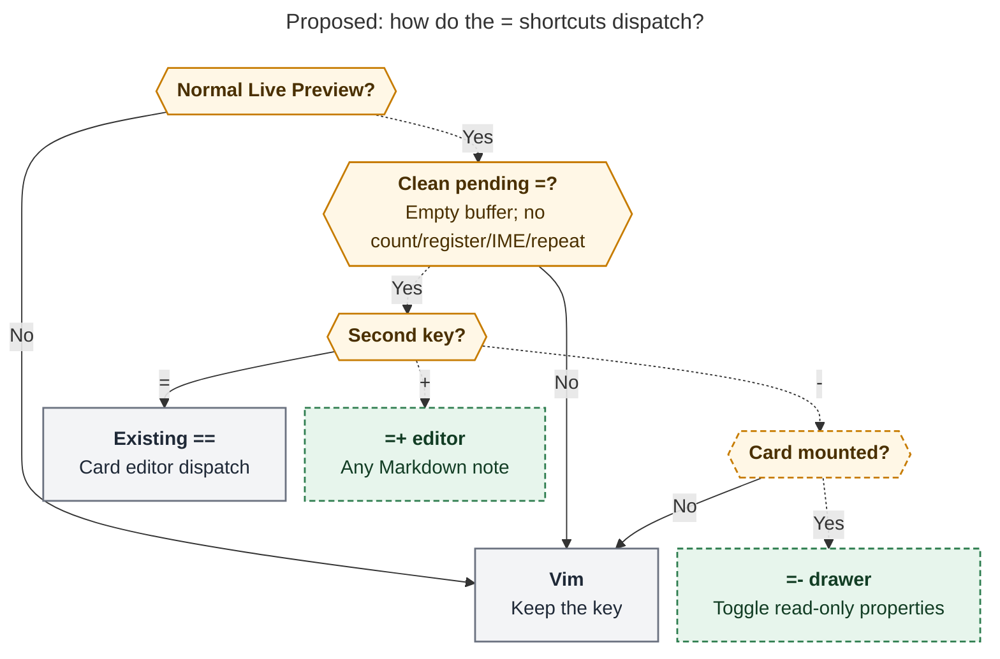
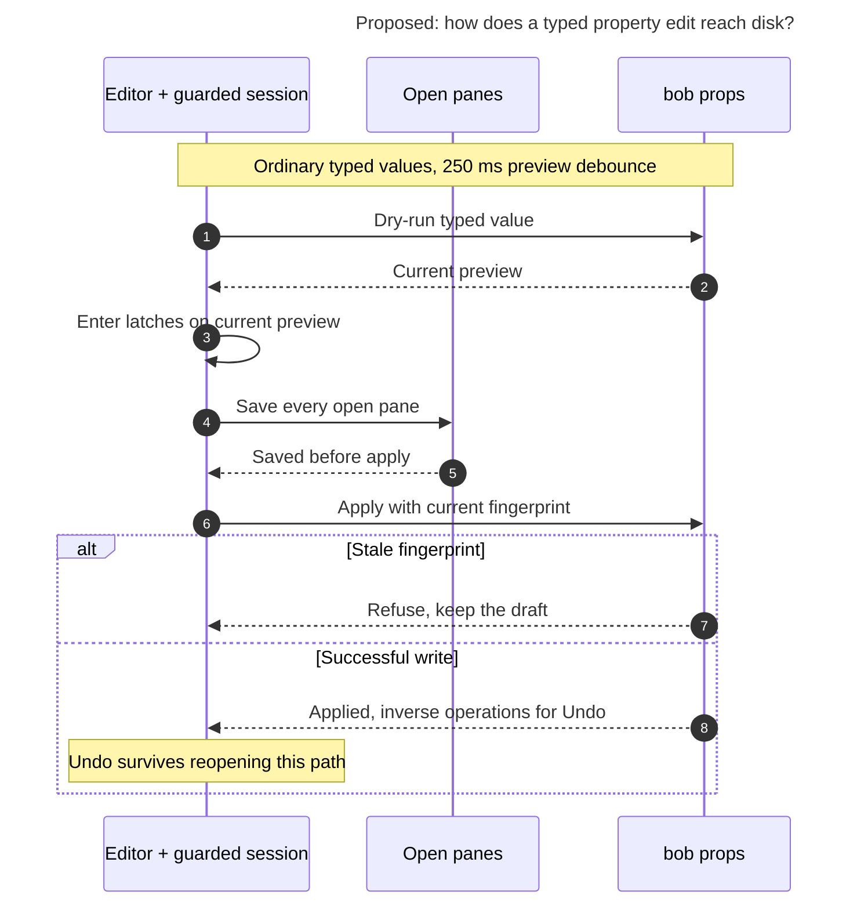

# Diagram proposals: Property cards own the frontmatter

Proposals for the swarm linker, not a report. Each diagram restates only what the source
report says.

```yaml
source: research:202611/card_owned_frontmatter/card_owned_frontmatter__final.md
producer: research.5v.image
check: "mmdc 12.0.0 (pinned npx, Puppeteer --no-sandbox) with the PDF-mirroring config rendered 2 of 2 Mermaid diagrams; exit 0, both SVGs present, broken-diagram probe rejected"
```

## equals-shortcut-dispatch

```yaml
anchor: |-
  second `=` at capture phase while the operator is pending
question: |-
  When do =-, =+, and == intercept Vim, and when do they fall through?
illustrates: |-
  The proposed extension to the existing capture-phase gate dispatches the second key only in normal Live Preview with an empty operator buffer, no count or register, no input-method composition (IME), and no repeat, with =+ available on any Markdown note and =- requiring a mounted card.
caption: The guarded = shortcuts preserve Vim fallback, open =+ on any Markdown note, and require a mounted card for =-.
review: "856.43×1026 px, fit 76.2%; reader question, source trace, labels and arrow checks passed; 0 visual revisions"
```



## guarded-typed-property-write

```yaml
anchor: |-
  Write discipline is the record session verbatim: debounced dry-run, Enter
question: |-
  How does a typed edit reach disk without losing a stale draft?
illustrates: |-
  For ordinary typed values, the proposed bob props editor reuses the guarded session so a current preview and saved open panes precede apply, stale refusal keeps the draft, and inverse operations support per-path Undo.
caption: Typed edits preview first and save open panes before apply; stale refusal keeps the draft, while successful writes supply per-path Undo.
review: "842×803 px, fit 77.5%; reader question, source trace, labels and arrow checks passed; 0 visual revisions; one sequence syntax fix before the passing batch"
```


