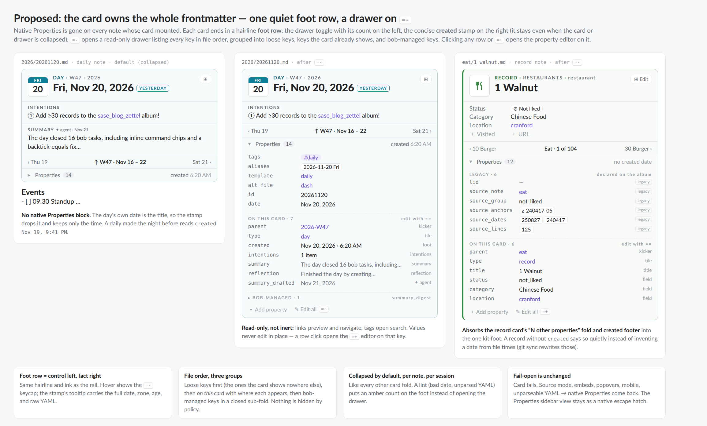
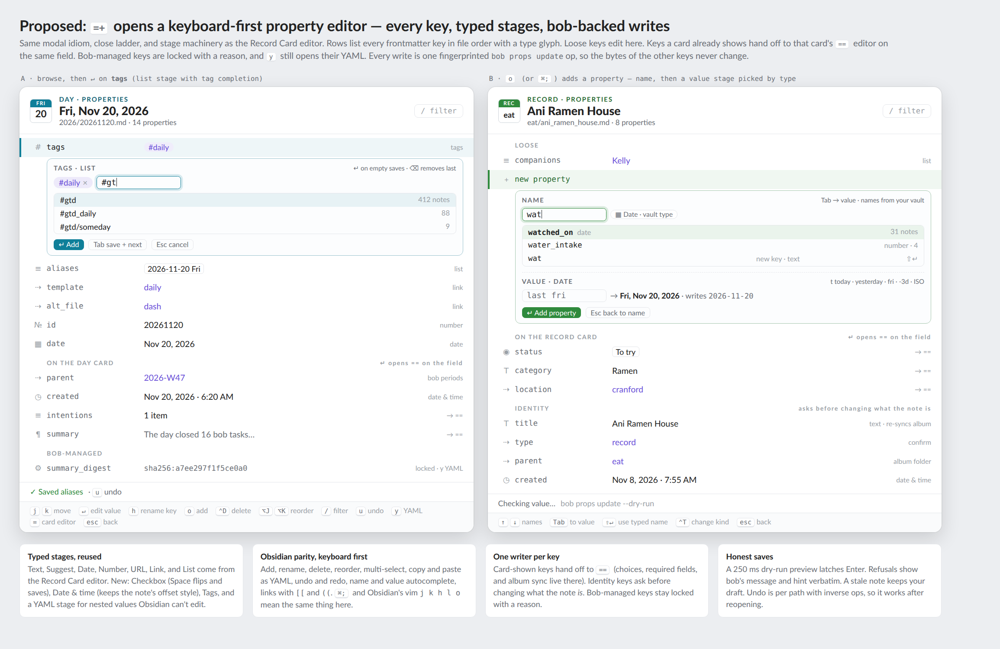

# Property cards own the frontmatter: a read-only drawer, a created stamp, and a keyboard-first `=+` editor

*Researcher: cld · 2026-11-22 · Scope: bob-plugins (Bob Ledger Tools property-card kit) +
bob-cli (writer) · Status: design recommendation*

## TL;DR

**Yes, do it, with six adjustments.** Today native Properties is the last surface on
card notes that still feels like raw Obsidian. It is mouse-first, it re-serializes YAML,
and it shows Bob plumbing (`type`, `parent`, `summary_digest`, seven `zorg_*` keys) in
the most valuable spot on the page. The kit already has every primitive this needs:
generation-bound property ownership, the title slot, the record card's
`N other properties` fold and `added …` footer, the guarded bob update session, the
Record Card editor's typed stages, and the `==` Vim gate. Most of the work is
generalizing those primitives. The one new piece of infrastructure is a generic,
byte-preserving frontmatter writer in bob-cli: **`bob props show|update`**.

My recommendation, in one paragraph: every mounted property card ends in a hairline
**foot row**. The drawer toggle sits on the left (`▸ Properties 14`) and a concise
**created stamp** sits on the right (`created 6:20 AM`, `added Aug 8, 2025`). The foot
row stays visible when the drawer or the whole card is collapsed. **`=-`** opens a
**read-only drawer** under the foot row. It lists *every* key in file order, in three
groups: keys the card shows nowhere else, keys the card already renders (each labelled
with where), and bob-managed keys in a closed sub-fold. **`=+`** opens a
**keyboard-first Property editor** modal. It covers Obsidian's Properties feature set
(add, rename, delete, reorder, multi-select, copy and paste, typed values, autocomplete,
undo and redo) and adds a few things Properties lacks: filter, natural-language dates,
`[[`/`((` link completion, a nested-YAML stage, refusals with hints, and per-path undo
that survives reopening the editor. Keys a card editor already owns hand off to `==` on
the same field. Bob-derived keys are locked with a reason. Keys that define the note ask
for confirmation first. Everything else is one fingerprinted `bob props update` op that
touches only that key's YAML span. Native Properties is hidden as a whole container and
made `inert` **only** when the card mounted and the frontmatter parsed. Every failure
falls back to native Properties, exactly as today.



*Figure 1: Proposed card bottom. The foot row puts the control on the left and the
created fact on the right. `=-` opens a read-only drawer of every key, grouped by
whether the card already shows it. Rendered from the real 2026-11-20 daily note and
`eat/1_walnut.md` frontmatter. Emoji are drawn as glyphs because the render host has no
emoji font.*



*Figure 2: Proposed `=+` editor. It uses the same modal idiom, close ladder, and stage
machinery as the Record Card editor. Panel A shows Enter on `tags` (list stage with
vault tag completion). Panel B shows `o` adding a property: name completion from the
vault, with the vault type previewed, then a date stage that accepts `last fri`.*

---

## 1. What exists today (facts this design builds on)

All paths are in the `bob-plugins` repo unless they are prefixed `bob-cli:`.

**The property-card family.** Bob Ledger Tools mounts album, record, day/week/quarter/
year, and bank cards built on one kit (`plugins/bob-ledger-tools/src/240b…240l`). Album,
record, and day/period cards mount in Obsidian's own title slot, after the inline title
and before `.metadata-container` (`240e-plugin-property-card-title-slot.js`). The bank
card is different: it lives mid-body under `# 🏦 Bank` on `bank.md` (line 67 of the
note today) and never owns the title.

**Property ownership is per row, not per block.** `propertyCardOwnKeys(scope, keys)`
(`240b-plugin-property-card-ownership.js`) tags matching `.metadata-property[data-property-key]`
rows with `bob-property-card-owned-property`. `styles.css` (around line 8657) hides them
only on the direct native path (`.cm-editor > .cm-scroller > .cm-sizer > .metadata-container`
and `.markdown-preview-view > … > .mod-header > .metadata-container`). The Properties
heading, unrelated rows, and **+ Add property** stay visible. Ownership is
generation-bound, observer-maintained, and released on failure, on mode or file change,
and on unload. Embeds, popovers, Source mode, mobile, and failed mounts never hide
anything.

| Card | Keys it hides today | What stays in native Properties |
|---|---|---|
| Album | `record` (the schema) | `parent`, `type`, `title`, `summary`, `emoji`, `index_*`, `walk_by`, `created` |
| Record (when hide-eligible) | schema fields + `title` | `parent`, `type`, `created`, legacy and unrelated keys |
| Day/period (when content is nonempty) | `intentions`, `summary`, `summary_digest`, `summary_drafted`, `reflection`, `review_digest`, `review_drafted` | `parent`, `template`, `alt_file`, `type`, `created`, `date`, `aliases`, `tags`, `id`, `end`, all `zorg_*` |
| Bank hub | `bank` | `parent`, `type`, `summary`, `created` |

**The record card already prototypes this feature.** `242i-plugin-record-sheet-model.js`
builds a `fold` of every non-schema, non-identity key, labelling album-declared legacy
keys **legacy** and linting an invalid `created`. `242j-plugin-record-sheet-dom.js`
renders it as `▸ N other properties` (session-per-path, `aria-expanded`, `y` jumps to
the YAML line). `recordSheetCreatedFooter` renders `added today, 7:55 AM` /
`added yesterday` / `added Aug 8, 2025`. The proposal generalizes exactly this to the
kit.

**`==` is a capture-phase interception of Vim's pending `=` operator**
(`248m-plugin-schema-double-equals.js`). The gate acts when CodeMirror Vim's
`inputState.operator === "indentAuto"` with an empty key buffer. It requires normal
mode, Live Preview, no count, no register, no modifiers, no repeat, and no IME
composition. It then dispatches through a per-instance registry (bank → album → record
→ extensions such as day/period). A vimrc `nnoremap ==` can never fire, because Vim
treats `=` as a complete operator. **`=-` and `=+` can use the identical mechanism.**
Only the accepted second key changes.

**Writers never call `processFrontMatter`.** `docs/record-card.md` states it outright.
`plugins/bob-navigation-hotkeys/src/211-parent-frontmatter-plan.js` gives the reason:
it "re-serializes the whole YAML block and would rewrite unquoted [[wikilinks]] in other
keys". Each card editor writes through its own bob command with a fingerprint and dry-run
preview:

| Editor | Writer |
|---|---|
| Record Card editor | `bob records update -i -` |
| Album card editor | `bob albums update` |
| Day/period card editor | `bob periods update` |
| Bank card editor | `bob bank config update` |

The writers share `bob-cli:src/native/yaml_spans.rs`, a byte-preserving span library.
It handles line endings, BOM, comments, flow-map keys, scalar quoting, and duplicate-key
refusal, and is already "shared by the album schema editor and the bank config editor".
The plugin side shares `242aa-plugin-guarded-update-session.js` (a writer-agnostic
guarded session) and `241xc-plugin-card-close-keys.js` (Esc / `q` / Ctrl+[).

**There is no generic frontmatter writer.** `bob --help` has no props or frontmatter
command. Every existing writer is species-specific.

**History matters.** An earlier record-card requirement (`bob-cli-ms.8.3.1.1` note #4,
cited in `202611/property_card_title_block/property_card_title_block__final.md`) said
native Properties and **Add property** must stay visible. This request reverses that
requirement, which is fine. But it removes the last native edit surface on card notes,
so the replacement editor has to be complete on day one. It should also be written up as
a new decision record (see section 9).

## 2. Vault census (what the drawer and editor will actually meet)

Read-only scan of `~/bob` (6,975 Markdown files, 6,750 with frontmatter):

| Species | Notes | Typical keys (count of notes carrying them) | `created` present |
|---|---:|---|---:|
| Day / week / quarter / year (`type: [[day]]`) | 1,289 | `zorg_*` ×7 (1,050), `id`/`aliases`/`tags` (240), `template` (179), `alt_file` (162), `end` (57), summary family (≈25), `intentions` (7) | 178 |
| Record | 209 | `status` (209), `category` (148), legacy `source_*` (105), `lid` (92), `visited` (78), … | 103 |
| Album | 6 | `title`, `summary`, `emoji`, `created`, **nested `record:` map**, `index_*`, `walk_by` | 6 |
| Bank hub (`bank.md`, an area) | 1 | `parent`, `type`, `summary`, `created`, **nested `bank:` map** | 1 |

Findings that shape the design:

1. **Legacy dailies are mostly provenance noise.** 1,050 of 1,289 temporal notes carry
   seven `zorg_*` keys plus `generated_from_zorg`. Collapsed by default is therefore
   necessary, and those keys belong in a **managed** sub-fold so they don't bury the
   handful of meaningful keys even when the drawer is open.
2. **`created` is absent on most temporal notes and half of the records.** Period notes
   never have it. The stamp must render *nothing* (or a quiet "no created date" where the
   date is real information) rather than invent one. File times are not trustworthy
   under git sync.
3. **`created` comes in mixed formats.** There are 471 `…-0500`, 302 `…-05:00`, 100
   `…+0000` (all in `ref/chat`), and 7 `YYYY-MM-DD HH:mm`. Bob's writers also disagree
   (`%z` in `vault_sync.rs`, `%:z` in gmail and bank). V8 parses all four. An editor must
   **preserve the existing offset style** when it edits a value.
4. **`.obsidian/types.json` types `created` as `text`.** That is presumably deliberate,
   because Obsidian's Date & time widget drops the offset. So the editor's type
   resolution cannot simply trust `types.json`. Bob-known keys outrank it.
5. **Nested maps exist on card notes** (album `record:`, hub `bank:`). Obsidian's
   Properties UI cannot edit nested values (its help page says to use Source mode).
   Ours can do better.
6. **Two installed plugins touch frontmatter.** *Metadata Menu* has
   `enableProperties: true`, but no fileClass path and one preset field, so its native
   Properties hooks are effectively unused. *Linter* runs only `add-blank-line-after-yaml`
   on save. Neither blocks the design, but Bryan should confirm he doesn't rely on
   Metadata Menu's Properties context menu on card notes (open question Q5).

## 3. Critique: is this a good idea?

**Yes, and it is the natural end state of the card family.** The arguments:

- **One home per fact.** Today a daily note shows its date three ways: the card title,
  `date:`, and `aliases:`. The card also renders `parent`, while the native rows below
  show `parent: [[2026/2026-W47]]` again. Half-hidden Properties (a heading,
  four to nine leftover rows, and **+ Add property**) is the worst of both worlds. The
  record-card synthesis already concluded this (`record_card__final.md`, section 5).
- **Native Properties is the wrong editor for Bob.** It is schema-blind, mouse-first,
  re-serializes YAML on save, cannot edit nested values, has no timezone story, and
  makes identity keys one click from an accident.
- **The parts exist.** This is composition, not invention. It needs the ownership
  primitive, the title slot, the record fold and footer, the guarded session, the typed
  stages, the LINK band, the close-key ladder, the YAML excursion, and `yaml_spans.rs`.

**But the request as written has gaps I would close:**

1. *"Taking over all properties"* without a matching write path would trap data.
   Hiding everything is only safe if the replacement editor can reach **every** key and
   **every** operation (add, rename, delete, reorder, nested), and if everything else
   fails open.
2. *A second editor next to `==`* risks two writers for one key. For a record's
   `status`, should `=+` or `==` validate it? Answer: **one writer per key**, with
   explicit handoff (section 5.5).
3. *"At bottom of the card"* collides with the rail, which already docks at the card's
   bottom. Put the foot row **below** the rail, so toggling the drawer never moves the
   navigation arms under your eyes.
4. *"`created` concisely on all cards"* is underspecified for 1,111 daily notes, all
   period notes, and 106 records without it, and redundant on dailies where the title
   *is* the date. It needs a formatting rule (section 5.2).
5. *Scope.* Only about 1,500 notes have cards. Areas, projects, notebooks, and 1,357
   `ref` notes (some with 30 keys) keep native Properties. That's acceptable for now,
   but `=+` should work on **every** note from day one, because the editor doesn't need
   a card.
6. *The bank card* lives mid-body on an area note. A full takeover there would put
   `parent`/`type`/`summary` in a drawer at line 67. Exclude it from the takeover until
   areas get a title-block card.

## 4. Adjusted requirements (changes called out)

| # | Requirement | Status |
|---|---|---|
| R1 | Hide native Properties completely on notes whose card mounted, in Reading view and Live Preview, desktop. Hide as a **whole container**, made `inert`, not row by row. | As asked, **plus** a precise eligibility rule |
| R2 | **Takeover eligibility:** the card mounted (slot or body fallback) ∧ the frontmatter parsed (metadataCache has it, and the source bytes confirm a closed `---` block) ∧ not embed/popover/canvas/print/mobile. Otherwise use today's per-key behavior. | **Added.** Unparseable YAML must stay visible natively. |
| R3 | **Species in scope:** album, record, day, week, quarter, year. **Bank hub excluded** (keeps `bank` row ownership) until areas get a title-block card. | **Changed** (narrowed) |
| R4 | A read-only drawer that lists **all** keys, is part of the card, is collapsed by default, and remembers its state per note for the session. Read-only means no in-place editing; links still navigate and tags still search. | As asked; "all keys" and "per note per session" made explicit |
| R5 | The drawer sits in a **foot row below the rail**, so toggling it never moves the nav arms. | **Clarified** |
| R6 | `=-` toggles the drawer. On notes **without** a takeover card it folds the native Properties block instead, so the key always means "fold this note's properties". | As asked, **extended** to non-card notes |
| R7 | `=+` opens the Property editor on **any** Markdown note, card or not. | **Extended** |
| R8 | Editor parity with Obsidian Properties (section 5.5 table) plus Bob-only gains. | As asked, made checkable |
| R9 | **One writer per key.** Card-owned keys hand off to `==`. Bob-derived keys are locked with a reason (the YAML excursion still works). Identity keys (`type`, `title`, album `parent`) need an explicit confirm. | **Added** |
| R10 | The `created` stamp is in the foot row, always visible (drawer or card collapsed), and follows the formatting rule in section 5.2. It **never** fabricates a value from file times. | As asked, made concrete |
| R11 | All writes go through `bob props update` (new), fingerprinted, byte-preserving, with dry-run preview. **Never** `processFrontMatter`. | **Added** (infrastructure) |
| R12 | `Mod+;` ("Add file property") on takeover notes opens `=+` in Add mode instead of focusing a hidden row. | **Added** (reliability) |
| R13 | Reading view and non-Vim users get palette commands (**Toggle properties drawer**, **Edit properties**) and Command Mode rows. | **Added** |

## 5. Design

### 5.1 Takeover mechanics (reliable first)

- **New kit primitive:** `propertyCardOwnFrontmatter(scope, { path })` returns a
  generation-bound release handle, like `propertyCardOwnKeys`. It tags the view scope
  `bob-property-card-owns-frontmatter` and hides `> … > .metadata-container` on the same
  direct paths the title-ownership CSS uses. It also sets `inert` and `aria-hidden` on
  the container, so keyboard focus, Tab order, and screen readers can't enter the hidden
  widget. The existing MutationObserver pattern re-applies after Obsidian re-renders the
  header.
- **Spike S1 (must pass before anything else):** in Live Preview with the container
  hidden and inert, confirm that `k`/`↑` from the first body line, `gg`, and Obsidian's
  own "jump into properties" behavior never land focus in a hidden input or reveal raw
  frontmatter lines. Use the existing real-Obsidian harness pattern
  (`scripts/obsidian-*-e2e.cjs` under `xvfb-run`). If focus can still leak, also cancel
  `focusin` on the container and return focus to the editor.
- **Retire per-row ownership on takeover species.** Keep `propertyCardOwnKeys` for the
  bank hub and for ineligible fallbacks (unparseable YAML still hides nothing).
- **Escape hatches stay native:** Source mode shows raw YAML, and Obsidian's **Properties
  view → File properties** sidebar still shows and edits everything. Say so in the docs,
  because it is the zero-risk fallback if the card ever misbehaves.
- **`Mod+;` and "Add file property":** add a capture-phase keydown on owned scopes that
  opens `=+` in Add mode. If the core command can be wrapped safely
  (feature-detected), route the palette command the same way. Otherwise the native
  command reveals Properties for that note (release ownership for the path), because
  invisible focus is never acceptable.

### 5.2 The foot row and the `created` stamp

Layout: one hairline-topped row, the same rule and ink as the rail, `--font-ui-smaller`,
tabular numerals.

```
▸ Properties 14   ⚠ 1                                created 6:20 AM
└ button: aria-expanded, aria-controls; hover shows the =- keycap      └ tooltip: full date, zone, age, raw YAML
```

The control is on the left and the fact is on the right. The record card's
`N other properties` fold and its created footer both move into this row, so the family
has one bottom grammar. The row stays rendered when the whole card is collapsed (as the
rail does today). A lint count (unparseable value, invalid date, a key that disagrees
with its vault type) shows as an amber `⚠ N` on the foot. It **never** auto-opens the
drawer, which would make the layout jumpy.

**`created` formatting rule** (one kit formatter; the species supplies the verb):

| Situation | Text | Notes |
|---|---|---|
| Temporal card, created on the subject's own date | `created 6:20 AM` | The title already says the date |
| Temporal card, created on another date | `created Nov 19, 9:41 PM` | "Made the night before" becomes visible |
| Created today | `created today, 7:55 AM` | Matches today's record footer |
| Created yesterday | `created yesterday` | |
| This year | `created Jun 11` | |
| Earlier years | `created Jun 11, 2025` | |
| Date-only value | no time part | |
| Invalid value | `created ⚠` (amber) | Drawer row shows raw value + lint |
| Missing, temporal card | *(nothing)* | 1,111 dailies and every period lack it; don't nag |
| Missing, album/record | `no created date` (faint) | Creation is real information there |

The verb is "added" for records (album vocabulary: "Last added") and "created"
elsewhere. Times render in the viewer's local zone. The tooltip shows the zone and the
raw string, so a `+0000` or `-0500` value is never ambiguous.

### 5.3 The drawer

- **Source of rows:** keys in **file order**, read from the confirmed source bytes
  (JavaScript objects reorder integer-like keys, so `Object.keys(frontmatter)` is not
  enough). Values come from the metadataCache. The drawer renders lazily, only when
  open.
- **Groups** (each shown only when nonempty):
  1. *(unlabelled)* **Loose keys**: keys the card renders nowhere else. Album-declared
     legacy keys get a `legacy` chip here, as they do today.
  2. **On this card · N**: keys the card renders, each with a faint right-aligned
     *where* (`kicker`, `tile`, `title`, `field`, `intentions`, `summary`, `foot`). This
     makes the card-to-YAML mapping learnable, which matters for trust.
  3. **▸ Managed · N** (a closed sub-fold): keys written by bob or an importer
     (`*_digest`, `review_drafted`, `zorg_*`, `generated_from_zorg*`,
     `copied_from_zorg_markdown`). Each adapter declares its own; a kit pattern list
     covers the importer families.
- **Value rendering** (reuse `recordSheetWikilinkSpans` and the date presentation):

  | Value | Rendering |
  |---|---|
  | Wikilinks | Internal links with hover preview |
  | URLs | Safe `http(s)` anchors |
  | Tags | Tag pills that open search |
  | Lists | Chips, `+N` after 6 |
  | Dates | Friendly, raw in tooltip |
  | Booleans | `✓ true` / `✗ false` |
  | Null | `—` |
  | Long text | Clamped to 2 lines |
  | Nested maps | Indented monospace `key: value` tree to depth 3, then `{…} N keys` |

- **Interaction:**
  - A row click opens `=+` on that key. A click on a link inside the row still
    navigates, so a row click never steals link navigation (the existing record rule).
  - `y` on a focused row opens Source on that YAML line (the existing excursion).
  - The last row is `＋ Add property · ✎ Edit all =+`. That is where Obsidian users
    already look for **+ Add property**.
- **State:** collapsed by default, per note path, for the session. That matches the
  record fold, the album schema fold, and the bank setup fold. It is never stored in
  frontmatter or settings.
- **Motion and accessibility:**
  - It's a `<dl>` with a labelled region.
  - Height animates through `grid-template-rows: 0fr→1fr` over 160 ms; there is no
    motion under `prefers-reduced-motion`.
  - Focus stays on the toggle.
  - Below 28rem each row stacks the key above the value.

### 5.4 Keymaps: `=-`, `=+`, and friends

- **Gate:** generalize `schemaDoubleEqualsGate` into one `=`-chord dispatcher. Second
  key `=` goes to the card editor (unchanged), `-` toggles the drawer, and `+` opens the
  Property editor. Every existing condition carries over unchanged: Live Preview, normal
  mode, pending `indentAuto`, empty key buffer, no count, no register, no
  `ctrl`/`alt`/`meta`, no repeat, no composition. Match on `event.key`, so layouts where
  `+` is unshifted work too. A thrown handler leaves the key with Vim.
- **Conflict cost:** `=-` and `=+` are legal Vim reindents over `-`/`+` linewise motions,
  but reindenting Markdown is a near no-op. `==` already set the precedent. (`=p`/`=P`
  would be conflict-free alternatives, since `p` isn't a motion. I would still keep
  Bryan's choice: `-` and `+` sit on and beside the `=` key, so all three chords are one
  hand position.)
- **Mnemonic caveat:** some people read `-`/`+` as collapse/expand. Mitigate with the
  foot-row hover keycap and the hint strip. `=-` is a toggle whose tooltip names the
  next state ("Show properties (=-)" / "Hide properties (=-)").
- **Non-card notes:** `=-` folds the native Properties block (verify a stable command or
  toggle exists in the spike; otherwise the gate passes the key through to Vim). `=+`
  opens the editor anyway.
- **Reading view and palette:**
  - **Toggle properties drawer** and **Edit properties** are bindable commands and get
    Command Mode rows.
  - The foot row and `＋ Add property` are click targets.
  - `Mod+;` opens Add mode (R12).

### 5.5 The `=+` Property editor

**Shell:** the Task Card idiom shared by the other card editors. The header is the
species identity badge (`propertyCardBuildIdentityBadge`), then `<KIND> · PROPERTIES`,
the note title, and `path · N properties`. Then come the rows, a status rule
(`Checking value…` / `✓ Saved · u undo` / bob's refusal and hint verbatim / the stale
line that keeps your draft), and a contextual hint strip. On a non-card note the badge
falls back to a neutral page tile.

**Rows:** every key in file order, grouped like the drawer. Each row has a type glyph,
the key in monospace, the rendered value, and a right-aligned route mark (`→ ==`,
`locked · y YAML`, `confirm`, or the type name).

**Routing: one writer per key.** I first drew this as a flowchart, but a table reads
more clearly:

| Ask in order | If yes | Examples | What Enter does |
|---|---|---|---|
| 1. Does bob derive it? | **Locked** | `summary_digest`, `review_*`, `zorg_*`, period `parent`, record `parent` (folder membership) | Teaches why, e.g. "bob periods writes this"; `y` opens YAML |
| 2. Does a card editor own it? | **Hand off to `==`** on that field | Record schema fields, `intentions`/`summary`/`reflection`, album `record:` schema | Closes `=+`, opens the card editor on the requested field (record and album editors already accept one) |
| 3. Does it define the note? | **Confirm, then `bob props`** | `type` (changes species), `title` on records and albums (re-sorts walks, rewrites index), album `parent` (owner catalogs) | One confirm line naming the consequence; bob runs the species sync in the same transaction |
| — otherwise | **`bob props update`** | `tags`, `aliases`, `template`, `id`, `date`, `created`, `companions`, any new key | Typed stage, preview, apply |

**Type resolution** (used to pick a stage):

1. Species schema (record fields).
2. Bob-known keys: `created` → date and time; `date`/`end`/`scheduled` → date;
   `parent`/`type` → link; `tags` → tags; `aliases`/`intentions` → list.
3. `.obsidian/types.json`, through Obsidian's type manager if it is reachable
   (`metadataCache.getAllPropertyInfos` appears only in community typings, so
   feature-detect it and fall back to reading `types.json`).
4. Value-shape inference.

If the vault type disagrees with the value, the row shows a small lint ("vault type
says text; value is a date and time").

**Stages:**

- **Reused** from the Record Card editor (`242q`/`242r`/`242s`/`242sa`): Text (with the
  `[[`/`((` LINK band), Suggest (ranked vault values for this key, with counts), Number,
  Date (`t`, `today`, `yesterday`, ISO), URL, Link, and List (chips; Enter on an empty
  item saves).
- **New:**
  - **Checkbox:** Space or Enter flips and saves as one op. No stage opens.
  - **Date and time:** accepts `now`, `9:41pm`, `yesterday 21:41`, ISO, and relative
    tokens (`fri`, `-3d`). The echo shows the parsed value and the written string. The
    existing offset style is kept on edit; a new value uses the note's other datetime
    style, else `%:z`.
  - **Tags:** a List variant with `#` completion from the vault tag index.
  - **YAML:** a monospace textarea for a nested or exotic value (a map, mixed list, or
    multi-line scalar). bob parses and previews it; Ctrl+Enter saves. Obsidian can't do
    this at all.
- **Add flow:** a NAME stage first, completing over vault property names. Each candidate
  shows its type and note count, plus a "new key · text" row. Shift+Enter uses the typed
  name literally. Tab moves to the value stage picked by type. The row is inserted where
  you pressed `o`/`O`.

**Keys (Obsidian parity, with Bob conventions where they already exist):**

| Action | Obsidian Properties | `=+` editor |
|---|---|---|
| Move | ↓/↑, Tab/Shift+Tab, vim `j`/`k` | `j`/`k`, ↓/↑, Ctrl+N/P, Tab (wraps), Home/End, digits `1`–`9` jump to row N |
| Edit value | → / vim `l` | Enter, `l`, → |
| Edit name (rename) | ← / vim `h` | `h`, ←, `r` (one `prop.rename` op; keeps position and value bytes) |
| Add | `Mod+;`, vim `o` | `o` below, `O` above, `Mod+;`, `+` |
| Delete | `Mod+Backspace` (also the selection) | Ctrl+D (Bob convention), `Mod+Backspace`; deletes marked rows when any are marked |
| Multi-select | Shift+↑/↓, `Mod+A` | Shift+↑/↓, `V` (visual-line), `Mod+A`, Space marks a row |
| Copy / paste | not documented | `Mod+C` copies selected rows as YAML; `Mod+V` pastes YAML as adds, with a preview ("3 properties; `id` would overwrite") before Enter |
| Reorder | drag | Alt+J/K, Shift+Alt+J/K to edge (bank editor convention) |
| Undo / redo | `Mod+Z` / `Mod+Shift+Z` | `u` / Ctrl+Z, Ctrl+R / Ctrl+Shift+Z; per path, from bob's `inverse_ops`, survives reopening |
| Change type | type icon (vault-wide) | Ctrl+T converts **this value's** kind (text ↔ list, string ↔ number…); **All actions → Change vault type** with an impact count, through Obsidian's type manager if it is reachable (otherwise a teaching line) |
| Filter | — | `/` filters keys and values |
| Raw YAML | Source mode | `y` / Ctrl+E excursion with Done (existing `242e` pattern) |
| Card editor | — | `=` hands off to `==` on the selected field |
| Close | Esc | Esc / `q` / Ctrl+[ ladder: band → stage → filter → editor |

**Write discipline** (the existing record-session behavior, verbatim):

- Discrete actions (checkbox, `t`, delete, reorder, paste-confirmed) apply one op with
  the current fingerprint.
- Typed values go through a 250 ms debounced dry run, and Enter stays latched until a
  current preview succeeds.
- Tab is "save and next" when the value changed, and pure navigation otherwise.
- A stale refusal keeps the draft and offers `↵ retry`.
- Every pane showing the note is saved before an apply.
- An optimistic overlay lasts until metadataCache catches up, capped at 5 s.

### 5.6 The writer: `bob props` (bob-cli)

Membership rule for the noun: **"read or rewrite one note's frontmatter mapping"**. It
sits in the *Vault* help section. Per `cli_rules.md`, every public long option gets a
short alias and the help text is complete.

```bash
bob props show PATH [-f json]          # typed rows, owner/role table, fingerprint, issues
bob props update [-i FILE|-] [-n]      # guarded JSON envelope; -n/--dry-run previews
```

The envelope mirrors `bob records update`:

```json
{ "schema_version": 1, "path": "2026/20261120.md", "expect": "<fingerprint>",
  "ops": [
    {"op": "prop.set",    "key": "tags", "value": ["daily", "gtd"]},
    {"op": "prop.set",    "key": "watched_on", "value": "2026-11-20", "kind": "date", "after": "companions"},
    {"op": "prop.rename", "key": "alt_file", "to": "alt"},
    {"op": "prop.move",   "key": "id", "before": "tags"},
    {"op": "prop.unset",  "key": "template"},
    {"op": "prop.set",    "key": "type", "value": "[[record]]", "confirm": "identity"}
  ] }
```

The reply carries `applied`, `fingerprint_after`, `inverse_ops`, the updated
`properties[]` (so the editor repaints in one round trip), and a per-op preview. Typed
refusals: `prop_stale`, `prop_owned` (with a hint naming the card editor),
`prop_derived`, `prop_identity_unconfirmed`, `prop_invalid_value`, `prop_key_invalid`,
`prop_duplicate_key`, `prop_frontmatter_unparseable`, `prop_bom`.

Guarantees, all built on `yaml_spans.rs`:

- Bytes outside the edited key spans are identical: comments, CRLF, flow-map keys, and
  untouched quoting all survive.
- Wikilinks are always quoted.
- An edited list keeps the style that key already used (block or flow).
- A datetime keeps its offset style.
- The fingerprint hashes the parsed mapping only, so editing the note *body* while the
  editor is open never stales it (the record fingerprint already works this way).
- The owner and role table is bob's authority for writes. The plugin's adapter
  declarations are display-only.
- Capability is gated as `props_v1`. Without it the editor opens **read-only** with
  "Update bob to edit here", and the YAML route still works.

### 5.7 Beautiful, concretely

- **Quiet by default:** collapsed, the card gains exactly one 1.6em line. Its ink
  equals the rail's.
- **Typographic hierarchy:**
  - Keys are monospace at 0.86em, muted, because they are identifiers.
  - Values use the text font.
  - Group labels use the kicker's tracked small caps.
  - The *where* marks use the faintest ink.
- **Colour:** no new colours. The card accent marks only the selected editor row and
  the active input; amber marks only lint.
- **Alignment:** keys sit on a `minmax(84px, max-content)` column, so values align
  across groups, with tabular numerals for dates and counts.
- **The editor looks like its card:** the same badge, kicker voice, and paper, so `==`,
  `=+`, and the card read as one object.
- **Light and dark, both:** every colour comes from the existing `--bob-property-card-*`
  variables. Verify kicker contrast ≥ 4.5:1 on the tint, as the kit already requires.

## 6. Alternatives considered

| Option | Verdict | Why |
|---|---|---|
| **A. Obsidian's global "Properties in document: Hidden"**, edit in Source or the sidebar | Reject | Affects every note. Mouse-only sidebar; no Bob semantics. |
| **B. Re-parent the native `.metadata-container` into the card** | Reject | Full parity for free, but it moves DOM Obsidian owns (Live Preview measurement, re-renders, events). It breaks across Obsidian updates, stays mouse-first, and still re-serializes YAML. |
| **C. Inline-editable drawer** (edit inside the card) | Reject | Breaks the family rule "painting never writes". IME, focus, and CodeMirror interplay inside the title slot, plus accidental edits. A modal is the proven pattern. |
| **D. Plugin-side writer** (`processFrontMatter` or a JS span planner) | Reject | `processFrontMatter` rewrites unquoted wikilinks and reformats the whole YAML. A JS planner would duplicate `yaml_spans.rs`, skip species sync, and diverge from every other card editor. |
| **E. A "Properties" section inside each `==` editor** | Reject for v1 | Four implementations, four behaviors. One generic editor plus handoff is consistent and cheaper. |
| **F. Cards on every note type now** (area, project, notebook, ref) | Defer | It's the right long-term direction (one property UI vault-wide), but much larger. `=+` on any note (R7) delivers most of the editing value immediately. |
| **G. Per-row hiding with a "show all" toggle** (extend today) | Reject | Leaves the heading and **Add property** dangling: the half-state this request exists to remove. |

## 7. Risks and open questions

| # | Risk or question | Mitigation or default |
|---|---|---|
| S1 | Hidden-container focus leak in Live Preview (cursor or Vim motion into invisible inputs) | `inert` + `aria-hidden` + `focusin` guard; spike before building |
| S2 | Obsidian changes the `.metadata-container` path | The kit already depends on it; fail-open restores native rendering; a real-Obsidian e2e test catches it |
| S3 | bob CLI latency in previews | Same 250 ms debounce as the record editor; discrete ops skip preview |
| S4 | Mixed `created` offset styles across bob writers | Preserve on edit; file a small bob-cli bead to pick one canonical style for new writes |
| Q1 | Drawer memory: per note per session (recommended, matches every other fold) **or** per pane (stays open while you walk `]n` through days)? | Ship per note; revisit if inspection walks feel tedious |
| Q2 | Should `=-`/`=+` take over Vim's reindent on **all** notes (R6, R7) or only card notes? | All notes; reindenting Markdown has no practical use |
| Q3 | Should records and albums missing `created` be backfilled (for example from each file's first git commit)? | Optional one-time `bob records tidy`-style migration; out of scope here |
| Q4 | Should period notes get `created` when `bob periods ensure` makes them? | Low value; the title is the period. Leave as is |
| Q5 | Do you use Metadata Menu's Properties context menu on card notes? | It's enabled but has no fileClass path; hiding Properties removes it on takeover notes only |
| Q6 | Is changing a vault-wide property type from inside `=+` worth relying on an internal Obsidian API? | Feature-detect it; otherwise point to Obsidian's All properties view |

## 8. Recommended solution and ship order

**Recommendation:** card-owned frontmatter with a foot row (drawer toggle and created
stamp), a read-only `=-` drawer listing every key, and a keyboard-first `=+` Property
editor backed by a new byte-preserving `bob props` writer. Use one writer per key, hand
off to `==` for card-owned keys, and fail open everywhere.

1. **Spike (go/no-go):** whole-container hide with `inert` in Live Preview and Reading
   view on real Obsidian (S1), `Mod+;` interception, and `=-`/`=+` through the
   generalized `=` gate. If S1 fails, ship the drawer and editor anyway and keep
   per-row hiding. The worst outcome is today's layout plus a better editor.
2. **bob-cli `bob props show|update`** on `yaml_spans.rs`. Includes the fingerprint, the
   op set, the owner and role table with species sync hooks, the capability `props_v1`,
   and golden byte-preservation tests (comments, CRLF, BOM refusal, flow lists, quoted
   and unquoted wikilinks, nested maps untouched, datetime offset styles).
3. **Kit foot row and drawer:** pure model and DOM fragments (`240m-…-foot-model.js`,
   `240n-…-foot-dom.js`), the created formatter, group classification from adapter
   declarations plus importer patterns, and `propertyCardOwnFrontmatter`. Fold the
   record card's fold and footer into it. Adopt it on album, record, and day/period.
   Unit tests mirror the existing `scripts/test-ledger-tools-property-card-*.cjs`.
4. **`=+` Property editor:** reuse the guarded session, stages, LINK band, close keys,
   and YAML excursion. Add the Checkbox, Date and time, Tags, YAML, and NAME stages,
   routing, multi-select, copy and paste, reorder, filter, and undo. Add palette
   commands and Command Mode rows.
5. **Docs, decision, and memory:**
   - Update `docs/record-card.md`, `docs/intention-card.md`, `docs/albums.md`,
     `docs/develop/architecture.md` (ownership section), and a new
     `docs/property-editor.md`.
   - Record a decision, *"Property cards own the whole frontmatter; one writer per
     key"*, superseding the "native Properties keeps identity rows" policy.
   - Update the `glossary:Property Card` strand ("owned-key property hiding" becomes
     whole-frontmatter ownership). Do this through `/sase_memory_write`.
   - Run a real-Obsidian walkthrough in light and dark, at narrow and wide widths.
6. **Later (F):** a minimal title-block "note card" for area, project, notebook, and ref
   notes, so the takeover, and the bank hub, become vault-wide.

**Effort (rough):** spike S; `bob props` M; foot row and drawer M; editor L (mostly reuse);
docs and e2e S–M.

---

### Sources

- bob-plugins:
  - `plugins/bob-ledger-tools/src/240b-plugin-property-card-ownership.js`
  - `248m-plugin-schema-double-equals.js`
  - `242i-plugin-record-sheet-model.js`
  - `242j-plugin-record-sheet-dom.js`
  - `242ka-plugin-record-sheet-properties.js`
  - `styles.css` (owned-property and title-ownership rules)
  - `plugins/bob-navigation-hotkeys/src/211-parent-frontmatter-plan.js`
  - `docs/record-card.md`, `docs/intention-card.md`, `docs/albums.md`,
    `docs/bob-ledger-tools.md`, `docs/develop/architecture.md`
- bob-cli:
  - `src/native/yaml_spans.rs`
  - `src/native/records/{protocol,fingerprint}.rs`
  - `created` writers (`vault_sync.rs` `%z`; gmail and bank `%:z`)
  - `bob --help`
- Vault (read-only): frontmatter census script over `~/bob`, `.obsidian/types.json`,
  `.obsidian/community-plugins.json`, and the Linter and Metadata Menu settings.
- Prior research:
  - `202611/property_card_title_block/property_card_title_block__final.md`
  - `202611/record_card/record_card__final.md`
- Obsidian Help, *Properties*: <https://obsidian.md/help/properties>. Covers types,
  `Mod+;`, keyboard and vim keys, the "Properties in document" setting, no nested editing,
  and no bulk editing.
- Obsidian Forum threads on Properties keyboard gaps:
  <https://forum.obsidian.md/t/support-editor-command-keyboard-shortcuts-in-properties/84218>,
  <https://forum.obsidian.md/t/add-to-existing-properties-keyboard-shortcut/108643>,
  <https://forum.obsidian.md/t/properties-option-to-hide-in-reading-view/66186>
- Community typings listing `MetadataCache.getAllPropertyInfos` (unofficial; verify in
  the spike): <https://fevol.github.io/obsidian-typings/api/namespaces/obsidian/classes/metadatacache>
