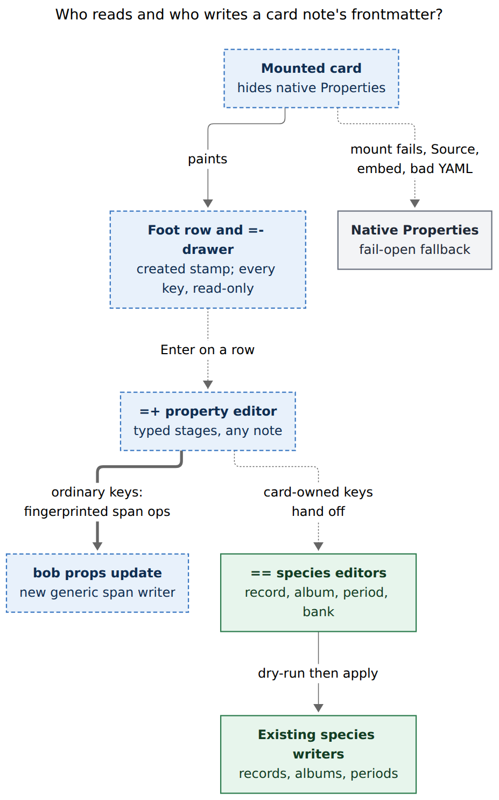
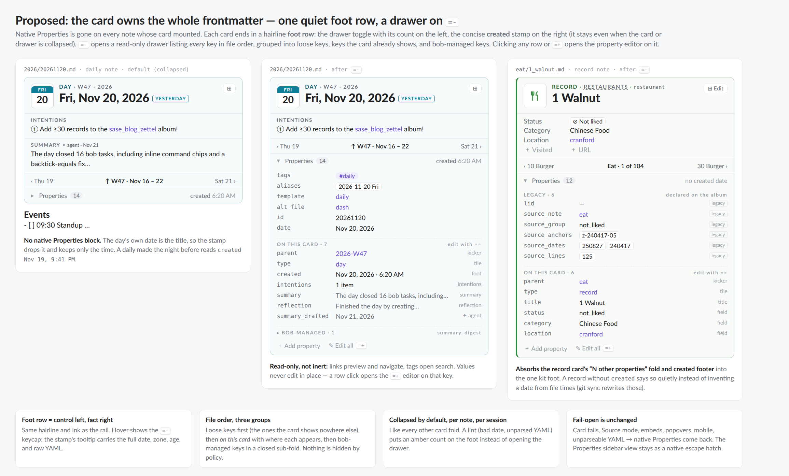
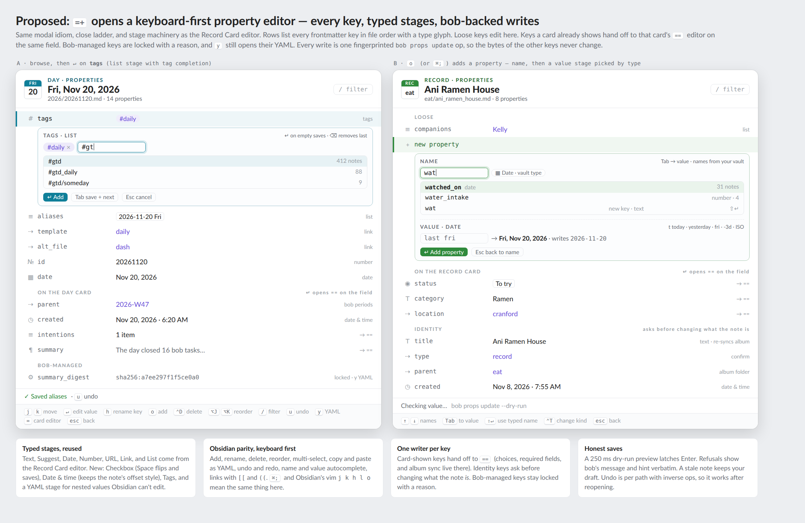

# Property cards own the frontmatter: consolidated design for the `=-` drawer, the created stamp, and the `=+` editor

*Lead researcher synthesis · 2026-11-22 · Inputs: five independent swarm reports
(`__cdx`, `__cld`, `__grk`, `__mus`, `__gem`, in this directory) plus my own
verification pass over bob-cli, bob-plugins, and the cited gate/session/CSS code.*

## Verdict

**All five researchers, independently, say yes — and so do I.** Native Properties is
the last surface on card notes that still feels like raw Obsidian: mouse-first,
schema-blind, re-serializing YAML on save, and showing Bob plumbing (`type`, `parent`,
`summary_digest`, seven `zorg_*` keys) in the most valuable spot on the page. Today's
per-row hiding leaves the worst of both worlds: a finished card on top, then a rump
native block with a dangling heading and **+ Add property**. Record notes currently
stack *three* metadata surfaces (sheet rows, the record fold, native Properties).
Finishing the takeover is the natural end state of the title-block work.

The consolidated recommendation in one paragraph: every mounted property card ends in a
hairline **foot row** — drawer toggle on the left (`▸ Properties · 14`), a concise
**created stamp** on the right — that stays visible when the drawer or the whole card
is collapsed. **`=-`** toggles a **read-only drawer** listing *every* frontmatter key
in file order, with keys the card already renders marked faintly and bob-managed
migration keys in a closed sub-fold. **`=+`** opens a **keyboard-first property editor**
modal on *any* Markdown note, built on the Record Card editor chassis, routing every
write through exactly **one writer per key**: ordinary keys through a new
byte-preserving **`bob props show|update`** command built on `yaml_spans.rs`,
card-owned keys by hand-off to `==`, bob-derived keys locked with a reason. Native
Properties hides as a **whole container** only while a card is mounted and the
frontmatter parses; every failure restores it. Ship the drawer first, the editor
second, and the hide **last** — never before `=+` can add a key.

*Figure 1: Painting is read-only and fail-open; editing routes each key to exactly one
writer. Dashed blue nodes are new; green are existing editors and writers. The one
place the consolidated design extends bob-cli is the generic `bob props` span writer.
Rendered 617 × 990 px; fit 90.2%.*

## What all five reports agree on (verified)

I re-checked the load-bearing claims directly in the repos; all held.

- **The primitives exist; this is composition, not invention.** The shared kit
  (`240b`–`240l`) owns generation-bound property ownership, the title slot, and
  fail-open mount lifecycle. The record card already prototypes the whole feature: a
  `▸ N other properties` fold and an `added …` created footer
  (`242i`/`242j-plugin-record-sheet-dom.js:438`), session-per-path collapse state, and
  a `y` jump to the YAML line.
- **`processFrontMatter` is banned, for cause.**
  `211-parent-frontmatter-plan.js` opens with: it "re-serializes the whole YAML block
  and would rewrite unquoted [[wikilinks]] in other keys." Every card editor writes
  through a fingerprinted bob envelope instead (`bob records/albums/periods update`,
  `bob bank config update`), sharing `242aa-plugin-guarded-update-session.js` (250 ms
  debounced dry-run, stale refusal keeps the draft, inverse-op Undo) and
  `src/native/yaml_spans.rs` in bob-cli (BOM, CRLF, comments, flow maps, scalar
  quoting, duplicate-key refusal — "shared by the album schema editor and the bank
  config editor").
- **A vimrc cannot bind `=-`/`=+`; the `248m` gate can.** CodeMirror Vim treats `=` as
  the complete `indentAuto` operator, so the second key resolves as a motion before any
  mapping is checked. `248m-plugin-schema-double-equals.js` already intercepts the
  second `=` at capture phase while the operator is pending with an empty key buffer,
  no count, no register, normal mode, Live Preview, no IME/repeat. Extending the
  accepted second key to `-` and `+` is the identical mechanism. One critical detail
  (gem): do **not** reject `shiftKey` — on US layouts `+` *is* Shift+`=`; match on
  `event.key`.
- **Hiding must be whole-container, gated, and fail-open.** Per-row hiding
  (`.bob-property-card-owned-property`, `styles.css:8657`) can never remove the
  Properties heading or **+ Add property**. The title-ownership pattern
  (`bob-property-card-owns-title`, direct-child paths at `styles.css:11977`) is the
  template: a generation-bound scope class, released on Source mode, path change,
  mount failure, teardown, and unload. The `.metadata-container` node must **stay in
  the DOM** — `240e` positions the title slot with `insertBefore(card, properties)`
  (gem's finding). Embeds, popovers, canvas, print, mobile, and unparseable YAML never
  hide anything; the right-sidebar File Properties pane stays untouched as the
  permanent escape hatch.
- **`created` must never be fabricated** from file times (untrustworthy under git
  sync), git history, or the date a daily note represents. Display never writes.
- **One decision governs closing:** the `=+` modal follows
  `decisions:q-and-ctrl-bracket-mirror-esc` (Esc / `q` / Ctrl+[ ladder, `q` types in
  text controls) via the shared `241xc` close-keys helper.

**Vault census** (cld and gem ran independent scans; numbers agree within counting
method): ~6,700–7,000 notes, ~1,473 (22%) carry one of the seven card species (day
1,198, record 209, week 50, album 6, quarter 5, year 4, bank 1). `created` is absent
on **all** period notes, ~85% of dailies (1,019 Zorg-era dailies instead carry seven
`zorg_*`/`generated_from_zorg` migration keys), and half the records. Formats are
mixed: `-0500`, `-05:00`, `+0000`, and 7 space-separated `YYYY-MM-DD HH:mm` values —
and bob's own writers disagree (`%z` in vault_sync, `%:z` in gmail/bank).
`.obsidian/types.json` deliberately types `created` as `text` because Obsidian's
datetime widget strips offsets. Albums and `bank.md` carry nested maps
(`record:`, `bank:`) that native Properties cannot edit at all.

## Where the reports disagree, and my resolutions

### D1 — Write path (the big one)

| Option | Backed by | Why not (or why) |
|---|---|---|
| `processFrontMatter` behind the guarded session | mus | **Rejected.** Explicitly banned in-house; re-serializes the whole block. mus cites the ban and recommends it anyway — the one internally inconsistent proposal in the swarm. |
| Pure JS line-span writer in bob-plugins (`replaceRange`, <2 ms) | gem | **Rejected as primary.** Latency is a red herring: the shipped record editor already runs bob in the loop (debounced 250 ms dry-runs, instant discrete ops, optimistic overlay) and it feels fine. A JS port of `yaml_spans.rs` forks the YAML serialization authority (grk's exact risk: "do not fork YAML serialization per species"), bypasses bob's cross-process write coordination, and gives Bob two writers that can drift. gem's *safety invariants* (§4.4 of that report) are excellent — they become `bob props` acceptance tests instead. |
| Extend each species writer with `prop.set`/`prop.unset` ops; no new public command | grk | **Viable fallback, not chosen.** Keeps one fingerprint per note, but spreads prop ops across four envelopes, and cannot write the 78% of notes with no species writer — which kills vault-wide `=+` (D4). Record protocol v1 is deliberately tiny (`field.set` only); growing four protocols is not obviously less work than one new command. |
| **New generic `bob props show|update` on `yaml_spans.rs`** | cld, cdx (independently) | **Chosen.** One writer, any note, fingerprinted span ops (`prop.set/unset/rename/move`), typed refusals (`prop_stale`, `prop_owned` with a hint naming the card editor, `prop_derived`, `prop_duplicate_key`, …), inverse ops for Undo, dry-run preview, `props_v1` capability gate (editor opens read-only against an old bob). The owner/role table lives in bob, so the plugin's adapter declarations are display-only. |

Implementation notes: read `sase/memory/cli_rules.md` before adding the subcommand;
the release rides the daily train (`decisions:bob-cli-releases-ride-a-daily-train`),
so land `bob props` at least one train ahead of the editor PR that needs it. Discrete
ops (checkbox toggle, delete, reorder) apply immediately with the current fingerprint;
only typed values need the debounced preview.

### D2 — Drawer content: complete inventory vs. complement

mus argued the drawer should show only keys the card doesn't already render; cdx, cld,
grk, and gem all want the complete inventory. **Complete inventory wins** — when you
deliberately open an inspector you want the whole truth, and "where did this key go"
must never require Source mode — but mus's duplication concern is real and is answered
by *visual demotion*, not omission:

1. **Loose keys** (unlabelled): everything the card renders nowhere else, in file
   order, with the existing `legacy` chip where album schemas declare it.
2. **On this card**: keys the card renders, each with a faint right-aligned *where*
   mark (`kicker`, `title`, `field`, `intentions`, `foot`). This makes the
   card-to-YAML mapping learnable, which is what makes the hide trustworthy.
3. **▸ Managed · N** (closed sub-fold): bob-written and importer keys (`*_digest`,
   `*_drafted`, `zorg_*`, `generated_from_zorg*`) — without this, 1,019 dailies bury
   their three meaningful keys under seven migration rows.

Nested maps (`record:`, `bank:`) render as one summary row (`record · 8 fields · ==`)
that jumps to the species editor — never a 90-line dump (grk/gem). Values render like
the rest of the card: wikilinks navigate with hover preview, tags open search, lists
are chips (`+N` after 6), booleans `✓/✗`, null `—`, long text clamped; absent, null,
empty-string, empty-list, `false`, and `0` stay distinguishable (cdx). Row source of
truth is the confirmed source bytes for membership and order (JS objects reorder
integer-like keys), metadataCache for values.

### D3 — `created`: foot row, not kicker

grk proposed promoting `created` into the title-block kicker; cdx, cld, and gem put it
on the foot row. **Foot row, right-aligned** — it costs zero extra vertical pixels,
keeps the title block calm, and the foot row (like the rail) stays rendered when the
card body is collapsed, which satisfies "visible even when collapsed" without touching
the title. One kit formatter; the species supplies the verb (`added` for records —
existing copy — `created` elsewhere):

| Situation | Text |
|---|---|
| Temporal card, created on its own date | `created 6:43 AM` (title already says the date) |
| Temporal card, created another day | `created Nov 19, 9:41 PM` (backfill becomes visible) |
| Today / yesterday | `created today, 7:55 AM` / `created yesterday` |
| This year / earlier | `created Jun 11` / `created Jun 11, 2025` |
| Date-only value | no time part; never a fake `12:00 AM` |
| Missing on temporal cards | *(nothing — don't nag 1,111 dailies and every period)* |
| Missing on album/record | faint `no created date` (creation is real information there) |
| Invalid | amber `created ⚠`; raw value and lint in the drawer |

Tooltip always shows the raw stored string and offset, so `+0000` vs `-0500` is never
ambiguous; times render in the viewer's local zone; date-only values are calendar
dates, never UTC-shifted (cdx). The formatter must accept both `T` and space-separated
timestamps (gem found `podcasts.md` breaks the current record regex). The record
card's existing footer (inside the collapsible body — currently disappears when the
sheet collapses) migrates into this always-visible foot row, fixing that gap.

### D4 — `=+` scope: any note, from day one

grk and mus scope `=+` to card notes; cld and gem make it vault-wide. **Vault-wide
wins**: the editor doesn't need a card, 78% of the vault (ref, project, area,
notebook) has the same mouse-first native editor problem, and a chord that silently
reindents on most notes breaks trust in the chord everywhere (gem). `=-` stays scoped
to notes with a mounted card (there is no drawer to toggle elsewhere; the key falls
through to Vim). The *takeover* (hiding native Properties) stays scoped to card
species. This is exactly what makes D1's generic writer necessary.

### D5 — Bank hub: exclude from the hide in v1

gem and grk include `bank.md`; cld excludes it. **Exclude** (narrowly): the bank card
is body-mounted under `# 🏦 Bank` mid-note, so a full takeover would relocate
`parent`/`type`/`summary`/`offclock`-family keys into a drawer at line ~67 — and
`bank.md` is an area note whose contract keys (`offclock`, `color`, `ready_cap`) have
no typed stages yet. It keeps today's `bank`-row ownership; `=+` still works there.
Revisit when areas get a title-block card (the shared "note card for area / project /
notebook / ref" follow-up all five reports converge on as the long-term end state).

### D6 — Hide mechanism details

Merge of grk + gem + cld, strongest parts of each:

- A third ownership bit, parallel to title ownership:
  `propertyCardOwnFrontmatter(scope, { path })` → scope class
  `bob-property-card-owns-frontmatter`, generation-bound release handles, observer
  re-application, same-frame restoration on mode/file change, mount loss, unload, and
  exceptions.
- CSS on the **exact direct-child native paths only** (never a global
  `.metadata-container` rule). Prefer setting Obsidian's own visibility variables
  (`--metadata-display-reading` / `--metadata-display-editing: none`) on the scope
  (grk — the documented mechanism), with a direct-child `display: none !important`
  fallback rule for drift insurance. Keep the node in the DOM (title-slot anchor).
- `inert` + `aria-hidden` on the container, plus a `focusin` guard, so keyboard focus
  and screen readers can't enter the hidden widget (cld). **Spike S1, go/no-go:** in
  real Obsidian, verify `k`/`gg`/jump-into-properties never land in a hidden input.
  gem's `240i`-style CodeMirror `StateField` + `editorAttributes` is the cleanest Live
  Preview implementation (ownership drops in the same transaction as a Source toggle).
- **Native entry points must not dead-end** (gem's distinctive find): `Mod+;` /
  "Add file property" on an owned note opens `=+` in Add mode; the
  `notebookFocusSummaryProperty`-style native-row focus helpers must route through
  `=+` when the scope is owned, because focusing an invisible input silently fails.
- Eligibility: card mounted ∧ frontmatter parses (cache **and** confirmed closed
  `---` block) ∧ desktop Live Preview/Reading ∧ not embed/popover/canvas/print.
  Identity-only day cards become eligible (that empty-daily "Properties" heading is
  precisely the clutter this feature exists to remove).

### D7 — Foot row sits below the nav rail

grk and mus put the fold above the rail ("the rail is the card's foot"); cdx, cld, and
gem put it below/last. **Below the rail**: expanding the drawer then never moves the
Previous/Next arms under your eyes mid-walk, and the record fold + created footer
merge into one bottom grammar for the whole family. The foot row is one hairline-
topped 1.6 em line in the rail's ink; an amber `⚠ N` lint count may join it (never
auto-opening the drawer).

*Figure 2 (from the cld report, rendered from real vault frontmatter): the collapsed
foot row costs one quiet line; the expanded drawer groups loose keys, on-card keys,
and managed keys.*

### D8 — Identity and derived keys in `=+`

grk locks `parent`/`type`/`created`; cld confirm-gates identity keys; gem allows edits
with warnings. Consolidated **one-writer-per-key routing**, checked in order:

| Ask | Route | Examples |
|---|---|---|
| Does bob derive it? | **Locked** with a teaching line; `y` opens YAML | `summary_digest`, `review_*`, `zorg_*`, period `parent` |
| Does a card editor own it? | **Hand off to `==`** on that field (record and album editors already accept one) | record schema fields, `intentions`/`summary`/`reflection`, album `record:` |
| Does it define the note? | **Locked in v1** (teaching + `y`); cld's confirm-then-sync flow is v2 | `type`, record/album `parent`, album `title` |
| Otherwise | **`bob props update`** typed stage → preview → apply | `tags`, `aliases`, `created`, `date`, `template`, `id`, any new key |

`created` is deliberately *editable* (cdx, cld, over grk): it's a user-correctable
timestamp, and the date-time stage preserves the existing offset style on edit. This
is a small, called-out parity reduction versus native Properties (which lets you
mangle `type` freely); the drawer, the `y` excursion, and the File Properties sidebar
keep every key reachable.

## Adjusted requirements (changes to the request, called out)

| # | Original | Adjustment |
|---|---|---|
| R1 | "Stop showing built-in Properties completely" | Hide the whole container **only while a mounted card and parsed frontmatter back it**, on desktop Live Preview/Reading. Source mode, embeds, popovers, mobile, bad YAML, failed mounts, and plugin unload keep/restore native. Recovery is part of "completely". |
| R2 | Read-only collapsed section at the card bottom | As asked, as **kit chrome** (one implementation, all species): complete inventory, grouped per D2, foot row below the rail per D7, session-per-path state (never persisted, matching every existing fold). |
| R3 | `=-` expand/collapse keymap | As asked, through the generalized `248m` gate. Card notes only; elsewhere the key stays with Vim. Palette commands, Command Mode rows, and the clickable disclosure cover Reading view and non-Vim use. |
| R4 | `=+` property editor ≥ native Properties | As asked, **extended to every Markdown note** (D4), with a parity checklist as acceptance criteria (below). One deliberate carve-out: vault-wide property *type* changes go through Obsidian's type manager only if feature-detection finds it; otherwise `=+` teaches and defers to the native All-properties sidebar rather than inventing a second type registry. |
| R5 | `created` concisely on all cards even when collapsed | On the always-visible foot row per D3's formatting rule. **Never fabricated**; missing stays silent on temporal notes. |
| R6 | — | **Added:** all writes through a new fingerprinted `bob props show|update`; `processFrontMatter` stays banned; one writer per key (D8). |
| R7 | — | **Added:** `Mod+;` and native property-focus helpers reroute to `=+` on owned notes; bank hub excluded from the hide in v1 (D5). |

## The `=+` editor, concretely

Record Card editor chassis: species identity badge (neutral page tile on non-card
notes), `<KIND> · PROPERTIES`, note title, `path · N properties`; rows in file order
grouped like the drawer, each with a type glyph, monospace key, rendered value, and a
right-aligned route mark (`→ ==`, `locked · y YAML`, or the type name); a status rule
(`Checking value…` / `✓ Saved · u undo` / bob's refusal verbatim); a hint strip.

*Figure 3 (from the cld report): the editor reuses the modal idiom, close ladder, and
typed-stage machinery of the existing card editors.*

**Parity-plus keymap** (merged cld/gem; Obsidian baseline from its Properties help):
`j`/`k`/arrows/Ctrl+N/P move; Enter/`l` edit value; `h`/`r` rename (span-preserving);
`o`/`O`/`Mod+;` add (name stage completes over vault property names with type and
usage count); Ctrl+D / `Mod+Backspace` delete; Space marks, Shift+↑/↓ and `V`
multi-select; `Mod+C`/`Mod+V` copy/paste rows as YAML with overwrite preview; Alt+J/K
reorder (comments travel with their key); `/` filters keys and values; `t` converts
this value's kind, with an explicit warning before any vault-wide type change
(especially `created` → datetime, which would strip offsets); `y`/Ctrl+E YAML
excursion with the floating Done return; `=` hands off to `==`; `u`/Ctrl+Z per-path
Undo from `inverse_ops`, surviving reopen; Esc/`q`/Ctrl+[ close ladder. Stages reused
from the record editor (Text with `[[`/`((` LINK band, Suggest, Number, Date, URL,
Link, List) plus new Checkbox (Space toggles, no stage), Date-and-time (`now`,
`9:41pm`, `fri`, `-3d`; preserves offset style), Tags (vault tag completion), and a
validated **YAML stage** for nested/exotic values — something native Properties cannot
do at all. Write discipline is the record session verbatim: debounced dry-run, Enter
latched on a current preview, stale refusal keeps the draft, every open pane saved
before apply, optimistic overlay ≤ 5 s.

Beauty rules (kit-wide): keys monospace 0.86 em muted, values in the text font, group
labels in the kicker's tracked small caps, keys on a `minmax(84px, max-content)`
column with tabular numerals, no new colors (accent marks only the selected row; amber
only lint), drawer height animated 160 ms via `grid-template-rows` with no motion
under `prefers-reduced-motion`, `<dl>` semantics with a real `aria-expanded`
disclosure, narrow panes stack key over value. The editor wears its card's badge and
paper so `==`, `=-`, and `=+` read as one object.

## Risks and open questions for Bryan

1. **S1 focus leak** (top risk): can a hidden-but-in-DOM metadata container still trap
   Vim motions or focus? Spike before building; if unfixable, ship drawer + editor and
   keep per-row hiding — the worst outcome is today's layout plus a much better editor.
2. **Drawer memory:** per note per session (matches every existing fold) or per pane
   (stays open walking `]n` through days)? Default: per note; revisit if inspection
   walks feel tedious.
3. **Backfill `created`?** 106 records and all periods lack it. Recommended: no (never
   fabricate); an explicit one-time migration from git history could be a separate,
   opt-in bead. Periods stay deliberately clock-free (their `date:` is not a creation
   stamp).
4. **Metadata Menu:** enabled but effectively unconfigured (no fileClass, one preset
   field). Hiding native Properties removes its context menu on takeover notes only —
   confirm you don't use it there.
5. **Vault-wide type changes from inside `=+`:** worth relying on the undocumented
   type-manager API (feature-detected), or fine to defer to Obsidian's All properties
   sidebar? Recommended: feature-detect, never hard-depend.
6. **Offset style:** file a small bob-cli bead to pick one canonical `created` style
   for *new* writes (`%:z`), while edits always preserve the existing style.

## Ship order

1. **Spike (go/no-go):** whole-container hide + `inert` focus behavior in real
   Obsidian (S1); `Mod+;` interception; `-`/`+` arms through the generalized `=` gate
   (unit-table tests beside the existing 29 `==` gate tests, plus a non-US-layout
   check).
2. **PR 1 — kit foot row + drawer + created + `=-`** (bob-plugins only, no hide yet):
   fold the record card's fold and footer into the shared kit; adopt on album, record,
   day/period. Native Properties still visible — temporary duplication is the safe
   half-state.
3. **PR 2 — `bob props show|update`** (bob-cli, rides the release train): span ops on
   `yaml_spans.rs`, fingerprint over the parsed mapping only (body edits never stale
   it), owner/role table, typed refusals, inverse ops, `props_v1` capability; golden
   byte-preservation tests from gem's invariant list (comments, CRLF, BOM refusal,
   flow maps, quoted/unquoted wikilinks, duplicate keys, anchors/aliases refused,
   offset styles, boolean-lookalike strings).
4. **PR 3 — `=+` editor** (bob-plugins): chassis reuse + new stages + routing +
   palette/Command Mode commands; read-only with a teaching line when `props_v1` is
   absent.
5. **PR 4 — the hide**: `propertyCardOwnFrontmatter`, native entry-point rerouting,
   fail-open e2e matrix (Source/embed/popover/mobile/bad YAML/unload/path change),
   light+dark narrow+wide walkthrough. **Never lands before PR 3.**
6. **Docs, decision, memory:** update `record-card.md`, `intention-card.md`,
   `albums.md`, architecture ownership docs, a new `docs/property-editor.md`; write a
   decision record (*property cards own in-document Properties; one writer per key*)
   superseding the historical "native Properties and Add property stay visible"
   record-card requirement; update the `glossary:Property Card` strand ("owned-key
   property hiding" → whole-frontmatter ownership) through `/sase_memory_write`.

Rough effort: spike S · foot row/drawer M · `bob props` M · editor L (mostly reuse) ·
hide + e2e M.

## Sources

- The five swarm reports in this directory (`card_owned_frontmatter__{cdx,cld,grk,mus,gem}.md`),
  each independently researched; cld's mocks are Figures 2–3 here, and grk's rendered
  routing figures (`property_card_frontmatter_takeover__grk_{chrome,equals,write}.png`)
  remain worth a look — note grk's write figure shows `created` read-only, which this
  consolidation changed to editable.
- My verification pass (2026-11-22, bob-cli @ `b7945e75`, bob-plugins @ origin/master):
  `src/native/yaml_spans.rs`, `src/native/records/protocol.rs` (`field.set`-only v1
  envelope), `bob-plugins` `211-parent-frontmatter-plan.js` (processFrontMatter ban),
  `248m-plugin-schema-double-equals.js` (gate snapshot and registry),
  `242aa-plugin-guarded-update-session.js` (250 ms debounce),
  `242j-plugin-record-sheet-dom.js:438` (created footer), `styles.css` 8657/11469/11977
  (row hiding, embed guard, title ownership).
- Obsidian Properties help and API docs, the W3C disclosure and modal-dialog patterns,
  and the Obsidian forum threads on Properties keyboard gaps — as cited with URLs in
  the cdx, cld, and mus reports.
