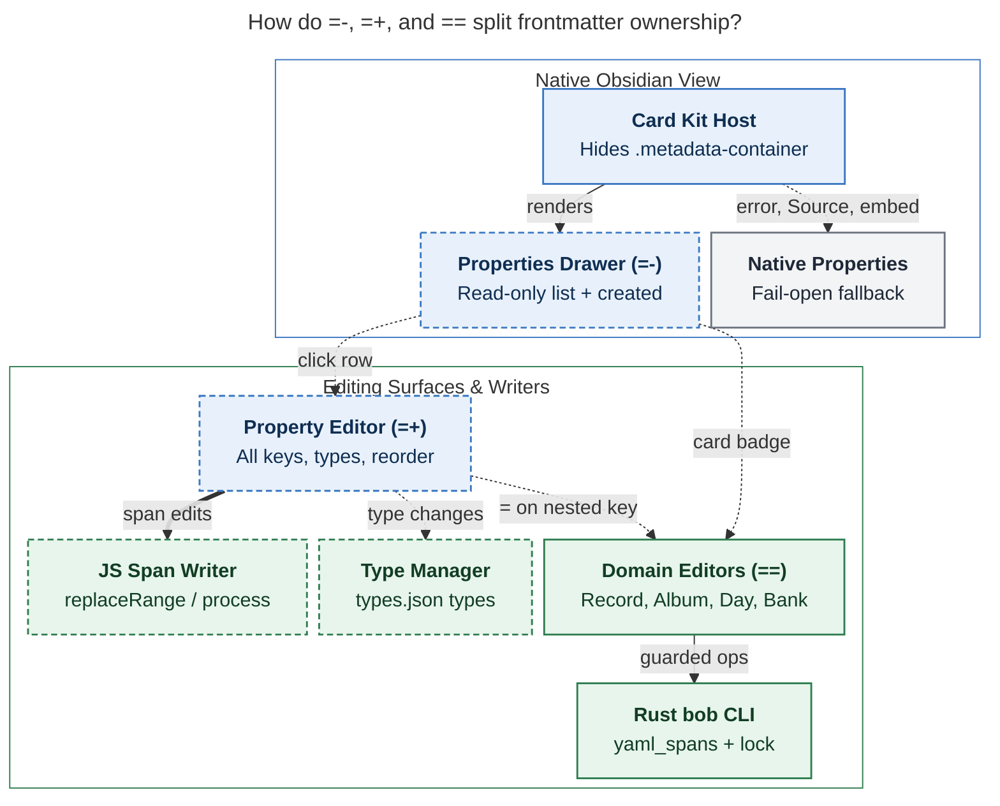
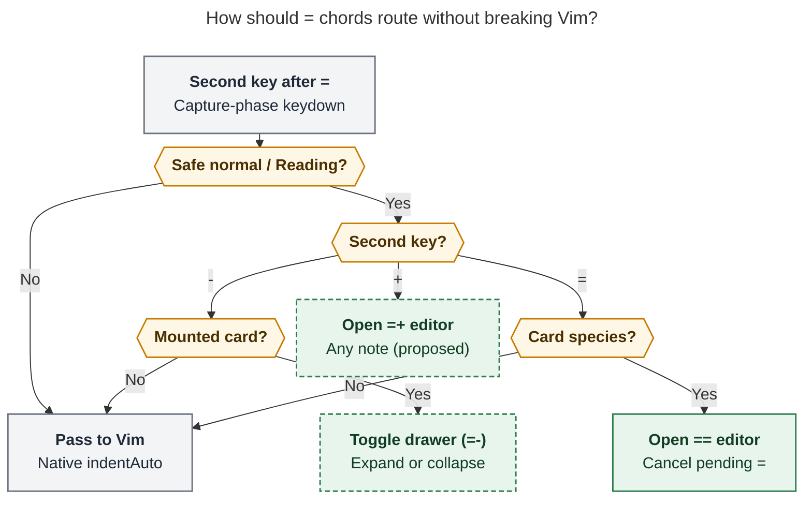

# Property Card Frontmatter Takeover & Keyboard-First Property Editor

> **Status**: Independent Research & Design Specification  
> **Scope**: `bob-plugins` (`bob-ledger-tools`, `bob-navigation-hotkeys`), `bob-cli` YAML invariants, and the `~/bob` vault  
> **Decision Context**: Extends the Property Card identity kit (`240b`–`240l`), `==` operator-pending dispatch (`248m`), and `decisions:q-and-ctrl-bracket-mirror-esc`

---

## 1. Executive Summary & Verdict

**Verdict: Strongly endorse the goal — with six targeted requirement adjustments.**

Having Property Cards take over native frontmatter presentation on card-bearing notes is the natural completion of Bob's Property Card architecture. Today, property-card notes sit in an awkward half-way state: `240b-plugin-property-card-ownership.js` hides individual `.metadata-property` rows via a subtree `MutationObserver`, leaving a jagged stump of unowned keys (or an empty `"Properties"` header with an `"Add property"` button) directly beneath a rich Bob card. Worse, **Record** notes currently display *three* overlapping metadata surfaces at once: the Record Sheet rows, a bespoke `▸ N other properties` fold (`242j-plugin-record-sheet-dom.js`), and Obsidian's native `.metadata-container` immediately below.

Replacing that partial row-hiding machinery with **whole-container hiding**, a **unified read-only Properties Footer Bar + Drawer (`=-`)** owned by the shared Property Card kit, a **concise `created` readout right on the collapsed footer**, and a **keyboard-first Property Editor modal (`=+`)** solves three real problems at once:

1. **Visual coherence**: Every property-card note becomes a single, calm, unified header above the note body instead of stacked, competing metadata blocks.
2. **Performance & reliability**: Swapping per-row `MutationObserver` hiding (`subtree: true` on `.cm-editor`) for a single scope-level class (`bob-property-card-owns-properties`) backed by `EditorView.editorAttributes` eliminates per-keystroke DOM scanning and guarantees same-frame fail-open recovery on Source mode, embeds, hover popovers, broken YAML, or plugin unload.
3. **Keyboard-first editing superiority**: Obsidian's built-in Properties widget is mouse-heavy, breaks Vim modal flow, lacks Vim-native reordering, lacks `[[`/`((` Bob link completions, and strips timezone offsets from ISO-8601 `created` timestamps whenever `datetime` is used. A Bob modal built on the proven `RecordCardModal` / `IntentionCardModal` stage grammar fixes all of those while preserving raw YAML formatting.

### The Core Architectural Recommendation

- **Rendering & Hiding**: Upgrade the shared kit (`240b` + `240c` + `240i` pattern) to hide the whole `.metadata-container` via direct-child CSS (`bob-property-card-owns-properties`) only when a card is actively mounted and its frontmatter parsed cleanly. Mount a single shared **Properties Footer Bar** (`bob-property-card-props`) inside every property card's bottom edge, rendered synchronously from Obsidian's `metadataCache` so there is zero layout flash while async `bob` reports load.
- **Keymaps**: Generalize `248m-plugin-schema-double-equals.js` into a shared capture-phase `=` operator-pending dispatcher for `==` (domain card editor), `=-` (toggle card properties drawer), and `=+` (open Property Editor) — plus a lightweight Reading-view prefix window, Command Palette entries, and mouse/focus controls on the card footer.
- **Editing Engine (Hybrid)**: Do **not** use `app.fileManager.processFrontMatter` (it re-serializes the entire YAML block and corrupts flow maps, comments, and quoting) and do **not** put `bob` CLI subprocesses in the interactive edit loop for every checkbox or tag toggle. Instead, build a **Verified JS Line-Span YAML Writer** in `bob-ledger-tools` mirroring `bob-cli`'s `src/native/yaml_spans.rs` invariants, backed by `parseYaml()` round-trip verification and `editor.replaceRange` (for instant UI + native Undo), paired with `app.metadataTypeManager` for global property types and **1-key `=` handoff** to the Rust-backed `==` domain editors for schema-governed and complex nested YAML (`record:`, `bank:`). Zero `bob-cli` breaking changes are needed for v1.

---

## 2. Empirical Baseline: Codebase & Real Vault Audit

Before designing UI or picking a YAML writer, I audited both the current `bob-plugins` / `bob-cli` implementation and all **6,689 Markdown notes** in `~/bob` (read-only). The data surfaced several edge cases that directly shape the design.

### 2.1 Property-Card Species Inventory in `~/bob`

`240f-plugin-property-card-species.js` defines seven property-card species (`album`, `record`, `day`, `week`, `quarter`, `year`, `bank`). Across the live vault, **1,473 notes (22.0%)** belong to these seven species, while **5,216 other notes (78.0%)** carry frontmatter without a property card (`ref`: 1,357; `project`: 102; `notebook`: 39; `mail`: 25; `area`: 18; `bank_month`: 1; other notes: 3,675).

| Species | Live Count | Key Count Range | Has `created` | Complex / Nested Keys | Current Card Mount & Quirks |
|---|---:|---:|---:|---|---|
| **`bank`** | 1 (`bank.md`) | 5 | **1 / 1** (100%) | `bank:` (nested compact flow-map YAML) | **Body-mounted** after `# 🏦 Bank`; does *not* use title slot or own title (`248c`). |
| **`album`** | 6 | 7–10 | **6 / 6** (100%) | `record:` (deep schema map, 30–100+ lines) | Title-slot mounted (`241v`). **1 of 6 (`podcasts.md`) uses space-separated `2026-08-06 07:35`** instead of ISO `T`. |
| **`record`** | 209 | 5–13 | **103 / 209** (49%) | None (flat scalars + lists) | Title-slot mounted (`242k`). Currently shows **triple UI**: sheet rows + `bob-record-sheet-fold` + native `.metadata-container`. Legacy imports carry `lid`, `source_group`, `source_note`, `source_anchors`, `source_dates`, `source_lines`. |
| **`day`** | 1,198 | 6–14 | **175 / 1,198** (15%) | None (lists + flow-list `parent` on Zorg notes) | Title-slot mounted (`296c`/`296d`). **166 of 175** `created` values share the exact calendar date as the note title; **9** are backfilled later. **1,019** historical Zorg notes lack `created` and start with 7 noisy `generated_from_zorg` / `zorg_source_*` keys. |
| **`week`** | 50 | 7–14 | **0 / 50** (0%) | None | Title-slot mounted (`296c`/`296d`). `bob periods ensure` does not stamp `created`. |
| **`quarter`** | 5 | 7–11 | **0 / 5** (0%) | None | Title-slot mounted. No `created` property. |
| **`year`** | 4 | 7–11 | **0 / 4** (0%) | None | Title-slot mounted. No `created` property. |

### 2.2 Critical Findings from `.obsidian/` and Existing Code

1. **`created` is intentionally typed as `"text"` in `.obsidian/types.json`**: Bryan explicitly configured `"created": "text"` rather than `"datetime"` because Obsidian's built-in `datetime` property widget strips timezone offsets (`-05:00` / `-04:00`) and reformats ISO-8601 values on edit. Our Property Editor must **respect `.obsidian/types.json`** and warn explicitly if a user tries to switch `created` (or any timezone-bearing ISO timestamp) to `datetime`.
2. **Space-separated timestamp parser gap**: Existing Record Sheet formatting in `242i-plugin-record-sheet-model.js` checks `/T\d{2}:\d{2}/` for clock times, which fails on `podcasts.md`'s `created: 2026-08-06 07:35`. The shared kit formatter must accept both `YYYY-MM-DDTHH:mm...` and `YYYY-MM-DD HH:mm...`.
3. **Existing native-DOM focus callers**: `241d-plugin-notebook-catalog.js:702–745` (`notebookFocusSummaryProperty`) queries `.metadata-property[data-property-key="summary"] input` and calls `view.metadataEditor.focus()`. On any note whose `.metadata-container` is `display: none`, focusing an invisible native input silently fails. Even though Notebooks aren't currently one of the 7 property-card species, **future species expansion or card-bearing notes using summary focus must route through `=+` (pre-focused on `summary`)** when `bob-property-card-owns-properties` is active.
4. **Vim mode is enabled (`vimMode: true`)** in `.obsidian/app.json`, and `248m-plugin-schema-double-equals.js` already documents why `obsidian_vimrc.md` cannot bind `=`-prefixed chords (`=` is CodeMirror Vim's complete `indentAuto` operator). However, `248m` currently **only runs in Live Preview** — pressing `==` in Reading View does nothing.
5. **Title-slot DOM anchoring depends on `.metadata-container` remaining in the DOM**: `240e-plugin-property-card-title-slot.js:59–67` mounts cards by calling `insertBefore(cardNode, properties)` where `properties` is the direct-child `.metadata-container` of `.cm-sizer` (Live Preview) or `.mod-header` (Reading). Hiding `.metadata-container` via CSS (`display: none !important`) preserves that DOM node as an exact layout anchor — never remove `.metadata-container` from the DOM!
6. **`processFrontMatter` is already banned for Bob YAML mutations**: `bob-navigation-hotkeys/src/211-parent-frontmatter-plan.js` explicitly warns against `app.fileManager.processFrontMatter` because js-yaml re-serialization strips comments, breaks compact flow maps (`bank.md`), and mangles wikilink quoting.

---

## 3. Candid Critique & Six Justified Requirement Adjustments

The core vision is **sound and high-leverage**, not over-engineering. Hiding Obsidian's native Properties on card-bearing notes removes persistent visual clutter across 1,473 notes, unifies 7 diverging card implementations, and lets Bob own the entire top-of-note experience with Vim-native ergonomics.

However, implementing the requirements *literally without adjustment* would create six avoidable friction points: redundant Record Sheet UI, empty `created` chrome on 80% of property-card notes, a massive unreadable YAML dump inside `album`/`bank` drawers, an inconsistent `=+` dead-end on 78% of the vault, a hidden crash mode on broken YAML, and an ergonomics snag on Reading View + Shift-key chords.

| # | Original Requirement | Critique / Friction Found | Recommended Adjustment |
|---|---|---|---|
| **1** | Add a collapsible read-only properties view at the bottom of every property card. | Record Sheet (`242j`) *already* renders a bespoke `bob-record-sheet-fold` (`▸ N other properties`) and a separate `bob-record-sheet-created` line. Adding a kit properties drawer underneath it would duplicate both. | **Retire Record Sheet's bespoke fold and `created` `<p>`** and replace them with the single shared kit **Properties Footer Bar + Drawer** across all 7 species. |
| **2** | Represent `created` concisely on all property cards even when collapsed. | **80.6% of property-card notes** (1,188 / 1,473: all Week/Quarter/Year notes, 1,019 Zorg dailies, 106 legacy records) have *no* `created` property, and **166 / 175** modern Day notes have a `created` date identical to their card title (`Nov 22, 2026`). Rendering a placeholder (`Created: —`) or repeating the day's own date wastes space and adds noise. | **Place `created` right-aligned on the collapsed Properties Footer Bar** (0 px extra height): show `Created 6:43 AM` on same-day Day notes, `Created Jun 11, 2026` on other notes/backfilled dailies (exact ISO timestamp in tooltip), flag malformed `created` with an amber badge, and **omit cleanly when absent**. |
| **3** | Show all frontmatter properties inside the collapsible read-only drawer. | `album` notes have 30–100+ line nested `record:` schemas and `bank.md` has a nested `bank:` map; 1,019 Zorg dailies carry 7 `generated_from_zorg` / `zorg_*` migration keys. Dumping raw nested maps or 7 migration keys inline makes `=-` noisy instead of scannable. | **Keep 1:1 key completeness**, but (a) summarize complex nested mappings (`record:`, `bank:`) as compact structural rows (`record · 8 fields · ==`) with a direct jump to `==`, (b) subtly badge keys already rendered in the card body (`in card`) so users know why a key appears in both, and (c) tuck `generated_from_zorg` / `zorg_*` keys behind a quiet secondary sub-fold (`▸ 7 migration keys`). |
| **4** | Trigger the new Property Editor with `=+` (scoped alongside property cards). | If `=+` works on the 1,473 card notes (where native Properties is hidden) and silently reindents a line on the other 5,216 notes (`project`, `area`, `ref`, `notebook`, etc.), muscle memory breaks constantly. Nobody uses Vim `=+` (reindent current line + next line) in Markdown prose. | **Make `=+` work on *all* Markdown notes vault-wide** (while keeping `=-` scoped strictly to notes with a mounted property card). Also add a **Reading-view `=` prefix window**, Command Palette commands, and footer buttons so `==`/`=-`/`=+` work outside Live Preview too. |
| **5** | Stop showing built-in Properties on all property-card notes, including `bank.md`. | Unlike the other 6 species, `bank.md`'s card is currently **body-mounted** beneath `# 🏦 Bank` (`248c`), not in the title slot. Hiding `.metadata-container` works cleanly today via the shared host, leaving `# 🏦 Bank` cleanly at the top and the Bank Setup card directly below it. | **Include `bank.md` in whole-container hiding and the shared Properties Footer Bar immediately**, while leaving `bank.md`'s migration to the title slot as an independent follow-up (no coupling needed). |
| **6** | Stop showing built-in Obsidian Properties completely on these notes. | If frontmatter has a YAML syntax error, if the user switches to **Source mode**, opens an **embed / hover popover / Canvas / Print / mobile**, or if a card fails to mount, hiding `.metadata-container` would strand the user with no metadata view or error indicator. | **Enforce strict fail-open invariants**: hide `.metadata-container` *only* on desktop Live Preview & Reading views when the card mounts cleanly and frontmatter parses cleanly. Always leave the right-sidebar **File Properties** core pane untouched as a permanent secondary view. |

### One Honest Meta-Critique: Is `=+` Worth Building vs. Toggling Native Properties?

Before committing to a full Property Editor, it is worth asking the skeptical question: *Why not simply make `=+` temporarily reveal Obsidian's built-in `.metadata-container` (or focus the File Properties sidebar) instead of building a custom editor?*

I considered that alternative seriously and **rejected it** for four concrete reasons specific to Bryan's workflow:
1. **Obsidian's native widget is hostile to Vim and keyboard flow**: Entering native Properties drops you out of Vim normal mode into unstructured contenteditable cells; adding a property, changing its type, reordering keys, or exiting cleanly back to your cursor line requires awkward Tab chains and mouse clicks.
2. **Native Properties corrupts Bob's YAML conventions**: Editing inside Obsidian's native widget runs Obsidian's full-block YAML serializer, stripping comments, expanding compact flow maps in `bank.md`, and reformatting quotes — the exact hazard `211-parent-frontmatter-plan.js` warns against.
3. **No Bob intelligence**: Native Properties has no awareness of Bob's `[[` / `((` `proseField` v2 completions, `bob-emoji` picker, schema-owned vs. freeform properties, or `==` domain editors (`record:`, `bank:`, `intention`).
4. **Bob already owns 70% of the modal kit**: `bob-ledger-tools` already has `bobCardWireCloseKeys` (`241xc`), `RecordCardModal` typed stages (`242q`/`242r`), `proseField` v2 (`242sa`/`297cd`), FLIP keyboard reorder (`241xa`/`241xb`), and guarded YAML excursion (`242e`). Building the Property Editor reuses proven patterns rather than inventing a new UI framework.

---

## 4. Architecture Analysis & Trade-Offs

### 4.1 Ownership & Write-Path Architecture

Figure 1 shows how the mounted Property Card, the read-only Properties Drawer (`=-`), the new generic Property Editor (`=+`), and the existing domain editors (`==`) divide reading, hiding, and writing cleanly.



*Figure 1 — Proposed division of frontmatter ownership (solid = existing Bob surfaces; dashed = new components). A mounted card hides native `.metadata-container` via CSS while rendering the read-only drawer (`=-`) from `metadataCache`. Interactive edits in `=+` flow through a verified JS line-span writer (thick path), while schema-governed nested structures delegate to existing Rust-backed `==` domain editors.*

### 4.2 Whole-Container Hiding: Replacing `240b`'s Row-Level Observer

Today, `240b-plugin-property-card-ownership.js` attaches a `MutationObserver` with `{ childList: true, subtree: true, attributes: true, attributeFilter: ["data-property-key"] }` directly onto the entire `.cm-editor` scope and tags matching `.metadata-property` elements one by one. Moving to whole-container takeover is dramatically simpler, faster, and more reliable if modeled directly on **`240i-plugin-property-card-title-ownership.js`**:

1. **Direct-Child Scope CSS (zero bleed into embeds, popovers, or sidebars)**:
   ```css
   .cm-editor.bob-property-card-owns-properties
     > .cm-scroller > .cm-sizer > .metadata-container,
   .markdown-preview-view.bob-property-card-owns-properties
     > .markdown-preview-sizer > .mod-header > .metadata-container {
     display: none !important;
   }
   ```
   - `.metadata-container` **stays in the DOM**, preserving `240e`'s `insertBefore(cardNode, properties)` slot positioning and `propertyCardTitleSlotPositioned` invariant.
   - Direct-child combinators (`>`) guarantee that embedded notes (`.markdown-embed`), hover popovers (`.hover-popover`), and the right-sidebar File Properties pane are **never** affected.
2. **CodeMirror `StateField` + `EditorView.editorAttributes` for Live Preview**:
   - Mirror `240i`'s lazy `StateField` (`propertyCardPropsFieldType`), resetting ownership automatically inside the reducer whenever `editorLivePreviewField === false` (Source mode toggle) or `editorInfoField.file?.path !== owner.path` (pane switched to another note).
   - Benefit: Switching to Source mode or navigating to a non-card note drops `bob-property-card-owns-properties` in the **exact same CodeMirror transaction** — zero stale-class race, zero `MutationObserver` on `.cm-editor`.
   - For Reading View, keep a lightweight generation-bound class toggle on `.markdown-preview-view` with the same deny-list as `240i` (`.markdown-embed, .internal-embed, .hover-popover, .canvas-node, .canvas-node-content, .print`, non-desktop).
3. **Fail-Open Preconditions (all must hold before claiming ownership)**:
   - Card mount succeeded and rendered into the active scope (including `bank.md` body mount).
   - Desktop app (`Platform.isDesktopApp !== false`), not Source mode, not embed/popover/canvas/print.
   - Frontmatter parsed cleanly: if the file starts with `---` and fails `parseYaml()`, **do not claim ownership** — let Obsidian's native `"Invalid YAML"` banner stay visible, and surface a subtle amber warning pill on the card if mounted.
   - Plugin unload / disable clears every Reading scope and removes the CodeMirror extension, restoring native Properties in the same frame.
4. **Native-Focus Caller Remediation**:
   - Update `241d-plugin-notebook-catalog.js:702` (`notebookFocusSummaryProperty`) and any similar helpers to check whether the active view scope carries `bob-property-card-owns-properties`; if so, open `=+` pre-focused on the `summary` row instead of trying to `.focus()` a hidden `.metadata-property` input.
   - Optionally intercept Obsidian's built-in `editor:add-property` (`Mod+;`) on card-owning notes — or document clearly that `=+` then `a` is the card-native equivalent (leaving `Mod+;` untouched unless Bryan opts in).

### 4.3 Frontmatter Writer Options Compared

How should `=+` write edits back to Markdown frontmatter? There are four viable architectures:

| Criterion | A. `app.fileManager.processFrontMatter` | B. Pure Rust CLI (`bob props ...`) | C. Pure JS Line-Span YAML Writer | **D. Hybrid: Verified JS Span Writer + `metadataTypeManager` + `==` Handoff (Recommended)** |
|---|---|---|---|---|
| **Preserves comments, quoting, flow maps (`bank.md`), CRLF, BOM** | **No** — re-serializes entire YAML block; explicitly banned in `211-parent-frontmatter-plan.js` | **Yes** (`yaml_spans.rs`) | **Yes** (mirrors `yaml_spans.rs` byte-span algorithm) | **Yes** |
| **Interactive latency** (toggle checkbox, add tag, reorder) | ~5 ms | **120–600 ms** per edit (process spawn + `bob_sync.lock` + disk reload) | **< 2 ms** via `editor.replaceRange` | **< 2 ms** for standard keys; Rust-guarded only on `==` handoff |
| **Native `Ctrl+Z` Undo & clean editor history** | Partial (rewrites whole frontmatter block) | **No** (external disk mutation clears/fragments undo stack) | **Yes** (targeted `replaceRange` transaction) | **Yes** + per-modal multi-step Undo stack |
| **Obsidian global property types (`.obsidian/types.json`)** | Via `metadataTypeManager` | **Unsafe** (external writes race Obsidian's in-memory cache) | Via `metadataTypeManager` | **Yes** — reads/updates via Obsidian's own API |
| **Schema-governed nested YAML (`record:`, `bank:`)** | Corrupts flow maps; bypasses validation | Full schema validation | Fragile if editing nested AST directly | **Safe**: read-only summary in `=+` + 1-key `=` handoff to Rust `==` modal |
| **Concurrent-edit safety & YAML round-trip check** | Moderate | High (file lock + CAS) | High (preimage check + `parseYaml()` verify) | **High** (verified span edit + preimage guard + raw YAML excursion fallback) |
| **Cross-repo coordination cost** | Low | High (new CLI subcommand + JSON contract + daily release train) | Low (`bob-plugins` only) | **Low** — ships completely in `bob-plugins` v1; optional `bob` lint enrichment later |

**Why Option D wins decisively:**
- **Speed & feel matter most for a property editor.** Toggling a boolean, adding three tags, renaming a key, and moving a row up two spots with `Alt+K` must feel instant (< 16 ms). Spawning `bob` CLI and waiting for vault re-indexing on every tweak would make `=+` feel noticeably slower than Obsidian's native header.
- **Safety is not sacrificed.** By porting the exact line-span principles of `bob-cli/src/native/yaml_spans.rs` into a pure, exhaustively unit-tested JS module (`240m-plugin-frontmatter-spans.js`), every mutation touches *only* the exact byte/line span of the targeted top-level key and verifies the candidate frontmatter string with Obsidian's bundled `parseYaml()` before committing a single character to the note.

### 4.4 Verified JS Line-Span YAML Writer: Safety Invariants

To guarantee rock-solid reliability across all 6,689 notes in `~/bob`, the span writer enforces seven strict invariants:

1. **Frontmatter fence extraction**: Recognizes optional UTF-8 BOM (`\uFEFF`), preserves `\r\n` vs. `\n`, requires opening `---` on line 0, and closes on the first top-level `---` or `...` line. If the note has *no* frontmatter yet, adding the first property inserts `---\n<key>: <val>\n---\n\n` cleanly at offset 0.
2. **Exact top-level key span parsing**: Walks lines tracking block scalars (`|`, `>`, `|-`, `>+`, `|2`, etc.), single/double-quoted multi-line scalars, and unclosed flow brackets (`[...]`, `{...}`) so indented lines or block-scalar contents that look like `key:` are never mistaken for top-level keys. Each top-level entry records `{ key, rawKey, headerLine, startLine, endLine, kind, hasComments, rawText }`.
3. **Fail-closed on hazardous YAML**:
   - **Duplicate top-level keys**: Refuses programmatic write on the duplicated key; highlights both lines and offers `y` (YAML excursion) to resolve cleanly.
   - **YAML anchors, aliases, merge keys, or custom tags (`&`, `*`, `<<`, `!`)**: Marks the affected key as *opaque/YAML-only* — viewable in `=+`, editable via `y`, never rewritten blindly.
   - **Parse failure on pre-existing frontmatter**: `=+` opens in a clear **Invalid YAML Recovery Banner** showing Obsidian's parser error message + line number and a 1-key `y` jump straight to the offending line in Source mode (with the floating `Done` return button from `242e`).
4. **Minimal-diff serialization**:
   - Untouched keys keep their **exact original bytes** (comments, blank lines, flow lists like `parent: ["[[...]]"]`, `bank:` flow maps, key quoting).
   - Edited scalar values keep single-line formatting when safe; quote automatically whenever YAML 1.1/1.2 would coerce or break (`[[wikilink]]`, leading `#`/`@`/`%`/`&`/`*`/`!`/?/`-`/`:`, `: `, `# `, boolean/null/number lookalikes like `true`, `yes`, `on`, `no`, `off`, `null`, `~`, `0123`, `2026-11-22` on a `text`-typed key, leading/trailing whitespace, or multiline strings using `|-`).
   - Edited lists default to canonical block lists (`\n  - item`), or preserve flow-list style (`[a, b]`) when the original key was a single-line flow list and stays short.
   - Key **reordering (`Alt+J` / `Alt+K`)** moves each key's full line span *along with* any immediately preceding comment lines attached to that key (separated by no blank line), so comments travel with their keys.
5. **Pre-write semantic round-trip verification**: Before writing, the module runs `parseYaml(candidateFrontmatter)` and verifies:
   - The candidate parses without error.
   - All untouched keys still parse to deep-equal values.
   - The mutated/added/renamed/deleted key parses to the expected value/presence.
   If verification ever fails, the write aborts before touching the editor or file and surfaces an actionable error notice.
6. **Live-editor first, disk-guarded fallback**:
   - If the target file is open in an active `MarkdownView` editor, commit via `editor.replaceRange(nextBlock, startPos, endPos)` so the buffer updates in the same frame, cursor position in the body is preserved (adjusting line delta cleanly), and Obsidian's native Undo stack stays coherent.
   - If invoked from Reading View (no mounted CodeMirror buffer) or background file, commit via `app.vault.process(file, (current) => ...)` with an exact preimage check on the frontmatter slice so external mutations (e.g., `bob` CLI or Sync) are never silently clobbered.
7. **In-modal Undo stack (`u` / `Ctrl+Z`)**: Because `=+` commits edits immediately (no "Save/Cancel" trap that loses work on Esc, matching `RecordCardModal` and `IntentionCardModal`), the modal maintains a session history of `{ beforeFrontmatter, afterFrontmatter, label }` entries so pressing `u` or `Ctrl+Z` in browse mode cleanly reverts the last property mutation step-by-step and shows a confirmation toast (`Undid: rename tag`).

---

## 5. Keymap & Routing Design (`==`, `=-`, `=+`)

### 5.1 Why `obsidian_vimrc.md` Cannot Bind `=-` or `=+`

As documented in `248m-plugin-schema-double-equals.js:1–4`, CodeMirror Vim registers `=` as a complete operator (`indentAuto`). The moment you press `=`, Vim enters **operator-pending mode** (`vim.inputState.operator === "indentAuto"`). Pressing a second key resolves as a motion (`=` = current line, `-` = line up, `+` = line down) *before* Vim ever checks multi-key normal mappings. Therefore, `nnoremap =-` and `nnoremap =+` in `obsidian_vimrc.md` will never trigger.

The proven solution is to generalize `248m-plugin-schema-double-equals.js` into a **unified capture-phase `=` operator-pending dispatcher** (e.g. `248m-plugin-property-card-equals-chords.js`, preserving the legacy exported helper names for existing unit tests).



*Figure 2 — Unified `=` chord dispatch decision tree. Counts (`2=-`), registers (`"a=+`), Source mode, Insert/Visual/Replace modes, and non-card notes on `=-`/`==` fall cleanly through to native Vim `indentAuto`.*

### 5.2 Exact Dispatch Gates & Edge Cases

1. **Live Preview gate (reusing `248m`'s battle-tested snapshot)**:
   - Require `vim.readable`, not `insertMode` / `visualMode` / `replaceMode`, `vim.operator === "indentAuto"`, `keyBufferEmpty`, `!countPending`, `!registerPending`.
   - Reject `ctrlKey || altKey || metaKey`, `repeat`, `isComposing`, `defaultPrevented`, and Source mode (`livePreview === false`).
   - **Critical detail for `=+`**: Do **NOT** reject `event.shiftKey`! On US QWERTY keyboards, `+` is `Shift+=`, so `event.key === "+"` arrives with `shiftKey: true`. Check `event.key === "=" | "-" | "+"` while only rejecting `ctrlKey || altKey || metaKey` (matching `248m:88`).
   - On match: call `event.preventDefault()`, `event.stopImmediatePropagation()`, cancel Vim's pending `=` operator via `Vim.handleKey(cm, "<Esc>", "mapping")`, and run the action.
2. **Reading View prefix window (closing `248m`'s current gap)**:
   - In Reading View, CodeMirror is inactive, so `vim.operator` does not exist. Add a lightweight 800 ms `=` prefix state per active `MarkdownView` when `view.getMode() === "preview"` and `event.target` is inside `.markdown-preview-view` (never inside `<input>`, `<textarea>`, `[contenteditable]`, or an open modal).
   - Pressing `=` starts the 800 ms window (swallowing only when unmodified); pressing `=`, `-`, or `+` within the window triggers the exact same handlers (`==`, `=-`, `=+`); any other key cancels the window immediately.
   - Benefit: Bryan gets identical `==`, `=-`, and `=+` ergonomics in both Live Preview and Reading View.
3. **Key Ergonomics Critique (`=-` vs. `=+`)**:
   - The visual symmetry of `==` (card editor), `=-` (collapse/expand properties), and `=+` (add/edit properties) is extraordinarily memorable and intuitive — definitely keep `=-` and `=+` as the primary chords.
   - Note one minor physical quirk on US keyboards: `=-` is two unshifted taps on adjacent keys, whereas `=+` requires pressing `=` unshifted, then holding `Shift` + pressing the same `=` key. That's slightly slower for rapid repeats, which is fine because `=+` opens a modal (used deliberately), while `=-` is a quick toggle (unshifted and instant).
   - Also expose **Command Palette commands** (`Bob: Toggle card properties` and `Bob: Edit note properties`) so Bryan can optionally bind an alternative chord (or trigger via `Cmd+P`) and so automation/Accessibility/non-Vim users have full coverage.
4. **`=-` Behavior When Scrolled Down the Note**:
   - If the user presses `=-` while the card is visible in the viewport: toggle the drawer in place without moving the cursor (and `240e`'s `ResizeObserver` keeps the scroll anchor stable).
   - If the card is scrolled **out of view** and the user presses `=-` to *expand* the drawer: expand it and smoothly scroll the card footer into view (respecting `prefers-reduced-motion`) while returning focus smoothly — or, if collapsing, collapse silently and show a brief status indicator only if offscreen. Even simpler and cleaner: when offscreen and expanding, scroll top-of-note into view so pressing `=-` always gives visible feedback; when collapsing while offscreen, collapse without yanking the user away from their paragraph.
5. **Consistency with `decisions:q-and-ctrl-bracket-mirror-esc`**:
   - Every modal/panel launched by `=+` MUST close or back out of stages on **`Esc`**, **`q`** (when focus is outside text inputs), and **`Ctrl+[`** (always, even inside text inputs), wired through the shared `bobCardWireCloseKeys` helper (`241xc-plugin-card-close-keys.js`). Reserve `q` from all modal shortcuts and hint badges.

---

## 6. Visual & UX Design Lead Specification

The visual language should feel **100% native to Bob's existing Property Card identity kit** (`240f`–`240l`, `styles.css`): *hue says where, form says what, and words say both*. No heavy borders, no drop-shadow card-inside-a-card clutter, no shouting colors. The properties area should feel like the **quiet architectural plinth** at the base of the card.

### 6.1 Surface A: Shared Card Properties Footer Bar & Read-Only Drawer (`=-`)

Every property card mounts a single kit-owned `<footer class="bob-property-card-props">` as its last child inside `.bob-property-card` (separated from the card body by a crisp `1px solid var(--background-modifier-border)` hairline).

#### Collapsed State (Default — 0 px Extra Vertical Clutter)

```text
┌──────────────────────────────────────────────────────────────────────┐
│ [🍽️]  RECORD · Restaurants · Place                  [⊞ Edit] [▾]     │
│       Sushi Nakazawa                                                 │
│                                                                      │
│  Rating      ★★★★☆ (4.5)                                             │
│  Neighborhood West Village                                           │
│  Tags        #date-night  #omakase                                   │
├──────────────────────────────────────────────────────────────────────┤
│ ▸ Properties (9) · =-   [+ Edit · =+]          Created Jun 11, 2026 │
└──────────────────────────────────────────────────────────────────────┘
```

Design details of the **Collapsed Footer Bar** (`min-height: 28px`, subtle `padding: 6px 14px`, tinted with `color-mix(in srgb, var(--background-secondary) 45%, transparent)`):
- **Left side (Disclosure Button)**:
  - `<button type="button" class="bob-props-toggle" aria-expanded="false" aria-controls="...">`
  - Shows chevron (`▸` collapsed / `▾` expanded), `Properties`, muted tabular count pill `(9)`, and a quiet keycap hint `=-` (shown on hover/focus or on desktop at `0.55` opacity so it stays calm, never loud).
  - Keyboard: `Enter`/`Space` when focused, or `=-` anywhere in the note.
- **Middle-left (Quiet Edit Affordance)**:
  - Compact ghost button `[+ Edit]` (title: `"Edit properties (=+)"`, keycap `=+` revealed on hover/focus; always visible when the drawer is expanded). Clicking it opens the `=+` Property Editor directly.
- **Right side (`created` Metadata)**:
  - Sits flush-right on the exact same single baseline (`margin-left: auto`, `font-size: var(--font-ui-smaller)`, `color: var(--text-muted)`, `font-variant-numeric: tabular-nums`), so representing `created` costs **zero additional vertical pixels** on every card!
  - Full verbatim frontmatter value + relative age (e.g., `"Created 2026-06-11T19:42:18-04:00 (5 months ago)"`) appears in the native `title` tooltip.

#### Smart `created` Formatting Rules (Grounded in `~/bob` Data)

| Case | Vault Example | Collapsed Footer Display | Rationale |
|---|---|---|---|
| **Same-day Day card** (166 / 175 modern dailies) | `20261122.md` with `2026-11-22T06:43:12-05:00` | `Created 6:43 AM` | The card title *already* says `Nov 22, 2026`; showing the creation clock time adds real signal without redundancy. |
| **Backfilled Day card** (9 / 175 modern dailies) | `20261110.md` created on `2026-11-12T08:15:00-05:00` | `Created Nov 12, 2026` | Surfacing the later date immediately reveals it was backfilled. |
| **Album / Record / Bank (ISO or space-separated)** | `podcasts.md` `2026-08-06 07:35`, `bank.md` `2026-11-11T11:31:42-05:00` | `Created Aug 6, 2026` / `Created Nov 11, 2026` | Scannable human date; omits year *only* if you prefer, though keeping `MMM D, YYYY` is unambiguous across multi-year records and albums. |
| **Date-only `created`** | `2026-08-06` | `Created Aug 6, 2026` | Clean date, no fake `12:00 AM`. |
| **Missing `created`** (Week/Quarter/Year, 1,019 Zorg dailies, 106 legacy records) | key absent | *(omitted cleanly)* | Never render `Created: —` noise on 80% of card notes. |
| **Malformed `created`** | `created: someday` | `⚠ Created: someday` (amber muted pill) | Alerts silently without hiding data; clicking opens `=+` on `created`. |

#### Expanded State (`=-` Pressed)

```text
┌──────────────────────────────────────────────────────────────────────┐
│ [📅]  DAY · Sunday                                   [⊞ Edit]        │
│       November 22, 2026                                              │
│       Intention: Ship property card research                         │
├──────────────────────────────────────────────────────────────────────┤
│ ▾ Properties (14) · =-   [+ Edit · =+]             Created 6:43 AM  │
│ ┄┄┄┄┄┄┄┄┄┄┄┄┄┄┄┄┄┄┄┄┄┄┄┄┄┄┄┄┄┄┄┄┄┄┄┄┄┄┄┄┄┄┄┄┄┄┄┄┄┄┄┄┄┄┄┄┄┄┄┄┄┄┄┄┄┄┄┄ │
│   parent      [↗ 2026-W47]                                 in card   │
│   type        day                                          in card   │
│   id          20261122                                               │
│   date        2026-11-22                                   in card   │
│   created     2026-11-22T06:43:12-05:00                    in card   │
│   tags        #daily  #focus                                         │
│   aliases     Nov 22, 2026  ·  Sun Nov 22                            │
│   intention   Ship property card research                  in card   │
│   rating      4                                                      │
│   ▸ 7 migration keys (generated_from_zorg, zorg_source_…)            │
│                                                                      │
│   Click any row to edit in =+  ·  Press =- to collapse               │
└──────────────────────────────────────────────────────────────────────┘
```

Design details of the **Expanded Read-Only Drawer**:
- **Key ordering**: Preserves the **exact frontmatter key order** from the note (never alphabetically shuffled behind the user's back), skipping only Obsidian's synthetic `position` metadata key.
- **Type-aware read-only value rendering**:
  - **Wikilinks (`[[target]]`, `[[target|alias]]`)**: Clickable internal link pills that open on click (`Mod+Click` for new pane) and trigger Obsidian's native hover page preview.
  - **External URLs (`https://...`)**: Clickable external link with safe protocol allowlist (`https?:` only, mirroring `RECORD_SHEET_SAFE_URL_RE`).
  - **Tags (`tags` property)**: Styled tag chips (`#tag`) matching Obsidian's theme pills (clicking opens Obsidian tag search, matching native Properties).
  - **Lists (`aliases`, `multitext`)**: Wrapping muted pill chips with clean spacing.
  - **Checkboxes (`checkbox`)**: Read-only visual check indicator (`☑ true` / `☐ false`, clearly non-interactive until you click to open `=+`).
  - **Dates / Timestamps / Numbers**: `font-variant-numeric: tabular-nums`; `created` displays its full verbatim value inside the drawer so the expanded view is always ground truth.
  - **Empty / `null` values**: Quiet italic `empty` placeholder (`var(--text-faint)`).
  - **Complex nested objects (`record:` on Albums, `bank:` on `bank.md`)**: Rendered as a compact structural summary row — e.g. `record  { 8 fields · 2 facets }  [Open schema ==]` — so opening `=-` on `movies.md` or `bank.md` stays crisp and scannable instead of dumping 90 lines of raw JSON.
- **Card-Owned Key Indicator (`in card`)**: Keys already displayed prominently by the card body (e.g., `title`, `parent`, `type`, `intention`, Record schema fields) still appear in the drawer for complete 1:1 transparency, accompanied by a very faint right-aligned `in card` micro-badge (`opacity: 0.55`).
- **Zorg / Migration Key Sub-Fold**: On notes containing `generated_from_zorg` or `zorg_*` keys (1,019 historical Day notes), group those keys into a secondary collapsible line at the bottom of the drawer (`▸ 7 migration keys`) so real note properties remain immediately scannable while keeping 100% of keys reachable.
- **Click-to-Edit Bridge**: Clicking any row's key label or empty area opens `=+` **already focused on that exact key** (and clicking a wikilink or URL follows the link instead of hijacking navigation).
- **Per-Pane Ephemeral Expansion State**: Collapsed by default on every note open. Storing open/closed state in a `WeakMap<Leaf, Map<Path, boolean>>` means toggling `=-` survives live re-renders and property edits within the same pane without leaking across tabs or polluting disk/frontmatter.
- **Responsive & Accessible**:
  - At `@container (max-width: 375px)` (narrow splits): footer wraps cleanly (`created` drops to a compact second line under the toggle, keycaps hide), and drawer switches from a 2-column grid (`minmax(96px, 140px) 1fr`) to stacked label-over-value rows.
  - Full `forced-colors` borders, `prefers-reduced-motion` instant transitions (no janky height slide when reduced motion is enabled), WCAG AA contrast on all badges and muted timestamps.

---

### 6.2 Surface B: Keyboard-First Property Editor (`=+`)

The `=+` modal (`PropertyEditorModal`) is designed to be **at least as capable as Obsidian's built-in Properties header** — and dramatically faster from the keyboard.

#### Visual Layout & Anatomy

```text
┌─ Properties · Sushi Nakazawa ───────────────────────────── [12 keys] ─┐
│  [/ Filter keys or values…                                          ] │
│  ── Note Properties ───────────────────────────────────────────────── │
│  ▸ title        Aa  Sushi Nakazawa                          [in card] │
│    parent       Aa  [[eat]]                                 [in card] │
│    type         Aa  record                                  [in card] │
│    created      Aa  2026-06-11T19:42:18-04:00               [in card] │
│    tags         #   #date-night  #omakase                             │
│    aliases      ≡   Nakazawa                                          │
│    rating       #   4.5                                     [in card] │
│    visited      ☑   true                                              │
│    website      Aa  https://sushinakazawa.com                         │
│    notes        Aa  Counter omakase — sit near chef                   │
│  ── Nested / Managed ──────────────────────────────────────────────── │
│    record       {}  8 fields · 2 facets              [== Open Schema] │
│ ───────────────────────────────────────────────────────────────────── │
│  j/k Move  Enter Edit  a Add  r Rename  t Type  d Del  Alt+J/K Order  │
│  / Filter  u Undo  y YAML  = Card Editor                 Esc/q Close  │
└───────────────────────────────────────────────────────────────────────┘
```

#### Feature Parity & Superpowers Matrix vs. Obsidian Built-in Properties

| Capability | Obsidian Built-in Properties | Bob Property Editor (`=+`) |
|---|---|---|
| View & edit all 6 Obsidian types (`text`, `list`, `number`, `checkbox`, `date`, `datetime`, plus `tags` / `aliases`) | Yes (mouse-driven) | **Yes** — specialized inline keyboard stage per type |
| Add new property with vault-wide key autocomplete (`metadataTypeManager.getAllProperties()`) | Yes | **Yes (`a`)** — fuzzy picker showing existing vault keys, inferred type icon, and usage count |
| Rename property key in place | Click label, edit, blur | **Yes (`r`)** — inline key rename with duplicate-key guard & exact span preservation |
| Delete / clear property | Right-click menu → Remove | **Yes (`d` clear value, `D` / `x` delete key)** with instant `u` Undo |
| Change global property type (`.obsidian/types.json`) | Click type icon → submenu | **Yes (`t`)** — shows warning badge when global change affects other notes (especially `created: text` → `datetime` tz loss!) |
| Copy / paste property value | Right-click menu | **Yes (`c` copy value, `C` copy `key: value` YAML)** |
| **Reorder properties in frontmatter** | **No** (must open Source mode!) | **Yes (`Alt+J` / `Alt+K`)** with FLIP animation & attached-comment preservation |
| **Instant keyboard filtering** | **No** | **Yes (`/`)** — filter by key name or value text |
| **Bob `[[` note & `((` task block link completion** | Basic `[[` only | **Yes** — registers as prose surface **`S16`** in `scripts/fixtures/prose-fields.json` (`proseField` v2) |
| **Bob emoji picker on emoji fields** | **No** | **Yes** — integrates `bob-emoji` API for `emoji` keys |
| **Preserves YAML comments, flow maps, quoting** | **No** (rewrites whole YAML block) | **Yes** — verified line-span writer with `parseYaml()` round-trip check |
| **Domain-editor bridge for complex nested YAML** | Shows ugly "Unsupported type" warning | **Yes (`=`)** — 1-key handoff to `RecordCardModal`, `AlbumSchemaCard`, `IntentionCardModal`, or `BankSetupCard` |
| **Raw YAML escape hatch with return trip** | Switch entire pane to Source mode manually | **Yes (`y`)** — jumps straight to exact frontmatter line in Source mode with `242e`'s floating **`Done`** return pill |
| **Multi-step in-modal Undo** | Only global editor Undo | **Yes (`u` / `Ctrl+Z`)** — step-by-step frontmatter history with toast feedback |
| **Strict Vim & `decisions:q-and-ctrl-bracket-mirror-esc`** | Breaks Vim normal mode | **Yes** — `j`/`k`, `g`/`G`, `Enter`, `Esc`/`q`/`Ctrl+[` throughout |

#### Complete Keyboard Grammar

Two clean, predictable modes (identical to `RecordCardModal` and `IntentionCardModal`):

1. **Browse Mode** (focus on row list):
   - `j` / `Down`, `k` / `Up`, `g` / `Home`, `G` / `End`: navigate rows.
   - `Enter` or `e`: open inline **Edit Stage** for focused row (for `checkbox`, **`Space`** toggles immediately in place without even opening a stage!).
   - `a`: open **Add Property Stage** (fuzzy key input seeded from `app.metadataTypeManager.getAllProperties()` + recent keys; selecting an existing vault key pre-selects its type and advances straight to the value input so adding a property is `a` → type key → `Enter` → type value → `Enter`).
   - `r`: open **Rename Key Stage** (validates non-empty, valid YAML key, no duplicate key).
   - `t`: open **Type Picker** (`text`, `list`, `number`, `checkbox`, `date`, `datetime`; shows clear caption `"Updates global property type in .obsidian/types.json"` + explicit warning on `created` / ISO-tz timestamps).
   - `d`: clear value (sets empty); `x` or `Backspace`/`Delete`: delete property row (undoable with `u`).
   - `Alt+J` / `Alt+K` (or `J` / `K`): move property down/up in frontmatter order (disabled while `/` filter is active so order shifts are never ambiguous).
   - `/`: focus top filter bar (`Enter` or `Down` jumps back to filtered rows; `Esc` clears filter first, second `Esc` closes modal).
   - `c`: copy value; `u` / `Ctrl+Z`: undo last mutation in this modal session.
   - `=`: jump directly to this note's domain `==` editor (when on a property-card species; especially highlighted on `in card` rows and nested `record:`/`bank:` rows).
   - `y`: YAML excursion — close modal, switch pane to Source mode, place cursor on the exact line of the focused key, and show the floating **`Done`** pill (`242e`) to return cleanly to Live Preview.
   - `Esc` / `q` / `Ctrl+[`: close modal and restore focus to the note's previous cursor position.

2. **Inline Stage Mode** (editing a single row's value right inside the list — no nested popup modals):
   - **`text` / `multiline`**: Single-line `<input>` (or auto-growing `<textarea>` when multiline or `Shift+Enter` pressed), wired with **`proseField` v2 (`S16`)** for `[[` wikilink and `((` task block completions. For `emoji` keys, `Ctrl+E` (or icon button) invokes `bob-emoji` picker. `Enter` saves; `Esc` / `Ctrl+[` cancels stage and returns to Browse Mode (`q` types normally inside text controls!).
   - **`list` / `tags` / `aliases`**: Interactive chip tray + inline add input (`Enter` appends chip; `Backspace` on empty input removes last chip; `←`/`→` selects chips, `Delete` removes selected chip, `Alt+←`/`Alt+→` reorders chips; `tags` auto-completes from vault tags via `metadataCache.getTags()`; `aliases` and `list` wire `proseField` v2 `S16`; `Cmd/Ctrl+Enter` or `Enter` on empty input commits and exits stage).
   - **`number`**: Numeric input with step-increment (`Up`/`Down`), validation against `NaN`/`Infinity`, preserves clean YAML numeric literal.
   - **`checkbox`**: Instant `Space` / `Enter` toggle in Browse Mode (also supports setting `null`/empty via `d`).
   - **`date` / `datetime`**: Keyboard-friendly text input accepting ISO dates plus quick relative tokens (`today`, `yesterday`, `now`) alongside a native date/time picker trigger (`Alt+Down`), preserving exact ISO formatting.
   - **Complex nested / opaque values (`record:`, `bank:`, anchors/tags)**: Read-only preview block inside the stage with two actions: **`= Open Domain Editor`** (for `record:`/`bank:`) and **`y Edit in YAML`** (exact line excursion with floating `Done` pill). Never silently flattens or destroys structured YAML.
   - **Schema-governed key nudge**: When editing a key that belongs to a `record` schema or `album` schema directly in `=+`, show a quiet one-line hint (`"Managed by Record Card — press = for typed options & validation"`) while still allowing direct raw edits when the user genuinely wants an override or lint repair.

---

## 7. Recommended Phased Implementation Plan

This entire design ships cleanly inside **`bob-plugins`** (`plugins/bob-ledger-tools/`) with **zero breaking changes to `bob-cli`** for v1. Keeping it in four focused, testable phases keeps every commit small, reviewable, and verifiable with both Node unit tests and real-Obsidian CDP E2E tests.

### Phase 1: Whole-Container Ownership & Shared Properties Footer Bar (`=-`)
- **Files (`bob-plugins`)**:
  - Upgrade `plugins/bob-ledger-tools/src/240b-plugin-property-card-ownership.js` (add whole-container `bob-property-card-owns-properties` ownership + `240i`-style Live Preview `StateField` + Reading scope toggle + full deny-list + fail-open on malformed YAML).
  - Add `plugins/bob-ledger-tools/src/240m-plugin-property-card-props-model.js` (pure frontmatter reader/normalizer: `created` smart formatter supporting both `T` and space-separated timestamps, `in card` key tagging, nested-map summaries, Zorg migration grouping).
  - Add `plugins/bob-ledger-tools/src/240n-plugin-property-card-props-dom.js` (shared `<footer class="bob-property-card-props">` builder, per-pane ephemeral fold state, click-to-open hooks, accessible disclosure & keyboard support).
  - Mount the shared footer inside all 7 card adapters (`241v` Album, `242j`/`242k` Record — retiring `bob-record-sheet-fold` & `bob-record-sheet-created`, `296b`/`296c` Day/Week/Quarter/Year, `248b`/`248c` Bank).
  - Update `plugins/bob-ledger-tools/styles.css` (direct-child `.metadata-container` hiding, `.bob-property-card-props` tokens, `@container <= 375px` rules, `forced-colors`, `prefers-reduced-motion`).
- **Tests**: Unit tests for `created` formatting across all 7 species (same-day Day, backfilled Day, space-separated `podcasts.md`, missing, malformed), Zorg grouping, nested-map summarization, and Live Preview `StateField` fail-open reducer; CDP test verifying `.metadata-container` is hidden on card notes and intact on embeds, Source mode, non-card notes, and broken YAML.

### Phase 2: Generalized `=` Chord Dispatcher (`==`, `=-`, `=+`) & Reading View Support
- **Files (`bob-plugins`)**:
  - Evolve `plugins/bob-ledger-tools/src/248m-plugin-schema-double-equals.js` into a shared `=` chord router handling `==`, `=-`, and `=+` in Live Preview (`indentAuto` operator-pending, allowing `shiftKey` for `+`, rejecting counts/registers/Source/Insert/Visual/Replace) **plus** the 800 ms Reading-view prefix window.
  - Register Command Palette commands (`Bob: Toggle card properties`, `Bob: Edit note properties`) and update `241d-plugin-notebook-catalog.js:702` (`notebookFocusSummaryProperty`) to route through `=+` whenever `.metadata-container` is card-owned.
- **Tests**: Exhaustive unit tests covering every gate (`2=-`, `"a=+`, `Shift+=` → `+`, non-card `=-` passthrough to Vim, non-card `=+` opening Property Editor, Reading view timeout/cancel, modal-open suppression) plus CDP Vim integration tests.

### Phase 3: Verified JS Line-Span YAML Writer
- **Files (`bob-plugins`)**:
  - Add `plugins/bob-ledger-tools/src/240o-plugin-frontmatter-spans.js` (pure, zero-DOM frontmatter parser + line-span patcher for add, update, rename, delete, reorder, create-frontmatter-if-absent, comment-preserving moves, duplicate-key/anchor guards, and `parseYaml()` semantic round-trip verifier).
  - Add `plugins/bob-ledger-tools/src/240p-plugin-frontmatter-commit.js` (editor `replaceRange` vs. `vault.process` preimage-guarded commit + session Undo stack + `app.metadataTypeManager` type adapter).
- **Tests**: Property-based & golden fixture unit tests built from real edge cases found in `~/bob` (`bank.md` flow maps, `movies.md` nested `record:`, `podcasts.md` space-separated `created`, Zorg flow-list `parent`, BOM/CRLF, multiline `|-` blocks, YAML comments, duplicate keys, anchors/aliases, unquoted wikilinks, boolean-lookalike strings).

### Phase 4: Keyboard-First Property Editor Modal (`=+`) & Polish
- **Files (`bob-plugins`)**:
  - Add `plugins/bob-ledger-tools/src/240q-plugin-property-editor-model.js`, `240r-plugin-property-editor-stages.js`, and `240s-plugin-property-editor-modal.js` (browse mode, `/` filter, inline typed stages for all 6 types + opaque/nested bridge, `Alt+J/K` FLIP reorder, `t` global type picker with `created` safety warning, `=` domain-editor handoff, `y` YAML excursion via `242e`, `u` Undo, `bobCardWireCloseKeys` for `Esc`/`q`/`Ctrl+[`).
  - Wire `proseField` v2 into text/list/aliases stages and register surface **`S16`** in `scripts/fixtures/prose-fields.json` (plus `bob-emoji` integration for `emoji` keys).
  - Update `bob-plugins` docs (`docs/develop/architecture.md`, card docs) and run full `npm test` + real-Obsidian CDP E2E suite.

---

## 8. Open Decisions for Bryan

Before writing code, four small taste/policy calls are worth confirming:

1. **Vault-wide `=+` vs. card-only `=+`**: This report strongly recommends making `=+` work on **all Markdown notes** (while `=-` applies only on notes with a mounted property card). Confirm if you prefer `=+` vault-wide or strictly card-only.
2. **Same-day Day card `created` format**: On today's Day note (`November 22, 2026`), do you prefer showing the creation time (`Created 6:43 AM` — recommended to avoid repeating the title date) or always showing a uniform date (`Created Nov 22, 2026`)?
3. **Intercepting Obsidian's `Mod+;` ("Add file property")**: On card-owning notes where native Properties is hidden, should `Mod+;` also open `=+` directly into the Add Property stage (`a`), or stay untouched?
4. **Zorg migration keys (`generated_from_zorg`, `zorg_*`)**: Confirm that auto-tucking those 7 historical keys into a secondary sub-fold inside `=-` (still 1 click / key away, still visible in `=+`) matches how you want historical Day notes to feel.
