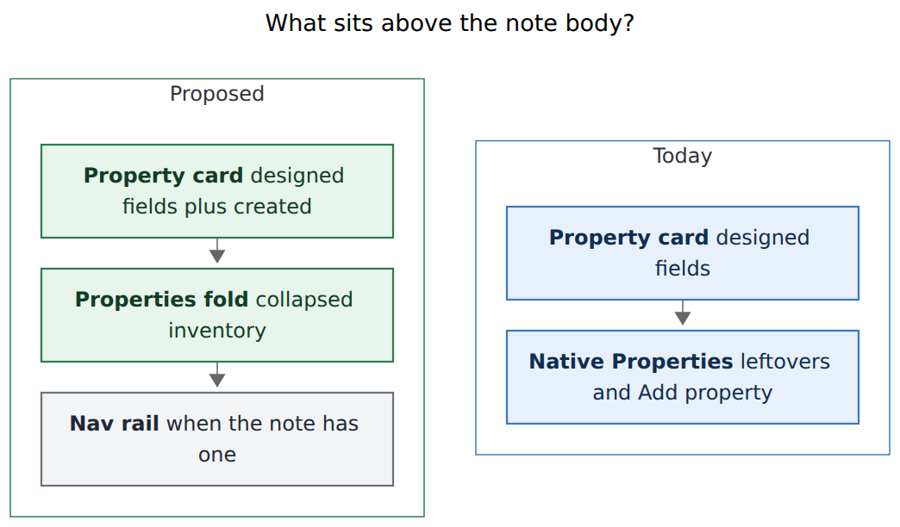
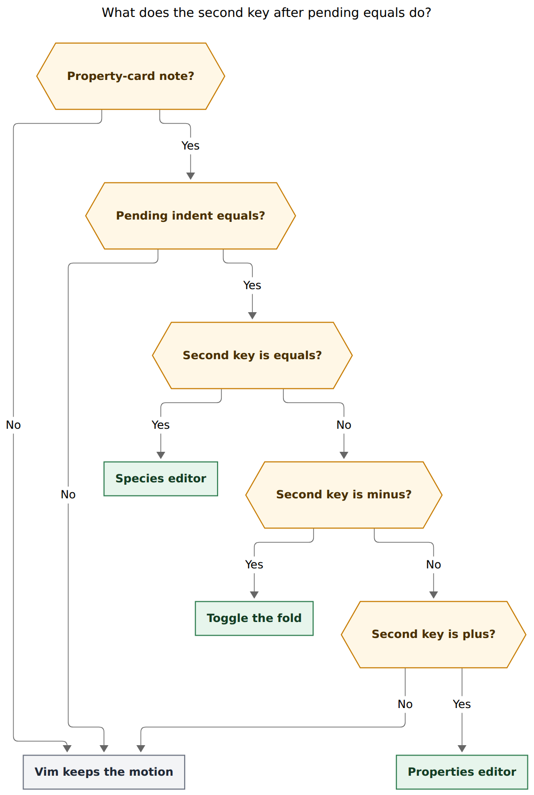
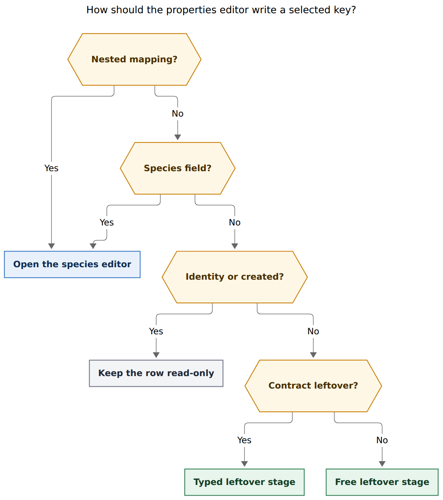

# Property cards should own in-document frontmatter

**Researcher:** grk (independent swarm report)
**Date:** 2026-11-22
**Question:** How should Bob property cards take over every frontmatter key, hide Obsidian's in-document Properties section, and add `=-` / `=+` as the fold and editor?

## Verdict

Do it. The request is the missing half of the title-block kit: the card already pretends to be the note's identity, while native Properties still lists the same keys underneath it. Hiding that section and folding the inventory into the card is the natural next step, and it will make album, record, day, period, and bank notes look finished.

Do it with a stricter design than the prompt as written. The card should become the only in-document properties surface. It should not grow a second, equally loud Properties table that repeats title, schema fields, intentions, and bank config. `==` stays the species editor. `=+` is a sibling editor for leftover and contract keys. `=-` toggles a quiet inventory fold that is part of the card, collapsed by default, sitting above the nav rail. `created` becomes a kicker caption on every species that has a valid stamp, including while the fold is closed. Native Properties hide only after `=+` can add a leftover key, and only while a desktop Live Preview or Reading mount succeeds.

## Critique of the request

The instinct is right. The current split is the ugly part of an otherwise beautiful kit.

On a healthy album the card already shows title, owners, summary, emoji, and schema. Native Properties still shows `parent`, `type`, `title`, `summary`, `emoji`, and `created`, and hides only `record`. On a record the sheet already shows schema fields, a created footer, and a leftover fold, while Properties keeps `parent`, `type`, `created`, legacy keys, and Add property. On a week note the card already is the title, date, and nav; Properties still dumps `parent`, `type`, `id`, `date`, `end`, `aliases`, and `tags`. Identity-only day cards currently own zero Properties rows, so an empty daily's loudest chrome is often the Properties heading itself.

That leftover native section is why the takeover is worth doing. It is also why a naive reading of "show all properties at the bottom of the card" would recreate the same visual noise inside the card.

Three parts of the request as written would make the feature worse:

1. **A complete dump of every key as the fold's primary UI.** Schema fields, intentions, summary, reflection, and `bank:` already have designed surfaces. Repeating them as a YAML table under the card teaches the user that the card is a skin over Properties, which is the opposite of the title-block work. The fold should be a complete *inventory* so no key can vanish, with first-class keys marked "on the card" and nested Bob mappings summarized in one line.

2. **Hiding native Properties before a keyboard editor exists.** Today leftover keys and Add property are the only mouse-light way to add `tags`, `aliases`, or a one-off key without opening Source. If the section disappears and `=+` is not ready, the only remaining write path is YAML. That is a regression. Ship the editor in the same epic, and flip the hide in the last stacked change.

3. **A generic editor that is "as powerful as Properties" for every key, including nested Bob mappings.** Obsidian Properties is a flat widget over vault-wide types in `.obsidian/types.json`. It is a poor editor for `record:`, `bank:`, `intentions`, and album schema, which is why those already have `==` editors that dry-run through bob. `=+` should beat Properties on leftover scalars, lists, aliases, tags, and known contract leftovers (`offclock`, `color`, `ready_cap`). It should send species fields and nested mappings to `==`. It should keep `parent`, `type`, and `created` read-only in v1.

I would still keep `=-` and `=+` as requested. `=` is already the property-card leader (`==` opens the species editor by capturing Vim's pending indent operator). Minus folds. Plus edits. That is a better mnemonic than inventing `=p` or `zp`, and it stays inside the capture-phase gate that already exists.

I would not add property cards to area, project, or notebook notes in this epic. Those notes still live under native Properties, and a later "every Bob note has a card" epic is the right place to finish the vault. v1 is the existing card family: album, record, day, week, quarter, year, and the bank hub.

## Current architecture

The kit already has the primitives this feature should extend, and it already refuses the dangerous shortcuts.

**Mount and fail-open.** `createPropertyCardHost` mounts in the title slot (Live Preview `.cm-sizer`, Reading `.mod-header`) after the inline title and before native Properties. Source, embeds, hover popovers, canvas, print, and mobile return `null` and keep native rendering. A failed builder restores title, H1, and Properties. Painting reads `metadataCache` and confirmed source bytes, never spawns bob, never writes the vault.

**Per-key hiding, not container hiding.** `propertyCardOwnKeys` tags matching `.metadata-property` rows with `bob-property-card-owned-property`. CSS then `display: none !important` those rows on the note's own native container. The Properties heading, Add property, unowned keys, and empty state stay. Album owns `record`. Bank owns `bank`. Records own schema keys (and `title` when the sheet holds it) only when hide-eligible. Day and period cards own `intentions`, `summary`, `summary_digest`, `summary_drafted`, `reflection`, `review_digest`, and `review_drafted`, and only while one of those content bands is nonempty. Identity-only day cards own nothing.

**Title ownership is already separate from Properties ownership.** That split should stay. Hiding the Properties *container* is a third ownership bit, parallel to `bob-property-card-owns-title`.

**Records already prototyped the fold.** Leftover keys that are neither identity (`parent`, `type`, `title`, `created`) nor schema land in `recordSheetRenderFold`, labelled `N other properties`, collapsed by default, session-local. A valid `created` is a footer (`added today, 7:55 AM`, `added yesterday`, `added Aug 8, 2025`). Collapsing the sheet currently returns before that footer, so created disappears with the fields. Invalid created stays in the fold with lint. Fold rows jump to Source YAML.

**`==` is a capture-phase Vim intercept.** CodeMirror Vim treats `=` as the indent operator, so a vimrc `nnoremap ==` never fires. The plugin watches keydown, and when the operator is pending `indentAuto` on a Live Preview property-card note in normal mode, the second `=` opens the registry editor (bank → album → record, then the day/period extension). Counted, visual, insert, and modified chords stay with Vim. Inside an open card editor, `=` already means "climb" (day → week → quarter → year, or record → album). That modal meaning is a different layer from the note-level leader.

**Writes already go through bob.** Record docs state the plugin never calls `processFrontMatter`. Record, album, period, and bank editors dry-run then apply fingerprint envelopes. The period field patcher is the model leftover keys need: original bytes plus an explicit key patch, preserving comments, key order, BOM, newlines, and unrelated values, then reparse-verify.

**`created` is not universal.** Albums and records stamp it. Daily Templater stubs stamp `parent` and `created`. Period scaffolds are deliberately clock-free: `parent`, `type: "[[day]]"`, `id`, `date`, `end`, `aliases`, `tags`. Bank.md is an area note (`type: "[[area]]"`) plus a nested `bank:` mapping; the bank card hides only `bank`.

## Adjusted requirements

Call-outs from the original request:

| Original | Adjustment | Why |
| --- | --- | --- |
| Take over all frontmatter keys | Yes: every key has a home on the card. First-class keys keep their designed rows. The fold is the complete inventory, including those keys as quiet "on card" lines. | Hiding Properties without a complete inventory loses keys. Dumping them all as equal rows undoes the card. |
| Stop showing native Properties completely | Hide the whole in-document `.metadata-container` for a successful desktop LP/Reading mount, via Obsidian's `--metadata-display-reading` and `--metadata-display-editing` on a view class. Source, embeds, popovers, mobile, and failed mounts stay native. Do not hide the global Properties sidebar. Do not write `cssclasses` into notes. | Per-row hiding cannot remove the heading or Add property. Official CSS variables are the documented hide. `cssclasses` would be a vault write from a painter. |
| Read-only collapsible view at the bottom of the card, collapsed by default | Yes, as kit chrome. Place it above the nav rail so navigation stays the foot of the card. Merge the record leftover fold into this kit fold. Session-local, like today's record fold. | A fold under the rail recreates "card then Properties". Records already have this fold. |
| `=-` expands/collapses | Yes. Same capture-phase gate as `==`. Toggle. Click/Enter on the disclosure, and a command palette command, for Reading view and mouse. | `=` is already the leader. Minus is fold. |
| `=+` opens a properties editor at least as strong as native Properties | Yes, as a Task Card idiom modal, sibling to `==`. Stronger than Properties on keyboard flow, typed leftovers, and wikilinks. Weaker on nested Bob mappings, which jump to `==`. Read-only identity and created in v1. | Native Properties is a bad nested-YAML editor and a mouse-first widget. Bob already has the better editor shape. |
| Represent `created` concisely on all cards even when the fold is collapsed | Promote a valid stamp into the title-block kicker (`added today, 4:30 PM` / `added yesterday` / `added Nov 8`). Omit when missing. Put invalid values in the fold with lint. Do not add `created` to period scaffolds. | Period notes are deterministic and clock-free. Inventing a stamp would reopen that contract. Records already have the copy; collapse currently hides it. |
| Lead the design: intuitive, reliable, beautiful | Kit fold + kicker caption + `=` leader. Hide last. Fail-open. Bob writes. | Reliability is fail-open plus fingerprint writes. Beauty is one chrome family, not a Properties clone. |

## Recommended design

### One card, three layers

The in-note stack, after a successful mount:

1. **Title block** — species tile, kicker, title, optional pill and subtitle, as today. A valid `created` joins the kicker as a muted last part, always visible. Tooltip holds the full timestamp.
2. **Species body** — schema chips and fields, intention bands, album schema summary, bank setup, ghosts, warnings. Collapse of this body (the existing record field collapse) is independent of the properties fold. Created stays in the kicker through that collapse.
3. **Properties fold** — one disclosure, collapsed by default: `▸ Properties · 8`. Expanded, a compact inventory grouped Identity / On this card / Also. Nested mappings render as one summary line (`record · 5 fields`, `bank · 3 accounts`) that opens `==`. Wikilinks keep hover previews. Legacy keys keep the muted `legacy` pill. Invalid values keep monospace plus lint.
4. **Nav rail** — unchanged, still the last child when present.



*Left is the proposed chrome: the card keeps designed fields and created, then a collapsed inventory fold, then the nav rail. Right is today: the card sits above native Properties, which still lists leftovers and Add property. Rendered size 696 × 409 px; fit 93.8%.*

The fold is part of `.bob-property-card`. It uses the record-fold look that already exists: muted labels, body-weight values, chips for lists, no type-icon column, no Add property row. Add property is a gesture (`=+`, or `o` inside the editor), not a permanent footer.

### Hide the container, not the rows

Replace `propertyCardOwnKeys(scope, subset)` as the hide mechanism with `propertyCardOwnProperties(scope)` that stamps `bob-property-card-owns-properties` on the native view scope after a successful mount. CSS:

```css
.cm-editor.bob-property-card-owns-properties,
.markdown-preview-view.bob-property-card-owns-properties {
  --metadata-display-reading: none;
  --metadata-display-editing: none;
}
```

Those are Obsidian's own properties-visibility variables (the same ones community snippets set via a `cssclasses` hack). The plugin sets them on the view, so note bytes never change. Generation-bound release stays exactly as title ownership and today's key ownership: a stale handle cannot unhide a newer mount; teardown, path change, Source, and `onLost` restore native Properties in the same frame.

Per-row tagging can remain as a debug fallback during the stacked PRs. The shipped behavior is container ownership. Embeds keep native Properties, including an expanded embed of a record whose parent pane is hidden.

### `=` is the property-card leader

Extend the existing pending-`indentAuto` gate. The first `=` still belongs to Vim. The second key, on a property-card note in normal Live Preview, with no count, no register, no modifier except Shift as required to type `+`:

| Second key | Result |
| --- | --- |
| `=` | Species editor (`==`), unchanged |
| `-` | Toggle the properties fold (`=-`) |
| `+` | Open the properties editor (`=+`) |
| anything else | Vim keeps the motion (`=j`, `=k`, `=G`, `=ip`) |



*On a property-card note, a pending indent equals waits for a second key. Equals opens the species editor, minus toggles the fold, plus opens the properties editor, and every other motion stays with Vim. Rendered size 756 × 1128 px; fit 79.1%.*

`=+` on a US layout is `=` then Shift+`=`. The gate today ignores `shiftKey` because the second `=` is unshifted. The plus arm must accept `event.key === "+"`. The minus arm is unshifted `-`. Repeat, composing, and `defaultPrevented` still no-op.

Vim's `=+` / `=-` indent motions are real, and they are obscure. `==` already stole indent-current-line on these notes. Stealing `=+` / `=-` only on property-card notes is the same bargain. Counted `2=-` stays with Vim.

Inside an already-open card editor, `=` keeps its climb meaning. `=+` / `=-` do not fire from a modal; they are note-level. Esc / `q` / `Ctrl+[` on the properties editor follow `decisions:q-and-ctrl-bracket-mirror-esc`.

Reading view and mouse: the disclosure is a real button (`aria-expanded`, 32 px target). Command palette: **Toggle properties fold** and **Edit properties**, next to **Edit record**.

### The properties editor (`=+`)

A Task Card idiom modal, not an in-card spreadsheet and not a YAML textarea (`y` remains the YAML excursion).

**Header.** Species identity badge (already used by `==` editors), title of the note, subtitle `Properties · <path>`.

**Browse.** One selectable row per top-level frontmatter key, in YAML order, plus a ghost `＋ Add property`. j/k, arrows, Tab. Enter edits. `o` adds. Ctrl+D unsets, undoable. `y` YAML excursion on the selected key. `u` guarded inverse. Hint strip lists only valid keys for the current selection.

**Row treatment.**



*Nested Bob mappings and first-class species fields jump to the species editor. Identity and created stay read-only. Contract leftovers get a typed stage. Free leftovers get a generic set/unset stage. All writes go through bob. Rendered size 806 × 910 px; fit 80.9%.*

| Kind | Examples | Editor behavior |
| --- | --- | --- |
| Nested Bob mapping | album `record:`, bank `bank:` | One summary row. Enter opens `==`. |
| First-class species field | record schema keys, `intentions`, `summary`, `reflection`, album `title`/`summary`/`emoji` | "On card" mark. Enter opens `==` on that field. |
| Identity | `parent`, `type` | Visible, read-only. Tooltip: identity is a refile, not a property edit. |
| Created | `created` | Visible, read-only. Bob stamps it. |
| Contract leftover | `aliases`, `tags`, `cssclasses`, `offclock`, `offclock_types`, `color`, `ready_cap`, `task_type` | Typed stage: list chips, checkbox, palette, integer-or-off. Validate before apply. |
| Free leftover | anything else scalar or list | Text / number / checkbox / date / list stage, chosen from the value plus a `t` type cycle. Wikilink completion through existing pickers. |

This is more powerful than native Properties for keyboard use, wikilinks, and Bob contracts. It is deliberately less powerful for turning `record:` into a nested object widget. That work belongs to the album card editor.

**Add property.** `o` or the ghost row. Name stage (literal, `[a-z][a-zA-Z0-9_]*` with a warning on unusual names), then type, then value. Refuse reserved field names that collide with a record schema key. Refuse renaming `parent` / `type` / `created`.

### Writes go through bob

Do not use `app.fileManager.processFrontMatter`. It reformats YAML, races the vault lock, invalidates species fingerprints, and is already banned for records.

Extend the period-style span patcher into a shared leftover-key op class, invoked from the existing species writers so each note still has one fingerprint and one lock:

- `bob records update -i` grows `prop.set` / `prop.unset` for non-schema keys, and still refuses schema keys with `record_unknown_field` on the old ops (schema stays `field.set`).
- `bob albums update -i` same for keys outside `record:` and outside album-details ops.
- `bob periods update` same for keys outside the intention/summary/reflection set.
- Bank hub leftovers (area-like keys on `bank.md`) need a small leftover envelope on the bank config writer or a dedicated path that patches only non-`bank:` keys. `bank:` itself stays `==`.

Each envelope carries `expect` over the current frontmatter mapping, inverse ops, and reparse-verify. Empty leftover values delete the key. Unrelated bytes, comments, and body stay. Plugin apply reuses the guarded update session already shared by album, record, period, and bank cards.

A new public `bob properties` command is unnecessary in v1. The plugin already speaks species envelopes. A hidden handshake is enough. If leftovers later appear on notes with no species writer, that is the area/project/notebook follow-up.

Do not write Obsidian `types.json` for Bob-owned keys. Vault-wide type identity is how `status` on a record collides with `status` on a project. Record docs already require shared names to share storage shape; the editor should follow bob's schema, not Obsidian's last-writer type.

### `created` caption

Generalize `recordSheetCreatedFooter` into the title-block kit as an optional kicker part. Copy stays:

- today: `added today, 7:55 AM` (drop the time only if the kicker is already wrapping at the narrow breakpoint, tooltip keeps it)
- yesterday: `added yesterday`
- older: `added Aug 8, 2025`
- missing: omit
- invalid: omit from kicker, show in the fold with lint

Records should drop the post-fields footer once the kicker holds it, so created does not appear twice on an expanded sheet. Album age of *latest record* on catalog rows is a different fact and stays where it is.

Period notes show no created caption. Their `date:` / `end:` already live in the leaf tile and subtitle.

### Beauty notes

Use the kit accent at 4–8% tint, not Obsidian's Properties panel chrome (no drag handles, no type glyphs in a 9 em label column, no "Add property" dashed row). The disclosure is a single muted line in `var(--text-muted)`, `▸` / `▾`, tabular count. Expanded rows use the record-fold metrics already in `styles.css` (0.15 em row gap, 0.55 em label/value gap, 600-weight muted labels). Nested mapping summaries use the same quiet `·` separators as kickers. The created kicker part uses `bob-property-card-kicker-part` so it wraps with owners and nouns instead of adding a fourth title line.

Narrow panes (`@container bob-property-card`): created caption may shorten to `added Nov 8`; the fold label may shorten to `▸ 8`. Accessible names stay long.

## Implementation sketch

One epic, three stacked changes. Hide last.

**PR 1 — kit fold and created caption (plugin).** `propertyCardBuildPropertiesFold` and a `created` kicker part in the title-block builder. Record leftover fold becomes the kit fold and also lists identity keys. Album, day/period, and bank cards grow the same fold from `metadataCache` keys. Created kicker on album, record, day, bank when valid. No hide yet. Native Properties still visible. Unit tests next to `test-ledger-tools-property-card-identity.cjs` and the record-sheet fold tests.

**PR 2 — `=+` editor and leftover writer (plugin + bob-cli).** Shared span patcher ops. Species update envelopes accept `prop.set` / `prop.unset`. Properties editor modal in the Task Card idiom, registry next to `==` (same `registerPropertyCard` family, or a sibling `openProperties` on each entry). Guarded session, inverse Undo, YAML excursion. Palette command. Tests for the patcher (BOM, comments, unrelated keys, stale expect) and for the gate's `+` / `-` arms (`test-ledger-tools-schema-double-equals.cjs`). Docs: plugin reference, CLI help via `just docs-gen`, glossary Property Card.

**PR 3 — hide native Properties and `=-`.** `propertyCardOwnProperties` + CSS variables. `=-` toggle. Fail-open matrix: Source, embed, popover, mobile, thrown paint, path change, plugin unload. Ownership tests that currently assert per-row class move to the view class and to "Add property is gone". Hide-eligible for day cards becomes "canonical subject mounted", including identity-only cards. A decision record: *Property cards own in-document Properties*.

Do not land PR 3 without PR 2.

**Out of v1.** Area, project, and notebook cards. Editing `parent` / `type` / `created`. A public `bob properties` command. Hiding the right sidebar Properties view. Mobile property cards. Writing `cssclasses: noProps` into notes.

## Alternatives considered

**Keep per-row hiding and only add the leftover keys to it.** Leaves the Properties heading and Add property. That is today's bug.

**In-card editable Properties table.** Fights Vim, focus, and the "painting never writes" rule. Bob's editors are modals with dry-run for a reason.

**Fold `=+` into `==` as a Properties tab.** `==` is already dense (album schema arrangement, record fields, intention climb). Mixing leftover YAML with those contracts would land a daily's `=+` on the intention stage. Sibling editors keep the leader mnemonic (`==` species, `=+` properties).

**`processFrontMatter` for leftovers only.** Fast to ship, reformats YAML, races bob, breaks fingerprints. Records already banned it.

**YAML excursion as the v1 editor.** `y` already exists. It is Source mode, not a keyboard properties editor. Keep it as the escape hatch.

**`=p` / `zp` instead of `=-` / `=+`.** Clearer English, but `=` is already the leader and `p` is a Vim put. Honor the requested chords.

**Add `created` to period scaffolds so every card has one.** Reopens the clock-free scaffold contract. The period's `date:` is not a created stamp.

**Hide via a per-note `cssclasses` snippet.** A painter would write the vault. The view class is the same CSS with no byte change.

**Community plugins (Metadata Menu, MetaEdit) as the editor.** Mouse-first, they write YAML locally, and they lean on vault-wide Obsidian types. The Task Card / Record Card editor is the house style.

## Risks

- **`=+` vs `==` confusion.** Mitigate with hint badges on the fold (`=-` toggle, `=+` edit) and with the editor subtitle `Properties`.
- **Shift+`=` as `+`.** Document it. The gate keys off `event.key`.
- **Bank.md is an area.** Hiding Properties hides `offclock` / `color` / `ready_cap` unless the fold and `=+` typed stages cover them. They must.
- **Obsidian CSS variable drift.** Keep the current per-row `display:none` as a second rule on `.metadata-container` for a cycle if a future Obsidian ignores the variables on LP.
- **Empty dailies.** Identity-only cards will hide Properties. That is the intended win. Confirm the day card always mounts on canonical subjects (already required by the title-block work).
- **Fingerprint surface area.** Leftover ops on three writers must share one patcher. Do not fork YAML serialization per species.

## Recommended solution

Ship the property card as the only in-document properties surface for album, record, day, week, quarter, year, and bank-hub notes.

The card keeps its designed body. A valid `created` lives in the kicker. A collapsed `▸ Properties · N` fold at the bottom of the card, above the rail, is the complete inventory. `=-` toggles it through the same pending-`=` gate as `==`. `=+` opens a Task Card properties editor that is better than Obsidian Properties on the keyboard, jumps species fields to `==`, and writes leftovers through a fingerprint-preserving bob patcher. Native Properties disappear only after that editor can add a key, and they reappear the moment the mount fails.

That is smaller than "a Properties clone in every card", and larger than "hide the leftover rows". It matches how the kit already thinks about title ownership, fail-open, and `==`.
