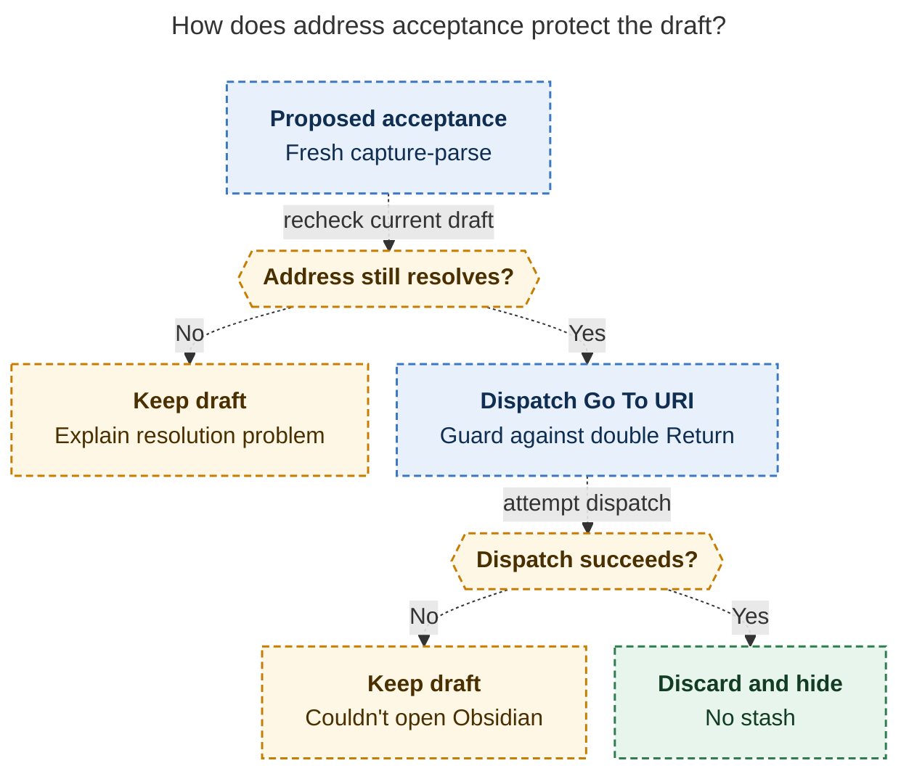
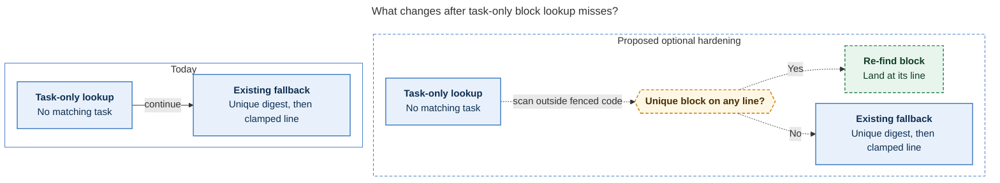

# Diagram proposals: `@foo^bar` as an exact Go To address in Bob Capture

Proposals for the swarm linker, not a report. Each diagram restates only what the source
report says.

```yaml
source: research:202611/caret_address_goto_capture/caret_address_goto_capture__final.md
producer: research.6d.image
check: "mmdc 12.0.0 (Puppeteer --no-sandbox) with the PDF-mirroring config rendered 2 of 2 Mermaid diagrams"
```

## acceptance-keeps-draft

```yaml
anchor: |-
  Resolution is re-run at accept time (fresh parse before dispatch)
question: |-
  What prevents a stale preview or failed dispatch from consuming the draft?
illustrates: |-
  Accept-time resolution and the shared URI dispatch path preserve the draft on failure and discard without stashing after successful dispatch.
caption: Proposed acceptance re-resolves the address before dispatch; resolution or dispatch failures preserve the draft, while success discards without stashing.
review: "640.957×914 px, fit 97.7%; question, source-trace and visual checks passed; 0 revisions"
```



## non-task-landing-fallback

```yaml
anchor: |-
  `findTaskLineByBlockId` only re-finds **task** lines; when a non-task block shifts
question: |-
  Where does the optional block fallback improve landing when a non-task block moves?
illustrates: |-
  The optional findAnyLineByBlockId fallback extends re-finding to non-task blocks after task-line search returns null, while keeping the existing landing ladder.
caption: Optional hardening inserts an any-block lookup after task-only lookup misses, retaining the existing digest and clamped-line fallbacks.
review: "818×635 px, fit 79.8%; question, source-trace and visual checks passed; 1 layout revision"
```


