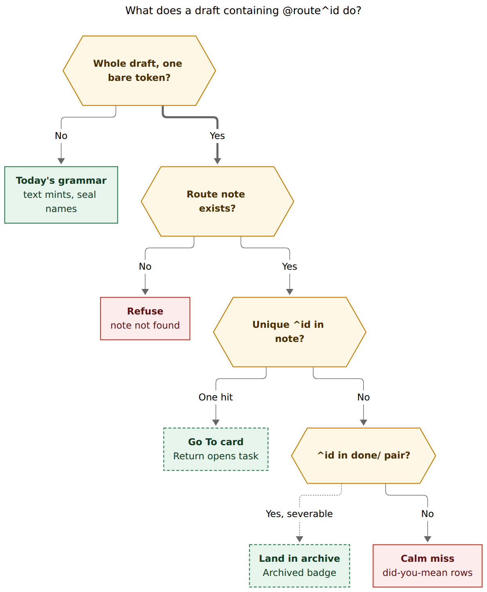

# `@foo^bar` as an exact Go To address in Bob Capture — consolidated research

**Lead consolidation, 2026-11-25.** Merges five independent reports — `__cdx`, `__cld`,
`__grk`, `__mus`, `__gem` (this directory) — plus a lead verification pass against the
bob-cli tree at `e6eb52a1`, the bob-mac-capture checkout opened via `sase repo open`,
and the screenshot `~/tmp/screenshots/20261125_135534.png`. Where the reports
disagreed, this report says who said what, what the code actually shows, and which way
to go.

## Verdict

**Build it — all five researchers independently said yes, and so do I.** A draft that
is exactly one bare `@route^id` token is a dead end today: parse calls it a complete
`task`, the panel enables Capture, and execution fails with the screenshot's `task text
is required` error, painted red twice. Every lexical neighbour already means something
(`@foo` pulls, `@foo:bar` links, `@foo+bar` ensures Next, `@foo^bar Text` mints,
`@foo^bar@` seals a project note); the bare caret form is the one unclaimed hole in the
marker-only family, and Go To is its natural read-only member. `/` searches when you
remember words; `@foo^bar` addresses when you know the location — they complement, not
compete. The vault even contains the feature's own task:
`bob.md:69 — "Allow @foo^bar syntax to jump to ^bar task in Obsidian!" ^capture-hat-jumps`.

**Recommended shape in one paragraph:** bob-cli claims a whole-draft bare `@route^id`
token and resolves it read-only **inside `capture-parse`** (new mode `task_goto`,
additive `goto` payload with `line`, `ref`, `block_id`, status, and text; grammar
30 → 31, schema 1). `bob capture` and `--dry-run` **refuse** the form with a teaching
error that names the landing, exactly as `/` and `//` refuse — capture never navigates,
navigation never writes. The Mac panel renders the resolved payload as a calm Go To
destination card, relabels the primary button, and on Return dispatches the existing
`obsidian://bob-goto-task` URI through the same discard-and-hide path the `/` picker
uses. Empty-body `@route^` (and partial `@route^int`) becomes a note-scoped Go To
browse instead of a mint-only "already used" denylist. Misses are calm did-you-mean
states, not error walls. One coordinated release train across bob-cli and
bob-mac-capture; an optional ~10-line hardening in bob-plugins.

## Verified ground truth

Facts below were probed live by the researchers on 2026-11-25 and, where marked ✓,
re-verified by the lead against the current checkouts.

| Fact | Evidence |
| --- | --- |
| `@bob^intention-rollovers` parses as a **complete** `task` (`needs: []`, body `""`), then dry-run fails with `task text is required` — the parse/execute split is why the panel shows "Preview failed" twice | Live `capture-parse` / `capture --dry-run` probes (all five reports); pinned by `src/native/capture/tests/grammar.rs:948` (`("@cash^id", "task text is required")`) |
| The target exists at `bob.md:82` (`[*] … ^intention-rollovers`); `bob.md` carries 98 used IDs, 96 on tasks, statuses mixed (20 Done, 8 Canceled) | grk's `block_id.used` probe |
| `GRAMMAR_REVISION` is **30** in the tree, so this feature ships as **31** ✓ | `src/native/capture_language/mod.rs:72` (cld's "29 → 30" used the installed binary's grammar 29 and is stale) |
| `capture-parse` already reads the vault — `record_policy_for_draft(&bob_dir(), …)`, `notebook_policy_for_draft`, Gmail offline context — so resolving a note lookup there follows precedent ✓ | `src/native/capture_parse.rs:128–133,1170` |
| `^` is hardcoded to the New-ID intent regardless of body text ✓ | `src/native/capture_block_ids.rs` (`else if marker == '^' { BlockIdIntent::New }`) |
| `/` and `//` whole-draft claims are refused in execution **before any other item parser**, so forced flags never mutate ✓ | `src/native/capture_language/item.rs:2262–2275` |
| The `/` search index has **no** `route^id` spelling — only `route:block-id` and bare `block-id` — so `/bob^intention-rollovers` finds 0 rows today ✓ | `src/native/capture_link_tasks.rs:336` (`link_task_search_fields`); cld's live probe |
| `switch_block_id_separator` already rewrites `.`/`:`/`+`/`,` between `@route:id`, `@route+id`, and `@route^id` in place — today the `.` tap onto `^` lands in the red error ✓ | `src/native/capture_language/rewrite.rs` |
| An unknown `block_id.intent` decodes as `.unsupported` in the Mac app, which renders the **generic New ID composer** — wire-safe (no crash, no write) but mint-flavored ✓ | `Sources/CaptureCore/CaptureModels.swift:11506–11518`, `BlockIDPickerIndex.swift:121,827` |
| The landing stack exists and is read-only: `obsidian://bob-goto-task?path&line&ref[&block]` re-finds by planned line + digest, then task line carrying `^block` (`findTaskLineByBlockId` requires a task line), then unique digest, then clamped line; records a `<C-o>` jump | `docs/reference/plugins/goto-task-uri.md`; `bob-plugins/.../180-editor-transactions.js:760` |
| Mac `/` accept dispatches the URI, discards without stashing, hides, and an in-flight flag swallows double Return | `CapturePanelModel.swift` (`acceptTaskGotoRow`, `taskGotoDispatchInFlight`) |
| Archives are paired: `bob.md` has `done_tasks: "[[done/bob_done]]"`; e.g. `^use-list-for-reflections` now lives only at `done/bob_done.md:2165` | cld's read-only vault probe |
| Governing constraints: the Mac is a thin client of bob's grammar and JSON; `capture-*` protocol names are frozen siblings, additive only; no new subcommand under `bob capture`; releases ride the daily train | `decisions:mac-capture-is-a-thin-client`, `sase/memory/cli_rules.md`, `decisions:bob-cli-releases-ride-a-daily-train` |

*Figure 1. A whole-draft bare `@route^id` token either resolves to a landing the panel
shows **before** Return, or refuses with a precise, fixable reason; any other draft
keeps today's grammar byte-for-byte. Duplicate `^id` hits inside one note also refuse,
naming both lines (folded into the "Unique ^id in note?" decision). Dashed nodes are
new behavior; the archive hop is deliberately severable. Rendered with mermaid-cli
12.0.0 at 827.7 × 1006 px, fit 78.9%.*

## Where the five reports disagreed, and the resolution

This is the consolidation's main work: the researchers agreed on *whether* and mostly
on *what*, but split on *where the semantics live*.

### 1. Does `bob capture` execute the goto read-only, or refuse it?

- **Execute read-only** (cld, grk): the form is complete and exact, unlike an
  unfinished `/x` query; success gives the terminal, the live preview, and
  Control-Return a working path through one submit pipeline.
- **Refuse, fail-closed** (cdx, mus, gem): capture's contract is "Go To never
  captures"; a read-only success breaks it and creates the worst skew failure — an
  **old Mac app** on a new bob would show a "Captured" toast, clear the draft, hide the
  panel, and never navigate. A silent no-op dressed as success.

**Resolution: refuse (majority), and resolve in `capture-parse` instead (gem's
architecture).** The phantom-toast hazard is real and the mitigation ("ship both halves
the same day") is hope, not a contract. The panel never needed `bob capture` for
navigation anyway — the `/` accept path dispatches the URI directly. With resolution in
`capture-parse`, the panel gets the destination from the same call it already makes on
every keystroke (one subprocess spawn, not two: the doomed dry run is skipped), and
`capture-parse` reading the vault has explicit precedent (record, notebook, Gmail
policies). cld's terminal concern is answered inside the refusal: the teaching error
names the landing —
`` `@bob^intention-rollovers` opens bob.md at ^intention-rollovers in Obsidian — it never captures. Add task text after the ID to create a task with this ID. ``
A later `bob open` command can serve terminal navigation properly if wanted.

### 2. What can `^id` land on — tasks only, or any block?

- **Tasks only, status-independent** (cdx): explain "not a task" rather than relabel
  generic blocks.
- **Task-bearing notes, notebook carve-out** (grk, mus).
- **Any unique block — open/closed tasks, notebook note bullets, plain bullets,
  headings — badged honestly** (cld, gem).

**Resolution: any unique block, badged.** Block IDs are note-unique addresses and
Obsidian's own `[[foo#^bar]]` opens whatever is there (mus's analogy). Refusing a valid
unique address the user typed is pedantry that makes the feature feel unreliable; the
cdx concern (don't mislabel) is answered by presentation (`Go To · Task` vs
`Go To · Note bullet` vs `Archived`), not refusal. Notebook routes get the same
treatment: bare `@nb^id` errors today (`notebook_note_required`), so claiming it as a
goto to the named note bullet fills the same hole without touching notebook *creation*
(which always carries the `@` seal or note text). This choice is the one place the
lead overrules a researcher (cdx) outright; it is listed as open question 2 in case
Bryan prefers the stricter read.

### 3. Archive fallback (`done/` pair)?

cld and gem want it in v1 (closed tasks leave the living note nightly, so remembered
addresses rot fast; the preview shows `Archived · done/bob_done.md` **before** Return —
never a silent redirect). cdx and mus defer it (scope).

**Resolution: recommended for v1, built last and explicitly severable** (the dashed
branch in Figure 1). The resolver reads the `done_tasks` frontmatter link and repeats
one scan; nothing redirects without the badge being shown first. Open question 1.

### 4. Empty/partial `@route^` — scoped Go To browse, or keep the mint composer?

gem and grk (strongly), plus cld, want empty-body `@route^` to become a note-scoped Go
To: the note's rows as **Go** rows (the `/` picker row shape: status glyph, text,
line), exact match pre-selected, "Next free `^id-2`" hidden, Return lands in one
motion. cdx warns the block-ID card is a minting surface and an old app shown a new
intent falls back to the New composer.

**Resolution: build the scoped browse — it is the everyday gesture** (`@bob.` via the
existing `.` → `^` alias is home-row; grk is right that the exact-address submit is the
fast path of this browse, not the whole feature). The lead verified cdx's compat
concern precisely: unknown intents decode to `.unsupported` → generic New ID composer.
That is wire-safe and writes nothing — the old app degrades to (roughly) today's dead
end — but it argues for the gentlest wire shape: **keep the completion context
`task_block_id` and `intent: "new"` unchanged, and add an additive goto payload**
(goto-eligible flag plus full-fidelity rows carrying `line`, `ref`, `target`, status,
text, section — not the `used` denylist, which grk correctly notes lacks landing fields
and ID-less rows). Old apps render exactly today's composer; new apps render Go rows.
The moment the draft gains body text at either edge, the card reverts to the mint
composer — empty-body-goto / nonempty-body-create is the same dual `@route:id` already
teaches.

### 5. Naming, button copy, and smaller splits

- **Mode name:** `task_goto` (grk, mus, gem) vs `block_goto` (cld) vs `task_address`
  (cdx). **Pick `task_goto`** — the need, context, and Mac machinery already carry this
  name, and `goto.target_kind` says what actually landed. cld's real naming point
  stands regardless: never call it "jump" (`CaptureJumpJson` / Ctrl+J successor-pin
  owns that word).
- **Primary button:** "Go To" (cdx, cld) vs "Open" (grk, gem). **Pick `Go To ↗`** — it
  matches the `/` card's established vocabulary and avoids colliding with the footer
  `⌃↩ Open` chip's capture-then-open meaning (the chip is hidden in this mode either
  way). Open question 3.
- **Duplicate `^id` in one note:** fail closed naming both lines (cdx, mus, gem) vs
  land-first-with-notice (cld). **Fail closed** — "reliable" means never landing
  somewhere the card did not show; the duplicate card offers "Open bob.md" to fix it.
- **Prefix auto-jump** (`@bob^intention` auto-resolving to `intention-rollovers`):
  **rejected unanimously.** Exact, case-sensitive ID or nothing; prefixes stay in the
  scoped browse. Unique prefixes rot when a second `intention-*` ID appears.
- **Strict plugin dispatch** (cdx): requiring a capability-gated strict block lookup
  with no clamped-line fallback is a real reliability idea but heavy for v1 (new
  capability negotiation across three repos). **Keep the existing re-find ladder**,
  which already verifies line + digest and shows a notice on a clamped landing, and add
  the small non-task fallback below. Strict mode is a follow-up.

## Requirement adjustments (called out)

| # | As requested | Adjusted to | Why |
| --- | --- | --- | --- |
| A1 | "captures of the form `@foo^bar`" jump | Only a **whole-draft, single-line, single bare token** (surrounding whitespace ignored) is a goto. Body text at either edge, child bullets, `@` seal, `#type`, `s:`, `$`, `%` directives, a second item, or `@@` keep today's meanings byte-for-byte | Same whole-draft rule as `/` and `//`; never silently discard typed metadata into a navigation, never steal `Fix it @foo^new-id` minting or `@foo^id@` seals (unanimous) |
| A2 | "jump to the `^bar` **task**" | Land on the unique line carrying `^bar` whatever it is — any-status task, note bullet, heading — with an honest badge; notebook routes included | Block IDs are note-unique addresses; `[[foo#^bar]]` behaves this way; refusing valid addresses reads as unreliability (majority; cdx dissent noted) |
| A3 | "in the ~/bob/foo.md file" | Resolve relative to the configured vault with today's route charset and resolver — never hard-coded `~/bob`, no path traversal, no `.md` spellings, no nesting beyond what routes already support | cdx; keeps one resolver, goto inherits route improvements for free (mus) |
| A4 | "just as if the user used `/`" | The **landing** is identical (same URI, same discard-no-stash, same hide, same `<C-o>` jump). The **plumbing** differs: resolution lives in `capture-parse`; `bob capture` refuses the draft like `/` instead of executing it | Disagreement 1 above; fail-closed across version skew, one spawn, thin-client compliant |
| A5 | (unstated) submit is the feature | The feature is a **scoped Go To**: `@foo^` / `@foo^int` browse that note's rows; the fully spelled exact address is its no-pick fast path | grk; `@bob.` is the everyday gesture, and the `.`-tap cycle `:` link / `+` ensure / `^` go to becomes coherent (gem) |
| A6 | (unstated) misses | A miss is a calm state: `No ^intention-rolovers in bob.md`, up to three did-you-mean rows applied only as explicit draft edits, plus the teaching line "add task text to create a task with this ID". An unused valid ID shows "available — add text to create" with no red flash while typing | cld, gem; today's `task text is required` teaches the wrong fix |
| A7 | (unstated) side effects | **None, ever**: no Task Link, no lane raise, no freshness stamp, no ledger write, no walk move, no block minting, no stash entry, no "Captured" toast | `/`'s "Go To never writes" promise, extended (unanimous) |

## Recommended design

### Claim (shared predicate in bob-cli)

A draft is a task goto exactly when, after trimming surrounding whitespace, it is one
item, one physical line, one whitespace-delimited token `@<route>^<block-id>` — route
in today's charset (`A–Z a–z 0–9 _ -`, lower-cased), ID passing the Bob validator
(`[A-Za-z0-9-]+`), no body, no seal, no section, no modifiers, no children. The
predicate lives beside `task_goto_query_token` / `note_goto_query_token` and is shared
by editor parse, completion, and the capture refusal, so the four surfaces can never
disagree (cdx's central warning). Acceptance boundary highlights:

| Draft | Behavior |
| --- | --- |
| `@bob^intention-rollovers` (± whitespace) | Go To card; Return opens `bob.md:82` |
| `@bob^` / `@bob^int` | Note-scoped Go To browse (goto-eligible block-ID card) |
| `@bob^x Fix it` / `Fix it @bob^x` | Mint with authored ID — unchanged, including duplicate-ID refusal |
| `@bob^x@`, `@bob^x@ %n`, `@bob^x#section` | Seal / notebook / section — unchanged |
| `@bob^x` + child bullet, or + second item | Refusal teaching the fork (never a partial navigation) |
| `@bob:x`, `^bob:x`, `@bob+x` | Link / ensure writes — unchanged |
| `@taxes^z-250414-15` (notebook route) | Go To the named note bullet, badged `Note` |

### Resolution ladder

1. Resolve the route exactly as minting/linking does. Missing note → `goto_note_not_found`.
2. Scan the note for lines whose trailing block ID equals `id` (case-sensitive, fenced
   code excluded, reusing bob's existing ID/task scanners). One hit → compute `line`
   and `ref` (`<line>:<digest>`, the same digest `open_notes` uses) plus display
   fields. Two-plus hits → `goto_duplicate_block_id`, naming the lines.
3. Zero hits → follow the note's `done_tasks` frontmatter pair once; a hit lands with
   `archived: true` (severable step).
4. Still nothing → `goto_block_not_found` with up to three did-you-mean rows (edit
   distance ≤ 2 / case / prefix in that note, then the same ID in other living notes),
   each carrying an exact replacement draft the Mac applies only as an explicit edit.

Resolution is re-run at accept time (fresh parse before dispatch) so a note edited
since the preview either still resolves or refuses — never lands nearby silently.

### Contract (additive; grammar 31, schema 1)

- **`capture-parse`:** `mode: "task_goto"`, `needs: []`, existing span kinds kept, plus
  a `goto` object: `status` (`found` / `missing_note` / `missing_block_id` /
  `duplicate_block_id`), `route`, `block_id`, `note_path`, `target`,
  `relative_path`, `line`, `ref`, `target_kind` (`task` / `bullet` / `notebook_note` /
  `heading`), `archived`, `section`, `text`, `status_symbol`, `status_name`,
  `closed`, optional `suggestion` rows and `valid_new_id` on misses. Old apps ignore
  the unknown mode and payload harmlessly (`decodeIfPresent` discipline).
- **`bob capture` / `--dry-run`:** refuse the claimed draft **before any other item
  parser**, beside the T3/T4 refusals, with the landing-naming teaching error above;
  forced flags change nothing; the whole batch rolls back.
- **`capture-complete`:** context stays `task_block_id`, `intent` stays `"new"`; add
  an additive goto-eligibility object with full-fidelity Go rows (disagreement 4).
  Mint-collision copy gains one clause: `— remove the text to go to it` (cld's bonus,
  so the refusal teaches the new form).
- **Bonus `/` indexing:** add `route^block-id` to `link_task_search_fields` and the
  Swift local matcher so `/bob^intention-rollovers` finds the task (verified missing
  today; gem, cld).
- No new subcommand, no renamed protocol field, release train without `!`.

### Mac panel (thin client)

- **Resolved card** replaces the write preview at the fixed eye line: `↗ GO TO` header,
  status glyph + task text as the strongest content, one quiet locator row
  (`bob.md · line 82 · Next`), badges (`Archived`, `Notebook`, `Done`), and the quiet
  promise `Opens in Obsidian · nothing is written`. Primary button **`Go To ↗`**;
  footer `⌃↩ Open` chip and Preview button hidden; no live dry run for this mode.
  Route blue and block-ID indigo token styling kept.
- **Keys:** Return, ⌘↩, ⌃↩, and the primary button all dispatch the same
  `bob-goto-task` URI through the `/` landing path — discard (no stash), hide, in-flight
  guard against double Return; dispatch failure keeps the draft with "Couldn't open
  Obsidian". Ctrl-C discards without stashing. Esc/q/⌃[ follow
  `decisions:q-and-ctrl-bracket-mirror-esc`.
- **Fast paste + instant Return:** if the latest accepted parse is stale for the
  current draft, run one synchronous `capture-parse` before deciding — never race into
  the old capture error (gem).
- **Scoped browse:** goto-eligible block-ID card shows Go rows (exact match
  pre-selected, "Next free" hidden); Return lands in one motion, Tab completes the ID
  into the resolved card; typing body text at either edge reverts to the mint composer
  live, with no red flash in between (including across the glued-`.` toggle
  `@bob:id` ↔ `@bob^id`, which becomes link ↔ go-to).

### bob-plugins (small, optional)

`findTaskLineByBlockId` only re-finds **task** lines; when a non-task block shifts
between preview and landing the handler falls through to the clamped line. Add
`findAnyLineByBlockId` (unique trailing `^id`, fenced code skipped) as a fallback only
when the task-line search returns null. Task behavior unchanged; URI contract stays v1.

### Version-skew matrix

| | Old Mac app | New Mac app |
| --- | --- | --- |
| **Old bob (≤30)** | Today's error — unchanged | Sees no `task_goto` mode; today's error, no crash |
| **New bob (31)** | Parse mode unknown → ignored; submit hits the **refusal** (an error, not a phantom toast — the fail-closed win); `^` card decodes additive payload away and shows today's composer | Full feature |

## Critique summary

Strengths (consensus): fills a dead-end hole, so no behavior is lost; the address is
symmetric with minting (`@bob^x` mints, `[[bob#^x]]` links, bare `@bob^x` opens); it
follows the house rule that a marker-only form acts on the existing thing; it reaches
what `/` cannot (closed, archived, non-task, note-scoped); the entire landing stack
already exists, so this is rails, not groundwork.

Honest costs: one more read-only form inside a family of writers, one character from
`@bob:x` (a ledger write) — answered by the card and button making "nothing is written"
unmistakable; the caret/colon asymmetry (`@r^x` opens while `^r:x` still links) will
confuse someone once — document the contrast, do not flip the colon form (mus); the
block-ID card gains a second personality keyed strictly to empty-body state; and the
feature spans two repos on one train, with the macOS gate watched to green on the exact
SHA.

## Rollout

1. **bob-cli:** shared claim predicate; resolver + `goto` payload in `capture-parse`;
   capture refusal; completion goto payload; `/` index bonus; grammar 31; docs
   (`docs/capture.md` "Going to a task with `@route^id`" beside the `/` section, the
   four-alone-forms teaching table `@r:x` links / `^r:x` links / `@r^x` opens /
   `text @r^x` creates, `docs/reference/capture-syntax.md`, alphabetized `--help`);
   goldens for the whole acceptance boundary, updating the two tests that pin
   `task text is required` for the bare token.
2. **bob-mac-capture:** destination card + button relabel + chip/preview hiding; URI
   dispatch through the `/` landing path with stale-parse and in-flight guards;
   goto-eligible block-ID card; calm miss states. macOS CI watched on the exact SHA.
3. **bob-plugins:** the non-task re-find fallback; deploy via `bob plugins sync`.
4. After shipping, propose a decision record through `/sase_memory_write`: *a
   whole-draft bare `@route^id` is a read-only Go To: exact address, any block, archive
   pair fallback, fail-closed duplicates, never writes; nonempty bodies still create;
   `/` stays vault-wide search.*

Key acceptance checks (consolidated): vault `git status` clean after resolution and
accepted navigation; dry-run and real capture refuse identically; every A1-table row
behaves as written; duplicate and miss cards never navigate; double Return dispatches
once; `@bob^use-list-for-reflections` lands archived with the badge; `Fix @bob^new-id`
mints byte-identically to today; old-app pairings match the skew matrix; `/`, `//`,
seals, notebooks, and `@foo:bar` regress nowhere.

## Open questions for Bryan

1. **Archive fallback in v1?** Recommended (preview shows the badge before Return), but
   cleanly severable if v1 should shrink.
2. **Any-block targets, or tasks-only?** Recommended any unique block, badged; cdx
   preferred tasks-only with a "not a task" explanation.
3. **Primary button copy:** `Go To ↗` (recommended, matches the `/` card family) or
   `Open ↗`.
4. **Scoped browse Return:** land immediately (recommended, matches `/`) or only insert
   the ID and let a second Return land.

## Follow-ups, not v1

Whole-draft `[[foo#^bar]]` paste as a goto (changes what a link-only capture means —
needs its own decision); a capability-gated strict plugin lookup with no clamped-line
fallback (cdx); an Obsidian "Copy Bob address" command yielding `@route^id` for the
task under the cursor (cld); terminal navigation via a future `bob open`; notebook
Option-landing refinements.

## Sources

The five sibling reports in this directory (each lists its own live probes, source
links at pinned SHAs, and memory reads). Lead verification: bob-cli checkout
(`capture_language/mod.rs`, `capture_parse.rs`, `capture_block_ids.rs`, `rewrite.rs`,
`capture_link_tasks.rs`, `item.rs`), bob-mac-capture checkout via `sase repo open`
(`CaptureModels.swift`, `BlockIDPickerIndex.swift`), and the screenshot
`~/tmp/screenshots/20261125_135534.png`. Figure rendered with
`@mermaid-js/mermaid-cli@12.0.0` under the PDF-mirroring config.
