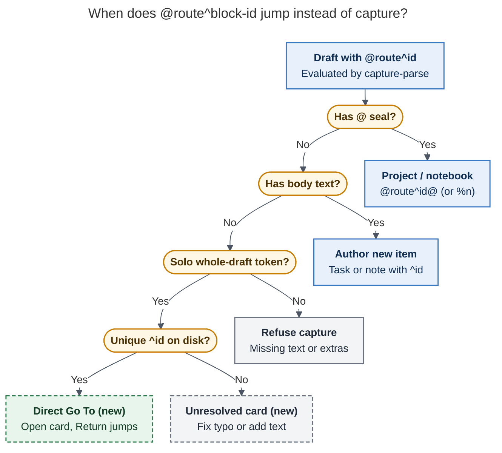
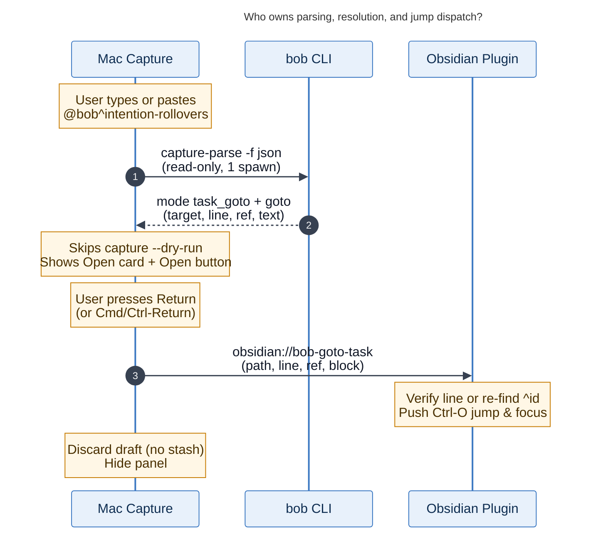

# Direct `@route^block-id` Go To in Bob Capture: Design, Critique, and Implementation Plan

**Date:** 2026-11-25  
**Scope:** `bob-cli`, `bob-mac-capture`, `bob-plugins` (`bob-navigation-hotkeys`)  
**Status:** Design research & recommendation

---

## Executive Summary & Verdict

**Verdict: Strongly recommended — with four concrete requirement refinements.**

Allowing a standalone `@foo^bar` draft in Bob Capture to jump directly to `^bar` in `foo.md` is not an ad-hoc shortcut; it closes an actual structural gap in the capture language. Every other marker-only `@route<op>id` token already resolves an existing task (`@foo` pulls from a note, `@foo:bar` links to today's Pomodoro, `@foo+bar` ensures Next, `@foo+bar!` toggles its link), and `switch_block_id_separator` in `bob-cli` already lets you tap `.` to cycle between `@foo:bar`, `@foo+bar`, and `@foo^bar`. Today, cycling onto `@foo^bar` — or typing/pasting `@bob^intention-rollovers` directly, as in `~/tmp/screenshots/20261125_135534.png` — crashes straight into a red error wall (`task text is required; pass TEXT or pipe it on stdin`) with a disabled `⌃↩ Open ↗` control and a broken blue `Capture` button.

However, implementing `@foo^bar` naively inside `bob capture` would introduce two serious hazards: a **version-skew silent no-op** if an older Bob Mac Capture build submits `@foo^bar` to a newer `bob` binary, and an **authoring regression** if `@foo^` steals ergonomics from creating new tasks (`@foo^new-id Do X`), project notes (`@foo^new-proj@`), or notebooks (`@foo^nb@ %n`).

**Recommended Architecture (Summary):**

1. **Resolve read-only inside `bob capture-parse` (Grammar 31, Schema 1)** via an additive `mode: "task_goto"` and `goto` payload — zero new `capture-*` subcommands (honoring `sase/memory/cli_rules.md`) and **one subprocess spawn** per draft instead of two.
2. **Keep `bob capture` strictly mutating**: refuse standalone `@foo^bar` with a clear teaching error matching `/` and `//`, guaranteeing fail-closed safety across `bob-cli` / `bob-mac-capture` version skew.
3. **Give `@foo^` a note-scoped Go To picker (`block_id.intent: "goto"`)** that lists the note's targets for one-keystroke jumping while preserving `+ New ID` creation and `@` type-through sealing for `@foo^new-proj@`.
4. **Render a calm, dedicated Go To preview card** in Bob Mac Capture that relabels the primary action to **`Open ↗`**, hides the redundant `⌃↩ Open ↗` footer chip, binds `↩` / `⌘↩` / `⌃↩` to the same read-only `obsidian://bob-goto-task` jump, excludes the draft from the canceled-draft stash, and turns missing/typo IDs into helpful suggestions or quiet authoring prompts instead of error walls.
5. **Expand resolution beyond open `#task` rows** to any unique `^block-id` in the note (open tasks, closed tasks, notebook notes, and plain bullets/headings) with transparent fallback to `done/<route>.md`, backed by an optional ~10-line fallback in `bob-navigation-hotkeys`.

---

## 1. Context & Diagnosis

### 1.1 What Happens Today (Screenshot Analysis)

In `~/tmp/screenshots/20261125_135534.png`, the user types `@bob^intention-rollovers` into Bob Mac Capture:

- **Token highlighting already understands the syntax**: `@bob` renders in route blue and `^intention-rollovers` renders in block-ID purple.
- **Live dry-run fails loudly**: `bob capture --dry-run` hits `missing_text_error()` (`src/native/capture_language/item.rs:1394`) and emits `capture item 1 starting on line 1: task text is required; pass TEXT or pipe it on stdin`. (On a notebook route, `src/native/capture_language/notebook.rs:1871` similarly emits `notebook_note_required`.)
- **The UI amplifies the friction**: the same error string appears *twice* (in the top error banner and again inside the red-framed preview box), accompanied by `Retry` and `Copy Diagnostic` buttons, a `Preview failed` status pill, a dimmed `⌃↩ Open ↗` button, and a blue `Capture` button.

### 1.2 The Missing Cell in Marker-Only `@route<op>id`

Bob Capture's marker-only shorthand family already has an intuitive symmetry across note routes and block-ID operators — except for `^`:

| Whole-draft form | Current `bob capture-parse` mode | Current semantics | Mutates vault? |
| :--- | :--- | :--- | :---: |
| `@foo` | `note_pull` | Pull ready tasks from `foo.md` | Yes |
| `@foo:bar` | `pomodoro_link` | Link `foo.md#^bar` into today's Pomodoro | Yes |
| `@foo+bar` | `task_toggle` (`EnsureNext`) | Ensure `foo.md#^bar` is Next | Yes |
| `@foo+bar!` | `task_toggle` (`Toggle`) | Toggle Pomodoro link on `foo.md#^bar` | Yes |
| **`@foo^bar`** | **`item` (error)** | **Fails: `task text is required`** | **Dead end** |
| `/query` | `incomplete` (`needs: ["task_goto"]`) | Fuzzy search tasks → jump in Obsidian | No |
| `//query` | `incomplete` (`needs: ["note_goto"]`) | Fuzzy search notes → open in Obsidian | No |

### 1.3 Two Hidden Compounding Gaps in the Current Codebase

Inspecting `bob-cli` revealed two concrete gaps that make this feature even more valuable than it first appears:

1. **The separator-switch dead end (`src/native/capture_language/rewrite.rs:2073`)**: `switch_block_id_separator` already lets you tap `.` after `@foo:bar` or `@foo+bar` to rewrite the token in place to `@foo^bar`, and tap `:`, `+`, or `,` after `@foo^bar` to switch back. On a marker-only draft like `@bob:intention-rollovers`, tapping `.` currently rewrites it to `@bob^intention-rollovers` and immediately crashes the preview into the screenshot's red error screen. Giving `@foo^bar` read-only Go To turns `:`, `+`, and `^` into a cohesive **3-way operator cycle** on any existing task: **`:` link · `+` ensure/toggle · `^` jump**.
2. **`/` search doesn't even index `route^block-id` (`src/native/capture_link_tasks.rs:336`)**: `link_task_search_fields()` indexes `route:block-id` and bare `block-id`, but not `route^block-id`. Even if a user copies `@bob^intention-rollovers` from a log or note and replaces `@` with `/`, `/bob^intention-rollovers` returns zero matches today.

---

## 2. Critical Evaluation & Alternatives

### 2.1 Honest Critique: Is `@foo^bar` Actually a Good Idea?

**Yes — when you know the route and block ID (or want to browse inside one note), `/` is the wrong mental model.**

`/` is a *global fuzzy search* across the entire vault. It shines when you remember words from a task title ("rollover", "sync bug"). It feels sluggish or noisy when:

- You already know the note and ID (muscle memory like `@bob^intention-rollovers`, or pasting from a `[[bob#^intention-rollovers]]` link, terminal log, or chat message).
- You want to browse tasks *scoped to a single note* (`@bob^`) and jump to one without wading through global matches.
- You just pulled up `@bob:intention-rollovers` or `@bob+intention-rollovers` to link or ensure a task, realized you want to read its notes first, and tap `.` to switch to `^`.

**Where the idea has real traps (and why naive implementations fail):**

1. **The `@foo^` dual-intent collision.** In Bob's grammar, `^` is *already* the authoring operator for naming a new task (`@foo^new-id Fix bug`), creating a sealed project note (`@foo^new-proj@`), or creating a notebook (`@foo^nb@ %n`). Today, `src/native/capture_block_ids.rs:163` hardcodes `if marker == '^' { BlockIdIntent::New }` regardless of whether body text exists. If `@foo^` blindly hijacks `^` for Go To only, authoring new IDs and sealed project notes becomes awkward; if it stays `New`-only, typing `@bob^` fails to help you find existing IDs to jump to.
2. **The Old-App × New-Bob version-skew footgun.** `bob-cli` ships on a daily release train (`decisions:bob-cli-releases-ride-a-daily-train`) while `bob-mac-capture` ships on its own release cadence. If `@foo^bar` were handled by `bob capture` returning `ok: true` with a new `kind: "task_goto"` payload, an older Bob Mac Capture build would recognize `ok: true`, show a green preview, enable `Capture`, submit the draft, clear the text, dismiss the panel, and **never open Obsidian** — a silent no-op disguised as success.
3. **Half-typed capture vs. intentional jump.** A user authoring `@foo^my-new-id Fix the bug` passes through the intermediate state `@foo^my-new-id` for a fraction of a second before typing ` Fix the bug`. If that prefix happens to collide with an existing ID or looks alarming while typing an unused ID, the panel must stay calm: unused IDs should quietly invite body text (never flash a red error banner), and pressing `Return` on an *unused* ID must never silently create or jump.
4. **Over-broad capture claiming.** A draft like `@foo^bar #bug` or `@foo^bar` followed by child bullets or a second item is clearly an incomplete *capture* missing its task title — silently turning it into a read-only jump would discard the user's extra metadata or child notes.

### 2.2 Comparing Five Architectural Approaches

| Option | Mechanism | Thin-client fit | `cli_rules.md` compliance | Old App × New `bob` safety | Live preview spawns | UX quality | Verdict |
| :--- | :--- | :---: | :---: | :---: | :---: | :---: | :--- |
| **A. Resolve inside `bob capture-parse` (Recommended)** | `capture-parse` emits `mode: "task_goto"` + additive `goto` object; `bob capture` refuses standalone `@foo^bar`; Mac Capture dispatches `obsidian://bob-goto-task` | Exact (`bob` owns grammar + vault lookup) | Exact (additive to frozen `capture-parse`) | **Safe (fail-closed)**: old app sees `bob capture` refusal | **1 spawn** (skips `capture --dry-run`) | Dedicated Open card, calm unresolved states, zero error flash | **Recommended** |
| **B. New `bob capture-goto` subcommand** | Separate CLI subcommand queried by Mac Capture when `capture-parse` flags `@foo^bar` | Good | **Violates `cli_rules.md`** ("`capture-*` protocol names are frozen siblings") | Safe if `capture` refuses | 2 spawns (`parse` + `goto`) | Same UI, higher latency & protocol surface | Rejected |
| **C. Handle in `bob capture` (`ok: true`, `kind: "task_goto"`)** | `bob capture --dry-run` and `bob capture` return a read-only jump payload | Violates "Go To never enters `bob capture`" | OK | **Broken**: old Mac Capture shows "Captured", clears draft, never opens Obsidian | 2 spawns (`parse` + `capture --dry-run`) | Risky semantic overload of `Capture` | Rejected |
| **D. Parse/read `foo.md` directly in Swift** | Mac Capture resolves `~/bob/foo.md` and searches `^bar` locally | **Violates `decisions:mac-capture-is-a-thin-client`** | N/A | N/A | 0–1 spawns | Duplicates route resolution, archive fallback, notebook & ledger logic in Swift | Rejected |
| **E. Don't add `@foo^bar`; only fix `/` to accept `foo^bar`** | Index `route^block-id` in `/` and tell users to type `/foo^bar` | Exact | Exact | Safe | 1 spawn | Fails the `.` separator-switch cycle, breaks `@route` muscle memory, still flashes red error on `@foo^bar` | Insufficient alone (adopt `/` fix as bonus) |

**Why Option A cleanly wins:** `src/native/capture_parse.rs` *already* reads `BOB_DIR` (`super::env::bob_dir()`), inspects notes on disk for `record_policy_for_draft` (`capture_parse.rs:128`) and `notebook_policy_for_draft` (`capture_parse.rs:133`), reads today's ledger for `ThemeCatalog`, and attaches additive resolved objects (`record`, `themes`, `gmail`) while keeping `schema_version = 1` and bumping `GRAMMAR_REVISION` (`src/native/capture_language/mod.rs:72`, currently `30`). Putting the single-note lookup for standalone `@route^block-id` into `capture-parse` follows established precedent, obeys `cli_rules.md` to the letter, cuts live-preview latency in half (1 spawn vs 2), and keeps `bob capture` 100% fail-closed for older clients.

---

## 3. Justified Requirement Adjustments

The original prompt asks that submitting `@foo^bar` jump to the `^bar` task in `~/bob/foo.md`, just like `/` search. Four deliberate adjustments make the feature safer, more useful, and much nicer to use:

### Adjustment 1: Restrict Direct Go To to Whole-Draft, Single-Token, Modifier-Free `@route^block-id`
- **Original implication:** Any capture of the form `@foo^bar` jumps.
- **Adjustment:** Trigger `task_goto` **only** when the entire trimmed draft is a single `@route^block-id` token on one line with no trailing text, no child bullets, no second item, no `@@`, no `#type`/clock tags, no `s:N`/`$N`/`&`/`*`/`~` relations, no `%c`/`%n`/`%f` directives, no `@` seal, and no forced CLI `-r` override.
- **Justification:** Anything carrying extra tokens or children is a partially-written *capture* missing its task body. Jumping there would silently throw away typed metadata or child bullets; refusing as an incomplete capture protects user intent.

### Adjustment 2: Resolve Any Unique `^bar` Block ID in `foo.md`, Plus `done/foo.md` Archive Fallback
- **Original implication:** Jump to the `^bar` *task* in `~/bob/foo.md`.
- **Adjustment:** Resolve **any** unique line carrying trailing `^bar` in `<route>.md` — open tasks, closed (`[x]` / `[-]`) tasks, notebook note bullets (`decisions:notebook-routes-write-notes`), and plain section bullets/headings — and fall back transparently to `done/<route>.md` when the active note doesn't exist (badged clearly as `Archived · done/foo.md`).
- **Justification:** `@route^id` is already used to author block IDs on notebook notes and non-task bullets, and users frequently jump back to closed or archived tasks. Restricting to open `#task` lines would make valid IDs look "missing" for no good reason. Because `obsidian://bob-goto-task` verifies line + SHA-256 `ref` digest first (`675-plugin-goto-task-uri.js:165`), jumping to any line already works when unchanged, and a 10-line fallback in `bob-navigation-hotkeys` makes shifted non-task lines equally resilient.

### Adjustment 3: Upgrade `@foo^` Into a Dual-Purpose Note-Scoped Go To Picker That Preserves New-ID & `@` Seal Authoring
- **Original implication:** Focused on submitting completed `@foo^bar`.
- **Adjustment:** When the whole draft is marker-only `@foo^` (or `@foo^<partial>`), have `bob capture-complete` return `block_id.intent: "goto"` with the note's existing rows (plus `⌘X` Completed toggle and notebook bullets on notebook routes), while keeping a trailing `+ New ID · <typed>` row and **type-through `@` sealing** so `@foo^new-proj@` works without a hitch.
- **Justification:** Users don't only paste `@foo^bar` — they type `@foo^` and expect Bob to help finish `bar`, just as `@foo:` and `@foo+` already do. Making `^` a real note-scoped Go To picker completes the UX while protecting `@foo^new-id` and `@foo^new-proj@` muscle memory. And because `CaptureBlockIDIntent` in Swift (`Sources/CaptureCore/CaptureModels.swift:11507`) already maps unknown `intent` strings to `.unsupported` (falling back to the `New` composer), this is **100% forward-compatible** with older Mac Capture builds.

### Adjustment 4: Keep `@foo^bar` Strictly Read-Only Outside `bob capture` (Plus Bonus `/` Indexing)
- **Original implication:** "allowing captures of the form `@foo^bar`".
- **Adjustment:** Treat `@foo^bar` as a **read-only navigation action** resolved by `bob capture-parse` and executed via `obsidian://bob-goto-task`, never as a `bob capture` mutation (refusing it in `bob capture` with a teaching error, matching `/` and `//`). In addition, index `route^block-id` in `link_task_search_fields()` (`src/native/capture_link_tasks.rs:336`) and Swift's local matcher so `/bob^intention-rollovers` also finds the task.
- **Justification:** Keeps the `bob capture` mental model pure ("Go To never captures"), eliminates the Old-App × New-Bob silent-no-op hazard, halves live-preview latency, and ensures `/` and `@` never surprise someone who swaps the leading sigil.

---

## 4. Recommended Design

### 4.1 Grammar & Classification Rules

A draft enters direct Go To only through a narrow, unambiguous gate in `bob-cli`'s capture classifier (`src/native/capture_language/editor_classify.rs`), evaluated after `@` seal detection and body-text checks:


*Figure 1. Classification gate for drafts containing `@route^block-id`. Dashed boxes mark new read-only paths; all existing `@` seal, task/note authoring, and incomplete-capture paths remain unchanged.*

#### Complete Acceptance & Refusal Truth Table

| Draft | Classification (`mode`) | Behavior | Why |
| :--- | :--- | :--- | :--- |
| `@bob^intention-rollovers` | `task_goto` (`found`) | Show Open card; `↩`/`⌘↩`/`⌃↩` jumps to `bob.md#^intention-rollovers` | Solo, modifier-free `@route^id` matching unique block ID |
| `@area/sub^id` | `task_goto` (`found`) | Same, resolving nested route `area/sub.md` | Nested area/project/notebook paths work identically |
| `@old-proj^id` (in `done/`) | `task_goto` (`found`, `archived: true`) | Same, badged `Archived · done/old-proj.md` | Archive fallback matches `capture-targets` / `//` |
| `@nb^note-id` (notebook route) | `task_goto` (`found`, `target_kind: "note"`) | Jumps to note bullet `^note-id` in `nb.md` | Notebooks hold note bullets with `^id` |
| `@bob^intention-rollover` (typo) | `task_goto` (`missing_block_id` + suggestion) | Calm card with closest ID suggestion (`Tab` / click to accept) | Typo recovery without red error wall |
| `@bob^brand-new-id` (valid unused ID) | `task_goto` (`missing_block_id`, no close typo) | Calm "Available ID — add text to create a task with `^brand-new-id`" card; `Return` disabled | Smooth prefix transition while authoring `@bob^brand-new-id Do X` |
| `@bob^dup-id` (2+ lines in note) | `task_goto` (`duplicate_block_id`) | Calm warning naming duplicate line numbers + `Open bob.md` action | Never jumps ambiguously to an arbitrary match |
| `@nope^foo` (missing note) | `task_goto` (`missing_note`) | Calm "No note `nope.md`" card (with route suggestion if close) | Consistent non-alarming unresolved UX |
| `@bob^` (empty ID after `^`) | `incomplete` (`needs: ["block_id"]`) | Opens note-scoped Go To picker (`intent: "goto"`) | Lets user browse/pick any target in `bob.md` or type a new ID |
| `@bob^id@` or `@bob^id@ %n` | Existing project/notebook creation | Unchanged | `@` seal always means project/notebook creation |
| `@bob^id Fix bug` | Existing `item` | Unchanged (authors new task with `^id`) | Body text present → capture |
| `@bob^id` + child bullet / `#type` / `s:2` / `%c` / 2nd item | Existing `item` (refused) | Refused as missing task text / invalid extras | Extra capture syntax never silently discarded into a jump |
| `@@bob^id` | Existing error / note-wide route | Refused (unchanged) | `@@` is a draft-wide route modifier, not a single-task jump |

#### Completing the Separator-Switch Triad (`rewrite.rs:2073`)

`switch_block_id_separator` already handles `.`, `:`, `+`, and `,` after `@route<op>id`. With direct `@route^id` Go To, all three operators form a lossless, zero-retyping cycle on a marker-only draft:

- `@bob:intention-rollovers` (**Link** to Pomodoro) → tap `.` → `@bob^intention-rollovers` (**Open** in Obsidian)
- `@bob+intention-rollovers` (**Ensure Next**) → tap `.` → `@bob^intention-rollovers` (**Open** in Obsidian)
- `@bob^intention-rollovers` (**Open** in Obsidian) → tap `:` (**Link**) or `+`/`,` (**Ensure Next**)

Note on syntax highlighting: keep the existing `route` (blue) + `block_id` (purple) spans — they already visually communicate "target note + exact block ID" cleanly and distinguish `@bob^id` from `/` fuzzy search.

---

### 4.2 Protocol & Thin-Client Architecture

Per `decisions:mac-capture-is-a-thin-client` and `sase/memory/cli_rules.md`, `bob-cli` owns grammar classification, note/archive resolution, line/ref digest computation, Pomodoro status lookup, and typo suggestions; Bob Mac Capture owns presentation, input timing, and dispatching `obsidian://bob-goto-task`.


*Figure 2. Component ownership and subprocess lifecycle for direct `@route^block-id` Go To. `bob capture` is never invoked.*

#### 1. `bob capture-parse` Additive Contract (Grammar 31, Schema 1)

Bump `GRAMMAR_REVISION` from `30` to `31` (`src/native/capture_language/mod.rs:72`), keep `SCHEMA_VERSION = 1` (`src/native/capture_parse.rs:36`), add `EditorMode::TaskGoto` (`"task_goto"` in `src/native/capture_language/editor_model.rs:332`), and attach an optional additive `goto` object on `CaptureParseResult` (`src/native/capture_parse.rs:621`) whenever `mode == "task_goto"`.

Notice the clean distinction from `/` search:
- `/` search keeps `mode: "incomplete"`, `needs: ["task_goto"]` (picker-driven global search).
- `@foo^bar` emits `mode: "task_goto"`, `needs: []`, plus the resolved `goto` payload.

**Example JSON (`status: "found"`):**

```json
{
  "schema_version": 1,
  "grammar": 31,
  "mode": "task_goto",
  "needs": [],
  "spans": [
    { "start": 0, "end": 4, "kind": "route" },
    { "start": 4, "end": 24, "kind": "block_id" }
  ],
  "goto": {
    "status": "found",
    "route": "bob",
    "block_id": "intention-rollovers",
    "target": "bob.md",
    "relative_path": "bob.md",
    "note_path": "/Users/bryan/bob/bob.md",
    "note_kind": "project",
    "archived": false,
    "target_kind": "task",
    "line": 42,
    "ref": "a9c1f0e4b2d8...",
    "text": "Investigate daily intention rollovers when midnight crosses",
    "section": "Next",
    "depth": 0,
    "status_symbol": "/",
    "status_name": "In Progress",
    "status_type": "IN_PROGRESS",
    "scheduled": "2026-11-26",
    "closed": false,
    "pomodoro": {
      "linked_today": true,
      "active": false,
      "label": "POM #2 — BOB"
    }
  }
}
```

**Unresolved `goto.status` variants (same object shape, optional fields omitted when absent):**

- `"missing_block_id"`: includes `target`, `relative_path`, `note_path`, `note_kind`, `archived`, optional `suggestion` (`{ "block_id": "intention-rollovers", "replacement": "@bob^intention-rollovers", "distance": 1, "text": "..." }`), and `valid_new_id: true|false` (so Mac Capture knows whether adding body text creates a valid new task with `^id`).
- `"missing_note"`: includes `route`, `block_id`, optional `suggestion` (`{ "route": "bob", "replacement": "@bob^intention-rollovers" }`).
- `"duplicate_block_id"`: includes `target`, `relative_path`, `note_path`, `duplicate_lines: [42, 87]`, `error`.

**Implementation reuse in `bob-cli`:**
- Reuse `capture_targets` route resolution + `done/` archive lookup (already used for `//` and `@route`).
- Reuse `note_tasks` / `capture_link_tasks` line scanning + `ref` SHA-256 digest helper so the `line`, `ref`, `path`, and `block` parameters match `obsidian://bob-goto-task` byte-for-byte (`docs/reference/plugins/goto-task-uri.md`).
- Reuse `capture_block_ids` edit-distance/prefix matching for typo suggestions (`distance <= 2` or unambiguous unique prefix).
- Only perform disk resolution when the whole draft classifies as `EditorMode::TaskGoto` — **zero I/O overhead** for ordinary captures.

#### 2. `bob capture` Refusal (T5 Invariant)

In `src/native/capture/mod.rs` (matching the existing refusals for `/` and `//`), a whole-draft `@route^block-id` passed to `bob capture` (with or without `--dry-run`) returns exit code 1 with a clear teaching message:

> `` `@bob^intention-rollovers` opens `bob.md` at `^intention-rollovers` in Obsidian — it never captures. Add task text after the ID to create a new task with `^intention-rollovers`, or submit it in Bob Mac Capture to jump there. ``

*(Note: in CLI context without a GUI, this also avoids silently pretending to open Obsidian over SSH or scripts, while documenting how to author a task if the user forgot the body text.)*

#### 3. `bob capture-complete` Note-Scoped Go To Picker (`BlockIdIntent::Goto`)

In `src/native/capture_block_ids.rs`:
- Add `BlockIdIntent::Goto` (serialized as `"goto"`) to `enum BlockIdIntent` (`capture_block_ids.rs:33`).
- Replace the hardcoded `if marker == '^' { BlockIdIntent::New }` (`capture_block_ids.rs:163`) with a `detect_caret_intent()` helper mirroring `detect_colon_intent()` (`capture_block_ids.rs:445`):
  - If the draft is whole-draft marker-only `@route^<prefix>` (no body text, no trailing tokens, no `@` seal, no other items) and `<route>` resolves to an existing note: return `BlockIdIntent::Goto` with the note's open tasks (and notebook bullets on notebook routes), honoring `--closed-tasks` for the `⌘X` Completed toggle. Include each row's `line`, `ref`, `block_id` (nullable for ID-less tasks, which can still jump by `line` + `ref`!), `status_symbol`, `text`, `section`, and `pomodoro` metadata.
  - Otherwise (body text present, multi-item draft, or note does not exist yet): return `BlockIdIntent::New`, preserving existing new-ID authoring behavior untouched.

#### 4. Version-Skew Compatibility Matrix (`bob-cli` × `bob-mac-capture`)

Because the two repositories release independently, all four combinations must degrade gracefully:

| | **Old `bob-mac-capture`** | **New `bob-mac-capture`** |
| :--- | :--- | :--- |
| **Old `bob-cli` (grammar 30)** | Unchanged (existing error) | Sees `mode != "task_goto"`; shows existing behavior cleanly (no crash) |
| **New `bob-cli` (grammar 31)** | Decodes unknown `mode: "task_goto"` safely; `bob capture` refuses with clear teaching error (never silently "captures"); decodes `intent: "goto"` as `.unsupported` → falls back to `New` picker | Full direct `@foo^bar` Go To card, 1-spawn resolution, `@foo^` Go To picker, and `Open ↗` primary action |

---

### 4.3 User Experience & Visual Design

This feature should feel **quiet, immediate, and unmistakable** — the opposite of the red error wall in `~/tmp/screenshots/20261125_135534.png`.

#### Before vs. After (Screenshot Transformation)

| Element | Today (`20261125_135534.png`) | With Proposed Design (`@bob^intention-rollovers`) |
| :--- | :--- | :--- |
| **Error banner** | Red banner: `capture item 1 starting on line 1: task text is required...` | **Gone** (zero error chrome) |
| **Preview area** | Red box repeating same error + `Retry` + `Copy Diagnostic` | **Calm `CaptureTaskGotoPreviewCard`**: neutral card showing note badge, task status chip, task title, section/Pomodoro metadata, and subtle `Read-only · jumps in Obsidian` hint |
| **Status pill** | `Preview failed` (red) | `Ready to open` (calm neutral/accent) |
| **Footer `⌃↩ Open ↗` chip** | Visible & disabled | **Hidden** (avoid redundant "Open ↗" next to "Open ↗") |
| **Primary button** | `Capture` (blue, broken) | **`Open ↗`** (enabled; `Return`, `⌘↩`, `⌃↩` all trigger jump) |

#### Preview Card States (ASCII Wireframes)

**State 1: Resolved Target (`status: "found"`)**

```text
┌─────────────────────────────────────────────────────────────────────────┐
│ @bob^intention-rollovers                                                │
├─────────────────────────────────────────────────────────────────────────┤
│  ↗ GO TO TASK · bob.md · Next · L42               [In Progress] [POM #2]│
│                                                                         │
│  [/] Investigate daily intention rollovers when midnight crosses        │
│      ^intention-rollovers · Scheduled 2026-11-26                        │
│                                                                         │
│  Read-only · press Return to jump in Obsidian (or : / + to link/ensure) │
├─────────────────────────────────────────────────────────────────────────┤
│ Ready to open    Templates 2  Stash 1   Discard   Preview   [ Open ↗ ]  │
└─────────────────────────────────────────────────────────────────────────┘
```
*(For archived notes, the header chip reads `Archived · done/old-proj.md`; for notebook notes, `↗ GO TO NOTE · nb.md · L18`; for closed tasks, `[x] Done` muted styling.)*

**State 2: Close Typo (`status: "missing_block_id"` with `suggestion`)**

```text
┌─────────────────────────────────────────────────────────────────────────┐
│ @bob^intention-rollover                                                 │
├─────────────────────────────────────────────────────────────────────────┤
│  ? No ^intention-rollover in bob.md                                     │
│                                                                         │
│  Did you mean  @bob^intention-rollovers  ?          [ Tab to accept ]   │
│  [/] Investigate daily intention rollovers when midnight crosses        │
│                                                                         │
│  Or add task text after the ID to create a new task.                    │
├─────────────────────────────────────────────────────────────────────────┤
│ Not found        Templates 2  Stash 1   Discard   Preview   [ Open ↗ ]* │
└─────────────────────────────────────────────────────────────────────────┘
  (*Open ↗ disabled until accepted or corrected)
```

**State 3: Unused Valid ID (`status: "missing_block_id"`, `valid_new_id: true`, no close typo)**

```text
┌─────────────────────────────────────────────────────────────────────────┐
│ @bob^new-feature-id                                                     │
├─────────────────────────────────────────────────────────────────────────┤
│  + ^new-feature-id is available in bob.md                               │
│                                                                         │
│  Type task text after the ID to create a new task, or type @ to start   │
│  a new project note (@bob^new-feature-id@).                             │
├─────────────────────────────────────────────────────────────────────────┤
│ Add task text    Templates 2  Stash 1   Discard   Preview   [ Capture ]*│
└─────────────────────────────────────────────────────────────────────────┘
  (*Capture disabled until text is typed — zero red error flash while typing!)
```

**State 4: Duplicate Block ID (`status: "duplicate_block_id"`)**

```text
┌─────────────────────────────────────────────────────────────────────────┐
│ @bob^dup-id                                                             │
├─────────────────────────────────────────────────────────────────────────┤
│  ! ^dup-id appears twice in bob.md (lines 42, 87)                       │
│                                                                         │
│  Block IDs must be unique for direct Go To.                             │
├─────────────────────────────────────────────────────────────────────────┤
│ Ambiguous ID     Templates 2  Stash 1   Discard   Preview [Open bob.md] │
└─────────────────────────────────────────────────────────────────────────┘
  (Opens bob.md at line 42 via obsidian://bob-open-notes so you can fix it)
```

#### The `@foo^` Note-Scoped Go To Picker UX

When typing `@bob^` (and optional query text like `@bob^int`):

- **Picker header:** `Go To · bob.md` with subtle `⌘X Completed` toggle chip (mirroring the `/` picker).
- **Candidate rows:** Existing open tasks (or notebook notes on notebook routes) in `bob.md`, showing status glyph, title, `^block-id` pill (when present; ID-less rows remain selectable and jump via `line` + `ref`), and section/Pomodoro badges.
- **Trailing creation row:** Whenever the typed query is a valid single-token unused block ID (no spaces), show a subtle separator and `+ New ID · ^<query> in bob.md` at the bottom (never auto-selected ahead of an existing match, auto-selected only when there are zero existing matches).

| Key while `@foo^` Go To picker is open | On an existing row | On `+ New ID · ^<query>` row |
| :--- | :--- | :--- |
| **`↩` / `⌘↩` / `⌃↩` / Click** | **Jump immediately** via `obsidian://bob-goto-task`, discard draft (no stash), hide panel | Insert `@foo^<query> ` (with trailing space so user can type task text immediately) |
| **`⇥` (Tab)** | Insert `@foo^<id>` into editor (dismiss picker → shows `CaptureTaskGotoPreviewCard`, ready to inspect or tap `:`/`+` to pivot!) | Insert `@foo^<query>` (no space, ready for `@` seal or space) |
| **Type `@`** (valid single-token unused ID) | — | **Type-through commit**: closes picker, writes `@foo^<query>@`, transitions seamlessly into project/notebook creation |
| **`⌘X`** | Toggle closed tasks (`--closed-tasks`) | Toggle closed tasks |
| **`Esc` / `⌃[` / `q`** *(when not typing)* | Dismiss picker (keeping editor text) | Dismiss picker |

Notice how **`Tab` on an existing row** makes the picker compose effortlessly with the preview card and separator-switching: you can type `@bob^int`, press `Tab` to fill `@bob^intention-rollovers`, inspect its preview card (or press `:` to turn it into a Pomodoro link), or just press `Return` right in the picker to jump in a single beat.

---

### 4.4 Reliability, Race Conditions & Edge Cases

1. **Fast Paste + Immediate `Return` (`CapturePanelModel.swift:4269`)**  
   A user may paste `@bob^intention-rollovers` and press `Return` in <50 ms, before debounced live analysis completes. In `submit(openAfterCapture:)`:
   - If the latest accepted `capture-parse` matches the current draft and has `mode == .taskGoto`, dispatch immediately if `goto.status == .found` (or do nothing + announce status if unresolved).
   - If analysis is stale or still in flight for the current draft, **await / run one synchronous `bob capture-parse -f json`** for the exact draft text before deciding whether to jump or submit `bob capture`. This guarantees pasted `@bob^id` + instant `Return` *never* races into a spurious `bob capture` error.

2. **Double-Return Guard (`taskGotoDispatchInFlight`)**  
   Reuse `taskGotoDispatchInFlight` (`CapturePanelModel.swift:1289, 12207`) across both `/` Go To and direct `@foo^bar` Go To so rapid double-`Return` never fires two `obsidian://bob-goto-task` launches or duplicates `<C-o>` jump-list entries.

3. **Failure Handling on Obsidian Launch**  
   Follow the exact pattern of `/` Go To: only discard the draft and hide the panel *after* `ObsidianOpenURL` / `NSWorkspace.shared.open` succeeds. If launching Obsidian fails, keep the draft open and show an inline status error so the user never loses what they typed.

4. **Never Stash Read-Only Go To Drafts (`CapturePanelModel.swift:7034`)**  
   Extend `draftIsReadOnlyGoto` to include `lastAnalysisIsDirectGoto` (true when `mode == .taskGoto` and `goto.status == .found`, plus when the `@foo^` Go To picker is open). Pressing `Ctrl+C`, `Esc`, or quitting the app discards `@bob^intention-rollovers` cleanly instead of polluting the canceled-draft stash. *(Subtlety: if `goto.status == .missingBlockId && validNewId`, the user may be mid-authoring a new task, so wait to treat it as read-only until it actually resolves — or discard cleanly only when resolved!)*

5. **Non-Task Block ID Drift Hardening in `bob-plugins` (`675-plugin-goto-task-uri.js:176`)**  
   Today `obsidian://bob-goto-task` resolves in two stages:
   - **Stage 1 (`L165`)**: Verify `planned` line against `ref` (SHA-256 of the line). Works for **every** line type (tasks, notebook notes, headings, plain bullets).
   - **Stage 2 (`L176`)**: If the line shifted between parse and open, fall back to `findTaskLineByBlockId(sourceLines, block)` (`180-editor-transactions.js:760`), which filters by `isObsidianTaskAtLine` (`#task`).  
   - **Optional 10-line hardening**: Add `findAnyLineByBlockId(sourceLines, block)` as a fallback *only* when `findTaskLineByBlockId` returns `null` (skipping fenced code blocks, matching unique trailing `^<block>`). Zero risk to existing task jumps, and notebook notes / plain bullets survive concurrent edits too.

6. **Keyboard Parity (`Return`, `⌘↩`, `⌃↩`, `Esc`, `q`, `⌃[`)**  
   - In direct Go To state (`status == .found`), `Return`, `⌘↩`, and `⌃↩` all execute the same jump (no awkward "Capture & Open" distinction).
   - In `status == .missingBlockId` with a typo `suggestion`, `Tab` accepts the suggestion right from the editor.
   - `Esc` / `⌃[` respects `decisions:q-and-ctrl-bracket-mirror-esc`.

---

## 5. Phased Implementation Roadmap

### Phase 1: `bob-cli` (Grammar 31, Read-Only Resolution & Picker Intent)
1. **Grammar & Classifier** (`src/native/capture_language/`):
   - Bump `GRAMMAR_REVISION` `30` → `31` (`mod.rs:72`).
   - Add `EditorMode::TaskGoto` (`"task_goto"`) in `editor_model.rs:332`.
   - Classify whole-draft, single-line, single-token, modifier-free `@route^block-id` (no `@` seal, no body text, no children/extras) as `EditorMode::TaskGoto` in `editor_classify.rs`.
2. **Read-Only Resolution in `capture-parse`** (`src/native/capture_parse.rs`):
   - Add `CaptureParseGoto` struct + `goto: Option<CaptureParseGoto>` on `CaptureParseResult`.
   - Resolve active note → `done/` archive fallback → unique `^block-id` match (open tasks, closed tasks, notebook notes, non-task lines) → `line`, `ref`, metadata, today's Pomodoro badge, or `missing_note` / `missing_block_id` (with typo suggestion + `valid_new_id`) / `duplicate_block_id`.
3. **Refusal in `bob capture`** (`src/native/capture/mod.rs`):
   - Refuse whole-draft `@route^block-id` cleanly in both `--dry-run` and real execution with the T5 teaching error.
4. **Picker Intent & `/` Bonus** (`src/native/capture_block_ids.rs`, `src/native/capture_link_tasks.rs`):
   - Add `BlockIdIntent::Goto` (`"goto"`) with `detect_caret_intent()` for whole-draft marker-only `@route^`.
   - Add `route^block-id` to `link_task_search_fields()` (`capture_link_tasks.rs:336`) so `/bob^intention-rollovers` also matches.
5. **Docs & Tests**:
   - Update `docs/capture.md`, `docs/reference/capture-syntax.md`, and unit/integration tests (`src/native/capture_language/tests/goto.rs`, `src/native/capture/tests/grammar.rs`).

### Phase 2: `bob-plugins` (Optional ~10-Line Hardening)
- In `plugins/bob-navigation-hotkeys/src/180-editor-transactions.js` and `675-plugin-goto-task-uri.js:176`, add a unique non-fenced `findAnyLineByBlockId` fallback after `findTaskLineByBlockId` returns `null`, then deploy with `bob plugins sync`.

### Phase 3: `bob-mac-capture` (1-Spawn Preview Card, Picker, & Submit Flow)
1. **Models** (`Sources/CaptureCore/CaptureModels.swift`):
   - Decode `mode == "task_goto"` + `CaptureParseGoto` payload.
   - Add `case goto = "goto"` to `CaptureBlockIDIntent` (`L11507`).
   - Add `route^block-id` to Swift local `/` search index (`TaskLinkPickerPresentation.swift` / `BlockIDPickerIndex.swift`).
2. **Panel Model** (`Sources/BobMacCapture/CapturePanelModel.swift`):
   - When `capture-parse` returns `mode == .taskGoto`, **skip `bob capture --dry-run`** completely and populate `directGotoPresentation`.
   - Update `primaryActionTitle` (`L2774`) → `"Open ↗"` (or `"Open <note>"` for duplicate ID), hide redundant `⌃↩ Open ↗` footer chip, and bind `Return` / `⌘↩` / `⌃↩` to `openDirectGoto()` using `taskGotoDispatchInFlight` (`L1289`).
   - Handle fast paste + `Return` by ensuring fresh `capture-parse` before falling through to `bob capture`.
   - Add `lastAnalysisIsDirectGoto` to `draftIsReadOnlyGoto` (`L7034`).
   - Wire `BlockIdIntent.goto` into the `@foo^` picker with `↩` direct jump, `⇥` insert into editor, trailing `+ New ID` row, `⌘X` Completed toggle, and `@` seal type-through.
3. **Panel View** (`Sources/BobMacCapture/CapturePanelView.swift`):
   - Build `CaptureTaskGotoPreviewCard` covering the 4 calm states (Found, Typo Suggestion with `Tab` accept, Available New ID, Ambiguous Duplicate / Missing Note).
4. **Verification**:
   - Run `cargo test` in `bob-cli`, Swift tests + `scripts/dev/macos-ci-check` (and watch exact-SHA macOS GitHub Actions to green) in `bob-mac-capture`, and manual end-to-end verification in Obsidian for active tasks, archived tasks, notebook bullets, typo suggestions, `.` separator cycling, `@foo^new-proj@` type-through, and fast paste + `Return`.
