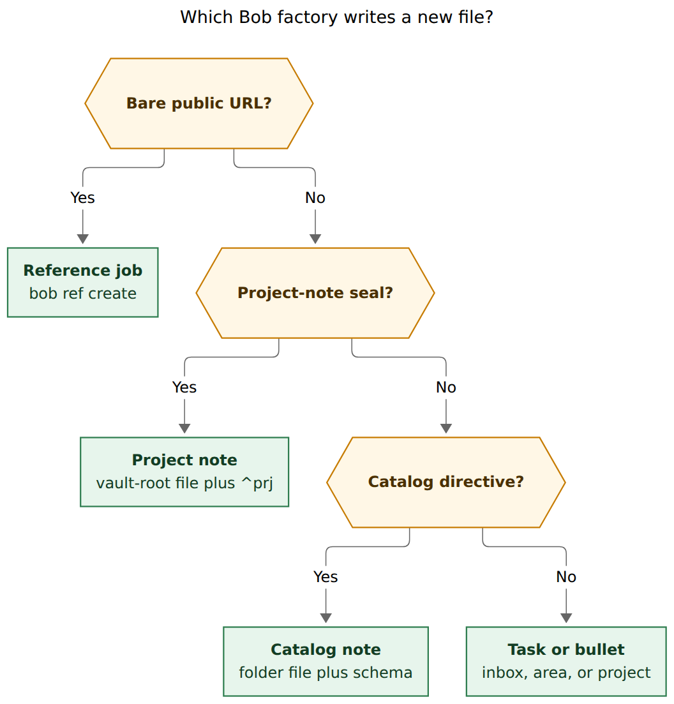
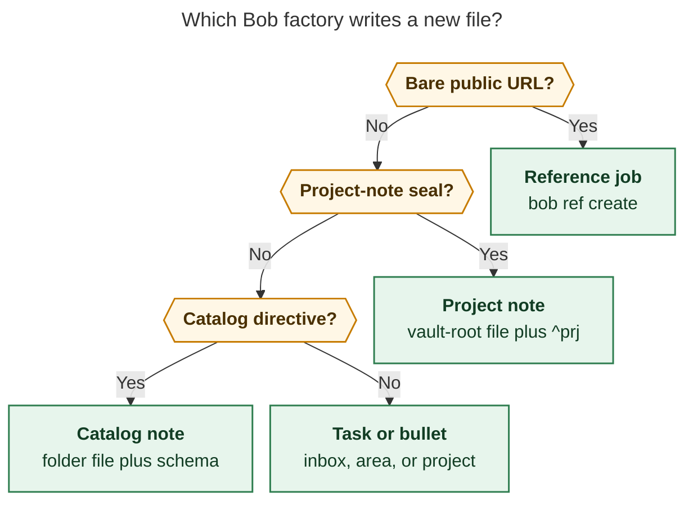
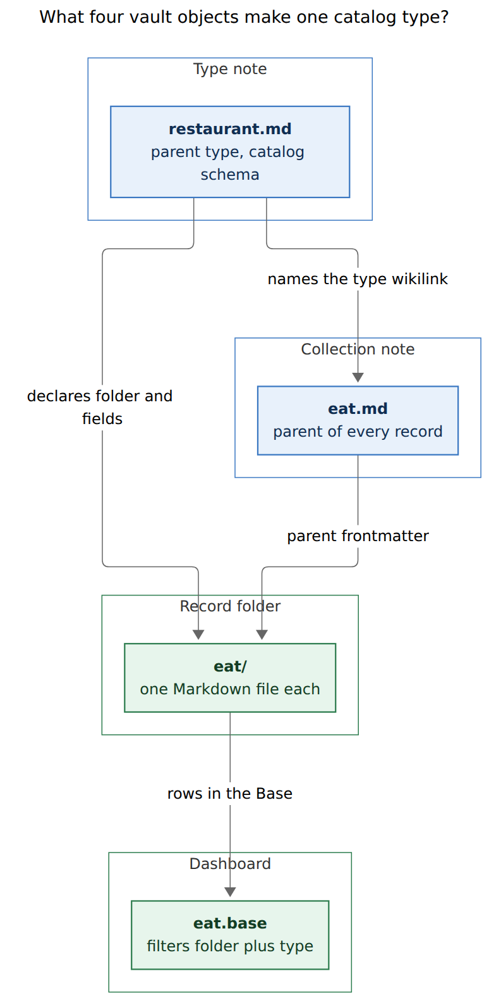
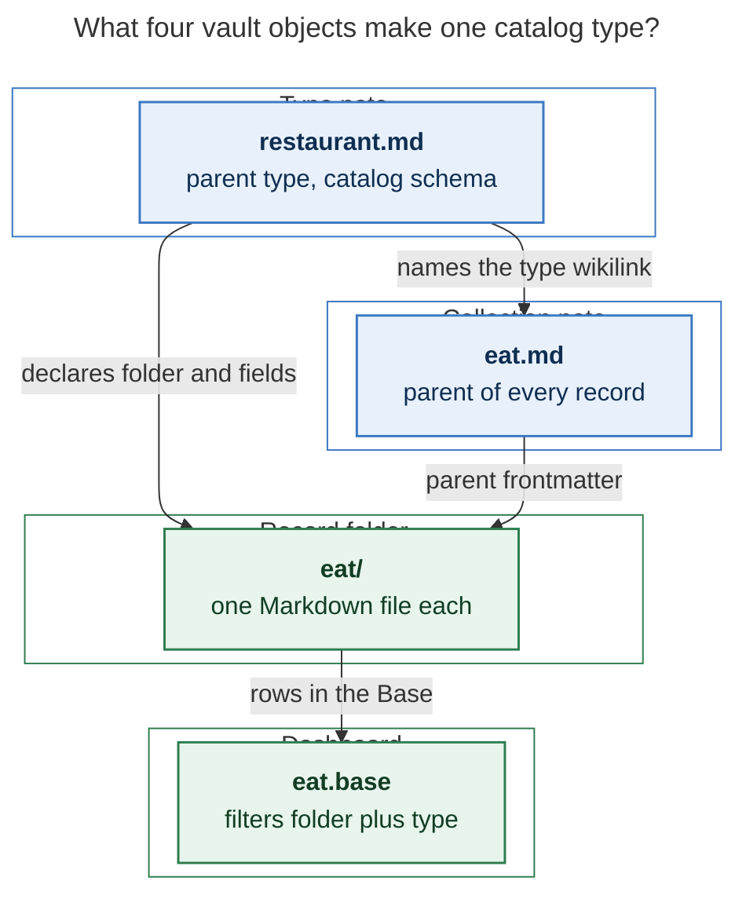
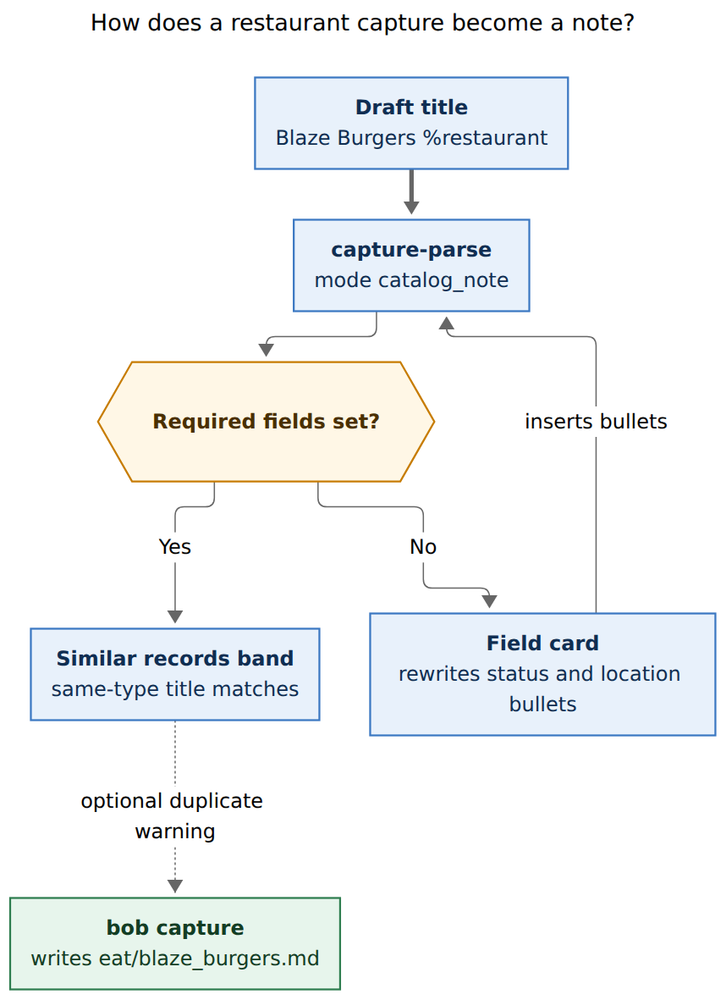
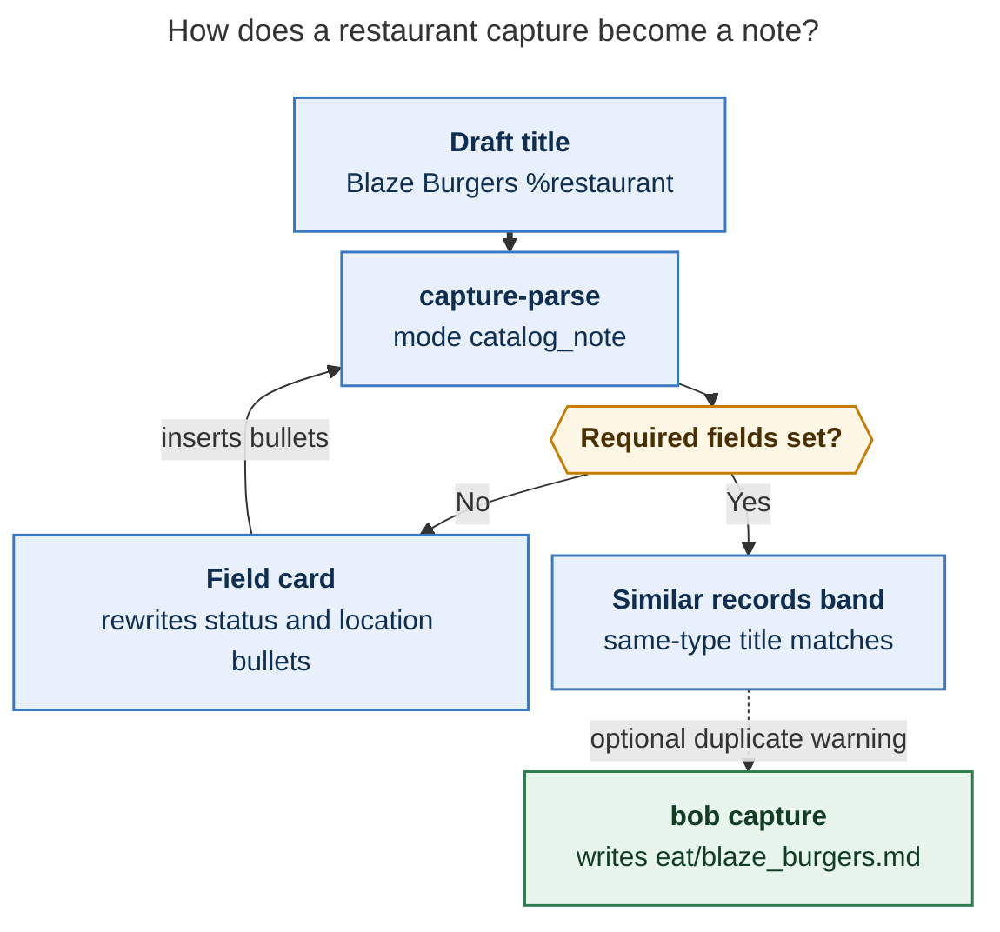

# Catalog type capture for restaurants, podcasts, and kin

- **Researcher:** grk
- **Date:** 2026-11-08
- **Question:** How should Bob grow generalized capture for vault notes that use custom-defined types, with `~/bob/eat/` as the first use-case, and with podcasts, TV shows, and movies as possible siblings? Is the idea sound, what should change, and what should be built?
- **Verdict:** Build a **catalog-type** layer, a third file factory beside project notes and reference jobs. Put a machine-readable schema on the existing type notes (`restaurant.md`, `podcast.md`). Capture it with a `%restaurant` / `%podcast` directive, field bullets, and a Mac field card that rewrites those bullets. Do **not** invent a second `bob types`, do **not** reuse the project-note `@route^id@` seal, and do **not** ship TV or movie types until those catalogs exist.

---

## 1. In one breath

The vault already has the shape this feature wants. Ninety-two restaurant notes live under `eat/` with `type: "[[restaurant]]"`. Fifteen podcast notes live under `podcasts/` with `type: "[[podcast]]"`. Each collection has an Obsidian Base dashboard. What is missing is a **Bob writer**: capture can create tasks, bullets, project notes, and reference jobs, and it cannot create a catalog record.

The requested feature is a good idea once it is narrowed. "Custom note type" as a universal constructor for every `type:` value would collide with engines that already own `project`, `area`, `ref`, `article`, `mail`, `day`, and `done`. The productive subset is **catalog types**: one-note-per-entity records in a dedicated folder, with a small schema, no `^prj` task, and a Base as the dashboard.

Recommended capture:

```text
Blaze Burgers %restaurant
- status: liked
- category: Burgers
- location: Linden
```

Mac Capture fills the required fields with a card that rewrites those bullets. `bob capture` writes `eat/blaze_burgers.md` in the Rush Bowl shape (human fields plus `created`, no zorg `source_*` residue). CLI management lives under a new noun `bob catalog`, because `bob types` already means ALL-CAPS task types and `bob capture` cannot grow subcommands.

---

## 2. What the vault already is

### 2.1 Type notes exist, and they have no schema

`~/bob/type.md` is the hub ("Types of bob notes that are used as the `type` frontmatter field"). Its children with `parent: "[[type]]"` are:

| Type note | Engine today | Folder of records | Capture can create one? |
| --- | --- | --- | --- |
| `project.md` | `bob projects`, `@route^id@` seal | vault root | yes |
| `area.md` | capture routes, `@route` tasks | vault root | by Templater / Cmd+N |
| `ref.md` | `bob ref create` | `ref/` | URL capture / `bob ref create` |
| `article.md` | `bob articles` | vault root | `bob articles adopt` |
| `mail.md` | `bob gmail new` | `gmail.folder` | `bob gmail new` |
| `day.md` | Templater daily notes | `YYYY/` | Mac daily-note flow |
| `done.md` | archive | `done/` | `bob task archive` |
| `restaurant.md` | none | `eat/` | **no** |
| `podcast.md` | none | `podcasts/` | **no** |

`restaurant.md` and `podcast.md` already describe one-note-per-entity records and point at `eat/` and `podcasts/`. Their frontmatter is only `parent` and `created`. Required fields live in prose. Bob cannot enforce them.

### 2.2 Restaurant records are a real catalog

`eat/` holds **92** notes. Every one has:

| Field | Present | Nulls | Role |
| --- | --- | --- | --- |
| `parent: "[[eat]]"` | 92/92 | 0 | collection parent |
| `type: "[[restaurant]]"` | 92/92 | 0 | type identity |
| `title` | 92/92 | 0 | display name |
| `status` | 92/92 | 0 | `liked` (85) or `not_liked` (7) |
| `location` | 92/92 | 0 | town string or `[[nj_towns#^…]]` |
| `category` | 92/92 | 6 | cuisine; Breakfast 18, Coffee 11 |
| `lid` | 92/92 | 11 | short table alias |
| `companions` | 92/92 | 2 empty | almost always `[[kelly]]` |
| `source_*` | ~90/92 | — | split provenance from `eat.md` |
| `visited` | 2/92 | — | hand-added visit date |
| `created` | 1/92 | — | hand-added timestamp |

`eat.base` already filters `file.inFolder("eat")` and `note.type == link("restaurant")`, and paints verdict / cuisine / town views. Capture that writes those fields will show up in the dashboard with no extra work.

The two notes that look like **hand-made records** (the target for new capture) are `eat/rush_bowl.md` and `eat/brown_fox_coffee_box.md`. Rush Bowl has no `source_*` fence, a `visited` date, empty companions, and dated `## Notes`. That is the beautiful new-note shape. The other 90 files still carry a `## Source` fence copied from `eat.md` table rows.

`eat.md` itself is a converted zorg table (`generated_from_zorg: true`, parent `[[h2_role]]`, **no** `type:`). It still holds about **107** table rows plus footnotes. The split into `eat/` is incomplete, and the table is still the place Bryan has been adding restaurants (Toast on 2026-02-02 is both a table row and `eat/toast.md`).

`maybe_eat.md` is a separate wishlist (`o P5` rows, about 12 still open), parented to `[[maybe]]`, with location / URL / inspired-by notes. Those are restaurants Bryan has never tried. The restaurant type currently has no `maybe` status.

`eat.md` is **not** a capture route. `bob capture-targets` lists inbox, area, and non-terminal project notes. `eat.md` is untyped, so `@eat Blaze Burgers` is the wrong idea even before syntax: it would mean "a task in eat.md" if eat were ever marked `[[area]]`.

### 2.3 Podcasts already match the same pattern

`podcasts/` holds **15** notes. Every one has `parent: "[[podcasts]]"`, `type: "[[podcast]]"`, `title`, `status` (`subscribed` 9 / `unsubscribed` 6), `category`, `url`, and `zorg_id`. `podcasts.base` mirrors `eat.base`. `podcasts.md` is a better index than `eat.md`: it wikilinks to `podcasts/<stem>` instead of duplicating the table.

Episode notes belong to the **reference** engine (`podcast_ref.md`, `lit/podcasts`). A show catalog and an episode PDF/ref are different objects. Catalog capture should create the show note. A Spotify URL for an episode should keep going through `bob ref` / URL capture.

### 2.4 TV, movies, books, people, drink

| Candidate | What exists | Catalog? |
| --- | --- | --- |
| Podcasts | 15 notes, type, folder, Base | **yes, ship in v1** |
| Restaurants | 92 notes, type, folder, Base | **yes, first use-case** |
| TV | `tv.md` is one bullet ("The Studio") | no catalog |
| Movies | no `movies.md`; `chad_movie.md` is an LLM prompt | no catalog |
| Books | `books.md` is a legacy `#book` table under `[[ref]]` | already `bob ref` |
| Videos | `videos.md` is YouTube **refs**, parent `[[ref]]` | already `bob ref` |
| People | `people.md` is a `%ldap` alias table | different system |
| Drink | `drink.md` is two liquor-store rows, parent `[[eat]]` | too small |
| Mail / articles / projects | specialized CLIs | engine types |

Bryan's Keep-backed task on `bob.md` (`bob__custom-note-types`) names "restaurants, podcasts, TV shows, and movies" and asks for CLI plus a capture schema. The vault evidence supports restaurants and podcasts. TV and movies are a wish, not a corpus.

### 2.5 Capture already has three file factories

From `docs/reference/capture-syntax.md` and `docs/capture.md` (grammar 19):

1. **Tasks and bullets** — `@route`, `@route#Section`, `@route+id`, lists.
2. **Project notes** — `@route^block-id@` / `@route:block-id@` write `<route>_<id>.md` at the vault root, with `type: "[[project]]"`, `template: "[[new_project]]"`, and a `^prj` line. CLI renders the note directly and never reads Templater.
3. **Reference jobs** — a bare public URL queues `bob ref create`.

Sigil contract (`decisions:capture-sigils-say-where-what-how`): **`@` says where, `#` names a place or a task type, `%` says how.** Current `%` directives are `%c` clip, `%n` Pomodoro note, `%t` bulk template, `%l` listen. Bare `%` opens the directive picker. Bare `#` opens **task type** completion (`FIX`, `BUILD`), refused when the name is not configured (`type_not_configured`).

Mac Capture is a thin client (`decisions:mac-capture-is-a-thin-client`): grammar, completion, preview, and writes belong to `bob`. New behavior lands in `capture-parse` / `capture-complete` / `bob capture` first; the app decodes spans, needs, and cards.

CLI rules: never add a subcommand under `bob capture`; `capture-*` protocol names are frozen siblings that may grow additively; nest user commands under a noun with a stated membership rule; `bob types` is the task-type catalog.

---

## 3. Critique of the plan

The implied plan: add generalized capture for custom-defined note types; each type declares required frontmatter and a directory; start with `eat/`; maybe also podcasts / TV / movies; invent a capture syntax that makes required fields easy.

**What is right**

- One-note-per-entity is already how restaurants and podcasts live. Capture should be able to add the next Toast without opening `eat.md` and aligning a table.
- A per-type schema is the right source of truth. Bases and Dataview cannot require fields at write time.
- A per-type directory is already how `eat/` and `podcasts/` work, and how `eat.base` / `podcasts.base` filter.
- Capture is the right surface. The Mac panel is where a field card can be beautiful; `bob capture` is the only writer Mac Capture is allowed to call.
- CLI management belongs in the same change. The `bob.md` task says so explicitly.

**What is wrong or incomplete**

1. **"Custom type" is too wide.** `type: "[[project]]"` is already a custom type with an engine. A generic constructor that also created projects, refs, or mail notes would fork those engines. The feature needs a closed opt-in (a `catalog:` block on the type note).
2. **Type name, collection note, and folder are three objects.** The request says "associated with its own directory (like `~/bob/eat/`)". The type is `restaurant`, the collection is `eat.md`, the folder is `eat/`. Podcasts make the same split (`podcast` vs `podcasts/`). The schema must name all three. Treating the folder name as the type name would mis-file restaurants under `restaurant/` and break `eat.base`.
3. **`@eat` cannot mean "new restaurant".** `@` already means "task destination". `eat.md` is an untyped zorg table. Promoting it to an area would make `@eat` append `#task` rows into the restaurant list. The project-note seal `@eat^blaze@` would create a **project** `eat_blaze.md` at the vault root with a `^prj` task. Both are the wrong file.
4. **`#restaurant` cannot mean the note type.** `#` at an item edge is task-type completion. Task types are ALL-CAPS work kinds (`bob types`). Mixing `restaurant` into that menu teaches the wrong vocabulary, and `type_not_configured` already refuses unknown hashes.
5. **TV and movies are not first-class yet.** Shipping empty `tv/` and `movies/` types adds schema without records. The engine should make adding a type cheap (write a type note with `catalog:`). The first shipped types should be the two that already have files.
6. **Required-only schemas would fight the data.** Category is null on 6 restaurants; lid is null on 11; companions are empty on the two hand-made notes. Optional fields with defaults and suggestions are part of "easy to input the correct values", not a later extra.
7. **`source_*` is migration residue.** Prompting for `source_note`, `source_anchors`, `source_dates`, or `source_lines` would make new capture worse than typing into `eat.md`. New notes should look like Rush Bowl.
8. **Dual-writing `eat.md` plus `eat/` is two sources of truth.** `eat.base` is already the dashboard. New capture should write the folder note only. Leave the zorg table alone; migrate it later.
9. **Templater is the wrong writer.** Project-note capture already renders YAML itself and never reads `_templates/new_project.md`. Folder templates today apply `_templates/new_note.md` only to vault-root Cmd+N. Catalog capture should write the note the same way project capture does: Bob-owned bytes, atomic with the rest of the draft.
10. **`bob types` is taken.** A note-type CLI stuffed under `bob types` would mix Pomodoro work-kinds with restaurant records. A new noun is required.

The idea is a good product. The implementation that treats every `type:` as a generic form, or that overloads `@` / `#`, is a bad one.

---

## 4. Justified requirement adjustments

These change the user's wording. They are deliberate.

| # | Original | Adjustment | Why |
| --- | --- | --- | --- |
| A1 | "Custom-defined types" for any note | Call the feature **catalog types**. Opt in with a `catalog:` block on a type note. Engine types stay on their existing commands. | `project` / `ref` / `mail` / `article` / `area` / `day` / `done` already have writers. |
| A2 | "Each type associated with its own directory" | Schema names **folder**, **collection** (parent note), and **type** separately. | `restaurant` → folder `eat`, parent `[[eat]]`. |
| A3 | Maybe also TV / movies / podcasts | v1 ships **restaurant** and **podcast**. TV / movie become types when a real list exists. Drink and people stay tables. Books stay refs. | Corpus evidence; adding a type later is a type-note edit. |
| A4 | Required fields only | Support **required, optional, defaulted, and machine** fields. | Matches `eat/` nulls and Rush Bowl. |
| A5 | Unspecified capture syntax | `%type` directive plus `key: value` field bullets. Field card rewrites bullets. | `%` already means "how"; `@` / `#` are taken; thin client stays honest. |
| A6 | Easy CLI management | New noun `bob catalog` (list, show, add, validate, types). Do not nest under `bob capture` or `bob types`. | CLI rules. |
| A7 | (implicit) keep `eat.md` in sync | New captures write **only** the folder note. Base is the dashboard. | Avoid dual-write merge conflicts. |
| A8 | (implicit) maybe_eat is a second type | `status: maybe` on the restaurant schema. Wishlist rows can migrate later. | One type, three verdicts. |
| A9 | (implicit) create a task too | Catalog capture creates a **note**. A "try this place" reminder is a normal task that wikilinks the record. | Catalog notes are records, like Rush Bowl. |

---

## 5. Naming: do not collide with task types

Bob already uses "type" for two things:

- **Task type** — ALL-CAPS work kind on a task / Pomodoro (`#FIX`, `bob types`, `[type:: FIX]`).
- **Note type** — frontmatter `type: "[[project]]"` pointing at a child of `type.md`.

Product copy for this feature should say **catalog type** and **catalog note**. CLI help should say "catalog types (restaurant, podcast)" in the first sentence, and mention that `bob types` is the task-type command.

Suggested glossary additions (later, via `/sase_memory_write`): Catalog Type, Catalog Note, Collection Note. Do not reuse Task Type.

---

## 6. Capture syntax

### 6.1 Recommended form

`%` says how. Creating a catalog note is a how.

```text
Blaze Burgers %restaurant
- status: liked
- category: Burgers
- location: Linden
- lid: blaze
```

Rules:

- The parent-line body is the **title**.
- `%restaurant` (or a schema alias such as `%eat`) selects the catalog type. One-letter tokens stay builtin directives (`%c`, `%n`, `%t`, `%l`). Catalog directives are the type-note stem, two or more characters, lowercase.
- First-level bullets whose first token is a schema field name followed by `:` fill that field. Other first-level bullets become `## Notes`.
- Nested bullets under a Notes line stay notes.
- `parent`, `type`, and `created` are never authored. Bob writes them.
- Missing required fields make the item **incomplete** (`needs: ["catalog_fields"]`), the same family as `:`, `+`, `&`. `bob capture` refuses with a teaching error that prints the missing field bullets.
- A title that slugs to an existing file in the folder refuses with `catalog_note_exists`, naming the path.

Bulk capture reuses `%t`:

```text
{0} %restaurant
- status: {1}
- location: {2} %t

"Blaze Burgers" liked Linden
"Ninja Sushi" liked Clark
```

### 6.2 Why this beats the other spellings

| Candidate | Fate |
| --- | --- |
| `@eat Blaze` | Means a task in `eat.md`. Wrong object. |
| `@eat/Blaze` | New folder-route grammar; `@` still reads as "where is the task". |
| `@eat^blaze@` | Already the project-note seal; would create `eat_blaze.md` with `^prj`. |
| `#restaurant` | Task-type picker. Wrong vocabulary. |
| `%e restaurant` | Extra token, two-step, uglier than `%restaurant`. |
| Templater prompt on Cmd+N | Outside capture; Mac Capture cannot call it; no atomic draft. |
| YAML fence in the draft | Heavier than field bullets; worse in the panel. |

A trailing-slash `@eat/` is a decent *alias* later (folder implies the unique type in that folder). It is not needed in v1 if `%eat` is declared as an alias on the restaurant schema.

### 6.3 Field card is a rewrite helper

Mac Capture must not submit fields out of band. The card inserts and edits field bullets, then Return runs the same `bob capture` as the CLI. That is how `:` already inserts `@route:id`, and how the relation card inserts `~note:id|label`.

`capture-parse` grows `mode: "catalog_note"` and a `catalog` object: type stem, folder, collection, title, field values, missing required names, optional remaining names. Spans: `catalog_directive`, `catalog_field_key`, `catalog_field_value`. Grammar version bumps (currently 19).

`capture-complete`:

- Bare `%` directive menu gains one row per catalog type (Bob-authored label, icon, consequence "create a restaurant note under eat/").
- After `%rest` the same menu filters by stem and alias.
- On a field bullet, `status:` completes enum values; `location:` and `category:` complete existing values from notes of that type, plus ordinary wikilink completion inside `[[`.

### 6.4 Similar records

Reuse the Similar tasks band idea (`decisions:similar-tasks-are-a-settled-heads-up`) with a catalog-scoped scan: same type, title similarity, at most two rows, never capturing on Return. Call it **Similar records**. `⌘1` can offer "open existing" via the goto URI. Do not auto-merge.

This matters: `eat.md` still has "1950s originals" while `maybe_eat.md` has "1950 Originals". Duplicate titles are already a real failure mode.

---

## 7. Schema on the type note

Put the schema in frontmatter of `restaurant.md` / `podcast.md`. Those notes are already the human definition. A side YAML file in `.bob/` would drift from the type hub.

```yaml
---
parent: "[[type]]"
created: 2026-06-11 13:07
catalog:
  folder: eat
  collection: eat
  aliases: [eat]
  filename: title_slug
  icon: restaurant
  fields:
    - name: status
      required: true
      kind: enum
      values: [liked, not_liked, maybe]
    - name: location
      required: true
      kind: text
      suggest: existing
    - name: category
      required: false
      kind: text
      suggest: existing
    - name: lid
      required: false
      kind: slug
    - name: companions
      required: false
      kind: list
      item: wikilink
      default: ["[[kelly]]"]
    - name: visited
      required: false
      kind: date
    - name: url
      required: false
      kind: url
---
```

Presence of `catalog:` is the opt-in. Engine type notes omit it and never appear in the `%` menu.

Field kinds (closed, small): `text`, `enum`, `list`, `date`, `url`, `slug`, `wikilink`. `suggest: existing` reads distinct values from live notes of that type. `default` applies on write when the bullet is omitted.

Machine fields, always written, never in the schema list: `parent` from `collection`, `type` from the type-note stem, `created` in the same timestamp shape project notes already use (`YYYY-MM-DDTHH:mm:ss±ZZZZ`, `BOB_NOW`).

Filename: slug of title (`&grain` → `andgrain` is already the eat/ convention), unique in `folder`. `lid` stays optional and is never auto-invented; the filename is identity.

Note body:

```markdown
---
parent: "[[eat]]"
type: "[[restaurant]]"
title: "Blaze Burgers"
status: liked
category: "Burgers"
location: "Linden"
lid: blaze
companions:
  - "[[kelly]]"
created: 2026-11-08T14:55:00-05:00
---

# Blaze Burgers

## Notes

- great jalapeño burger
```

Match Rush Bowl. Do not emit `## Source` fences or `source_*` keys.

Podcast schema (v1 sibling):

```yaml
catalog:
  folder: podcasts
  collection: podcasts
  aliases: [podcasts]
  filename: title_slug
  fields:
    - name: status
      required: true
      kind: enum
      values: [subscribed, unsubscribed]
    - name: url
      required: true
      kind: url
    - name: category
      required: false
      kind: text
      suggest: existing
```

A Spotify **show** URL plus `%podcast` is a catalog note. A Spotify **episode** URL stays a reference job (`%l` already means listen-on-ref). If both appear, the URL routing policy wins for a bare URL; `%podcast` on a title with a `url:` field is the show.

---

## 8. Which types to define

**Ship in v1**

1. **restaurant** — first use-case, 92 files, Base, incomplete split from `eat.md`.
2. **podcast** — same engine, 15 files, cleaner index. Proves the schema is not restaurant-shaped only (`url` + subscription vs location + liked).

**Define later, cheaply, when a list exists**

3. **tv_show** / **movie** — Bryan named them, and they would share a watch-status enum (`watching`, `watched`, `dropped`, `queued`) plus year / where-to-watch. There is no folder and no Base today. Wait until he actually keeps a list (Plex watch history is a possible import, not a reason to ship empty types).
4. **drink** — two rows. Could share restaurant-like location fields under `drink/` if the list grows.
5. **place** / **town** — `nj_towns` already uses block IDs on one note. That is a different grain (anchors, not files).

**Do not make catalog types**

- **project, area, day, done, mail, article, ref** — engines.
- **person** — `%kelly` aliases in `people.md` are a table; VIP notes already exist as ordinary notes.
- **book** — reading tasks + `ref/` notes. A book catalog would split the library.

Rule of thumb for a new catalog type: at least a handful of records that want their own file, a stable small schema, and a Base view that is better than a table in one note. Until then, a table in `tv.md` is the right grain.

---

## 9. CLI: `bob catalog`

Membership rule: notes whose `type` wikilink resolves to a type note that has `catalog:`.

```text
bob catalog              # list types (default, read-only)
bob catalog types        # same
bob catalog list restaurant
bob catalog show eat/blaze_burgers
bob catalog validate restaurant
bob catalog add restaurant 'Blaze Burgers' --status liked --location Linden
```

`add` is a thin wrapper that builds the same capture draft (title, `%type`, field bullets) and calls the capture planner. Scripts get flags; humans get capture.

JSON additive, `schema_version: 1`. `-f json` / `-h` on every command. Long options with short aliases. Subcommands alphabetical. Human output colored.

`validate` reports missing required fields and unknown keys on existing notes (the 6 null categories are allowed if `category` is optional). It does not rewrite `source_*`.

Do not add `bob capture restaurant`. Do not add `bob types catalog`.

---

## 10. Mac Capture: make it beautiful

The panel already has one elevated-card lifecycle (pickers.md) and a Task Card / relation card / similar-tasks band. Catalog capture should feel like those, not like a YAML editor.

1. Type `Blaze Burgers %` → directive menu shows **Restaurant** with a short consequence, below Clip / Template.
2. Accept → draft reads `Blaze Burgers %restaurant`. Preview card title is the restaurant name; destination line is `eat/blaze_burgers.md`.
3. Required fields missing → the card body is a compact form (status segmented control from the enum, location with suggestions, category optional in a "More" fold). Tab moves fields. Enum completion is the same list widget as relation labels.
4. Each accepted field rewrites a bullet. The user can edit bullets by hand; the card and the draft never disagree because the card is a rewrite of the draft.
5. Similar records band at the foot, settled, same visual language as Similar tasks.
6. ⌘↩ refuses while required fields are missing (footer chip names the first missing field). After they are set, ⌘↩ captures and hides only on bob success.

Idle agenda (`decisions:idle-capture-shows-ledger-agenda`) stays the empty-draft view. A catalog draft is not empty.

Capability detection stays per-response: unknown `catalog_note` mode paints as a generic incomplete item until bob is upgraded.

---

## 11. Routing: a fourth factory, not a takeover

**Reader question:** Which Bob factory writes a new file?

**Caption:** A bare URL still queues a reference job, a project-note seal still creates a vault-root project, a catalog directive writes a schema-backed folder note, and everything else stays a task or bullet.



Rendered size: 704 × 736 px; fit scale: 92.8%. Mermaid CLI 12.0.0.



**Reader question:** What four vault objects make one catalog type?

**Caption:** The type note holds the schema, the collection note is the parent, the folder holds one Markdown file per record, and the Base is the dashboard.



Rendered size: 515 × 1054 px; fit scale: 84.7%.



**Reader question:** How does a restaurant capture become a note?

**Caption:** The type directive opens a field card that rewrites schema bullets; once required fields are set, bob writes one file under `eat/`.



Rendered size: 572 × 788 px; fit scale: 100%.



---

## 12. Reliability constraints

These are load-bearing, not polish.

- **Atomic drafts.** A catalog item in a bulk capture stages the new file in memory with the rest of the batch. Any failure writes nothing (`docs/capture.md` planner contract).
- **Lock and sync.** Writes take `bob_sync.lock` like other vault mutations. Online writes follow the same pre-sync / post-sync rules as project-note capture.
- **Identity.** Filename stem is the durable id. `lid` is a display alias. Do not invent a second `[id::]` task field on a note that has no `^` task.
- **Collision.** Refuse an occupied stem. Suggest the existing note in the similar-records band.
- **Unknown fields.** Extra `key: value` bullets that are not in the schema become Notes, or refuse with a teaching error. Prefer refuse: silent drop hides typos (`statis: liked`).
- **Enum typos.** Refuse `status: love-it`; complete the real values.
- **No Templater round-trip.** Bob writes the file. Cmd+N in `eat/` can keep a later folder template for in-Obsidian creation; capture does not depend on it.
- **Do not mark `eat.md` as `[[area]]`** as a shortcut to reuse `@eat`. That would make restaurant capture and task capture share a route.
- **Docs.** New behavior goes to `docs/capture.md` plus `docs/reference/capture-syntax.md`, a short guide candidate, and a decision record. `just docs-gen` for `bob catalog` help. README stays a front door (`docs.md`).

---

## 13. Phases

**v1 — restaurant writer.** Schema on `restaurant.md`. `%restaurant` / `%eat`. Field bullets. `catalog_note` parse mode. Mac field card. `bob catalog list|show|add|validate|types`. Writes Rush Bowl-shaped notes. Similar-records band can ship here if `capture-related` grows a type filter cheaply; otherwise v1.1.

**v1.1 — podcast.** Same engine, second schema. Directive menu now has two catalog rows. Proves aliases, `url` kind, and a second folder.

**v1.2 — bulk `%t`.** Templates already expand into ordinary items; once catalog items parse, `%t` works with little extra code. Worth a contract test.

**Later, separate beads.** `status: maybe` migration from `maybe_eat.md`. Stop editing `eat.md` tables. Optional `eat.base` embed on `eat.md`. TV / movie types when a list exists. `bob catalog validate` as a nightly lint.

Do not block v1 on finishing the 107-to-92 table split.

---

## 14. Would I take a different approach?

A smaller approach: a restaurant-only `bob eat add` command and a Templater template. That would ship faster and would trap the next type (podcasts) into a second command. The vault already has two catalogs. Generalized capture is justified; generalized-for-every-type is not.

A larger approach: a full entity database (SQL, properties API, bidirectional `eat.md` tables). Bob's grain is Markdown notes plus Bases. Stay there.

The middle path above is the one I would implement: one catalog factory, schema on type notes, `%type` + field bullets, restaurant then podcast, Mac card as a rewrite helper.

---

## 15. Recommended solution

1. **Name the feature catalog types**, opt-in via `catalog:` on a child of `type.md`.
2. **Ship restaurant and podcast.** Leave TV, movies, people, books, and drink out of v1.
3. **Capture syntax:** `Title %restaurant` plus `key: value` field bullets. Required fields incomplete until present. Optional fields and defaults allowed. Machine fields (`parent`, `type`, `created`) are silent.
4. **Mac Capture:** extend the `%` directive picker and add a field card that rewrites bullets. Thin client. Similar-records band for same-type titles.
5. **CLI:** `bob catalog` with membership "notes whose type has `catalog:`". `add` wraps capture. Never `bob types`, never `bob capture <subcommand>`.
6. **Write Rush Bowl notes** into the schema folder. Do not dual-write `eat.md`. Do not prompt for `source_*`.
7. **Keep engine types on their engines.** Project seal, URL refs, gmail, articles stay as they are.

That is intuitive (title, how, fields), reliable (atomic planner, refuse collisions, schema-checked enums), and beautiful (one card, one preview, one file that appears in `eat.base` the next time the dashboard opens).
