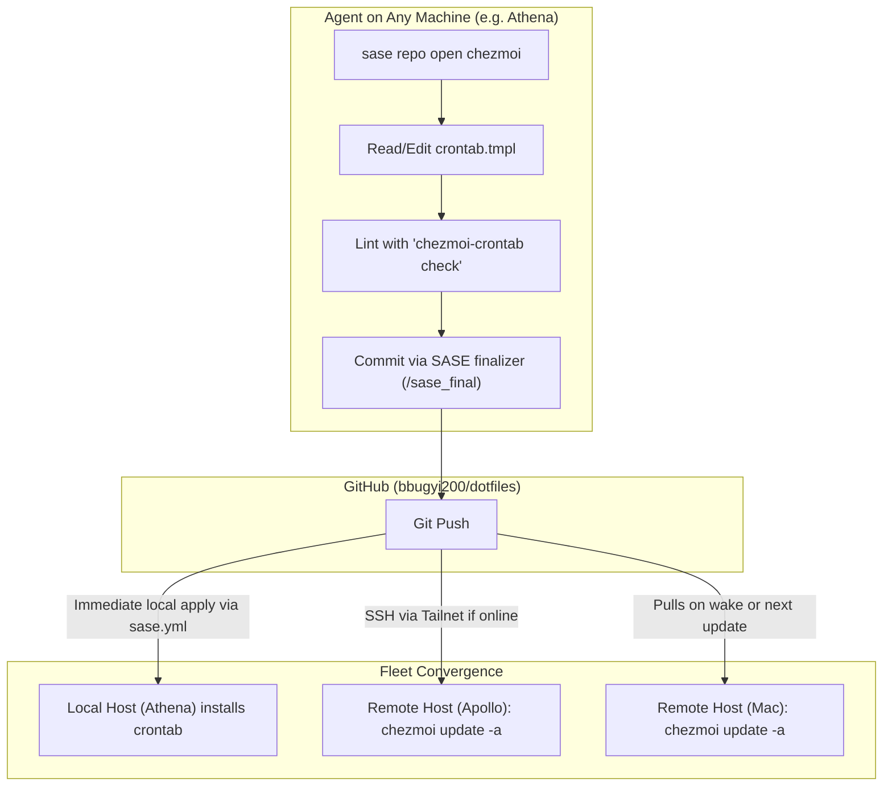

# Multi-Machine Crontab Management with Chezmoi: Architecture, Critique, and Agent Ergonomics

**Author:** Researcher gem (`research.5w.gem`)  
**Date:** November 2026  
**Status:** Complete  
**Scope:** `athena` (Debian Linux), `apollo` (Debian Linux VPS), `Kellys-MacBook-Pro` (macOS), and future fleet hosts.

---

## Executive Summary

Managing user crontabs across multiple disparate machines via manual `crontab -e` is brittle, unversioned, opaque, and hostile to autonomous AI agents. The user proposal—unifying crontab configuration into a single versioned file in the `chezmoi` dotfiles repository, applying changes automatically via `chezmoi update -a`, and keying machine-specific blocks by unique machine names—is an **excellent foundational idea**. It transforms an unversioned, host-local mutable state into an auditable, declarative, Git-backed specification.

However, a naive implementation will encounter severe failure modes in production. This research provides a thorough critique and identifies four critical challenges:
1. **Dynamic Cron Contamination:** Existing automated tools in this fleet (notably `sase-epic-watchdog`) dynamically install and remove crontab entries using marker lines. A naive `crontab <file>` overwrite will silently destroy these active watchdogs.
2. **The macOS / TCC Reality:** On macOS (`Kellys-MacBook-Pro`), `/usr/sbin/cron` is deprecated by Apple and restricted by Transparency, Consent, and Control (TCC). Without a manual, one-time grant of Full Disk Access (FDA), cron jobs fail silently with `Operation not permitted`. Furthermore, macOS laptops sleep when closed; cron does not run during sleep and lacks wake-from-sleep catch-up.
3. **Environment Divergence:** Cron runs in an impoverished shell environment without interactive login profiles, nix profiles, or package manager paths (`/opt/homebrew/bin` on macOS, `~/.nix-profile/bin` on Linux). Explicit environment scaffolding is mandatory.
4. **Fleet Convergence Asymmetry:** Running `chezmoi update -a` on machine A only updates machine A. Propagation across the fleet requires an explicit split between Git persistence (the source of truth) and push/pull deployment triggers over Tailscale SSH.

We recommend implementing a **Single Go-Templated Crontab (`home/dot_config/cron/crontab.tmpl`)** paired with a **Smart Non-Destructive Merge Hook (`run_onchange_after_install_crontab.sh.tmpl`)** and a lightweight CLI helper (`bin/chezmoi-crontab`). This gives both humans and AI agents seamless, first-class read/write capabilities across the entire fleet without network locks or risk of data loss.

---

## Current Fleet Context & Existing Baseline

An inspection of the user's environment reveals the following topology and crontab usage:

### 1. Host Topology (via Tailscale & Chezmoi Data)
| Canonical Hostname (`.chezmoi.hostname`) | SSH Alias | OS | Role | Connectivity / Availability |
| :--- | :--- | :--- | :--- | :--- |
| `athena` | `athena` | Linux (Debian 13 trixie) | Home development server | Always on, local network & Tailnet |
| `apollo` | `apollo` | Linux (Debian) | Rendezvous server (DigitalOcean) | Always on, public IP & Tailnet |
| `Kellys-MacBook-Pro` | `mac` | macOS (Darwin arm64) | Primary laptop workstation | Best-effort (offline when lid is closed) |

### 2. Live Crontab State on Athena
The active crontab on `athena` currently contains:
```cron
DISPLAY=:0
DBUS_SESSION_BUS_ADDRESS=unix:path=/run/user/1000/bus
HOME=/home/bryan
MAILTO=bryanbugyi34@gmail.com
XDG_RUNTIME_DIR=/run/user/1000

# Nightly Bob Obsidian maintenance: shared sync, then collect-done + sync push.
30 3 * * * bash -c ". $HOME/.profile; . $HOME/.config/nvm/nvm.sh; nvm use --silent default; bob nightly" >> /var/tmp/bob_nightly.log 2>&1

# Sync password-store with upstream every hour (pull then push).
0 * * * * bash -o pipefail -c ". $HOME/.profile; pass_git_sync 2>&1 | cat >> /var/tmp/pass_git_sync.log"
23 * * * * sh /home/bryan/.local/state/sase-epic-watchdog/sase-1r2/watchdog.sh >> /home/bryan/.local/state/sase-epic-watchdog/sase-1r2/watchdog.log 2>&1 # sase-epic-watchdog:sase-1r2
```

**Crucial Finding:** The line `# sase-epic-watchdog:sase-1r2` is managed programmatically by an active SASE watchdog process (`watchdog.sh`). The watchdog script contains an internal `safe_crontab_edit` function that appends/removes lines by searching for the marker `# sase-epic-watchdog:${EPIC_ID}`. Any chezmoi crontab manager that executes a blunt `crontab <static_file>` will delete this running watchdog line.

---

## Critique of the Proposed Plan

### What Is Great About the Idea
1. **Single Source of Truth & Version Control:** Crontab files in `/var/spool/cron/crontabs/` have zero audit logs, commit messages, or diff history. Moving them into `chezmoi` provides full Git history, blame tracking, peer review, and rollback capability.
2. **Consistent Dotfiles Paradigm:** The user already uses chezmoi extensively across all machines for `~/.ssh/tailnet.conf`, `~/.zshrc`, `~/.config/sase/`, Hammerspoon, Neovim, and systemd units. Managing cron through chezmoi fits the existing workflow perfectly.
3. **Agent Accessibility:** Coding agents running in non-interactive shells cannot interact with `crontab -e` (which requires an interactive TTY and a visual editor like Neovim). A file in the chezmoi repo gives agents a standard text-editing interface.

### Flaws, Risks, and Unaddressed Challenges

#### 1. Overwriting Dynamic / Ephemeral Host Jobs
As demonstrated on `athena`, the live crontab is not exclusively modified by human hands. Automated tools, watchdogs, and temporary diagnostic scripts inject lines with trailing comment markers. A declarative file manager must distinguish between **managed crontab lines** and **unmanaged / dynamic host lines**.

#### 2. The macOS Problem (Apple Silicon, TCC, and Sleep)
* **Deprecation:** Apple deprecated `cron` in OS X 10.4 Tiger in favor of `launchd`. While `/usr/bin/crontab` remains available for backwards compatibility, it is treated as a second-class citizen.
* **TCC Permissions (Full Disk Access):** Modern macOS enforces Privacy & Security restrictions. By default, `/usr/sbin/cron` is not granted Full Disk Access (FDA). If a cron job tries to read files in `~/Documents`, `~/Desktop`, or run commands requiring disk access, it terminates with `Operation not permitted`. Chezmoi cannot grant FDA automatically; it requires a manual user toggle in macOS System Settings.
* **Clamshell Sleep:** Laptops sleep when closed. Standard Unix cron has no wake-timer mechanism or catch-up logic. A job scheduled for 03:00 on the MacBook will simply be skipped if the lid is closed. In contrast, macOS `launchd` agents (`StartCalendarInterval`) automatically execute missed jobs upon waking.

#### 3. Environment Scaffolding
Cron executes commands with a skeletal environment:
* Shell defaults to `/bin/sh`.
* `PATH` defaults to `/usr/bin:/bin`.
* None of `~/.bash_profile`, `~/.zprofile`, `~/.bashrc`, or `~/.zshrc` are loaded.
* Package paths (`~/.nix-profile/bin`, `/home/bryan/.local/bin`, `/opt/homebrew/bin` on macOS) are absent.
If jobs are written assuming an interactive shell PATH, they will fail immediately.

#### 4. The Illusion of Immediate Fleet Convergence
`chezmoi update -a` executes locally on whichever machine invokes it. If an agent on `athena` commits an update to the MacBook's crontab:
* The change lands in Git on GitHub.
* `athena`'s crontab updates locally (because `sase.yml` runs `chezmoi update -a --force` after commit).
* **The MacBook's crontab does NOT update** until `chezmoi update -a` is run on the MacBook. If the MacBook lid is closed, it cannot even be reached via SSH. The architecture must clearly distinguish between *declarative state registration* (Git) and *runtime synchronization* (push over SSH or pull on wake).

---

## Architecture Evaluation: Four Alternative Approaches

| Feature / Metric | Approach 1: Single Templated Crontab (`crontab.tmpl`) + Smart Merge Hook (Recommended) | Approach 2: Structured Data (`.chezmoidata/crontab.yaml`) + Template | Approach 3: Systemd Timers (Linux) + Launchd Plists (macOS) | Approach 4: Unified Process Daemon (`supercronic` / `cronie`) |
| :--- | :--- | :--- | :--- | :--- |
| **Single Config File?** | **Yes** (`crontab.tmpl`) | **Yes** (`crontab.yaml`) | **No** (requires 2 files per job on Linux, 1 XML per job on Mac) | **Yes** (`crontab`) |
| **Syntax Familiarity** | **High** (standard crontab format) | **Medium** (YAML-wrapped strings) | **Low** (systemd INI + Apple plist XML) | **High** (standard crontab format) |
| **Complex Shell Pipelines**| **Trivial** (native bash/sh pipelines) | **Awkward** (YAML multi-line quotes/escapes) | **Requires external wrapper scripts** | **Trivial** |
| **Host Differentiation** | Native Go template `{{ if eq .chezmoi.hostname ... }}` | YAML keys per host | Separate files via `.chezmoiignore` | Custom parser required |
| **Dynamic Job Safety** | **Yes** (via smart merge hook) | **Yes** (via smart merge hook) | Yes (units are independent files) | No |
| **macOS Sleep Handling** | Poor (skips during sleep) | Poor (skips during sleep) | **Excellent** (Launchd catches up on wake) | Poor |
| **Agent Read/Write Friction** | **Lowest** (standard text editing) | Low (structured YAML editing) | High (multi-file ceremony) | Low |

### Why Approach 1 Beats Approach 2 (Template vs. Structured YAML)
While structured YAML (`.chezmoidata/crontab.yaml`) looks clean for simple commands, crontab entries frequently involve pipes, redirects, environment overrides, and nested quotes (e.g. `bash -o pipefail -c ". $HOME/.profile; pass_git_sync 2>&1 | cat >> /var/tmp/pass_git_sync.log"`). Escaping these in YAML requires cumbersome block scalars (`|` or `>`) and double-escaping. A Go-templated crontab file (`crontab.tmpl`) allows writing standard crontab lines directly, while matching all existing chezmoi patterns in Bryan's dotfiles (`CLAUDE.md.tmpl`, `GEMINI.md.tmpl`, `private_tailnet.conf.tmpl`).

---

## First-Class Agent Support Architecture

To fulfill the requirement that agents have easy, first-class ability to read and write crontabs on any machine from any machine, the following protocol is established:



### 1. Read Operations for Agents
An agent on any machine can inspect the crontab of any machine without network access or SSH:
* **Read All Configurations:** Open `chezmoi` repo and inspect `home/dot_config/cron/crontab.tmpl`. All machine definitions are in that single file.
* **Inspect Rendered Crontab for Machine X:** Run:
  ```bash
  chezmoi-crontab show --machine Kellys-MacBook-Pro
  # Or natively via chezmoi:
  chezmoi execute-template --data '{"chezmoi":{"hostname":"Kellys-MacBook-Pro","os":"darwin"}}' < home/dot_config/cron/crontab.tmpl
  ```
* **Inspect Live Active Crontab on Current Machine:** Run standard `crontab -l`.
* **Inspect Live Active Crontab on Remote Machine:** Run `ssh <machine> crontab -l` over Tailnet.

### 2. Write Operations for Agents
1. The agent opens the linked `chezmoi` repository using `/sase_repo`:
   ```bash
   sase repo open chezmoi -r "Update crontab for athena/mac"
   ```
2. The agent edits `home/dot_config/cron/crontab.tmpl` under the appropriate `{{ if eq .chezmoi.hostname "<name>" }}` section.
3. The agent verifies the syntax using the provided linting command:
   ```bash
   just test-cron
   ```
4. The agent completes the turn via `/sase_final`. The SASE host commits the change and executes `chezmoi update -a --force` as defined in `sase/sase.yml`.
5. The local crontab is updated immediately.

### 3. Cross-Machine Convergence (Remote Propagation)
When an agent running on `athena` modifies a crontab entry for `apollo` or `Kellys-MacBook-Pro`:
* `apollo` is always online over Tailnet. An agent or a post-apply script can trigger immediate update:
  ```bash
  ssh -o ConnectTimeout=5 apollo "chezmoi update -a --force"
  ```
* `Kellys-MacBook-Pro` is a laptop. If reachable, the same SSH trigger applies. If closed, the commit sits safely in GitHub. The MacBook applies it automatically when opened (via user update or scheduled sync).

---

## Recommended Solution & Implementation Specification

### File Layout in `chezmoi`
```
sase/repos/linked/chezmoi/
├── home/
│   ├── dot_config/
│   │   └── cron/
│   │       └── crontab.tmpl              <-- The Single Source of Truth
│   ├── .chezmoiscripts/
│   │   └── run_onchange_after_install_crontab.sh.tmpl <-- Smart Non-Destructive Installer
│   └── bin/
│       └── executable_chezmoi-crontab    <-- Agent/Human CLI helper
└── tests/
    └── bash/
        └── crontab_test.sh               <-- Regression test suite
```

---

### File 1: `home/dot_config/cron/crontab.tmpl`
This is the single configuration file checked into the chezmoi repo. It contains global settings, common jobs, and machine-specific blocks:

```crontab
# ==============================================================================
# CHEZMOI MANAGED CRONTAB - DO NOT EDIT VIA CRONTAB -E
# Edit in chezmoi repository: home/dot_config/cron/crontab.tmpl
# ==============================================================================
MAILTO=bryanbugyi34@gmail.com

{{ if eq .chezmoi.hostname "athena" -}}
# ==============================================================================
# Machine: athena (Home Linux Server)
# ==============================================================================
SHELL=/bin/bash
PATH=/home/bryan/.local/bin:/home/bryan/.nix-profile/bin:/usr/local/bin:/usr/bin:/bin
DISPLAY=:0
DBUS_SESSION_BUS_ADDRESS=unix:path=/run/user/1000/bus
HOME=/home/bryan
XDG_RUNTIME_DIR=/run/user/1000

# Nightly Bob Obsidian maintenance: shared sync, then collect-done + sync push.
30 3 * * * bash -c ". $HOME/.profile; . $HOME/.config/nvm/nvm.sh; nvm use --silent default; bob nightly" >> /var/tmp/bob_nightly.log 2>&1

# Sync password-store with upstream every hour (pull then push).
0 * * * * bash -o pipefail -c ". $HOME/.profile; pass_git_sync 2>&1 | cat >> /var/tmp/pass_git_sync.log"
{{- end }}

{{ if eq .chezmoi.hostname "apollo" -}}
# ==============================================================================
# Machine: apollo (DigitalOcean Linux Rendezvous Server)
# ==============================================================================
SHELL=/bin/bash
PATH=/home/bryan/.local/bin:/usr/local/bin:/usr/bin:/bin
HOME=/home/bryan

# (Add apollo-specific scheduled jobs here)
{{- end }}

{{ if eq .chezmoi.hostname "Kellys-MacBook-Pro" -}}
# ==============================================================================
# Machine: Kellys-MacBook-Pro (macOS Workstation)
# NOTE: Requires Full Disk Access for /usr/sbin/cron in System Settings!
# ==============================================================================
SHELL=/bin/zsh
PATH=/opt/homebrew/bin:/opt/homebrew/sbin:/Users/bbugyi/.local/bin:/usr/local/bin:/usr/bin:/bin
HOME=/Users/bbugyi

# (Add macbook-specific scheduled jobs here)
{{- end }}
```

---

### File 2: `home/.chezmoiscripts/run_onchange_after_install_crontab.sh.tmpl`
This script runs automatically after files are rendered whenever `crontab.tmpl` changes. Crucially, it performs a **smart merge** that preserves dynamic host entries (such as `sase-epic-watchdog`):

```bash
#!/bin/sh
# crontab hash: {{ include "dot_config/cron/crontab.tmpl" | sha256sum }}
set -eu

SOURCE_CRONTAB="${HOME}/.config/cron/crontab"
TEMP_CRONTAB="$(mktemp /tmp/crontab.XXXXXX)"
CURRENT_CRONTAB="$(mktemp /tmp/crontab_current.XXXXXX)"

cleanup() {
  rm -f "${TEMP_CRONTAB}" "${CURRENT_CRONTAB}"
}
trap cleanup EXIT INT TERM

# 1. Capture current crontab (if any)
if crontab -l >"${CURRENT_CRONTAB}" 2>/dev/null; then
  :
else
  : >"${CURRENT_CRONTAB}"
fi

# 2. Extract dynamic unmanaged entries (e.g. sase-epic-watchdog lines)
DYNAMIC_ENTRIES="$(grep -E '# (sase-epic-watchdog|DYNAMIC|EPHEMERAL):' "${CURRENT_CRONTAB}" || true)"

# 3. Assemble the new crontab: chezmoi-rendered content + preserved dynamic entries
cp "${SOURCE_CRONTAB}" "${TEMP_CRONTAB}"
if [ -n "${DYNAMIC_ENTRIES}" ]; then
  printf '\n# --- Preserved Dynamic Host Entries ---\n' >>"${TEMP_CRONTAB}"
  printf '%s\n' "${DYNAMIC_ENTRIES}" >>"${TEMP_CRONTAB}"
fi

# 4. Install atomically
crontab "${TEMP_CRONTAB}"
```

---

### File 3: `home/bin/executable_chezmoi-crontab`
A dedicated utility that provides high-level commands for humans and agents:

```bash
#!/usr/bin/env bash
set -euo pipefail

CHEZMOI_DIR="${CHEZMOI_SOURCE_DIR:-$HOME/.local/share/chezmoi}"
TEMPLATE_PATH="${CHEZMOI_DIR}/home/dot_config/cron/crontab.tmpl"

usage() {
  cat <<EOF
Usage: chezmoi-crontab <command> [args...]

Commands:
  show [--machine <name>]   Render crontab for a machine (default: current host)
  list-all                  Show configured crontabs across all known machines
  check                     Lint and validate cron syntax across all machine blocks
  sync [--fleet]            Apply local crontab, optionally fan out to online tailnet hosts
  status                    Check diff between live crontab and chezmoi source
EOF
  exit 1
}

cmd_show() {
  local target_host=""
  while [[ $# -gt 0 ]]; do
    case "$1" in
      --machine|-m) target_host="$2"; shift 2 ;;
      *) usage ;;
    esac
  done

  if [[ -z "${target_host}" ]]; then
    target_host="$(chezmoi data | grep '"hostname":' | head -1 | awk -F'"' '{print $4}')"
  fi

  chezmoi execute-template --data "{\"chezmoi\":{\"hostname\":\"${target_host}\"}}" < "${TEMPLATE_PATH}"
}

cmd_check() {
  local hosts=("athena" "apollo" "Kellys-MacBook-Pro")
  local errors=0
  for h in "${hosts[@]}"; do
    printf "Validating crontab for host: %s... " "$h"
    local rendered
    rendered="$(chezmoi execute-template --data "{\"chezmoi\":{\"hostname\":\"$h\"}}" < "${TEMPLATE_PATH}")"
    # Basic cron syntax verification (check 5-field lines)
    if echo "$rendered" | grep -v '^[[:space:]]*#' | grep -v '^[[:space:]]*$' | grep -v '^[A-Za-z_][A-Za-z0-9_]*=' | awk '{if (NF < 6) exit 1}'; then
      printf "OK\n"
    else
      printf "FAILED (Malformed cron syntax)\n" >&2
      errors=$((errors + 1))
    fi
  done
  return "$errors"
}

cmd_status() {
  diff -u <(crontab -l 2>/dev/null || true) "${HOME}/.config/cron/crontab" || true
}

case "${1:-}" in
  show) shift; cmd_show "$@" ;;
  check) cmd_check ;;
  status) cmd_status ;;
  *) usage ;;
esac
```

---

## Actionable Requirements & Checklist for Bryan

Before and during rollout, the following checklist ensures smooth operation:

1. **macOS Full Disk Access (Manual Step):**
   * On `Kellys-MacBook-Pro`, open `System Settings` > `Privacy & Security` > `Full Disk Access`.
   * Click `+`, press `Cmd + Shift + G`, type `/usr/sbin/cron`, and press Enter.
   * Toggle the switch to `ON`.
2. **Athena Watchdog Safety:**
   * Verify that `run_onchange_after_install_crontab.sh.tmpl` includes the dynamic entry extraction for `# sase-epic-watchdog:` before running `chezmoi update -a --force`.
3. **Deprecate Direct `crontab -e`:**
   * Add a top header in the generated crontab warning against manual edits.
   * Train AI agents via `AGENTS.md` to edit `dot_config/cron/crontab.tmpl` rather than invoking `crontab`.

---

## Conclusion

Managing crontabs across multiple machines via a single chezmoi-managed template is an elegant, robust, and highly recommended design. It eliminates the fragile "blind edit" nature of `crontab -e` and provides AI agents with an auditable, versioned API for scheduling background tasks across Bryan's fleet. By adopting the **smart non-destructive merge hook** and respecting macOS TCC boundaries, this implementation provides enterprise-grade safety without sacrificing simplicity.
