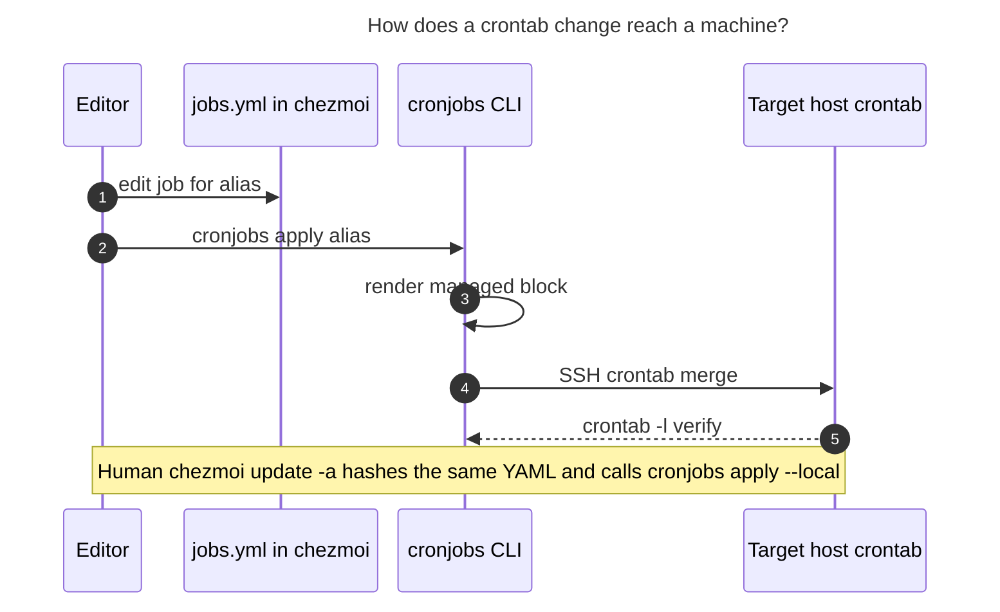

# Chezmoi-managed crontabs, with first-class agent access

Researcher: `grk`. Independent design research for putting Bryan's user crontabs in the chezmoi repo, applying them with `chezmoi update -a`, and giving agents an easy read/write path on every tailnet machine. Peer swarm reports were not consulted.

This research ran on **athena** on 2026-11-07. Live user crontabs were read on athena and apollo. SSH to `mac` timed out (lid-closed MacBook, as `tailnet.md` warns). The prompt said this machine has no crontab; athena already has one. Apollo is the Linux host with an empty crontab.

## Verdict

Do it. Put the **desired** user crontab in one chezmoi YAML, apply it through the same `run_onchange_after` pattern already used for systemd user timers, and give agents a `cronjobs` CLI plus a distributed skill so they edit that file and install it over Tailscale SSH. Keep `crontab -e` as a viewer of last resort.

The request is right about the source of truth (one committed file, keyed by machine alias) and right that agents cannot manage this today. It is too narrow about "crontab is just a file chezmoi can drop in," too optimistic that `chezmoi update -a` is enough for agents, and too strict that machine names are the only per-host fact.

## Bottom line

1. **One YAML in chezmoi is the desired state. The live crontab is a generated install.** Chezmoi cannot write `/var/spool/cron/crontabs/$USER`. The working pattern is the same one already in `home/.chezmoiscripts/run_onchange_after_enable_bob_ref_intake_timer.sh.tmpl`: a source file, a SHA-256 pin in a `run_onchange_after` script, and an external loader (`crontab -` here, `systemctl --user enable --now` there).
2. **Agents write the YAML and run `cronjobs apply <alias>`. Humans run `chezmoi update -a`.** Both paths must install identical bytes. Agents must not wait for the next human apply, and they must not call `crontab -` / `crontab -e` themselves.
3. **Preserve a marked local lane.** The sase-epic-watchdog already injects and removes a tagged hourly line on athena. A full replace of the spool would delete it on the next apply.
4. **Stay on user cron for wall-clock Linux jobs.** Athena's `bob nightly` and `pass_git_sync` already work there. High-frequency jobs already live in systemd user timers (Linux) and a LaunchAgent (Mac). Leave those where they are.

---

## 1. Is this a good idea?

Yes. The current setup is a per-machine spool that only the logged-in user can edit with `crontab -e`, plus ad-hoc agent appends. That is why Bryan cannot see apollo's jobs from athena, why agents on one host cannot safely change another, and why the live athena crontab already contains a watchdog line that no git history explains.

A committed desired-state file keyed by machine alias solves the human problem (one place to look) and is the only way to solve the agent problem (a write that works from a numbered workspace clone, then an apply that works over SSH).

The idea fails if:

- chezmoi is asked to manage the spool path as a regular dotfile
- `chezmoi update -a` is the only apply path (agents, Mac-offline, apollo's non-interactive PATH)
- apply wipes unmarked local lines
- agents keep appending with `crontab -l | { cat; echo; } | crontab -`

---

## 2. Current state (evidence)

### 2.1 Live crontabs

**athena** (`crontab -l`, user `bryan`, cron package `3.0pl1-197`, service enabled/active). `/usr/bin/crontab` is setgid `crontab`. User crontab changes do not need root or `sase sudo`.

Env: `DISPLAY=:0`, `DBUS_SESSION_BUS_ADDRESS=unix:path=/run/user/1000/bus`, `HOME=/home/bryan`, `MAILTO` (Bryan's usual address), `XDG_RUNTIME_DIR=/run/user/1000`.

Jobs:

| Schedule | Command |
| --- | --- |
| commented `0 4 * * *` | old `tman` nightly |
| commented `5 * * * *` | old `init-bg` |
| `30 3 * * *` | `.profile` + nvm + `bob nightly` → `/var/tmp/bob_nightly.log` |
| `0 * * * *` | `.profile` + `pass_git_sync` → `/var/tmp/pass_git_sync.log` |
| `23 * * * *` | `sase-epic-watchdog:sase-1r2` (injected 2026-11-03) |

Timezone: `America/New_York`. `loginctl Linger=yes`.

**apollo** (`ssh apollo crontab -l`): `no crontab for bryan`. `cron` and `crontab` binaries exist. Timezone: `Etc/UTC`. `Linger=yes`. `bob-ref-intake.timer` is already running as a systemd user timer.

**mac** (`ssh mac`): connection timed out. Treat as best-effort. Chezmoi already ships `Library/LaunchAgents/com.bbugyi.bob-vault-sync.plist` (15-second `bob vault-sync`). No `run_onchange` was found that `launchctl load`s it.

### 2.2 Chezmoi today

- Repo: `bbugyi200/dotfiles`, `.chezmoiroot` = `home`.
- Machine tests already pin three hostnames: `athena`, `apollo`, `Kellys-MacBook-Pro` (see `tests/bash/poseidon_chezmoi_isolation_test.sh` and `home/.chezmoiignore`).
- SSH aliases in `private_dot_ssh/private_tailnet.conf.tmpl`: `athena`, `apollo`, `mac` (Mac user `bbugyi`).
- **No crontab source file exists.** Grep of the chezmoi tree for cron hits aliases (`vcron` edits `~/Sync/bin/cron.jobs/...`), a vim crontab filetype, and a comment that `crontab -e` uses `$EDITOR`.
- Closest existing pattern: `run_onchange_after_enable_bob_ref_intake_timer.sh.tmpl` is hostname-gated, pins the unit files with `include ... | sha256sum`, then `systemctl --user daemon-reload && enable --now`.
- `home/dot_config/systemd/user/` already holds `bob-ref-intake.{service,timer}` and athena-only `poseidon-cache-watch.{service,timer}`.
- Official chezmoi docs (`Use scripts to perform actions`) describe this exact shape for non-file targets: pin a source file's hash in a `run_onchange_` script, then pipe it into an external loader (`dconf load` in the docs; `crontab -` here).

Chezmoi versions are skewed:

| Host | Binary | Version | Non-interactive PATH |
| --- | --- | --- | --- |
| athena | `~/.nix-profile/bin/chezmoi` | 2.13.1 (nixpkgs, 2022) | yes |
| apollo | `~/go/bin/chezmoi` | `dev` | **no** — only a login shell finds it |

`chezmoi update -a` works for Bryan in a login shell. An agent `ssh apollo chezmoi update -a` fails with `command not found`. Any agent apply path that shells out to remote chezmoi will fail on apollo today.

The live source tree (`~/.local/share/chezmoi`) and the SASE linked clone share `origin` `git@github.com:bbugyi200/dotfiles.git` at the same HEAD. Agents edit the linked clone; Bryan's `chezmoi update` pulls that remote. That split is fine as long as agents commit and push before expecting a remote `chezmoi update` to see the change.

### 2.3 How agents touch crontab today

They already can, locally, without sudo. They do it badly.

- `pass_git_sync` plan text in the home-project tales states the crontab is **not** chezmoi-managed and installs with `crontab -l | { cat; echo "<entry>"; } | crontab -`.
- `sase-epic-watchdog/sase-1r2/watchdog.sh` has `safe_crontab_edit` that snapshots, inserts or strips a `# sase-epic-watchdog:<id>` line, installs with `crontab file`, and restores on mismatch. `crontab.before` vs live crontab is exactly that one added line.
- `crontab -l` on a host with no crontab exits non-zero. The watchdog treats that as failure, so its installer cannot bootstrap apollo.
- There is no `sase crontab`. `sase scheduler` is the SASE orchestrator (axe). `sase machine` lists enrolled remotes (apollo is enrolled and `hello ok` from athena); it dispatches agents, it does not install cron lines.
- No crontab skill exists under chezmoi's provider skill trees.
- User crontab is setgid, so `sase sudo` is the wrong tool.

### 2.4 Other schedulers already in the fleet

| Mechanism | Where | Cadence | Role |
| --- | --- | --- | --- |
| user crontab | athena | hourly / 03:30 | `bob nightly`, `pass_git_sync`, watchdog |
| systemd user timer | athena, apollo | every 2 min | `bob-ref-intake` |
| systemd user timer | athena only | ~5 min | `poseidon-cache-watch` |
| LaunchAgent | Mac (chezmoi-managed plist) | every 15 s | `bob vault-sync` |
| `~/Sync/bin/cron.jobs/` | scripts Bryan opens with `vcron` | n/a | job *bodies*, not the schedule |

`vcron` is a red herring for this design: it edits the job scripts, not the crontab.

Linger is enabled on both Linux hosts, so systemd user timers already fire without a login. Cron also fires without a login. Both are valid on athena and apollo. Cron is the one Bryan already uses for the nightly/hourly jobs.

---

## 3. Critique of the original plan

The request asks for: one committed config file in chezmoi; `chezmoi update -a` updates the crontab on the machines named in that file; machine names as the only per-host part; first-class agent read/write from any machine to any machine.

### What to keep

- **One committed file as desired state.** Splitting into `crontab.athena`, `crontab.apollo`, `crontab.mac` would make "what runs where?" a grep across files. Agents would guess the wrong file.
- **Machine alias as the selector.** The fleet already has a three-name vocabulary (`athena` / `apollo` / `mac` in SSH and `tailnet.md`) plus three chezmoi hostnames (`athena` / `apollo` / `Kellys-MacBook-Pro`). The config should use the short aliases. The renderer maps alias → hostname / SSH host / username / `$HOME`.
- **Apply on `chezmoi update -a` for humans.** That is already how systemd timers, tmux reloads, and the SSH `Include tailnet.conf` hook work.
- **Agent first-class access as a hard requirement.** A file Bryan can edit and agents cannot apply from apollo is half a solution. The current local-append habit is how the watchdog line appeared.

### What to change

These are explicit requirement adjustments.

**A1. The source file is desired state. `crontab -` is the installer. (mechanism)**

Chezmoi manages files under `$HOME`. The crontab spool is root-owned and only writable through the setgid `crontab` binary. Official chezmoi guidance for this class of target is a `run_onchange_` script that hashes a source file and loads it with an external command. Match `run_onchange_after_enable_bob_ref_intake_timer.sh.tmpl`.

**A2. The human apply path stays `chezmoi update -a`. The agent apply path is `cronjobs apply`. (two installers, one renderer)**

`chezmoi update -a` needs a login-shell chezmoi on the target. Apollo's non-interactive SSH PATH does not contain chezmoi. The Mac is often unreachable. Agents cannot wait for Bryan to walk up to each machine.

`cronjobs apply athena` must render from the YAML in the working tree (or the committed file) and `ssh athena crontab -`. Remote chezmoi is unused. After the YAML is pushed, a later human `chezmoi update -a` hashes the same file and installs the same bytes (idempotent).

**A3. Machine names select jobs. A tiny inventory next to them records facts. (schema)**

`$HOME` is `/home/bryan` vs `/Users/bbugyi`. Username is `bryan` vs `bbugyi`. Chezmoi hostname is `Kellys-MacBook-Pro` for the machine everyone else calls `mac`. Athena is `America/New_York`; apollo is `Etc/UTC`, so `30 3 * * *` is a different instant on each host. Athena's crontab sets `DISPLAY` and `DBUS_SESSION_BUS_ADDRESS`; apollo has no graphical session.

Keep **job** targeting to machine aliases only, as requested. Put the derived facts (hostname, SSH alias, user, home) in an `inventory:` map at the top of the same file, defaulting to the table already implied by `tailnet.md`. Env vars that a job actually needs (`MAILTO`, `DISPLAY`) live under that machine's `env:`.

**A4. Full-replace the managed block. Keep a local lane. (drift)**

A generated crontab that is the entire spool will delete `# sase-epic-watchdog:sase-1r2` the next time Bryan runs `chezmoi update -a`. The watchdog's own installer also cannot create the first crontab on a host where `crontab -l` fails.

Wrap generated lines in markers. On apply: read live crontab (treat "no crontab" as empty), keep lines outside the managed markers, write managed + preserved local, verify with `crontab -l`. Document that ephemeral injectors must either use the local lane or grow a `cronjobs` API later.

**A5. `crontab -e` stops being the write path. (habit)**

Once chezmoi owns the managed block, `crontab -e` edits are overwritten on the next apply. Ship `cronjobs edit` (opens the YAML) and `cronjobs show` (live spool). Leave `crontab -l` as a raw viewer. A wrapper that errors on `crontab -e` is optional v2; the skill must forbid it for agents from day one.

**A6. Do not fold systemd timers or LaunchAgents into crontab. (scope)**

`bob-ref-intake` every two minutes and `poseidon-cache-watch` are already chezmoi-managed systemd user units with linger. The Mac vault-sync agent is already a plist. Cron skips missed runs while a laptop sleeps; launchd and systemd `Persistent=true` can catch up. v1 of this work is **user crontab only**. A later `backend:` field on a job can render to a timer or plist; that is a different project.

**A7. Linux cron is the right v1 backend. Mac cron is optional and weaker. (platform)**

Apple still ships `crontab`, and the man page still says Darwin supports it, with the function absorbed into launchd. Recent write-ups (2025–2026) agree it runs when a crontab exists, skips jobs while the Mac sleeps, and often needs Full Disk Access for `/usr/sbin/cron`. Bryan already uses a LaunchAgent for the Mac job that must keep running. If the Mac crontab is real (unverified today), import it into the YAML under `mac:`. If a Mac job must survive sleep, it belongs in `~/Library/LaunchAgents/`, which chezmoi can install as a regular file.

**A8. This is a chezmoi `~/bin/cronjobs` plus a skill, not a `sase crontab` subcommand. (home)**

Crontab content is home-directory state. sase already has `scheduler` (the orchestrator) and `machine` (remote agent dispatch). A sase subcommand would teach agents the wrong module and would be unavailable on a host that has chezmoi but not a matching sase build. Put the binary in chezmoi `home/bin/executable_cronjobs` so `chezmoi apply` puts it on `PATH`. Distribute a skill next to `sase_sudo` / `sase_gmail` across the provider skill trees, and add a short rule to the chezmoi `AGENTS.md` / `CLAUDE.md.tmpl` family.

**A9. User crontab only. No sudo. (privilege)**

User crontab is setgid. `sase sudo` is for root. Root crontab, `/etc/cron.d`, and systemd *system* units stay out of scope.

**A10. Schedules are local wall clock on the target. (time)**

Document that `30 3 * * *` on athena is 03:30 Eastern and on apollo would be 03:30 UTC. If a job must fire at the same instant everywhere, say so in the YAML comment and pick per-machine schedules. Do not invent a timezone field in v1 unless a real shared job needs it.

**A11. Empty is a valid desired state. (apollo)**

Apollo today has no crontab. Applying "no jobs" must install a managed block that can be empty (env + comments only) or call `crontab -r` only when the YAML says the machine has no crontab *and* no local lane. Prefer an empty managed block so MAILTO and markers exist.

**A12. Unify chezmoi versions as follow-up, not a blocker. (tooling)**

Athena 2.13.1 already runs `include | sha256sum` and `.chezmoiscripts`. Avoid `.chezmoidata/` (directory form is much newer than 2.13.1). A YAML file plus a Python/bash renderer does not need a chezmoi upgrade. Version skew and apollo's login-only PATH still deserve a later bead.

---

## 4. Alternatives

| Approach | Why it showed up | Why it loses for v1 |
| --- | --- | --- |
| Raw `crontab.tmpl` with `{{ if eq .chezmoi.hostname }}` | Closest to crontab -e; one file | Go templates inside cron syntax; agents break `{{`; no structured ids; hostname vs alias confusion (`Kellys-MacBook-Pro`) |
| One file per host | Simple ignore rules | "What runs where?" becomes a search; shared jobs duplicate |
| Chezmoi writes `~/.config/cron/crontab` only, Bryan runs `crontab` by hand | Chezmoi stays file-only | Agents still cannot apply; human still has a second step |
| systemd user timers for every Linux job | Already used; linger is on; `Persistent=true`; journalctl | Would rewrite working `bob nightly` / `pass_git_sync`; Mac has no systemd; Bryan's muscle memory and MAILTO stay on cron |
| launchd everywhere, including Linux | Mac-native | Linux has no launchd; XML plists are hostile to agents |
| Agents SSH `crontab -e` with EDITOR | Matches Bryan | Needs a TTY; not automatable; fights chezmoi |
| Agents only edit YAML; apply waits for Bryan | Simplest agent write | Fails "from any machine" and Mac-offline |
| `sase sudo` remote `crontab` | Existing remote-exec gate | Wrong privilege; user crontab is not root |
| Dispatch a remote sase agent via `sase machine agent` | apollo is enrolled | Heavy for `crontab -`; Mac is not in `sase machine list` from athena |

The runner-up is "YAML now, optional `backend: systemd|launchd` later." v1 still installs cron only.

---

## 5. Recommended solution

### 5.1 Shape

One file, two maps, one installer, one CLI, one skill.

```text
home/dot_config/cronjobs/jobs.yml
home/bin/executable_cronjobs
home/.chezmoiscripts/run_onchange_after_apply_crontab.sh.tmpl
home/dot_*/skills/cronjobs/SKILL.md   # every provider tree
tests/bash/cronjobs_test.sh
```

Add `dot_config/cronjobs/jobs.yml` to `.chezmoiignore` if the YAML should not also appear as a destination file, **or** let chezmoi install `~/.config/cronjobs/jobs.yml` so `cronjobs` can read it without locating the source tree. Prefer installing it: then a machine that has been `chezmoi apply`'d can render even if `~/.local/share/chezmoi` is stale, and agents can `ssh athena cronjobs show --desired`.

### 5.2 YAML sketch (v1, full command strings)

Import today's athena lines almost verbatim so the first apply is a no-op besides adding markers.

```yaml
inventory:
  athena:
    hostname: athena
    ssh: athena
    user: bryan
  apollo:
    hostname: apollo
    ssh: apollo
    user: bryan
  mac:
    hostname: Kellys-MacBook-Pro
    ssh: mac
    user: bbugyi

machines:
  athena:
    env:
      DISPLAY: ":0"
      DBUS_SESSION_BUS_ADDRESS: "unix:path=/run/user/1000/bus"
      HOME: /home/bryan
      MAILTO: "<existing address>"
      XDG_RUNTIME_DIR: /run/user/1000
    jobs:
      - id: bob-nightly
        schedule: "30 3 * * *"
        command: >-
          bash -c ". $HOME/.profile; . $HOME/.config/nvm/nvm.sh;
          nvm use --silent default; bob nightly"
          >> /var/tmp/bob_nightly.log 2>&1
      - id: pass-git-sync
        schedule: "0 * * * *"
        command: >-
          bash -o pipefail -c ". $HOME/.profile; pass_git_sync 2>&1
          | cat >> /var/tmp/pass_git_sync.log"
  apollo:
    env:
      HOME: /home/bryan
      MAILTO: "<existing address>"
    jobs: []
  mac:
    env:
      HOME: /Users/bbugyi
    jobs: []   # import live crontab once the Mac is reachable
```

Commented historical lines (`tman`, `init-bg`) can live as YAML comments above the job they replaced, or as `enabled: false` jobs. Prefer `enabled: false` so they stay in git without occupying the spool.

Do not put the watchdog in this file unless it should survive epic close. It is an ephemeral injector; the local lane is its home until watchdog grows a `cronjobs` client.

### 5.3 Renderer and apply

`cronjobs` subcommands:

| Command | Who | What |
| --- | --- | --- |
| `cronjobs show [alias]` | human, agent | Live `crontab -l` on that host (SSH if needed). `all` shows every alias. |
| `cronjobs show --desired [alias]` | human, agent | Render YAML for that alias. No SSH. |
| `cronjobs diff [alias]` | human, agent | Desired managed block vs live managed block. Local-lane lines listed separately. |
| `cronjobs apply [alias]` | human, agent | Render, merge local lane, `crontab` the temp file, verify. `--local` skips SSH (used by the chezmoi hook). |
| `cronjobs edit` | human | `$EDITOR` on `jobs.yml` in the chezmoi source / `~/.config/cronjobs/jobs.yml`. |
| `cronjobs render [alias]` | tests | Print the managed block to stdout. |

SSH: `ssh -o BatchMode=yes -o ConnectTimeout=8 <alias>`. On timeout, print a one-line "mac unreachable" and exit 2. Do not hang a SASE turn.

Empty live crontab: treat `crontab -l` failure whose stderr contains `no crontab` as empty. Never refuse apply because the host has none.

Markers:

```cron
# BEGIN CHEZMOI CRONJOBS
...generated env and jobs...
# END CHEZMOI CRONJOBS
```

Lines outside the markers round-trip unchanged.

Chezmoi hook (linux and darwin; no-op if `cronjobs` is missing, which should not happen if the binary is applied first — use `after_` so `~/bin/cronjobs` exists):

```sh
#!/bin/sh
# jobs.yml: {{ include "dot_config/cronjobs/jobs.yml" | sha256sum }}
# cronjobs: {{ include "bin/executable_cronjobs" | sha256sum }}
set -eu
cronjobs apply --local
```

Gate the hook with `{{ if or (eq .chezmoi.hostname "athena") (eq .chezmoi.hostname "apollo") (eq .chezmoi.hostname "Kellys-MacBook-Pro") }}` so a future fourth machine does not get a surprise empty crontab.

### 5.4 Agent skill (the actual "first-class" part)

A skill named `cronjobs` (or `crontab`) that agents load before touching any schedule. Required rules:

1. `sase repo open chezmoi` before editing `home/dot_config/cronjobs/jobs.yml`.
2. Read with `cronjobs show` / `cronjobs diff`. Never invent live contents from memory.
3. Write by editing the YAML. Never `crontab -e`. Never `crontab -`. Never `crontab -l | cat | crontab -`.
4. After the YAML change, `cronjobs diff <alias>` then `cronjobs apply <alias>` for each affected machine. Commit the chezmoi repo in the same turn (`/sase_final`).
5. User crontab does not use `sase sudo`.
6. Mac may time out; report it and still apply the Linux hosts.
7. Removing a job is allowed; deleting a machine's whole crontab is allowed only when the YAML for that alias has `jobs: []` and diff is shown first. Use `/sase_gate` only when dropping a job Bryan did not ask to drop.
8. Watchdog-style lines belong in the local lane, or they need a later API. Do not hand-edit the spool to add them.

Add one paragraph to chezmoi `AGENTS.md` pointing at the skill, the way the repo already points at `chezmoi update -a --force` after commits.

### 5.5 Tests

Follow `tests/bash/poseidon_chezmoi_isolation_test.sh`: render for `athena`, `apollo`, `Kellys-MacBook-Pro`.

- athena render contains `bob nightly` and `pass_git_sync`, and does not contain `/Users/bbugyi`.
- apollo render contains the markers and no athena job command.
- mac render contains `/Users/bbugyi` if any job exists, never `/home/bryan`.
- merge: given a live crontab with a `# sase-epic-watchdog:` line outside markers, apply keeps it.
- `crontab -l` empty-failure is treated as empty.

### 5.6 Migration

1. Import athena's live crontab into `jobs.yml` (without the watchdog line).
2. Land `cronjobs` + hook + tests.
3. `cronjobs diff athena` on athena; expect only marker additions.
4. `cronjobs apply --local` once; confirm watchdog survived; confirm `bob nightly` still present.
5. `cronjobs apply apollo` so apollo gets markers + MAILTO and zero jobs.
6. When the Mac is open: `cronjobs show mac`, import, apply.
7. Recast `vcron` later if desired so it also opens `jobs.yml`. Out of v1.



_Figure 1. Desired state lives in git. The installer is always `cronjobs`, either locally from the chezmoi hook or over SSH from an agent. The live spool is never the document of record._

---

## 6. Risks

- **`crontab -e` after cutover.** Next apply overwrites managed lines. Skill + `cronjobs edit` are the mitigation. Optional later: shell wrapper.
- **Mac offline.** Agent apply to `mac` will fail often. That is already true for every Mac SSH. The YAML still records intent; the next `chezmoi update -a` on the Mac installs it.
- **Timezone surprise.** Copying athena's `30 3 * * *` onto apollo would run at 03:30 UTC. v1 has no apollo jobs, so this is documentation until the first apollo job.
- **Watchdog vs apply races.** If apply runs while `safe_crontab_edit` holds a snapshot, last writer wins. Markers make a lost watchdog line obvious (`cronjobs diff` shows it only in live, outside managed). Watchdog reinstalls itself on `install`.
- **chezmoi 2.13.1 vs `dev`.** Hook syntax used here already exists on athena. Do not take a dependency on `.chezmoidata/`.
- **Public research / public dotfiles.** `jobs.yml` will contain commands and paths, which is fine. Keep MAILTO in the real file; this public report omits the address.

---

## 7. What "first-class agent support" means in practice

Today an agent on athena can `crontab -l` locally and cannot see or change apollo without inventing SSH. An agent on apollo cannot even assume chezmoi is on `PATH`. After this design:

| Intent | Command |
| --- | --- |
| What is live on athena? | `cronjobs show athena` |
| What should be live on apollo? | `cronjobs show --desired apollo` |
| Do they match? | `cronjobs diff apollo` |
| Add a job on athena from a workspace on apollo | edit `jobs.yml` in the chezmoi linked clone, `cronjobs apply athena` |
| Bryan at a keyboard | edit YAML or `cronjobs edit`, commit, `chezmoi update -a` |

That is the requirement. A skill without the CLI fails it. `chezmoi update -a` without the CLI fails it for agents. SSH `crontab -` without the YAML fails it for reviewability.

---

## 8. Recommended decision

Accept the plan with A1–A12. Implement v1 as:

1. `home/dot_config/cronjobs/jobs.yml` — inventory + per-alias env + jobs.
2. `home/bin/executable_cronjobs` — show / diff / apply / render / edit, SSH via existing `Host` aliases.
3. `run_onchange_after_apply_crontab.sh.tmpl` — hash-pin the YAML and binary, `cronjobs apply --local`.
4. A `cronjobs` skill copied through the chezmoi provider skill trees, plus a pointer in chezmoi `AGENTS.md`.
5. Bash tests that render all three hostnames and keep the local lane.

Leave systemd timers, LaunchAgents, `~/Sync/bin/cron.jobs`, and `sase scheduler` alone. Import the Mac crontab when the laptop is reachable. File chezmoi version unification as a separate follow-up.

---

## Sources

- Live `crontab -l` on athena; `ssh apollo crontab -l`; `ssh mac` timeout (2026-11-07).
- Chezmoi repo: `home/.chezmoiscripts/run_onchange_after_enable_bob_ref_intake_timer.sh.tmpl`, `home/.chezmoiignore`, `home/private_dot_ssh/private_tailnet.conf.tmpl`, `home/Library/LaunchAgents/com.bbugyi.bob-vault-sync.plist`, `home/dot_config/systemd/user/*`, `home/dot_config/aliases.sh` (`vcron`), `tests/bash/poseidon_chezmoi_isolation_test.sh`, `AGENTS.md`.
- `~/.local/state/sase-epic-watchdog/sase-1r2/watchdog.sh` (`safe_crontab_edit`) and `crontab.before`.
- chezmoi docs: [Use scripts to perform actions](https://www.chezmoi.io/user-guide/use-scripts-to-perform-actions/) (hash-pin + external loader); [macOS hostname via scutil](https://chezmoi.io/user-guide/machines/macos/).
- systemd user timers vs cron: Debian 13 timer guides (`Persistent=true`, linger). Both athena and apollo have `Linger=yes`.
- macOS cron: still present through recent releases; Apple documents it as absorbed into launchd; sleep skips jobs; Full Disk Access for `/usr/sbin/cron` is a recurring failure mode (2025–2026 write-ups).
- `sase scheduler -h`, `sase machine list` (apollo enrolled), `sase artifact` / sudo skill (user crontab is not a sudo path).
- Chezmoi binaries: athena nixpkgs 2.13.1; apollo `~/go/bin/chezmoi` version `dev`, login-shell PATH only.
