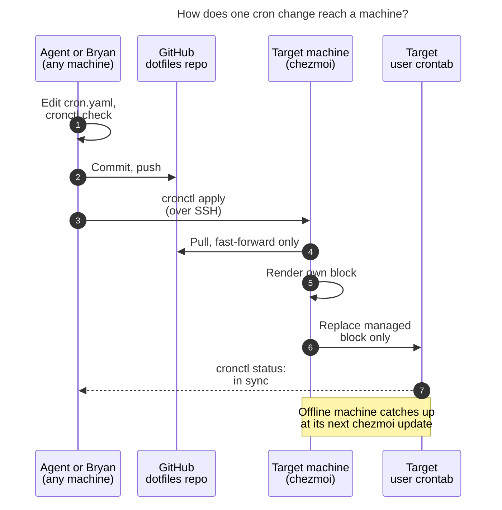

# Managing crontabs from chezmoi, with first-class agent support (cld)

**Question.** Should Bryan's crontabs on athena, the Mac, and future machines come from
one file committed to the chezmoi repo, applied by `chezmoi update -a`? Can agents read
and write any machine's crontab from any machine? What design is best, and how should
the requirements change?

**Short answer.** Yes, it's a good idea, and it fits how the dotfiles repo already works:
the tailnet SSH config uses the same pattern (shared source, per-host conditions, a
`run_onchange_` script). I would build it with five changes to the plan as stated:

1. chezmoi owns a **marked block** in each crontab, not the whole crontab.
2. Machines are named by **canonical names that match the SSH aliases** (`athena`,
   `apollo`, `mac`), not by raw hostnames.
3. Rendering **fails closed**: if chezmoi can't tell which machine it's on, it leaves the
   crontab alone instead of emptying it.
4. A small **`cronrun` job runner** removes the machine-specific environment lines your
   current crontab depends on.
5. Agents get a **`cronctl` CLI plus a skill**, not just permission to run `crontab`.

The core of this design was prototyped against the oldest chezmoi you run (v2.13.1 on
athena), with a fake `crontab` binary. The recommended solution is in §5.

---

## 1. Scope note: which machine is "this machine"?

This research ran on **athena** (`hostname` → `athena`), and athena already has a
crontab. The machine with *no* crontab is **apollo** (`ssh apollo crontab -l` → `no
crontab for bryan`). I assume "this machine" means apollo, or a future machine such as
the work host that `.chezmoiignore` already keys on (`bbugyi.c.googlers.com`). The design
below treats any new machine as a one-line addition, so the answer doesn't change the
recommendation.

## 2. What exists today (evidence)

### 2.1 Machines

| Machine | Crontab today | cron / TZ / mail | chezmoi | Notes |
| --- | --- | --- | --- | --- |
| `athena` (Debian 13) | Yes, hand-edited | Debian `cron 3.0pl1-197`; `America/New_York`; `/usr/sbin/sendmail` present | **v2.13.1** (nixpkgs; upstream tag dated 2022-03-03) | Agents run here |
| `apollo` (Linux) | **None** | `/usr/sbin/cron` active; **`Etc/UTC`**; **no sendmail** | Built from source (Apr 2026) in `~/bin`; **not on non-login SSH `PATH`** | Its chezmoi source was at `7f023270` while athena's was at `f1da6b64`, so machines drift until someone runs `chezmoi update` |
| `mac` (macOS, user `bbugyi`) | Yes (contents **not inspected**) | macOS cron | presumably Homebrew | SSH timed out during research: the Mac was asleep or offline. chezmoi sees it as `Kellys-MacBook-Pro`; its tailnet name is `kellys-macbook-pro` |

### 2.2 athena's live crontab

Besides the Debian boilerplate header, it contains:

- **Machine-specific environment lines:** `DISPLAY=:0`,
  `DBUS_SESSION_BUS_ADDRESS=unix:path=/run/user/1000/bus`, `HOME=/home/bryan`,
  `XDG_RUNTIME_DIR=/run/user/1000`, and `MAILTO=bryanbugyi34@gmail.com`.
- **Two disabled (commented-out) jobs:** `tman` and `init-bg`.
- **`bob nightly`** at 03:30. It sources `~/.profile` and `nvm.sh` and logs to
  `/var/tmp/bob_nightly.log`.
- **`pass_git_sync`** every hour, logging to `/var/tmp/pass_git_sync.log`.
- **An agent-installed line:**
  `23 * * * * sh ~/.local/state/sase-epic-watchdog/sase-1r2/watchdog.sh … # sase-epic-watchdog:sase-1r2`.

**Agents already write your crontab.** That last line was installed on 2026-11-03 by the
reboot watchdog automation for epic `sase-1r2`. Its script runs `crontab -l` to a file,
filters lines by a marker, installs the result, re-lists the crontab to verify it, and
restores the old one if the check fails. It removes itself when the epic closes or after
14 days. This matters for the design: **a chezmoi apply that replaces the whole crontab
would silently delete this line.** Agents run `chezmoi update -a --force` after every
dotfiles commit, so this would happen in practice, not just in theory.

### 2.3 The chezmoi repo

- **No crontab management exists.** The remaining traces are `EDITOR=nvim` (a comment
  notes it is for `crontab -e`) and old `vcron`-style aliases pointing at
  `~/Sync/bin/cron.jobs`.
- **The patterns this design needs are already in use:**
  - Host conditions on `.chezmoi.hostname`/`.chezmoi.fqdnHostname` in `.chezmoiignore`
    and in scripts.
  - Every script is a `run_onchange_after_*.tmpl` that embeds
    `{{ include "<file>" | sha256sum }}` so it re-runs only when that input changes.
  - `run_onchange_after_ensure_ssh_tailnet_include.tmpl` is the closest precedent: shared
    config, filtered by host, then idempotently merged into a file the user also edits.
- **There are already three schedulers:**
  - **cron:** athena and the Mac.
  - **systemd user timers:** `bob-ref-intake.timer` every 2 min on athena and apollo;
    `poseidon-cache-watch.timer` every 5 min on athena.
  - **launchd:** `com.bbugyi.bob-vault-sync` every **15 s** on the Mac. Cron can't run
    anything more often than once a minute.
- **A side finding:** apollo has `~/Library/LaunchAgents/com.bbugyi.bob-vault-sync.plist`.
  The Mac-only plist isn't excluded on Linux. It's harmless, but it shows how easily the
  host conditions drift.

### 2.4 chezmoi upstream, as of v2.74.0

- **No built-in crontab support.** I grepped the docs for `crontab` and found nothing.
  The documented approach for "apply X when its config changes" is a `run_onchange_`
  script that embeds a hash or the rendered content.
- **Script semantics that matter here:**
  - `run_onchange_` runs "if their content has changed since the last time they were run
    successfully", so a failed install retries on the next apply.
  - If a script template renders to only whitespace, the script isn't run.
  - Scripts "should be idempotent".
- **macOS hostname:** chezmoi derives `.chezmoi.hostname` from `os.Hostname()`, cut at
  the first dot. Its own macOS guide warns: "The result of the `hostname` command on
  macOS depends on the network that the machine is connected to," and recommends
  `scutil`.
- **Version limits, because athena is on v2.13.1:**

  | Feature | Available since | On v2.13.1? |
  | --- | --- | --- |
  | `.chezmoidata.<format>` (single file at the source root) | before v2.13.1 | Yes |
  | `fromYaml` | v2.9.0 | Yes |
  | `includeTemplate` | August 2022 (~v2.22) | No |
  | `.chezmoidata/` directories | v2.34.0 | No |

### 2.5 Cron and platform facts that shape the design

- **Debian cron (from the man pages):**
  - Environment lines aren't variable-expanded.
  - `HOME`, `SHELL`, and `LOGNAME` come from `/etc/passwd`.
  - `%` in a command means newline unless escaped as `\%`.
  - There's no per-user timezone: "It currently does not support per-user timezones."
    So `CRON_TZ` isn't available, and schedules use each machine's local time (athena
    New York, apollo UTC).
- **macOS:** Apple calls cron "not a recommended solution. It has been deprecated in
  favor of `launchd`."
  - Asleep or off: "If the system is turned off or asleep, `cron` jobs do not execute."
  - launchd `StartCalendarInterval` jobs missed during sleep "will run when the computer
    wakes up."
  - Apple also advises against programmatically adding cron jobs, because the crontab is
    a shared resource. That's an argument for the marked-block approach below.
- **macOS privacy permissions:** Community reports say jobs that touch protected folders
  can fail with "Operation not permitted" unless `/usr/sbin/cron` (or the terminal) has
  Full Disk Access. This is a known nuisance, not an Apple-documented rule. Treat it as a
  Mac rollout check.

## 3. Critique of the plan

### 3.1 What's right

- **One versioned source of truth** fixes the real problems. Today the crontabs are
  invisible, unreviewed, unbacked-up, and different on every machine. Agents can't
  reason about them without SSHing around.
- **chezmoi is the right carrier.** It's already on every machine, already does per-host
  conditionals, and `chezmoi update -a` is already your "converge this machine" habit.
- **Selecting jobs by machine name** is the right level of detail. It is the same
  vocabulary as the tailnet note and the SSH aliases.

### 3.2 Where the plan as stated would hurt

1. **Owning the whole crontab clobbers other writers.** The epic watchdog is one example;
   your own quick `crontab -e` experiments are another. Worse, the first apply on the Mac
   would delete any Mac job not yet transcribed into the file. I couldn't read the Mac's
   crontab, so that risk is real.
2. **Raw hostnames are a fragile machine identity.**
   - The Mac's `hostname` changes with the network.
   - Its chezmoi hostname (`Kellys-MacBook-Pro`) doesn't match its tailnet or SSH name
     (`kellys-macbook-pro` / `mac`).
   - The work host is matched on its FQDN.
   - Agents address machines by SSH alias, so the config should too.
3. **An unknown machine could wipe a crontab.** A naive template renders "no jobs" when
   the hostname doesn't match, and a full replace then empties the crontab. Identity
   failures must be no-ops.
4. **Your current crontab already breaks the "only machine names" rule.**
   `XDG_RUNTIME_DIR=/run/user/1000`, `DBUS_SESSION_BUS_ADDRESS=…/1000/bus`, and
   `HOME=/home/bryan` are machine- or user-specific; on the Mac `HOME` is
   `/Users/bbugyi`. Cron won't expand variables in those lines, so they can't be written
   generically in the crontab. They have to move into a runner that works them out when
   the job runs.
5. **"Agents read/write any crontab from any machine" needs defining.**
   - A **write** really means: edit the source, commit, push, then make each target
     machine pull and apply.
   - **Remote apply has sharp edges:**
     - chezmoi isn't on apollo's non-login SSH `PATH`.
     - `chezmoi update -a --force` on a remote machine would overwrite *unrelated* local
       dotfile edits there.
     - The Mac is often unreachable.
   - **Reads should come in two kinds:** the *desired* crontab (rendered from source,
     for any machine, with no SSH) and the *live* one (`crontab -l` over SSH).
6. **Security and persistence.** Making cron writable by agents means any agent can
   schedule recurring code on every machine. Agents already have a shell on athena and
   SSH to the other machines, so this adds no new capability. It does add *persistence
   and spread*. The fix is to keep every change an auditable git commit, apply only
   pushed commits, show diffs, and keep backups. No unattended auto-pull.
7. **Timezones differ.** The same `30 3 * * *` means 03:30 New York on athena and 03:30
   UTC on apollo. Debian cron can't fix that per user, so it must be documented and
   visible.
8. **`MAILTO` only works where there's a mail transfer agent.** apollo has no sendmail,
   and the Mac delivers to a local mailbox. Failure reporting shouldn't depend on email
   alone.
9. **Cron on the Mac is the weakest link.** Jobs are skipped while it sleeps, and Apple
   deprecates cron. Hourly sync jobs don't care. Time-of-day jobs (for example "04:00
   daily") will mostly never run on a laptop.
10. **Scope.** Cron can't express the 15 s launchd job or long-running services. The
    single file should cover periodic cron jobs only; systemd units and LaunchAgents stay
    separate, though agents should be able to *see* them.

### 3.3 Alternatives considered

| Option | Verdict | Why |
| --- | --- | --- |
| A. Keep `crontab -e` per machine | ✗ | The status quo: unversioned and opaque to agents |
| B. One crontab file per machine in chezmoi (`crontab.athena`, `crontab.mac`, …) installed by `run_onchange_` | ✗ (workable fallback) | Simple, but breaks "single file" and duplicates shared jobs |
| C. Single YAML, chezmoi **owns the whole crontab** | ✗ | Simplest declarative form, but clobbers the watchdog and unmigrated Mac jobs (§3.2.1) |
| **D. Single YAML, chezmoi owns a marked block** | **✓ recommended** | Declarative inside the block, coexists with other writers, safe migration. The same model the Ansible `cron` module (a name comment per entry) and the Ruby `whenever` gem (Begin/End block) use |
| E. Single YAML generating native schedulers (systemd timers on Linux, launchd on macOS) | Later, Mac only | Best behavior: runs missed jobs after sleep, real per-job status, Apple's recommended path. But it needs two backends, plus converting cron syntax to launchd (`StartCalendarInterval` has no ranges or steps, so they must be expanded into lists). It also isn't what you asked for |
| F. Ansible / Nix home-manager | ✗ | A second configuration-management tool alongside chezmoi for about five jobs |
| G. `bob cron` in bob-cli | ✗ | Cron isn't Bob-vault functionality; it belongs with the dotfiles |

**Would I take a different approach?** Mostly no: chezmoi plus cron is right. The real
differences from your plan:

- **Option D** (a marked block) instead of whole-crontab ownership.
- **Agent support as a tool plus a skill** (`cronctl`), not just access to `crontab`.
- **A YAML schema that doesn't depend on cron**, so the Mac can later switch to launchd
  (option E) without migrating the config.

## 4. Requirement adjustments (explicitly called out)

| # | Your requirement | Adjusted requirement | Why |
| --- | --- | --- | --- |
| ADJ-1 | (implied) the file defines "my crontab" | chezmoi owns **one marked block** (`# BEGIN chezmoi-cron` … `# END chezmoi-cron`) at the top of each crontab. Lines outside it are preserved and reported as *unmanaged* | Coexists with the agent watchdog; safe first apply on the Mac |
| ADJ-2 | Only machine names are machine-specific | Kept, but names are **canonical names equal to the SSH aliases** (`athena`, `apollo`, `mac`). The same file maps each name to the hostname(s) chezmoi may report | Stable on macOS, and agents can `ssh <name>` directly |
| ADJ-3 | — (new) | **Fail closed:** unknown machine means the crontab is not touched. A known machine with zero jobs still gets an (empty) block, so removing its last job works | Prevents a hostname glitch from wiping a crontab |
| ADJ-4 | Only machine names are machine-specific | **Tighter:** no paths, UIDs, or display variables in the file. `cronrun` works out `XDG_RUNTIME_DIR` etc. when the job runs, and commands use `$HOME` | Your current crontab breaks the rule (§3.2.4) |
| ADJ-5 | `chezmoi update -a` updates the crontab | Kept as the human path. **Added:** `cronctl apply <machine>…` pulls fast-forward-only, applies only cron-related targets, and syncs, over SSH. Offline machines catch up at their next update | Instant convergence for agents without force-applying unrelated dotfiles |
| ADJ-6 | Agents can read/write any machine's crontab | Reads: `cronctl render/status/logs` (desired vs live, from anywhere). Writes: edit YAML, commit, push, `cronctl apply`. Agents **never** `crontab -e`/`crontab -` a persistent job | Makes "first-class" concrete and auditable |
| ADJ-7 | — (new) | Every job has a stable **`name`**, used for logs, status, `cronctl run`, and diffs | Agents need handles, not line numbers |
| ADJ-8 | — (new) | Schedules are in **each machine's local time**; `cronctl list` shows each machine's TZ. Different times on different machines mean two jobs | Debian cron has no `CRON_TZ` |
| ADJ-9 | — (scope) | The file covers **cron jobs of ≥ 1 min**. systemd units and LaunchAgents stay as they are (`cronctl status --all-schedulers` lists them read-only). Time-of-day jobs on the Mac are flagged as sleep-sensitive | Cron can't do 15 s jobs; the Mac skips cron jobs while asleep |
| ADJ-10 | — (process) | Upgrade athena's chezmoi (v2.13.1 → current) so the file can live at `home/.chezmoidata/cron.yaml`. Until then use `home/.chezmoidata.yaml` with a top-level `cron:` key | `.chezmoidata/` needs v2.34+ (§2.4) |

## 5. Recommended solution

### 5.1 Layout in the chezmoi repo

| Path (under `home/`) | Deployed to | Role |
| --- | --- | --- |
| `.chezmoidata/cron.yaml` (fallback: `.chezmoidata.yaml` → `cron:` key) | — (template data) | **The single source of truth** |
| `.chezmoitemplates/cron-block` | — | Renders one machine's managed block from `(machine, cron)` and validates the config |
| `dot_config/cron/crontab.tmpl` | `~/.config/cron/crontab` | This machine's rendered block: readable locally and visible in `chezmoi diff` |
| `.chezmoiscripts/run_onchange_after_sync_crontab.sh.tmpl` | (script) | Embeds this machine's rendered block and runs `~/bin/cronctl sync` when it changes |
| `bin/executable_cronctl` | `~/bin/cronctl` | Agent and human CLI (§5.5) |
| `bin/executable_cronrun` | `~/bin/cronrun` | Job runner: environment, lock, logs, status (§5.4) |
| `sase/skills/crontab.md` | provider skill dirs (via `sase skill init`) | `/crontab` agent skill (§5.6) |
| `sase/memory/crontab.md` (reference; create via `/sase_memory_write`) | — | Rule: crontab changes go through cron.yaml |
| `../tests/bash/cron_*_test.sh` | — | Rendering, validation, and merge tests (§5.7) |

### 5.2 The single file

Below is athena's real crontab, migrated. The only machine-specific facts are the names
in `machines:`.

```yaml
# home/.chezmoidata/cron.yaml
cron:
  # Canonical machine name (= SSH alias) -> names chezmoi may report as .chezmoi.hostname.
  machines:
    athena: [athena]
    apollo: [apollo]
    mac: [Kellys-MacBook-Pro]
  # Written at the top of every managed block (cron env lines are positional).
  env:
    MAILTO: bryanbugyi34@gmail.com
  jobs:
    - name: bob-nightly
      machines: [athena]
      schedule: "30 3 * * *"
      description: Nightly Bob Obsidian maintenance (shared sync, collect-done, sync push)
      command: . "$HOME/.config/nvm/nvm.sh"; nvm use --silent default; bob nightly
    - name: pass-git-sync
      machines: [athena]
      schedule: "0 * * * *"
      description: Sync password-store with upstream (pull then push)
      command: pass_git_sync
    - name: tman
      machines: [athena]
      schedule: "0 4 * * *"
      disabled: true # rendered as a commented-out line; history stays visible
      command: tman --log=stdout:INFO@nocolor --log=/var/tmp/tman.log:DEBUG@json start
```

**Schema:**

- `name` must match `^[a-z0-9][a-z0-9-]*$` and be unique.
- `machines` lists canonical names. `[all]` is optional sugar.
- `schedule` is five fields or an `@keyword`.
- `command` is one line of POSIX `sh`, written naturally. The renderer escapes `%` and
  quotes.
- `description` and `disabled` are optional.

There are deliberately **no per-machine overrides**: different behavior per machine
means two jobs.

### 5.3 Rendering and installing

**Machine resolution.** Templates loop over `cron.machines` and pick the name whose
aliases include `.chezmoi.hostname`. No match renders nothing, so the script is skipped
and the crontab isn't touched (ADJ-3). If the Mac's network-dependent hostname turns out
to be a problem, change only this resolver: on darwin, use
`output "scutil" "--get" "LocalHostName"`. The file stays the same.

**Block template** (`.chezmoitemplates/cron-block`). It takes
`dict "machine" <m> "cron" .cron`, so **any machine can render any other machine's
block**:
`chezmoi execute-template '{{ template "cron-block" (dict "machine" "mac" "cron" .cron) }}'`.
It validates with `fail`: unknown machine names (typos), bad names or schedules,
duplicate names, and newlines in commands. A bad config therefore fails
`chezmoi apply` *before* any crontab changes. Each job renders as:

```
# bob-nightly: Nightly Bob Obsidian maintenance (…)
30 3 * * * "$HOME/bin/cronrun" bob-nightly '. "$HOME/.config/nvm/nvm.sh"; nvm use --silent default; bob nightly'
```

using
`'{{ .command | replace "'" "'\\''" | replace "%" "\\%" }}'`. Lines aren't wrapped in
`bash -c ". $HOME/.profile; …"` any more; that is `cronrun`'s job. `crontab -l` still
shows the real command.

**Install script** (`run_onchange_after_sync_crontab.sh.tmpl`):

- It embeds the rendered block in a heredoc comment. That works on v2.13.1, which lacks
  `includeTemplate`. So it re-runs only when **this machine's** block changes.
- It runs after files are written, so the fresh `~/bin/cronctl` exists. A failed run
  retries on the next apply.

**`cronctl sync`** (POSIX sh; the algorithm was prototyped):

1. Resolve the machine. If unknown: warn and exit 0. If `~/.config/cron/crontab` is
   missing: exit 0.
2. Take a lock: `flock` on Linux, a `mkdir` lock on macOS.
3. Read `crontab -l`. Treat "no crontab for …" as empty; any other error aborts.
4. **Refuse** if the markers are corrupt (not exactly one BEGIN/END pair, or none).
5. New crontab = rendered block + blank line + the current crontab minus the old block.
6. If it's byte-identical to the current one, exit quietly. Otherwise back up the current
   crontab to `~/.local/state/cron/backups/crontab.<ts>` (keep 20), and warn if the
   *live* block differs from the last installed one, since that means someone hand-edited
   it.
7. Run `crontab <new>`, then `crontab -l`, and compare. On a mismatch, restore the
   backup. (Same pattern as the watchdog's `safe_crontab_edit`.)

Because cron environment lines are positional, the block's `env` applies to all lines
after it, including unmanaged ones below. That's acceptable and documented.

### 5.4 `cronrun`: the runner that keeps the file machine-agnostic

`cronrun <job> '<command>'`:

- **Environment:** sets a sane `PATH`, sources `~/.profile` (what every current job does
  by hand), and on Linux sets `XDG_RUNTIME_DIR=/run/user/$(id -u)` and the matching DBus
  address if they're unset (replacing the hard-coded `…/1000` lines).
- **Overlap guard:** a per-job lock, so a slow `pass_git_sync` never overlaps itself.
- **Logs and status:** appends timestamped output to `~/.local/state/cron/<job>.log`
  (size-capped), and writes `~/.local/state/cron/<job>.status` (start, end, exit code,
  machine).
- **Failure reporting:** **silent on success.** On failure it prints a short summary and
  the log tail, so cron mails it where a mail agent exists (athena); elsewhere the status
  file still records it. This is the "cronic" pattern.

### 5.5 `cronctl`: agent-first interface (same commands for humans)

| Command | What it does |
| --- | --- |
| `cronctl list [--json]` | Job × machine matrix from the YAML, with each machine's TZ |
| `cronctl render <machine> [--source DIR]` | Desired block for any machine, rendered locally (no SSH). `--source` lets agents render an uncommitted workspace checkout |
| `cronctl check [--source DIR]` | Renders every machine (runs all validation); nonzero exit on any error |
| `cronctl status [<machine>…\|--all] [--json] [--all-schedulers]` | Per machine: reachable?, source commit vs `origin`, desired vs live block (in sync / drifted / pending), unmanaged lines, last run and exit code per job. `--all-schedulers` also lists systemd user timers / LaunchAgents read-only |
| `cronctl diff <machine>` | Unified diff of the desired vs live block |
| `cronctl apply <machine>…\|--all` | Refuses unless the cron source is pushed. Locally, or via `ssh -o BatchMode=yes -o ConnectTimeout=8 <m> 'bash -lc …'`: `chezmoi git -- pull --ff-only` → `chezmoi apply --no-tty ~/.config/cron ~/bin/cronctl ~/bin/cronrun` → `cronctl sync` → status. Unreachable machines are reported as *pending* with a distinct exit code |
| `cronctl sync` | Local idempotent merge (§5.3); also the drift-repair command |
| `cronctl run <job> [--machine m]` | Runs the job **now** through `cronrun`, exactly as cron would |
| `cronctl logs <job> [--machine m] [-n N]` | Tail of the job's log |
| `cronctl edit` | Human convenience replacing `crontab -e`: opens cron.yaml in the chezmoi source, then runs `check` and shows the diff |

**Notes on `apply`:**

- The `bash -lc` wrapper handles apollo's `PATH`.
- The targeted `chezmoi apply` means agents never `--force` unrelated dotfiles on another
  machine.
- On athena, agents still follow the existing chezmoi rule (`chezmoi update -a --force`
  after commits), and `cronctl sync` is idempotent either way.



*Figure 1. A cron change is always a pushed commit. Each machine pulls it, renders only
its own block, and replaces only that block, so lines written by other tools survive. An
offline Mac converges at its next `chezmoi update -a`. (Rendered with Mermaid CLI 12.0.0
at 794 × 839 px, 82% fit.)*

### 5.6 Agent enablement

- **`/crontab` skill** (`home/sase/skills/crontab.md`):
  - **Reading:** `cronctl status --all`, `render`, `logs`.
  - **Writing:**
    1. Run `sase repo open chezmoi`.
    2. Edit `cron.yaml`.
    3. Run `cronctl check --source <checkout>`.
    4. Commit through the finalizer and push.
    5. Run `chezmoi update -a --force` locally (existing rule).
    6. Run `cronctl apply <machines>`, then `cronctl status`.
  - **Rules:**
    - Never edit inside the block.
    - Never `crontab -e`/`crontab -` a persistent job.
    - Ephemeral, self-removing automation (like epic watchdogs) may add *marker-tagged*
      lines **below** the block using a verified safe edit.
    - Time-of-day jobs on `mac` are sleep-sensitive.
- **Reference memory note** (via `/sase_memory_write`): a short pointer saying cron.yaml
  is the only source of truth for persistent cron jobs, with the `cronctl` commands. Add
  a one-line cross-link from the existing `tailnet.md` note, since `cronctl` uses those
  SSH aliases.
- **Guardrails:**
  - Only pushed commits can be applied.
  - Every apply backs up and diffs.
  - Unknown machines are no-ops.
  - Markers make other writers visible rather than lost.
  - Deliberately **no** auto-pull timer: convergence stays a deliberate act by Bryan or an
    agent.

### 5.7 Tests (chezmoi repo `tests/bash`, bashunit)

- **Render tests:** render every machine from the repo's real `cron.yaml`. Golden-file
  tests for a fixture YAML cover `%` and quote escaping, disabled jobs, `all`, and
  failures on unknown machines, duplicate names, and bad schedules.
- **Merge tests** for `cronctl sync` with a fake `crontab` on `PATH`:
  - first install preserves foreign lines;
  - an unchanged crontab is a byte-identical no-op;
  - a block update keeps foreign lines in place;
  - an empty crontab (the "no crontab" case) works;
  - corrupt markers are refused;
  - a failed verify restores the backup.

### 5.8 Rollout

1. *(Recommended)* Upgrade athena's chezmoi. Otherwise use the root `.chezmoidata.yaml`
   fallback.
2. Land the templates, `cronctl`, `cronrun`, and tests, with **athena's jobs** migrated.
   On athena:
   - delete the legacy job and environment lines, keeping the watchdog line;
   - apply immediately, so no job runs twice or is skipped;
   - check that `cronctl status athena` shows only the watchdog as unmanaged.
3. **apollo:** apply. It gets an empty block, which proves the zero-jobs path.
4. **Mac, when it's awake:**
   - `cronctl status mac` shows its whole current crontab as *unmanaged*, so nothing is
     lost.
   - Move those jobs into the YAML, apply, and delete the legacy lines.
   - Check Full Disk Access if a job touches protected folders.
   - Move time-of-day Mac jobs to launchd later (option E), or schedule them for hours
     when the Mac is awake.
5. Add the skill and memory note; run `sase skill init` so the skill is deployed.

**Rough size:** one focused implementation session. About 250 lines of shell for
`cronctl`, 80 for `cronrun`, 60 lines of templates, and 150 of tests.

### 5.9 Open questions for Bryan

1. Is "this machine" apollo, or a work host? A corporate host may forbid user cron or
   agent SSH.
2. What's in the Mac's crontab? Are any jobs daily or time-of-day, so they'd silently
   miss while the Mac sleeps?
3. Should ephemeral agent jobs (watchdogs) keep living outside the block (my
   recommendation), or must *every* cron line come from the YAML?
4. OK to upgrade athena's chezmoi from v2.13.1?

## Appendix A: prototype evidence

Run in a throwaway temp source, destination, and state with athena's **chezmoi v2.13.1**
(nothing touched the real crontab or dotfiles):

- **Data and resolution:** root `home/.chezmoidata.yaml` loaded under `.chezmoiroot`
  (`cron` keys visible in `chezmoi data`), and the resolver returned `athena`.
- **Rendering for other machines:** `execute-template` rendered the athena, mac, and
  apollo blocks from athena. apollo, with zero jobs, rendered just the markers and env.
- **Validation:** an unknown machine and a typo'd machine (`apolo`) both failed with a
  clear `fail` error. Optional keys needed `index . "disabled"`, because chezmoi uses
  `missingkey=error`.
- **Re-runs:** the `run_onchange_after_` script with the embedded block ran on first
  apply, did not re-run on an unchanged apply, re-ran when an athena job changed, and did
  **not** re-run when only an apollo job was added.
- **Merge logic, with a fake `crontab`:**
  - preserved an `# sase-epic-watchdog:…` line;
  - an unchanged crontab was a no-op;
  - an updated block left foreign lines intact;
  - it created a crontab where none existed;
  - it refused a BEGIN-without-END crontab (exit 2).
- **Quoting:** a rendered line with single quotes, `$(date +%F)`, a pipe, and `$HOME`,
  passed through cron's `\%`→`%` rule and `/bin/sh`, ran the intended command.

## Appendix B: sources

- chezmoi docs, as of v2.74.0: user guide *Use scripts to perform actions*
  (`run_onchange_` semantics, hash-embedding pattern, empty-script skip); *macOS:
  Determine the hostname* (network-dependent `hostname`, use `scutil`); reference for
  `.chezmoidata/` and `.chezmoidata.<format>`. Version introductions come from the
  upstream git history (`.chezmoidata/` in v2.34.0; `fromYaml` in v2.9.0;
  `includeTemplate` in Aug 2022). Hostname derivation is in
  `internal/chezmoi/chezmoi.go` (`FQDNHostname`).
- chezmoi issue [#3737](https://github.com/twpayne/chezmoi/issues/3737): not about cron;
  shows that `run_onchange_` doesn't fire under `apply --source-path`.
- Apple, *Scheduling Timed Jobs* (Daemons and Services Programming Guide, 2016):
  [developer.apple.com](https://developer.apple.com/library/mac/documentation/MacOSX/Conceptual/BPSystemStartup/Chapters/ScheduledJobs.html).
- Secondary, on macOS cron sleep and Full Disk Access:
  [DEV: macOS sleep trap](https://dev.to/arjun_adhikari_4ac4ca1052/cron-not-working-on-mac-how-to-fix-the-macos-sleep-trap-with-launchd-3l4g),
  [Apple Developer Forums: crontab on Mojave](https://developer.apple.com/forums/thread/106320),
  [Apple Developer Forums: Sonoma cron and Full Disk Access](https://developer.apple.com/forums/thread/745692),
  [Apple Community: "Operation not permitted" from crontab](https://discussions.apple.com/thread/254531320).
- Debian `crontab(5)` / `cron(8)` man pages on athena (`cron 3.0pl1-197`).
- Live inspection: athena's and apollo's crontabs, timezones, mail agents, and chezmoi
  versions; the `sase-epic-watchdog` script and state files; the chezmoi dotfiles repo
  (`home/.chezmoiignore`, `home/.chezmoiscripts/*`, systemd and launchd units).
