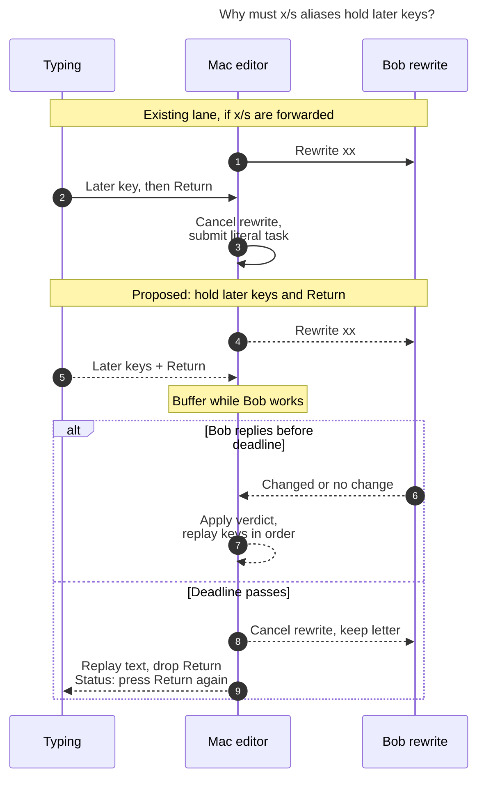

# Diagram proposals: `x` → `!` and `s` → `*`: Shift-free close-outcome aliases in Bob Mac Capture

Proposals for the swarm linker, not a report. Each diagram restates only what the source
report says.

```yaml
source: research:202611/close_outcome_x_s_typing_aliases/close_outcome_x_s_typing_aliases__final.md
producer: research.3r.image
check: "mmdc 12.0.0 with --no-sandbox and the PDF-mirroring config rendered 1 of 1 Mermaid diagrams"
```

## key-hold-timing

```yaml
anchor: |-
  While an `x`/`s` rewrite is in flight, the controller buffers
question: |-
  How does the proposed key hold prevent fast typing from dropping an alias, and what happens when Bob misses the deadline?
illustrates: |-
  The proposed bounded key hold buffers later key-downs until Bob answers and replays them in order, while a missed deadline cancels the rewrite and drops buffered Return instead of submitting an unresolved alias draft.
caption: The proposed hold replays keys after Bob's verdict; a missed deadline keeps the letter, drops buffered Return, and asks for another press.
review: "679x989 px, fit 90.3%; question, visual, source-trace and unique-anchor checks passed; 0 visual revisions, 1 parse fix; reply/deadline scope only"
```


