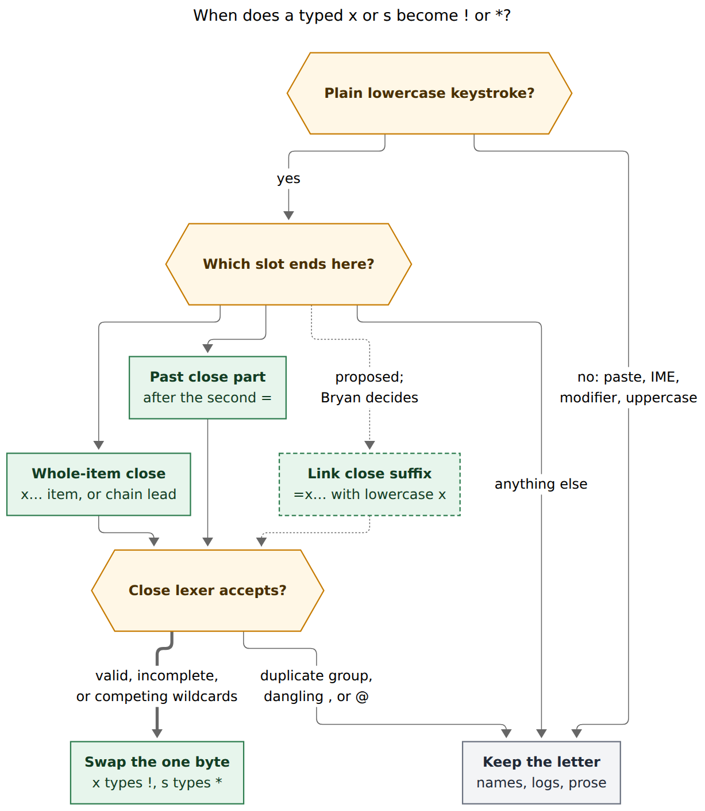

# `x` → `!` and `s` → `*`: Shift-free close-outcome aliases in Bob Mac Capture

*Consolidated report · 2026-11-08 · merges the cdx, cld, grk, mus, and gem
research reports with the lead researcher's own verification.*

## Bottom line

**Build it, but as an editor-only typing assist owned by Bob, with ten
requirement adjustments.** The request is a good one:

- Closing a Pomodoro is Bryan's most frequent capture. The last 40 daily notes
  hold **489 closed Pomodoros**, about 12 a day and up to 23.
- `!` (Shift+1) and `*` (Shift+8) are the only outcome markers that need Shift.
- Every other Shift sigil on the hot path already has a Shift-free alias: `.`→`^`,
  `;`→`:`, `,`→`+`, `=`→`~`, `\`/`/`→`#`, and past-segment `-`→`~`. Adding
  `x`→`!` and `s`→`*` completes that family; it does not start a new pattern.

How it works:

- Implement it as one new branch of Bob's `capture-rewrite` rule
  `expand_sigil_alias`.
- The Mac app forwards `x` and `s` keystrokes into its existing rewrite lane.
- `bob capture` and `bob capture-parse` keep the letters literally. Pasted and
  CLI text never change meaning.

Two things make this harder than "add two characters to an allowlist":

1. **These are the first letters in the rewrite lane.** Whole-item `xx` and `xs`
   are documented prose today, `@route:id=xs` is a named start, and `x log xs`
   contains a session chain (shown below). The alias has to be scoped by Bob's
   grammar, not by string matching.
2. **A dropped alias now produces a wrong vault write, not stray punctuation.**
   - Today, any keystroke that lands before Bob answers cancels the rewrite.
   - A Return in that window submits the literal draft.
   - So `xx⏎` or `xs1⏎`, typed fast, would file a junk inbox task ("xx", "xs1")
     instead of closing the Pomodoro.

   The Mac half must make typing speed irrelevant. That is most of the
   engineering.

The recommended design is in [§8](#8-recommended-solution).

## Evidence base

| Source | What it contributed |
| --- | --- |
| Five researcher reports | cdx: precise timing analysis and a "pre-key draft" location query. cld: vault frequency, an alias inventory, the viable-prefix rule, and a rebase proposal. grk: test matrices and figures (kept in this directory). mus: the transport-cost argument and v1 scoping. gem: ergonomics and the `x=1s` theme-collision walkthrough |
| Lead verification: grammar 19 | Built `bob` from bob-cli `59ba11a6` (grammar **19**) and re-ran every disputed probe. All five reports had probed the installed `bob 0.4.0`, which reports grammar **16** |
| Lead verification: Mac source | Read bob-mac-capture `0583f37`: `CapturePanelController.noteSeparatorToggleIntentIfEligible`, `CapturePanelModel` (`noteSeparatorToggleIntent`, `editorTextDidChange`, `startCaptureRewrite`, `applyCaptureRewrite`, `submit`, `invalidateRewrite`), `CaptureCloseTaskCommaAssist`, `RefsPanelModel` key buffer, and `docs/keyboard.md` |
| Lead verification: vault scan | `~/bob`, read-only: close counts, collision counts, and name prefixes |
| Decisions | `decisions:mac-capture-is-a-thin-client`, `decisions:relation-equals-alias-and-flips`, `decisions:close-selections-list-explicitly` |

No Swift was compiled and no Mac latency was measured. Statements about Mac
race behavior come from reading the source, not from observed failures.

## 1. What the request means

**"Instead of the second `=`" means "after the second `=`".** All five reports
agree, and grammar 19 confirms it. The request's own example, `x=1=s` → `x=1=*`,
keeps the `=`; the letter takes the place of `*`. The literal reading, where `s`
stands in for `=*`, would steal valid input:

| Typed (grammar 19) | Meaning today |
| --- | --- |
| `x=1s` | Past session named **S**, 5 minutes |
| `x=s`, `x=xs` | Past sessions named **S** / **XS**, 25 minutes |
| `x=1!` | Past session with **repair**, which is a different `!` |
| `x=1x` | Teaching error: "write `x=1#x`" |
| `x=1=s`, `x==s` | `invalid_pomodoro_past` ("not a task list"), so aliasing is collision-free |
| `x=1=*`, `x==*` | Valid park-all past sessions |

The `[s]` in the documented form `x=E[s][!][=X]` is a placeholder for the
`~`-segment suffix (`~2`, `~~`, and so on). It is not the letter `s` (grk).

## 2. Is this a good idea?

**Yes.** The arguments for it:

- **Frequency × friction.** About 12 closes a day, and the two outcomes that
  need Shift are the ones that act on every remaining link.
  - Caveat: the vault records outcomes, not keystrokes, and Bob keeps no capture
    history. So the share of closes typed as `x!`/`x*` (rather than bare `x` or a
    numbered list) is **not measured**.
  - gem's claim that these are "by far the most frequent" is plausible but
    unverified.
- **Ergonomics and mnemonics.** `xx` is a same-key double tap. `[x]` already
  means "done" in Markdown. `s` reads as **s**tar, **s**helve, or **s**tash, all
  of which fit Park. `p` (park) loses the visual `s`≈`*` link and collides with
  `xp…` prose, so all five reports keep `s`.
- **Almost every target position is an error today.**
  - A letter has no meaning inside `x[<N>][*
][!<M>][~<K>][@<N>]` or after a
    past token's second `=`.
  - Grammar 19 reports `x1x`, `x1s`, `x!s`, and `x=1=s` all as
    `invalid_pomodoro_close` or `invalid_pomodoro_past`.
  - In those positions the alias can only turn an error into valid syntax.

**The costs, ranked:**

1. **Async correctness (high).** A dropped alias leaves a *valid* prose capture
   (`xx`, `xs1`), and Return files it. Existing aliases fail harmlessly because a
   literal `.` or `;` is rarely a valid, different command. The one exception,
   past-segment `-`, already needed special Return plumbing
   (`deferSubmitForPastSegmentDash`).
2. **Ordinary letters get claimed while typing (low in practice).** Whole-item
   `xx…` and `xs…`, link-suffix names `=xx…` and `=xs…`, and a chain-close
   position in inline Work Log text all change. Vault evidence (lead scan):
   - **0** task lines start with `xx` or `xs`.
   - **0** of the **870** named Pomodoros in 2026 start with `X` (top names:
     PLAN 204, BUILD 172, READ 107).
   - **0** of **3,956** child bullets in 2026 daily notes contain an `xs…` or
     `xx…` word.
   - Such words exist only in reference notes (`xsmall` 31×, `xstate` 11×,
     `xs` 13×).
3. **A process spawn per letter (moderate).** `s` is about 6% of English
   letters. Every forwarded key spawns `capture-rewrite`: median 5.8 ms (cld) or
   6.1 ms (cdx) on apollo, Mac unmeasured. While the rewrite runs, it holds back
   that keystroke's completion request (`completionGate`). A cheap lexical
   prefilter fixes this.
4. **Documentation contradiction (low).** `docs/capture.md` L337 and L4682 and
   `capture-syntax.md` L1006 say "`xx` … never closes". That stays true for the
   grammar but not for the panel, so the docs need a scoped sentence.

**Would I take a different approach?** No. Every alternative the reports raised
loses (see [§7](#7-alternatives-considered)). The changes I would make are to the
*requirements*, not the architecture.

## 3. What exists today, and what the change touches

| Piece | Today | Change |
| --- | --- | --- |
| Bob rule | `rewrite.rs` `expand_sigil_alias` dispatches `-`, `=`, `\`/`/`, `,`, `.`, `;`; most gate on `completion_field_at` | Add an `x`/`s` branch. **There is no close `CompletionContext`**; `pomodoro_close_task` is only a parser `Need` (`editor_model.rs:329`). So mus's "gate via `completion_field_at`" cannot work. The gate must be the close lexer (`close_selection.rs` `lex_close_selection`), as cdx, cld, and grk say |
| Mac key filter | `noteSeparatorToggleIntentIfEligible` allows `: ^ + \| , . ; - = ~` and `\`/`/` | Add lowercase `x`/`s` plus a prefilter |
| Mac model allowlist | `noteSeparatorToggleIntent` has the same list | Add `x`/`s` |
| Apply path | `applyNativeSingleEditRewrite`: one native edit, so Undo restores the typed key | Reuse unchanged |
| Stale guard | `applyCaptureRewrite` requires `plainDraft == draft` and an unmoved caret. Any later keystroke reaches `editorTextDidChange` → `invalidateRewrite()`, which cancels the in-flight request | This is where fast `xx1` loses the alias |
| Return during rewrite | `submit()` waits only when `deferredRewriteInputDraft` is set, which today happens only for `-` in an `x=` draft | Generalize to `x`/`s` |
| Close-list comma assist | App-local, digits only, filters Bob's `pomodoro_close_*` spans (`x1`+`2` → `x1,2` when the lineup has fewer than 10 links) | No key overlap; must behave after `x*` exactly as after a typed `*` |
| Key-buffer precedent | `RefsPanelModel.pendingHighlightsCopyBuffer` holds keys while Command-Y waits for an async read | Pattern for the type-ahead hold in §8.2 |

## 4. Verified grammar facts that settle the disputes

Probed with `capture-parse` on grammar 19:

| Draft | Result | Consequence |
| --- | --- | --- |
| `xx`, `xs`, `X!`, `Xs` | `task` (prose) | Whole-item alias is a deliberate, editor-only steal; capital `X` stays prose |
| `x!*` / `x*!` | Error: competing park-all and complete-all groups | A temporary state, not a dead end… |
| `x!*1`, `x*!2`, `x*1!` | **Valid** | …so `x!`+`s` → `x!*` must be allowed (grk would block it) |
| `x!!`, `x**` | Error: "use one `!`/`*` list" | `x!`+`x` and `x*`+`s` stay literal |
| `x1,*`, `x@*` | Error: "expected a task number after `,`/`@`" | Stay literal after a dangling `,` or `@` |
| `@foo:bar=x` / `=x!` / `=x*` | `pomodoro_link` close | Link-close suffixes are real close slots |
| `@foo:bar=xx`, `=xs` | `pomodoro_link` **start** (named XX/XS) | Aliasing here is a steal; Bryan decides (A10) |
| `@foo:bar=X`, `=X*` | `pomodoro_link` **close** | **New:** uppercase `X` *is* a link close, so "capital X escapes" only holds if the alias also requires a lowercase opener |
| `@foo:bar=XS` | Named start | Uppercase names stay safe |
| `x log x`, `x log x!` | **Two items**: close with log "log", then a second close | **New:** a trailing `x` after inline Work Log text is a chain close. Without a rule, `x fixed xss…` would become `x fixed x*s…` |
| `x log xs` | One close, log "log xs" | Today's prose is safe; only the alias would break it |
| `+2 x!` | Chain: adjust, then close | Chain closes in the lead should alias (`+2 xs` → `+2 x*`) |
| `x\n- x!` | Close; the child log text is `x!` | Child bullets never alias |
| `=x` (whole item) | Retired-close teaching error | Whole-item `=x…` never aliases |
| `x=#"a=b"=*` | Invalid name (names cannot contain `=`) | cdx's quoted-`=` concern is moot. Still locate the second `=` with `split_past_token`, never with a byte search |

## 5. Requirement adjustments (all flagged)

| # | Kind | Adjustment | Basis |
| --- | --- | --- | --- |
| **A1** | Clarified | Alias the letter **after** the past token's second `=`; never insert or remove a `=`. `x=1=s` → `x=1=*`; `x=1s` stays the past session named S | §1; all five agree |
| **A2** | Widened | Alias at **every outcome-marker position** in a close selection, not only directly after `x` or the second `=`. Examples: `x1s` → `x1*`, `x*1x` → `x*1!`, `x=1=1s` → `x=1=1*`, `x@1s` → `x@1*`, and lead chain closes (`+2 xs` → `+2 x*`). Batch items count too (an `xx` item after a blank line) | cdx, cld, grk, gem; one mental model: "inside a close, `x` types `!` and `s` types `*`" |
| **A3** | Narrowed | Alias only where the result is still a **viable prefix**: the lexer says valid, incomplete, or *only* competing wildcards. Never a second `!`/`*` group, never after a dangling `,` or `@` | §4 probes; cld's rule, which overrides grk's stricter one |
| **A4** | Narrowed | **Never alias** in past `E` (names, counts, repair `!`), whole-item `=x…`, child bullets, templates, wikilinks, code spans, or picker and modal fields. **Also never in a chain close that follows inline Work Log text** (`x log xs` stays literal) | §4; the inline-entry rule is a new finding here |
| **A5** | Narrowed | **Lowercase trigger and lowercase opener.** `X`, `S`, `=X…`, held-key repeats, and modified keys (⌘X, ⌃S) never alias | New nuance: `=X` is a link close |
| **A6** | Scoped | **Editor typing only.** `bob capture`, `capture-parse`, paste, restored drafts, templates, and completion inserts keep the letters. Requires `--cursor`, like every other alias | All five; `decisions:relation-equals-alias-and-flips` |
| **A7** | Added | **Typing speed must not change the outcome.** A fast Return waits for Bob, and keys typed before Bob answers must not drop the alias | cdx, cld, gem |
| **A8** | Added | **Escape:** Undo restores the literal key in one step; capital `X…` writes prose. **No same-key double-tap restore** | Resolves grk vs cdx (§6) |
| **A9** | Added | **Prefilter:** the Mac asks Bob only on a lexical superset of eligible positions | mus, cld, grk |
| **A10** | Proposed, **Bryan decides** | **Link-close suffixes alias too**: `@r:id=xx` → `=x!`, `^r:id=x1s` → `=x1*`, `Fix it @r:id=xs` → `=x*`. Cost: a named start beginning `xx`/`xs` must be typed uppercase (`=XS…`) or as `=#xs…` | cdx and cld include it; grk splits it; mus defers it. The request says "wherever the `x` syntax is respected", and no X-named Pomodoros exist. Dropping it later removes one branch |

Out of scope for v1, by consensus:

- A letter alias for drop (`~`). `d` collides with `xdg-open`; cld's
  `x1-2` → `x1~2` is worth a later look.
- Aliases in the repair slot.
- Naming the aliases in teaching errors. Errors keep canonical `!`/`*`.

## 6. How the disagreements were resolved

| Topic | Positions | Resolution |
| --- | --- | --- |
| Link suffixes (`=xx`, `=xs`) | cdx and cld: alias. grk: only already-claimed `=x1s`, keep `=xx` a name. mus: defer all. gem: silent | **Alias all lowercase `=x…` link closes (A10), as a separable Bryan decision.** grk's split is inconsistent: it steals whole-item `xs` but protects the equally rare named start `XS` |
| `x!` + `s` (competing wildcards) | cdx and cld: allow. grk: stay literal. mus: unsure | **Allow.** `x!*1` and `x*!2` are valid on grammar 19, so blocking would make `x!*1` untypeable with aliases |
| Escape gesture | grk: second same key restores the letters (like `\\`). cdx: no double-tap. Others: Undo | **Undo + capital `X`.** For `\\` the doubled key reads naturally as an escape. Here three `x` presses would yield `xx`, and `xss` would yield `xs`, which is surprising. Each extra arm is also more timing state. Revisit only if Undo proves insufficient |
| Fast typing | cdx: a full pending-edit transaction (rebase plus ordered replay). cld: Return deferral plus prefix rebase. gem: Return deferral only. grk and mus: mostly silent | **Return deferral plus a bounded key hold** (§8.2). Return deferral alone still files `xx1` from `xx1⏎`. A prefix rebase alone misses a second alias inside one round trip (`x1s2x`) and skips the comma assist that a typed `*` would get |
| Bob gate | mus: `completion_field_at`. gem: a hand-written digit/comma scan. grk: swap, then lex. cld: swap and re-parse, or a predicate. cdx: locate on the pre-key draft, then lex | **Locate the slot on the pre-key draft, then lex the candidate** (cdx + grk). mus's gate has no context to use (§3), and gem's scan duplicates the lexer. Locating on the candidate is unsafe: `=` + `x` gives candidate `=!`, which `close_after_eq_parts` claims as a retired close |
| Prefilter | cld: line regex. grk: previous character. mus: a line heuristic. gem: `latestParse.mode`. cdx: caution | **A lexical superset combining cld and grk** (§8.2). Reject gem's use of `latestParse`: it describes the previous keystroke's draft, so it is stale by design |
| Old Bob + new Mac | cdx: capability probe. cld and grk: no gate needed | **Ship Bob first. An optional one-time probe is cheap insurance**: without it, `xx⏎` on an old Bob files a task "xx" |

## 7. Alternatives considered

| Alternative | Verdict |
| --- | --- |
| Swift-side replacement or close recognition (like the comma assist) | **Reject.** A second grammar; `decisions:mac-capture-is-a-thin-client`. The comma assist was allowed only because it needs agenda data that Bob's lexical rewrite cannot see |
| Grammar-level alias (`bob capture 'xx'` ≡ `x!`) | **Reject.** Scripts and paste change meaning (`xs` becomes a park-all close). Every diagnostic, span, and doc gains a second spelling forever. `decisions:relation-equals-alias-and-flips` already rejected "syntax reaching the grammar" |
| Bob publishes per-caret "next-key alias hints" in `capture-parse` | **Not now.** A new protocol surface, and it still races (the hint describes the previous draft) |
| Explicit chords (⌃X, ⌥S) or conversion only on a delimiter | **Reject as a substitute.** ⌃S is already the stash picker and ⌘X is cut, and it changes the requested interaction |
| A keyboard close card (pick outcomes per row after `x`) | Larger UX investment. The letter alias does not preclude it later |
| `p` for park instead of `s` | **Reject.** Weaker glyph mnemonic; same `xp…` prose collision class |

## 8. Recommended solution

*A plain lowercase `x` or `s` is swapped only when it ends a close selection in
one of three slots, and Bob's close lexer still accepts the result. Names, Work
Log text, and prose keep the letter. The dashed link-suffix path is proposal A10,
pending Bryan's decision.*

### 8.1 bob-cli first: one branch of `expand_sigil_alias`

Add an `expand_close_outcome_alias` helper beside
`expand_past_segment_dash_alias`. It keeps the rule code `expand_sigil_alias`,
JSON `schema_version` 1, and grammar 19, and needs no new response field.

1. **Trigger.** The byte at `cursor-1` is lowercase `x` or `s`, and the token
   ends at the cursor. With no `--cursor`, the rule is skipped.
2. **Locate on the pre-key draft** (trigger byte removed) a close selection whose
   text ends exactly at the trigger offset. Reuse the existing classifiers; do
   not write new string scans.
   - **Whole-item or lead-chain close.** `classify_whole_item_close` on the token.
     The token must be the item's first token, or every token before it on the
     line must be a session token. That excludes chain closes after an inline
     entry (A4).
   - **Past close part.** `past_token_len` + `split_past_token` with
     `has_second_eq`, and the trigger falls in `close_text`.
   - **Link close (A10).** `close_after_eq_parts` with `x_len == 1` and a
     **lowercase** `x` (A5), on `@route:id=`, `^route:id=`, and
     `<text> @route:id=` suffixes.
   - **Excluded everywhere:** templates (`template::analyze`),
     `wikilink_claims`, code spans, child lines.
3. **Verify the candidate.** Swap the byte for `!` or `*`, then run
   `lex_close_selection` on the selection. Accept `Valid` and `Incomplete`, plus
   an `Err` whose only cause is the competing-wildcards error. A small predicate
   in `close_selection.rs` (cld: `close_marker_may_follow`) is cleaner than
   matching message text. Reject every other error.
4. **Edit.** Call `finish_sigil_alias` for a one-byte replacement. The cursor
   does not move. Summaries: `Typed ! for x` / `Typed * for s`. Feeding the
   output back is a no-op.

**Tests.** Add unit cases in `src/native/capture_language/tests/rewrite.rs` and
CLI JSON cases in `tests/cli/capture/rewrite.rs` for every row of the matrix
below. Keep `bare_close.rs`'s assertion that `xx` parses as prose.

| Fires (cursor at end) | Result | Stays literal | Why |
| --- | --- | --- | --- |
| `xx` / `xs` | `x!` / `x*` | `x=1s`, `x=s`, `x=xs`, `x=1x` | Past `E` names and teaching error |
| `x1x` / `x1s` | `x1!` / `x1*` | `x!x`, `x*s`, `x1,s`, `x@s` | Duplicate group, dangling `,`/`@` |
| `x!s` / `x*x` | `x!*` / `x*!` (diagnostic until a digit follows) | `X`, `Xs`, `@r:id=Xs` | Uppercase (A5) |
| `x*1x`, `x@1s`, `x1~2s` | `x*1!`, `x@1*`, `x1~2*` | `x log xs`, `x\n- xs` | Inline entry, child bullet |
| `x=1=s` / `x=1=x` / `x==s` | `x=1=*` / `x=1=!` / `x==*` | `=xs`, `=x` + `s` | Whole-item start; retired `=x` |
| `x=fix=s`, `x=1!=x`, `x=1=1s` | `…=*`, `…=!`, `x=1=1*` | `Plan xs`, `tax`, `session`, `s:2` | Prose, schedule marker |
| `+2 xs` | `+2 x*` | templates, wikilinks, code spans | Existing guards |
| `@r:id=xx`, `^r:id=x1s` (A10) | `=x!`, `=x1*` | `xx` with no `--cursor` | Paste/CLI stay literal |
| Second item `xx` after a blank line | `x!` | Picker/modal fields | Mac-side guard |

Also test UTF-8 offsets after an emoji, CRLF drafts, and idempotence.

**Docs, all in bob-cli.** Read `cli_rules.md` and `docs.md` through
`/sase_memory_read` first. Then update:

- the `capture-rewrite --help` sigil-alias paragraph and examples (regenerate
  `docs/reference/cli/capture-rewrite.md`);
- the `docs/capture.md` "Sigil alias" paragraph (L8846);
- the "`xx` is ordinary prose" rows at L337, L3579, and L4682, scoped to say
  "grammar and CLI: prose; Mac editor: typing `xx` gives `x!`";
- `docs/reference/capture-syntax.md` L1006 and the overloaded-marker rows.

Ship as a non-breaking `feat(capture):` on the daily release train, with no
version or changelog edits.

### 8.2 Bob Mac Capture second

1. **Forwarding.** Add lowercase `x` and `s` to both allowlists, under the
   existing guards: no ⌘/⌃/⌥, no marked text, collapsed selection, main editor,
   modal fields excluded. Also require `!event.isARepeat`.

   **Prefilter**, so prose letters never spawn `bob`. Forward only when both
   hold:
   - the character before the caret is one of `x`, `0`–`9`, `=`, `!`, `*`, `~`;
   - the current line before the caret matches `(^|[ \t=])x`.

   This is a strict superset of §8.1's slots: every close carrier has a
   lowercase `x` at a token start or after `=`, and every viable marker follows
   one of those characters. The filter only decides when *not to ask*, like
   today's `=` filter. Pin the superset property with a fixture shared with
   Bob's test table.
2. **Return deferral.** Generalize `deferSubmitForPastSegmentDash` to a
   "meaning-changing alias" flag (past-segment `-` plus `x`/`s`). Extend the echo
   check in `applyCaptureRewrite` (today: replacement `~` for trigger `-`) to
   `!` for `x` and `*` for `s`. A failed request cancels the queued submit and
   leaves the editable literal; it never submits it silently.
3. **Type-ahead: a bounded key hold (recommended).**
   - **Engage.** While an `x`/`s` rewrite is in flight, the controller buffers
     later key-downs instead of inserting them: characters, Return, Backspace.
     Cap the buffer at about 32 keys and about 150 ms, tuned from the existing
     `CaptureSignpost.measure("rewrite")` data.
   - **Replay.** When Bob answers (`changed` or not), replay the buffer in order
     through the normal key path. Chained aliases (`x1s2x3`), the comma assist,
     and Return then behave exactly as if typed after the reply.
   - **Flush first.** Any modifier command (⌘Z, ⌘V), click, focus change, or
     dismissal flushes the buffer before acting.
   - **Deadline.** If the deadline passes, cancel the rewrite (the letter stays)
     and replay. A buffered Return is **dropped with a status line** ("Bob did
     not answer; press Return again") rather than submitting an unresolved
     alias draft.
   - **Why a hold.** This is the simplest model that makes speed irrelevant.
     `RefsPanelModel`'s Command-Y key buffer is an in-repo precedent.
   - **Fallback.** If the hold feels laggy on the Mac, use cld's prefix rebase:
     apply Bob's one-byte verdict when the live draft's prefix up to the request
     cursor is unchanged and the literal key is still at `cursor-1`. Document
     that a second alias inside one round trip, and the comma assist on the
     following digits, can then differ from slow typing.
4. **Version skew (optional).** At process resolution, run
   `capture-rewrite --cursor 2 -- xx` once and cache the result by client
   identity. If Bob does not return `x!`, skip forwarding `x`/`s` and show "update
   bob for x/s aliases". This prevents `xx⏎` from filing a task on an old Bob.
5. **Tests.**
   - `CaptureSeparatorToggleTests` for forwarding, the prefilter, repeats,
     modifiers, and IME.
   - Model tests with a deliberately delayed fake Bob for `xx⏎`, `xs1⏎`,
     `x=1=s3`, `x1s2x3`, ⌘⏎, repeated Return, failure and no-op replies,
     Undo/Redo, caret moves, client replacement, and dismissal.
   - An emoji before a later item, to check UTF-8 to UTF-16 conversion.
   - Comma-assist parity: after `xs` → `x*`, typing `1` and `2` behaves as after
     a typed `*`.
6. **Docs and gate.**
   - Docs: `docs/keyboard.md` rows for `x` and `s`; the `docs/capture-panel.md`
     rewrite-lane paragraph plus the `xx` and named-start notes; a
     `docs/protocol.md` compatibility row.
   - Gate: compile on a Swift host via `scripts/dev/macos-ci-check`, and watch
     the exact-SHA macOS CI run with `/sase_monitor`, as the linked repo
     requires.

### 8.3 Compatibility

| Pairing | Behavior |
| --- | --- |
| New Bob + new Mac | Aliases work in the panel |
| New Bob + old Mac | Letters never enter the lane; type `!`/`*` as today |
| Old Bob + new Mac | Bob returns `changed: false`, so letters stay literal. **Without the probe in 8.2 step 4**, a habitual `xx⏎` files a task "xx" |
| CLI, paste, scripts | Unchanged: `xx` is a task, and `x=1=s` keeps its teaching error |

### 8.4 Governance and open questions

Once accepted, record a new decision, working title *"Close Outcomes Have Letter
Aliases In The Editor"*, through `/sase_memory_write`. It applies to bob-cli and
Bob Mac Capture.

- **Claims:** A1–A10.
- **Rejected alternatives:** those in §7, the literal "instead of `=`" reading,
  and the double-tap escape.
- **Reopens when:** a stolen prose or name parse actually bites, or Mac
  rewrite latency makes the key hold noticeable.

Questions for Bryan:

1. **A10:** should link-close suffixes alias (`@r:id=xx` → `=x!`)? Recommended:
   yes.
2. Is Undo plus capital `X` enough as the escape, or do you want a one-time
   "x → ! · s → *" hint when the draft is exactly `x`? Recommended: skip the hint
   in v1.
3. Is a close-drop alias (`x1-2` → `x1~2`) worth a follow-up? It is
   collision-free, but out of scope here.

## Appendix: provenance

- **Researcher reports**, now in this directory as
  `close_outcome_x_s_typing_aliases__{cdx,cld,grk,mus,gem}.md`. grk's
  `figure-eligibility.*` and `figure-owners.*` moved with its report so its links
  still resolve. grk's eligibility figure is superseded by
  `figure-alias-slots.*`: grk keeps `=xx` literal and blocks competing
  wildcards, and §6 overturns both.
- **Lead probes** used a debug build of bob-cli `59ba11a6`
  (`capture-parse --no-ref --format json`, grammar 19). The current
  `capture-rewrite` returns `changed: false` for `xx`, `x1s`, and `x=1=s`.
- **Vault scan** (read-only, `~/bob`):
  - 489 closed Pomodoro entries in the last 40 daily notes (max 23 in a day);
  - 870 named Pomodoros in 2026, none starting with X;
  - 0 task lines starting `xx`/`xs`;
  - 0 of 3,956 child bullets in 2026 daily notes with `xs…`/`xx…` words.
- **Figure:** `figure-alias-slots.mmd`, rendered with Mermaid CLI 12.0.0 using
  the PDF-mirroring config. 817 × 940 px, 79.9% fit.
