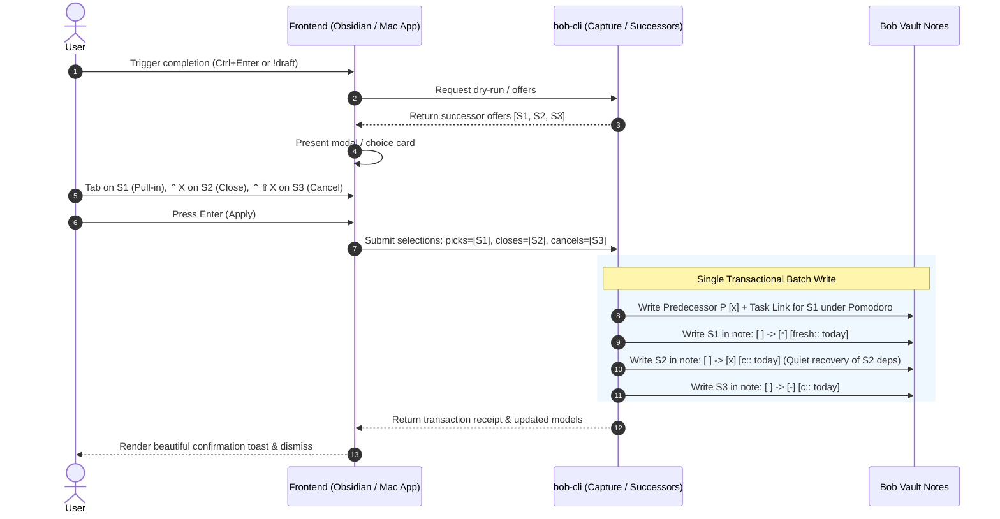
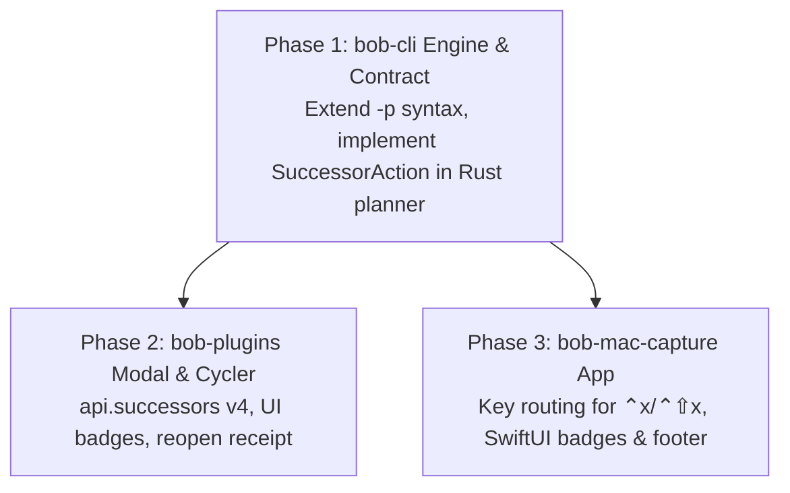

# Research & Design: Closing and Cancelling Tasks Directly from Successor Menus

> **Researcher:** `gem` (5-researcher independent swarm)  
> **Topic:** Design, critique, and implementation plan for closing and cancelling tasks directly from successor menus in Obsidian and Bob Mac Capture  
> **Repository Scope:** `bob-cli` (successor planner, selection grammar, task completion/cancellation engine), `bob-plugins` (`bob-navigation-hotkeys` modal, `task-status-cycler` orchestration), and `bob-mac-capture` (SwiftUI pull-in card, key command routing, process client)  
> **Date:** November 2026  

---

## Executive Summary

When completing a task or closing a Pomodoro in Bob, the successor menu surfaces unblocked tasks (direct hand-offs, project residents, pull-ins, keep-moving tasks, and relation successors) so the user can choose what to pull into the daily ledger. In practice, reviewing successors often provides immediate clarity that certain successor tasks are **already completed** (e.g., done offline, alongside the predecessor, or implicitly satisfied) or **obsolete** (rendered unnecessary by the predecessor's outcome).

Currently, neither Obsidian's `SuccessorOfferPickerModal` nor the macOS `CapturePullInChoiceCard` allows acting on these tasks at review time. The user must either pull them in and immediately close/cancel them in today's Pomodoro ledger (polluting tracked daily records), navigate away to source notes to edit them manually, or leave them to rot in the backlog until they resurface days or weeks later in a morning GTD review.

### Core Recommendations & Findings

1. **Compelling Value with High GTD Alignment**: The proposal is a high-leverage improvement to daily GTD flow. It eliminates backlog drag and keeps morning reviews focused on genuine decisions rather than acknowledging stale, finished, or moot work.
2. **Staged Row Verdict Model vs. Instant Mutation**: We strongly advise against immediate destructive keystrokes. Instead, the UI should adopt a **Staged Row Verdict Model** where `<ctrl+x>` (or Mac `⌃x`) stages a **Close** verdict, `<ctrl+shift+x>` (or Mac `⌃⇧x`) stages a **Cancel** verdict, and `Tab`/`Space` stages a **Pull-In** verdict. Pressing Return applies all staged verdicts in a single atomic transaction; pressing Escape discards all pending actions cleanly.
3. **No Phantom Ledger Entries**: Successors marked as **Close** (`[x]`) or **Cancel** (`[-]`) should be mutated in their **source notes only**. They must **not** be inserted as Task Links under today's open Pomodoro. Today's Pomodoro ledger reflects work planned or executed *during* today's sessions; historical completion or cancellation of unblocked work belongs in the source document.
4. **Quiet Dependent Recovery (The "Hydra" Rule)**: When a successor task $S$ is closed from the menu, $S$ might itself have open dependents ($D_1, D_2$). Spawning recursive successor menus or injecting new rows dynamically into an open picker would create chaotic UI jitter and cognitive overload. Instead, closing/cancelling a successor must recover its dependents **quietly in the background** (`[unblocked:: today]`), allowing them to surface through the standard GTD review walk (TICKLER/NEW) the following morning.
5. **Unified Multi-Action CLI Contract**: In `bob capture`, the `-p, --pull-in` option should be extended with an expressive, backwards-compatible action grammar: e.g., `-p 1:pull,2:close,3:cancel` (or `-p 1,2:close,3:cancel`, where bare numbers default to `pull`). This keeps Bob Mac Capture a strict thin client, guarantees mutually exclusive actions per offer, and enables single-transaction execution across all target files.
6. **API Evolution**: Nav's `api.successors` interface bumps from `version: 3` to `version: 4`. `pick(model)` resolves `{ picks: [{ key, destination? }], closes: [key], cancels: [key] }` or `null`. `task-status-cycler` orchestrates the source note writes, applies completion dates (`[c:: today]`) and cancellation logs, and stores preimages in the same-day reopen receipt for full reversibility.

---

## 1. Critique & Strategic Workflow Evaluation

### 1.1 The User Problem & Current Failure Modes

In David Allen’s Getting Things Done (GTD) methodology, task dependencies form a directed acyclic graph. When a prerequisite task $P$ finishes, its downstream successors $S_1, \dots, S_n$ unblock and enter the actionable horizon. 

In Bryan's daily workflow, two recurring scenarios occur upon completing $P$:
- **Concurrent Completion**: While working on $P$ ("Finalize authentication protocol design"), $S_1$ ("Draft token exchange format") was naturally completed in the same work session.
- **Obsolescence / Invalidation**: Finishing $P$ revealed that $S_2$ ("Add cookie fallback adapter") is no longer necessary because an alternative architecture was selected.

```
       [✓ Predecessor P Completed]
                   │
                   ▼
       Successor Offers Surfaced
    ┌──────────────┬──────────────┐
    ▼              ▼              ▼
 Successor S1   Successor S2   Successor S3
 (Real Next)    (Already Done)  (Now Obsolete)
    │              │              │
 Pull into      Mark Done      Cancel Task
 Pomodoro       in Source      in Source
```

Under the current system, the user is trapped in a triad of undesirable choices:

| Current Strategy | Workflow Impact | Why It Fails |
| :--- | :--- | :--- |
| **A. Leave Unselected** | Tasks unblock to `[ ]` (Ready) and enter the backlog. | Days or weeks later, $S_1$ and $S_2$ decay to ROTTEN or resurface in the morning review walk. Bryan has to context-switch, remember that $S_1$ was finished long ago, and manually close it. |
| **B. Pull In & Immediate Close** | User marks $S_1$ and $S_2$ to pull into today's Pomodoro, then immediately presses `Ctrl+Enter` or `Alt+[` on the daily note. | Pollutes today's Pomodoro ledger with phantom tasks not actually worked on today. Skews Pomodoro metrics and clutters the daily file with struck/cancelled bullets. |
| **C. Out-of-Band Source Edit** | User cancels the prompt or opens a separate tab, finds the source notes, navigates to the lines, and edits checkboxes. | Breaks flow state, interrupts Pomodoro rhythm, and forfeits the convenience of the successor surfacing engine. |

**Verdict**: Adding close and cancel capability directly to the successor menu addresses a genuine, high-frequency GTD pain point.

---

### 1.2 Critique of the Plan & Critical Pitfalls

While the feature is undeniably valuable, implementing it without rigorous guardrails introduces substantial architectural and UX risks.

#### Pitfall 1: Destructive Gesture Safety vs. Exploratory Review
The successor menu is fundamentally an exploratory triage modal. In Bob Mac Capture, it opens during capture review before anything has landed on disk. In Obsidian, it pauses the completion transaction.
- **Risk**: If `<ctrl+x>` immediately mutates a task on disk, an accidental keystroke commits a permanent change to a note that might not even be open.
- **Mitigation**: **Action Staging**. Modifying a row to "Close" or "Cancel" must only stage a visual verdict. The write executes only when the user confirms with Return (`↵` / `↩`). Hitting Escape (`Esc`) cleanly aborts all actions with zero filesystem mutations.

#### Pitfall 2: The "Hydra" Problem (Cascading Unblocking)
If Successor $S_1$ is marked closed in the menu, $S_1$ might itself unblock downstream tasks $D_1$ and $D_2$.
- **Naïve Approach A (Recursive Pickers)**: After finishing the current menu, a second menu pops up for $D_1$ and $D_2$. This produces jarring modal cascades, holds the review walk lock indefinitely, and frustrates the user.
- **Naïve Approach B (Dynamic In-Place Expansion)**: $D_1$ and $D_2$ are inserted into the open list in real time. This causes list height jitter, moves selection indices under the cursor, and risks infinite loops if cyclic dependencies exist.
- **Recommended Architectural Invariant (Quiet Background Recovery)**: Tasks closed or cancelled from the successor menu recover their dependents **quietly** using the standard recovery engine:
  - Direct dependents unblock, lose `#prj_is_blocked`, and receive `[unblocked:: today]`.
  - No new offers are generated during this turn.
  - The unblocked downstream tasks will naturally appear in tomorrow morning's GTD review walk (as TICKLER / NEW rungs).

#### Pitfall 3: Pomodoro Ledger Purity
When a task is closed from the successor menu:
- Does a Task Link appear under today's open Pomodoro?
- **Rule**: **No**. The user is declaring: *"This task was already completed or is obsolete."* They did not spend the current Pomodoro session executing it. The edit must strictly touch the source note (`note.md`), writing `[x] ... [c:: YYYY-MM-DD]` or `[-] ... [c:: YYYY-MM-DD]`, without creating a live or struck Task Link on the daily note.

#### Pitfall 4: Same-Day Reopen Reversibility (Obsidian Cycler)
In Obsidian, if Bryan closes a predecessor with `Ctrl+Enter` and immediately realizes a mistake, pressing `Ctrl+Enter` on the struck Task Link executes the **same-day reopen receipt**: it strips the link, restores previous statuses, and undoes the gesture.
- **Requirement**: Any successor closed or cancelled during the gesture must have its pre-mutation line recorded in the reopen receipt. Reopening the predecessor must restore the successor to its original open state.

---

## 2. Interaction & Keyboard Design

### 2.1 Keybinding Ergonomics

Bryan proposed `<ctrl+x>` to close and `<ctrl+shift+x>` to cancel. Let us evaluate keymap ergonomics across operating systems and input contexts.

#### Conflict Analysis

| Context | Proposed Key | Potential Collision | Assessment |
| :--- | :--- | :--- | :--- |
| **macOS Native** (`bob-mac-capture`) | `⌃x` (Control-X) | Standard macOS Cut is `⌘x` (Command-X). `⌃x` is Emacs prefix in Cocoa text fields, but rarely used in search/filter inputs. | **Safe & Clean**. `⌃x` does not collide with `⌘x` (Cut) or `⌥x` (Special characters). |
| **macOS Native** (`bob-mac-capture`) | `⌃⇧x` (Control-Shift-X) | None in standard macOS menu bar or text routing. | **Safe & Clean**. |
| **Obsidian Modal** | `Ctrl+X` | In Obsidian/Vim, `Ctrl+X` in insert mode can trigger autocompletion or decrement numbers. However, within a Modal dialog with an active search input, `Ctrl+X` is completely interceptable by `keydown`. | **Safe**. Modifiers ensure letters aren't typed into the search filter input. |
| **Obsidian Modal** | `Ctrl+Shift+X` | None. | **Safe**. |

#### Semantic Justification
- `x` is the universal character for the Markdown completed checkbox (`- [x]`). Using `Ctrl+X` to mark a row as `[x]` is instantly memorable.
- `Shift` is the universal Bob/Obsidian modifier for demotion, cancellation, or inversion (e.g., `Ctrl+Shift+P` for cancel, `Shift+Tab` for reverse navigation). `Ctrl+Shift+X` as the cancelled counterpart (`- [-]`) is completely natural.

### 2.2 Unified Keyboard Specification

The interaction model harmonizes across both applications:

```text
               ┌────────────────────────────────────────────────────────┐
               │              ROW VERDICT STATE MACHINE                 │
               └────────────────────────────────────────────────────────┘

                                    [ Unmarked ]
                                   (default: none)
                                    ▲     ▲     ▲
                        Tab / Space │     │     │ ⌃⇧X
                             toggle │     │     │ toggle
                                    ▼     │ ⌃X  ▼
                               ┌────────┐ │ toggle ┌──────────┐
                               │ PULL IN│ │        │  CANCEL  │
                               │  [*]   │ │        │   [-]    │
                               └────────┘ ▼        └──────────┘
                                      ┌────────┐
                                      │ CLOSE  │
                                      │  [x]   │
                                      └────────┘
```

#### Detailed Key Behavior

1. **Selection & Marking**:
   - `Tab` (Obsidian) / `Space` (Mac): Cycles the highlighted row between **Pull In** and **Unmarked**.
   - `Ctrl+X` (Obsidian) / `⌃x` (Mac): Cycles the highlighted row between **Close** and **Unmarked**.
   - `Ctrl+Shift+X` (Obsidian) / `⌃⇧x` (Mac): Cycles the highlighted row between **Cancel** and **Unmarked**.
   - *Mutual Exclusivity*: Staging a verdict replaces any prior verdict on that row. A row cannot simultaneously be pulled in and cancelled.
2. **Navigation**:
   - `ArrowDown` / `ArrowUp` (both) or `⌃N` / `⌃P` (Mac): Moves selection highlight.
   - `Ctrl+A` (Obsidian) / `⌘A` (Mac): Marks all selectable rows in the active group for Pull-In.
3. **Commit & Abort**:
   - `Enter` (`↵` / `↩`): Commits all staged verdicts atomically:
     - Pull-In rows $\rightarrow$ linked to destination Pomodoro, status set to `*` (Next), stamped `[fresh:: today]`.
     - Close rows $\rightarrow$ updated in source note to `[x]`, stamped `[c:: today]`, dependents unblocked quietly.
     - Cancel rows $\rightarrow$ updated in source note to `[-]`, stamped `[c:: today]`, cancel logged if configured.
     - Unmarked rows $\rightarrow$ recover quietly as Ready/Tickler in backlog.
   - `Shift+Enter` (`⇧↩`) (Mac only): Skips all pull-ins and executes only explicit closes/cancels (or if none, submits with `--pull-in none`).
   - `Escape` (`Esc`): Aborts the dialog. Zero writes occur. (In Mac Capture, returns to draft; in Obsidian, commits predecessor Done with zero successor pulls/closes/cancels).

---

## 3. Visual & Aesthetic Design

A core requirement is that this feature must be **intuitive, reliable, and beautiful**. Successor menus are high-visibility touchpoints; changes must maintain Bob's clean, typography-focused, macOS-native elegance.

### 3.1 Visual Anatomy of Successor Rows

Each row dynamically reflects its staged verdict using color, iconography, text styling, and trailing action capsules.

```text
┌────────────────────────────────────────────────────────────────────────────────────────┐
│ UNMARKED (Default)                                                                     │
│  □  Send deployment announcement to team                          travel.md  ·  Ready  │
├────────────────────────────────────────────────────────────────────────────────────────┤
│ PULL IN (Tab / Space)                                                                  │
│  ☑  Send deployment announcement to team                    travel.md  ·  Next → FIX   │
├────────────────────────────────────────────────────────────────────────────────────────┤
│ CLOSE (Ctrl+X / ⌃x)                                                                    │
│  ✓  Send deployment announcement to team         travel.md  ·  [x] Close in travel.md  │
├────────────────────────────────────────────────────────────────────────────────────────┤
│ CANCEL (Ctrl+Shift+X / ⌃⇧x)                                                            │
│  ⊘  Send deployment announcement to team        travel.md  ·  [-] Cancel in travel.md  │
└────────────────────────────────────────────────────────────────────────────────────────┘
```

#### Detailed Visual Styling Specification

| Row State | Leading Indicator | Text Typography | Trailing Meta / Capsule | Color Tokens |
| :--- | :--- | :--- | :--- | :--- |
| **Unmarked** | Neutral square border (`□` / `RoundedRectangle`) | Standard `.body` color | Source note, current lane (`Ready`), planned destination (`→ FIX`) | `.secondary` / neutral |
| **Pull In** | Accent filled checkbox with white check (`☑`) | Standard `.body` color, bold destination | `→ FIX` in bright accent capsule, `adds ^id` badge if needed | Accent Blue / Purple (`--task-status-next`) |
| **Close** | Green filled circle with white check (`✓` / `checkmark.circle.fill`) | Subtle 85% opacity, normal weight | Soft green pill: `[x] Close in <note>` (destination capsule removed) | Success Green (`--task-status-done` / `#34C759`) |
| **Cancel** | Coral/Amber circle with diagonal slash (`⊘` / `minus.circle.fill`) | Subtle strikethrough, italicized, 70% opacity | Muted red/amber pill: `[-] Cancel in <note>` (destination capsule removed) | Danger/Muted Coral (`--task-status-cancelled` / `#FF3B30`) |

### 3.2 Dynamic Footer Summary

The footer dynamically summarizes the staged actions using pill badges with numeric content transitions:

```text
┌────────────────────────────────────────────────────────────────────────────────────────┐
│  Tab Pull In · ⌃X Close · ⌃⇧X Cancel · Esc None                   pull in 2 · close 1  │
│                                                     (plan 10/10)     [ Apply (3) ↵ ]   │
└────────────────────────────────────────────────────────────────────────────────────────┘
```

- When only pull-ins are staged: `pull in 2`
- When mixed actions are staged: `pull in 2 · close 1 · cancel 1`
- Confirmation button label transitions gracefully:
  - No items: `Skip ⇧↩` or `Apply ↩`
  - Pull-in only: `Pull In 2 ↩`
  - Close/Cancel only: `Apply (2) ↩`
  - Mixed: `Apply (4) ↩`

### 3.3 Post-Commit Receipt & Notifications

#### Obsidian Unblocked Notice Card
When closing or cancelling successors alongside the predecessor, the post-write notice card (`bob-nh-notice is-unblock`) expands its receipt:

```text
┌──────────────────────────────────────────────────────────────────┐
│ 🔓  Unblocked   1 → FIX                     ✓ Fix apollo machine! │
│  ＋ Re-launch all failed agents on apollo!               [ Next ] │
│  ✓ Book hotel in Vienna · closed in travel.md            [ Done ] │
│  ⊘ Rent car at airport · cancelled in travel.md     [ Cancelled ] │
│ ──────────────────────────────────────────────────────────────── │
│  (plan 10/10)  (1 pulled in · 1 closed · 1 cancelled)            │
└──────────────────────────────────────────────────────────────────┘
```

#### macOS Notification Line
`🔓 1 to FIX · 1 closed · 1 cancelled`

---

## 4. Architectural Design & Implementation

Implementing this feature cleanly requires coordinating changes across `bob-cli`, `bob-plugins`, and `bob-mac-capture`.



### 4.1 Layer 1: `bob-cli` Core Engine & CLI Contract

#### 1. CLI Option Grammar (`-p, --pull-in`)
Currently, `bob capture` accepts:
```bash
bob capture -p "1,2" ...
bob capture -p "all" ...
bob capture -p "none" ...
```
To maintain backwards compatibility and conform to `sase/memory/cli_rules.md`, we extend `-p, --pull-in` by allowing **action qualifiers** on offer tokens:
- `<token>` (bare number or key) defaults to `pull` (e.g. `1` or `note.md#^id`).
- `<token>:pull` explicitly marks pull-in.
- `<token>:close` or `<token>:x` marks close.
- `<token>:cancel` or `<token>:-` marks cancel.

Examples:
```bash
# Pull in offer 1, close offer 2, cancel offer 3
bob capture -p "1:pull,2:close,3:cancel" "!deploy:release"

# Bare numbers default to pull; mix with close/cancel
bob capture -p "1,2:close,3:cancel" "!deploy:release"

# Close all offers directly without pulling any in
bob capture -p "all:close" "!deploy:release"
```

#### 2. Rust Internal Data Structures
In `src/native/task_complete/successors.rs`:

```rust
/// Action verdict for an individual successor offer.
#[derive(Debug, Clone, Copy, PartialEq, Eq, Default)]
pub(crate) enum SuccessorAction {
    #[default]
    PullIn,
    Close,
    Cancel,
}

/// Structured selections passed into the planner.
#[derive(Debug, Clone, PartialEq, Eq, Default)]
pub(crate) enum SuccessorSelection {
    #[default]
    None,
    All(SuccessorAction),
    Actions(BTreeMap<String, SuccessorAction>),
}
```

#### 3. Execution in the Capture Pipeline
When `SuccessorAction::Close` or `SuccessorAction::Cancel` is selected for an offer $D$:
- **Placement**: No Task Link is placed on the daily note (`D.link = None`).
- **Source Mutation**:
  - `Close`: The task line in $D$'s source note is modified using `set_task_line_status(line, 'x')` and stamped with `upsert_completion_date(line, today)`. Freshness stamps (`[keeps::]`, `[unblocked::]`) are cleared.
  - `Cancel`: The task line is modified using `set_task_line_status(line, '-')` and stamped with `upsert_cancelled_date(line, today)`. If configured, a `❌ **CANCEL LOG**` entry is prepended.
- **Dependent Handling**: Any dependent $T$ of $D$ is evaluated:
  - If $D$ was closed: $T$ recovers as Blocked $\rightarrow$ Ready, stamped `[unblocked:: today]`. It does **not** generate secondary successor offers during this execution.
  - If $D$ was cancelled: $T$ remains blocked or follows the cancellation prune rule (`src/native/task_cancel/prune.rs`).
- **JSON Output**: The capture JSON payload carries additive arrays under `pull_in`:
  ```json
  "pull_in": {
    "supported": true,
    "offer_count": 3,
    "choice": "subset",
    "picked_count": 1,
    "closed_count": 1,
    "cancelled_count": 1,
    "closed": [
      { "key": "travel.md#^hotel", "text": "Book hotel in Vienna", "note_path": "travel.md" }
    ],
    "cancelled": [
      { "key": "travel.md#^car", "text": "Rent car at airport", "note_path": "travel.md" }
    ]
  }
  ```

---

### 4.2 Layer 2: `bob-plugins` (Obsidian Integration)

#### 1. Navigation Plugin Modal (`bob-navigation-hotkeys`)
File: `plugins/bob-navigation-hotkeys/src/206-successor-picker-modal.js`

- **State Model**: Replace `markedKeys = new Set()` with `verdicts = new Map()`:
  - Key $\rightarrow$ `"pull_in"` | `"close"` | `"cancel"`
- **Keydown Router**:
  ```javascript
  // Inside handleKeydown(event):
  if (event.key && String(event.key).toLowerCase() === "x" &&
      (event.ctrlKey === true || event.metaKey === true)) {
    event.preventDefault();
    event.stopPropagation();
    if (event.shiftKey === true) {
      this.toggleRowVerdict("cancel");
    } else {
      this.toggleRowVerdict("close");
    }
    return;
  }
  ```
- **Row Rendering**:
  - Add CSS classes `.is-verdict-close` and `.is-verdict-cancel`.
  - In `.is-verdict-close`: display `✓` mark, add pill `[x] Close in <note>`.
  - In `.is-verdict-cancel`: display `⊘` mark, add pill `[-] Cancel in <note>`.
- **API Version Bump**:
  - Bump `api.successors.version` from `3` to `4`.
  - `pick(model)` resolves:
    ```javascript
    {
      picks: [{ key: "...", destination: ... }],
      closes: ["..."],
      cancels: ["..."]
    }
    ```

#### 2. Status Cycler Coordination (`task-status-cycler`)
File: `plugins/task-status-cycler/src/137-plugin-successor-project.js`

- When `result` is received from `pickerApi.pick(model)`:
  - If `result.closes.length > 0` or `result.cancels.length > 0`:
    - Read source notes for all closed/cancelled tasks.
    - Snapshot line preimages and record them in the gesture's reopen receipt.
    - Apply status edits directly to editor buffers or vault files in the same atomic settlement pass.
    - Suppress recursive offers for dependents of closed successors.

---

### 4.3 Layer 3: `bob-mac-capture` (macOS Swift Integration)

Bob Mac Capture operates as a strict thin client of `bob`.

#### 1. Key Routing (`CaptureKeyCommandRouter.swift`)
Add two new enum cases:
```swift
public enum CaptureKeyCommand: Equatable {
    // ... existing cases ...
    case togglePullInClose
    case togglePullInCancel
}
```
Route keypresses when `pullInChoice != nil`:
- Keycode 7 (`kVK_ANSI_X`) with Control modifier $\rightarrow$ `.togglePullInClose`
- Keycode 7 (`kVK_ANSI_X`) with Control + Shift modifiers $\rightarrow$ `.togglePullInCancel`

#### 2. Choice State (`CapturePullInChoiceState.swift`)
```swift
public enum PullInRowVerdict: String, Equatable, Sendable {
    case pullIn = "pull"
    case close = "close"
    case cancel = "cancel"
}

public struct CapturePullInChoiceState: Equatable {
    public var verdicts: [String: PullInRowVerdict] = [:]
    
    public mutating func toggleVerdict(_ key: String, verdict: PullInRowVerdict) {
        if verdicts[key] == verdict {
            verdicts.removeValue(forKey: key)
        } else {
            verdicts[key] = verdict
        }
    }
}
```

#### 3. View Components (`CapturePullInChoiceView.swift`)
- In `CapturePullInOfferRow`:
  - Check `choice.verdicts[row.offerKey]`
  - Render green checkmark circle for `.close`, red slash circle for `.cancel`.
  - Hide destination capsule when `.close` or `.cancel` is active, replacing it with `[x] Close` or `[-] Cancel` capsule.
- In `CapturePullInChoiceFooter`:
  - Add hints: `("⌃X", "Close")` and `("⌃⇧X", "Cancel")`.
  - Bind action buttons to dispatch the structured argument string: e.g. `--pull-in 1:pull,2:close`.

---

## 5. Edge Cases & Invariant Analysis

### 5.1 Still-Blocked (Muted) Rows
In the current menu, rows that remain blocked (e.g. project residents waiting on other prerequisites) are rendered as muted rows and skipped during keyboard navigation.
- **Can a user cancel a still-blocked task?**
  - **Analysis**: Often, an obsolete task is *still blocked* by something else that also didn't get done. Cancelling an obsolete blocked task is valid and desirable because it unblocks subsequent tasks or prunes dead branches.
  - **Recommendation**: In Phase 1, keep keyboard navigation focused on selectable (unblocked) offers to preserve speed and avoid navigational ambiguity. In Phase 2, allow `ArrowDown` to focus muted rows with a special hint: `⌃⇧X Cancel obsolete prerequisite`. Muted rows must never allow `Pull In` or `Close`.

### 5.2 Project Notes (`^prj`) and Pull-Ins
- If a project finishes and its pull-in offer (`project_finished`) appears:
  - Marking it **Close** completes the project note (`^prj` $\rightarrow$ `[x]`).
  - Marking it **Cancel** cancels the project (`^prj` $\rightarrow$ `[-]`).
  - Both actions strip `#hide` from the project note as specified in `docs/task-dependencies.md` §12.10.

### 5.3 Stale Preimage Conflicts
If another agent or external process modifies a successor's source note while the menu is open:
- The cycler verifies the line preimage before modifying the file.
- If the line text on disk has diverged, the individual row update fails gracefully with a notification: `⚠ Could not close "Task text" (source note modified)`.
- The primary predecessor completion and any unaffected successor edits still land safely.

---

## 6. Implementation Roadmap & Test Plan

### 6.1 Phased Implementation Stages



1. **Phase 1: `bob-cli` Core**
   - Extend `-p, --pull-in` parsing in `src/native/capture/cli.rs` and `pull_in.rs` to support `:pull`, `:close`, `:cancel` qualifiers.
   - Extend `SuccessorSelection` and `plan_successors` in `src/native/task_complete/` to execute source line edits for close/cancel.
   - Enforce Quiet Background Recovery for dependents of closed successors.
   - Update `docs/task-dependencies.md` (§12.5, §12.14).
2. **Phase 2: `bob-plugins` (Obsidian)**
   - Bump `api.successors` to `version: 4` in `bob-navigation-hotkeys`.
   - Implement `Ctrl+X` and `Ctrl+Shift+X` handling and visual styling in `SuccessorOfferPickerModal`.
   - Update `task-status-cycler` to orchestrate source file updates and store reopen receipts.
3. **Phase 3: `bob-mac-capture` (macOS)**
   - Update `CaptureKeyCommandRouter` to recognize `⌃x` and `⌃⇧x`.
   - Update `CapturePullInChoiceState` and `CapturePullInChoiceView` with new styling, capsules, and footer metrics.
   - Update `BobProcessClient` to format `-p` arguments.

### 6.2 Test Vectors (Proposed SV Series)

| Vector ID | Scenario | Input / Selection | Expected Outcome |
| :--- | :--- | :--- | :--- |
| **SV1** | Close hand-off successor | `-p 1:close` on offer $D_1$ | Predecessor $P$ closes `[x]`; $D_1$ in `note.md` becomes `[x] [c:: today]`; no Task Link in daily note. |
| **SV2** | Cancel project resident offer | `-p 2:cancel` on resident $R$ | $P$ closes `[x]`; $R$ in `prj.md` becomes `[-] [c:: today]`; no Task Link in daily note. |
| **SV3** | Mixed three-way action batch | `-p 1:pull,2:close,3:cancel` | $D_1$ linked to Pomodoro (`[*]`); $D_2$ marked `[x]` in source; $D_3$ marked `[-]` in source. |
| **SV4** | Cascading unblock suppression | $D_1$ unblocks $D_2$; select `1:close` | $D_1$ closed `[x]`; $D_2$ recovered quietly as `[unblocked:: today]`; no secondary picker opened. |
| **SV5** | Same-day reopen reversal | Predecessor reopened with `Ctrl+Enter` | Predecessor restored to open; $D_1$ (closed) and $D_2$ (cancelled) restored to original open status. |
| **SV6** | Escape abort | Press `Esc` in modal with staged verdicts | Zero writes to daily note or source notes; predecessor completion discarded or committed with zero pulls. |

---

## 7. Conclusion & Next Steps

Closing and cancelling tasks directly from successor menus resolves an acute GTD workflow friction point. By adopting the **Staged Row Verdict Model**, enforcing **Quiet Background Recovery**, and maintaining strict **Pomodoro Ledger Purity**, Bob gains a powerful, safe, and visually stunning enhancement.

### Recommended Next Action
Submit an implementation ChangeSpec / Epic starting with Phase 1 in `bob-cli`, followed by coordinated updates to `bob-plugins` and `bob-mac-capture`.
