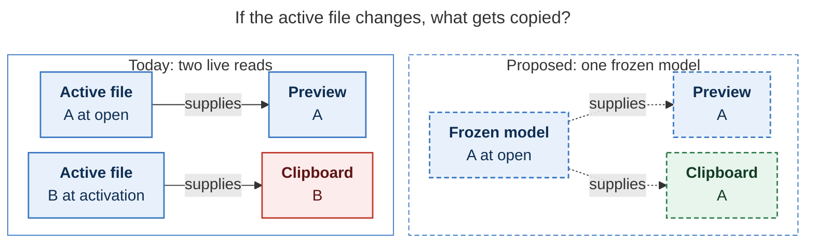

# Diagram proposals: Cmd+Y as a keyed Copy card

Proposals for the swarm linker, not a report. Each diagram restates only what the source
report says.

```yaml
source: research:202611/cmd_y_copy_card/cmd_y_copy_card__final.md
producer: research.48.image
check: "mmdc 12.0.0 with the PDF-mirroring config rendered 1 of 1 Mermaid diagrams"
```

## snapshot-preserves-preview

```yaml
anchor: |-
  Freeze everything into an immutable model. A key or `↵` copies that model's string
question: |-
  If the active file changes, what gets copied?
illustrates: |-
  Freezing everything into an immutable model keeps the preview and copied value
  together, even when the active file switches from A to B before activation.
caption: >-
  If the active file changes from A to B after opening, today's copy can drift; the proposed snapshot keeps preview and clipboard on A.
review: "860x421 px, fit 75.9%; question, source, and visual checks passed; 1 revision across 2 look rounds; unique anchor; broken-source probe returned nonzero"
```


