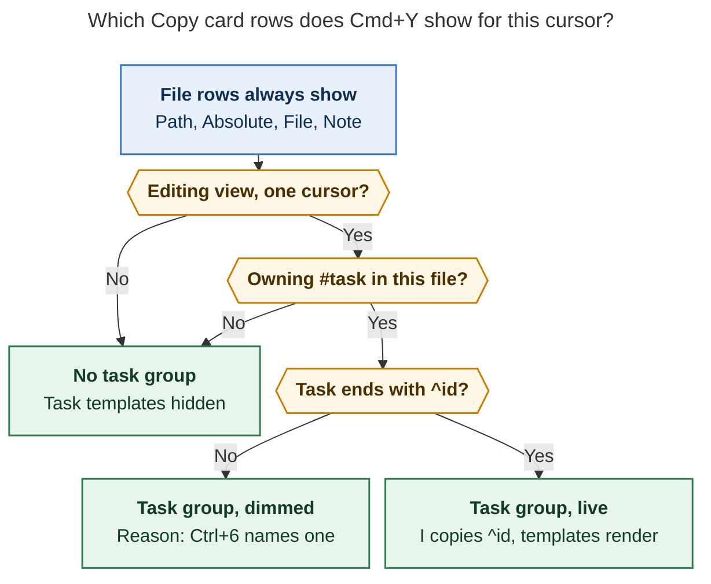

# Cmd+Y as a keyed Copy card: paths, the task's block ID, and your own templates

*Lead researcher consolidation · 2026-11-11 · Inputs: five independent reports
(`__cdx`, `__cld`, `__grk`, `__mus`, `__gem` in this folder) plus my own checks of
bob-plugins `e2a5701`, chezmoi `7ab303fb`, bob-mac-capture `ee26941`, bob-cli
`f9d998c1`, the live vault, and the screenshot `~/tmp/screenshots/20261111_092732.png`.
This is research only. Nothing was implemented or deployed.*

## Bottom line

- **Yes, do it.** `Cmd+Y` is a gesture you use many times a day. Today only `Cmd+Y ↵`
  is fast. The panel is a file picker stretched to 840 px around six rows. Two of those
  rows are useless at the vault root: Parent directory shows `(empty string)` and
  Relative path repeats Basename. All five researchers agreed it is worth doing, and so
  do I.
- **Delete the filter field. It is the real obstacle, not the row list.** While a
  focused text input exists, an unmodified letter can't mean "copy" without also
  meaning "filter". Three researchers (cdx, cld, gem) said to remove it. Two (grk, mus)
  said to keep it and fire letters only while it is empty. I side with removal: if
  letters fire on an empty filter, you can never type a query that starts with a key
  letter, so the filter turns into a trap. A list of 5–8 rows doesn't need search.
- **Make it Bob's second Copy card.** Bob Mac Capture already opens a **Copy card** on
  `Cmd+Y`. It has no filter, fixed letters for fixed rows, digits for lists, Return for
  the selected row, and `I` for the ID. The Obsidian card should feel like the same
  object.
- **Recommended shape:**
  - The fixed rows are `P` Path (`~/bob/bob.md`, the `↵` default), `A` Absolute path,
    `F` File name, and `N` Note name.
  - A **TASK** group appears when the cursor is inside a `#task` in the active file. It
    has `I` Block ID (copies `^bank-records`) plus any of your templates that need it.
  - Templates live in `~/.config/bob/config.yml` → `copy.templates`. They use a tiny
    `{variable}` language, and the variable names are the row labels.
- **Two adjustments matter most.**
  1. The template variable is `{block_id}`, not `{task_id}`. In your vault, "task id"
     already means something else: `[id:: bob__bank-records] ^bank-records`.
  2. The default row is labelled **Path** with key `P`. That leaves `T` free for your
     task template.

  Your template becomes `the ^{block_id} task in the {path}` and still copies exactly
  `the ^bank-records task in the ~/bob/bob.md`.

## What the evidence says

I re-checked every load-bearing claim from the five reports against the source.

| # | Fact | Evidence |
| --- | --- | --- |
| E1 | `Cmd+Y` is command `copy-active-file-path` (`Mod+Y`). It opens `YankPathPickerModal`, a subclass of the shared `FilteredPickerModal`, with title "Copy active file path" and an input labelled "Filter path formats". | `src/490-plugin-lifecycle.js:451-456`; `src/200-filtered-picker-modals.js:910-959` (all `src/` paths are under `plugins/bob-navigation-hotkeys/`) |
| E2 | The frame is the generic picker size, `width: min(92vw, 960px); height: min(82vh, 840px)`. The Task Card already escapes it with `height: auto`. | `styles.css:5-14`, `styles.css:2129` |
| E3 | The footer reuses the note-picker hints, so it says **↵ Open** although the panel copies. Copying the tilde path reports `Copied absolute path`, the same message as the real absolute path. | `src/180-editor-transactions.js` `KEYBOARD_HINTS`; `YANK_PATH_NOTICE_LABELS` in `src/010-requires-and-config.js:246` |
| E4 | **The preview and the copied value can diverge.** Rows preview one file, but activation calls `yankActiveFilePath(kind)`, which looks up the active file again. | `src/200-filtered-picker-modals.js:956`; `src/640-plugin-notes-and-task-move.js:47-60` |
| E5 | The six formats are one array, `YANK_PATH_COMMANDS`. It feeds both the panel rows and six palette-only `yank-*` commands. | `src/010-requires-and-config.js:212-244`; `src/490-plugin-lifecycle.js:458` |
| E6 | Parsing helpers already exist. `findOwningTaskLine` returns the cursor's `#task` line or its nearest `#task` ancestor, skipping fences. `getTrailingBlockId` returns the bare ID. `cleanTaskDisplayText` gives the title. `isObsidianTaskLine` requires `#task`. | `src/070-recommended-roll-batch.js:444`; `src/020-config-load-and-tasks.js:412,434`; `src/130-fences-and-status.js:86` |
| E7 | Filter-less key cards already exist in this plugin. `FreshnessDecayCardModal extends Modal` uses the `.bob-key-card*` tokens and an `openingChordKeys` guard. Two modals register a catch-all `scope.register(null, null, …)`. The Task Card key model ignores auto-repeat and IME composition. | `src/060-decay-card-modal.js:38,54,83`; `styles.css:2079-2125`; `src/672-delete-confirm-modal.js:126`; `src/207-image-zoom-modal.js:326`; `src/314-task-card-key-model.js:31,54` |
| E8 | The Mac Copy card uses fixed letters for fixed rows: `I` Marker ID, `T` Title, `N` Note path, `P` PDF path, `F` PDF file. Digits `1–9` are for lists, and Return copies the selected row. | bob-mac-capture `Sources/RefsCore/RefsCopy.swift` (glyphs and `case "i"…`); bob-cli `docs/reference/mac-capture/keyboard.md:25,39-52` |
| E9 | **"Task id" is already taken.** Vault tasks carry both identifiers, for example `- [/] #task Use records… [id:: bob__bank-records] ^bank-records`. The `[id::]` value is note-qualified. | `~/bob/bob.md:28` |
| E10 | **Tasks without a block ID are common.** 2,330 of 4,912 `#task` lines (47%) have no trailing `^id`. Among `[ ]` tasks, 26 of 103 have none. | My `grep` over `~/bob/**/*.md`, 2026-11-11 |
| E11 | `Ctrl+6` (`rename-selected-block-id`) also *names* a block that has no ID: with no existing match it goes to its insertion path. | `plugins/block-id-prompt/src/100-plugin-lifecycle.js:158-217`; `src/050-source-discovery-and-edits.js` |
| E12 | The plugin already reads `~/.config/bob/config.yml` (`XDG_CONFIG_HOME` aware) with an mtime and size cache, so edits apply on the next gesture. It has no settings tab. bob-cli ignores unknown top-level keys. | `src/010-requires-and-config.js:534`; `src/020-config-load-and-tasks.js:22`; bob-cli `docs/reference/configuration.md:351-352` |
| E13 | **Fragment headroom is tight.** The 1,000-line cap applies per fragment, and `640-plugin-notes-and-task-move.js` is 983 lines, `200-filtered-picker-modals.js` 960, and `100-yank-and-paths.js` 917. | `wc -l`; bob-plugins `AGENTS.md` |
| E14 | **A real-Obsidian end-to-end (e2e) harness exists.** It runs under xvfb with an isolated scratch vault and probes the app over the Chrome DevTools Protocol (CDP), for example `scripts/obsidian-decay-ladder-e2e.cjs`. No unit test covers the yank picker today. | bob-plugins `scripts/`; `package.json` `test` list |
| E15 | bob-cli's `docs/reference/plugins/bob-navigation-hotkeys.md` is a generated mirror (`source: bob-plugins:docs/…`), so no bob-cli edit is needed. | bob-cli docs front matter |

E10, E11, E13, and E14 are new in this consolidation. No individual report measured
how often a task lacks an ID. None noticed that the target fragment has only 17 lines of
room. cdx concluded that real focus and clipboard behavior could not be tested
automatically, but the e2e harness covers both.

## Is this a good idea?

Yes. The request goes in the right direction on every point.

1. **Speed.** For a small, stable menu used dozens of times a day, fixed single-key
   accelerators beat search and arrow keys. This is the Hick–Hyman argument cld and gem
   make. Every row becomes `Cmd+Y` plus one key.
2. **The block ID is the most valuable addition.** It turns `Cmd+Y` from "copy a path"
   into "copy a reference to this thing", the way JetBrains' *Copy Path/Reference…*
   puts references next to paths.
3. **The template is the real feature.** `the ^bank-records task in the ~/bob/bob.md`
   is a precise, greppable pointer you can paste into an agent prompt, and it costs one
   keystroke. That makes the feature worth building.
4. **Removing the two rows is right**, as the screenshot shows (E1). Keep them as
   palette commands, though, because someone's bindings may use them.

The risks are not in string substitution. They are about **which task**, whether the
copied text **matches the preview**, and whether a template **silently produces broken
text**. Most of the design below addresses those three risks.

I would not use a different approach. I would drop the parts of the request that
assume a filtered picker, and add the guardrails listed below.

## Where the researchers disagreed, and how I resolved it

| Question | Positions | Resolution |
| --- | --- | --- |
| Keep the filter field? | **Remove:** cdx, cld, gem. **Keep, letters fire only while empty:** grk, mus (mus also fires digits at any time) | **Remove.** With empty-filter letter jumps, any query that starts with a row key fires that row, so the filter can never be used for those letters. grk's precedent, the theme-action modal, is a long searchable list with actions on top, which is a different shape. Filter-less key cards already exist in this plugin (E7) and on the Mac (E8). |
| Modal base | New `Modal`: cdx, cld. Extend `FilteredPickerModal`: grk, mus, gem (gem's `hideSearchInput` option does not exist) | **New `CopyCardModal extends Modal`** on the `.bob-key-card` tokens, following the decay card. `200-filtered-picker-modals.js` has no room left anyway (E13). |
| Fixed-row keys | `t a b n i` (cdx), `p a f n i` (cld), `t a b s i` (grk, gem), `t a b e i` (mus) | **`p a f n i`.** Freeing `t` gives your task template its natural key. It also matches the Mac card (`P` path, `F` file, `I` ID) and avoids the "basename" ambiguity (next row). The `t a b s i` alternative is under Open questions. |
| Row labels | Keep yours (4 reports) vs **Path / Absolute path / File name / Note name** (cld) | **Rename.** Obsidian's own API calls `bob` the `basename` and `bob.md` the `name`, so "Basename = bob.md" contradicts the platform. Short labels also let each row fit on one line. |
| Block ID variable | `{task_id}` bare plus `{task_block_id}` with caret (cdx); `{block_id}` only (cld); `{block_id}` with alias `{task_id}` (grk, mus, gem); plus `{block_ref}` with caret (grk, gem) | **`{block_id}`, bare, with no aliases.** E9 shows `task_id` is ambiguous in this vault, and an alias would keep that ambiguity forever. An unknown `{task_id}` shows "did you mean `{block_id}`?" instead. You write `^{block_id}`, as your example already does. |
| File variables | Your spelling (`{abs_file_with_tilde}` and siblings) vs label-derived (`{path}`…) vs many aliases (gem) | **Label in snake_case:** `{path}`, `{absolute_path}`, `{file_name}`, `{note_name}`. That is one rule you can guess from the card itself. Did-you-mean hints map your spellings. |
| Which task | Owning task via `findOwningTaskLine` (cdx, cld); also follow the target of a Task Link under the cursor (grk); cursor line only, open tasks only (mus); hand-written indent walk (gem) | **Owning `#task` in the active file, any status.** Following a Task Link (grk) would pair another note's ID with *this* note's path, which produces a confidently wrong sentence. mus's "open only" rule drops closed tasks whose IDs are still worth copying. gem's walk re-implements E6. |
| Missing values | Hide (cdx, grk, mus); always show disabled (gem); three states (cld) | **Three states (figure below).** No task means no task group. A task without an ID shows dimmed rows with a reason. E10 shows that case is common, so a row that silently disappears would be confusing. |
| Template keys | Required explicit key (cdx); auto letter from `c…` (grk, gem); digits `1–5` (mus); digits by position, or an explicit key (cld) | **Optional `key`. The default is the entry's 1-based position in the list.** That follows the Mac grammar (digits for lists), and a key only changes when you edit the list. |
| Removed rows as variables | Keep hidden `{relative}` / `{parent_directory}` (grk, mus, gem) | **Not in v1.** You asked for variables equal to the rows on the panel. Each is easy to add when a real template needs it. |

## Requirement adjustments (called out)

| # | You asked | I recommend | Why |
| --- | --- | --- | --- |
| A1 | Every remaining option takes one keypress | **Remove the filter.** Fixed rows get fixed letters, and templates get digits or a configured key. | Letters and a focused filter cannot coexist (above). |
| A2 | Remove Parent directory and Relative path | Remove them **from the card only**. Keep `yank-parent-directory` and `yank-relative-path` as palette commands. | Command IDs are sticky, because someone's binding may use them. |
| A3 | "Absolute path with tilde" stays the `↵` default | Keep it as the default, labelled **Path** (key `P`). `↵` copies the **highlighted** row, and the highlight starts on Path. | Once you have moved with `↑↓`, `↵` should follow the highlight. Your fast path `Cmd+Y ↵` doesn't change. |
| A4 | A block-ID option when "a task … is selected" | "Selected" means the cursor's **owning `#task` in the active file**: the cursor line, any note under the task, or its Depends-On, LINKS, or BLOCKS lines. One cursor, editing view only. | It is the same "which task" rule that relations and dependencies use (E6). |
| A5 | Copy `^foo-bar-baz` | The row copies **`^foo-bar-baz`** and never mints an ID. A task without one shows a dimmed row: "none yet · Ctrl+6 on the task line names one". | Copying must never write to the vault. E11 makes the hint actionable. |
| A6 | Variable `{task_id}` | **`{block_id}`**, bare. | Avoids the clash with `[id::]` (E9). |
| A7 | Variable `{abs_file_with_tilde}` | **`{path}`**: every variable is its row label in snake_case. | You can read the variable names off the card. |
| A8 | One or more custom options | `copy.templates` entries are `{label, template, key?}`. A **label is required.** | The label column is what you scan, so a raw template there is noise. |
| A9 | (unstated) Errors | Bad templates show a **red reason on their row** and get no key. They never reach the clipboard. | You learn about the problem at the moment you would have pasted it. |
| A10 | (unstated) Feedback | The confirmation shows the copied value, for example `Copied ~/bob/bob.md`. | Fixes the misleading notice in E3. |
| A11 | (unstated) Exactness | The card copies **exactly the previewed string**, snapshotted when the card opens. | Fixes E4. |

## The design

### The card

The card is compact and sized to its content: `width: min(600px, 92vw)`, `height:
auto`, and `max-height: min(75vh, 840px)`, the same sizing as the Task Card. It has no
search field. Each row sits on one line with a keycap, a muted label, and a monospace
value.

**Cursor inside a task that has a block ID** (on its line or on any child line):

```text
╭──────────────────────────────────────────────────────────────╮
│ Copy                                                  bob.md │
│                                                              │
│▌[P]  Path            ~/bob/bob.md                          ↵ │
│ [A]  Absolute path   /Users/bbugyi/bob/bob.md                │
│ [F]  File name       bob.md                                  │
│ [N]  Note name       bob                                     │
│ ── TASK  Use records to start tracking bank transactions… ── │
│ [I]  Block ID        ^bank-records                           │
│ [T]  Task ref        the ^bank-records task in the ~/bob/b…  │
│                                                              │
│ ↵ copy path   ↑↓ select   esc close                          │
╰──────────────────────────────────────────────────────────────╯
```

**Cursor in a task with no block ID.** About half of all tasks look like this (E10):

```text
│ ── TASK  Add event note to 2026-11-12 recruiter Google Ev… ── │
│ [I]  Block ID        none yet · Ctrl+6 on the task line…  dim │
│ [T]  Task ref        needs a block ID                     dim │
```

**Cursor anywhere else** (the common path-copy case): only the four file rows. The
divider and the task group are omitted.

**A broken template** keeps its place, gets no key, and states the fix:

```text
│ [ ]  Wiki link       unknown {task_id} · did you mean {block_id}? │
```

Visual rules:

- **Reuse Bob's tokens; don't invent a look.**
  - Keycaps use a compact `.bob-key-card-key`.
  - The highlighted row keeps today's accent tint and left bar.
  - `↵` appears only on the highlighted row.
  - The per-row copy icons and "Copy" pills go away, because the keycap is the
    affordance.
- **Columns.**
  - Labels are `--text-muted` in a fixed column of about 120 px.
  - Values use `--font-monospace`. Paths are middle-truncated so the file name stays
    visible, and the full value is in the tooltip.
  - Template values may wrap to two lines.
  - The clipboard always gets the full string.
- **The task caption is the reliability affordance.** It shows a small-caps `TASK` plus
  the title from `cleanTaskDisplayText`, so you see *which* task's ID you are copying
  before you press a key.
- **Grouping follows dependency.** A template that uses `{block_id}` renders inside the
  task group. Any other template renders after `N`. Everything below the divider
  depends on the task.
- **States.**
  - Dimmed rows use opacity ≈ 0.55 with a right-aligned reason.
  - Error rows use the error colour with no keycap.
  - Transitions only run when `prefers-reduced-motion: no-preference` (as
    `.bob-key-card-row` does).
- **Header and footer.**
  - The header is "Copy", with the vault-relative path as quiet context on the right.
  - The footer's `↵` hint names the highlighted action (`↵ copy path`,
    `↵ copy block ID`).
- **Accessibility.**
  - The list has `role="listbox"` with `aria-activedescendant`.
  - Rows are `role="option"` with `aria-keyshortcuts`, and dimmed rows get
    `aria-disabled`.
  - Check it once with VoiceOver.

### Keys

| Key | Row | Copies (cursor on `^bank-records` in `bob.md`) | Variable |
| --- | --- | --- | --- |
| `P` · **`↵`** | Path | `~/bob/bob.md` | `{path}` |
| `A` | Absolute path | `/Users/bbugyi/bob/bob.md` | `{absolute_path}` |
| `F` | File name | `bob.md` | `{file_name}` |
| `N` | Note name | `bob` | `{note_name}` |
| `I` | Block ID *(task group)* | `^bank-records` | `{block_id}` → `bank-records` |
| `key:` or `1–9` | Your templates | `the ^bank-records task in the ~/bob/bob.md` | — |

Other keys: `↑` `↓` / `Ctrl+N` `Ctrl+P` move, `↵` copies the highlighted row, and
`Esc` closes. Clicking a row copies it.

Key rules:

- `P A F N I` are **reserved even when their row is hidden**, so a key never changes
  meaning.
- Letters are case-insensitive, which also covers Caps Lock. Shift+letter is ignored,
  which keeps it free for Mac-style alternate payloads later.
- A template key is one `[a-z0-9]`. Without one, a template's key is its 1-based
  position in `copy.templates`. Entries after the ninth need an explicit key.
- A template key that collides with a reserved key or another template leaves **every**
  colliding template keyless, each with a red reason. Built-ins never lose their key,
  and nothing is silently reassigned.

### Which task: one rule, three states



*Figure 1. The file rows never depend on the cursor. The task group appears only for
one cursor in an editing view inside a `#task` of the active file. A task without an ID
shows dimmed rows that explain the fix, so they don't silently vanish. Rendered
688×848 px, fit 94.9%, with Mermaid CLI 12.0.0 and the research-PDF config.*

The resolver runs **once, before the card opens**, against the live editor buffer, not
the lagging metadata cache:

1. Take the active `MarkdownView`'s editor. Reading view, multiple cursors, or no
   editor means no task. These are the same guards `Ctrl+6` uses.
2. Find `owner = findOwningTaskLine(lines, head.line)`. This covers the task line, its
   notes, and its managed Depends-On, BLOCKS, LINKS, and LINKED FROM child lines.
   Fences and frontmatter are excluded. If a non-empty selection touches more than one
   owning task, the result is ambiguous and there is no task. Never pick the first one.
3. Read `blockId = getTrailingBlockId(lines[owner])` and
   `title = cleanTaskDisplayText(lines[owner])`. Any checkbox status is accepted, since
   a closed task's ID is still a valid pointer.
4. **Same-file invariant.** Every value on the card describes the *active file*. A
   `[[other#^id]]` link or Task Link under the cursor never supplies the block ID.
   Pomodoro rows are not `#task` lines, so they have no owner.
5. Freeze everything into an immutable model. A key or `↵` copies that model's string
   and never recomputes it (fixes E4).

### Template contract

Add the setting in **chezmoi's `home/dot_config/bob/config.yml`**, which deploys to
`~/.config/bob/config.yml`:

```yaml
# Obsidian Cmd+Y Copy card (bob-navigation-hotkeys). bob-cli ignores this block.
# Variables are the card's row labels: {path} (~/…), {absolute_path},
# {file_name}, {note_name}, and {block_id} (bare: write ^{block_id}).
# {{ and }} are literal braces. Always quote templates. `key` is one letter or
# digit; without it, an entry's key is its position in this list (1–9).
# A template that uses {block_id} shows only when the cursor is in a task.
copy:
  templates:
    - label: Task ref
      key: t
      template: "the ^{block_id} task in the {path}"
```

On `bob.md` with the cursor in `^bank-records`, `T` copies exactly
`the ^bank-records task in the ~/bob/bob.md`.

| Variable | Value | Unavailable when |
| --- | --- | --- |
| `{path}` | `~/bob/bob.md`. `~` replaces the home directory only at a real path boundary; a vault outside home gets the absolute path. | No vault base path (mobile) |
| `{absolute_path}` | `/Users/bbugyi/bob/bob.md` | Same as `{path}` |
| `{file_name}` | `bob.md` | Never |
| `{note_name}` | `bob` | Never |
| `{block_id}` | `bank-records`, without the caret, so it composes as `^{block_id}` and `[[{note_name}#^{block_id}]]` | No task (hidden), or a task without an ID (dimmed) |

The language has three rules and nothing more:

- **Substitution.** `{name}` substitutes a value, and `{{` / `}}` produce literal
  braces. Values are inserted in **one pass** and never re-scanned, so a file name
  containing `{block_id}` stays a file name. This is the same `{placeholder}` style as
  `highlights.listen_command` in the same file.
- **Errors appear on the card, never on the clipboard.** Each gets a specific reason:
  - an unknown name, with did-you-mean hints for `{task_id}`, `{abs_file_with_tilde}`,
    `{abs_file}`, `{basename}`, `{basename_no_ext}`, and `{stem}`;
  - an unbalanced brace;
  - an empty template;
  - a non-string template: "quote the template — YAML read it as a mapping". An
    unquoted `{path}` parses as a YAML mapping, and an unquoted ` #` starts a comment.
- **Missing runtime values dim or hide the row (Figure 1). They never produce partial
  text** such as `the ^ task in …`.

Output is plain text, with no shell or Markdown escaping. Newlines in a template are
kept, and the preview shows them as `⏎`.

Loading reuses the existing config path helper, `parseYaml`, and the mtime and size
cache, so a `chezmoi apply` takes effect on the next `Cmd+Y`. A missing file or section
means no template rows. Invalid YAML or a malformed `templates` list disables only the
template rows and shows one diagnostic row; the built-in rows always work. On mobile
there is no `fs`, so templates and absolute paths are unavailable while File name and
Note name still work, and the highlight starts on the first available row.

### Copy and feedback

- **Order of events.** Await `writeTextToClipboard`, then close the card and show
  `Copied ~/bob/bob.md` (middle-truncated). If the write fails, the card **stays
  open**, the row shows the reason, and nothing is lost.
- **One write at a time.** A busy guard prevents rapid double presses from writing
  twice.
- **Read-only.** No vault writes, no ID minting, no freshness stamps, and no undo
  entries.
- **Keyboard hygiene.**
  - A catch-all modal scope consumes every key while the card is open (E7).
  - Ignored keys: `event.repeat`, `isComposing` / `keyCode 229`, and
    Meta/Ctrl/Alt chords other than `Ctrl+N`/`Ctrl+P`.
  - Keys still held from the opening `Cmd+Y` are ignored until released, using the
    decay card's `openingChordKeys` pattern.

## Reliability checklist

| Failure mode | Guard |
| --- | --- |
| Holding `Cmd+Y` fires a row through auto-repeat | Ignore `event.repeat` and the opening chord |
| IME composition or dead keys | Ignore `isComposing` and `keyCode 229` |
| A global hotkey fires behind the card | The catch-all scope returns `false` |
| Block ID from the wrong task or file | Owning-task rule, same-file invariant, the visible TASK caption, and refusing multi-task selections |
| Preview ≠ clipboard (today's E4) | The immutable snapshot is copied byte for byte |
| A template copies `{task_id}` literally or `the ^ task` | Unknown name means a red row with no key. A missing value means the row is dimmed or hidden. |
| A YAML mapping or comment eats the template | Detect non-string or empty templates and name the fix |
| A key collision silently remaps | Every colliding template goes keyless. Built-in keys are reserved even when hidden. |
| Config edited while Obsidian runs | mtime and size cache, re-read on each `Cmd+Y`, frozen while the card is open |
| Clipboard write rejected | The card stays open with an inline reason |
| No absolute base path (mobile) | Path rows are unavailable with a reason, and the highlight starts on the first available row |

## Implementation plan

Make one bob-plugins change and one chezmoi commit, in either order: bob-cli and older
plugins both ignore an unknown `copy:` key. Neither bob-cli nor Mac Capture needs
changes.

**bob-plugins, `plugins/bob-navigation-hotkeys`** (fragment build: edit `src/`, then
`npm run build`; never edit `main.js` by hand):

1. **`src/101-copy-card-model.js`** (new, pure, no Obsidian):
   - the built-in row table `{id, key, label, variable, needs}`;
   - `resolveCopyCardTask(lines, selection)`, from E6;
   - `parseCopyTemplate` and `renderCopyTemplate`, returning tokens or a reason;
   - `buildCopyCardModel(...)`, which returns rows with key, availability, preview,
     payload, and reason, plus the default row;
   - `resolveCopyCardKey(model, event)`.

   Built-ins can be expressed as templates (`"{path}"`, `"^{block_id}"`), giving one
   row pipeline.
2. **`src/102-copy-card-config.js`** (new): loads and validates `copy.templates` with
   the stat-key cache.
3. **`src/2xx-copy-card-modal.js`** (new): `CopyCardModal extends Modal` on the
   `.bob-key-card` tokens, with the catch-all scope and the opening-chord guard.
4. **`src/640-plugin-notes-and-task-move.js`**: `openYankPathPicker()` builds the
   snapshot and opens the card. **Keep this file's net growth near zero**, because it
   is at 983 of 1,000 lines (E13). The new logic belongs in the new fragments.
5. **`src/200-filtered-picker-modals.js`**: delete `YankPathPickerModal`. Delete
   `YANK_PATH_PICKER_TITLES` from `010`.
6. **`src/010-…` and `src/490-…`**:
   - Keep the command ID `copy-active-file-path` and `Mod+Y`, renamed to "Copy path,
     block ID, or template".
   - Keep all six `yank-*` palette commands.
   - Add `yank-block-id`, with no hotkey.
   - Split the card's row catalog from `YANK_PATH_COMMANDS`.
7. **Plumbing**: register the new fragments in `src/fragments.json`, export the pure
   functions in `src/700-exports.js`, and add a `.bob-copy-card*` block to
   `styles.css`.
8. **Tests:**
   - `scripts/test-navigation-copy-card.cjs`, added to `npm test`, covering:
     - the template grammar: escapes, single pass, unknown names and hints, YAML
       mappings, multi-line templates;
     - task resolution: the task line, a child note, a Depends-On line, a closed task,
       no ID, a fence, a Task Link (must *not* resolve), and a two-task selection;
     - keys: repeat, IME, reserved keys, collisions, digits, hidden rows keeping their
       keys, and `↵` following the highlight;
     - the snapshot: open on A, switch the active file to B, and A is still copied.
   - A FakeNode render test, modelled on `test-navigation-task-card-view.cjs`.
   - A real-Obsidian e2e `scripts/obsidian-copy-card-e2e.cjs` with its offline
     self-test, following `obsidian-decay-ladder-e2e.cjs` (E14). It drives `Cmd+Y`,
     each key, and Esc in a scratch vault, asserts the clipboard, and captures
     **light and dark screenshots** of all three states for the design review.
9. **Docs**: add a "Copy card (`Cmd+Y`)" section to `docs/bob-navigation-hotkeys.md`
   with the keys, the task rule, the variables, and the config example.
10. **Checks and deploy**:
    - Regenerate the command inventory.
    - Run `npm run docs:check`, `npm run build`, `npm run build:check`, and `npm test`.
    - Then run `bob plugins sync`, following the repo's no-`-F` rule.

**chezmoi.** Add the `copy:` block above to `home/dot_config/bob/config.yml`, commit it,
and apply it through that repo's normal workflow.

**Afterwards.** Once you accept the design, record it in the decisions web through
`/sase_memory_write`: "Copy cards key fixed rows by letter and lists by digit; copying
never writes the vault; every value on a card describes one target." Mac Capture already
follows this, so the record would cover both cards.

**Size.** About 400–500 lines of JS in three new fragments, about 120 lines of CSS, and
about 300 lines of unit tests plus the e2e. It fits in one PR.

## Alternatives considered

| Approach | Why I rejected it |
| --- | --- |
| Keep the filter, with letter jumps only while it is empty (grk, mus) | The filter then can't take any query that starts with a key letter, and the oversized input stays. |
| Keep the filter and use positional digits (minimal diff) | Numbers shift when the task group appears, and the useless filter stays. |
| Number every row by position | The conditional task rows renumber everything below them. |
| Option-key alternates to merge rows, as on the Mac card | That makes two keypresses and hides options, against your one-keypress requirement. Shift+letter is kept free in case you want this later. |
| Reorder rows by context (for example, block ID first on a task) | Stable positions are worth more than clever ones in a gesture you use dozens of times a day. |
| Follow Task Links or embeds to their task (grk) | It pairs another note's ID with this note's path. If you want it later, add a separate `{task_path}` contract. |
| Mint a missing block ID on copy | A copy gesture must not write to the vault. The dimmed row points to `Ctrl+6`. |
| `{task_id}` as the variable, or as an alias | It is ambiguous with `[id:: …]` (E9). |
| A full template engine with filters, conditionals, or JS | Escaping, execution, and debugging costs, which your template doesn't need. |
| A settings-tab format manager (as the community Shell Path Copy plugin has) | It would drift from chezmoi, and Bob already has one config file. |
| Per-format global hotkeys | The palette `yank-*` commands already allow this, without previews. |
| Built-in wikilink, URI, or Markdown-link rows | A long tail better served by one-line templates, for example `"[[{note_name}#^{block_id}]]"`. |

## Corrections to the individual reports

- **grk.** Its Task Link resolution, via `parseLinkPickerTaskLink`, breaks the
  same-file invariant. On a Pomodoro Task Link in a daily note, your template would say
  `the ^x task in the ~/bob/<daily>.md`, but `^x` lives in another note. Its claim that
  removing the filter makes this "the one picker that cannot search" overlooks the
  decay card and Task Card, which are filter-less key cards in the same plugin. Its
  figures are kept in this folder.
- **mus.** "Open task line only" excludes closed tasks and child notes. The five-row
  template cap is arbitrary.
- **gem.**
  - `hideSearchInput` is not a `FilteredPickerModal` option.
  - Its sample `executeCopyItem` calls `getActiveMarkdownFile()` again at copy time,
    which keeps today's preview-and-copy drift (E4).
  - The indentation walk duplicates `findOwningTaskLine`.
  - Eight-plus aliases per variable is the vocabulary sprawl the other reports warn
    against.
- **cdx.** It concluded that real focus and clipboard behavior can't be tested
  automatically. The real-Obsidian e2e harness can test them (E14).
- **cld.** Verified: the Mac Copy-card glyphs, the `Ctrl+6` naming path, and the
  key-card tokens. I adopt its key scheme and labels. I keep your "in the …" wording,
  which cld had dropped.
- **All five.** None measured how often tasks lack IDs (E10). None noticed that `640`
  has 17 lines of headroom (E13).

## Open questions for you

1. **Letters.** `P A F N I` with your template on `T`, as recommended, or your labels
   with `t a b s i` and the template on `c`? The second keeps "Absolute path with
   tilde" and "Basename", but it gives up `T` and keeps the basename ambiguity.
2. **Variable names.** OK with label-derived `{path}` and the rest, or would you rather
   keep `{abs_file_with_tilde}` as the canonical name? Either way, `{task_id}` should
   become `{block_id}`.
3. **`Cmd+Y Cmd+Y`.** Should a fresh second `Cmd+Y` copy the highlighted row, so you
   never leave the chord? It is cheap and safe behind the catch-all scope, but it is
   one more rule. I left it out of v1.
4. **Next variables.** `{task}` (the task title) and `{relative_path}` are each a
   one-line addition when a real template needs them.

## Recommended solution

Replace the `Cmd+Y` filtered picker with a **keyed Copy card**, the Obsidian twin of
Bob Mac Capture's `Cmd+Y` Copy card, in `bob-navigation-hotkeys`:

1. **No filter field.**
   - Fixed rows: `P` **Path** `~/bob/bob.md` (highlighted on open, so `Cmd+Y ↵` is
     unchanged), `A` Absolute path, `F` File name, `N` Note name.
   - Parent directory and Relative path leave the card but stay as palette commands.
   - Every row is one keypress, `↑↓`/`Ctrl+N`/`Ctrl+P` and `↵` still work, and `Esc`
     closes.
2. **A TASK group, only when it is truthful.**
   - The cursor's owning `#task` in the active file is resolved from the live buffer
     with `findOwningTaskLine` and `getTrailingBlockId`, and snapshotted when the card
     opens.
   - It is captioned with the task's title.
   - `I` copies `^id`.
   - A task without an ID shows dimmed rows pointing to `Ctrl+6`.
   - The card never takes an ID from another note and never writes to the vault.
3. **Templates** live in chezmoi `home/dot_config/bob/config.yml` → `copy.templates`
   as `{label, template, key?}`.
   - The language is single-pass `{variable}` plus `{{ }}`.
   - Variables are the row labels: `{path}`, `{absolute_path}`, `{file_name}`,
     `{note_name}`, and a bare `{block_id}`.
   - Errors show as red reasons on the card, never as clipboard text.
   - Ship `{label: Task ref, key: t, template: "the ^{block_id} task in the {path}"}`.
4. **Beautiful by subtraction.**
   - A content-sized 600 px card on Bob's key-card tokens.
   - One-line rows with keycaps and an aligned monospace value column.
   - No per-row icons or pills, `↵` shown only on the highlighted row, and a footer
     that says *copy*.
   - A confirmation that shows the copied value.
5. **Reliable by construction.**
   - Immutable snapshot, exact-bytes copy, and a catch-all scope.
   - Auto-repeat, IME, and opening-chord guards.
   - Close only after a successful write.
   - Reserved keys that never move.
   - New pure fragments (keeping `640` under its cap), unit and render tests, and a
     real-Obsidian e2e with light and dark screenshots.
   - Then `bob plugins sync` and the chezmoi commit.

## Sources

**Code and data inspected:**

- bob-plugins `e2a5701`, under `plugins/bob-navigation-hotkeys/`:
  - `src/010, 020, 060, 070, 100, 130, 180, 200, 203, 314, 490, 640, 670, 672, 207, 700`
  - `styles.css`
  - `src/fragments.json`
  - `package.json`
- bob-plugins `plugins/block-id-prompt/src/100-plugin-lifecycle.js` and
  `050-source-discovery-and-edits.js`; `docs/block-id-prompt.md` and
  `docs/bob-navigation-hotkeys.md`; `scripts/obsidian-decay-ladder-e2e.cjs` and its
  test.
- chezmoi `7ab303fb`: `home/dot_config/bob/config.yml`.
- bob-mac-capture `ee26941`: `Sources/RefsCore/RefsCopy.swift`.
- bob-cli `f9d998c1`: `docs/reference/mac-capture/keyboard.md`,
  `docs/reference/configuration.md`, and `docs/reference/plugins/`.
- Vault: `~/bob/bob.md:28`, plus task and block-ID counts over `~/bob/**/*.md`.
- Screenshot `~/tmp/screenshots/20261111_092732.png`.

**Web**, as cited by the input reports and not re-fetched:

- Obsidian internal links and block references: <https://obsidian.md/help/links>
- Obsidian `Scope.register`:
  <https://docs.obsidian.md/Reference/TypeScript+API/Scope/register>
- W3C APG modal dialog pattern:
  <https://www.w3.org/WAI/ARIA/apg/patterns/dialog-modal/>
- W3C character-key shortcuts:
  <https://www.w3.org/WAI/WCAG22/Understanding/character-key-shortcuts.html>
- MDN `Clipboard.writeText`:
  <https://developer.mozilla.org/en-US/docs/Web/API/Clipboard/writeText>
- JetBrains Copy Path/Reference:
  <https://www.jetbrains.com/help/phpstorm/2017.3/cutting-copying-and-pasting.html>
