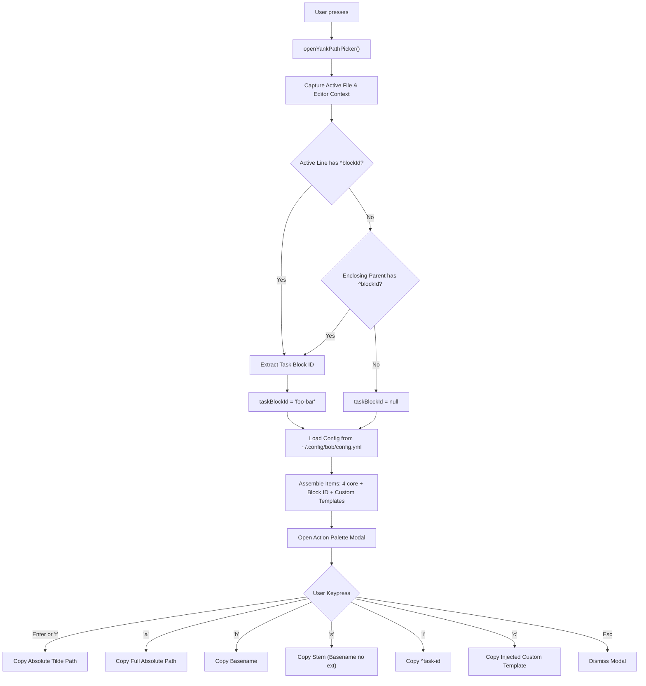

# Redesign and Enhancement of the Obsidian `<cmd+y>` Copy Path & Task Reference Panel

**Author:** Researcher `gem` (5-Researcher Swarm)  
**Date:** 2026-11-11  
**Target Systems:** `bob-plugins` (`plugins/bob-navigation-hotkeys`), `chezmoi` (`~/.config/bob/config.yml`)  
**Context:** Research, architectural critique, UX design, and implementation specification for upgrading the `<cmd+y>` modal in Bryan's Obsidian vault.

---

## 1. Executive Summary

Pressing `<cmd+y>` (`Mod+Y`) in Bryan's Obsidian environment currently invokes the `"Copy active file path"` command, opening a `FilteredPickerModal` from `bob-navigation-hotkeys`. While functional, the current interface has several usability friction points and architectural limitations:
1. **Redundant & Low-Value Options:** The panel lists 6 static file-path formats. Among these, `"Parent directory"` frequently evaluates to `(empty string)` on vault-root notes (as captured in `~/tmp/screenshots/20261111_092732.png`), and `"Relative path"` is almost always redundant with `"Basename"` or irrelevant outside internal Obsidian wikilinks.
2. **Missing Single-Key Speed:** In its current form, selecting an option requires arrow-key navigation or typing a query into a search filter input, followed by `<Enter>`. For a modal that contains only 4–6 discrete choices, a search filter is unnecessary friction.
3. **No Task / Block ID Awareness:** When working in Bryan's GTD daily notes or project files, tasks routinely carry block identifiers (e.g. `^task-slug`). Currently, copying a task's block ID or a contextual phrase (e.g. `"the ^xyz task in ~/bob/..."`) requires manual copy-paste sequences across multiple commands.
4. **No Configurable Custom Formats:** Users cannot define composite reference templates (such as markdown links, SASE task references, or natural-language citations) that combine the active file path with task metadata.

### Core Recommendations
- **Prune Noise:** Remove `"Parent directory"` and `"Relative path"` from the picker, leaving four clean, distinct path formats: *Absolute path with tilde*, *Absolute path*, *Basename*, and *Basename without extension*.
- **Transform into a Quick Action Palette:** Eliminate or bypass the search input text box. Convert the modal into an instant-trigger Action Palette where every item is bound to a single mnemonic key (`t`, `a`, `b`, `s`, `i`, `c`) with numeric aliases (`1`–`6`). Pressing any shortcut key instantly copies the string to the clipboard, displays a toast notice, and dismisses the modal.
- **Preserve `<Enter>` for Default:** Keep `"Absolute path with tilde"` (`~/...`) as the first item and the default action triggered immediately by `<Enter>`.
- **Dynamic Task Block ID Option:** Inspect the active editor cursor position upon modal open. If the cursor rests on or within an Obsidian task carrying a trailing block ID (e.g., `^foo-bar-baz`), inject a dedicated row to copy `^foo-bar-baz` (bound to key `i` or `5`).
- **Template Injection via Chezmoi:** Add a new configuration section (`copy.custom_formats`) to `~/.config/bob/config.yml` (managed in chezmoi). Support variable interpolation for tokens like `{task_id}`, `{block_ref}`, `{abs_file_with_tilde}`, `{abs_file}`, `{basename}`, and `{basename_without_extension}`. Configure Bryan's requested template: `"the ^{task_id} task in the {abs_file_with_tilde}"`.
- **Graceful Fallbacks:** If a custom option references `{task_id}` but the active cursor is not on a task with a block ID, display the option in a disabled state with an explanatory badge (e.g. `Unavailable: cursor not on a task with a block ID`), preserving stable key assignments without broken pastes.

---

## 2. Current State Analysis

### 2.1 Visual & Behavioral Inspection of the Status Quo

Analysis of the captured screenshot `~/tmp/screenshots/20261111_092732.png` illustrates the current UI state when `<cmd+y>` is pressed on `bob.md`:

```
+---------------------------------------------------------------------------------+
| [Copy] Copy active file path                                                [x] |
|        6 path formats for bob.md                                                |
+---------------------------------------------------------------------------------+
| [Q] Filter path formats                                                         |
+---------------------------------------------------------------------------------+
| [Copy] Absolute path with tilde                                    Copy    ↵    |
|        ~/bob/bob.md                                                             |
|                                                                                 |
| [Copy] Absolute path                                               Copy         |
|        /Users/bbugyi/bob/bob.md                                                 |
|                                                                                 |
| [Copy] Basename                                                    Copy         |
|        bob.md                                                                   |
|                                                                                 |
| [Copy] Basename without extension                                  Copy         |
|        bob                                                                      |
|                                                                                 |
| [Copy] Parent directory                                            Copy         |
|        (empty string)                                                           |
|                                                                                 |
| [Copy] Relative path                                               Copy         |
|        bob.md                                                                   |
+---------------------------------------------------------------------------------+
| ↑ ↓ Navigate    ^N ^P Move    ↵ Open    esc Dismiss                             |
+---------------------------------------------------------------------------------+
```

### 2.2 Codebase Tracing in `bob-plugins`

In `plugins/bob-navigation-hotkeys/`:

1. **Hotkey Binding (`src/490-plugin-lifecycle.js:451-456`):**
   ```javascript
   this.addCommand({
     id: "copy-active-file-path",
     name: "Copy active file path",
     hotkeys: [{ modifiers: ["Mod"], key: "Y" }],
     callback: () => this.openYankPathPicker(),
   });
   ```
   On macOS, `Mod+Y` maps to `<cmd+y>`.

2. **Launcher Mixin (`src/640-plugin-notes-and-task-move.js:3-10`):**
   ```javascript
   openYankPathPicker() {
     const file = this.getActiveMarkdownFile();
     if (!file) {
       return;
     }
     new YankPathPickerModal(this.app, this, file).open();
   }
   ```
   Notice that `openYankPathPicker` only resolves the active `TFile`. It does not inspect the editor view, cursor line, or task context.

3. **Picker Definition (`src/200-filtered-picker-modals.js:910-960`):**
   `YankPathPickerModal` extends `FilteredPickerModal`, which injects:
   - An `<input>` element (`bob-cnp-input`) with autofocus via `window.setTimeout(() => openingInput.focus(), 0)`.
   - Results list (`bob-cnp-results`).
   - Fixed keyboard hints footer (`KEYBOARD_HINTS`).
   The items are generated by mapping over `YANK_PATH_COMMANDS`:
   ```javascript
   const YANK_PATH_COMMANDS = [
     { id: "yank-absolute-path-tilde", name: "Yank absolute path with tilde", kind: "absolute-tilde" },
     { id: "yank-absolute-path", name: "Yank absolute path", kind: "absolute" },
     { id: "yank-basename", name: "Yank basename", kind: "basename" },
     { id: "yank-basename-without-extension", name: "Yank basename without extension", kind: "basename-no-extension" },
     { id: "yank-parent-directory", name: "Yank parent directory", kind: "parent-directory" },
     { id: "yank-relative-path", name: "Yank relative path", kind: "relative" },
   ];
   ```

4. **Path Calculation (`src/100-yank-and-paths.js:18-39`):**
   `getYankPathText(kind, relativePath, basePath, homePath)` evaluates each option using string path utilities (`normalizeVaultRelativePath`, `joinFilesystemPath`, `compactHomePath`, `getVaultPathBasename`, etc.).

---

## 3. Plan Critique & Strategic Analysis

Is this redesign a good idea? **Yes, unequivocally.** However, several critical design nuances must be resolved to ensure the result is intuitive, reliable, and aesthetically pleasing.

### 3.1 Critique 1: Pruning "Parent directory" and "Relative path"
- **Verdict:** Strongly recommended.
- **Justification:**
  - `"Parent directory"` on any note at the vault root returns an empty string, rendering the row confusing and non-functional. For nested files, copying a naked folder fragment (e.g. `projects`) without root or home context is rarely what an author needs when pasting into terminal commands or tickets.
  - `"Relative path"` inside an Obsidian vault is identical to `"Basename"` for root files. For nested files, bare relative paths (e.g. `projects/foo.md`) are seldom used outside of internal wikilinks (which use `[[foo]]` anyway).
  - Removing these two cuts visual clutter by 33%, allowing all remaining choices plus custom options to fit comfortably without scrolling.

### 3.2 Critique 2: The Core UX Dilemma — Single-Key Shortcuts vs. The Filter Input Bar
The most critical architectural question in this redesign is: **How should single-key selection work when the modal currently has an active text filter input?**

In `FilteredPickerModal`, the text input (`inputEl`) is automatically focused when the modal opens. If an input field has focus:
- Typing any normal key (`t`, `a`, `b`, etc.) sends an input event into the search box.
- If we intercept keystrokes in `handleKeydown`:
  - If we follow the pattern in `PomodoroThemeActionModal` (where single keys trigger only when `inputEl.value === ""`):
    Because the desired single-key triggers are common English letters (`t`, `a`, `b`, `s`, `i`, `c`), the user could **never type a search query**! For example, trying to type `"absolute"` would immediately fire on `"a"`, and trying to type `"tilde"` would immediately fire on `"t"`.
- **The Core Realization:**
  *Why does a 4-to-6-item modal have a search filter at all?*
  Nobody opens a 5-item menu to type a search query. A search input on a 5-item list is pure visual overhead and keyboard friction.
- **Recommended Solution: Action Palette Model (No Filter Box)**
  For `YankPathPickerModal`, remove the search input bar entirely (or hide it unless explicit search is invoked). The modal becomes a pure, ultra-fast **Action Palette** (resembling a macOS context menu, Raycast quick action, or vim which-key menu):
  - Every option has a dedicated keyboard shortcut.
  - Typing a shortcut key instantly copies that option and closes the modal.
  - Pressing `<Enter>` instantly copies the default option (`Absolute path with tilde`).
  - Arrow keys (`↑`/`↓`) and vim scroll (`Ctrl+N`/`Ctrl+P`) still move the highlight, and `<Enter>` copies the highlighted item.
  - `Esc` closes the modal.
  - This eliminates keyboard focus races, completely removes the input lag, and shaves ~50px of useless vertical height off the dialog.

### 3.3 Critique 3: Mnemonic Letters vs. Positional Numbers
Should options be triggered by letters (`t`, `a`, `b`, `s`, `i`, `c`) or numbers (`1`, `2`, `3`, `4`, `5`)?

| Criterion | Mnemonic Letters (`t`, `a`, `b`, `s`, `i`, `c`) | Positional Numbers (`1`, `2`, `3`, `4`, `5`) |
| :--- | :--- | :--- |
| **Cognitive Association** | **High:** `t` = Tilde, `a` = Absolute, `b` = Basename, `s` = Stem, `i` = ID, `c` = Custom | **Low:** Arbitrary index in list |
| **Resilience to Dynamic Rows** | **Excellent:** If the cursor is NOT on a task, row `i` (Block ID) disappears or is disabled. `b` STILL copies basename! | **Poor:** If row 5 disappears, pressing `5` either does nothing or misfires; users suffer muscle-memory invalidation. |
| **Vim & Keyboard Ergonomics** | Natural touch typing without moving hand up to the number row. | Requires reaching for the number row. |
| **Clash Potential** | Potential conflict if a search input exists (mitigated by removing search input). | Zero conflict with text input if search input is retained. |

**Recommended Solution:**
Implement a **dual-key trigger system**:
1. Primary mnemonic shortcuts: `t` (Tilde), `a` (Absolute), `b` (Basename), `s` (Stem/basename without extension), `i` (Task ID), `c` (Custom format).
2. Secondary positional aliases: `1`, `2`, `3`, `4`, `5`, `6` as alternative triggers.
3. `<Enter>` triggers the default item (row 0: *Absolute path with tilde*), or the highlighted row if navigated.
4. Render the primary mnemonic key in a styled `.bob-cnp-kbd` badge on each row.

### 3.4 Critique 4: Context Awareness — What Defines a "Task with Block ID"?
The requirement states:
> *"We should add a new option to that panel when a task that has a block ID selected. This option should copy that block ID (ex: `^foo-bar-baz`)."*

Let's dissect the technical details:
1. **Detection Boundary:**
   - In Obsidian, when `<cmd+y>` is pressed, the active leaf is a `MarkdownView`.
   - The editor cursor position is `editor.getCursor()`.
   - The line at that cursor is `editor.getLine(cursor.line)`.
   - Does this line qualify as a task?
     - In `bob-navigation-hotkeys`, `isObsidianTaskLine(line)` verifies that the line begins with a list item checkbox (`- [ ]`, `- [x]`, etc.) and contains `#task`.
     - `getTrailingBlockId(line)` checks `BULLET_PROPERTY_TRAILING_BLOCK_ID_RE` (`/[ \t]+\^([A-Za-z0-9-]+)[ \t]*$/`).
2. **Child Bullet Resolution (Enclosing Task):**
   - In Bryan's GTD and project workflow, tasks often contain indented child notes:
     ```markdown
     - [ ] Deploy new version #task ^deploy-v2
         - Note about deployment checks
         - Cursor is currently on this line!
     ```
   - If Bryan's cursor is sitting on an indented child bullet under a task, strict single-line checking would say "no task selected."
   - **Recommendation:** If the active line itself is not a task with a block ID, walk backwards up the line indentation to find the parent task bullet. If the parent task has a block ID, inherit that context! This makes the feature significantly more forgiving and intuitive.
3. **Copy Value:**
   - The option must copy the block ID **with the leading caret** (`^foo-bar-baz`), matching Obsidian's block reference grammar and Bryan's explicit prompt specification: `(ex: ^foo-bar-baz)`.
4. **Read-Only Safety:**
   - The `<cmd+y>` command is strictly a *read-only inspection/clipboard tool*. It must **never** mutate the vault (e.g. it must not auto-generate a block ID if one is missing). If a task lacks a block ID, the option is unavailable.

### 3.5 Critique 5: Custom Options Configuration & Template Interpolation
The requirement states:
> *"add a new configuration field that allows the user to format one or more custom options that appears in this panel, which have a string value that supports injected variables containing the appropriate values of the other (non-custom) options on that panel. You should configure this field to something like `the ^{task_id} task in the {abs_file_with_tilde}` in my chezmoi repo."*

#### Variable Syntax & Supported Tokens
We recommend standard curly-brace syntax `{token}`. To maximize flexibility and avoid syntax friction, the interpolator should support both canonical names and ergonomic aliases:

| Token | Alias(es) | Evaluated Example | Notes |
| :--- | :--- | :--- | :--- |
| `{task_id}` | `{block_id}` | `foo-bar-baz` | Naked block ID (without `^`). Ideal when template writes `^{task_id}`. |
| `{block_ref}` | `{block_id_with_caret}` | `^foo-bar-baz` | Block ID with leading `^`. |
| `{abs_file_with_tilde}` | `{path_tilde}`, `{absolute_tilde}` | `~/bob/projects/sase.md` | Compacted path using `~` for `$HOME`. |
| `{abs_file}` | `{path}`, `{absolute}` | `/Users/bbugyi/bob/projects/sase.md` | Full absolute filesystem path. |
| `{basename}` | `{filename}` | `sase.md` | File name including extension. |
| `{basename_without_extension}` | `{stem}`, `{title}` | `sase` | File stem without `.md`. |
| `{rel_file}` | `{relative_path}` | `projects/sase.md` | Vault-relative path. |
| `{wikilink}` | — | `[[sase#^foo-bar-baz]]` | Formatted Obsidian wikilink. |

#### What Happens When `{task_id}` is Missing?
If a custom template contains `{task_id}` (like `the ^{task_id} task in the {abs_file_with_tilde}`), but the user opens `<cmd+y>` on a non-task line (e.g. top of file):
- **Option A (Silent empty string):** Formats as `"the ^ task in the ~/bob/notes.md"`. *Bad — generates broken, corrupted text.*
- **Option B (Omit row):** Hide the custom row completely. *Acceptable, but can be confusing if the user expects it to be there.*
- **Option C (Disabled Row with Explanation — Recommended):**
  Render the custom row, but with:
  - Icon: `circle-alert` (muted)
  - Preview text: `Unavailable (cursor is not on a task with a block ID)`
  - Status pill: `Unavailable`
  - Keyboard shortcut: Disabled (or pressing it triggers a non-intrusive notice: `Cannot copy: cursor is not on a task with a block ID`).
  - *Why this wins:* It maintains stable visual row order and keyboard muscle memory while giving clear feedback on *why* the template cannot be evaluated.

---

## 4. Proposed UI & Interaction Specification

### 4.1 Visual Mockups

#### State A: Cursor on a General Note Line (No Task / No Block ID)
```
+---------------------------------------------------------------------------------+
| [Copy] Copy Path & Reference                                                [x] |
|        4 formats for bob.md                                                     |
+---------------------------------------------------------------------------------+
| [Copy] Absolute path with tilde                          [t] [1]    Copy   ↵    |
|        ~/bob/bob.md                                                             |
|                                                                                 |
| [Copy] Absolute path                                     [a] [2]    Copy        |
|        /Users/bbugyi/bob/bob.md                                                 |
|                                                                                 |
| [Copy] Basename                                          [b] [3]    Copy        |
|        bob.md                                                                   |
|                                                                                 |
| [Copy] Basename without extension                        [s] [4]    Copy        |
|        bob                                                                      |
|                                                                                 |
| [!]    Task in file                                      [c]        Unavailable |
|        Unavailable (cursor is not on a task with block ID)                      |
+---------------------------------------------------------------------------------+
| t / a / b / s / c  Quick copy     ↵ Default (Tilde)     esc Dismiss             |
+---------------------------------------------------------------------------------+
```

#### State B: Cursor on a Task Carrying a Block ID (`^auth-spec`)
```
+---------------------------------------------------------------------------------+
| [Copy] Copy Path & Reference                                                [x] |
|        6 formats for gtd_daily.md · task ^auth-spec                             |
+---------------------------------------------------------------------------------+
| [Copy] Absolute path with tilde                          [t] [1]    Copy   ↵    |
|        ~/bob/gtd_daily.md                                                       |
|                                                                                 |
| [Copy] Absolute path                                     [a] [2]    Copy        |
|        /Users/bbugyi/bob/gtd_daily.md                                           |
|                                                                                 |
| [Copy] Basename                                          [b] [3]    Copy        |
|        gtd_daily.md                                                             |
|                                                                                 |
| [Copy] Basename without extension                        [s] [4]    Copy        |
|        gtd_daily                                                                |
|                                                                                 |
| [#]    Task Block ID                                     [i] [5]    Copy        |
|        ^auth-spec                                                               |
|                                                                                 |
| [*]    Task in file                                      [c] [6]    Copy        |
|        the ^auth-spec task in the ~/bob/gtd_daily.md                            |
+---------------------------------------------------------------------------------+
| t / a / b / s / i / c  Quick copy     ↵ Default (Tilde)     esc Dismiss         |
+---------------------------------------------------------------------------------+
```

### 4.2 Styling & Micro-Interactions

1. **Header & Context Badge:**
   - Header icon: Lucide `copy` (or `clipboard-copy`).
   - Title: `"Copy Path & Reference"`.
   - Subtitle: Formats count, active file name, and an accent badge displaying the detected task ID (e.g. `task ^auth-spec`).
2. **Keyboard Badges (`.bob-cnp-kbd`):**
   - Each row features a sleek, centered keyboard key badge on the right (rendered via Obsidian's existing `.bob-cnp-kbd` class):
     ```html
     <div class="bob-cnp-row-badges">
       <kbd class="bob-cnp-kbd">t</kbd>
       <span class="bob-cnp-row-status is-open">Copy</span>
     </div>
     ```
   - When hovering or selecting a row, the badge subtly highlights.
3. **Single-Key Execution:**
   - Pressing `t`, `a`, `b`, `s`, `i`, `c` (or numbers `1`–`6`) immediately:
     1. Copies the target text to clipboard via `navigator.clipboard.writeText`.
     2. Fires `new Notice("Copied <label>")`.
     3. Closes the modal.
   - Total interaction time: **under 100 milliseconds**.
4. **`<Enter>` Behavior:**
   - If the user hasn't pressed arrow keys, `<Enter>` immediately copies the default: `"Absolute path with tilde"` (`~/...`).
   - If the user used `↑`/`↓` to highlight another row, `<Enter>` copies that highlighted row.

---

## 5. Technical Architecture & Implementation Blueprint

### 5.1 Architecture Overview



### 5.2 Configuration Schema in Chezmoi (`~/.config/bob/config.yml`)

Add a dedicated `copy:` section to `~/.config/bob/config.yml`:

```yaml
# Custom copy & yank options for the <cmd+y> panel in Obsidian
copy:
  custom_formats:
    - name: Task in file
      key: c
      format: "the ^{task_id} task in the {abs_file_with_tilde}"
    - name: Markdown Link
      key: m
      format: "[{basename}#^{task_id}]({abs_file_with_tilde}#^{task_id})"
```

#### Config Parser Implementation
In `plugins/bob-navigation-hotkeys/src/020-config-load-and-tasks.js`:
- Utilize the existing `statSync` mtime/size caching mechanism (`blocksLinesConfigStatKey`) so that edits to `~/.config/bob/config.yml` take effect on the next `<cmd+y>` gesture without restarting Obsidian.
- Implement `loadCopyCustomFormats(options)` returning an array of validated format objects `{ name, key, format }`.

### 5.3 Template Interpolation Function

In `plugins/bob-navigation-hotkeys/src/100-yank-and-paths.js`:

```javascript
/**
 * Interpolates variables into a custom format template string.
 * @param {string} template e.g. "the ^{task_id} task in the {abs_file_with_tilde}"
 * @param {Object} variables Key-value pairs for tokens
 * @returns {{ ok: boolean, text: string, missingVars: string[] }}
 */
function interpolateCopyTemplate(template, variables) {
  const missingVars = [];
  const text = String(template || "").replace(/\{([A-Za-z0-9_-]+)\}/g, (match, token) => {
    if (Object.prototype.hasOwnProperty.call(variables, token)) {
      const val = variables[token];
      if (val === null || val === undefined) {
        missingVars.push(token);
        return match;
      }
      return String(val);
    }
    missingVars.push(token);
    return match;
  });

  return {
    ok: missingVars.length === 0,
    text: missingVars.length === 0 ? text : "",
    missingVars,
  };
}
```

### 5.4 Context Extraction & Enclosing Task Resolution

In `plugins/bob-navigation-hotkeys/src/640-plugin-notes-and-task-move.js`:

```javascript
  openYankPathPicker() {
    const file = this.getActiveMarkdownFile();
    if (!file) {
      return;
    }

    const taskContext = this.getActiveEditorTaskContext();
    new YankPathPickerModal(this.app, this, file, taskContext).open();
  }

  getActiveEditorTaskContext() {
    const view = this.getActiveMarkdownView();
    if (!view || !view.editor) {
      return null;
    }

    const editor = view.editor;
    const cursor = editor.getCursor();
    const currentLineNumber = cursor.line;
    const currentLine = editor.getLine(currentLineNumber);

    // 1. Direct check on current line
    const directBlockId = getTrailingBlockId(currentLine);
    if (directBlockId && isObsidianTaskLine(currentLine)) {
      return {
        blockId: directBlockId,
        blockRef: `^${directBlockId}`,
        line: currentLineNumber,
        text: currentLine,
      };
    }

    // 2. Hierarchical parent check (if cursor is on indented child bullet)
    const currentIndent = getLineIndentWidth(currentLine);
    if (currentIndent > 0) {
      for (let ln = currentLineNumber - 1; ln >= 0; ln--) {
        const line = editor.getLine(ln);
        if (!line.trim()) continue;
        const indent = getLineIndentWidth(line);
        if (indent < currentIndent) {
          const parentBlockId = getTrailingBlockId(line);
          if (parentBlockId && isObsidianTaskLine(line)) {
            return {
              blockId: parentBlockId,
              blockRef: `^${parentBlockId}`,
              line: ln,
              text: line,
            };
          }
          if (indent === 0) break;
        }
      }
    }

    return null;
  }
```

### 5.5 Item Composition in `YankPathPickerModal`

In `plugins/bob-navigation-hotkeys/src/200-filtered-picker-modals.js`:

```javascript
class YankPathPickerModal extends FilteredPickerModal {
  constructor(app, plugin, file, taskContext = null) {
    const basePath = plugin.getVaultBasePath();
    const homePath = getHomeDirectoryPath();
    const relativePath = getVaultRelativeFilePath(file);
    const absolutePath = joinFilesystemPath(basePath, relativePath);
    const tildePath = absolutePath ? compactHomePath(absolutePath, homePath) : "";
    const basename = getVaultPathBasename(relativePath);
    const stem = getVaultPathBasenameWithoutExtension(relativePath);

    // Variables for interpolation
    const variables = {
      abs_file_with_tilde: tildePath,
      absolute_path_tilde: tildePath,
      path_tilde: tildePath,
      abs_file: absolutePath,
      absolute_path: absolutePath,
      path: absolutePath,
      basename: basename,
      filename: basename,
      basename_without_extension: stem,
      stem: stem,
      title: stem,
      rel_file: relativePath,
      relative_path: relativePath,
      task_id: taskContext ? taskContext.blockId : null,
      block_id: taskContext ? taskContext.blockId : null,
      block_ref: taskContext ? taskContext.blockRef : null,
    };

    const items = [
      {
        kind: "absolute-tilde",
        key: "t",
        aliasKey: "1",
        title: "Absolute path with tilde",
        preview: tildePath || "Unavailable",
        actionLabel: tildePath ? "Copy" : "Unavailable",
        available: Boolean(tildePath),
        icon: "copy",
        isDefault: true,
      },
      {
        kind: "absolute",
        key: "a",
        aliasKey: "2",
        title: "Absolute path",
        preview: absolutePath || "Unavailable",
        actionLabel: absolutePath ? "Copy" : "Unavailable",
        available: Boolean(absolutePath),
        icon: "copy",
      },
      {
        kind: "basename",
        key: "b",
        aliasKey: "3",
        title: "Basename",
        preview: basename || "Unavailable",
        actionLabel: basename ? "Copy" : "Unavailable",
        available: Boolean(basename),
        icon: "copy",
      },
      {
        kind: "basename-no-extension",
        key: "s",
        aliasKey: "4",
        title: "Basename without extension",
        preview: stem || "Unavailable",
        actionLabel: stem ? "Copy" : "Unavailable",
        available: Boolean(stem),
        icon: "copy",
      },
    ];

    // Conditionally append Task Block ID option
    if (taskContext && taskContext.blockId) {
      items.push({
        kind: "task-block-id",
        key: "i",
        aliasKey: "5",
        title: "Task Block ID",
        preview: taskContext.blockRef,
        actionLabel: "Copy",
        available: true,
        icon: "hash",
      });
    }

    // Append custom configured options
    const customFormats = loadCopyCustomFormats();
    customFormats.forEach((custom, index) => {
      const interp = interpolateCopyTemplate(custom.format, variables);
      const customKey = custom.key || String.fromCharCode(99 + index); // 'c', 'd', ...
      const numKey = String(items.length + 1);

      items.push({
        kind: `custom-${index}`,
        key: customKey,
        aliasKey: numKey <= "9" ? numKey : null,
        title: custom.name || "Custom format",
        preview: interp.ok ? interp.text : `Unavailable (missing: ${interp.missingVars.join(", ")})`,
        actionLabel: interp.ok ? "Copy" : "Unavailable",
        available: interp.ok,
        icon: "sparkles",
        copyText: interp.ok ? interp.text : null,
      });
    });

    super(app, {
      items,
      title: "Copy Path & Reference",
      headerIcon: "copy",
      resultsLabel: "Path and reference formats",
      emptyText: "No formats available",
      // Hide search input element for instant Action Palette feel
      hideSearchInput: true,
      footerHints: [
        { keys: ["t", "a", "b", "s", "i", "c"], label: "Quick copy" },
        { keys: ["↵"], label: "Default (Tilde)" },
        { keys: ["esc"], label: "Dismiss" },
      ],
      openItem: (item) => this.executeCopyItem(item),
    });

    this.taskContext = taskContext;
  }

  handleKeydown(event) {
    const key = String(event.key || "").toLowerCase();

    // Check single-key match (mnemonic or numeric alias)
    if (!event.ctrlKey && !event.metaKey && !event.altKey) {
      const matchedItem = this.items.find(
        (it) => it.key === key || (it.aliasKey && it.aliasKey === key),
      );
      if (matchedItem) {
        event.preventDefault();
        event.stopPropagation();
        if (matchedItem.available) {
          void this.executeCopyItem(matchedItem);
        } else {
          new Notice(matchedItem.preview);
        }
        return;
      }
    }

    // Default Enter triggers selection
    if (event.key === "Enter") {
      event.preventDefault();
      event.stopPropagation();
      this.openSelectedItem();
      return;
    }

    super.handleKeydown(event);
  }

  async executeCopyItem(item) {
    if (!item || !item.available) {
      return false;
    }

    let textToCopy = item.copyText;
    if (!textToCopy) {
      if (item.kind === "task-block-id") {
        textToCopy = this.taskContext ? this.taskContext.blockRef : "";
      } else {
        const file = this.plugin.getActiveMarkdownFile();
        const res = this.plugin.getActiveFileYankPath(item.kind, file);
        textToCopy = res && res.ok ? res.text : "";
      }
    }

    if (!textToCopy) {
      new Notice("Nothing to copy");
      return false;
    }

    this.close();
    return this.plugin.writeTextToClipboard(textToCopy, item.title);
  }
}
```

---

## 6. Edge Cases, Failure Modes & Safeguards

| Scenario / Edge Case | Risk / Impact | Mitigation / Safeguard |
| :--- | :--- | :--- |
| **Cursor on task without a block ID** | User expects block ID option, but task has no `^...` | Omit `Task Block ID` row. For custom templates using `{task_id}`, display row with `Unavailable (requires a task with block ID)` status. Do not generate broken strings. |
| **Cursor on indented note under a task** | Direct line check fails to find task | Hierarchy resolver walks up indentation levels to locate the enclosing `#task` bullet and its block ID. |
| **Multiple cursors or visual block selection** | Undefined cursor coordinate | Resolve cursor from `editor.getCursor("head")` (active selection endpoint). |
| **Reading View (not Live Preview/Source)** | `editor` is undefined in Reading mode | Gracefully degrade: disable task-specific options and offer the 4 file-path formats. |
| **Non-Markdown files (Canvas, PDF, Images)** | File has no text line context | `openYankPathPicker` already guards with `if (!file || file.extension !== 'md') return;` and notifies user. |
| **Broken / missing `~/.config/bob/config.yml`** | Config YAML parse error or missing file | Catch parse errors, log to console, and fall back to the built-in defaults without breaking `<cmd+y>`. |
| **Command Palette backward compatibility** | Older scripts or hotkeys bound to `yank-parent-directory` | Keep `yank-parent-directory` and `yank-relative-path` in `this.addCommand(...)` in `490-plugin-lifecycle.js` so command IDs remain valid, but exclude them from the interactive `<cmd+y>` modal picker. |

---

## 7. Verification & Testing Strategy

### 7.1 Automated Unit Tests
Create a dedicated test file `scripts/test-navigation-hotkeys-yank-path.cjs` in `bob-plugins`:
1. **Template Interpolation Tests:**
   - Verify `{task_id}` correctly extracts naked ID (`foo`).
   - Verify `{block_ref}` correctly extracts caret ID (`^foo`).
   - Verify `{abs_file_with_tilde}` collapses home directory correctly.
   - Verify unresolvable variables return `{ ok: false }` with correct `missingVars`.
2. **Context Extraction Tests:**
   - Single task line: `- [ ] Write docs #task ^docs-slug` -> extracts `docs-slug`.
   - Multi-line indented child note -> resolves parent task block ID.
   - Non-task line with trailing caret -> rejected.
   - Line inside fenced code block -> rejected via `isObsidianTaskAtLine`.
3. **Keydown Event Handling:**
   - Verify `t` fires Absolute Tilde copy.
   - Verify `b` fires Basename copy.
   - Verify `Enter` without arrow motion fires Absolute Tilde copy.
   - Verify `Esc` closes modal without clipboard write.
4. **Config Stat-Cache Invalidation:**
   - Verify editing `config.yml` refreshes custom formats on the next invocation.

### 7.2 Manual QA Verification in Obsidian
1. **Root File Test:** Open root `bob.md`, press `<cmd+y>`.
   - Verify "Parent directory" and "Relative path" are absent.
   - Verify `<Enter>` copies `~/bob/bob.md`.
2. **Task with Block ID Test:** Place cursor on `- [ ] Test task #task ^my-test-id`, press `<cmd+y>`.
   - Verify "Task Block ID" appears showing `^my-test-id`.
   - Press `i`: verify clipboard contains `^my-test-id`.
   - Reopen `<cmd+y>`, press `c`: verify clipboard contains `"the ^my-test-id task in the ~/bob/..."`.
3. **Child Bullet Test:** Place cursor on an indented sub-bullet under that task, press `<cmd+y>`.
   - Verify parent block ID `^my-test-id` is correctly resolved.
4. **Non-Task Line Test:** Place cursor on a plain header or empty line, press `<cmd+y>`.
   - Verify "Task Block ID" row is omitted.
   - Verify "Task in file" row shows `Unavailable` badge.

---

## 8. Recommended Solution & Implementation Roadmap

### Phase 1: Chezmoi Configuration
Update `~/.config/bob/config.yml` in the `chezmoi` repository:
```yaml
copy:
  custom_formats:
    - name: Task in file
      key: c
      format: "the ^{task_id} task in the {abs_file_with_tilde}"
```
Run `chezmoi apply ~/.config/bob/config.yml`.

### Phase 2: Plugin Enhancements in `bob-plugins`
1. **Update `src/010-requires-and-config.js`:**
   - Define default mnemonic keys for core path commands.
   - Define supported interpolation variable names.
2. **Update `src/020-config-load-and-tasks.js`:**
   - Implement `loadCopyCustomFormats()` with stat-cached YAML reading.
3. **Update `src/100-yank-and-paths.js`:**
   - Implement `interpolateCopyTemplate()` and variable dictionary construction.
4. **Update `src/640-plugin-notes-and-task-move.js`:**
   - Add `getActiveEditorTaskContext()` to resolve task block IDs from active cursor line or parent bullet.
5. **Update `src/200-filtered-picker-modals.js`:**
   - Refactor `YankPathPickerModal` to:
     - Remove/hide the search input bar.
     - Add `.bob-cnp-kbd` badges to each row.
     - Handle single-key keydowns (`t`, `a`, `b`, `s`, `i`, `c` and `1`–`6`).
     - Bind `<Enter>` to row 0 (*Absolute path with tilde*).
     - Render task block ID and custom template rows.
6. **Build and Test:**
   - Run `node scripts/build-plugins.mjs`.
   - Run `npm run test`.
   - Run `bob plugins sync` to deploy updated plugins to `~/bob/`.

---

## 9. Conclusion

The proposed redesign transitions `<cmd+y>` from a slow, search-centric modal into a dedicated, lightning-fast **Action Palette**. By pruning redundant path formats, introducing context-aware task block ID capture, and providing user-configurable format strings via Chezmoi, this enhancement addresses every UX limitation of the status quo while maintaining rock-solid reliability, keyboard ergonomics, and visual polish.
