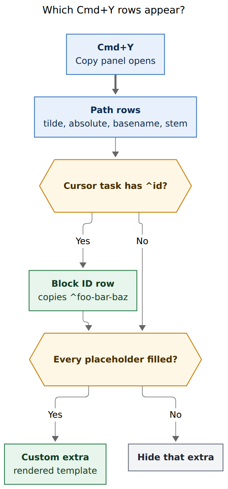
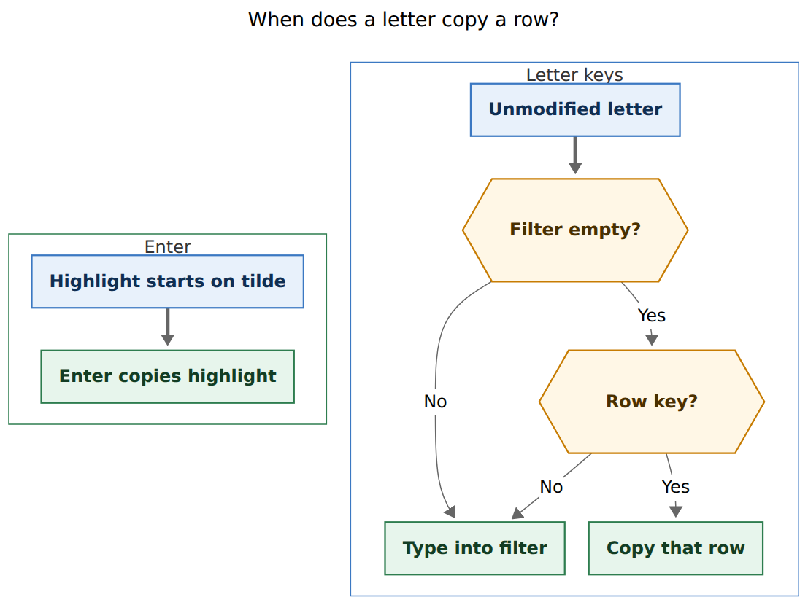

# Compact the Cmd+Y Copy sheet and add a block-id extra

> **Research query:** Improve the Obsidian panel bound to `<cmd+y>` (`copy-active-file-path`). Remove Parent directory and Relative path. Make every remaining option a single keypress, with Absolute path with tilde still the Enter default. Add a Block ID row when the cursor task has a trailing `^id`. Add a chezmoi-backed config field for one or more custom formats whose templates inject the other (non-custom) values, seeded to `the ^{task_id} task in the {abs_file_with_tilde}`. Lead the design so it is intuitive, reliable, and beautiful. Critique the plan, call out justified requirement adjustments, and recommend a solution.

> **Researcher:** `grk`. Independent report. Do not treat this as the swarm synthesis.

- **Evidence:** bob-plugins `bob-navigation-hotkeys` 2.80.0 (`src/010-requires-and-config.js` `YANK_PATH_COMMANDS`; `src/100-yank-and-paths.js` `getYankPathText`; `src/200-filtered-picker-modals.js` `YankPathPickerModal` / `FilteredPickerModal`; `src/203-pomodoro-themes-manager-actions.js` empty-filter letter jumps; `src/314-task-card-key-model.js`; `src/350-picker-task-card.js` compact CSS class; `src/020-config-load-and-tasks.js` `getTrailingBlockIdSpan`; `src/220-property-targets.js` `parseLinkPickerTaskLink`; `src/550-plugin-cancel-and-counted-property.js` Task Card cursor walk; `src/640-plugin-notes-and-task-move.js` clipboard; `src/207a-image-zoom-origin.js` copy toast; `styles.css` `.bob-cnp-modal` / `.bob-task-card-modal` / `.bob-cnp-kbd`; `docs/bob-navigation-hotkeys.md`); chezmoi `home/dot_config/bob/config.yml`; bob-cli `src/native/config/mod.rs` `RawConfig` (no `deny_unknown_fields`); bob-cli `src/native/highlights_ref/listen.rs` unknown-placeholder failure; screenshot `~/tmp/screenshots/20261111_092732.png` (vault-root `bob.md`); community `obsidian-shell-path-copy` token templates; prior analog `research:202610/refs_panel_ctrl_y_yank_card__grk.md` (Mac Refs Ctrl+Y, different product, same letter-key copy language).
- **Date of evidence:** 2026-11-11.



*Figure 1. Path rows are always present. The Block ID row appears when the cursor task already has a trailing `^id`. Each custom extra appears only when every placeholder it uses has a value; an empty variable hides that extra. Rendered 407.062×874 px, fit 100.0%. Mermaid CLI `@mermaid-js/mermaid-cli@12.0.0`.*

## Bottom line

**Yes: keep Cmd+Y as a Copy sheet, shrink the chrome, and teach every row a letter.** The request is a good idea. The panel that exists today is the Child Note Picker stretched to `min(82vh, 840px)` around six path formats, two of which are empty or duplicate at vault root, with a footer that says **Open** and no accelerators.

**Recommended solution:** a compact Copy sheet (Task Card `height: auto` pattern) whose built-in rows are tilde, absolute, basename, and stem; whose Block ID row copies `^foo-bar-baz` when the cursor task already has that id; and whose custom rows come from plugin-only `copy.extras` in `~/.config/bob/config.yml`. Empty-filter letter jumps copy immediately (`t` tilde, `a` absolute, `b` basename, `s` stem, `i` block id, first extra `c`). Enter still copies Absolute path with tilde. Parent directory and Relative path leave the sheet and stay as palette commands plus hidden template variables.

That is a plugin + chezmoi change. bob-cli does not interpolate these templates. There is no plugin settings tab.

## Is this a good idea

**Yes, with the sheet compacted and the custom field kept small.** Cmd+Y is already a daily yank verb (`Mod+Y` on `copy-active-file-path`). The six-row picker proves the payloads. The gaps are chrome, accelerators, and a way to paste a sentence that mixes a block id with a path.

1. **The screenshot is a layout bug more than a missing-feature bug.** `.modal.bob-cnp-modal` is `height: min(82vh, 840px)` for every filtered picker. Task Card already escaped that with `.bob-task-card-modal { height: auto; max-height: min(75vh, 840px); width: min(600px, 92vw); }`. Six rows sitting under a filter in an 840px frame is why the panel looks empty. Beauty starts by borrowing that compact class.

2. **Parent directory and Relative path earn their removal on this sheet.** At vault-root `bob.md`, Parent directory previews `(empty string)` and Relative path equals Basename (`bob.md`). Both remain useful as palette commands (`yank-parent-directory`, `yank-relative-path`) and as hidden `{parent_directory}` / `{relative}` variables inside custom templates.

3. **Single-keypress is already house style.** `PomodoroThemeActionModal` jumps `r/c/h/o` when the filter is empty and types into the filter otherwise. Task Card uses mnemonic letters (`b`, `l`, `t`, `x`) when no text input is focused. Image zoom copies with `y` and toasts `✓ Copied ${text}`. The Copy sheet should join that family instead of inventing a filter-less modal.

4. **Custom extras are the right generalization.** Community `obsidian-shell-path-copy` rebuilt itself around a token engine and a settings-tab format manager. Bob already owns `~/.config/bob/config.yml` through chezmoi, and the plugin already reads that file. One YAML list of templates is the Bob-shaped version of that idea. The listen-command interpolator in bob-cli (`{target}`, `{audio}`, `{title}`, `{pdf}`; unknown placeholders fail) is the failure model to copy.

5. **Block ID belongs on this sheet because Cmd+Y is the yank chord.** Trailing `^[A-Za-z0-9-]+` is already parsed (`BULLET_PROPERTY_TRAILING_BLOCK_ID_RE` / `getTrailingBlockIdSpan`). Pasting `^foo-bar-baz` into chat, capture, or an agent prompt is a real daily move. Hiding the row when the cursor task has no id keeps the sheet honest.

The request as written overfits two details: treating `{task_id}` as if it were the only name for a caret-less block id (it collides with Tasks `[id::]`), and implying the filter should go away so letters always fire. The rest of this report is the corrected shape.

## What is already true

| # | Fact | Evidence |
| --- | --- | --- |
| E1 | `<cmd+y>` is plugin command `copy-active-file-path`, default `Mod+Y`, opening `YankPathPickerModal`. | `src/490-plugin-lifecycle.js`; `docs/bob-navigation-hotkeys.md` command table |
| E2 | The sheet is a `FilteredPickerModal` titled "Copy active file path", placeholder "Filter path formats", footer `↑ ↓` Navigate / `^N ^P` Move / `↵` **Open** / `esc` Dismiss. | `src/200-filtered-picker-modals.js`; `src/180-editor-transactions.js` `KEYBOARD_HINTS` |
| E3 | Built-in kinds, in order: `absolute-tilde`, `absolute`, `basename`, `basename-no-extension`, `parent-directory`, `relative`. Each also has a palette command with no default hotkey (`yank-absolute-path-tilde`, …). | `YANK_PATH_COMMANDS` in `src/010-requires-and-config.js` |
| E4 | Tilde paths use `compactHomePath` (`/Users/bbugyi/bob/bob.md` → `~/bob/bob.md`). Empty parent at vault root previews `(empty string)`. | `src/090-local-task-ids.js`; `getYankPathPreviewText` |
| E5 | Generic picker CSS is `width: min(92vw, 960px); height: min(82vh, 840px)`. Task Card overrides to `height: auto`. House keycaps are `.bob-cnp-kbd`. | `styles.css` |
| E6 | `YankPathPickerModal.handleKeydown` is the base class: arrows, Ctrl+N/P, Enter. Letters type into the filter. | `FilteredPickerModal.handleKeydown` |
| E7 | Theme-action modal already implements empty-filter letter jumps, with placeholder `type to filter · r/c/h/o jump when empty`. | `src/203-pomodoro-themes-manager-actions.js` |
| E8 | Trailing Obsidian block id is `[ \t]+\^([A-Za-z0-9-]+)[ \t]*$`. Tasks `[id::]` is a different identifier. | `BULLET_PROPERTY_TRAILING_BLOCK_ID_RE` |
| E9 | Task Card / Ctrl+Shift+Enter resolve "the selected task" as: cursor `#task` line; dedicated Task Link target (`parseLinkPickerTaskLink`, including `blockId`); managed Depends-On / BLOCKS / LINKS / LINKED FROM lines walk to the owner. | `src/550-plugin-cancel-and-counted-property.js`; `src/220-property-targets.js` |
| E10 | Clipboard helper notices `Copied ${label}` and does not echo the bytes. Image zoom does: `✓ Copied ${text}`. | `writeTextToClipboard`; `copyImageZoomSource` |
| E11 | Plugin reads `~/.config/bob/config.yml` (`XDG_CONFIG_HOME` or `~/.config/bob/config.yml`). There is no settings tab. | `getBulletPropertyConfigPath` |
| E12 | bob-cli `RawConfig` has no `deny_unknown_fields`. A top-level `copy:` key is ignored by the CLI today. | `src/native/config/mod.rs` |
| E13 | `getYankPathText` is exported on `helpers` and has **no unit tests**. | `src/700-exports.js`; grep of `scripts/test-*.cjs` |
| E14 | Command IDs are sticky: cli_rules never hard-remove a command. Palette `yank-parent-directory` / `yank-relative-path` stay. | `sase/memory/cli_rules.md`; generated command table |
| E15 | Community Shell Path Copy uses `<filename>`-style tokens, leaves unknown tokens in the string, and manages formats in a settings tab. Bob listen-command uses `{name}` and fails unknown placeholders. | `ckelsoe/obsidian-shell-path-copy` README; `listen.rs` |

## Requirement adjustments

Call-outs the lead should adopt or explicitly reject.

| ID | Adjustment | Why it is justified |
| --- | --- | --- |
| **ADJ-1** | Compact the modal with a dedicated class `.bob-yank-path-modal` (`height: auto; width: min(640px, 92vw); max-height: min(75vh, 840px)`). | The empty 840px frame is the screenshot. Task Card already proved this pattern. A 960×840 picker for five rows will never look beautiful. |
| **ADJ-2** | Keep the filter. Letters copy only while it is empty (theme-manager rule). | "Single keypress" and "filter still works" coexist in `PomodoroThemeActionModal`. Removing the filter would make this the one picker that cannot search, and it would fight muscle memory. |
| **ADJ-3** | Title the sheet **Copy**. Subtitle names the file (`bob.md` or `5 formats for area/note.md`). | Once the sheet copies `^ids` and sentences, "Copy active file path" is a lie. |
| **ADJ-4** | Footer says **Copy**, not Open. Show `t a b s i` (plus extra letters) as Jump, `↵` Copy, `esc` Dismiss. Drop `^N ^P` from this footer. | The inherited `KEYBOARD_HINTS` are for opening notes. Image zoom and the theme-action modal already specialize their footers. |
| **ADJ-5** | Built-in keys: `t` tilde (alias `~`), `a` absolute, `b` basename, `s` stem, `i` block id (alias `^`). These five letters stay reserved even when the Block ID row is hidden. | Unmodified letters are the single-keypress the request asked for. `~` and `^` need Shift; they are extra mnemonics, not the primary keys. Stable reservation keeps extras from stealing `i` on files with no task. |
| **ADJ-6** | Rename the fourth row's **key** to stem (`s`). Keep the visible title "Basename without extension" or shorten it to **Stem**; either is fine if the keycap is `s`. | `n` for "no extension" is opaque. Unix stem matches the preview `bob`. |
| **ADJ-7** | Block ID row copies `^foo-bar-baz` **with the caret**. Hide the row when the cursor task has no trailing id. Do not mint an id. | The request's example is `^foo-bar-baz`. Minting on yank would write the vault from a copy gesture. |
| **ADJ-8** | "Selected" is the Task Card cursor task, including a dedicated Task Link's target `^id` and a walk from Depends-On / BLOCKS / LINKS / LINKED FROM to the owner. | Copying a different id than Ctrl+Shift+P would see is a reliability bug. `parseLinkPickerTaskLink` already returns `blockId`. |
| **ADJ-9** | `{block_id}` is the canonical caret-less placeholder. `{task_id}` is a documented alias of `{block_id}`. `{block_ref}` is `^` plus that id (the row payload). | `the ^{task_id} task in the {abs_file_with_tilde}` must not become `the ^^foo task in the ~/bob/bob.md`. `{task_id}` also collides in speech with Tasks `[id::]`; the alias exists so Bryan's example string works as written. |
| **ADJ-10** | Custom extras live at plugin-only `copy.extras` in chezmoi `config.yml`. bob-cli does not parse them. No settings tab. | The plugin already reads this file. `RawConfig` ignores unknown keys. A settings tab would drift from chezmoi. |
| **ADJ-11** | Each extra is a string template or a mapping `{template, label?, key?}`. Bare strings are `{template: <string>}`. Default label is **Custom**. Default key is the first unused letter from `cdefghjklmnopqruvwxyz`. | One extra should be a one-liner in YAML. Label and key are opt-in polish. Auto-key `c` for Bryan's single extra. |
| **ADJ-12** | Hide an extra when any placeholder it uses is empty, or when a placeholder is unknown, or when its key collides. Notice once on open. Do not copy a half-rendered string. | Shell Path Copy leaves unknown tokens in the clipboard. Bob's listen-command fails unknown names. Honesty on a Copy sheet means the preview equals the bytes. |
| **ADJ-13** | Keep parent and relative as **hidden variables and palette commands**. They leave the sheet only. | cli_rules: never hard-remove a command. Templates such as `{relative}` still need the vault-relative path. |
| **ADJ-14** | Add palette command `yank-block-id` (no default hotkey). Missing id notices "No block ID on the cursor task". | Same pattern as the path yanks. Power users can bind it. |
| **ADJ-15** | Notice shows the copied bytes, truncated, in the image-zoom voice: `Copied ~/bob/bob.md`. | Today's `Copied absolute path` hides the only thing that matters. |
| **ADJ-16** | Do not add a built-in wikilink / Obsidian-URL / Markdown-link row in v1. Those are custom templates (`[[{basename_no_ext}#^{block_id}]]` when the basename is unique). | Hick's law. The request named one sentence format. Shell Path Copy's unbounded token list is the cautionary tale. |
| **ADJ-17** | Do not auto-copy on Cmd+Y without opening the sheet. Enter remains the tilde default **after** the sheet is open. | The request keeps the panel. Muscle memory for "Cmd+Y, Enter" already matches tilde-first `selectedIndex = 0`. |
| **ADJ-18** | Seed chezmoi with Bryan's sentence using the alias he wrote, plus a comment that `{task_id}` is caret-less `{block_id}`: `the ^{task_id} task in the {abs_file_with_tilde}`. | Exact request. The comment prevents the double-caret footgun. |

## Would I take a different approach

I would still ship this as a Cmd+Y Copy sheet in `bob-navigation-hotkeys`. I would not:

- replace the picker with a new modal family (decay card, command palette, or a native `Menu`);
- put a format manager in a plugin settings tab;
- teach bob-cli to interpolate `copy.extras`;
- flatten wikilink, file URL, heading, line number, and date onto the built-in list;
- copy on key-down of Cmd+Y itself;
- mint missing block ids;
- remove the filter.

The implementing surface is `YankPathPickerModal` plus a pure interpolator plus compact CSS plus one chezmoi block. That is the smallest change that matches the house.

## Recommended solution

### The sheet

Cmd+Y opens a compact Copy sheet on the active markdown file.

**Always visible (in this order):**

| Key | Title | Bytes copied (vault-root `bob.md`) |
| --- | --- | --- |
| `t` (alias `~`) | Absolute path with tilde | `~/bob/bob.md` |
| `a` | Absolute path | `/Users/bbugyi/bob/bob.md` |
| `b` | Basename | `bob.md` |
| `s` | Stem (Basename without extension) | `bob` |

Highlight starts on the tilde row. Enter copies the highlight.

**Conditionally visible:**

| Key | Title | Bytes copied | When |
| --- | --- | --- | --- |
| `i` (alias `^`) | Block ID | `^foo-bar-baz` | Cursor task has a trailing Obsidian `^id` |

**Then each valid `copy.extras` entry**, in config order, with its assigned letter. Bryan's seeded extra:

| Key | Title | Bytes copied (on `bob.md` with `^foo-bar-baz`) |
| --- | --- | --- |
| `c` | Custom | `the ^foo-bar-baz task in the ~/bob/bob.md` |

Each row shows a `.bob-cnp-kbd` chip, the title, and a preview that **is** the copied string (empty path kinds still show `(empty string)` if a palette command can copy them; the sheet itself will not list parent/relative). The Copy status pill stays. Click copies, same as today.



*Figure 2. Empty-filter letter jumps copy immediately. A letter that is not a row key, or any letter once the filter has text, types into the filter. Enter copies the highlight, which opens on Absolute path with tilde. Rendered 737.478×554 px, fit 88.5%. Mermaid CLI `@mermaid-js/mermaid-cli@12.0.0`.*

Placeholder copy: `type to filter · t/a/b/s/i jump when empty` (extend with extra letters). Footer: Jump / Copy / Dismiss.

IME composition and key-repeat do not fire jumps (Task Card rule).

### Cursor task for Block ID

Resolve in this order, matching Task Card:

1. Dedicated Task Link under the cursor → `parseLinkPickerTaskLink(line).blockId`, prefixed with `^` for the row / `{block_ref}`.
2. Managed Depends-On, BLOCKS, LINKS, or LINKED FROM line → owner task, then its trailing span.
3. Cursor line if it is an Obsidian task (`- [ ] … ^id`) → `getTrailingBlockIdSpan`.
4. Otherwise no Block ID row, and extras that need `{block_id}` / `{task_id}` / `{block_ref}` hide.

Do not follow an ordinary `[[note#^id]]` mention in prose. Task Links are the dedicated bullets the rest of the plugin already treats as the selected task.

### Config

Chezmoi `home/dot_config/bob/config.yml`, plugin-only:

```yaml
# bob-navigation-hotkeys Cmd+Y extras. bob-cli ignores this block.
# Placeholders: {abs_file_with_tilde} {abs_file} {basename} {basename_no_ext}
# {relative} {parent_directory} {block_id} {task_id} {block_ref}
# {block_id} and {task_id} are the caret-less trailing id; write ^{task_id}
# when you want ^foo-bar-baz. An extra with any empty or unknown placeholder
# is hidden.
copy:
  extras:
    - the ^{task_id} task in the {abs_file_with_tilde}
```

Mapping form when a label or key is worth pinning:

```yaml
copy:
  extras:
    - template: the ^{task_id} task in the {abs_file_with_tilde}
      label: Chat mention
      key: c
```

Load with the same `getBulletPropertyConfigPath` + YAML parse + mtime cache the plugin already uses for `properties` / `relations`. Invalid `copy.extras` (not a list, entry neither string nor mapping with `template`) notices once and contributes no rows. Missing `copy:` means no extras; path rows still work. Mobile without Node `fs` already cannot read this file; extras stay empty there.

### Placeholder catalog

Built-in rows plus the two retired sheet rows. Values are computed once when the sheet opens.

| Placeholder | Value | Empty when |
| --- | --- | --- |
| `{abs_file_with_tilde}` | `compactHomePath` of the vault-absolute path | no vault base path |
| `{abs_file}` | vault-absolute filesystem path | no vault base path |
| `{basename}` | file name with extension | never for a real file |
| `{basename_no_ext}` | stem | never for a real file |
| `{relative}` | vault-relative path (`bob.md`, `area/note.md`) | never for a real file |
| `{parent_directory}` | vault-relative parent (`""` at vault root) | vault root (treat `""` as empty → extras that use it hide at root) |
| `{block_id}` | caret-less trailing id (`foo-bar-baz`) | no cursor-task id |
| `{task_id}` | alias of `{block_id}` | same |
| `{block_ref}` | `^foo-bar-baz` | no cursor-task id |

Interpolator: replace `{name}` tokens. Unknown name → extra invalid. Empty value → extra hidden. No nested templates. No `<angle>` tokens. v1 has no escape hatch for a literal `{`; none of the seeded uses need one.

`{parent_directory}` at vault root is the empty string, which is why that row looked broken in the screenshot. Hiding extras that ask for it at root is the same honesty rule.

### Key assignment for extras

1. Reserved: `t`, `a`, `b`, `s`, `i`.
2. Explicit `key:` must be one lowercase ASCII letter, not reserved, not taken by an earlier extra. Otherwise that extra is hidden and the open-notice names it.
3. Else the first letter of `cdefghjklmnopqruvwxyz` that is still free.
4. If the alphabet is exhausted, hide the extra (21 extras is past the point of a beautiful sheet).

### Clipboard and palette

`openItem` copies the item's already-rendered `text`. The notice is `Copied <truncated text>`. Palette commands keep today's kind-based `getYankPathText` path. New `yank-block-id` uses the cursor resolver. Parent and relative palette commands remain.

### CSS and chrome

```css
.modal.bob-cnp-modal.bob-yank-path-modal {
  width: min(640px, 92vw);
  max-width: min(640px, 92vw);
  height: auto;
  max-height: min(75vh, 840px);
}
```

`YankPathPickerModal` adds `bob-yank-path-modal` next to `bob-cnp-modal`, the way Task Card adds `bob-task-card-modal`. Long previews wrap in `.bob-cnp-row-path` with `title=` set to the full string (already true).

### Documentation

Plugin reference `docs/bob-navigation-hotkeys.md` (bob-plugins; mounted into the Bob site) grows a short **Copy sheet** section: keys, Block ID rule, `copy.extras` placeholders, and the caret-less `{task_id}` warning. The generated command table picks up `yank-block-id` from `addCommand`. Chezmoi keeps the comment above `copy:`. bob-cli `docs/reference/configuration.md` does **not** grow a CLI field; at most a one-line "plugin-only keys in this file" pointer if that page already lists the shared file. This is a plugin behavior change, not a new CLI flag (`sase/memory/docs.md`).

### Tests

New `plugins/bob-plugins/scripts/test-navigation-hotkeys-yank-path.cjs` against exported helpers:

- `getYankPathText` for all six kinds, including empty parent at vault root and tilde compaction.
- interpolator: Bryan's template; `{task_id}` vs `{block_ref}` caret rules; unknown placeholder; empty `{block_id}` hides; `{parent_directory}` empty at root hides.
- extra key assignment: first extra → `c`; explicit `key: m`; collision with `t` hides; reserved `i` stays reserved with no Block ID row.
- cursor-task fixtures: `#task` line with `^id`; Task Link `[[note#^id]]`; prose mention does not count; no-task line hides the row.

`getYankPathText` is already on `helpers`. Export the interpolator and extra-builder the same way (`src/700-exports.js`).

### Implementation sketch (for the later plan)

Stay inside `bob-navigation-hotkeys` fragments (each file ≤ 1000 lines) plus chezmoi `config.yml`:

1. `src/100-yank-and-paths.js` — interpolator, extra parser, item builder that attaches `text`, `key`, `kind`.
2. `src/200-filtered-picker-modals.js` — `YankPathPickerModal` compact class, specialized footer, empty-filter `handleKeydown`, kbd chips in `renderItem`.
3. `src/640-plugin-notes-and-task-move.js` — cursor-task block id, copy-notice bytes, `yank-block-id`.
4. `src/010-requires-and-config.js` / `src/490-plugin-lifecycle.js` — register `yank-block-id`; load `copy.extras`.
5. `styles.css` — `.bob-yank-path-modal`.
6. chezmoi `home/dot_config/bob/config.yml` — seeded `copy.extras`.
7. `docs/bob-navigation-hotkeys.md` — Copy sheet section.
8. `scripts/test-navigation-hotkeys-yank-path.cjs`.

`npm run build` then `bob plugins sync`. No bob-cli `RawConfig` change unless a later decision wants the CLI to validate plugin-only keys.

## Alternatives considered

| Approach | Why it loses |
| --- | --- |
| Delete the filter so every letter always copies | Breaks the only search path and diverges from the theme-action modal the letters are copied from |
| Settings-tab format manager (Shell Path Copy) | Drifts from chezmoi; Bob already has one config file |
| bob-cli interpolates `copy.extras` | The CLI never opens this sheet; unknown-key ignore is enough |
| Built-in wikilink / Obsidian URL / heading / line rows | Unbounded list; custom templates cover the rare ones |
| Decay-card chrome without a filter | Beautiful for 4 choices, hostile once extras grow; we already have a picker |
| Copy on Cmd+Y down, panel only as fallback | Breaks "tilde is the Enter default on that panel" |
| Mint a block id when missing | A copy gesture must not write the vault |
| `{task_id}` includes the caret | Bryan's `^{task_id}` would paste `^^id` |
| Leave parent/relative on the sheet | Vault-root screenshot shows empty and duplicate rows |
| Remove `yank-parent-directory` / `yank-relative-path` | Violates sticky command ids |

## Risks

- **`{task_id}` vs `[id::]`.** Documented alias. The Block ID row title says "Block ID" and the preview shows the caret form.
- **Double caret.** Seeded template uses `^{task_id}`. Tests lock that.
- **Letter vs filter.** Empty-filter jumps are easy to get wrong on the first keydown after a failed filter; clear-on-open (`selectedIndex = 0`, empty input) already happens.
- **Task Link vs mention.** Following every `[[note#^id]]` in the cursor line would copy ids from prose. Dedicated Task Link bullets only.
- **Future `deny_unknown_fields` on `RawConfig`.** If bob-cli ever denies unknown keys, `copy:` would break CLI config parse. Mitigate with a comment in `config.yml` and, if that day comes, a `serde(flatten)` leftover map. Out of scope for v1.
- **Mobile.** Extras require the desktop config file. Path rows still work.

## Suggested acceptance

1. Cmd+Y on `bob.md` with no cursor task: four path rows, compact height, `t`/`a`/`b`/`s`/`Enter` copy the matching bytes, footer says Copy, notice echoes the bytes.
2. Cursor on `- [ ] #task … ^foo-bar-baz`: fifth row, `i` copies `^foo-bar-baz`.
3. Cursor on a dedicated Task Link to that task: same fifth row.
4. Seeded extra visible only in (2)/(3); `c` copies `the ^foo-bar-baz task in the ~/bob/bob.md`.
5. Parent directory and Relative path absent from the sheet; palette commands still copy them.
6. Unknown `{nope}` extra hidden with a notice; empty `{block_id}` extra hidden with no notice-spam beyond the one open summary if any extras were dropped.
7. New unit tests green; `docs/bob-navigation-hotkeys.md` describes the sheet.
