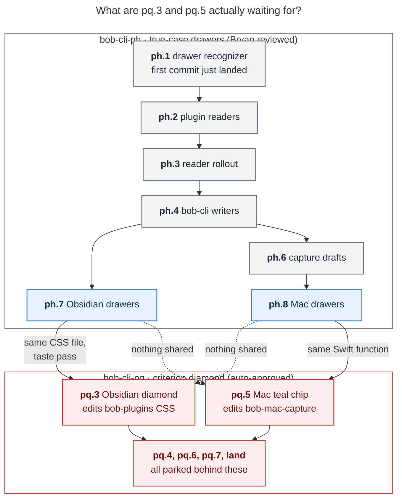
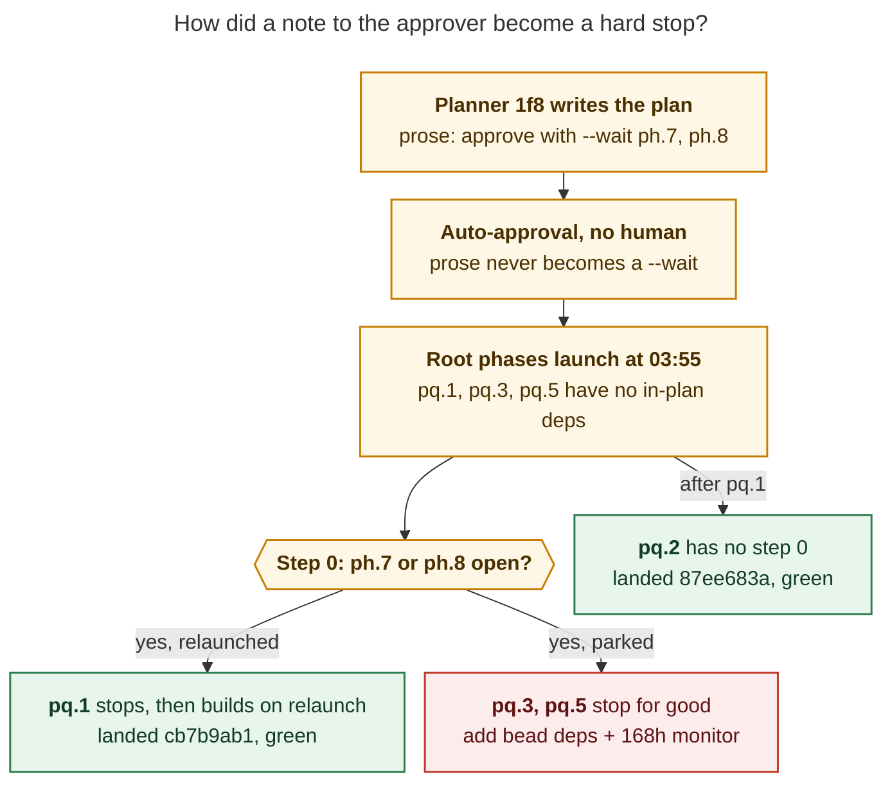
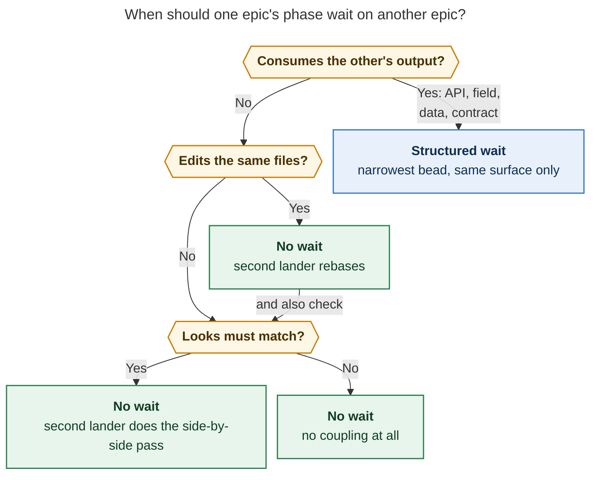

# Do pq.3 and pq.5 really wait on the drawer epic?

_As of 2026-11-23 10:00 EST. Covers `bob-cli-pq.3` (Obsidian draws the criterion
diamond) and `bob-cli-pq.5` (the Mac draft shows requirement bytes as a teal chip),
which both wait on `bob-cli-ph.7` (Obsidian drawers) and `bob-cli-ph.8` (Mac drawers)._

## Short answer

- **No, not really.** Neither phase uses any code, field, data, or contract that
  `bob-cli-ph` produces. The only links are two soft ones: a shared file, and a wish to
  tune both looks side by side.
- **Half the edges have no link at all.** `pq.3` (Obsidian CSS) waits on `ph.8` (Mac
  Swift). `pq.5` (Mac Swift) waits on `ph.7` (Obsidian CSS).
- **They waited because the plan told them to.** Step 0 of each root phase says:
  "If either is still open, stop without changes." The planner meant the wait for a
  human approver (`--wait`). But the plan was auto-approved, so that instruction had
  nobody to read it, and the prose stop became the gate.
- **The wait is expensive.** All five unfinished phases of the epic, plus its land agent, are
  parked behind five to six drawer phases in a row. `ph.1` only just made its first
  commit (`37b2080e`).
- **The fix is mostly structural.** Planners need one rule. Cross-epic waits need a
  structured field instead of prose. Auto-approval needs a guard (see
  [Prevention](#how-to-prevent-this)).

## What the wait really blocks



_Figure 1. All four arrows into `pq.3` and `pq.5` are real bead dependencies today.
Only two of them (solid) match any shared code. The dotted two connect surfaces that
share nothing. Each phase also sits five or six drawer phases deep._

| Pair | Shared code | Needs the other's output? | Verdict |
| --- | --- | --- | --- |
| `pq.3` ↔ `ph.7` | Adjacent sections of `bob-ledger-tools/styles.css` | **No.** Requirements already have their own owner-ink pipeline (`--bob-req-ink`, `[data-bob-req][data-bob-type-hue]`). `ph.7` _reuses_ that pipeline ("reuse the requirement ink pipeline"). | Soft: rebase, plus a taste pass |
| `pq.5` ↔ `ph.8` | Both edit `paintHighlighting` in `CapturePanelModel.swift` | **No.** `pq.5` deletes the requirement concealment. `ph.8` was designed to avoid that same concealment defect. | Soft: a likely rebase conflict |
| `pq.3` ↔ `ph.8` | None (Obsidian CSS vs. Mac Swift) | No | **No coupling** |
| `pq.5` ↔ `ph.7` | None (Mac Swift vs. Obsidian CSS) | No | **No coupling** |

If either look follows the other, the drawer follows the requirement. The drawer plan
says the tray's "stroke weight matches the requirement glyph at the same font size."
So landing the diamond first would give `ph.7` and `ph.8` a final reference to match.

**Proof that the gate was not load-bearing:** the same plan put the same step 0 on
`pq.1` (`glyph-contract`), which edits the plugin twins the plan lists as shared code.
`pq.1` built anyway and landed green as `cb7b9ab1`, "keeping every drawer word and
pattern untouched." `pq.2` had no step 0, built on top of that, and landed green as
`87ee683a`.

## Why the agents waited



_Figure 2. The planner addressed the wait to an approver who never existed. The
step 0 stop then fired, and the same gate produced three different behaviors._

| Time (EST) | Event |
| --- | --- |
| 11-22 17:36 | `bob-cli-ph` is created: 11 phases, approved by a reviewer. |
| 11-23 03:54 | Planner `1f8` creates `bob-cli-pq` with `decided_by: auto` ("no human reviewed this plan"). The plan says: approve with `--wait 'bead=bob-cli-ph.7,bead=bob-cli-ph.8'`, and also check again in step 0 of every root phase. |
| 03:55 | The root phases `pq.1`, `pq.3`, and `pq.5` launch at once. No wait is applied. |
| 03:57 – 04:00 | All three stop. `pq.3` adds bead dependencies on `ph.7` and `ph.8`, plus a monitor (`zgn61t`) that polls every 5 minutes for up to 168 hours. |
| 04:29 | `pq.1` is relaunched with the same generic prompt. It reads the relaunch as an instruction to proceed, then builds and lands. |
| 05:10 | `pq.2` lands. Its plan section has no step 0. |
| 05:27 | `pq.5` is relaunched, stops again, and adds the same dependencies plus a monitor (`73f7mb`). |
| now | `pq.3--mon` and `pq.5--mon` are waiting. `pq.4`, `pq.6`, `pq.7`, and `pq.land` wait behind them. |

There are three root causes:

1. **The planner turned a taste preference into a hard stop.** The plan gives its own
   reason: "The two looks must be tuned side by side." That is a consistency concern,
   not a data dependency. The plan also gated every root phase on _both_ drawer
   phases, instead of only the one for the same surface.
2. **The wait had no structured place to live.** In plan frontmatter, `depends_on` may
   name only earlier phases in the same plan (`sase plan validate --explain`). The only
   structured cross-epic wait is `sase plan approve --wait`, which a human types.
   Auto-approval does not read prose, so the wait was silently dropped.
3. **Phase agents obey the plan literally, and they have no channel for objecting.**
   The prompt says the epic's decisions are final. So `pq.3` and `pq.5` did the
   faithful thing: they parked, and they turned the prose into real bead dependencies
   (recorded as `dependency_added` events at 09:00Z and 10:27Z). Those edges now look
   like real dependencies to anyone running `sase bead read`.

## How to prevent this



_Figure 3. Only consuming the other epic's output justifies a wait, and that wait names
the narrowest bead on the same surface. Shared files and matching looks are handled by
whichever side lands second._

Ranked by leverage:

1. **Give cross-epic waits a structured field (the structural fix).** Add a per-phase
   `waits_on:` field to the epic plan schema, with a required `why:`. For example:
   `waits_on: [{bead: bob-cli-ph.7, why: "consumes the drawer annotation"}]`.
   `sase bead work` would create the bead dependency at launch, so auto-approval cannot
   drop it, and the bead graph shows it from minute one. `sase plan validate` should
   also flag prose gates such as "approve with `--wait`" or "if X is still open, stop".
2. **Add a planner rule (the cheapest fix)** to the `/sase_plan` skill, which lives in the
   chezmoi-managed global SASE config. The rule: "A phase waits on another epic only
   when it consumes something that epic creates. If they share files, the second lander
   rebases. If their looks must match, the second lander does the side-by-side pass.
   Never gate a phase on a bead for a different surface."
3. **Add an auto-approval guard (a safety net).** When a plan body addresses the
   approver (`--wait`, "approve with"), auto-approval should either apply the request or
   send the plan to a human.
4. **Give agents a way to object (damage control).** When a soft gate's blocker is
   several phases away, the phase agent should raise a `sase questions` prompt that
   quotes the cost, rather than parking silently for up to 168 hours.

## Unblocking today (not done; needs Bryan's go-ahead)

```sh
# Edges with no shared surface. Safe to drop on their own.
sase bead dep rm bob-cli-pq.3 bob-cli-ph.8
sase bead dep rm bob-cli-pq.5 bob-cli-ph.7
# Recommended: drop the soft edges too, and let the drawer phases match the diamond.
sase bead dep rm bob-cli-pq.3 bob-cli-ph.7
sase bead dep rm bob-cli-pq.5 bob-cli-ph.8
```

Removing the edges is not enough on its own. Both monitors (`zgn61t2tsqaa`,
`73f7mbaghqrs`) poll the drawer beads' status directly, not the dependency edges. So
they must be stopped with `sase monitor stop`, and the phases relaunched. The step 0
text in the plan also still says "stop". So record the waiver as a note on
`bob-cli-pq`, for example: "Bryan waived the `ph.7`/`ph.8` sequencing gate. Keep drawer
words untouched; the later lander does the taste pass." Otherwise the relaunched agents
will park again.

## Sources

- Plan: `plan:202611/task_reqs_criterion_diamond.md` (frontmatter, Context §
  "Sequencing with the true-case drawers epic", and step 0 of each root phase).
- Plan: `plan:202611/true_case_drawers.md` (phase graph, "One ink family", the tray
  decision, and the Mac "never hidden" rule).
- Beads: `bob-cli-pq`, `.1`, `.2`, `.3`, `.5`; `bob-cli-ph`, `.7`, `.8` (notes,
  dependencies, and the `dependency_added` history).
- Transcripts: `bob-cli-pq.1`, `bob-cli-pq.2--plan`, `bob-cli-pq.3--plan`,
  `bob-cli-pq.5`, `bob-cli-pq.5--plan`. Monitors from `sase monitor list`.
- Code: bob-plugins `plugins/bob-ledger-tools/styles.css` (the requirement section,
  `--bob-req-ink`) and bob-mac-capture `CapturePanelModel.swift`
  (`paintHighlighting`, `concealedRequirementMarkerSpans`) at `0b458fb1`.
