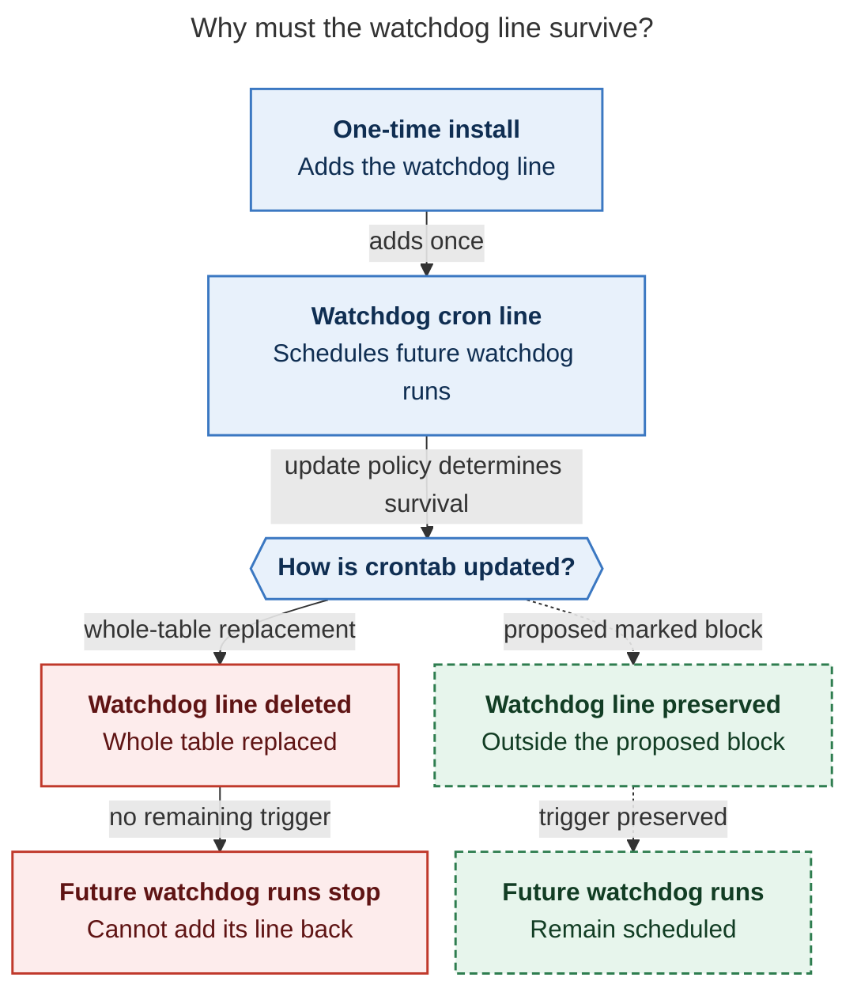
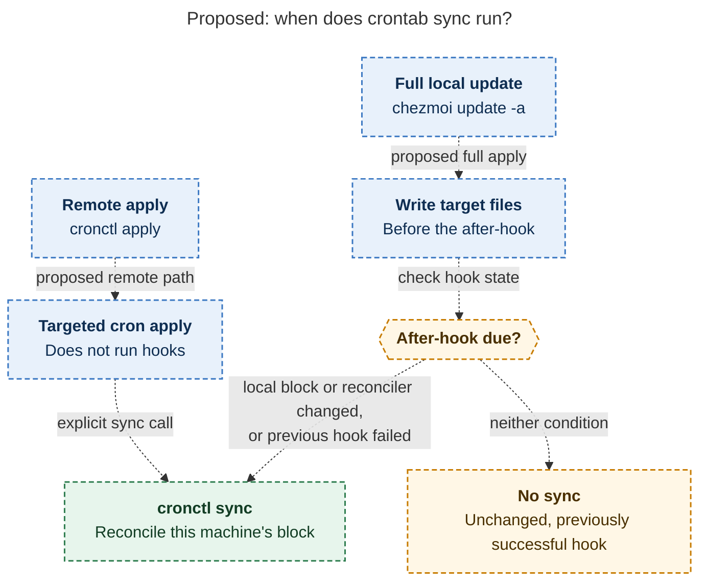

# Diagram proposals: Crontabs as code through chezmoi, with first-class agent access

Proposals for the swarm linker, not a report. Each diagram restates only what the source
report says.

```yaml
source: research:202611/crontab_as_code_via_chezmoi/crontab_as_code_via_chezmoi__final.md
producer: research.5w.image
check: "mmdc 12.0.0 with the PDF-mirroring config rendered 2 of 2 Mermaid diagrams; broken-input negative control passed"
```

## watchdog-survival

```yaml
anchor: |-
  whole-table replacement deletes the line, nothing ever runs the watchdog again, so it
question: |-
  Why must the watchdog line survive an update?
illustrates: |-
  The watchdog adds its line only on its one-time install action, so whole-table replacement stops future watchdog runs and self-reinstallation, while the proposed marked block preserves that line.
caption: Whole-table replacement stops the watchdog that cannot reinstall itself; the proposed marked block preserves its cron line.
review: "551.625x1012 px, fit 88.2%; question, source trace, labels, arrows and visual checks passed; 0 revisions"
```



## sync-triggers

```yaml
anchor: |-
  The hook then re-runs exactly when *this machine's* block or the reconciler changes.
question: |-
  When does a full update or targeted remote apply actually run sync?
illustrates: |-
  The run_onchange_after_ hook responds to local block or reconciler changes and retries failures, while remote targeted apply explicitly calls the same cronctl sync.
caption: Full updates conditionally run the after-hook; remote targeted applies call sync explicitly. Either path uses the same reconciler.
review: "675.26x764 px, fit 96.7%; question, source trace, labels, arrows and visual checks passed; converging arrows mean either path; 0 revisions"
```


