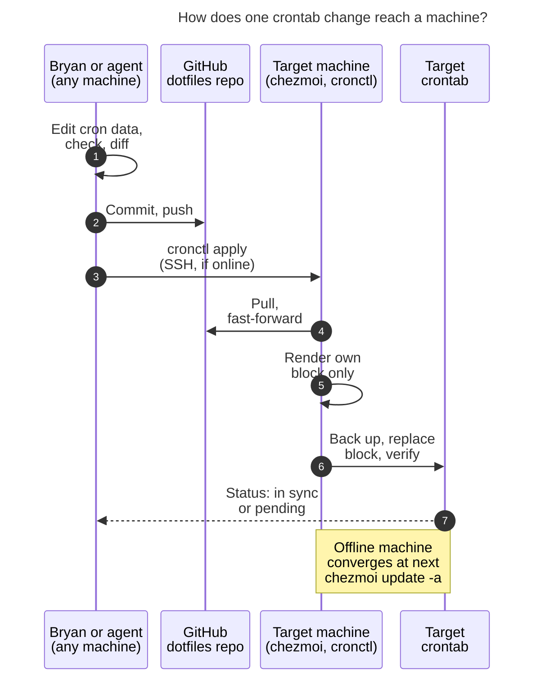

# Crontabs as code through chezmoi, with first-class agent access

Consolidated report, 2026-11-07. It merges five independent reports
([cdx](crontab_as_code_via_chezmoi__cdx.md), [cld](crontab_as_code_via_chezmoi__cld.md),
[grk](crontab_as_code_via_chezmoi__grk.md), [mus](crontab_as_code_via_chezmoi__mus.md),
[gem](crontab_as_code_via_chezmoi__gem.md)) with the lead's own checks. The lead's
checks focused on where the reports disagreed or left a claim untested. Nothing here
changed a live crontab, scheduler, or the chezmoi source. Every experiment ran in
throwaway chezmoi source, destination, and state directories.

## Answer first

**Yes, build it. One committed file in the chezmoi repo should be the source of truth
for every machine's user crontab.** It fits how the dotfiles already work. Host-gated
`run_onchange_after_*` scripts already load systemd timers and merge
`~/.ssh/tailnet.conf` into a file you also edit by hand. `chezmoi update -a` is already
your "converge this machine" habit.

As literally stated, though, the plan would cause harm in three ways:

- **It would delete live jobs.** A whole-crontab replacement would delete athena's
  agent-installed watchdog line, and that line would never come back. It would also
  delete any Mac job not yet copied into the file.
- **Its machine-name rule doesn't hold.** Your current crontab already breaks "only
  machine names are machine-specific", and chezmoi's name for the Mac isn't the name
  you or agents use.
- **`chezmoi update -a` alone doesn't give agents a write path.** It only converges the
  machine it runs on. Apollo can't even find `chezmoi` over non-interactive SSH, and the
  Mac is usually unreachable.

**Recommended solution:** a namespaced `cron:` block in `home/.chezmoidata.yaml`. Jobs
in it are keyed by stable IDs and select machines by canonical name, which is the SSH
alias.

- **Ownership:** chezmoi owns only a **marked block** in each user crontab. Everything
  outside the block is preserved.
- **Rendering and install:** each machine renders only its own block. A
  `run_onchange_after_` hook calls an idempotent `cronctl sync` reconciler when that
  block changes.
- **Environment:** a tiny `cronrun` runner works out the environment at run time, so the
  file holds no paths, user IDs, or display variables.
- **Agents:** a `cronctl` command-line tool, a global `/crontab` skill, and a reference
  memory note let agents read the desired or live crontab of any machine from any
  machine. Agents write by editing the file, then running `cronctl apply <machine>`.

§6 has the full design.

### Which machine is "this machine"?

Every researcher found that SASE runs these agents on **athena**, which already has a
crontab. The tailnet machine with **no** crontab is **apollo** (`no crontab for bryan`).
The request probably means apollo, or a future machine such as the work host already
named in `.chezmoiignore`. The design treats any new machine as a one-line addition, so
this doesn't change the recommendation. It is still listed as an open question (§8).

## 1. What exists today

| Fact | Evidence | Why it matters |
| --- | --- | --- |
| **athena crontab** has 5 environment lines (`DISPLAY`, `DBUS_SESSION_BUS_ADDRESS=…/run/user/1000/bus`, `HOME=/home/bryan`, `MAILTO`, `XDG_RUNTIME_DIR=/run/user/1000`), 2 commented-out jobs (`tman`, `init-bg`), `bob nightly` at 03:30, `pass_git_sync` hourly, and an agent line `# sase-epic-watchdog:sase-1r2` | `crontab -l` (all five reports; the lead re-checked the active lines) | Hard-coded user-ID paths break the "only machine names" rule. A second writer already exists. |
| **apollo** has no crontab, timezone `Etc/UTC`, login shell zsh, and no sendmail | `ssh apollo` (crontab, timezone, and shell re-checked by the lead; sendmail per cld) | It is a safe pilot. The same schedule means a different instant than on athena (`America/New_York`). |
| **The Mac** (`mac`, user `bbugyi`, chezmoi hostname `Kellys-MacBook-Pro`) **timed out** over SSH in every session that tried, including the lead's | `ssh -o ConnectTimeout=8 mac` | Its crontab, OS version, chezmoi version, and write permissions are **unverified**. |
| **chezmoi versions are skewed.** athena: **v2.13.1** (nixpkgs; 2022). apollo has **two** binaries: `~/bin/chezmoi` v2.70.2 and `~/go/bin/chezmoi` `dev`. A login shell picks the `dev` build, and a non-login SSH shell finds **neither**. | The lead resolved a cdx/grk/cld disagreement. Each had seen only one of the two binaries. | The design must work on 2.13.1. Remote commands can't assume `chezmoi` is on `PATH`. |
| apollo's chezmoi source is at `7f023270`, behind the repo's `f1da6b64` | `git log` on both | Machines drift until someone runs `chezmoi update`. |
| The repo has no crontab management, no `.chezmoidata*`, and no `.chezmoi.toml.tmpl`. The only cron traces are `vcron`-style aliases into `~/Sync/bin/cron.jobs/` (job bodies, not schedules). | Repo inspection | This is a greenfield change. The legacy aliases should be retired or repointed. |
| SASE's chezmoi project runs `commit_hooks.after: "chezmoi update -a --force"`, and `AGENTS.md` requires it after every commit | `sase/sase.yml`, `AGENTS.md` | Agents *will* apply on athena after every dotfiles commit, so a destructive installer would fire in practice. |
| Global agent skills live in `home/sase/skills/*.md` (e.g. `sase_gmail.md`). Global memory lives in `home/sase/memory/*.md` (e.g. `tailnet.md`). | Repo inspection | The new skill and memory note have an obvious home. |
| **The dotfiles repo is public** (`bbugyi200/dotfiles`) | `gh repo view` | Cron job definitions become public. Secrets must stay out of them. |
| **Three schedulers already exist:** cron (athena, Mac); systemd user timers (`bob-ref-intake` every 2 min on athena and apollo, `poseidon-cache-watch` on athena); launchd (`com.bbugyi.bob-vault-sync` every 15 s on the Mac) | Repo and host inspection (cld, grk, mus) | Cron can't run anything more often than once a minute. This work should not swallow the other schedulers. |

### Agents already write your crontab, just not safely

An agent installed the athena watchdog line on 2026-11-03 for epic `sase-1r2`. It is a
one-off generated script (`~/.local/state/sase-epic-watchdog/sase-1r2/watchdog.sh`).
Its `safe_crontab_edit` function snapshots the table, adds or strips its marker line,
reinstalls, verifies, and restores on mismatch. User crontab writes need no root,
because `crontab` is setgid, so `sase sudo` is the wrong tool.

Two facts here decide the ownership question:

- **The watchdog adds its line only on its one-time `install` action.** If a
  whole-table replacement deletes the line, nothing ever runs the watchdog again, so it
  can't add itself back. mus's suggestion that "watchdog installers should re-install
  their own line" doesn't hold for this script.
- **It refuses to act when `crontab -l` fails** (grk). That includes the "no crontab"
  case, so this installer pattern can't bootstrap a machine like apollo.

So nothing is missing at the permission level: agents can run `crontab -l` and
`crontab <file>` locally and reach apollo over BatchMode SSH. What is missing is a
**contract**: one source of truth, one installer, and a documented tool and skill.

## 2. Is this a good idea? A critique

### What's right

- **A versioned, single source of truth fixes the real problem.** Today's crontabs are
  unreviewed, unbacked-up, and different on every machine. Agents can't reason about
  them without SSHing around.
- **chezmoi is the right carrier.** It is already on every machine, already does per-host
  logic, and already has the "hash a source, run a loader" idiom. chezmoi's own docs use
  that idiom for targets that aren't files.
- **Selecting jobs by machine name is the right level of detail.** It matches the
  vocabulary of `tailnet.md` and the SSH aliases.

### What would hurt if built literally

1. **Owning the whole crontab destroys other writers.** That means the watchdog, quick
   `crontab -e` experiments, and every Mac job on the first apply. Apple's scheduling
   guide warns against programmatic crontab edits for this exact reason: the crontab is
   a shared resource.
2. **Raw hostnames are fragile machine names.** chezmoi sees the Mac as
   `Kellys-MacBook-Pro`, while agents and SSH call it `mac`. chezmoi's own macOS guide
   warns that `hostname` on macOS depends on the network.
3. **An unrecognized machine must never mean "empty crontab".** A naive template renders
   no jobs when the hostname doesn't match, and a full replace then wipes the table.
4. **The "only machine names" rule is already broken by today's crontab.** Cron doesn't
   expand variables in environment lines. So `/run/user/1000`, `/home/bryan`, and the
   Mac's `/Users/bbugyi` can't be written generically *in the crontab*. They have to be
   worked out at run time.
5. **`chezmoi update -a` only converges the machine it runs on.** It doesn't push to
   other machines. Remote use has sharp edges:
   - `chezmoi` isn't on apollo's non-login `PATH`.
   - `--force` on someone else's machine overwrites *unrelated* local dotfile edits.
   - The Mac is usually asleep.
6. **"Read/write any crontab from any machine" needs a definition.** Agents can read the
   *desired* state anywhere and offline. Reading or writing the *live* state needs a
   reachable target. An offline machine should show as "pending", never as "updated".
7. **Cron on a laptop is weak.** Apple calls cron deprecated in favour of launchd:
   - Jobs are skipped while the Mac sleeps.
   - launchd `StartCalendarInterval` jobs run on wake instead.
   - Community reports say jobs touching protected folders need Full Disk Access for
     `/usr/sbin/cron`.

   Hourly sync jobs don't care. A 04:00 job on a laptop mostly never runs.
8. **Persistence and spread.** A cron entry that agents can write is recurring code
   execution on every enrolled machine. chezmoi `run_` scripts *already* run repo code
   on every apply, so this adds no new capability. It does add persistence. Combined with
   a **public** repo, that argues for: pushed commits only, a diff before every apply,
   backups, and no automatic pull timer.
9. **Installing a schedule doesn't prove it works.** Valid syntax doesn't prove that the
   executables, the nvm setup, credentials, network, or mail delivery work under cron's
   minimal environment. MAILTO only works where there's a mail transfer agent: athena
   has sendmail, apollo doesn't.
10. **A Git revert doesn't undo side effects.** Reverting the source changes *future*
    runs only. It can't undo a sync or a nightly maintenance run that already happened.

### Would I take a different approach?

**Mostly no.** chezmoi plus user cron is right, and every researcher agreed.

The differences from the plan as stated:

- **Ownership:** chezmoi owns a marked block, not the whole table.
- **File format:** structured YAML with job IDs, not a raw crontab.
- **Machine names:** canonical names (the SSH aliases), not raw hostnames.
- **Environment:** a runner that works out the environment at run time.
- **Agent support:** a real command-line tool plus a skill, not just "agents may run
  `crontab`".

I would **not** migrate to systemd timers or launchd as part of this work. Keep the YAML
free of cron-specific assumptions so a later `backend: launchd` can move sleep-sensitive
Mac jobs without a config migration.

## 3. Where the researchers disagreed, and how this report resolves it

| Question | Positions | Resolution and deciding evidence |
| --- | --- | --- |
| **Who owns the crontab?** | Marked block: cdx, cld, grk. Full ownership plus an allowlist: mus. Full render plus a regex that preserves *known* dynamic markers: gem. | **Marked block.** Full ownership permanently kills the watchdog (§1). gem's regex keeps only patterns it already knows, so it would delete every unrecognized Mac line on the first apply. mus's real worry, that merging "silently blesses drift", is handled two ways. `cronctl status` reports every line outside the block as *unmanaged*, and the skill forbids persistent jobs outside the file. |
| **File format** | YAML data: cdx, cld, grk. Go-templated raw crontab with `{{ if eq .chezmoi.hostname }}` blocks: mus, gem. | **YAML**, with a templated raw crontab as the runner-up. The data fits the requirement literally: `machines: [athena, mac]` *is* "only machine names". It also gives agents stable job handles, validation, and per-machine rendering without touching the hostname. gem's objection that complex pipelines are awkward in YAML is real. It goes away once commands are one-liners run through `cronrun`, and anything longer becomes a script in `~/bin`. |
| **Machine names** | Exact `.chezmoi.hostname`: cdx, gem. Canonical name equal to the SSH alias, plus a map from name to hostname: cld, grk, and mus (in its wrapper). | **Canonical name = SSH alias** (`athena`, `apollo`, `mac`), with one map in the same file. Agents address machines by alias. If the Mac's hostname drifts, only the map changes. |
| **Hook type** | Run on every apply as a cheap no-op: cdx. `run_onchange_after_`: the others. | **`run_onchange_after_` keyed on this machine's rendered block.** The lead tested this on 2.13.1: a `run_after_` script that runs on every apply **appears in every `chezmoi diff` forever**, while a `run_onchange_` script doesn't. That is permanent noise for you and for agents. cdx's advantage, catching manual drift, comes back through `cronctl status`, with `cronctl sync` to repair it. cdx and cld both showed that keying on the *locally rendered* block skips the re-run when only another machine's jobs change. |
| **How an agent writes to a remote machine** | Render locally and pipe over `ssh host crontab -`: grk. Remote `chezmoi update -a --force`: gem. Remote fast-forward pull, then a targeted apply, then a sync: cld. Deploy pinned to a revision: cdx. | **cld's approach plus cdx's revision check.** There is **one installer path**: the target's own chezmoi render followed by `cronctl sync`. "Installed" therefore always means "what this machine's source says", and status can check that. grk's direct pipe creates a second installer and leaves the target's source stale; apollo is already behind. gem's `--force` applies unrelated changes and overwrites local edits. **The lead also tested cld's approach on 2.13.1: a targeted `chezmoi apply <path>` updates the file but does *not* run `.chezmoiscripts` hooks.** So `cronctl` must call `sync` itself, as cld specified. A naive targeted apply would silently install nothing. |
| **Where the data lives** | `home/.chezmoidata.yaml`: cdx, and cld's fallback. `.chezmoidata/cron.yaml`: cld, after an upgrade. A deployed `~/.config/cronjobs/jobs.yml` parsed by the tool: grk. | **`home/.chezmoidata.yaml` under a `cron:` key now.** cdx and cld both tested it on 2.13.1. cdx showed that 2.13.1 ignores the `.chezmoidata/` directory form, which cld dates to v2.34. Move to `.chezmoidata/cron.yaml` after a fleet-wide upgrade. Parsing YAML in the tool would need PyYAML, which macOS doesn't ship, so let chezmoi do the parsing. |
| **Rendering another machine's crontab** | gem: `chezmoi execute-template --data '{"chezmoi":{"hostname":…}}'`. cld: a shared template partial that takes `(dict "machine" … "cron" .cron)`. | **cld's partial.** 2.13.1 has no `--data` or `--override-data` flag; the lead checked `execute-template --help`. `--override-data` arrived in v2.66.0 and works on apollo's v2.70.2. The partial works on **every** version; the lead rendered the Mac's block on athena with it. |
| **Machine-specific environment** | Per-machine `env:` literals in the file: grk, gem. A generic runner: cld. Per-job wrapper scripts: cdx. | **The `cronrun` runner.** Literal `/run/user/1000` and `/home/bryan` values in the file break your own requirement. Per-job scripts stay available for genuinely complex jobs. |
| **Hand edits inside the block** | Stop with a conflict: cdx. Back up, warn, and overwrite: cld. | **The source wins, with a backup and a loud warning.** A failing hook would make SASE's post-commit `chezmoi update -a --force` fail on *every* dotfiles commit until a human intervenes. Editing inside the block is unsupported by definition. |
| **Enrolling apollo** | Leave it unmanaged until needed: cdx. Give it an empty block now: cld, grk, mus. | **An empty block now.** Nothing exists to overwrite, and it tests the zero-jobs path end to end. |

## 4. Requirement adjustments (explicit)

| # | Your requirement | Adjusted requirement | Why |
| --- | --- | --- | --- |
| ADJ-1 | (implied) the file defines "my crontab" | chezmoi owns **one marked block** (`# BEGIN chezmoi-cron` … `# END chezmoi-cron`) at the top of each user crontab. Lines outside it are preserved and reported as *unmanaged*. | Coexists with agent watchdogs; makes the first apply on the Mac safe. |
| ADJ-2 | Only machine names are machine-specific | **Kept.** Names are **canonical names equal to the SSH aliases**. A single `machines:` map in the same file records which hostname(s) chezmoi reports for each name. That map is the only machine-specific data. | The Mac is `mac` to agents but `Kellys-MacBook-Pro` to chezmoi. |
| ADJ-3 | (new) | **Fail closed.** An unrecognized machine renders nothing, so no script runs and the crontab is untouched. A listed machine with zero jobs still gets an empty block, so removing its last job works. `crontab -r` is never used. | A hostname glitch must not wipe a crontab. |
| ADJ-4 | Only machine names are machine-specific | **Tighter.** No absolute paths, user IDs, or display variables in the file. `cronrun` works out `XDG_RUNTIME_DIR`, the DBus address, `PATH`, and the profile at run time. Commands use `$HOME`. | Your current crontab breaks the rule (§2, item 4). |
| ADJ-5 | A checked-in file | The deliverable is **file + reconciler + tool + skill**. A checked-in file without an installer does nothing. | All five reports agreed. |
| ADJ-6 | `chezmoi update -a` updates the crontab | **Kept** as the human path, and it re-runs only on machines whose block changed. **Added:** `cronctl apply <machine>…` for agents and remote convergence. Both triggers end in the same `cronctl sync` on the target. | `update` only converges the machine it runs on. |
| ADJ-7 | Agents can read/write any machine's crontab from any machine | **Reads:** desired state for any machine, offline (`cronctl render/list/check`). Live state over SSH (`cronctl status/diff/logs`). **Writes:** edit the YAML, commit, push, then `cronctl apply`. An unreachable target is reported as *pending*, never as done. Agents never use `crontab -e`, `crontab -`, or `ssh … crontab` for persistent jobs. | Makes "first-class" concrete, auditable, and honest about the Mac. |
| ADJ-8 | (new) | Every job has a stable **`name`**, used for logs, status, `cronctl run`, diffs, and block comments. | Agents need handles, not line numbers. |
| ADJ-9 | (new) | Schedules run in **each machine's local time**: athena is New York, apollo is UTC. `cronctl list` shows each machine's timezone. If two machines need different times, write two jobs. | Debian cron has no per-user `CRON_TZ`. |
| ADJ-10 | (scope) | The file covers **user cron jobs that run at most once a minute**. systemd user timers and LaunchAgents stay as they are, and `cronctl status --all-schedulers` lists them read-only. Time-of-day jobs on `mac` are flagged as sleep-sensitive. Root crontabs and `/etc/cron.d` are out of scope. | Cron can't run the 15 s job, and the Mac skips cron while asleep. |
| ADJ-11 | (new) | **No secrets in job definitions.** Commands may *reference* gpg- or chezmoi-encrypted files by path. | The dotfiles repo is public. |
| ADJ-12 | (process) | Design for **chezmoi 2.13.1**: the single-file `.chezmoidata.yaml`, no `includeTemplate`, no `--override-data`. Upgrading athena's chezmoi and cleaning up apollo's duplicate binaries are follow-ups, not blockers. | That is the oldest version in the fleet. |
| ADJ-13 | (cleanup) | Retire or repoint the `vcron`, `vab`, and `vdb`/`vwb`/`vmb` aliases and `~/Sync/bin/cron.jobs/`. | Two scheduling "sources of truth" shouldn't coexist silently. |

If you want **every** cron line, including the ephemeral watchdogs, to come from the
file, ADJ-1 isn't enough. First give watchdog-style automation a `cronctl`-based API,
then switch to owning the whole table. Don't freeze an ephemeral watchdog path into
permanent config just to make the list look complete.

## 5. Alternatives considered

| Option | Verdict | Why |
| --- | --- | --- |
| Keep `crontab -e` per machine | ✗ | The status quo: unversioned and opaque to agents. |
| One crontab file per machine (`crontab.athena`, …) | ✗ (workable fallback) | Simple, but breaks "single file" and duplicates shared jobs. "What runs where?" becomes a grep. |
| One Go-templated raw crontab with hostname `if` blocks (mus, gem) | Runner-up | Familiar syntax and trivial pipelines. But there are no job IDs or structured validation. Shared jobs need `or` chains or copies. Templating braces inside cron lines are easy for agents to break. Rendering another machine needs a newer chezmoi or tricks. |
| One YAML file, chezmoi owns the whole crontab | ✗ for now | Destroys the watchdog (§1). Fine only after ADJ-1's follow-up. |
| **One YAML file, chezmoi owns a marked block** | **✓ recommended** | Declarative inside the block and coexists with other writers. It is the same ownership idea as Ansible's per-entry `#Ansible:` name comments and the `whenever` gem's begin/end block. |
| YAML generating native schedulers (systemd timers on Linux, launchd on the Mac) | Later, Mac only | Catches up after sleep and gives real per-job status. But it needs two backends, and `StartCalendarInterval` has no ranges or steps, so cron expressions must be expanded into lists. |
| Ansible or Nix home-manager | ✗ | A second configuration-management system for about five jobs. Revisit only if fleet admin grows. |
| `bob cron` or a `sase crontab` subcommand | ✗ | Crontab content is home-directory state. A `sase` subcommand would also clash with `sase scheduler` (the orchestrator) and be missing on hosts with an older sase build. |
| One central scheduler that runs jobs on every machine over SSH | ✗ | Makes local maintenance depend on the network and on the controller. |
| `supercronic` or another daemon; `/etc/cron.d` | ✗ | A new dependency on every machine, or root plus no Mac equivalent. |

## 6. Recommended solution

### 6.1 Layout in the chezmoi repo

| Path (under `home/` unless noted) | Deployed to | Role |
| --- | --- | --- |
| `.chezmoidata.yaml` (`cron:` key) | — (template data) | **The single source of truth** |
| `.chezmoitemplates/cron-block` | — | Renders one machine's block from `(dict "machine" m "cron" .cron)` and validates the data with `fail` |
| `dot_config/cron/managed.crontab.tmpl` | `~/.config/cron/managed.crontab` | This machine's rendered block. Readable locally and visible in `chezmoi diff`. |
| `.chezmoiscripts/run_onchange_after_sync_crontab.sh.tmpl` | (script) | Embeds this machine's block and runs `cronctl sync` when it changes |
| `bin/executable_cronctl` | `~/bin/cronctl` | The command-line tool for agents and humans (§6.5) |
| `bin/executable_cronrun` | `~/bin/cronrun` | Job runner: environment, lock, logs, status (§6.4) |
| `sase/skills/crontab.md` | global agent skill | The `/crontab` skill (§6.6), modelled on `sase_gmail.md` |
| `sase/memory/crontab.md` | global reference memory | "Crontab changes go through `cron:` data". Create it through `/sase_memory_write`, and cross-link it from `tailnet.md`. |
| `tests/bash/cron_*_test.sh` (repo root) | — | bashunit render, merge, and quoting tests (§6.7) |

### 6.2 The single file

athena's live jobs, migrated. The only machine-specific facts are the names in
`machines:`.

```yaml
# home/.chezmoidata.yaml
cron:
  version: 1
  # Canonical machine name (= SSH alias) -> hostnames chezmoi may report.
  # Listing a machine enrolls it. An unlisted machine is never touched.
  machines:
    athena: [athena]
    apollo: [apollo]
    mac: [Kellys-MacBook-Pro]
  # Written at the top of every managed block (cron env lines are positional).
  env:
    MAILTO: "<your address>"
  jobs:
    - name: bob-nightly
      machines: [athena]
      schedule: "30 3 * * *"
      description: Nightly Bob maintenance (shared sync, collect-done, sync push)
      command: '. "$HOME/.config/nvm/nvm.sh" && nvm use --silent default && bob nightly'
    - name: pass-git-sync
      machines: [athena]
      schedule: "0 * * * *"
      description: Sync password-store with upstream (pull, then push)
      command: pass_git_sync
    - name: tman
      machines: [athena]
      schedule: "0 4 * * *"
      enabled: false # rendered as a commented-out line, so history stays visible
      command: tman --log=stdout:INFO@nocolor --log=/var/tmp/tman.log:DEBUG@json start
```

**Schema rules** (enforced by `fail` in the partial and by `cronctl check`):

- `name` matches `^[a-z0-9][a-z0-9-]*$` and is unique.
- `machines` lists known canonical names; `[all]` is optional shorthand. A misspelled
  name like `apolo` fails `chezmoi apply` *before* any crontab changes.
- `schedule` is five fields or an `@keyword`.
- `command` is one line of POSIX `sh`. The renderer escapes `'` and `%`. Anything longer
  becomes a script in `~/bin`.
- `description` and `enabled` are optional. chezmoi templates fail on missing keys, so
  read optional keys with `hasKey` or `index`, as cld found.
- There are **no per-machine overrides**: different behaviour per machine means two jobs.

### 6.3 Rendering and installing

**Machine resolution.** The template walks `cron.machines` and picks the name whose list
contains `.chezmoi.hostname`. If nothing matches, `managed.crontab` renders empty and
the hook template renders empty. chezmoi skips a script that renders to whitespace, so
the crontab is untouched (ADJ-3). If the Mac's hostname turns out to drift with the
network, change only the resolver: on darwin, use
`output "scutil" "--get" "LocalHostName"`. The data file stays the same.

**Block rendering.** Each job renders as:

```text
# BEGIN chezmoi-cron (machine: athena; edit cron: in .chezmoidata.yaml)
MAILTO=<your address>
# bob-nightly: Nightly Bob maintenance (shared sync, collect-done, sync push)
30 3 * * * "$HOME/bin/cronrun" bob-nightly '. "$HOME/.config/nvm/nvm.sh" && nvm use --silent default && bob nightly'
# pass-git-sync: Sync password-store with upstream (pull, then push)
0 * * * * "$HOME/bin/cronrun" pass-git-sync 'pass_git_sync'
# tman (disabled): 0 4 * * * …
# END chezmoi-cron
```

cld checked the quoting: a line with single quotes, `$(date +%F)`, a pipe, and `$HOME`
survived cron's `\%` rule and `/bin/sh`.

**Hook** (`run_onchange_after_sync_crontab.sh.tmpl`):

- **Body:** a few lines that run `exec "$HOME/bin/cronctl" sync`.
- **Change detection:** on 2.13.1, which lacks `includeTemplate`, embed the rendered
  block in an inert heredoc. Also embed the `sha256sum` of `bin/executable_cronctl`.
  The hook then re-runs exactly when *this machine's* block or the reconciler changes.
- **Ordering:** it runs after target files are written, so the fresh `cronctl` and
  `managed.crontab` already exist.
- **Retries:** chezmoi re-runs a failed `run_onchange_` script on the next apply.

**`cronctl sync`**, the reconciler (POSIX `sh`, merging the cld and cdx algorithms):

1. Resolve the machine. If it's unknown, or `managed.crontab` is missing, warn and exit 0.
2. Take a per-user lock: `flock` on Linux, a `mkdir` lock on macOS (no `flock`).
3. Read `crontab -l`. Treat `no crontab for <user>` as empty. Any other error, such as a
   permission or TCC failure, aborts and exits non-zero.
4. Count the markers:
   - **Zero pairs:** enrolment. Insert the block at the top.
   - **Exactly one well-formed pair:** replace it.
   - **Anything else** (duplicate, nested, or half a pair): refuse and change nothing.
5. Build the candidate: block + the outside lines, byte for byte. If it's identical to
   the live table, exit 0 quietly.
6. If the live block differs from the last installed block
   (`~/.local/state/cron/installed.block`), warn loudly that a hand edit inside the block
   is being overwritten.
7. Back up the whole table to `~/.local/state/cron/backups/` (keep 20). Run a native
   syntax check where one exists: `crontab -n` on Debian. macOS has none, so the
   install itself is the final parser.
8. Re-read the table. If it changed since step 3, abort and retry once. Install with
   `crontab <candidate>`, read it back, and compare. On a mismatch, restore the backup
   and exit non-zero. Only then record the installed block.

Two limits to know about:

- **No transaction.** The lock serializes `cronctl`, but `crontab -e` and the watchdog
  don't honour it. The re-read in step 8 narrows that race without closing it.
- **Shared environment lines.** Cron environment lines are positional, so the block's
  `MAILTO` also applies to unmanaged lines below it. That's acceptable and documented.

### 6.4 `cronrun`: keeping the file machine-agnostic

`cronrun <job> '<command>'`:

- **Environment.** Sets a sane `PATH` (including the nix profile, `~/.local/bin`, and
  `/opt/homebrew/bin`) and sources `~/.profile`, which every current job does by hand.
  On Linux it sets `XDG_RUNTIME_DIR=/run/user/$(id -u)` and the matching
  `DBUS_SESSION_BUS_ADDRESS` when they're unset. This replaces the hard-coded `…/1000`
  lines.
- **Overlap guard.** A per-job lock, so a slow `pass_git_sync` never overlaps itself.
- **Logs and status.** Appends timestamped output to `~/.local/state/cron/<job>.log`
  (size-capped). Writes `<job>.status` with start, end, exit code, and machine.
  Optionally it also keeps writing the old `/var/tmp/*.log` paths if anything reads
  them.
- **Failure reporting.** Silent on success. On failure it prints a short summary and the
  log tail, so cron mails it where a mail agent exists (athena). Elsewhere the status
  file still records it. This is the "cronic" pattern.

### 6.5 `cronctl`: one interface for agents and humans

| Command | What it does |
| --- | --- |
| `cronctl list [--json]` | Job × machine matrix from the data, with each machine's timezone |
| `cronctl render <machine> [--source DIR]` | The desired block for any machine, rendered locally with no SSH. `--source` renders an uncommitted SASE workspace checkout. |
| `cronctl check [--source DIR]` | Renders every machine (running all validation). Exits non-zero on any error. |
| `cronctl status [<machine>…\|--all] [--json] [--all-schedulers]` | Per machine: reachable or not; source revision vs `origin`; desired vs live block (`in_sync`, `drifted`, `pending`, `unmanaged`, `identity_mismatch`, `failed`); unmanaged lines; last run and exit code per job. `--all-schedulers` adds systemd user timers and LaunchAgents, read-only. |
| `cronctl diff <machine>` | Unified diff of the desired vs live block. Outside lines are listed separately. |
| `cronctl apply <machine>…\|--all [--rev REV]` | See the bullets below. |
| `cronctl sync` | The local reconciler (§6.3). It also repairs drift. |
| `cronctl run <job>` / `cronctl logs <job> [-n N]` | Run a job **now** through `cronrun`, exactly as cron would, or tail its log. Running a job has real side effects, so don't use `run` just to test a schedule. |
| `cronctl edit` | The human replacement for `crontab -e`. Opens the data file in the chezmoi source, then runs `check` and shows the diff. |

**`cronctl apply`** works like this:

- **Precondition:** it refuses unless the source revision is committed and pushed.
- **Remote command:** for each machine it runs
  `ssh -o BatchMode=yes -o ConnectTimeout=8 <alias> '"$HOME/bin/cronctl" _remote-apply REV'`.
- **On the target**, `_remote-apply` does four things:
  1. Finds chezmoi (`~/.nix-profile/bin`, `~/go/bin`, `~/bin`, `/opt/homebrew/bin`, …).
  2. Runs `chezmoi git -- pull --ff-only` and checks that `HEAD` contains `REV`.
  3. Runs a **targeted** apply: `chezmoi apply ~/.config/cron ~/bin/cronctl ~/bin/cronrun`.
  4. Calls `cronctl sync` **explicitly**, because a targeted apply doesn't run hooks.
- **Results:** an unreachable machine is reported as `pending` with its own exit code.

Remote commands use an absolute path and do their own chezmoi discovery, because apollo's
non-login `PATH` has neither chezmoi nor, probably, `~/bin`. The targeted apply leaves
unrelated dotfile changes for your next `chezmoi update -a`, by design.

**Bootstrap:** each machine needs **one** full `chezmoi update -a` before
`cronctl apply` can reach it. Until then `~/bin/cronctl` doesn't exist there. On 2.13.1,
a targeted apply also fails when the target's parent directory doesn't exist yet; the
lead reproduced this.



*Figure 1. A crontab change is always a pushed commit. The target pulls it, renders only
its own block, and replaces only that block, so lines written by other tools survive. A
machine that can't be reached converges at its next `chezmoi update -a`. On athena,
SASE's post-commit `chezmoi update -a --force` does steps 3–6 automatically. (Mermaid
CLI 12.0.0; 684 × 826 px, 95.4% fit.)*

### 6.6 First-class agent support

- **A global `/crontab` skill** in `home/sase/skills/crontab.md`:
  - **Reading:** `cronctl status --all`, `cronctl render <m>`, `cronctl logs <job>`.
    Never describe live contents from memory.
  - **Writing:**
    1. `sase repo open chezmoi`.
    2. Edit the `cron:` data.
    3. `cronctl check --source <checkout>`, then `cronctl render`/`diff` for the
       affected machines.
    4. Commit through the finalizer. SASE's commit hook then converges the local
       machine.
    5. `cronctl apply <other machines>`, then `cronctl status`.
  - **Rules:**
    - Never edit inside the block.
    - Never install a persistent job with `crontab -e`, `crontab -`, or `ssh … crontab`.
    - Ephemeral, self-removing automation (watchdogs) may add *marker-tagged* lines
      **below** the block with a verified safe edit.
    - User crontab never needs `sase sudo`.
    - A Mac timeout is reported as `pending`, never as success.
    - Time-of-day jobs on `mac` are sleep-sensitive.
- **A global reference memory note** (create it via `/sase_memory_write`): "The `cron:`
  data is the only source of truth for persistent cron jobs", plus the `cronctl`
  commands. Add a one-line cross-link from `tailnet.md`, since `cronctl` uses those
  aliases. Because the note is global, agents working in *any* project (bob-cli, sase, …)
  find it, not just agents in the dotfiles repo.
- **One paragraph in the chezmoi `AGENTS.md`** pointing at the skill, next to the
  existing `chezmoi update -a --force` rule.
- **Guardrails:**
  - Only pushed commits can be applied.
  - Every apply backs up and diffs.
  - Unknown machines are no-ops.
  - Markers make other writers visible instead of lost.
  - **No** automatic pull timer: convergence stays a deliberate act by you or an agent.

### 6.7 Tests (`tests/bash`, bashunit)

- **Render tests:** render every machine from the real data. Golden-file tests on a
  fixture YAML cover `%` and quote escaping, disabled jobs, `all`, and `fail` on unknown
  or misspelled machines, duplicate names, bad schedules, and newlines in commands.
- **Merge tests** for `cronctl sync`, with a fake `crontab` on `PATH`:
  - the first install keeps foreign lines;
  - an unchanged table is a byte-identical no-op;
  - a block update keeps foreign lines in place;
  - the "no crontab" case works;
  - corrupt markers are refused;
  - a permission error is *not* treated as empty;
  - a failed verify restores the backup;
  - a hand edit inside the block triggers the warning.
- **Resolver test:** an unknown hostname renders nothing.

cld prototyped the core of the render and merge pieces against 2.13.1 with a fake
`crontab`.

### 6.8 Rollout

1. **Land** the data, partial, hook, `cronctl`, `cronrun`, and tests, with athena's jobs
   migrated.
2. **athena (supervised, one step):** back up the table, then remove the legacy job and
   environment lines while keeping the watchdog line. Run `cronctl sync` in the same
   step so no job runs twice or gets skipped. Check that `cronctl status athena` shows
   only the watchdog as unmanaged. Confirm `bob nightly` and `pass_git_sync` still work
   under `cronrun`; check `cronctl logs` after the next run.
3. **apollo:** one full `chezmoi update -a` to bootstrap. It gets an empty block, which
   proves the zero-jobs path. After that, `cronctl apply apollo` works remotely.
4. **Mac, when it's awake:**
   - `cronctl status mac` shows the whole current table as *unmanaged*, so nothing is
     lost.
   - Move its jobs into the data, apply, then delete the legacy lines.
   - Check for macOS privacy (TCC) friction in both places it can bite:
     - writing a crontab over SSH may need **"Allow full disk access for remote users"**
       under Sharing → Remote Login;
     - jobs that touch protected folders may need Full Disk Access for `/usr/sbin/cron`.

     Neither is verified for this Mac.
   - Move time-of-day jobs to launchd later, or schedule them for hours when the Mac is
     awake.
5. **Ship** the skill, memory note, and `AGENTS.md` pointer, and run `sase skill init` so
   the skill is deployed.
6. **Follow-ups:**
   - Upgrade athena's chezmoi (then move the data to `.chezmoidata/cron.yaml`).
   - Remove apollo's duplicate chezmoi binary.
   - Retire the `vcron` family of aliases.

**Rough size:** one focused implementation session. That's about 250 lines of shell for
`cronctl`, 80 for `cronrun`, 60 lines of templates, and 150 of tests (cld's estimate).

## 7. Risks that remain

- **Habit drift.** A `crontab -e` edit inside the block is overwritten on the next
  change. The backup, the warning, and the skill are the mitigation. An optional later
  shell wrapper could intercept `crontab -e`.
- **The Mac is often offline.** Its desired state is still committed and shows as
  `pending` until it wakes and updates.
- **Timezone surprises.** Copying athena's `30 3 * * *` to apollo means 03:30 UTC.
  `cronctl list` shows each machine's timezone.
- **Version skew.** athena is on 2.13.1 and apollo on `dev`/2.70.2; the Mac is unknown.
  Test on the oldest version in use.
- **Concurrent writers.** The re-read narrows races with the watchdog but doesn't remove
  them. Markers make a lost line visible in `cronctl status`.

## 8. Open questions for you

1. Which machine is "this machine": apollo or a work host? A corporate machine may
   forbid user cron or agent SSH.
2. What's in the Mac's crontab? Are any jobs time-of-day jobs that would silently miss
   while it sleeps?
3. Can ephemeral agent jobs (watchdogs) keep living outside the block, as recommended?
   Or must *every* cron line come from the file?
4. Is it OK to upgrade athena's chezmoi from v2.13.1?
5. Should job logs stay at `/var/tmp/*.log` or move to `~/.local/state/cron/`?

## Recommended solution (summary)

**Adopt the single-file plan, with a marked block and a real agent interface.**

- **The file:** one `cron:` block in `home/.chezmoidata.yaml`. Jobs have stable names and
  select machines by canonical SSH alias. A single map ties each alias to chezmoi's
  hostname, and an unrecognized machine is a guaranteed no-op.
- **Rendering and install:** each machine renders only its own block. A
  `run_onchange_after_` hook calls an idempotent `cronctl sync`. It replaces only the
  `# BEGIN/END chezmoi-cron` block, backs up, verifies, and never runs `crontab -r`.
- **Environment:** move run-time environment into `cronrun`, so the file holds nothing
  machine-specific except names.
- **Agent support:**
  - `cronctl` to list, render, check, diff, show status, apply over SSH, and read logs;
  - a global `/crontab` skill;
  - a global reference memory note.

  Agents then read any machine's desired or live crontab from anywhere and change it by
  commit plus `cronctl apply`.
- **Scope:** keep cron for these jobs. Leave systemd timers and LaunchAgents alone, and
  move sleep-sensitive Mac jobs to launchd only when a real job needs it.

## Sources

**Live inspection** (2026-11-07, read-only):

- athena `crontab -l`, `chezmoi --version`, `chezmoi execute-template --help`.
- apollo `crontab -l`, `timedatectl`, both chezmoi binaries, `--override-data` probe.
- Mac SSH timeout.
- The chezmoi repo at `f1da6b64`: `sase/sase.yml`, `AGENTS.md`,
  `home/.chezmoiscripts/*`, `home/private_dot_ssh/private_tailnet.conf.tmpl`,
  `home/sase/skills/`, `home/sase/memory/`, `home/dot_config/aliases.sh`, `tests/bash/`.
- `~/.local/state/sase-epic-watchdog/sase-1r2/watchdog.sh`.
- `gh repo view bbugyi200/dotfiles` (public).

**Lead experiments** (chezmoi v2.13.1, throwaway directories):

- A targeted apply doesn't run `.chezmoiscripts` hooks, and fails when the target's
  parent directory doesn't exist.
- `chezmoi diff` always lists `run_after_` scripts but not settled `run_onchange_` ones.
- A partial with a `dict` argument renders another machine's block.

**Peer experiments:**

- cdx: the `.chezmoidata/` directory form is ignored on 2.13.1; the single-file form
  works; on-change hooks keyed on local content; Debian `crontab -n`.
- cld: merge logic and quoting with a fake `crontab`; per-machine re-run behaviour.

**External:**

- chezmoi: [Use scripts to perform actions](https://www.chezmoi.io/user-guide/use-scripts-to-perform-actions/),
  [application order](https://www.chezmoi.io/reference/application-order/),
  [`update`](https://www.chezmoi.io/reference/commands/update/),
  [`.chezmoidata` format](https://www.chezmoi.io/reference/special-files/chezmoidata-format/),
  [`.chezmoidata/` directory](https://www.chezmoi.io/reference/special-directories/chezmoidata/),
  [macOS hostname guidance](https://chezmoi.io/user-guide/machines/macos/),
  [v2.66.0 release (`--override-data`)](https://newreleases.io/project/github/twpayne/chezmoi/release/v2.66.0).
- Debian [crontab(1)](https://manpages.debian.org/bookworm/cron/crontab.1.en.html) and
  [crontab(5)](https://manpages.debian.org/bookworm/cron/crontab.5.en.html).
- Apple: [Scheduling Timed Jobs (archived)](https://developer.apple.com/library/archive/documentation/MacOSX/Conceptual/BPSystemStartup/Chapters/ScheduledJobs.html),
  [Terminal guide: launchd scripts](https://support.apple.com/en-asia/guide/terminal/apdc6c1077b-5d5d-4d35-9c19-60f2397b2369/mac).
- macOS privacy over SSH:
  [Michael Tsai, "Allowing a Remote Computer to Access Your Mac"](https://mjtsai.com/blog/2023/04/28/allowing-a-remote-computer-to-access-your-mac/),
  [1Password community, "operation not permitted" over SSH on Sequoia](https://www.1password.community/discussions/developers/cli-on-sequoia-via-ssh---settings-json-operation-not-permitted/27968).
- Cron and Full Disk Access (community):
  [Apple Developer Forums thread 745692](https://developer.apple.com/forums/thread/745692),
  [Apple Community thread 254531320](https://discussions.apple.com/thread/254531320).
- [systemd.timer (`Persistent=`)](https://www.freedesktop.org/software/systemd/man/252/systemd.timer.html);
  [Ansible `cron` module](https://docs.ansible.com/projects/ansible/latest/collections/ansible/builtin/cron_module.html).
