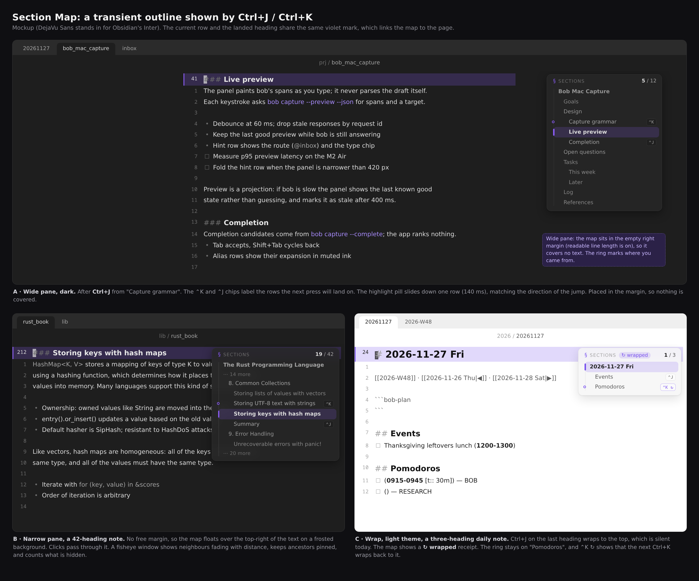

# Ctrl+J / Ctrl+K Section Map: a transient outline for heading jumps

*Researcher `cld` · 2026-11-27 · evidence from `bob-plugins` at `dd9ecff1`, the live vault config in `~/bob/.obsidian/`, and a scan of all 7,043 vault notes.*

## Bottom line

Yes, build it, with five changes to the brief:

1. **Map, not outline.** Show a compact, pane-anchored **Section Map**. It lists the whole outline when a note has 12 or fewer headings, which covers 97% of multi-heading notes. Longer notes get a fisheye window around where you are.
2. **Label the next stops.** Mark the rows that the next `Ctrl+J` and `Ctrl+K` will land on. Ring the section you just left. Say so when a jump wraps around. Wrapping is silent today, which is part of why you get lost.
3. **Scope it to the gesture.** It appears on the jump and stays while Ctrl is held. It fades 1.5 s after the last jump and disappears at once on an edit, any other cursor motion, or a pane or file change.
4. **Never take anything.** No focus, no keys, no clicks, no Esc handling. The page never moves for it. In wide panes it sits in the empty right margin. Otherwise it floats, translucent, in the pane's top-right corner.
5. **Animate the map, not the page.** The jump itself stays instant. The highlight slides between rows in the map, and the landed heading flashes the same violet mark as the current map row. You see where you went without the editor scrolling smoothly.

Everything else (a peek command, counted jumps with a relative-number gutter) is optional and comes later. The mockup below shows the recommended look.



*Mockup rendered in headless Chromium from hand-written HTML and CSS. DejaVu Sans stands in for Obsidian's Inter, and `^` stands in for the `⌃` glyph, which the font lacks. In panel A the ⌃K and ⌃J chips label the rows the next presses will land on, and the ring marks the section you came from. Panel B shows the fisheye window with pinned ancestors. Panel C shows the wrap receipt.*

---

## 1. What happens today

All of this comes from the code and the live config:

| Fact | Evidence |
|---|---|
| `Ctrl+J`/`Ctrl+K` run `bob-navigation-hotkeys:jump-to-{next,prev}-section-header`. In Vim normal mode the route is `nnoremap <C-j> :bob_next_header<CR>`, then an exmap, then `obcommand`. In insert and non-Vim modes, `hotkeys.json` binds Ctrl+J/K to the same commands. | `~/bob/obsidian_vimrc.md:22-23,35-36`; `~/bob/.obsidian/hotkeys.json` |
| Targets are every ATX heading of levels 1–6, as one flat list. Frontmatter and fenced code are skipped. A bare `#` line counts. | `getSectionHeaderLines`, `src/130-fences-and-status.js:13`; `SECTION_HEADER_RE = /^ {0,3}#{1,6}(?:[ \t]|$)/` |
| **Jumps wrap silently.** Past the last heading, Ctrl+J returns to the first one, and Ctrl+K does the reverse, with no feedback. | `getSectionHeaderJumpLine`, `130-fences-and-status.js:58-81` |
| **The landed heading is pinned to the very top of the viewport** (`EditorView.scrollIntoView(..., { y: "start" })`). Everything in the previous section scrolls out of view. | `scrollEditorLineToTop`, `src/170-open-task-jump.js:687` |
| The only feedback is a global `Notice` when a note has **zero** headings. | `jumpToSectionHeader`, `src/610-plugin-jumps-and-counted-keys.js:178-204` |
| Counts such as `3<C-j>` cannot reach the command through the exmap → `obcommand` route. I did not test it live. The plugin can already read a pending Vim count for its capture-phase handlers. | `090-local-task-ids.js:302-367`; `handleOpenTaskJumpPhysicalKeydown`, `610-…:784` |
| `610-plugin-jumps-and-counted-keys.js` is at **962 / 1000** lines, the per-fragment cap. New code needs new fragments. | `wc -l`; `bob-plugins/AGENTS.md` |

Existing Bob UI this can reuse:

- **Landing flash**: a CodeMirror line decoration `bob-landing-flash`. It shows a 24% accent tint plus a 2 px inset accent bar and fades over 1.2 s, with a reduced-motion variant. It is used today by the open-notes URI landing (`676-plugin-open-notes-uri.js:7-61`, `styles.css:129-150`).
- **Landing toasts**: the bank walk replaces one `Notice` per landing and already uses the words **"↻ wrapped"** (`549a-bank-walk-notice.js`). The shared `.bob-nh-notice` card styles live in `styles.css:1700+`.
- **Walker Footer**: the persistent status-bar walk panel. Its glossary entry says it is not a landing toast. A section-jump indicator should stay out of the footer for that reason.

## 2. What the vault says about the notes you jump in

From a scan of `~/bob`. The first three rows count all 7,043 `.md` files. The last row excludes the `_generated` tree.

| Measure | Value |
|---|---|
| Notes with at least 2 headings | 4,236 of 7,043 |
| Headings per note, among notes with any | median **2**, p75 3, p90 **4**, p99 **18**, max **178** (in `_generated`) |
| Heading levels in use | H2 11,127 · H1 4,092 · H5 764 · H3 653 · H4 426 · H6 2 |
| Heading text length (characters) | median **12**, p90 31, p99 80, max 200 |
| Non-generated notes with at least 2 headings that fit in N rows | ≤5: 92.7% · ≤9: 96.2% · **≤12: 97.2%** · ≤15: 99.2% (n = 3,110) |

What follows from this:

- **A 12-row cap shows the full outline 97% of the time.** Windowing is the rare case, but it has to work: some notes have 18 to 178 headings.
- **Daily notes are tiny.** `20261126.md` has `# 2026-11-26 Thu`, `## Events`, and `## Pomodoros`. The map there is a 3-row card. It is still useful because it makes the wrap visible.
- **Labels are short**, so a card about 260–300 px wide rarely truncates.
- **Odd headings exist.** `org.md` has bare `#` lines and table-like headings such as `# 0 = [[horizon]] | Horizons of Focus`. Labels need cleaning, and empty headings need a placeholder.
- Notes often skip levels (H1 straight to H3, and many H5s). Indentation has to come from the real nesting, not from the raw level number.

## 3. Critique: is this a good idea?

### 3.1 Why you lose your place

Four things in the current behavior combine:

1. **Top-pinning removes the context behind you.** After a jump the heading sits at row 0, so you cannot see what you just left.
2. **The list is flat and unlabelled.** Ctrl+J visits H1 through H6 in one sequence. Nothing tells you whether the next stop is a sibling, a child, or a new top-level part.
3. **Wrap is silent.** At the end of the note the next press throws you back to the top with no signal, which is the most disorienting case.
4. **Nothing on screen shows your position.** There is no "5 of 12" and no indication of what comes next.

HCI research has names for both missing pieces. **Visual momentum** (Woods, 1984) is how well an interface helps you carry your bearings across a view change. **Feedforward** (Vermeulen et al., CHI 2013) is showing what an action will do before you take it. Your request asks for both: where am I now (momentum), and where will the next press take me (feedforward).

### 3.2 Verdict

**It is a good idea, and a better fit than the off-the-shelf options.** I surveyed eight popular Obsidian outline plugins (section 5). None of them shows an outline in response to a next or previous heading key. All of them are persistent and built for the mouse: sidebars, edge rails that expand on hover, sticky headers. Your navigation is keyboard-first and Vim-shaped. A transient map tied to the jump gesture fills a real gap.

There are three risks, each with a mitigation:

- **Noise.** It pops up on every press. The mitigations are a compact card, the margin placement, a short life, no focus, and no movement of the text.
- **Lying.** A map that disagrees with where the jump actually lands is worse than no map. The mitigation is to build both from the same scanner, the same line array, and the same jump function (section 6.6).
- **Clutter in narrow panes.** The overlay covers the right ends of the top lines for about 1.5 s. Mitigations are translucency, clicks passing through, and a one-line compact mode in very narrow panes.

### 3.3 Requirement adjustments

| # | Your requirement | Adjusted to | Why |
|---|---|---|---|
| A1 | "brief" | **Lives as long as the gesture.** It stays while Ctrl is held, fades 1.5 s after the last jump, and disappears at once on an edit, another motion, or a pane or file change. | A fixed timer either cuts you off mid-scan or lingers. A held modifier is the same "quasimode" that makes Cmd+Tab feel natural (Raskin). |
| A2 | "an outline of the file's markdown sections" | **The full outline when it has 12 rows or fewer; otherwise a fisheye window** of 8 headings around the current one. Up to 2 ancestors stay pinned, and "⋯ N more" rows count what is hidden. | 97% of notes get the full outline. The long ones (up to 178 headings) cannot fit in a card that stays out of the way. Furnas's fisheye "degree of interest" is the standard answer: importance minus distance from the focus. |
| A3 | (not stated) | **Mark the next stops.** ⌃J and ⌃K chips go on the rows the next presses will land on, with **↻** added when that press would wrap. A **↻ wrapped** receipt appears when this press wrapped. | This answers your actual question ("what's after or before the one I just jumped to?") without making you work it out. |
| A4 | (not stated) | **Show where you came from.** A hollow ring marks the section you left, and the highlight *slides* there-to-here. | Direction of travel is the cheapest orientation cue there is. |
| A5 | (not stated) | **Pane-anchored, not a global Notice.** | Notices stack window-wide in the top-right, compete with other toasts, cannot sit in the editor margin, and know nothing about panes. |
| A6 | (not stated) | **Read-only and non-interactive in v1.** Clicks pass through, it never takes focus or keys, and **Esc does not close it**. | `decisions:q-and-ctrl-bracket-mirror-esc` says every Esc-closable panel must also close on `q` and `Ctrl+[`. Binding Esc would therefore mean stealing `q` from the editor, which breaks Vim macro recording. Making the map gesture-scoped keeps it outside that rule entirely. |
| A7 | (new, small) | Add a **"Show section map" peek command**, unbound by default, that shows the map without moving. | It lets you check where you are before jumping, at almost no cost once the map exists. |
| A8 | (new, optional) | **Phase 2: counted jumps** (`3<C-j>`) plus a relative-number gutter in the map. | You already use relative line numbers and counted Bob keys. This turns the map from a receipt into a launcher. |

What I would **not** add: a persistent rail or minimap, a sidebar, sticky headers, smooth editor scrolling, or a modal picker as a replacement. Section 4 explains why.

## 4. Options considered

| Option | Near your eyes? | Covers text? | Pane-local? | Answers "what's next"? | Effort | Verdict |
|---|---|---|---|---|---|---|
| **A. Pane-anchored HUD (Section Map)**: an absolutely positioned card inside the pane, placed in the margin when there is room | ✔ top-right, beside the landed heading | none in margin mode; briefly the right ends of lines in narrow panes | ✔ | ✔ (chips) | M | **Recommended** |
| B. `Notice` toast with a fragment (the bank-walk pattern) | ✖ window corner, not the pane | over everything | ✖ | ✔ | S | Fallback only: it stacks with other notices, a click dismisses it, and it cannot use the margin |
| C. CodeMirror tooltip anchored at the landed heading | ✔✔ | covers the section's first lines, exactly where you read next | ✔ | ✔ | M | Covers the most valuable text |
| D. CodeMirror panel (top or bottom bar) | ~ | pushes the text down (layout shift) | ✔ | ~ one line | S | Reflowing the editor on every press is intrusive |
| E. Status-bar breadcrumb (`§ 5/12 · Live preview`) | ✖ bottom corner | none | ✖ | ✖ | S | Too peripheral, and it competes with the Walker Footer |
| F. Persistent edge rail with ticks that expands on jump (Notion, Heading Scroller, Subtle TOC style) | ~ | always a thin rail | ✔ | ✔ when expanded | L | Beautiful but always on screen, which contradicts "brief". Possible later |
| G. Core **Outline** sidebar, which is already enabled (`core-plugins.json: "outline": true`) | ✖ far from your eyes | costs a sidebar | ~ | ✖ (no wrap or next marking) | 0 | A free baseline to try today, but not the answer |
| H. Sticky headings (VS Code Sticky Scroll, Another Sticky Headings) | ✔ | always on | ✔ | ✖ shows ancestors only | M | Answers "where am I", not "what's next" |
| I. Smooth-scroll the jump | ✔ | none | ✔ | ✖ | S | Slows every jump. A + animated map gives the same spatial benefit with no latency |
| J. Land the heading a few lines below the top, keeping the end of the previous section visible | ✔ | none | ✔ | ✖ | XS | Shows less of the section you jumped to and still does not show what is next. Skip |
| K. Fuzzy "go to heading" picker (Wave TOC, consult-outline style) | ✔ | modal | ✔ | n/a | M | A different job (far jumps when you know the name). Complements A, does not replace it |

## 5. Prior art and what to borrow

**Obsidian plugins.** I surveyed eight via a fetch of their `community.obsidian.md` pages. None shows an outline in response to a next or previous heading command. The common patterns are:

- **Edge rails with ticks sized by heading level that expand on hover**: Heading Scroller, Subtle TOC (which closes 160 ms after the mouse leaves), Wave TOC, and Notion's floating TOC.
- **A margin card**: Beyond TOC. It *requires Readable line length* to make room for the card, which is the same trick as margin mode here.
- **Sticky ancestor headings**: Another Sticky Headings, and VS Code's Sticky Scroll.
- **Pickers**: Wave TOC's "Jump to heading", and Dynamic Outline's search.
- **Current-section and parent-path highlighting** is universal. Floating TOC (154k downloads) highlights the current heading and shows its parent.

What to borrow: highlight the current row and its parent path, size and indent rows by level, use the margin when there is one, and respect reduced motion (Heading Scroller does). What to avoid: hover-only discovery and permanent screen presence.

**Editors and keyboard UIs.** which-key in Emacs and Neovim, and Helix's key-hint popups, are transient, non-modal info boxes triggered by a keypress. That is the right interaction family. Cmd+Tab and Alt+Tab switchers stay open while the modifier is held, which is the held-Ctrl rule in A1.

**Research.**

- **Woods (1984), visual momentum**: support the move between views by showing how they relate. Here that means the from-ring, the sliding highlight, and the shared violet mark on the map row and the page line.
- **Furnas (1986), fisheye views**: degree of interest = a-priori importance − distance. Here, pinned ancestors are the importance term, and rows fade with distance from the current one.
- **Vermeulen et al. (CHI 2013), feedforward**: show what an action will do before it is taken. Here, the ⌃J/⌃K chips and the ↻ marker.
- **Klein & Bederson (CHI 2005)**: animated scrolling improved reading task time and accuracy. I take the benefit of the animation but put it on the map, so jumps stay instant.

## 6. Recommended design: the Section Map

### 6.1 Anatomy (see the mockup)

- **Header**: the accent `§` glyph, small-caps `SECTIONS`, a **↻ wrapped** receipt pill on wrap, and a right-aligned `5 / 12` with the current index in normal ink.
- **Rail**: one hairline down the left. The current row carries a 3 px accent bar on the rail. The from-row carries a hollow accent ring.
- **Rows**: one per heading, indented 12 px per depth step with at most 4 steps.
  - The **current row** has an 18% accent tint and semibold text. It is never truncated and may wrap to 2 lines.
  - Other rows truncate with an ellipsis and fade with distance from the current row: 1 step away is muted, 2 steps is muted at 75%, 3 or more steps is muted at 45%.
  - H1 rows are semibold.
- **Chips**: a quiet keycap-style chip on the next and previous target rows. They read `⌃J`/`⌃K` on macOS and `Ctrl J`/`Ctrl K` elsewhere. When the press would wrap, the chip gains ` ↻` and accent ink.
- **Gap rows**: `⋯ 14 more`, in faint ink with an exact count.
- **Empty state**: one line, "No headings in this note". It replaces the global Notice and appears in the same place.

### 6.2 Content model

The model is a pure function, so it can be tested in node:

```
buildSectionMapModel(lines, {
  cursorLine,          // after the jump (or current, for peek)
  fromLine,            // cursor line before the jump; null for peek
  direction,           // +1, -1, or 0 (peek)
  wrapped,             // this press wrapped around
  maxRows = 12,
}) → {
  total, index,                        // "5 / 12"
  rows: [{ line, depth, label, kind: "heading" | "gap", hidden?,
           isCurrent, isFrom, isPinnedAncestor,
           chip: "next" | "prev" | "both" | null, chipWraps, distance }],
  wrapped,
}
```

Rules:

- **Headings** come from `getSectionHeaderLines(lines)`, the exact list the jump uses.
- **Depth** comes from an outline stack: pop while the top's level ≥ this heading's level, depth is the stack length, then push. A note that goes H1 → H3 indents H3 by one step, not two.
- **The current section** is the last heading at or above `cursorLine`. If the cursor is above the first heading, nothing is current and the header reads `– / 12`.
- **Chips** come from calling `getSectionHeaderJumpLine(lines, cursorLine, ±1)`. That is the same function the next keypress will run, so a chip cannot disagree with the jump. `chipWraps` is set when the next target lies on the other side of the cursor from the direction of travel.
- **Windowing** applies only when `total > maxRows`.
  - Keep up to 2 ancestors that fall outside the window: the outermost and the nearest.
  - Show a window of 8 headings: the current one, 3 behind, and 4 ahead in the direction of travel. Peek centres it, 4 and 3.
  - Fill the remaining slots with `⋯ N more` gap rows.
  - The window is a deterministic function of (index, direction), with no hidden state.
- **Labels** are cleaned as follows:
  - Drop the ATX closing `#`s.
  - `[[target|alias]]` becomes the alias, `[[target#h]]` becomes `target › h`, and `[text](url)` becomes the text.
  - Strip `**`, `__`, `*`, `_`, `~~`, `==` and backticks, inline HTML, and a trailing `^block-id`.
  - Keep `#tags` and emoji.
  - An empty heading shows *(untitled)* in italics.
  - Insert text with `textContent` only.

### 6.3 Placement

The map is mounted in the `.view-content` of the `MarkdownView` whose editor ran the command. Only one map exists at a time, and it moves if you jump in another pane. It is built with that view's `ownerDocument` so pop-out windows work.

1. **Margin mode**: used if `pane.right − scrollbar − contentColumn.right ≥ mapWidth + 32 px`. Readable line length is on, since it is Obsidian's default and `app.json` does not override it. The map's left edge sits 16 px right of the text column, and its top is 8 px below the scroller top, level with the landed heading. Nothing is covered.
2. **Overlay mode** (otherwise): top-right, 12 px inset, `width = clamp(200px, 30% of pane, 300px)`. The background is 86% opaque with `backdrop-filter: blur(10px)`, and `pointer-events: none`.
3. **Compact mode** (panes narrower than 420 px, or hover-preview editors): a single top-right strip, `↑ Capture grammar · ● Live preview 5/12 · ↓ Completion`.

Vertical position is fixed at the top of the pane rather than following the heading. A map that stays put on repeated presses is calmer, and after a jump the heading is at the top anyway.

### 6.4 Lifetime

```mermaid
---
title: "When does the Section Map appear, stay, and leave?"
accTitle: "Section Map lifetime"
accDescr: "A section jump shows the map; it holds while Ctrl is down, lingers 1.5 seconds after release, then fades; edits, other motions, and pane or file changes remove it at once."
config:
  state:
    nodeSpacing: 30
    rankSpacing: 30
---
stateDiagram-v2
  direction TB
  state "Hidden" as HIDDEN
  state "Fading · 180 ms" as FADE
  state "Visible" as VIS {
    state "Holding · Ctrl down" as HOLD
    state "Lingering · 1.5 s" as LINGER
    HOLD --> LINGER: Ctrl up or window blur
    LINGER --> HOLD: another jump
  }
  HIDDEN --> HOLD: Ctrl+J, Ctrl+K, or peek
  LINGER --> FADE: 1.5 s with no jump
  FADE --> HOLD: another jump
  FADE --> HIDDEN: fade done
  VIS --> HIDDEN: edit, other motion, pane or file change
  classDef focus fill:#E8F1FB,stroke:#3B78C2,stroke-width:1.5px,color:#0F2E52
  classDef outcome fill:#E7F5EC,stroke:#2E7D4F,stroke-width:1.5px,color:#123D24
  classDef muted fill:#F3F4F6,stroke:#6B7280,stroke-width:1.5px,color:#1F2937
  class HOLD focus
  class LINGER outcome
  class HIDDEN muted
  class FADE muted
```



*The map belongs to the jump gesture. It holds while you are still chaining jumps, lingers just long enough to read two or three labels (about 250 ms per fixation, so 1.5 s leaves margin), and disappears as soon as you do anything else. A jump while it is visible re-renders it in place. Peek without Ctrl held goes straight to Lingering.*

Details:

- **"Other motion"** means a selection change to a line other than the one the jump set. It is detected with an `EditorView.updateListener` registered through `registerEditorExtension`.
- **Mouse-wheel scrolling does not dismiss.** The map describes the cursor, not the viewport.
- **"Window blur"** guards against a missed Ctrl keyup, for example after Alt+Tab.

### 6.5 Visual and motion spec

CSS is written against Obsidian variables so both themes work. The mockup's CSS is a faithful starting point:

```css
.bob-section-map {
  position: absolute; z-index: var(--layer-popover); width: 264px;
  padding: 8px 6px 7px 8px; border-radius: var(--radius-l);
  background: color-mix(in srgb, var(--background-secondary) 86%, transparent);
  backdrop-filter: blur(10px) saturate(1.15);
  border: 1px solid var(--background-modifier-border);
  box-shadow: var(--shadow-s); font-size: var(--font-ui-smaller);
  pointer-events: none;
}
.bob-section-map .sm-row.is-current {            /* same mark as .bob-landing-flash */
  color: var(--text-normal); font-weight: 650;
  background: color-mix(in srgb, var(--interactive-accent) 18%, transparent);
}
.bob-section-map .sm-row.is-current::before {     /* rail bar */
  background: var(--interactive-accent); width: 3px; /* … */
}
```

| Moment | Motion | Why |
|---|---|---|
| Appear | opacity 0→1 and a 6 px slide from the right, **90 ms** ease-out | It should be readable by the time your eyes land |
| Repeat press | the highlight pill and the list's `translateY` move **140 ms** `cubic-bezier(.2,.7,.2,1)`; DOM rows are reused, keyed by line | The motion shows direction. CSS transitions retarget smoothly under key autorepeat |
| Wrap | no long slide; a 120 ms crossfade and a small pop on the **↻ wrapped** pill | A slide down the whole list would read as a scroll |
| Leave | opacity 1→0 over **180 ms** ease-in, then removed | Abrupt disappearance in peripheral vision grabs attention; a soft fade does not |
| Page | **reuse `bobOpenNotesLandingFlashEffect`** on the landed heading (1.2 s) | The same violet mark on the map row and the page line visually ties the two together |
| Reduced motion | no slides; opacity only; the flash is static (the existing rule) | Accessibility, and it matches the existing flash CSS |

### 6.6 Reliability rules

1. **Jump first, map second.** The map runs in `try/catch` after the cursor and scroll have succeeded. A map failure can never block or alter a jump.
2. **One scan per press.** The `lines` array that picks the target also builds the model.
3. **Chips are computed, not inferred.** They call `getSectionHeaderJumpLine` for each direction, not index ± 1. This matters because Ctrl+K from the middle of a section goes to *that* section's own heading, which simple arithmetic gets wrong.
4. **Stale state is impossible.** Any document change hides the map, so it is never drawn from old text.
5. **Pane-local singleton.** Its element, timers, and listeners are cleaned up through `register` and `registerDomEvent` on unload, leaf change, `file-open`, and `layout-change`. A layout change re-places the map, or hides it if the pane is gone.
6. **No input capture.** No focus, no `preventDefault`, no Esc binding, `pointer-events: none`.
7. **No writes.** Nothing is written to the vault, localStorage, settings, or stats.
8. **Mobile**: skipped (`Platform.isMobile`). Ctrl+J/K is not a mobile gesture.
9. **Accessibility**: `role="status"` with a throttled one-line summary for screen readers: "Section 5 of 12, Live preview; next Completion; previous Capture grammar".

### 6.7 Edge cases

| Case | Behavior |
|---|---|
| 0 headings | Empty-state line in the map, which replaces today's global Notice |
| 1 heading | One row, `1 / 1`, chip "both ↻". This truthfully shows that the jump goes nowhere new |
| Cursor in frontmatter or the preamble, then Ctrl+K | Wraps to the last heading; no from-ring; ↻ wrapped |
| Headings inside fences or frontmatter | Not listed, because the scanner skips them, which keeps parity with the jump |
| `#` alone; headings that are links or tables (`org.md`) | *(untitled)*; cleaned labels |
| H1 → H3 skips; H5-heavy notes | Depth from the stack; indent capped at 4 steps |
| 42 or 178 headings | Fisheye window, pinned ancestors, exact `⋯ N more` counts |
| Very long titles | Ellipsis; the current row wraps to 2 lines at most |
| Same file open in two splits | Only the pane that ran the command shows the map |
| Holding Ctrl+J on key autorepeat | DOM reused, transitions retarget, one scan per press (≈1 ms at vault sizes) |
| Reading view | The commands are `editorCallback`s, so they are unavailable there and no map appears |
| Folded section as the target | Jump behavior is unchanged. The map still lists every heading (a ▸ fold mark is a possible polish item) |

## 7. Implementation sketch (for a planner)

All in `bob-plugins/plugins/bob-navigation-hotkeys` (committed fragment build; never hand-edit `main.js`):

| Piece | Where | Size |
|---|---|---|
| Pure model: `getSectionHeadings`, `cleanSectionHeadingLabel`, `buildSectionMapModel` | new `src/131-section-map-model.js` | ~220 lines |
| Controller and view: `SectionMapController` (mount, placement, render with DOM reuse, timers, Ctrl keyup and blur, selection and doc-change listener) | new `src/615-section-map-view.js` | ~350 lines |
| Wiring | move `jumpToSectionHeader` out of the full `610-…` into the new fragment as `runSectionHeaderJump(plugin, editor, direction)`. It computes `wrapped`, dispatches the landing flash, and calls the controller | small |
| Command | `show-section-map` ("Show section map"), an `editorCallback` for peek, unbound by default | small |
| Lifecycle | instantiate in `490-plugin-lifecycle.js`; `registerEditorExtension(sectionMapListener)` | small |
| CSS | a `.bob-section-map` block in `styles.css` | ~140 lines |
| Exports | `700-exports.js` for tests | small |
| Unit tests | `scripts/test-navigation-section-map-model.cjs`: fixtures for 0, 1, and 3 headings, frontmatter and fences, `#`-only lines, skipped levels, a 42-heading window in both directions, wrap flags, and label cleaning. Plus a **parity property test**: for random documents and every cursor line, the chip rows equal `getSectionHeaderJumpLine(±1)` | ~250 lines |
| End-to-end | `scripts/obsidian-section-map-e2e.cjs` plus an offline wrapper, following `docs/develop/validation.md`. Under xvfb, press Ctrl+J/K in Vim normal *and* insert mode. Assert the map is in the right pane, the rows, chips, wrap receipt, `pointer-events: none`, dismissal on edit, motion, and pane switch, and unchanged note hashes. Take screenshots in light and dark, wide and narrow | ~300 lines |
| Docs | a "Section map" subsection in `docs/bob-navigation-hotkeys.md` (read the `docs` reference memory first) | short |
| Deploy | `bob plugins sync` | — |

No bob-cli changes, no JSON contract, and no release-train involvement. Nothing in the decisions roster governs heading jumps. The only record that touches this is `q-and-ctrl-bracket-mirror-esc`, and design rule A6 keeps the map outside it. If you adopt this, consider recording a decision such as "Section jumps show a gesture-scoped Section Map; it never takes keys" so later changes do not quietly make it modal.

## 8. Phasing

1. **v1 (one plan, one agent session):** everything in section 6, including the landing flash and the peek command.
2. **v2 (optional):** counted section jumps, which need a capture-phase Ctrl+J/K handler that reads the pending Vim count. This reuses the open-task-jump pattern and the `090-local-task-ids.js` count reader; the vimrc `nnoremap`s would be retired or kept for insert mode. Add a **relative-index gutter** in the map (2 1 ● 1 2), the same mental model as your relative line numbers.
3. **Later, only if wanted:** sibling and parent heading jumps (for example Ctrl+Alt+J/K), or a quiet persistent rail that the map collapses into. Do not build these speculatively.

## 9. Open questions for Bryan

1. **Hold behavior:** is "stays while Ctrl is held, then 1.5 s" right, or do you want a fixed time only?
2. **Landing flash** on every heading jump: welcome, or too busy next to the map?
3. **Tiny notes:** show the map on 2–3-heading daily notes too (my default, for consistency and wrap visibility), or only from N headings up?
4. **Chips:** key names (`⌃J`/`⌃K`) or plain arrows (`↓`/`↑`)?
5. **Appetite for v2:** are counted jumps with relative numbers worth it?

## 10. Recommended solution

Build a **Section Map** in `bob-navigation-hotkeys`. It is a pane-anchored, read-only HUD that appears on every `Ctrl+J`/`Ctrl+K` (and on an optional peek command):

- **Placement:** in the editor's right margin when there is room, otherwise a frosted card in the pane's top-right corner, and a one-line strip in very narrow panes.
- **Content:** the note's headings, indented by real nesting. It shows the full outline up to 12 rows, otherwise a fisheye window of 8 headings with pinned ancestors and exact hidden counts.
- **Orientation:** the current row has the same violet mark that flashes on the landed heading, with a ring on the section you left. `⌃J`/`⌃K` chips sit on the next stops, with ↻ when a press would wrap, and a **↻ wrapped** receipt appears when it just did.
- **Truthfulness:** it is built from the same scanner and the same jump function as the keys, so it cannot disagree with them.
- **Restraint:** it lives exactly as long as the gesture (Ctrl held, then 1.5 s) and vanishes on any edit or other motion. It never takes focus, keys, clicks, or Esc. The page never moves for it, and its only animation is a 140 ms slide inside the map.

Ship v1 with unit, parity, and end-to-end screenshot tests. Decide on counted jumps with a relative-number gutter after living with v1 for a week.

---

## Sources

**Code and config inspected (local):** `bob-plugins@dd9ecff1`: `plugins/bob-navigation-hotkeys/src/{010,090,130,170,490,549a,610,676}-*.js`, `styles.css`, `docs/bob-navigation-hotkeys.md`, `docs/develop/validation.md`. Vault: `~/bob/obsidian_vimrc.md`, `~/bob/.obsidian/{hotkeys,app,appearance,core-plugins}.json`, and a heading scan of every `.md` file under `~/bob`. Memory: `decisions:q-and-ctrl-bracket-mirror-esc`, `glossary:walker-footer`.

**Web:**

- Obsidian API, `Notice`: [docs.obsidian.md/Reference/TypeScript+API/Notice](https://docs.obsidian.md/Reference/TypeScript+API/Notice), [setMessage](https://docs.obsidian.md/Reference/TypeScript+API/Notice/setMessage)
- Core Outline highlight feature request: [forum.obsidian.md/t/…/3916](https://forum.obsidian.md/t/core-outline-plugin-highlight-location-of-cursor-view/3916)
- Obsidian plugins surveyed: [Beyond TOC](https://community.obsidian.md/plugins/beyond-toc), [Floating TOC](https://community.obsidian.md/plugins/floating-toc), [Wave TOC](https://community.obsidian.md/plugins/wave-toc), [Another Sticky Headings](https://community.obsidian.md/plugins/another-sticky-headings), [Heading Scroller](https://community.obsidian.md/plugins/heading-scroller), [Subtle TOC](https://community.obsidian.md/plugins/subtle-toc), [Dynamic Outline](https://community.obsidian.md/plugins/dynamic-outline), [Section Lens](https://community.obsidian.md/plugins/section-lens), [Floating Headings](https://community.obsidian.md/plugins/floating-headings)
- Notion floating TOC description: [simple.ink guide](https://www.simple.ink/guides/the-new-floating-notion-table-of-content-or-page-navigation)
- Furnas, "Generalized Fisheye Views", CHI '86: [PDF](https://www.ifs.tuwien.ac.at/~mlanzenberger/teaching/ps/ws06/stuff/p16-furnas.pdf), [researchr](https://researchr.org/publication/Furnas86)
- Woods, "Visual momentum", *IJMMS* 21(3), 1984: [scilit](https://scilit.com/publications/cc98e76d69e3cb3b038ca73769a1d194); Bennett & Flach, "Visual Momentum Redux": [CORE Scholar](https://corescholar.libraries.wright.edu/psychology/278)
- Vermeulen, Luyten, van den Hoven, Coninx, "Crossing the Bridge over Norman's Gulf of Execution: Revealing Feedforward's True Identity", CHI 2013: [author PDF](https://documentserver.uhasselt.be/bitstream/1942/14759/1/VermeulenLuytenVandenHovenConinx_chi2013.pdf)
- Klein & Bederson, "Benefits of Animated Scrolling", CHI 2005 EA: [researchr](https://researchr.org/publication/KleinB05), [HCIL tech report](https://www.cs.umd.edu/projects/hcil/jazz/learn/papers/CS-TR-3964.pdf). The figures quoted come from a secondary summary and were not checked against the ACM original.
- Raskin, *The Humane Interface* (2000), quasimodes. Cited from memory, with no link.
