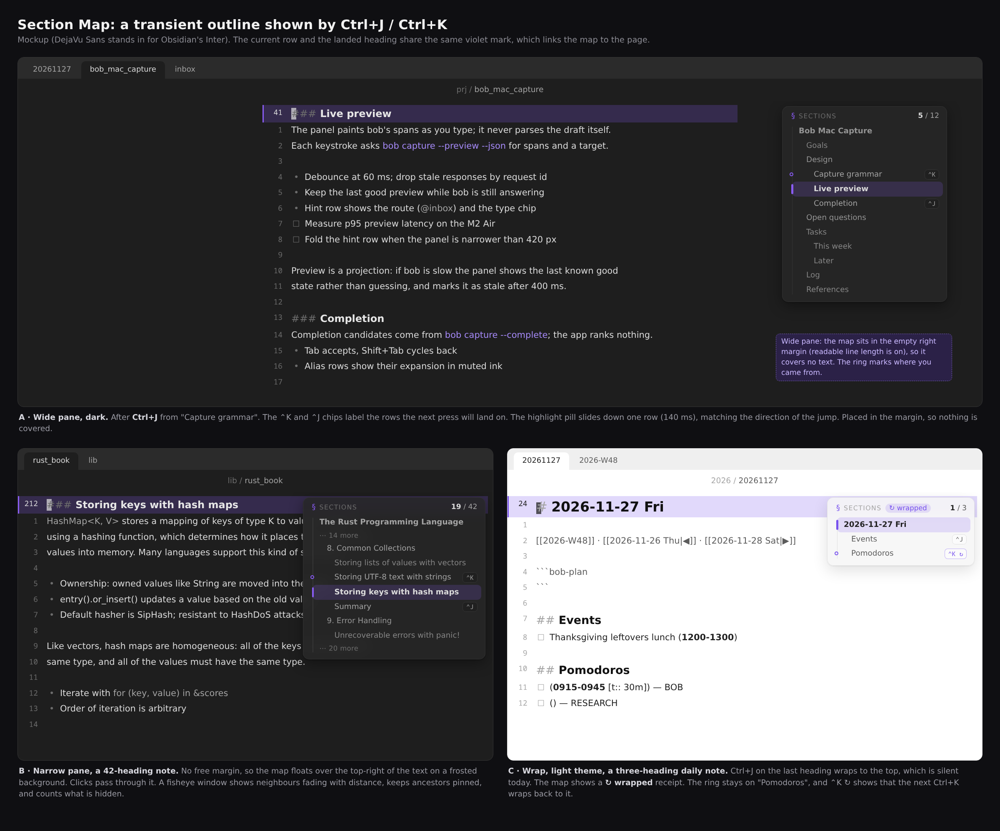
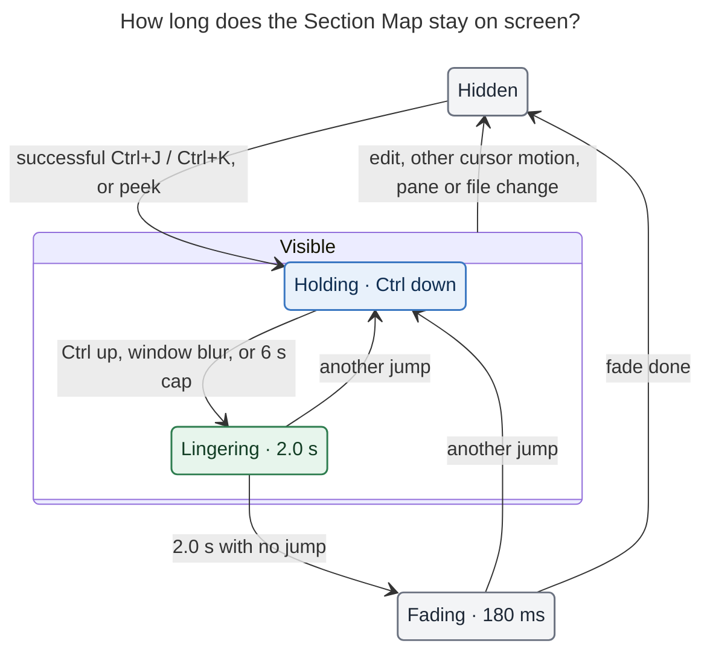

# Ctrl+J / Ctrl+K Section Map: consolidated design research

*Lead consolidation · 2026-11-27 · merges five independent swarm reports
(`__cdx`, `__cld`, `__grk`, `__mus`, `__gem`, siblings in this directory) plus the
lead's own verification against `bob-plugins@c2f73154` and the live vault config.*

## Bottom line

**Build it — all five researchers and the lead agree — but not as a literal
"outline of the file."** The consolidated recommendation is a **Section Map**: a
pane-anchored, read-only, gesture-scoped card that appears inside the editor pane
on every successful section jump, shows the note's headings (full outline for
typical notes, a window with pinned ancestors for long ones), marks where you are,
where you came from, and exactly where the next `Ctrl+J` / `Ctrl+K` will land,
makes the currently silent wrap-around explicit, and vanishes the moment you do
anything else. It never takes focus, keys, or clicks.

One sentence: *after a successful heading jump, paint a passive card in the
pane's right margin (top-right overlay when there is no margin) from the exact
same scanner and jump function the keys use, hold it through key-repeat and while
Ctrl stays down, fade it ~2 s after the last jump, and pair it with a brief
accent flash on the landed heading line.*

*Researcher cld's rendered mockup (headless Chromium, hand-written HTML/CSS; `^`
stands in for `⌃`). Panel A: margin mode with ⌃K/⌃J chips on the actual next
targets and a ring on the section just left. Panel B: windowed view of a
42-heading note with pinned ancestors. Panel C: the `↻ wrapped` receipt.*

## What happens today (verified)

Facts below were independently established by multiple researchers and
re-verified by the lead in `bob-plugins@c2f73154` and the live vault.

| Fact | Evidence |
|---|---|
| Two bindings reach the same commands: Vim normal mode via `nnoremap <C-j> :bob_next_header<CR>` → exmap → `obcommand`, **and** `hotkeys.json` binds Ctrl+J/K to `bob-navigation-hotkeys:jump-to-{next,prev}-section-header` for insert/non-Vim contexts. The plugin itself registers **no default hotkey**. | `~/bob/obsidian_vimrc.md:22-23,35-36`; `~/bob/.obsidian/hotkeys.json`; `490-plugin-lifecycle.js:427` |
| Targets are every ATX heading H1–H6 (up to three leading spaces, bare `#` counts) in the **live editor buffer**, skipping YAML frontmatter and fenced code. Setext headings and headings in quotes/callouts are excluded; a heading-shaped line inside a multiline HTML comment is currently *included* (cdx probe). | `SECTION_HEADER_RE`, `010-requires-and-config.js:20`; `getSectionHeaderLines`, `130-fences-and-status.js:13` |
| Next = first heading strictly after the cursor; previous = last heading strictly before it (so Ctrl+K from a section body goes to that section's *own* heading, not a sibling). **Jumps wrap silently at both ends**; a one-heading note jumps to itself. | `getSectionHeaderJumpLine`, `130-fences-and-status.js:58-81`; `scripts/test-navigation-hotkeys-section-nav.cjs` (9 tests pass) |
| On success the cursor lands at column 0 and the heading is pinned to the **top of the viewport** (`EditorView.scrollIntoView(..., { y: "start" })`), scrolling everything you just left off-screen. There is **no success feedback at all**; a global `Notice` fires only for zero-heading notes. | `jumpToSectionHeader`, `610-plugin-jumps-and-counted-keys.js:178-205`; `scrollEditorLineToTop`, `170-open-task-jump.js:687` |
| **Double-scroll frame:** `setEditorCursor` first calls `editor.scrollIntoView(..., true)`, then `scrollEditorLineToTop` immediately re-scrolls to `y: "start"`. `setEditorCursorWithoutScroll` already exists at `170-open-task-jump.js:673` and eliminates the extra frame. (gem's find; lead-verified.) | `170-open-task-jump.js:647-685` |
| Section jumps do **not** record Vim jump history, so `<C-o>` cannot return to the pre-jump line; the additive `recordJump(from, to)` API already exists. Counts (`3<C-j>`) are dropped by the `:obcommand` route. | `620-plugin-dash-and-vim-jumps.js:349`; `090-local-task-ids.js:301` |
| In Live Preview, `bob-ledger-tools` hides some headings via `Decoration.replace({ block: true })`: Property-Card-owned opening H1s and absorbed catalog H2s (`## Projects`, `## Areas`, …). Ctrl+J/K still jumps onto those invisible lines. (gem's find; decorations lead-verified.) | `bob-ledger-tools/src/240i-…:114`, `240wg-…:206` |
| The fragment that owns the jump is at **962 / 1000** lines — new code needs new fragments. Reusable in-house patterns exist: landing flash (`.bob-landing-flash`, 1.2 s, reduced-motion variant), lane/bank walk notices with a `↻ wrapped` chip, and the pane-local window-hint card. | `wc -l 610-…`; `styles.css:129-150`; `543-lane-walk-notice.js`; `549a-bank-walk-notice.js`; `473-window-hint-view.js` |

### What the vault says (cld's scan of all 7,043 notes)

- 4,236 notes have ≥ 2 headings; among notes with any, the median is **2**
  headings, p90 **4**, p99 18, max 178 (in `_generated`).
- Excluding `_generated`, **a 12-row card shows the full outline for 97.2%** of
  multi-heading notes (≤ 15 rows: 99.2%).
- Heading text is short (median 12 chars, p90 31), so a ~260–300 px card rarely
  truncates. Odd headings exist (bare `#`, link/table-shaped titles), so labels
  need cleaning and an *(untitled)* placeholder. Notes skip levels (H1 → H3,
  many H5s), so indentation must come from real nesting, not raw level.

## Is this a good idea?

**Yes — unanimously.** The disorientation is structural, not a habit problem.
Four mechanisms combine: (1) top-pinning scrolls the previous context off-screen;
(2) the target list is flat across H1–H6, so nothing says whether the next stop
is a child, sibling, or new top-level part; (3) wrap is silent — the single most
disorienting case; (4) nothing shows position (`5 / 12`) or what comes next. The
request asks for exactly what HCI literature names: **visual momentum** (Woods
1984 — carry your bearings across a view change) and **feedforward** (Vermeulen
et al., CHI 2013 — show what an action will do before you take it), plus
recognition-over-recall (Nielsen).

The survey evidence (eight community TOC plugins across cld/mus/gem/grk: Floating
TOC, Dynamic Outline, Quiet Outline, Beyond TOC, Heading Scroller, Subtle TOC,
Another Sticky Headings, Wave TOC; plus VS Code sticky scroll/breadcrumbs and
Notion's floating TOC) shows a real gap: **none shows an outline in response to a
next/previous-heading command.** They are all persistent, mouse-first chrome.
Bryan's navigation is keyboard-first and Vim-shaped; a transient map tied to the
jump gesture is the missing product, and it matches Bob's established
"zero pixels until the gesture" pattern (`decisions:similar-tasks-are-a-settled-heads-up`,
the window-prefix card, the lane-walk notices, the yank flash).

Three risks, each with a designed mitigation: **noise** (every press pops UI) →
compact card, margin placement, in-place updates, short life, no focus, no page
movement; **lying** (a map that disagrees with the jump is worse than none) →
build both from the same scanner and the same jump function, with a parity test;
**clutter in narrow panes** → translucent overlay, clicks pass through, one-line
compact mode.

## Requirement adjustments (explicitly called out)

1. **"Outline of the file" → full outline only when it fits; windowed map
   otherwise.** Full list up to **12 rows** (97% of real notes); above that, a
   ~7–9-row window around the current heading with up to 2 pinned ancestors and
   exact `⋯ N more` counts. A 30–178-heading note cannot be both brief and
   complete.
2. **Trigger on the commands, not the literal keys.** The HUD hooks the end of a
   successful `jumpToSectionHeader`, so palette invocations and remaps behave
   identically, and Ctrl+J's other owners — the successor-picker pin
   (`decisions:successor-jump-parks-the-walk`), schema/bank field jumps, insert-mode
   newline — are never touched. No capture-phase Ctrl+J listener.
3. **"Brief" = gesture-scoped, with numbers.** Show at 0 ms on a successful
   jump; update one card in place through key-repeat; pause while Ctrl is
   physically held (6 s failsafe); fade **~2.0 s** after the last jump; vanish
   immediately on edit, other cursor motion, or pane/file change. A pure
   hold-Ctrl lifetime fails the single-tap case (Ctrl is released in ~100 ms);
   a pure fixed timer either cuts off reading or lingers — so combine them.
4. **Keep wrap; make it loud.** Do not change `getSectionHeaderJumpLine`. Add a
   `↻ wrapped` receipt when a press wrapped and a `↻` mark on a chip whose next
   press *would* wrap. All five reports rate this release-blocking, not polish.
5. **Mark the actual next/prev targets and where you came from.** `⌃J`/`⌃K`
   chips go on the rows the next presses will land on — *computed by calling the
   jump function*, never by index ± 1 (Ctrl+K from a body goes to the current
   section's own heading; arithmetic gets this wrong). A hollow ring marks the
   section just left.
6. **Strictly passive in v1.** No focus, no clicks, no Esc/q/Ctrl+[ handling,
   `pointer-events: none`. Under `decisions:q-and-ctrl-bracket-mirror-esc`, any
   panel Esc closes must also close on `q` (consumed outside text controls) and
   `Ctrl+[` — which would steal `q` from Vim macro recording for ~2 s after
   every jump. Staying non-interactive keeps the map outside that rule entirely;
   generic "any other key or edit hides it" covers Esc without binding it. If a
   later version adds click-to-jump or focus, it then owes the full panel key
   contract.
7. **Pair the map with a landing flash and ship two companion fixes.** Reuse the
   existing `.bob-landing-flash` pattern (accent ink — this is navigation, not a
   yank) so the map row and the page line share one mark; switch the jump to
   `setEditorCursorWithoutScroll` + `scrollEditorLineToTop` to kill the
   double-scroll frame. The flash also covers the near-EOF case where the
   heading physically cannot reach the top of the viewport and the eye otherwise
   has no landing cue (gem).
8. **Add an unbound "peek" command.** Same card, no cursor movement, computed
   from the real cursor position; goes straight to the lingering state. Cheap
   once the map exists, and it is the untimed route WCAG's timing guidance wants
   alongside a transient display.
9. **Desktop, editor modes only in v1.** The commands are `editorCallback`s;
   reading-view and mobile parity are separate scope.
10. **Defer**: counted `3<C-j>` jumps, `<C-o>` burst history, click-to-jump,
    numbered row leaps (digits mean "press me" in Bob's grammar — a false
    affordance on a passive card), sticky breadcrumbs, and any persistent rail.
    Good follow-ups; not what "I lost my place" asks for.

## Alternatives considered and rejected

| Approach | Why it loses |
|---|---|
| Core Outline sidebar (already enabled) | Far from the eyes, costs sidebar space, closed/covered in splits, no wrap or next-target marking. Free baseline to compare against, not the answer. |
| Community floating/edge TOCs, sticky headings | Always-on, mouse-first chrome; different parser than the jump; fights Bob's HUD language. Sticky ancestors answer "where am I while scrolling," not "what will this key do." |
| Rich `Notice` toast (lane-walk style) | Right content, wrong surface: window-global bottom/top-right corner, stacks with other toasts, knows nothing about panes, replays animations on repeat. |
| CM6 cursor-anchored tooltip | Covers the exact text you are about to read (heading lands top-left); fiddly lifecycle under key-repeat. |
| CM6 top/bottom panel | Reflows the editor on every press. |
| Modal fuzzy heading picker | A different job (far jumps by name); steals focus and breaks the tap-tap-tap flow. Fine as a separate future command. |
| Stop wrapping / center the landing / smooth-scroll | Changes a tested contract, or trades away the jump's instant feel; the map plus a wrap chip keeps the loop and makes it honest. |

## Recommended design: the Section Map

### Content

- **Header row:** small-caps label, right-aligned `5 / 12` position (tabular
  numerals), a `↻ wrapped` receipt pill when the press wrapped, direction glyph.
- **Rows:** one per heading, indented by **real nesting depth** (outline stack —
  H1 → H3 indents one step, clamped at 4 steps), labels cleaned (strip closing
  `#`s, unwrap `[[target|alias]]` and `[text](url)`, strip emphasis/backticks
  and trailing `^block-id`, keep `#tags` and emoji — they are landmarks; empty
  heading → *(untitled)*; insert via `textContent` only).
- **Current row:** accent tint + 2–3 px accent rail bar + semibold; never
  truncated (may wrap to 2 lines). Identity is the heading's *position*, never
  its text — duplicate `## Notes` rows stay distinct.
- **From row:** hollow accent ring on the section just left; the highlight
  slides from-row → current-row (~140 ms) so direction of travel is visible.
- **Chips:** quiet keycap chips (`⌃J` / `⌃K`, or `↑`/`↓` if key labels can't be
  resolved reliably under remapping) on the rows `getSectionHeaderJumpLine(±1)`
  returns from the landing; `↻` + accent ink when that press would wrap.
- **Windowing** (> 12 headings): a contiguous window around the current heading,
  biased toward the direction of travel, up to 2 pinned ancestors from outside
  the window, exact `⋯ N more` counts, deterministic from (index, direction).
- **Edge states:** one heading → `1 / 1` with an `only section` note (honest
  no-op, no wrap celebration); zero headings → keep today's `Notice`, no card;
  cursor above the first heading → no current row, `– / 12`.

### Placement

Mounted in the jumping `MarkdownView`'s own `view-content`, built against that
view's `ownerDocument` (pop-out windows; Obsidian warns `document` can be the
wrong window). One map at a time; it belongs to the pane that ran the command.

1. **Margin mode** when the readable-line-length gutter has ≥ card width + margin:
   the card sits in the empty right margin, level with the landed heading —
   covering zero text. (Readable line length is on in the vault.)
2. **Overlay mode** otherwise: top-right of the pane, 12 px inset,
   `clamp(200px, 30%, 300px)` wide, ~86–92% opaque surface with backdrop blur,
   `pointer-events: none`. Top-right is correct because `scrollEditorLineToTop`
   puts the landed heading top-*left*; dodge any visible `Notice` overlap.
3. **Compact mode** (pane < ~420–520 px): a one-line strip —
   `↑ Prev title · ● Current 5/12 · ↓ Next title`.

Choose placement once per visible sequence; recompute on pane resize/migration
only. Never chase the caret.

### Lifecycle

*The map belongs to the jump gesture: it holds while Ctrl is physically down
(capped at 6 s, released by window blur so a missed keyup can't pin it),
lingers 2.0 s after the last jump — enough for two or three label fixations —
and disappears the instant you do anything else. Peek without Ctrl goes straight
to Lingering. Every repeat press re-renders the same card in place; an expiry
timer from generation N is a no-op after generation N+1.* (Rendered with
`@mermaid-js/mermaid-cli@12.0.0`, PDF config: 605.9 × 821 px, 100% fit.)

Dismissal details: "other cursor motion" is a selection change to a line the
jump did not set, detected via an editor update listener with a
self-caused-dispatch guard so the jump's own selection event doesn't dismiss the
card. Mouse-wheel scrolling does **not** dismiss — the map describes the cursor,
not the viewport. Process every command normally (including OS key-repeat);
coalesce only the visual update to the latest result per frame — never debounce
navigation itself. Timing constants ship as named constants, tuned after a week
of real use, not argued in advance.

### Visual and motion spec

Obsidian theme variables only (`--background-secondary`/`--background-primary`
mix, `--background-modifier-border`, `--interactive-accent`, `--text-muted`,
`--shadow-s`, `--radius-l`, `--font-ui-smaller`, tabular nums for the counter);
no new palette, tested in light and dark. Current/prev/next titles get strong
readability; farther rows fade with distance. Motion: ~90 ms ease-out entrance,
~140 ms highlight slide between rows (DOM rows reused, keyed by line, so CSS
transitions retarget under autorepeat), ~120 ms crossfade + chip pop on wrap (a
full-list slide would read as a scroll), ~180 ms exit fade. No entrance replay
per press, no progress/countdown bars (peripheral anxiety), no smooth-scrolling
the editor. `prefers-reduced-motion`: opacity only, read from the view's own
window. Landing flash: reuse the existing accent line-decoration pattern
(`676-plugin-open-notes-uri.js`) with per-window ownership and timer cleanup.

### Accessibility

`role="status"` / `aria-live="polite"` with one coalesced sentence after rapid
presses settle — "Section 5 of 12, Implementation; next Editor integration;
previous Reading" — never a re-announcement of every row per repeat. Current-row
identity carried by marker + weight, not color alone. The peek command and an
optional display preference (**Brief · Until next editor action · Off**) provide
the untimed route; full plain-text labels stay in the accessible representation.

### Reliability rules

1. **Jump first, map second.** The card renders in `try/catch` after cursor and
   scroll succeed; a render failure can never block, alter, or undo a jump, and
   never becomes a toast.
2. **One scan per press, one source of truth.** The same `lines` array picks the
   target and builds the model; chips call the real jump function. A parity
   property test enforces it: for random documents and every cursor line, chip
   rows ≡ `getSectionHeaderJumpLine(±1)`.
3. **Stale state is impossible.** Any document change hides the map. Cache the
   heading index per editor keyed by the immutable CM6 `state.doc` reference
   (O(1) on key-repeat; never key by file path or mtime — unsaved panes
   differ); rescan in the generic-editor fallback.
4. **Pane-local singleton with full teardown** via `register*` on unload, leaf
   change, file-open, and layout change; `editor.cm` access stays isolated and
   feature-detected (it is a documented but untyped boundary); no vault writes,
   no settings writes, no network.
5. **Scanner scope is explicit.** v1 shows exactly the navigable set the keys
   use (ATX, fence/frontmatter-aware). The HTML-comment inclusion and any
   Setext/callout policy change are separate, test-covered scanner decisions —
   changing which lines the keys visit is a behavior change and must change
   navigation and display together.

## Known divergences deferred to phase 2 (deliberate)

- **Hidden and folded headings** (gem's discovery, lead-verified): Live Preview
  jumps can land on headings `bob-ledger-tools` has hidden (Property-Card H1s,
  absorbed catalog H2s) or inside folded sections. Real defect — but *fixing it
  changes which lines Ctrl+J visits*, needs CM6 decoration/fold inspection
  verified in a live Obsidian probe, and deserves its own decision. v1 keeps
  strict parity with today's targets so the map never lies about them.
- **Counted jumps** (`3<C-j>`) reusing the existing pending-Vim-count reader,
  plus a relative-index gutter in the map; requires rerouting around the
  count-dropping `:obcommand` nnoremap.
- **Burst-coalesced `<C-o>` history** via the existing `recordJump` API: one
  entry per jump burst so a single `<C-o>` returns to the pre-peek line.
- **Click-to-jump / focusable map** — then, and only then, the
  Esc/q/Ctrl+[ panel contract applies.
- **Reading-view parity** via `metadataCache` headings + preview scroll.

## Where the five reports disagreed, and the resolutions

| Question | Spread | Resolution |
|---|---|---|
| How Ctrl+J/K is bound | grk: vimrc only; mus: hotkeys only; cld: both | **Both** (lead-verified): vimrc nnoremaps for normal mode *and* `hotkeys.json` entries; the plugin registers no default. Hooking the command callback makes the question moot. |
| Row budget | 5 (mus) · 7 (cdx) · 8+rail (grk) · 12/8 (cld) · 12/9 (gem) | **12 full / ~8 windowed**, because cld's vault scan is the only actual data: ≤12 rows covers 97.2% of real multi-heading notes, and the median note has 2–4 headings anyway. |
| Dwell time | 1.2 s (grk) · 1.5 s (cld, mus) · 2.0 s (gem) · 2.4 s (cdx) | **2.0 s + Ctrl-hold pause + 6 s cap**, as a tunable constant. gem's argument stands: hold-only fails single taps; timer-only fails chained scanning. All numbers are prototype defaults, not usability findings. |
| Interactivity in v1 | passive (cdx, cld, grk) vs. click + Esc (mus) and click + hover + passive Esc (gem) | **Passive.** `decisions:q-and-ctrl-bracket-mirror-esc` makes any Esc-closable surface owe `q` (consumed outside text controls — breaking Vim macros) and `Ctrl+[`. Generic activity-dismissal covers Esc without binding it. |
| Placement | top-center (mus) vs. top-right/margin (others) | **Margin, then top-right overlay, then compact strip.** The landing pins the heading top-left; top-center covers the first body lines, the right margin covers nothing. |
| Empty-note behavior | in-card empty state (cld) vs. keep the `Notice` (mus, gem, cdx) | **Keep today's `Notice`** — no card implies no card chrome for a note with nothing to map; zero behavior change. |
| Hidden-heading scope | gem: fix in v1 | **Defer** (see above): target-set changes ride their own decision, not the HUD's coattails. |

## Implementation sketch (for a planner)

All in `bob-plugins/plugins/bob-navigation-hotkeys` (committed fragment build —
edit `src/` fragments, `npm run build`, never hand-edit `main.js`; deploy with
`bob plugins sync`). No bob-cli change, no JSON contract, no release-train
involvement.

| Piece | Home | Notes |
|---|---|---|
| Pure model | new `src/13x-section-map-model.js` | `getSectionHeadingEntries(lines)` (same walk as `getSectionHeaderLines`, plus level/label), `cleanSectionHeadingLabel`, `buildSectionMapModel(lines, {cursorLine, fromLine, direction, wrapped, maxRows})` → rows/chips/window/counts/ariaLabel. Zero DOM, zero Obsidian — node-testable. |
| View/controller | new `src/61x-section-map-view.js` | Mount, placement modes, in-place DOM reconciliation, generation-guarded timers, Ctrl keyup + blur listeners, update-listener dismissal, full teardown. Model the painter on `473-window-hint-view.js`. |
| Wiring | move/wrap `jumpToSectionHeader` into the new fragment (610 is at 962/1000 lines) | Compute `wrapped`, switch to `setEditorCursorWithoutScroll` + `scrollEditorLineToTop`, dispatch landing flash, call the controller. Plus an unbound `show-section-map` peek command registered in `490-plugin-lifecycle.js`. |
| CSS | `.bob-section-map` block in `styles.css` | Theme variables only; reduced-motion variant alongside the existing flash rules. |
| Tests | new model test + parity property test; keep `test-navigation-hotkeys-section-nav.cjs` green; headless-Chromium visual preview (light/dark, wide/narrow, wrap, 42-heading fixture); real-Obsidian CDP e2e per `docs/develop/validation.md` (both Vim normal and insert routes, dismissal cases, unchanged note hashes) | The parity test is the single strongest guard: the map can never disagree with the keys. |
| Docs | a "Section map" subsection in `docs/bob-navigation-hotkeys.md` (read the `docs` reference memory first) | — |

Performance is a non-issue at vault scale with the doc-keyed cache (cdx measured
~0.3 ms for a 1,000-line scan, ~2.3 ms at 10,000 on this host; the cache makes
repeats a pointer compare), but the first jump after an edit should stay in the
test matrix.

If this ships, record a decision — e.g. *"Section jumps show a gesture-scoped,
passive Section Map built from the jump's own scanner; it never takes focus or
keys"* — so a later change can't quietly make it modal.

## Open questions for Bryan (non-blocking)

1. Chips as key names (`⌃J`/`⌃K`) or plain arrows? (Arrows are remap-proof;
   key names are more instructive.)
2. Show the map on tiny 2–3-heading daily notes too (default: yes — it is what
   makes the wrap visible there), or only from N headings up?
3. Landing flash on every jump: welcome, or too busy next to the map?
4. Appetite for phase 2 (counted jumps + relative-index gutter, `<C-o>` burst
   history, hidden/folded-heading handling) after a week with v1?

## Sources

**Local (lead-verified):** `bob-plugins@c2f73154` —
`plugins/bob-navigation-hotkeys/src/{010,090,130,170,473,490,543,549a,610,620,676,687}-*.js`,
`styles.css`, `scripts/test-navigation-hotkeys-section-nav.cjs`;
`bob-ledger-tools/src/{240i,240wg}-*.js`; vault `~/bob/obsidian_vimrc.md`,
`~/bob/.obsidian/{hotkeys,core-plugins}.json`. Memory:
`decisions:q-and-ctrl-bracket-mirror-esc`, `decisions:successor-jump-parks-the-walk`,
`decisions:similar-tasks-are-a-settled-heads-up`.

**From the sibling reports:** cld's full-vault heading scan and HTML/CSS mockup
(`ctrl_jk_section_map_mockup__cld.png`); grk's keymap-ownership and lifecycle
figures (`keymap-routing.png`, `hud-lifecycle.png`, `hud-window.png`); cdx's
scanner edge-case probes and timing measurements; gem's hidden-heading,
double-scroll, and jump-history findings; mus's precedent inventory.

**Web (as cited in the sibling reports):** Obsidian developer docs (viewport,
editor extensions, pop-out windows), CodeMirror syntax-tree reference, Obsidian
help/community pages for the surveyed outline plugins, VS Code code-navigation
docs, Nielsen's usability heuristics, WCAG Timing Adjustable / Status Messages /
animation-from-interactions, Woods 1984 (visual momentum), Furnas 1986 (fisheye
views), Vermeulen et al. 2013 (feedforward), Klein & Bederson 2005 (animated
scrolling; secondary summary).
