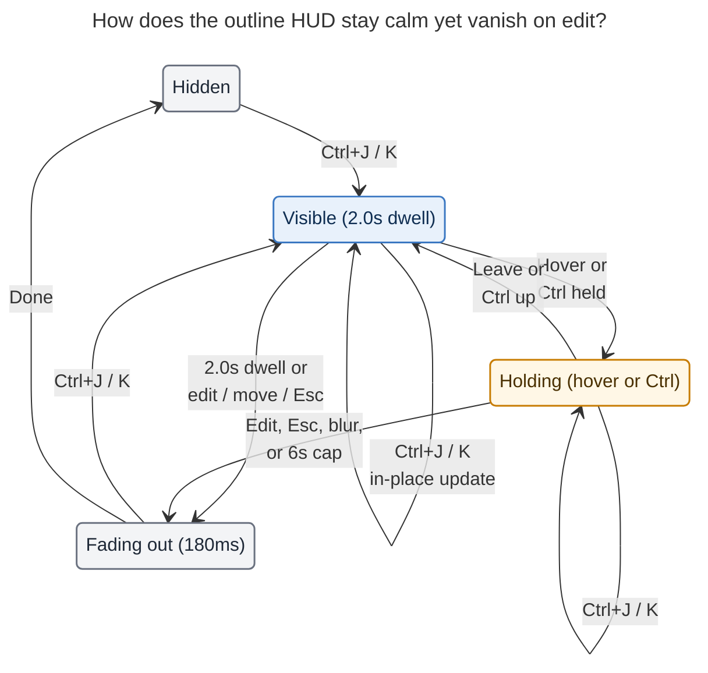

# Ephemeral Section-Outline HUD for `<ctrl+j/k>` in Obsidian

*Research report · `bob-navigation-hotkeys` (`bob-plugins`) · 2026-11-27*

---

## Executive Summary

**Verdict:** The core idea—displaying a brief, non-intrusive outline of the note's Markdown sections when `<ctrl+j>` / `<ctrl+k>` is pressed—is **genuinely strong** and solves the single biggest ergonomics gap in keyboard section navigation. Keeping the outline **ephemeral and jump-triggered** beats persistent sidebars and always-on floating TOCs in a multi-split, Vim-first Obsidian workflow.

**Critical critique:** An outline HUD *by itself* leaves four closely related causes of spatial disorientation unfixed in the current `bob-navigation-hotkeys` implementation:

1. **Silent boundary wrapping** (`getSectionHeaderJumpLine` wraps from last heading to first without any visual cue).
2. **Near-EOF scroll clamping with no target highlight** (`scrollEditorLineToTop` cannot push late headings to the top edge, so the eye loses where the cursor actually landed).
3. **Bob Live Preview hidden headings** (`bob-ledger-tools` hides title-owned opening H1s and absorbed catalog H2s such as `## Projects` / `## Areas` via CM6 `Decoration.replace({ block: true })`, yet `<ctrl+j/k>` still jumps straight into them).
4. **No burst `<C-o>` jump recording or `N<ctrl+j/k>` counts** (peeking three sections ahead leaves no single `<C-o>` return ticket to where you were editing).

**Recommended solution:** Implement a **pane-anchored, non-modal, ephemeral Section Outline HUD** directly inside `bob-navigation-hotkeys`, modeled on the proven architecture of `Ctrl+W` window keys (`473-window-hint-view.js` + `687-plugin-window-prefix.js`), rather than reusing Obsidian's global `Notice` toast queue. Pair it with a brief CM6 heading landing flash, explicit `↻ wrapped` feedback, fold/hidden-heading awareness, `N<ctrl+j/k>` count support, and burst-coalesced `<C-o>` jump-history recording.

---

## 1. Root-Cause Diagnosis: Why `<ctrl+j/k>` Loses Your Place Today

In `bob-plugins` (`bob-navigation-hotkeys` v2.107.14), `<ctrl+j>` and `<ctrl+k>` invoke `jump-to-next-section-header` and `jump-to-prev-section-header` (`plugins/bob-navigation-hotkeys/src/490-plugin-lifecycle.js:426-436`), which execute `jumpToSectionHeader(editor, direction)` (`src/610-plugin-jumps-and-counted-keys.js:178-205`):

1. `getSectionHeaderLines(lines)` (`src/130-fences-and-status.js:13-56`) splits `editor.getValue()`, skips YAML frontmatter and `` ``` `` / `~~~` code fences, and matches `SECTION_HEADER_RE = /^ {0,3}#{1,6}(?:[ \t]|$)/` (`src/010-requires-and-config.js:20`).
2. `getSectionHeaderJumpLine(lines, cursorLine, direction)` (`src/130-fences-and-status.js:58-81`) picks the next/previous heading line, silently wrapping at document boundaries.
3. `setEditorCursor(editor, { line: targetLine, ch: 0 })` moves the cursor (calling `editor.scrollIntoView` internally), immediately followed by `scrollEditorLineToTop(editor, targetLine)` (`src/170-open-task-jump.js:687-720`), which dispatches `EditorView.scrollIntoView(docLine.from, { y: "start" })`.

This produces **five distinct disorientation mechanisms**:

| # | Mechanism | What happens in practice | Codebase source |
| --- | --- | --- | --- |
| 1 | **Keyhole scrolling** | `y: "start"` pushes the previous heading off the top of the pane while long sections push the next heading off the bottom. You lose both sibling context ("what's before/after?") and parent hierarchy ("which `##` owns this `###`?"). | `170-open-task-jump.js:713` |
| 2 | **Silent boundary wrap** | Pressing `<ctrl+j>` on the last section teleports to the first section with zero signal that you wrapped. In repetitive notes (e.g., multiple `### Notes` or `### Page N` sections), wrapping feels indistinguishable from advancing. | `130-fences-and-status.js:71, 80` |
| 3 | **Hidden / absorbed Bob headings** | In Live Preview, `bob-ledger-tools` hides recognized opening H1s (`propertyCardOwnTitleInEditor`, inclusive reveal on selection touch) and hides absorbed catalog H2s (`## Areas`, `## Projects`, `## Notebooks`, `## Albums`, `## Records` via `Decoration.replace({ block: true })` + `atomicRanges`, strict-inside reveal). Raw-text `<ctrl+j/k>` jumps directly onto these hidden headings—either flashing raw H1 Markdown open above the Property Card or parking invisibly at an absorbed cabinet boundary (`ch: 0 === range.from`). | `bob-ledger-tools/src/240i-plugin-property-card-title-ownership.js:102-115`; `240wg-plugin-cabinet-absorb-editor.js:76-89, 206` |
| 4 | **Near-EOF scroll clamp + no landing cue** | Near the bottom of a note, `scrollIntoView(..., { y: "start" })` clamps at max scroll. The *previous* heading stays at the top of the viewport while the cursor quietly moves mid-screen with no flash. | `610-plugin-jumps-and-counted-keys.js:198-203` |
| 5 | **No `<C-o>` burst anchor or counts** | `setEditorCursor` dispatches a CM6 selection change rather than a Vim jump motion, so `<C-o>` does not return to the pre-jump line inside the section you left. Nor does `N<ctrl+j>` work (unlike `N<Ctrl+Shift+J/K>`). | `610-plugin-jumps-and-counted-keys.js:178-205, 275-353` |

Notice also a subtle frame-jitter bug on line 198–203: `setEditorCursor` calls `editor.scrollIntoView(..., true)` (center-ish) right before `scrollEditorLineToTop` scrolls to `y: "start"`. Switching to the already-available `setEditorCursorWithoutScroll` (`170-open-task-jump.js:673`) followed by `scrollEditorLineToTop` eliminates that double-scroll frame.

---

## 2. Critique of the Plan & Alternative Approaches

### Is an ephemeral jump-triggered outline a good idea?

**Yes—with clear scope boundaries.** A transient outline works specifically because Bryan's trigger is *already* an intentional, episodic navigation gesture (`<ctrl+j/k>`). You don't pay permanent screen real estate or visual clutter while reading and writing; you pay ~2 seconds of quiet peripheral chrome *only* when you actively ask to move across sections.

Where naive implementations of this idea fail is **over-rendering** (dumping 50 headings on screen), **wrong primitive choice** (putting a pane-local map into Obsidian's global top-right `Notice` stack), **bad lifecycle timing** (flashing on every rapid keypress or lingering after you start typing), and **accidental modality** (stealing focus or keystrokes).

### Comparison of six architectural approaches

| Approach | How it works | Strengths | Weaknesses in Bob's workflow | Verdict |
| --- | --- | --- | --- | --- |
| **1. Core Outline / Quiet Outline sidebar** | Right sidebar stays open with heading tree | Always visible; supports drag/fold/search; zero custom plugin code | Permanently consumes ~240 px (painful in multi-split layouts); sits at the far edge of the *window*, not the active split; no `<ctrl+j/k>` wrap or Bob hidden-heading awareness | **Reject as primary** (good optional companion for heavy restructuring) |
| **2. Always-on Floating / Notion-style Edge TOC** (e.g., *Floating TOC*, *Ink Floating TOC*) | Thin bars pinned permanently to editor right edge; expands on mouse hover | Tiny idle footprint; constant vertical progress cue | Hover-to-expand is mouse-first and useless for Vim `<ctrl+j/k>`; collapsed anonymous bars do not tell you *which* section is before/after; always-expanded TOC occludes narrow splits | **Reject** |
| **3. Sticky Breadcrumb / Status-Bar Strip** | 1-line bar showing `H1 › H2 › H3` or `← Prev · Curr · Next →` | Zero editor occlusion; works during ordinary scrolling | Parent breadcrumbs omit *siblings* (the exact pain point); a 1-line prev/curr/next strip truncates badly and loses vertical hierarchy; Bob's status bar already carries `[[ s w n b ]]`, the walker footer, and the Highlights chip | **Reject** |
| **4. Modal Fuzzy Heading Picker (`Modal`)** | `<ctrl+j/k>` (or a new chord) opens a centered modal outline requiring `Enter` / `Esc` | Fast random access in 50-heading documents | Steals focus, dims the note, and destroys the 1-keystroke muscle memory of `<ctrl+j>` + immediately edit | **Reject for `<ctrl+j/k>`** (Obsidian already has heading quick-jump) |
| **5. Rich Obsidian `Notice` Toast** (like `]w` / `]b` walk notices) | `new Notice(fragment)` styled like `.bob-nh-notice` | Existing Bob pattern; tiny DOM boilerplate | **Wrong anchor:** `.notice-container` is global window top-right, detached from a left/center split. **Stacks/collides** with sync, task, and walk notices. **Flickers on rapid repeat:** `.hide()` + `new Notice()` replays enter/exit animations on every tap. No clean hover-hold or instant fade on typing | **Reject** |
| **6. Pane-Anchored Ephemeral Floating HUD** (like `Ctrl+W`'s `createWindowHintHost`) | Reused DOM card anchored to the active leaf's `.view-content` top-right, zero focus steal | Hugs the active split at the top heading's eye line; zero flicker during rapid bursts; notice-aware; theme-native; supports hover-hold + click-to-jump + instant dismiss on edit | Slightly more DOM/positioning code (~250–300 lines of pure view + controller), though `473-window-hint-view.js` already establishes the exact pattern in this plugin | **Recommended** |

### Why NOT an Alt-Tab "Hold-Ctrl to Keep Open" Latch as the primary dismiss rule?

It is tempting to design `<ctrl+j/k>` like `Cmd+Tab`: hold `Ctrl`, tap `j`/`k`, release `Ctrl` to dismiss. **That fails the 80% single-tap case.** When you tap `<ctrl+j>` once to jump to the next section and immediately release `Ctrl`, releasing `Ctrl` happens in ~80–120 ms—far too fast to read neighboring section titles! You would still need a ~2 s post-release dwell timer anyway. Worse, OS shortcuts and key remappers can occasionally drop a `Control` `keyup` event across focus transitions.

**Better synthesis:** Use a **2.0 s dwell timer** as the primary auto-hide, *augmented* by a **Ctrl-hold pause** (if `Ctrl` stays physically held down while you pause to decide whether to tap `j` again, pause the dwell timer until `keyup` or a 6 s failsafe cap). That gives you hold-to-peek for free without breaking quick single taps or risking a stuck overlay.

---

## 3. Justified Adjustments to the Requirements

The table below calls out every adjustment recommended beyond the initial brief and why each earns its complexity.

| # | Original requirement | Recommended adjustment | Justification |
| --- | --- | --- | --- |
| **A1** | "Display an outline of the file's markdown sections" | **Adaptive sliding window + pinned ancestor trail + right-edge hairline progress spine.** Show the full outline when `total ≤ 12`; above 12 headings, show a balanced 9-row window around the active heading, pin any scrolled-off ancestor headings (`↳ H2 › H3`) at the top, show `··· N above/below` counts, and render a 6 px full-file progress spine on the right edge. | Long reference notes (Highlights annotations with 30–80 `### Page N` headings), research reports, and `dash.md` would otherwise overflow the pane vertically and stop being scannable at a glance. |
| **A2** | "Brief, non-intrusive" | **Activity-aware smart lifecycle instead of a fixed blind timer.** Open immediately on jump, update *in place* with zero re-animation during rapid bursts, dwell 2.0 s after stillness, pause on deliberate hover or held `Ctrl`, and fade out immediately (180 ms) as soon as you edit, move the cursor, switch panes/files, blur the window, or press `Esc`. | A fixed 4 s timer feels intrusive the instant you start typing; a fixed 0.8 s timer vanishes before you can read a 10-heading outline. Activity-aware dismissal solves both. |
| **A3** | Outline HUD alone | **Pair the HUD with a 700 ms CM6 landing line flash** (reusing `.bob-landing-flash`'s accent left rail + soft tint fade) **and explicit boundary cues** (`↻ wrapped to top/bottom` pill + subtle edge bump; `only section` badge on 1-heading notes). | Fixes near-EOF scroll clamping (where the heading cannot reach the top of the viewport) and eliminates silent wrap teleportation—both direct causes of losing your place. |
| **A4** | Scan all Markdown headings | **Respect Live Preview hidden headings and folded subtrees.** Skip headings inside CM6-folded parent sections (showing a subtle `▸ +N` badge on the collapsed parent) and skip headings hidden by `bob-ledger-tools` title ownership or absorbed cabinets in Live Preview (while keeping all headings in Source mode). | Jumping into a hidden Property-Card H1 flashes raw source open above the card; jumping into an absorbed `## Projects` cabinet strands the cursor at an invisible boundary; jumping into a folded archive explodes your folds open. |
| **A5** | Plain 1-step `<ctrl+j/k>` | **Add `N<ctrl+j/k>` Vim count support, burst-coalesced `<C-o>` jump-history recording, and double-scroll removal (`setEditorCursorWithoutScroll`).** | Mirrors `N<Ctrl+Shift+J/K>` already in `bob-navigation-hotkeys`. Coalescing one `<ctrl+j/k>` burst into a single `recordJump(origin, settledDest)` lets **one `<C-o>`** return straight to the line you were working on before peeking ahead. |
| **A6** | Unspecified interaction mode | **Keep the HUD strictly non-modal (zero focus steal, no keycap digits, no `q` interception).** | Preserves zero-latency Vim flow. Notably, under `decisions:q-and-ctrl-bracket-mirror-esc`, `q` and `Ctrl+[` mirror `Esc` on every *panel* that `Esc` closes—so a *passive status HUD* must NOT push a modal keymap scope or hijack `q` (which records a Vim macro in normal mode). Passive `Esc` / `Ctrl+[` can dismiss the HUD in capture phase *without* `preventDefault()` (mirroring `handleClearSearchHighlightKeydown` at `610-plugin-jumps-and-counted-keys.js:750-782`). Also, omit bare `1..9` row numbers: in Bob's visual grammar (`Ctrl+W`, Copy Card, Cabinets), row digits signal "press this key to jump," which would be a false affordance on a non-modal HUD. |
| **A7** | Editor-only (`editorCallback`) | **Phase 2: Reading-mode parity** via `checkCallback` + `metadataCache.getFileCache(file).headings` + `view.previewMode.applyScroll(line)`. | Lets the exact same `<ctrl+j/k>` habit and outline HUD work when reading Prose and Reference notes in Reading view without complicating Phase 1. |

---

## 4. Visual & Interaction Design Specification

The design extends `bob-navigation-hotkeys`'s existing visual language (`.bob-wp-card` in `styles.css:5419-5866`, `.bob-nh-notice` in `styles.css:1688-1900`, and `.bob-landing-flash` in `styles.css:129-150`), built exclusively on Obsidian CSS variables so it renders natively in light, dark, and community themes.

### 4.1 Spatial Anchoring & Collision Avoidance

- **Anchor:** `position: fixed`, aligned to the **top-right corner of the active leaf's `.view-content`** (`top = paneRect.top + 12px`, `right = viewportWidth - paneRect.right + 14px`), mounted on `view.containerEl.ownerDocument.body` (one host per `Document` via `WeakMap`, so popout windows work seamlessly).
- **Why top-right of the active pane:**
  1. **Zero vertical eye travel:** `scrollEditorLineToTop` lands the heading at the top-left of the pane; the HUD sits in the exact same horizontal eye band.
  2. **Natural Readable Line Length synergy:** In wide panes with Obsidian's centered readable column (~700 px), the right margin is empty whitespace—the HUD covers **zero characters of text**.
  3. **Multi-split clarity:** In a 2- or 3-split workspace, the HUD hugs the exact pane you are navigating, never flying off to a distant corner of the monitor.
  4. **Zero collision with other Bob chrome:** `bob-wp-card` (`Ctrl+W`) sits bottom-center; status-bar items (`[[ s w n b ]]`, walker footer, Highlights chip) sit along the bottom edge.
- **Notice-stack avoidance:** Right before positioning, inspect visible `.notice-container .notice` elements in the same `Document`. If any visible notice's bounding box intersects our card's horizontal band and overlaps its top edge (common in a single-pane or rightmost-split window right after a `]s` / `]w` / sync toast), push `top` down to `maxOverlapBottom + 8px` (clamped within the pane).
- **Responsive narrow/mobile clamp:** When `paneRect.width < 520px` (narrow split or mobile), switch to `.is-compact`: width `min(220px, paneWidth - 20px)`, max 5 visible rows (`2 above + active + 2 below`), and slightly tighter padding.

### 4.2 Visual Mockups (Four Key States)

#### State 1 — Standard note (`≤ 12` headings, full outline shown)

Notice how heading depth is **relative-normalized** (`minLevel = 2`, so `##` sits at depth 0 without wasted left padding) and the active row carries a 2.5 px accent left rail, soft accent tint, bold ink, and a fleeting direction glyph (`↓` / `↑`). Immediate `±1` neighbors stay crisp; farther rows recede gently.

```text
┌─ Active Editor Pane ─────────────────────────────────────────────────────────────┐
│ ## Pomodoros                                     ┌─────────────────────────────┐ │
│ ┃ (700ms subtle accent landing flash)            │ ☰  OUTLINE            3 / 6 │ │
│                                                  │ ─────────────────────────── │ │
│ - [/] (09:00-09:25) — BUILD                      │   Intentions                │ │
│   - [[bob-cli#^a1|Section HUD research]]         │   Events                    │ │
│ - [ ] () — REVIEW                                │ ▎ Pomodoros               ↓ │ │
│                                                  │     Morning block           │ │
│                                                  │   Notes                     │ │
│                                                  │   End of day                │ │
│                                                  └─────────────────────────────┘ │
└──────────────────────────────────────────────────────────────────────────────────┘
```

#### State 2 — Long document (`> 12` headings, sliding window + pinned ancestor + progress spine)

When a deep subsection's parent scrolls out of the 9-row window, a muted ancestor trail (`↳`) pins at the top. A 6 px right-edge **progress spine** shows the full-file track, the visible window thumb (`▒`), and the exact active heading position (`●`), while folded sections show `▸` (and `+N` when concealing skipped sub-headings).

```text
┌──────────────────────────────────┐
│ ☰  OUTLINE               14 / 38 │
│ ↳ Architecture › Storage         │  ← pinned ancestor (only when scrolled off)
│ ──────────────────────────────── │
│ ··· 9 above                    │ │
│   │ Indexing pipeline          │ │
│   │ Cache invalidation         ▒ │  ← right-edge 6px progress spine
│ ▎ │ Write-ahead log          ↓ ● │  ← accent dot at 14/38 along full file
│   │   Crash recovery           ▒ │
│   │   Compaction          ▸ +4 ▒ │  ← folded section concealing 4 sub-headings
│   │ Benchmarks                 ▒ │
│   Query planner                │ │
│ ··· 21 below                   │ │
└──────────────────────────────────┘
```

#### State 3 — Boundary wrap (`↻ wrapped`) and Single-section note

```text
┌──────────────────────────────────┐     ┌──────────────────────────────────┐
│ ☰  OUTLINE  [↻ wrapped]    1 / 6 │     │ ☰  OUTLINE  [only section] 1 / 1 │
│ ════════════════════════════════ │     │ ──────────────────────────────── │
│ ▎ Intentions                   ↓ │     │ ▎ Notes                          │
│   Events                         │     └──────────────────────────────────┘
│   Pomodoros                      │
│   ···                            │
└──────────────────────────────────┘
  (top border pulses 160ms accent)
```

#### State 4 — Narrow split (`paneWidth < 520px`, `.is-compact`)

```text
┌─────────────────────────┐
│ OUTLINE           3 / 6 │
│ ─────────────────────── │
│   Events                │
│ ▎ Pomodoros           ↓ │
│     Morning block       │
│   Notes                 │
└─────────────────────────┘
```

### 4.3 Typography, Color, Sanitization, and Motion Tokens

- **Surface & elevation:**
  - `background: color-mix(in srgb, var(--background-primary) 92%, transparent);` with `backdrop-filter: blur(10px) saturate(1.15);` (fallback `var(--background-primary)`).
  - `border: 1px solid var(--background-modifier-border); border-radius: 10px;`
  - `box-shadow: var(--shadow-s);` (elevated cleanly without heavy modal chrome), `z-index: var(--layer-popover, 30);`.
- **Header (`24px` height):**
  - Left icon (`list-tree`, 12 px, `var(--text-faint)`) + label `Outline` (`10.5px`, `font-weight: 650`, `letter-spacing: 0.06em`, `text-transform: uppercase`, `color: var(--text-faint)`—matching `.bob-wp-col-header`).
  - Optional wrap pill (`↻ wrapped`) styled with `.bob-nh-notice-chip.is-info` tokens (`--text-accent` tint + border).
  - Right counter `3 / 6` (`11px`, `var(--font-monospace)`, `font-variant-numeric: tabular-nums`, `color: var(--text-muted)`).
- **Rows (`25px` fixed single-line height, `text-overflow: ellipsis`):**
  - Relative indentation: `depth = Math.min(heading.level - baseLevel, 4)`, `padding-left: calc(10px + depth * 12px)` with `1px` vertical guide hairlines (`color-mix(in srgb, var(--background-modifier-border) 65%, transparent)`) on nested levels.
  - Active row (`.is-active`): `background: color-mix(in srgb, var(--interactive-accent) 13%, transparent);`, `box-shadow: inset 2.5px 0 0 var(--interactive-accent);`, `color: var(--text-normal);`, `font-weight: 600;`, `font-size: 12.5px;`.
  - Focal gradient by distance `d = Math.abs(index - activeIndex)`:
    - `d === 1` (immediate prev/next): `color: color-mix(in srgb, var(--text-normal) 82%, var(--text-muted)); font-weight: 450;`
    - `d === 2 || d === 3`: `color: var(--text-muted);`
    - `d >= 4`: `color: var(--text-faint);`
  - Empty heading (`##` with no text): italic `var(--text-faint)` fallback `(untitled H2)`.
- **Markdown display sanitization:** Reuse Bob's canonical heading cleaner (`propertyCardCleanHeadingText` in `bob-ledger-tools/src/240h-plugin-property-card-title-range.js:15-31`) extended for inline formatting:
  - Strip opening `#{1,6}[ \t]*`, closing `[ \t]+#+[ \t]*$`, and trailing block IDs `\s+\^[A-Za-z0-9-]+$`.
  - Unwrap wikilinks (`[[Note|Alias]]` → `Alias`, `[[Note]]` → `Note`) and Markdown links (`[Label](url)` → `Label`).
  - Strip emphasis wrappers (`**`, `__`, `*`, `_`, `~~`, `` ` ``) and backslash escapes (`\*` → `*`).
  - **Preserve emojis** (`🍅`, `📅`, `🥀`, `🚧`) because emojis are high-signal landmarks in Bob notes.
- **Motion discipline (calm, zero countdown jitter):**
  - **No shrinking countdown progress bar:** Continuously moving bars in peripheral vision create reading anxiety and steal attention from the note.
  - Enter: `90ms ease-out` (`opacity: 0 → 1`, `translateY(-4px) → 0`).
  - Burst updates: **no re-entry animation**; active row tint transitions `100ms ease-out`, direction chevron fades gently after `450ms`.
  - Wrap bump: `160ms ease-out` top/bottom inset accent glow (echoing `.bob-wp-ring.is-bump-*`).
  - Exit: `180ms ease-out` opacity fade with `pointer-events: none` immediately on fade start so a fading card never intercepts clicks.
  - `@media (prefers-reduced-motion: reduce)`: disable transforms and keyframe pulses; use instant / 80 ms linear opacity only (mirroring `styles.css:5843-5865`).

### 4.4 Lifecycle & Smart Dismissal

The diagram below captures the complete four-state lifecycle that keeps rapid `<ctrl+j/k>` bursts rock-steady while guaranteeing the HUD vanishes the instant you engage with the note.



*Figure 1: The HUD opens on `Ctrl+J`/`Ctrl+K`, updates in place during bursts, pauses while hovered or while `Ctrl` stays held, and fades out after 2.0 s or immediately on editing, cursor movement, `Esc`, blur, or pane switch.* *(Verified with `@mermaid-js/mermaid-cli@12.0.0`, PDF-mirroring config: 555.7 × 702 px, 100.0% fit.)*

Key interaction details that prevent subtle bugs:

- **Stationary-pointer guard:** If the mouse cursor was already parked in the top-right corner when `<ctrl+j>` fired, do **not** immediately lock into `Holding`. Require an actual `pointermove` inside the card after show (with `pointer-events: auto` enabled on the card only while `Visible`/`Holding`) to engage hover-hold.
- **Click-to-jump:** Clicking any row in the HUD jumps directly to that heading, triggers the landing flash, updates the HUD active row, and restarts the dwell timer (so you can visually orient and jump directly to a heading 5 sections down if your hand happens to be on the trackpad). Full heading text appears as a tooltip on hover when truncated.
- **Self-caused selection suppression:** Our own `setEditorCursorWithoutScroll` triggers a CM6 `selectionSet` update synchronously. Tag the jump dispatch (e.g., incrementing a `sectionJumpInFlight` counter around cursor/scroll dispatch) so the plugin's `EditorView.updateListener` ignores our own jump selection while immediately dismissing on any *user* cursor movement (`j`/`k`/mouse/search) or `docChanged`.
- **Passive `Esc` / `Ctrl+[`:** Hide the HUD in capture phase *without* `preventDefault()` or `stopPropagation()`, so Vim normal mode still runs `nohlsearch` or leaves visual/insert mode cleanly, and `q` remains untouched for Vim macros.
- **Accessibility:** Card carries `role="status"`, `aria-live="polite"`, `aria-atomic="true"`, and a concise `aria-label` (e.g., `"Section 3 of 6: Pomodoros. Previous: Events. Next: Morning block."`).

---

## 5. Technical Architecture & Implementation Blueprint

### 5.1 Plugin Ownership: Inside `bob-navigation-hotkeys`

Build this **directly inside `bob-navigation-hotkeys`**—not as a 13th plugin and not inside `bob-ledger-tools`. `bob-navigation-hotkeys` already owns:

- `jump-to-next-section-header` / `jump-to-prev-section-header` and `getSectionHeaderLines` / `getSectionHeaderJumpLine`,
- `scrollEditorLineToTop` and `setEditorCursorWithoutScroll`,
- `.bob-landing-flash` CM6 `StateField` pattern (`676-plugin-open-notes-uri.js`),
- `vimJumpHistory` / `recordJump` (`620-plugin-dash-and-vim-jumps.js`),
- Vim count reading & dual-dispatch guards (`610-plugin-jumps-and-counted-keys.js`), and
- `createWindowHintHost` (`473-window-hint-view.js`), the exact pure-DOM overlay pattern we want.

### 5.2 Fragment Layout (`src/fragments.json`)

Following `bob-plugins/docs/develop/architecture.md` (≤ 1,000 lines per hand-edited fragment; pure logic separated from DOM painting and Obsidian glue):

| Fragment | Responsibility | Dependencies / Testability |
| --- | --- | --- |
| **`131-section-outline-model.js`** | `parseSectionHeaders(lines)` returning `{ line, level, rawTitle, title, empty }[]`; `cleanSectionHeaderTitle(raw)`; `filterNavigableSectionHeaders(headers, { hiddenLines, foldedRanges })` returning visible headings plus `collapsed` & `hiddenDescendantCount`; `planSectionHeaderJump(headers, cursorLine, direction, repeat)` returning `{ targetIndex, targetLine, wrapped, total, direction }`; `buildSectionOutlineViewModel(headers, activeIndex, options)` computing relative `baseLevel`, adaptive sliding window, pinned ancestor chain, overflow counts, progress-spine metrics, and `ariaLabel`. | **100% pure JS.** Zero DOM, zero Obsidian, zero CM6. Keep `getSectionHeaderLines` and `getSectionHeaderJumpLine` intact as thin wrappers for full backward compatibility with `scripts/test-navigation-hotkeys-section-nav.cjs`. |
| **`474-section-outline-view.js`** | `createSectionOutlineHost(doc, options)` modeled directly on `473-window-hint-view.js`: lazy single DOM tree, in-place row reconciliation (reuses DOM nodes across bursts), pane-rect anchoring + `.notice-container` overlap offset, compact `< 520px` mode, hover-hold (after `pointermove`), row click callback, wrap bump animation, reduced-motion handling, `hide()` / `destroy()`. | **Pure DOM painter.** Injectable `setTimeout`/`clearTimeout`/`setIcon`, testable with fake DOM in Node and visually rendered in Chromium via `scripts/preview-section-outline.cjs`. |
| **`611-plugin-section-outline.js`** | Mixin on `BobNavigationHotkeysPlugin`: CM6 `StateField` for `.bob-section-landing-flash` (700 ms / 350 ms reduced-motion); O(1) `WeakMap`-style doc-identity cache (`{ doc, headers }` keyed by immutable CM6 `cm.state.doc`); CM6 `foldedRanges` + hidden-heading range reader; `jumpToSectionHeader(editor, direction, repeat)` orchestrating count consumption, dual-dispatch guard, `setEditorCursorWithoutScroll` + `scrollEditorLineToTop`, burst-coalesced `this.recordJump`, landing flash, and HUD update; dismiss listeners (`updateListener`, `active-leaf-change`, `file-open`, `blur`, `visibilitychange`, passive `Esc`, `Ctrl` `keyup`); full `onunload()` teardown. | Thin Obsidian/CM6 adapter. All calls guarded so missing CM6 or `@codemirror/language` degrades gracefully to plain-text heading jumping. |
| **`styles.css`** | Namespaced `.bob-so-*` rules and `.cm-line.bob-section-landing-flash`, using only Obsidian theme variables. | Automatic light/dark/community theme fidelity. |

### 5.3 Detecting Folded & Bob-Hidden Headings Without Fragile Coupling

Two separate visibility mechanisms exist in Obsidian Live Preview, and both can be handled cleanly without reaching into private `bob-ledger-tools` internals:

1. **CodeMirror 6 Folds (`@codemirror/language`):**
   - Obsidian bundles `@codemirror/language` at runtime (already imported via guarded `try { require("@codemirror/language") } catch` in `bob-emoji`, `bob-chips`, and `bob-ledger-tools`).
   - Query `foldedRanges(cm.state)` (`RangeSet`). Iterate `folds.between(0, doc.length, (from, to) => ...)`:
     - If a heading's `line.from` satisfies `foldFrom < line.from && line.from <= foldTo`, that heading is **concealed inside a folded ancestor**: exclude it from jump targets and increment the nearest visible ancestor's `hiddenDescendantCount` (`▸ +N`).
     - If a fold starts on `headingLine` (`line.from <= foldFrom && foldFrom <= line.to`), mark that heading `collapsed: true` (renders `▸`) while keeping it navigable!
2. **Bob Hidden Headings (Title-Owned H1 & Absorbed Cabinet H2s):**
   - Two clean options exist:
     - **Option 1 — Generic CM6 block-replace inspection (Zero cross-plugin coupling, recommended first):** Query `cm.state.facet(EditorView.decorations)` (or `EditorView.atomicRanges`) for active `Decoration.replace({ block: true })` ranges covering `[line.from, line.to]` with no visible widget. Both `propertyCardOwnTitleInEditor` (`240i:114`) and `propertyCardCabinetAbsorbEditorExtension` (`240wg:206`) emit exact `Decoration.replace({ block: true })` spans over the hidden heading lines! Checking CM6's own decoration facet skips *both* Bob's hidden H1/cabinet H2s *and* any future plugin's block-hidden headings automatically, while staying 100% visible in Source mode (where those fields emit `Decoration.none`).
     - **Option 2 — Explicit additive `bob-ledger-tools` API:** If CM6's decoration facet proves awkward to inspect across `ViewPlugin`-provided vs `StateField`-provided decorations in real Obsidian CDP tests, add a 15-line read-only `api.hiddenHeadingLines?.(view)` method to `bob-ledger-tools` and feature-detect it in `bob-navigation-hotkeys` (following `docs/develop/plugin-apis.md`).
   - **Recommendation:** Verify Option 1 in a 10-line real-Obsidian CDP probe during implementation; fall back to Option 2 only if CM6 hides facet provider internals. Either way, `131-section-outline-model.js` simply takes `hiddenLines: Set<number>` as a pure input.

### 5.4 Performance & Reliability Guarantees

- **O(1) repeat parsing during bursts:** CodeMirror 6 `state.doc` (`Text`) is immutable. Caching `{ docRef: cm.state.doc, headers }` per editor makes rapid 30 Hz `<ctrl+j>` key-repeat parsing cost **~0.05 ms** (one pointer comparison) even on a 5,000-line note.
- **Zero DOM thrash:** `createSectionOutlineHost` builds the outer shell once per `Document` and reconciles the ≤ 12 row elements in place (`setText` + class toggles), avoiding layout thrash or flicker during bursts.
- **Counted jump & dual-dispatch safety:** Reuse the exact `WeakMap`-keyed macrotask dispatch guard and `getPendingVimRepeat` / `resetPendingVimInputState` helpers already battle-tested for `Ctrl+Shift+J/K` (`610-plugin-jumps-and-counted-keys.js:290-396`), so `3<ctrl+j>` works seamlessly whether `<ctrl+j>` arrives via `hotkeys.json` or `.obsidian.vimrc`.
- **Burst-coalesced `<C-o>` history:** When the HUD transitions `Hidden → Visible`, capture `burstOrigin = { path, line: cursorLine, ch: cursorCh }`. On each jump in the burst, update `burstDestination`. Commit one `this.recordJump(burstOrigin, burstDestination)` when the burst settles (or update the top entry in place), so tapping `<ctrl+j>` five times to inspect a note and hitting `<C-o>` once drops you right back where you were working.

### 5.5 Edge-Case Matrix

| Edge case | Defined behavior |
| --- | --- |
| **0 headings** (or only frontmatter/fenced `#`) | Keep existing `new Notice("No next/previous section header")`; do not show an empty HUD. |
| **1 heading** | Jump to (or stay on) that heading, flash the line, and show the 1-row HUD with a muted `only section` badge so the keypress feels acknowledged rather than broken. |
| **All body headings hidden/absorbed** | Treat as 0 navigable headings (show the standard notice); in Source mode they remain visible and navigable. |
| **Cursor above first heading** | `<ctrl+j>` lands on heading 0 (not wrapped); `<ctrl+k>` wraps to last heading (`↻ wrapped`). |
| **Cursor mid-section body** | `<ctrl+k>` lands on the current section's own header (preserving existing `test-navigation-hotkeys-section-nav.cjs:24`); `<ctrl+j>` lands on the next header. |
| **Duplicate heading titles** (e.g., three `### Notes`) | Keyed strictly by index/line, never by title; hierarchy indentation + pinned ancestor trail distinguish them unambiguously. |
| **Deep nesting (H1–H6) or skipped levels (`##` → `####`)** | Normalize `baseLevel = min(levels)` and clamp visual indent to 4 steps (`0..4 × 12px`) so deeply nested titles still retain ≥ 180 px of readable text width. |
| **Very long heading titles** | Single-line `text-overflow: ellipsis` keeps uniform 25 px row cadence; full title exposed in hover tooltip and `aria-label`. |
| **Multi-split & popout windows** | Anchor to active leaf's `.view-content` in `view.containerEl.ownerDocument`; switching leaves immediately hides the old pane's HUD. |
| **Plugin unload / disable** | `onunload()` clears every dwell/flash/bump timer, removes all host DOM nodes across every tracked `Document`, and clears cached references. |

### 5.6 Phased Implementation & Validation Plan

1. **Phase 1 — Core HUD + Companion Fixes (MVP, ships complete and polished):**
   - Add `131-section-outline-model.js`, `474-section-outline-view.js`, `611-plugin-section-outline.js`, and `.bob-so-*` CSS in `bob-navigation-hotkeys`.
   - Include: pane-anchored HUD, adaptive sliding window + pinned ancestor + progress spine, 2.0 s activity-aware lifecycle + hover-hold + click-to-jump + Ctrl-hold pause, 700 ms landing line flash, `↻ wrapped` feedback, fold/hidden-heading filtering, `N<ctrl+j/k>` counts, burst-coalesced `<C-o>`, and `setEditorCursorWithoutScroll` cleanup.
   - **Validation (`bob-plugins` gates):**
     - Pure Node unit tests (`scripts/test-navigation-hotkeys-section-outline-model.cjs` + `scripts/test-navigation-hotkeys-section-outline-view.cjs`, keeping `test-navigation-hotkeys-section-nav.cjs` green).
     - Headless Chromium visual preview script (`scripts/preview-section-outline.cjs`, modeled directly on `scripts/preview-window-prefix.cjs`) rendering light + dark themes across 5 fixtures (short note, 38-heading note with pinned ancestor + folded badges, wrapped boundary, 1-heading note, narrow 420 px split) for visual sign-off before deploy.
     - Real Obsidian CDP verification (multi-split anchoring, Live Preview title-owned H1 + absorbed cabinet H2 skipping, `.notice-container` avoidance, rapid `<ctrl+j>` repeat, `prefers-reduced-motion`).
     - `npm run build && npm test && npm run validate && npm run docs:check`, followed by `bob plugins sync`.
2. **Phase 2 — Reading Mode Parity & Optional Tuning (only if desired after living with Phase 1):**
   - Extend `jump-to-next/prev-section-header` to `checkCallback` so Reading view (`view.getMode() === "preview"`) scrolls smoothly via `previewMode.applyScroll` and shows the exact same HUD.
   - Only add user settings if real-world usage surfaces a preference split (avoid premature settings bloat).

---

## 6. Recommended Solution & Quick Decisions to Confirm

**Ship Phase 1 inside `bob-navigation-hotkeys`:** a pane-anchored, non-modal, theme-native **Section Outline HUD** with adaptive sliding window, pinned ancestor breadcrumb, full-file hairline progress spine, activity-aware smart dismissal, 700 ms heading landing flash, explicit `↻ wrapped` cues, fold/hidden-heading awareness, `N<ctrl+j/k>` counts, and burst-coalesced `<C-o>` jump history.

Before writing a plan, three crisp defaults are worth a 10-second sanity check:

1. **Folded parent sections:** Default to **skipping** sub-headings hidden inside a collapsed ancestor (showing `▸ +N` on the folded parent) rather than auto-unfolding them on `<ctrl+j>`? *(Recommended: skip—respects deliberate folds.)*
2. **Hidden Property-Card H1s:** Default to **skipping** a Live Preview H1 currently owned/hidden by a Bob Property Card (and absorbed cabinet H2s like `## Projects`) so `<ctrl+j/k>` only visits visible body sections? *(Recommended: skip in Live Preview, keep in Source mode.)*
3. **Dwell timeout:** Start at **`2000 ms`** after the last jump (pausing on hover or held `Ctrl`, dismissing immediately on edit/cursor-move)? *(Recommended: 2000 ms—long enough to read 8–10 headings, quick enough to stay out of the way.)*
