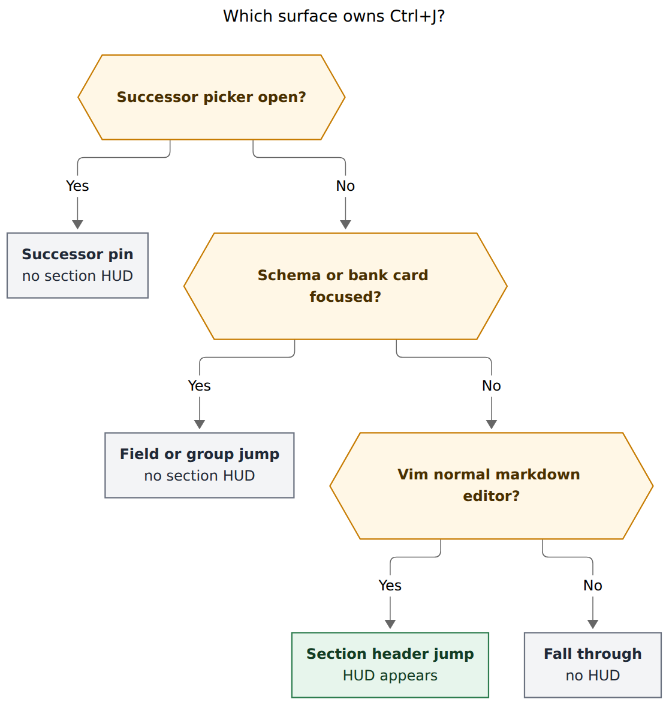
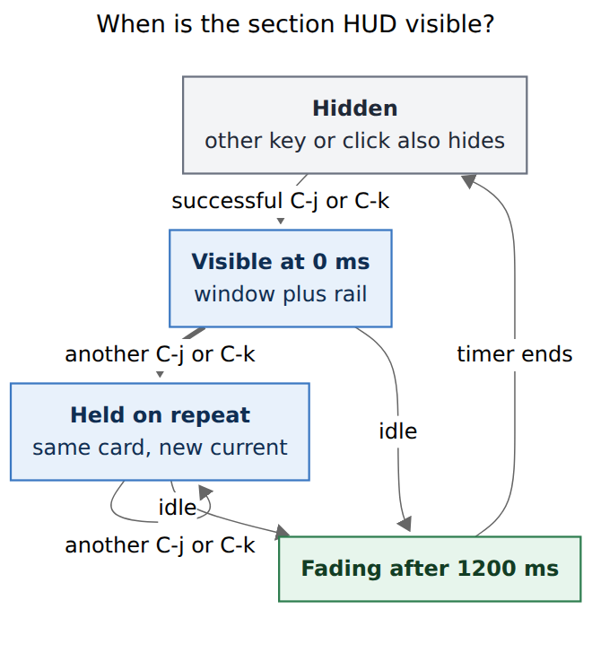
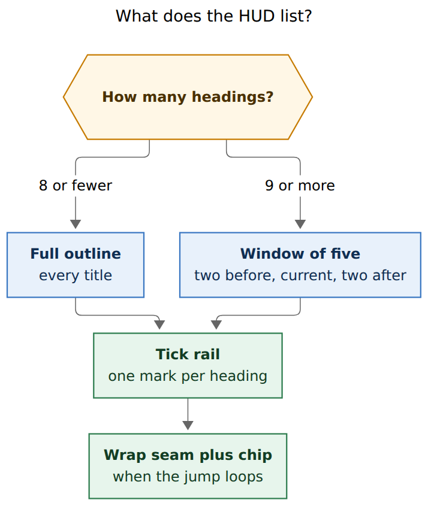

# Ctrl+J/K should show a section-skip HUD, not a full outline

> **Research query.** When Bryan uses Ctrl+J / Ctrl+K in Obsidian to jump to the next or previous markdown section header, it is easy to lose his place. He wants a brief, non-intrusive, clearly visible outline of the file's markdown sections when those keymaps fire. Lead the design so it is intuitive, reliable, and beautiful. Critique the plan. Is it a good idea? Would a different approach be better? Call out justified requirement changes. End with a recommended solution.
>
> Independent swarm report from researcher `grk`. I did not read peer reports from this swarm.

**Baselines.** Vault vimrc `nnoremap <C-j> :bob_next_header<CR>` / `<C-k>` (`~/bob/obsidian_vimrc.md`); `bob-navigation-hotkeys` commands `jump-to-next-section-header` / `jump-to-prev-section-header` (`plugins/bob-navigation-hotkeys/src/490-plugin-lifecycle.js`); `jumpToSectionHeader` + `getSectionHeaderJumpLine` (`610-plugin-jumps-and-counted-keys.js`, `130-fences-and-status.js`); wrap tests in `scripts/test-navigation-hotkeys-section-nav.cjs`; lane-walk notice + wrap chip (`543-lane-walk-notice.js`); window-prefix pane overlay (`473-window-hint-view.js`, `docs/window-keys.md`); `bob-vim-yank-flash`; core Outline plugin enabled in `~/bob/.obsidian/core-plugins.json`. Community always-on TOCs (Heading Rail, Floating Headings, Dynamic Outline, Sticky Headings, Trailmark, Margin Rail) and VS Code sticky scroll / breadcrumbs as contrast, not as a install list.

**Figures.** Mermaid CLI `@mermaid-js/mermaid-cli@12.0.0`. Keymap routing SVG 743.3 × 784 px, fit 87.8%. HUD lifecycle SVG 439.6 × 498 px, fit 100.0%. HUD windowing SVG 475.9 × 564 px, fit 100.0%.

## Bottom line

**Build it, as a pane-local section-skip HUD on the existing `jumpToSectionHeader` path. Do not paint the whole outline on every jump, do not install a floating TOC plugin, and do not open the Outline pane.**

The request is the right product family. The naive reading of it — "on Ctrl+J, show every heading in the note" — is the reading that would ship a wall of text over the heading Bryan just jumped to. Long daily notes, project notes with drawer H2s, and research reports have far more than a brief overlay can list. The missing information after a jump is smaller than that: which heading just became current, which one is next, which one was previous, where that is in the file, and whether the jump wrapped.

Bob already solved this shape twice. `]w` lane-walk notices show rank, a tick rail, the current title, and a `↻ wrapped` chip (`543-lane-walk-notice.js`). The Ctrl+W window prefix paints a pane-local card in the same accent-pill language, with hints at arm rather than after a delay (`docs/window-keys.md`, `research:202611/obsidian_ctrl_w_numbered_tab_jump`). The section HUD is those two ideas composed for heading teleports.

**Recommended design, in one sentence:** after a successful Ctrl+J / Ctrl+K section jump, paint a pointer-events-none card in the upper-right of that editor pane, at 0 ms, listing a window of neighboring headings plus a tick rail of the whole file, held through key-repeat, faded 1200 ms after the last jump, with a ↻ wrap chip and a 200 ms accent flash on the landed heading line.

## Verdict: good idea

Ctrl+J / Ctrl+K already jump. The keymap is real, the command is real, and the disorientation is structural.

1. **The jump is a teleport.** `jumpToSectionHeader` sets the cursor to column 0 and calls `scrollEditorLineToTop` (`610-plugin-jumps-and-counted-keys.js`). The landed heading sits at the top of the viewport. The previous heading is gone. The next heading is usually below the fold. The eye sees one title and a body, with no map.

2. **The jump wraps.** `getSectionHeaderJumpLine` cycles at both ends (`130-fences-and-status.js`). The test file names it: "section-header navigation moves normally and cycles at boundaries" (`scripts/test-navigation-hotkeys-section-nav.cjs`). Ctrl+J on the last heading lands on the first. That is a useful reading-order loop — window-keys `w` wraps the same way (`docs/window-keys.md`) — and it is silent today. A wrap with no HUD is how "which section is after this one?" becomes "I am at the top of the file and I do not know why."

3. **The outline pane is already on and is not this feature.** Core `outline` is enabled (`~/bob/.obsidian/core-plugins.json`). Bryan still loses his place. A sidebar that is closed, covered, or on the other side of a dual split cannot answer a chord that lives in the editor.

4. **Vim's native heading motions are already spent.** The vault vimrc binds `]]` / `[[` to bracket-walk repeat, not to headings (`~/bob/obsidian_vimrc.md`). Ctrl+J / Ctrl+K *are* the heading motion. Orientation belongs on those keys.

This is a good idea. I would take this approach, with the adjustments below. I would not solve it with an always-on floating TOC, sticky headings, a Notice in the bottom-right, or a change to wrap.

## Critique of the stated plan

The request is two sentences:

1. Display a brief, non-intrusive, clearly visible outline of the file's markdown sections when Ctrl+J / Ctrl+K is used.
2. Make it intuitive, reliable, and beautiful.

Those are the right *family* of requirements. Four implied solutions inside them are not.

**"Outline of the file's markdown sections" is not "every heading, every time."** A daily note's review groups, a project note's drawer H2s, and a research report's H2/H3 tree are not a brief overlay. Lane-walk already compresses: dots up to 30 items, a caret bar above that (`543-lane-walk-notice.js`). Heading titles matter more than task titles — the names *are* the map — so the HUD should list a local window and keep the rest as a rail. Full titles only when the note is short enough to glance.

**Always-on chrome is the community default and the wrong product for this complaint.** Floating Headings, Heading Rail, Dynamic Outline, SlickOutline, Trailmark, and Margin Rail all keep a TOC in the pane while you read. VS Code sticky scroll and zhouhua's Sticky Headings pin ancestors at the top while you *scroll*. Bryan's complaint is a *keymap*. Sticky ancestors tell you where you are during a slow scroll. They do not tell you what you just skipped, or that you wrapped. Gesture-triggered HUD matches `decisions:similar-tasks-are-a-settled-heads-up`: zero pixels until the gesture that needs them.

**A Notice is the wrong surface.** Lane-walk and review toasts are window-global and sit bottom-right, far from a heading that just snapped to the top of *this* pane. Dual splits are the daily layout the window-prefix research already treated as given. The HUD has to be pane-local, like the window-prefix card and the image-zoom toast (`.bob-image-zoom-toast` in `plugins/bob-navigation-hotkeys/styles.css`).

**Opening the Outline pane, or installing a community TOC, fights Bob's HUD language.** Yank-flash research rejected both community yank plugins in favor of a Bob-owned flash. Schema-card research rejected stealing keys that other Bob surfaces already own. The same rule applies here. Ctrl+J is already the successor pin (`decisions:successor-jump-parks-the-walk`) and the schema/bank field jump (`docs/albums.md`, `241yf-plugin-album-schema-field-jump.js`). The HUD may fire only on the vim-normal section-jump path.



_Successor pickers pin. Schema and bank cards jump fields. Only a vim-normal markdown editor section jump shows the HUD. Every other Ctrl+J falls through._

Rendered size: 743.3 × 784 px; fit scale: 87.8%. Mermaid CLI 12.0.0.

## What the keymap actually does today

Verified against the vault vimrc, `bob-navigation-hotkeys` 2.107.14 command table, and the section-nav tests.

The chord is not an Obsidian hotkeys.json default. It is a vimrc `nnoremap` onto an exmap:

```text
exmap bob_next_header obcommand bob-navigation-hotkeys:jump-to-next-section-header
exmap bob_prev_header obcommand bob-navigation-hotkeys:jump-to-prev-section-header
nnoremap <C-j> :bob_next_header<CR>
nnoremap <C-k> :bob_prev_header<CR>
```

Those commands call `this.jumpToSectionHeader(editor, ±1)` (`490-plugin-lifecycle.js`). The helper:

- Reads the live editor text.
- Collects ATX headings with `SECTION_HEADER_RE = /^ {0,3}#{1,6}(?:[ \t]|$)/`, skipping YAML frontmatter and fenced code (`130-fences-and-status.js`).
- Picks the next heading strictly after the cursor, or the previous strictly before it.
- **Wraps** to the other end when none remain.
- On a single-header note, "next" and "previous" are that same line.
- On a no-header note, returns `null` and the command shows `No next section header` / `No previous section header`.
- On success, `setEditorCursor(..., ch: 0)` and `scrollEditorLineToTop`.

Setext underlines are ignored. Headings inside fences and frontmatter are ignored. That parse is the contract the HUD must reuse; a second parser would drift.

Open-task jumps (`Ctrl+Shift+J/K`) already have a dual-dispatch guard *because* a vim nmap for those chords could collapse onto these `<C-j>` / `<C-k>` maps (`610-plugin-jumps-and-counted-keys.js`). The HUD must stay on the command path. Do not add a vimrc overlay, and do not add a hotkeys.json default for Ctrl+J — insert-mode Ctrl+J is newline, and schema/bank cards plus successor pickers already own the chord when they have focus.

## Requirement adjustments

Call-outs, each a change to the request as written.

1. **Window, then rail, then full list.** Eight or fewer headings: list every title. Nine or more: two before, current, two after, plus a tick rail of the whole file. The rail is the outline of the file; the titles are the local map. This is the justified reading of "brief."

2. **Appear on the gesture, vanish without a panel.** 0 ms on a successful jump (the window-prefix lesson: a 300 ms card is too late for a fluent chord). Hold through key-repeat on the same card. Fade 1200 ms after the last jump. Any other key, click, leaf change, or mode change hides immediately. The HUD is not a modal and not a focusable panel, so `decisions:q-and-ctrl-bracket-mirror-esc` does not bind it. If a later revision makes it focusable, Esc / `q` / `Ctrl+[` must then close it through Esc's own dispatch.

3. **Keep wrap; make wrap visible.** Do not change `getSectionHeaderJumpLine`. Adding a ↻ wrapped chip and a dashed seam in the title window is enough. Stopping wrap would match window-keys `h`/`l` (spatial, no wrap) and fight window-keys `w` (reading order, wraps). Heading motion is reading order.

4. **Pane-local overlay, upper-right of the editor that jumped.** The landed heading is top-left. The HUD lives top-right of that pane, 12 px inset, `max-width` about 280 px. `pointer-events: none` in v1. Dual splits each own their own HUD or none.

5. **Flash the landed heading 200 ms in accent ink.** Yank flash already trained the eye (`bob-vim-yank-flash`, 200 ms, generation-guarded). The HUD is the map; the flash is the "you landed here" pulse. Use accent, not yank green — this is navigation, not a copy.

6. **Implement inside `bob-navigation-hotkeys`, next to `jumpToSectionHeader`.** A new plugin would split the jump from its HUD. Community TOC plugins would ignore Bob's fence/frontmatter parse and fight Ctrl+J on cards.

7. **Vim-normal markdown editor only, v1.** `editorCallback` already gates the command. Reading view has no vimrc map. Do not invent a reading-view twin until someone uses heading jump there.

8. **No click-to-jump, no numbered 1–9 heading leaps, no counted `3<C-j>` in v1.** Those are good follow-ups. They are not what "I lost my place" asks for, and schema-card research already spent 1–9 on field jumps.



_Hidden until a successful jump. Visible at 0 ms. Repeats keep the same card and move current. Idle starts a 1200 ms fade. The timer, another key, or a click returns to hidden. A jump during fade is a new successful jump from hidden._

Rendered size: 439.6 × 498 px; fit scale: 100.0%. Mermaid CLI 12.0.0.

## Alternatives considered

| Approach | Why it loses |
| --- | --- |
| Core Outline pane, auto-revealed | Already enabled; lives in a sidebar; looks away from the teleport; closed or covered in a dual split. |
| Community floating TOC (Heading Rail, Floating Headings, Dynamic Outline, SlickOutline) | Always-on chrome on an already dense Bob editor (property cards, walk footers, window prefix, chips). Different parse. Fights Bob visual language. |
| Sticky headings / VS Code sticky scroll | Solves scroll orientation (ancestors pinned while you move slowly). Does not show next, does not show wrap, does not fire on the keymap. A fine *later* companion, a poor v1. |
| `Notice()` rich card, lane-walk style | Correct *content* (rank, rail, wrap chip, current title), wrong *place* (bottom-right, window-global). |
| Center the heading (`zz`) instead of top-align | Open-task jumps already center. For sections, Bryan then reads from mid-viewport. Next heading still often below the fold. Does not replace a map. |
| Stop wrapping | Fixes the worst teleport and changes a tested contract. HUD plus wrap chip keeps the loop and makes it honest. |
| "Go to heading" modal (IntelliJ Ctrl+F12 / Heading Compass palette) | A search command, not a skip HUD. Useful as a separate command. Does not fire on Ctrl+J. |
| Always-on right-edge bar (Trailmark, Margin Rail) | Beautiful for reading. Permanent pixels. Not what the keymap complaint asks for. |

The lane-walk notice is the content template. The window-prefix card is the placement and timing template. The yank flash is the landing pulse. Compose those three; do not import a fourth language.

## Recommended HUD

### What it shows



_Eight or fewer headings list every title. Nine or more list a window of five. Every note gets a tick rail. A wrap paints a seam and a ↻ chip._

Rendered size: 475.9 × 564 px; fit scale: 100.0%. Mermaid CLI 12.0.0.

Header row, tabular nums, direction glyph:

```text
4 / 12  ↓
```

or, on wrap:

```text
1 / 12  ↓   ↻ wrapped
```

Tick rail under the header: one mark per heading, current filled with `--interactive-accent` and a 2 px halo, others at 30% mix, H1 slightly larger than H6. Above ~24 marks, compress to a continuous bar with a caret, same rule lane-walk uses above 30.

Title window:

- Hash prefix in muted mono (`##`, `###`), title in `--text-normal`, ellipsis on overflow.
- Indent `(level - 1) * 10px`.
- Current row: `bob-wp-pill.is-active` treatment — accent border, 12% accent fill, `font-weight: 650`.
- Neighbors muted.
- Wrap seam: a dashed hairline between the last heading and the first when the window crosses the loop.

Empty and single-header notes:

- No headings: keep today's Notice, no HUD.
- One heading: still show `1 / 1` so the no-op is honest. The tests already land on that same line.

### Where it sits

Upper-right of the markdown view that jumped, `position: fixed` against that pane's rect (copy the window-hint `positionCard` pattern in `473-window-hint-view.js`). Twelve-pixel inset from the pane's top and right, below the tab bar, above the heading that just became top-left. Narrow pane (`< 400 px`): shrink to 220 px and keep the right edge. `z-index` above the editor, below modals. `pointer-events: none`. `role="status"` and `aria-live="polite"`. `prefers-reduced-motion: reduce` drops the 120 ms fade to instant opacity.

Reuse Bob tokens only: `--background-primary`, `--background-modifier-border`, `--radius-m`, `--shadow-s`, `--interactive-accent`, `--text-muted`, `--font-ui-smaller`, `--font-monospace`. No new palette.

### Lifecycle

One HUD per editor, `WeakMap`. One generation counter, yank-flash style: a hide timer scheduled at generation N is a no-op if a later jump bumped it.

Show at 0 ms on a *successful* jump. Update in place on repeat — same DOM, new current, no unmount. Hide on:

- 1200 ms idle after the last jump (between yank's 200 ms and window-prefix receipt's 1600 ms; long enough to read five titles, short enough to leave the editor alone).
- Any key that is not Ctrl+J / Ctrl+K.
- Pointer down in the editor.
- Active leaf change, view-mode change, or file change.

Do not show on the "No next section header" Notice path.

### Parse

Extend `getSectionHeaderLines` into `getSectionHeaderEntries(lines) -> [{ line, level, title }]`. Same fence and frontmatter walk. Strip trailing ATX hashes and whitespace from `title`. Empty `#` headings keep a replacement glyph `§` so the row is still a target. Tests in `scripts/test-navigation-hotkeys-section-nav.cjs` grow a windowing table: short list, long window, wrap seam, rail length equals heading count, fences ignored.

`jumpToSectionHeader` stays the only writer of the cursor. The HUD is a pure view of `(entries, currentIndex, direction, wrapped)`.

## Implementation home

`bob-navigation-hotkeys`, not a new plugin.

| Piece | Home |
| --- | --- |
| Entry parse + window model | new fragment next to `130-fences-and-status.js`, exported from `700-exports.js` |
| Show / hold / hide | mixin next to `610-plugin-jumps-and-counted-keys.js`, called at the end of a successful `jumpToSectionHeader` |
| DOM + CSS | painter sibling to `473-window-hint-view.js`; styles in `plugins/bob-navigation-hotkeys/styles.css` under `.bob-section-hud` |
| Tests | `scripts/test-navigation-hotkeys-section-nav.cjs` plus a painter harness like the window-hint tests |
| Docs | one paragraph on the existing Jump to next/previous section header rows in `docs/bob-navigation-hotkeys.md`; vimrc comment stays the map |

Do not add a default hotkey on the command. The vimrc map is the binding. Do not teach Ctrl+J in insert mode.

## Risks

- **Ctrl+J collisions.** Successor pin and schema/bank field jumps must keep winning when those UIs have focus. The HUD hooks the section-jump command, not a capture-phase Ctrl+J listener. That is the whole routing figure.
- **Flicker on key-repeat.** Holding Ctrl+J fires many jumps. Reuse one card. Never unmount/remount per hop.
- **Covering the heading.** Upper-right is the rule because `scrollEditorLineToTop` puts the heading top-left. A left-edge rail would cover the hashes Bryan just landed on.
- **Parse drift.** A HUD that used `metadataCache.headings` would see a stale cache mid-edit and would not share the fence rules. Live editor text, same helper.
- **Motion.** Honor `prefers-reduced-motion`. The flash is 200 ms either way; the card fade is the part that goes instant.

## Follow-ups, not v1

- Counted `3<C-j>` once the vimrc map can carry a count (today it is a `:obcommand` nnoremap and drops counts).
- Click-to-jump once the HUD has proven it is not in the way; that would take `pointer-events` back and would then owe Esc / `q` / `Ctrl+[` (`decisions:q-and-ctrl-bracket-mirror-esc`).
- Reading-view twin.
- Always-on sticky current heading as a *separate* reading aid, after this HUD exists, so the two can share the entry parse.
- Numbered heading leaps. Schema cards already own 1–9 when focused; a section HUD that paints numbers would invite the same fight the schema-card research refused to have with bank digits.

## Recommended solution

Ship a **section-skip HUD** on `bob-navigation-hotkeys.jumpToSectionHeader`:

1. Keep Ctrl+J / Ctrl+K, keep wrap, keep scroll-to-top, keep the vimrc map.
2. On a successful jump, show a pane-local, pointer-events-none card in that editor's upper-right at 0 ms.
3. List every title when there are eight or fewer headings; otherwise two neighbors each side of current.
4. Always paint a tick rail of the whole file, a `N / M` header, a direction glyph, and a ↻ wrapped chip plus wrap seam when the jump looped.
5. Flash the landed heading line 200 ms in accent ink.
6. Hold the same card through repeat; fade 1200 ms after idle; hide on any other key or click.
7. Reuse the existing heading parse; add tests for windowing and wrap; style with window-prefix pills and lane-walk rails.

That is brief, non-intrusive, clearly visible, and already in Bob's visual language. The full-outline reading of the request is the part to drop.
