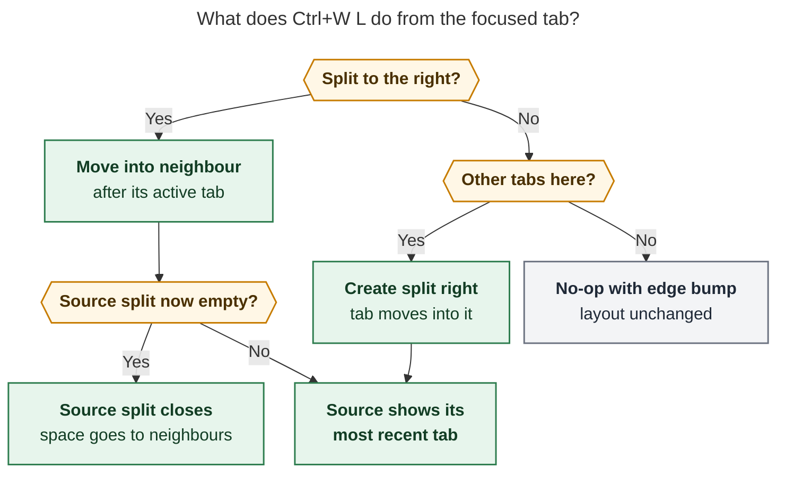

# `Ctrl+W` split keys for Bob's Obsidian: a layout-only window layer with a live-preview hint

Independent research by **cld**, 2026-11-15. No other report from this swarm was
consulted. This is research and a proposed design. No product code was changed.

**Recommendation in one paragraph.** Build this. It is a good idea, but it should not
be built as vimrc mappings. Ship it as a small new plugin, `bob-vim-windows`, that owns
`Ctrl+W` as a prefix through a capture-phase key listener. That is the same pattern
`bob-navigation-hotkeys` and `bob-vim-surround` already use. The layer is armed whenever
the user is not typing text, so it works in reading view, PDFs, and empty tabs as well
as in normal mode. `h`/`l` focus the split to the left or right; nothing wraps. `H`/`L`
move the current tab into that split: they create a split when there is none and remove
a split that the move leaves empty. The tab is moved as the same object, never cloned,
so its undo history, cursor, and scroll survive. One key table drives both the dispatch
and the hint, so the hint can never disagree with what a key does. The hint has two
stages. An instant focus ring appears on every press. If you pause, a compact card
appears with a minimap of your splits and a plain-words preview of what each key will
do. Two changes to the requirements carry the design: **every `Ctrl+W` key changes
layout and never closes a note**, and the **"other split"** idea gets its own keys
(`w` and `p`) rather than bending `h`/`l`. Start with a short spike in the existing
real-Obsidian test harness, because the move relies on four unofficial Obsidian
methods.

---

## 1. What I looked at

- **The screenshot** (`~/tmp/screenshots/20261115_171818.png`). macOS, light theme, Vim
  mode on. The main area holds two tab groups side by side. The left group has three
  tabs: two pinned (`20261115`, `dash`) and the active `sase_blog`. The right group has
  one tab, `sase_blog_contents`, in reading-style rendering. The status bar shows the
  `[[ s w n b ]]` bracket selector. At a glance it is hard to tell which split has
  focus: the two tab bars look almost the same.
- **bob-plugins** at `63ff1654`: `bob-navigation-hotkeys` (tab commands, capture-phase
  listeners, Vim-mode helpers), `bob-vim-surround`, `bob-vim-yank-flash`, the Copy card,
  and the CDP end-to-end and preview harnesses under `scripts/`.
- **The vault's Obsidian config**: `~/bob/obsidian_vimrc.md`, `.obsidian/hotkeys.json`,
  `.obsidian/app.json` (`vimMode: true`), and the obsidian-vimrc-support settings
  (`displayChord: true`).
- **Upstream sources**, opened as external repos:
  - `obsidianmd/obsidian-api` at `879c936`: the public `obsidian.d.ts`.
  - `obsidian-typings`, branch `release/obsidian-public/1.15.1`: unofficial internal
    workspace typings.
  - `replit/codemirror-vim` at `c3131c4`: the Vim engine Obsidian embeds.
  - `esm7/obsidian-vimrc-support` at `1ff5d97`.
  - `jsrozner/obsidian-tab-shifter` at `23fe914`: prior art for moving tabs between
    groups.
- **Web**: the Obsidian forum feature request for "move tab to tab group
  left/right/above/below" and the `saberzero1/motions` 0.17.0 release notes.

I could not run Obsidian. It is not installed on apollo, and the harness's default
`/snap/bin/obsidian` lives on athena. Every runtime claim below that depends on
unofficial internals is therefore labeled **(verify in spike)**.

---

## 2. What exists today

### 2.1 Obsidian's layout model

The main area is a tree. `workspace.rootSplit` is a `WorkspaceSplit` whose children are
tab groups (`WorkspaceTabs`) or nested splits. Each tab group holds tabs
(`WorkspaceLeaf`).

Obsidian names a split by its divider, not by its layout:

- `direction: 'vertical'` means a vertical divider, so the children sit **side by
  side**.
- The public API makes this explicit: `getLeaf('split', 'vertical')` puts the new leaf
  "to the right".

The screenshot is `rootSplit(vertical) → [Tabs(3), Tabs(1)]`.

| Need | API | Status |
| --- | --- | --- |
| List main-area tabs and their groups | `workspace.iterateRootLeaves`, `leaf.parent` (1.6.6), `leaf.getContainer()` | **public** |
| Focus a tab | `workspace.setActiveLeaf(leaf, { focus: true })` | **public** |
| Create a split next to a tab | `workspace.createLeafBySplit(leaf, 'vertical', before)` | **public** |
| Split right showing the same note (Vim `<C-w>v`) | `workspace.duplicateLeaf(leaf, 'split', 'vertical')` (1.1.0) | **public** |
| Most recently used tab inside one group | `workspace.getMostRecentLeaf(root)` | **public** |
| Load a background tab that has not loaded yet | `leaf.isDeferred`, `leaf.loadIfDeferred()` | **public** |
| Move a tab object to another group | `WorkspaceParent.removeChild(child)` / `insertChild(index, child)` | unofficial |
| Select a tab in a group | `WorkspaceTabs.selectTab(leaf)`, `currentTab` | unofficial |
| Split orientation; equalize widths | `WorkspaceSplit.direction`, `WorkspaceItem.setDimension()` | unofficial |
| Pane geometry | `WorkspaceItem.containerEl.getBoundingClientRect()` | unofficial, very stable |
| Native neighbour lookup | `workspace.getAdjacentLeafInDirection(leaf, dir)` | unofficial ("potentially does not work", per the typings) |

**The unofficial surface the design needs is small:** `removeChild`, `insertChild`,
`selectTab`, and `setDimension`, plus `containerEl` for geometry. The move code in
`bob-navigation-hotkeys` already relies on `parent.children` and `selectTab`
(`630-plugin-vim-link-and-leaves.js:267`, `:361`, `:438`).

**What Obsidian provides natively:**

- **Split right** and **Split down**.
- Directional focus commands, reported as `editor:focus-left|right|top|bottom`.
  **(verify the IDs with `Object.keys(app.commands.commands)` in the spike)**.
- **No command to move the current tab into a neighbouring group.** The forum request
  for one has been open since April 2023. The only answers in that thread are community
  plugins (Tab Shifter, Pane Relief).

### 2.2 The Vim layer has a `<C-w>` trap

`codemirror-vim` (`packages/codemirror-vim-core/vim.js:198-200`) defines:

```js
{ keys: '<C-w>', type: 'operatorMotion', operator: 'delete', motion: 'moveByWords', …, context: 'insert' },
//ignore C-w in normal mode
{ keys: '<C-w>', type: 'idle', context: 'normal' },
```

`matchCommand` prefers any **full** match over a partial one (`vim.js:1601-1612`).
After `nmap <C-w>l …`, pressing `<C-w>` therefore fully matches the idle entry. The key
buffer clears, and the following `l` just moves the cursor. The obsidian-vimrc-support
README says `nmap <C-w>h …` "also works". The upstream source says otherwise, and the
`motions` fork's 0.17.0 release notes describe exactly this bug: "an idle entry for
`<C-w>` … consumed the key before the second keystroke arrived".

The workaround is `nunmap <C-w>`. obsidian-vimrc-support routes it to
`unmap('<C-w>', 'normal')` (`main.ts:392-394`), which deletes the idle entry. That is
fragile, because it depends on the Vim build bundled with Obsidian. Separately, Obsidian
binds **Close current tab** to `Mod+W`, which is `Ctrl+W` on Linux. Forum users hit
this collision too.

### 2.3 Bob's plumbing

- **The vault vimrc** maps keys to `exmap … obcommand bob-navigation-hotkeys:<id>`, with
  the rule "every mapping that replays `:` must be nnoremap". `<C-w>` appears nowhere in
  it. `Ctrl+W` is not bound in `hotkeys.json`.
- **Capture-phase key listeners are the house pattern** for chords that Vim would
  otherwise swallow. `bob-navigation-hotkeys` has at least six; see
  `610-plugin-jumps-and-counted-keys.js:390`. Each registers on both `window` and
  `document` and de-duplicates with a `WeakSet`. Helpers already exist:
  - `isVimNormalModeEditor`
  - `getCurrentVimMode`, which reads `cm.state.vim` and falls back to the vimrc
    plugin's `currentVimStatus`
  - `getPendingVimRepeat`
  - `getFocusedMarkdownEditorView`

  `bob-vim-surround` uses the same listener, plus `Vim.defineOperator` and
  `Vim.mapCommand`.
- **Existing tab commands** cover tabs within one group:
  - `move-tab-left` / `move-tab-right` (`Ctrl+Shift+,` / `Ctrl+Shift+.`)
  - `duplicate-current-tab` (`Alt+T`)
  - `close-tabs-left` / `close-tabs-right` / `close-other-tabs` (`\<`, `\>`, `\\`)
  - `toggle-current-tab-pin`
  - the `Ctrl+0` dash tab-reuse ranking

  Nothing works across groups.
- **Design precedents to borrow:**
  - The **Copy card**: one key per row, dimmed rows that "nudge … and announce the
    reason", and the promise that the preview and the action never disagree.
  - The **Task Card**: `Esc`, `q`, and `Ctrl+[` close it without writing.
  - **bob-vim-yank-flash**: a 200 ms confirmation flash.
- **Test harnesses**:
  - `scripts/obsidian-*-e2e.cjs` drives real Obsidian over CDP in a scratch vault,
    under `xvfb-run` on Linux.
  - `scripts/preview-*.cjs` plus HTML templates render UI previews.

### 2.4 Prior art

- **Tab Shifter** moves a tab by opening the same file in a new leaf in the target group
  and then calling `activeLeaf.detach()`. It creates `getLeaf('split','vertical')` when
  only one group exists, and it wraps cyclically. This **clone-and-close** approach:
  - drops the editor's undo history, cursor, scroll, and back/forward history
  - only handles markdown
  - flashes while the file reloads

  Its README admits that it orders groups by leaf iteration order rather than by
  geometry.
- **VS Code editor groups** are the closest mental model for the requested `H`/`L`:
  - Move Editor into Left/Right Group.
  - The next-group variant creates a group when there is none.
  - Empty groups close by default.

  I could not find an official spec for these during this research. Treat them as
  well-known behaviour, not as a cited contract.

---

## 3. Critique: is this a good idea?

**Yes.** Here is why it pays off for Bob specifically:

1. **Bryan already works in two splits.** The screenshot is a task note beside a draft.
   That workflow will become more common as blog and reference reading grows.
2. **Obsidian's keyboard support for splits stops halfway.** You can create a split and
   focus one, but rearranging needs the mouse. The vimrc route also breaks on the
   `<C-w>` idle trap.
3. **Muscle memory.** `<C-w>h/l` is among the most ingrained Vim chords. Bob is a
   keyboard-first vault with Vim mode always on.

**Concerns with the plan as written:**

- **`H`/`L` are not Vim's semantics.** In Vim, `<C-w>L` moves the *window* to the far
  right as a full-height column. The tab (buffer) does not move between windows. The
  requested behaviour is VS Code's "move editor to group". I think the request is
  **right for Obsidian**. Here the tab is the unit you care about and a tab group is a
  window. A whole group rarely needs to move, and an exchange key covers that case
  (§5.2, `x`). Keep the request, but document the difference so nobody "fixes" it back
  toward Vim.
- **"Navigate to the other split" conflicts with directional keys** once there are
  three splits, or one split down. See A2.
- **"Show a hint when `<C-w>` is pressed" will flicker** for fluent use if the card
  appears instantly. `<C-w>l` is typed in about 150-250 ms. See A3.
- **Scope creep.** Vim has about 40 `<C-w>` commands. Without a principle, the layer
  grows into a half-working Vim clone. See A1.
- **It relies on unofficial internals.** Moving the tab itself, rather than a clone,
  needs `removeChild`/`insertChild`. This is the main reliability risk; §5.7 mitigates
  it.
- **Platform collision.** On Linux, `Ctrl+W` is Obsidian's close-tab key, and the
  athena e2e harness runs on Linux. On macOS it is free. See A6.

**Would I take a different approach?** Yes on mechanism, not on intent. I would not use
the vimrc or `obcommand` route that the existing keys use. I would not adopt Tab
Shifter. I would also not add this to `bob-navigation-hotkeys`. §6 compares the options.

---

## 4. Requirement adjustments (called out)

| # | Adjustment | Why |
| --- | --- | --- |
| **A1** | **`Ctrl+W` changes layout, never content.** No key in the family closes a note. Vim's closing keys become non-destructive: `c` merges this split's tabs into its neighbour, and `o` merges every split into this one. `q` cancels the prefix instead of quitting (Bob convention). | Makes the layer safe to explore, which matters once a hint invites trying keys. It also gives a clear test for adding a key. In Vim, `<C-w>c` hides a window but keeps the buffer; merging tabs is the faithful equivalent. |
| **A2** | **`h`/`l` are strictly directional and do not wrap.** At the edge they do nothing and show a "bump". **`w` (and `Ctrl+W Ctrl+W`) cycle through splits, and `p` returns to the previous split.** With two splits, `w` and `p` both mean "the other one". | Directional keys that sometimes go the opposite way break spatial memory once a third split exists. `w`/`p` are the Vim-native "other window" keys. |
| **A3** | **The hint has two stages.** An instant cue (focus ring plus a `⌃W` badge on the focused split) appears on every press. The full card appears after a **300 ms** pause, or at once after an unmapped key. | Fluent sequences never flash a card, and hesitant users always get help. The armed state is never invisible (§5.4). |
| **A4** | **`H`/`L` move the tab object itself.** Nothing is cloned or reopened, so undo history, cursor, scroll, pin, view mode, and back/forward history survive. If the needed internals are missing, `H`/`L` are refused, with a dimmed row explaining why. | "Reliable" has to include "my undo still works". Bob already protects editor undo history (Disk reloads stay out of it, so `u` keeps undoing your own edit). |
| **A5** | **Scope v1 to columns in the current window's main area.** Sidebars and popout windows are out of scope. Navigation still uses geometry, so a split created by dragging with the mouse does not break it. | That is what the screenshot shows and what was asked. Horizontal splits and popouts double the test matrix. |
| **A6** | **The prefix arms whenever you are not typing text**: Vim normal or visual mode, or a non-text focus such as reading view, PDF, canvas, graph, or an empty tab. It passes through in Vim insert mode, inputs, modals, and pickers. On Linux this deliberately takes `Ctrl+W` from Obsidian's close-tab hotkey in those contexts. | Insert-mode `Ctrl+W` keeps deleting a word. A window key should not stop working because the right split is a PDF. |
| **A7** | **Add a quiet "focused split" indicator** when two or more splits exist: a 2 px accent line on the focused group's tab bar. | The screenshot shows the problem: you cannot tell which split `h`/`l` will act from. A good-looking window layer needs a visible current window. |
| **A8** | **Moving or focusing splits never records a jump.** `Ctrl+O` history is unchanged. | Vim does not add window switches to the jumplist. Bob's 100-entry jump history should stay about places in notes. |

---

## 5. Design

### 5.1 Principles

1. **Layout, never content.** (A1)
2. **One table.** Each key's entry holds its label, availability, preview text, and plan
   function. Dispatch and the hint card both read it. A test checks that each key's plan
   in the card equals the plan dispatch would run.
3. **Move the tab object itself.** (A4)
4. **The armed state is never invisible.** It is cancelled by `Esc`, `Ctrl+[`, `q`, a
   click, window blur, or a modal opening.
5. **Silent for the fluent, helpful for the hesitant.** (A3)
6. **Fail closed, and say why.** A refused key leaves the layout unchanged and names the
   reason in the card. Routine success shows no toast notification.

### 5.2 Key map

Phase 1 is the requested core plus two cheap keys. Phases 2 and 3 are recommended
follow-ups.

| Key(s) | Does | Phase | Notes |
| --- | --- | --- | --- |
| `h` / `l` (also `Ctrl+H` / `Ctrl+L`) | Focus the split to the left / right | 1 | Uses geometry. Ties go to the split that overlaps vertically and was used most recently. At an edge: bump, no wrap. |
| `H` / `L` | Move the current tab into the split left / right, creating or removing splits as needed | 1 | See Figure 1. Focus follows the tab. |
| `w`, `Ctrl+W`, `W` | Next / previous split, wrapping | 1 | The "other split" key. |
| `p` | Previous (last-focused) split | 1 | Tracked from `active-leaf-change`, main area only. |
| `v` | Split right showing the same note | 1 | Public `duplicateLeaf(leaf, 'split', 'vertical')`, the same as Vim `<C-w>v`. |
| `=` | Equalize split widths | 1 | `setDimension` on each column, then `recomputeChildrenDimensions`. |
| `Esc`, `Ctrl+[`, `q` | Cancel | 1 | Bob's card-close convention. |
| `c` | Merge this split's tabs into the neighbouring split | 2 | Non-destructive "close". |
| `o` | Merge all splits into this one | 2 | Non-destructive "only". |
| `x` | Exchange this split with its neighbour | 2 | Vim `<C-w>x`. |
| `f` | Open the link under the cursor in the other split, creating one if needed | 2 | Vim `<C-w>f`. Very useful for task-note-plus-draft work. |
| `<` / `>` | Narrow / widen the current split | 2 | Respects a Vim count. |
| `1`-`9` | Focus split N (numbers drawn on the minimap) | 2 | Like tmux `display-panes`. |
| `j` `k` `J` `K` `s` | Horizontal versions | 3 | Same planner with `direction = top`/`bottom`. |

**Key normalization.**

- Read `event.key`, so the active keyboard layout is respected.
- Ignore keydowns that are only a modifier. Pressing Shift for `H` must not cancel.
- Treat a held Ctrl as Vim does: `Ctrl+W Ctrl+L` is the same as `Ctrl+W l`.
- **Never swallow Cmd/Meta chords**: they cancel the prefix and pass through, so
  `Cmd+S` while armed still saves.
- Ignore auto-repeat (`event.repeat`) and IME composition (`isComposing`).
- If a Vim operator is pending, for example `d` then `Ctrl+W`, pass `Ctrl+W` through
  and let Vim's idle entry cancel it, as stock Vim does.
- A pending Vim count is cleared in phase 1. Phase 2 can give it meaning (`3 Ctrl+W w`).

### 5.3 Behaviour details



*Figure 1. `L` either joins the neighbour, creates a split at the edge, or does nothing
when the tab is already alone at the edge. A split the move empties closes itself; `H`
mirrors this. (Rendered with mermaid-cli 12.0.0 in the PDF configuration: 828×720 px,
78.8% fit.)*

**Finding the neighbour (`h`/`l`/`H`/`L`).**

1. Build a snapshot from `iterateRootLeaves`, keeping only leaves in the active leaf's
   container (`getContainer()`). Take each leaf's unique `parent` tab group, and each
   group's `containerEl` rectangle, tab list, active tab, and pin flags.
2. The neighbour on the left is the group whose right edge is at or left of the current
   group's left edge (within 2 px of tolerance) and which overlaps it vertically.
3. If several groups qualify, pick the nearest horizontally. Break ties by largest
   vertical overlap, then by most recently focused.

This is pure data, so it can be unit-tested with fixtures. It also handles a nested
layout made with the mouse without walking the tree.

**Moving a tab** (only after the spike confirms the internals):

1. Moving into an existing neighbour: `source.removeChild(L)`, then
   `target.insertChild(target.currentTab + 1, L)`, then `target.selectTab(L)`, then
   `setActiveLeaf(L, { focus: true })`.
2. Creating a split at the edge:
   1. `ph = createLeafBySplit(L, 'vertical', before = side === 'left')`, which makes a
      new group holding an empty placeholder tab.
   2. Move `L` into the new group, then detach `ph`. The order matters: the new group
      is never empty, so it never collapses.
3. Check the result:
   - `L.parent === target`
   - `target` contains `L`
   - the source group either still has tabs or has been detached
   - the active leaf is `L`

   If any check fails, put `L` back into its source group and show a single notice:
   "Window move failed — layout restored".
4. Choose what the source group shows next with `getMostRecentLeaf(source)`, which
   returns the most recently used tab, rather than whichever neighbour index Obsidian
   picks. In the screenshot, moving `sase_blog` right should reveal `dash` if you were
   just there, not whichever tab happens to sit next to it.
5. Save the layout: `workspace.requestSaveLayout()`, then `onLayoutChange()`, so the
   ledger-tools footers and other `layout-change` listeners refresh.

**Defaults.**

- **Pinned tabs keep their pin when moved.**
- **Background tabs that have not loaded yet** get `loadIfDeferred()` before focus.
- **Stacked groups** move the same way.
- **New splits use Obsidian's native halving.** The plugin does not equalize
  automatically: if you set 60/40 by hand, joining a neighbour must not undo it. `=`
  equalizes on demand.
- **If the active leaf is in a sidebar**, `h`/`l`/`w`/`p` target the main area's most
  recently used split. `H`/`L` refuse with "only main-area tabs move between splits".

### 5.4 Arming, cancelling, timing

```mermaid
---
title: "How does the Ctrl+W prefix arm, hint, and finish?"
accTitle: "Ctrl+W prefix lifecycle"
accDescr: "Ctrl+W arms the prefix with an instant cue; hesitation reveals the hint card; a mapped key runs its action, and Escape, an unmapped key, a click, or losing focus cancels."
config:
  state:
    nodeSpacing: 30
    rankSpacing: 30
---
stateDiagram-v2
  state "Idle<br/>keys pass through" as IDLE
  state "Armed<br/>focus ring and badge" as ARMED
  state "Hint card shown<br/>live preview" as HINT
  state "Action runs<br/>flash or bump" as ACT
  IDLE --> ARMED: Ctrl+W outside insert mode
  ARMED --> HINT: 300 ms pause or unmapped key
  ARMED --> ACT: mapped key
  HINT --> ACT: mapped key
  ARMED --> IDLE: Esc, click, blur
  HINT --> IDLE: Esc, click, blur
  HINT --> HINT: unmapped key nudges card
  ACT --> IDLE: layout saved
```



*Figure 2. Fluent `Ctrl+W l` goes from Armed straight to the action, so the card never
appears. A pause or a wrong key brings up the card, and nothing is ever armed without
being visible. (647×778 px, 100% fit.)*

**When `Ctrl+W` arms the prefix.** Ctrl must be held with no Meta, Alt, or Shift, and
the event must not be a repeat or part of an IME composition. Then one of these must be
true:

- Focus is in a MarkdownView's CodeMirror editor, Obsidian Vim mode is on, and the Vim
  mode is normal or visual. Use `getCurrentVimMode` with the same logic nav uses.
- Focus is not editable (no input, textarea, or contenteditable) and is not inside a
  modal, prompt, menu, or suggestion popup.

**Everything else passes through untouched**, including:

- Vim insert mode, where `Ctrl+W` deletes the previous word
- the Vim `:` prompt
- the bob command-mode sheet
- the Task Card and the Copy card
- search fields

**While armed:**

- The next keydown is consumed: `preventDefault()`, `stopPropagation()`.
- An unmapped key is swallowed. As in Vim, `Ctrl+W` followed by `d` must not delete
  anything. If the card is already showing, the unknown key nudges it instead.
- There is no timeout, because the card makes the armed state visible from 300 ms on.
- Operations run one at a time: a `Ctrl+W` pressed during an async move waits for the
  move to finish.

**Where the listener is registered.** The capture listener goes on `window` and
`document`, de-duplicated with a `WeakSet` (house pattern). Phase 3 extends it to popout
windows through `workspace.on('window-open')`.

### 5.5 The hint, designed to be beautiful

**Instant cue (0 ms).** Two things appear on the focused split and go away the moment
the prefix ends:

- a 2 px accent ring in `--interactive-accent`
- a small `⌃W` key-cap badge in its top-right corner

Nothing else moves. Your eye is already on that split, and this confirms that the key
registered.

**Card (300 ms).** The card sits at the bottom centre of the main area, at most 520 px
wide, above the status bar. It never covers the cursor's split edge, and it stays in
the same place every time so you learn where it is. It never takes focus. It is built
from Obsidian theme variables, so light and dark themes and Bryan's CSS snippets carry
over automatically. For the screenshot's layout:

```text
╭─ ⌃W  Splits ──────────────────────────────────────────── esc ╮
│                                                              │
│  ┏━━━━━━━━━━━━━━━━━━━━━━━━━━━━━━┓  ┌────────────────────────┐ │
│  ┃ ▍sase_blog          3 tabs   ┃→ │ sase_blog_contents     │ │
│  ┗━━━━━━━━━━━━━━━━━━━━━━━━━━━━━━┛  └────────────────────────┘ │
│  ┆new┆ ← H                                                  │
│                                                              │
│  FOCUS   h  at left edge           l  → sase_blog_contents   │
│          w  next split             p  previous split          │
│  MOVE    H  ⇤ new split on left    L  ⇥ join sase_blog_contents│
│  SPLIT   v  split right, same note =  equal widths            │
╰──────────────────────────────────────────────────────────────╯
```

The same card with focus in the single-tab right split:

```text
│  MOVE    H  ⇤ join sase_blog · closes this split   L  only tab here │
```

**Minimap.**

- Columns are drawn at their real width ratios.
- The focused column is filled with the accent colour and labelled with its active tab
  name.
- A small arrow shows where `l` (or `h`) will land.
- A dashed ghost column marks where `H`/`L` would create a split.
- A column that `H`/`L` would remove is drawn at 40% opacity.

The minimap answers "what will happen" before you press anything.

**Rows.**

- Rows are grouped FOCUS / MOVE / SPLIT and ordered so the requested keys come first.
- Each row is a key cap, a glyph, and a short verb phrase that names the real target
  note.
- An unavailable row is dimmed to `--text-faint` and states its reason ("at left edge",
  "only tab here"), as the Copy card does.
- A layout-changing consequence ("closes this split") is a small amber chip. It is
  information, not an alarm, because nothing is lost.

**Motion**, all disabled or reduced to plain fades under `prefers-reduced-motion`:

- The card fades in and rises 6 px over 120 ms.
- On any key it fades out over 80 ms.
- After focus or a move, the destination split's ring pulses once (200 ms, the
  yank-flash timing). After a move, the moved tab's header pulses once in its new
  group.
- An edge bump is a 160 ms inner glow on the side you pressed toward, plus a 3 px
  nudge.

**There are no toast notifications** for routine success.

**Focused-split indicator (A7).** When the window has two or more main-area splits, the
focused group's tab bar gets a quiet 2 px accent underline. Implement it with
Obsidian's active tab-group class if one exists **(verify `.workspace-tabs.mod-active`
in spike)**; otherwise toggle a body class from `active-leaf-change`.

### 5.6 Where it lives: architecture options

| Option | How | Pros | Cons | Verdict |
| --- | --- | --- | --- | --- |
| **A. vimrc maps** | `nunmap <C-w>`, `nnoremap <C-w>l :bob_win_right<CR>`, … plus `exmap`s to new commands | Fits today's vimrc pattern; tiny | Editor normal mode only (dead in reading view and PDFs); depends on the `<C-w>` idle trap and the bundled Vim version; no hint possible, beyond a hack on `vim-keypress`; no previews | Only as a stopgap |
| **B. Capture-phase prefix in a new `bob-vim-windows` plugin** | The listener of §5.4 plus registered commands | Works in every view; owns timing, hint, and cancelling; one key table; unit-testable planner; isolated release and rollback | One more plugin to deploy and enable; a little overlap with nav's tab commands | **Recommended** |
| **C. Same as B inside `bob-navigation-hotkeys`** | New fragments in nav | Reuses Vim helpers and card CSS | Nav is already very large (src totals about 118k lines, v2.82); it couples a pure UI concern to task-data plugins; a bad layout bug would force a release of the whole task layer | No |
| **D. Adopt Tab Shifter or Pane Relief** | Install and map | No code | Clone-and-close loses undo history; markdown only; wraps; no hint; not Bob-styled | No |

**Plugin shape for B.** Hand-edited `main.js`, like `bob-vim-yank-flash`, until it
passes about 1000 lines; after that, a `src/fragments.json` build.

- `manifest.json`: `isDesktopOnly: true`.
- Modules:
  - `keymap`: the single key table
  - `snapshot`: reads the workspace into plain data
  - `planner`: a pure function, `(snapshot, key) → plan`
  - `executor`: applies a plan and checks the result
  - `hint`: the cue, the card, and the minimap
  - `keys`: the arming state machine
- **Commands are registered for every action** with no default hotkeys, for example
  `bob-vim-windows:focus-left` and `move-tab-to-left-split`. They are then reachable
  from the command palette and command mode, and from the vimrc if ever wanted.

**Out of scope for this plugin.** Leave the existing nav tab commands where they are.
Add one comment to `obsidian_vimrc.md` saying `<C-w>` belongs to `bob-vim-windows`, so
nobody adds a vimrc `<C-w>` map that would never fire.

### 5.7 Reliability and tests

1. **Phase 0 spike, before any UI**, about half a day on athena with the CDP harness.
   It must confirm, or rule out:
   - `removeChild` on a group's last tab collapses that group and gives its width to
     the neighbours
   - a re-parented markdown leaf keeps undo history (type, `Ctrl+W L`, `u`), cursor,
     scroll, and back/forward history
   - re-parented PDF and reading-view leaves render correctly
   - the layout survives a reload (`workspace.json`)
   - `Ctrl+W` capture beats Obsidian's `Mod+W` close-tab on Linux
   - the native focus command IDs and the `mod-active` class

   If re-parenting turns out to be unsafe, fall back to view-state cloning that keeps
   ephemeral state (scroll and cursor). Tell Bryan explicitly that undo history would
   be lost.
2. **Unit tests** in house style (`node --test scripts/test-vim-windows-*.cjs`):
   - planner vectors over fixture snapshots: one group, two groups, three groups, a
     nested horizontal split, a pinned tab, a single tab at an edge, sidebar focus
   - the hint/dispatch parity test (principle 2)
   - key normalization: held Ctrl, Shift-only keydowns, Cmd pass-through, IME, repeat
   - arming gates per focus context
3. **CDP e2e** (`scripts/obsidian-vim-windows-e2e.cjs`): the scenarios above plus:
   - insert-mode `Ctrl+W` still deletes a word
   - with the Task Card open, `Ctrl+W` passes through
   - an unmapped key changes nothing
   - `Esc` leaves the layout identical

   Screenshots go to the report directory, as the yank-flash e2e already does.
4. **Preview harness** (`scripts/preview-vim-windows-hint.cjs`): the card in
   light/dark, with 1/2/3 columns, a narrow window, and a long note title.
5. **Upgrade canary.** On each Obsidian update, run the e2e. Feature detection at load
   dims the `H`/`L` rows with "Obsidian layout API changed", so it fails visibly and
   never moves a tab in an unknown way.

---

## 6. Alternatives considered

- **A stopgap today, with no plugin.** Add `nunmap <C-w>`, then
  `exmap focusl obcommand editor:focus-left` and `nnoremap <C-w>h :focusl<CR>`, and
  similarly for `l`. This gives `h`/`l` in normal mode only. It has no `H`/`L` (Obsidian
  has no native command for them) and no hint, and it is sensitive to the Vim build.
  It is fine for a week; it is not the design.
- **Using native Obsidian commands for everything.** `v` → **Split right** is fine, but
  `duplicateLeaf` is public and avoids depending on a command ID. Native focus commands
  rely on the "potentially does not work" `getAdjacentLeafInDirection` and include
  sidebars. Owning about 40 lines of geometry is more predictable.
- **Making `<C-w>H/L` Vim-faithful** (move the whole window to the far edge). This is
  rarely useful in a two- or three-column note layout. `x` (exchange) covers the real
  need.
- **Equalize after every create or remove** (Vim's `equalalways`). Rejected as the
  default because it overrides a split Bryan sized on purpose. `=` is one key away.

---

## 7. Risks and open questions for Bryan

1. **Linux `Ctrl+W`.** In normal mode and in non-text views, `Ctrl+W` stops meaning
   "close tab" on Linux. Bryan's daily Obsidian is the Mac, where this does not apply.
   OK? (Recommend yes. Closing stays on `Cmd+W`, plus `\\`/`\<`/`\>` for siblings.)
2. **If the spike shows re-parenting is unsafe**, should `H`/`L` ship with clone
   semantics (undo history lost) or wait? (Recommend: wait, and ship `h`/`l`/`w`/`p`/
   `v`/`=` first.)
3. **Hint delay**: 300 ms, or always show the card at once? (Recommend 300 ms and no
   setting, which is Bob's no-settings style. The constant is one line to change.)
4. **`q` cancels rather than closes** (A1), which differs from Vim's `<C-w>q`. Agree?
5. **Once accepted**, record the rule "`Ctrl+W` changes layout, never content" as a
   `decisions` memory record through `/sase_memory_write`. The implementer should not do
   this in the middle of a build.

---

## 8. Recommended solution

1. **Phase 0 (spike).** Confirm the re-parenting, collapse, undo, Linux-capture, and
   class facts in the CDP harness (§5.7.1). Decide clone versus re-parent from the
   evidence.
2. **Phase 1 (ship).** A new desktop-only plugin `bob-vim-windows` with a
   capture-phase `Ctrl+W` prefix (§5.4). It is armed outside text entry and passes
   through in insert mode and modals. Keys:
   - **`h`/`l`**: directional focus, no wrap, edge bump
   - **`H`/`L`**: move the tab object to the left or right split, creating it at the
     edge and closing a split the move empties (Figure 1)
   - **`w`/`Ctrl+W`/`W`/`p`**: the "other split" keys
   - **`v`**: split right showing the same note
   - **`=`**: equal widths
   - **`Esc`/`Ctrl+[`/`q`**: cancel

   It also includes:
   - the instant ring and badge, the 300 ms live-preview card with minimap and dimmed
     reasons, the confirmation pulse, and the edge bump (§5.5)
   - the focused-split underline
   - commands for every action
   - docs (`docs/bob-vim-windows.md`, `nav.yml`), unit, e2e, and preview tests
   - deployment through `bob plugins sync`
3. **Phase 2.** Non-destructive `c`/`o`, `x` exchange, `f` (link in the other split),
   `<`/`>` resize with counts, and `1`-`9` from the minimap numbers.
4. **Phase 3.** `j`/`k`/`J`/`K`/`s` with the same planner, and popout windows.

This meets every stated requirement:

- `Ctrl+W h`/`l` reach the other split.
- `Ctrl+W H`/`L` move the tab, creating the split when needed and removing it when the
  last tab leaves.
- A good hint appears whenever you pause.

It changes two things on purpose: the "other split" gets its own keys, and the family
never closes a note.

---

## Sources

- Bob code and config: `bob-plugins@63ff1654`.
  - `plugins/bob-navigation-hotkeys/src/610-plugin-jumps-and-counted-keys.js:390` (the
    capture-listener pattern) and `:912` (`getCurrentVimMode`)
  - `plugins/bob-navigation-hotkeys/src/630-plugin-vim-link-and-leaves.js:267,361,438`
    (tab moves and closes through `parent.children` and `selectTab`)
  - `plugins/bob-vim-surround/main.js:723-775` (capture listener plus `Vim.mapCommand`)
  - `docs/copy-card.md` and `docs/bob-navigation-hotkeys.md` (card conventions, tab
    commands)
  - `~/bob/obsidian_vimrc.md`, `~/bob/.obsidian/hotkeys.json`, and the
    obsidian-vimrc-support `data.json`
- `obsidianmd/obsidian-api@879c936`, `obsidian.d.ts`: `createLeafBySplit`,
  `duplicateLeaf`, `getLeaf('split', …)`, `getMostRecentLeaf`, `WorkspaceSplit`,
  `WorkspaceTabs`.
- `obsidian-typings`, branch `release/obsidian-public/1.15.1`:
  - `WorkspaceParent.d.ts` (`insertChild`, `removeChild`, `children`)
  - `WorkspaceSplit.d.ts` (`direction`)
  - `WorkspaceTabs.d.ts` (`selectTab`, `currentTab`, `isStacked`)
  - `WorkspaceItem.d.ts` (`setDimension`)
  - `Workspace.d.ts` (`activeTabGroup`, `getAdjacentLeafInDirection`)
- `replit/codemirror-vim@c3131c4`, `packages/codemirror-vim-core/vim.js`:
  - lines 198-200: the `<C-w>` insert delete and the normal-mode idle entry, present
    since commit `180827b` (2018)
  - lines 1601-1612: a full match beats a partial one
  - lines 1001-1022: normal mode has no timeout for pending keys
  - `packages/codemirror-vim/src/index.ts:248`: the `vim-keypress` signal
- `esm7/obsidian-vimrc-support@1ff5d97`: `README.md` (the `nmap <C-w>h` example,
  `obcommand`) and `main.ts:392-394` (`nunmap` calls `unmap(…, 'normal')`).
- `jsrozner/obsidian-tab-shifter@23fe914`: `src/plugins/TabShifterPlugin.ts` (clone and
  detach, cyclic wrap) and its README caveats.
- [Obsidian forum: Add command to move current tab to tab group to the right/left/above/below](https://forum.obsidian.md/t/add-command-to-move-current-tab-to-tab-group-to-the-right-left-above-below/57391)
- [saberzero1/motions 0.17.0 release notes (the idle `<C-w>` fix)](https://newreleases.io/project/github/saberzero1/motions/release/0.17.0)
- [Obsidian forum: Ctrl+W closes the note rather than deleting the previous word (Vim mode)](https://forum.obsidian.md/t/ctrl-w-closes-the-note-rather-than-deleting-the-previous-word-vim-mode/41140)
- [obsidian-vimrc-support plugin page](https://community.obsidian.md/plugins/obsidian-vimrc-support)
