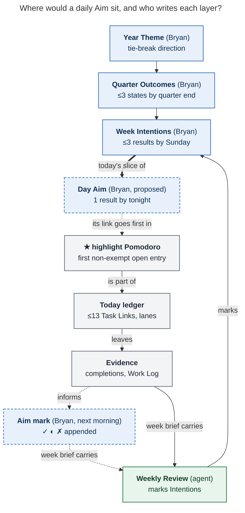

# A daily layer for the period tree: call it the Aim, not "commitments"

*Researcher `cld` · 2026-11-17 (Tuesday of 2026-W47). I checked bob-cli at `3236ceef`,
the live vault (read-only), the deployed Bob plugins, Bryan's bob config, and the
earlier `what_to_write_in_period_notes` research, plus some outside sources. I changed
nothing in the vault or in bob-cli.*

> **The request.** We already track intentions in weekly period notes, outcomes in
> quarterly ones, and themes in yearly ones. Do something similar for daily notes, but
> what should it be called ("daily commitments"?), and what constraints (a commitment
> limit?) and policies (a daily task in `gtd_daily.md`?) should support it? Critique
> the plan, adjust the requirements where that's justified, and end with a recommended
> solution.

## Bottom line

- **Add the daily layer, but make it one result, not a list of commitments.** Bob
  already has a strong daily *task* layer with limits on it: Today, capped at 13
  on-clock Task Links in your config; NEXT, capped at 13; PENDING, capped at 8; the
  READY caps; CROWDED; and the ★ highlight. What's missing is the daily *result*
  layer, the link between the week's Intentions and the Pomodoro ledger. Today the
  Intentions are written on Monday and not looked at again until the next Monday's
  Review.
- **Call it the Aim** (`## Aim` in the daily note). "Commitment" already means three
  things in Bob: the review walk's *Commitments done* boundary and commitment tiers,
  *sticky commitment* (lanes), and dependency *commitment transfer*. It appears 92
  times in the deployed plugins alone. "Intention", "highlight", "focus", "priority",
  "goal", and "plan" are taken too (§3). "Aim" has no uses in bob-cli, and it completes
  the ladder: **Theme → Outcomes → Intentions → Aim**.
- **Constraints:** one line, phrased as a state that's true by tonight. It links one
  task, and the line says which week Intention it serves (`· I1`). Its Task Link goes
  first in today's ledger, so its Pomodoro is the ★ highlight. **Don't add a new
  numeric limit on tasks.** You already have five soft task caps, and PENDING is over
  its cap today (11/8). The limit that's missing is on *results*, and it's 1.
- **Policies:** you own the Aim the same way you own Intentions, so no agent or tool
  writes it. It never changes a task's lane, its Today membership, its freshness, or
  its priority. It is never carried forward automatically. You mark yesterday's Aim
  the next morning (✓ ◐ ✗) as part of one new `#gtd #post` row in `gtd_daily.md`. That
  row replaces the "highlight chosen" clause buried in the Morning review row.
- **Order of work:** run a zero-code trial for two weeks (a template heading plus one
  checklist row). Only then build the small bob-cli read path (week brief and
  `bob plan` lints). Don't give days a Review, a Reflection, or an agent callout.
- **Why be careful:** you've tried daily goal lists before. From Jan 9 to Mar 14,
  2024, 55 daily notes held a `## Goals` section averaging **4.7 lines a day**. Only
  **28% were marked done and 56% were carried forward**, and the practice then stopped.
  `#now` died the same way, at 73 tagged tasks. The weekly Intentions practice is also
  only one week old: W47 is the first week with any written.

---

## 1. What exists today

### 1.1 The period tree, and who writes what

From `docs/periods.md` (§Note anatomy and ownership) and `src/native/periods/brief.rs`:

| Level | Your section | Who writes it | What reads it |
| --- | --- | --- | --- |
| Year (`YYYY.md`) | `## Theme`, `## Outcomes` | Bryan only | Quarter briefs ("Parent Theme/Outcomes"); the year Review marks them |
| Quarter (`YYYY-Qn.md`) | `## Outcomes` | Bryan only | Every week brief in the quarter; the quarter Review marks them |
| Week (`YYYY-Www.md`) | `## Intentions` | Bryan only | The week brief copies it word for word; the weekly Review marks each line ✓ ◐ ✗ – |
| **Day (`YYYYMMDD.md`)** | **nothing** | — | Week brief day rows carry only Worked, a "mostly" root mix, and the closeout mark |

Days are deliberately outside the review machinery. "Days have no Review, so day rows
carry no review state," so a weekly brief's day rows have no human words at all. Daily
notes are also not created by bob. Templater builds them from `~/bob/_templates/daily.md`.
After that, bob's writers (`gcal sync`, capture, reconcile) edit them all day.

### 1.2 The day already has a dense task layer

From `docs/plan.md` and `bob plan` at about 20:00 today:

```text
PLAN  10/13 links · 1 off-clock      TODAY 11 - PENDING 11/8 - NEXT 9/13
ROOTS ○ bob 4 - ○ sase_blog 2 - ○ sase 2 - ○ dev_plex_hack_patch 1 - ○ dev 1 - ○ abby 1
★ WRITE   1 link
```

- **Today**: the open tasks with a dedicated Task Link under today's open Pomodoros,
  computed when read and never stored (`decisions:today-is-read-from-the-ledger`).
- **Budget**: `plan.max_links: 13` on-clock links (default 10), with
  `max_next: 13`, `max_pending: 8`, `max_ready: 21`, and per-note Ready caps. All of
  them are soft: chips turn red, and nothing is refused.
- **★ highlight**: "the first open non-exempt entry in ledger order." Your Morning
  review row already asks for "highlight chosen (≤3 themes, highlight first)."
- **Closeout**: the Day strip marks each day met or missed, depending on whether the
  `#gtd #post` Morning review was completed.

So the task-level question, "what am I committed to doing today?", is answered three
times already: by the ledger, by the Next lane, and by the ★ entry. The question
nothing answers is **"what will be true tonight that makes today count, and which
week Intention does it move?"**

### 1.3 How the practice is going

| Section | State on 2026-11-17 |
| --- | --- |
| Week Intentions | Written for **1 of 48** weeks: W47 (3 lines, entered Mon 2026-11-16 08:14–08:16). W46 reads `NOT SET`. |
| Week Reflection | 1 of 48 weeks (W46: "a rough week… writers block related to `sase_blog#^s0-spike`"). |
| Q4 Outcomes | 3 lines, entered 2026-11-16 08:12–08:14. |
| 2026 / 2027 Theme | Empty (the earlier research said to wait until the 2027-01-11 yearly review). |

The weekly loop ran as designed for the first time **yesterday**. The earlier report
said to run it for 3–4 weeks before building anything. A daily layer added now stacks
a second new habit on top of one that isn't proven yet. That isn't a reason to wait.
It's a reason to keep the daily layer tiny and to judge both layers together (§8).

### 1.4 What Bryan's days actually look like

Measured from `bob periods show` (W43–W46, 28 days) and the Nov 2–16 daily ledgers:

- **Worked** ranged from 1h 15m to 6h 25m a day; the median was about **3h 30m**.
- **`gtd` share of Worked** had a median of about **28%** (17–52% on days it was in
  the top three). PLAN Pomodoros took 25–90 minutes a day.
- **Fragmented, agent-orchestrated sessions**: 9–23 closed on-clock sessions a day.
  The median session lasted 5–22 minutes, and in W46 it was 5–10 minutes most days.
  Most child bullets say "apollo agent", "athena research", and so on.
- **Done** ranged from 7 to 41 completions a day, routine rows included.
- **The morning review is reliable**: closeout was met on **26 of 28** days.

Two design consequences follow:

1. Size the Aim **as a result, not as a time block.** *Make Time*'s Highlight is
   pitched as a 60–90 minute block. Your days don't come in 90-minute blocks, and
   agents often deliver the result. "Merged", "decided and written", and "sent" fit
   how you work. "Two hours on X" doesn't.
2. **Attach the Aim to the morning review**, the one ritual that happens every day,
   and not to a new evening shutdown ritual.

### 1.5 Daily goal lists have failed here before

The vault already contains a daily goal practice, and it ended:

| Attempt | When | What happened |
| --- | --- | --- |
| `## Goals` in daily notes | 55 notes, 2024-01-09 → 2024-03-14 (also 2 in Aug 2023) | It started as outcome-style states ("dev and prod backfill CLs are mailed", "go/words ticket is created"). Within weeks it became zorg task lines with `>` carry-forward marks. **Mean 4.7 lines a day; 73 of 257 lines (28%) done; 144 (56%) carried.** By month, done was 34% → 23% → 26%, and carried was 53% → 70% → 39%. |
| `## @GOAL` sized lists (L/M/S) | 2024-03-15 → 03-20, plus 2024-09-04 | Seven notes, then gone. |
| `#now` weekly-bet tag | 2026-09-30 | 73 tasks tagged in bulk and stripped the same day. The decision record calls it "a second marker with a manual lifecycle" and says "it repeats Today". |
| zorg `now_*` / `soon_*` / `maybe_*` notes | zorg era | "Hand-kept horizon lists had already died twice." |

The 2024 data shows the failure plainly. An uncapped daily list grows to about five
lines. Most lines don't get finished, carrying them forward turns the list into a
backlog, and the backlog is abandoned. The first week of 2024 shows the format that
works: a short list of **states**. The cap and the "no carry-forward" rule are there to
keep it in that form.

---

## 2. Critique: is a daily layer a good idea?

**Yes, with a different shape than "daily commitments."** Here is the argument on
each side.

### What a daily layer gets right

- **It closes the gap in the loop.** The prior research's Figure 1 loop is Outcomes →
  Intentions → work → Review → Reflection, and it touches the Intentions only on
  Mondays. Self-monitoring is the active ingredient: prompting people to monitor
  progress has an effect of d ≈ 0.40 across 138 studies, larger when progress is
  recorded (Harkin et al. 2016). A one-line daily Aim that names "· I1" is the
  cheapest way to look at the Intentions every day *and* record which one moved.
- **Daily progress matters for motivation.** Amabile & Kramer's roughly 12,000 daily
  diary entries from 238 professionals found that progress in meaningful work was the
  strongest positive influence on a person's day. The Aim names the progress you
  intend, so you can tell at night whether it happened.
- **Daily planning works, with a caveat that fits you.** Parke et al. (2018, *JAP*)
  found that daily planning raises engagement and performance through a sense of goal
  progress. Interruptions weaken the benefit of planning out the day's *time*, while
  *contingent* planning ("if X goes wrong, then…") holds up. Your fragmented,
  agent-driven days argue for planning one result, with an optional fallback, rather
  than planning the hours. A meta-analysis (Aeon et al. 2021, 158 samples) finds
  moderate links between time management and performance, and stronger links to
  well-being.
- **A daily note can't turn into a pile.** This is the structural difference from
  `#now` and from Next. Tomorrow's `## Aim` starts empty. Nothing builds up unless you
  copy it by hand, and having to copy it by hand is useful friction: Bullet Journal
  "migration" uses the same idea.

### What's risky about it

1. **Duplicating Today.** A list of today's tasks would be a fourth copy, after the
   ledger, the Next lane, and the ★ entry. `#now` was rejected because "it repeats
   Today". The Aim must be a *result one level above* the tasks, linked to a task but
   not a substitute for one.
2. **The list grows.** See the 2024 data above. A "commitment limit" of 3 or 5 would
   recreate the 2024 `## Goals` list, which averaged 4.7 lines.
3. **Ritual cost.** `gtd` already takes a median of about 28% of Worked. Every daily
   step costs 365 repetitions a year, so the Aim has to take under two minutes, and
   marking it about ten seconds.
4. **Two unproven habits at once.** The weekly loop is a day old. If both lapse, you
   won't know which one failed. That is why §8 measures them together.
5. **The name.** "Daily commitments" would clash with the walk's "Commitments done"
   in the same morning ritual (§3).
6. **Agents could start writing it.** If an agent ever drafts the Aim, it becomes a
   forecast, not a choice. The period-note contract already rules this out for
   Intentions, and the same rule should cover the Aim.

### Verdict

Do it, but as a **one-line daily Aim** that sits under the week's Intentions and over
the ★ highlight. You write it in the morning review and mark it the next morning. It
has no effect on task state, and bob reads it in the weekly brief later. Don't do it
as a capped list of daily commitments.

---

## 3. What to call it

The counts below are case-insensitive whole-word matches (singular or plural) in
bob-cli `docs/` + `src/`, the Markdown in `~/bob`, and the deployed `bob-*` plugin
bundles.

| Candidate | Collisions | Fit | Verdict |
| --- | --- | --- | --- |
| **Commitments** | bob-cli 56 · vault 164 · plugins 92 ("Commitments done", "K commitments", commitment tiers, "sticky commitment", "commitment transfer") | Strong word, but the morning walk already uses it for something else | **Reject.** "Walked to Commitments done · set today's commitments" in one row is ambiguous. |
| Intentions (daily) | Same word as the week section | Fine meaning | **Reject.** The week brief and Review would have two kinds of "Intentions". |
| Highlight | bob-cli 1,946 · vault 5,445 (★ plan highlight, the Highlights app, PDF highlights, annotation highlights) | It's *Make Time*'s term for exactly this | **Reject the word, reuse the idea:** the Aim's link goes in the ★ highlight entry. |
| Focus | bob-cli 368 · plugins 566 (focus chart, `focus-visible`) | Vague | Reject. |
| Priority / Goal / Plan / Today / Next | P-levels and `[priority::]`; `h3_goal`; the PLAN type, `bob plan`, `bob-plan`; Today; the Next lane | Each is taken | Reject. |
| Win / Must-win | "wins" is Bob's precedence wording ("the list wins over…"); "win" also reads as past tense | Good energy | Runner-up as "Must-win" if you dislike Aim. |
| MIT / Big 3 | Jargon; "Big 3" implies three | — | Reject. |
| **Aim** | **bob-cli 0** · vault 43 (all incidental verbs) · plugins 1 (a verb in a meeting hint) | Singular, forward-looking, about a result; reads well in a Review ("Aim ✓"); four keystrokes | **Recommend.** |

**Recommended vocabulary:** section `## Aim`. The glossary term would be **Daily Aim**
(aliases *aim*, *day aim*). The ladder reads **Theme (year) → Outcomes (quarter) →
Intentions (week) → Aim (day)**.

---

## 4. Requirement adjustments (called out)

Each of these changes the request as stated. Each one comes with the reason.

| # | The request implied | I recommend instead | Why |
| --- | --- | --- | --- |
| **R1** | Name: "daily commitments" | **Aim** (`## Aim`) | Name collision (§3); a commitment is a promise about *tasks*, and an aim is a result. |
| **R2** | A list, with a "commitment limit" | **One line**, a soft cap of 1 | Five soft task caps already exist; the 2024 list averaged 4.7 lines and 28% done; ~3.5 h median Worked leaves room for one real result. |
| **R3** | It could mark tasks as committed | **No task-level state at all**: no tag, field, lane change, or Today effect | `#now` history; `decisions:task-lanes-are-sticky` and `today-is-read-from-the-ledger`. |
| **R4** | Mirror the period notes | Mirror **only the planning section**: no daily `## Review`, `## Reflection`, or agent callout | 365 reviews a year would cost far more than they return; the week Review already covers the days. |
| **R5** | (unstated) Who marks the result? | **You, the next morning**, with one appended mark; bob later shows evidence | An agent per day is too much; the morning review is the reliable ritual (26 of 28 days). |
| **R6** | "A daily task in `gtd_daily.md`" | Yes: **one new `#post` row, staged**, and *remove* the "highlight chosen" clause from Morning review | The prior research found that one clause inside a long row ("set ≤3 Intentions") got skipped, so a dedicated row is more likely to be done. |
| **R7** | Build it in bob | **Two-week zero-code trial first**, then a small bob-cli *read* path; plugin UI last | bob + gtd are already most of the worked time; the vault-only version is reversible in one edit. |
| **R8** | (unstated) Carry forward unfinished commitments? | **Never automatically.** Choosing yesterday's ✗ again is a deliberate rewrite. | 56% carry-forward is what ended the 2024 practice. |

---

## 5. The recommended design

### 5.1 Where it sits in the daily note

Make one template change in `~/bob/_templates/daily.md`. Put a read-only embed of the
week's Intentions directly after the `bob-plan` fence, then an empty `## Aim` heading:

````markdown
```bob-plan

```
![[<% moment(tp.file.title, "YYYYMMDD").format("GGGG/GGGG-[W]WW") %>#Intentions]]

## Aim

## Pomodoros
````

- **The embed** shows the week's Intentions every time you open the daily note, so
  there's daily contact with them without any copying. It sits *outside* `## Aim`, so
  later parsing reads only your line. (Obsidian heading embeds render the section up to
  the next heading, which here is `## Days`.)
- **Keep the heading empty.** Don't add prompt text. The same rule applies to period
  notes: anything under the heading will be read as your words once a brief copies it.
- **Placement is safe with bob's writers:**
  - `bob gcal sync` creates `## Events` "immediately above `## Pomodoros`"
    (`src/native/gcal/plan.rs`), which puts Events below `## Aim`.
  - The ledger starts at `## Pomodoros`.
  - Aim lines aren't tasks, so they create no Task Mentions. Mentions come only from a
    task's own text.

### 5.2 The line

```markdown
## Aim

- <state that's true by tonight> → [[note#^id]] · I<n>
```

Next morning, append the mark. **Don't rewrite the line.**

```markdown
- Zettels must declare a type: check merged → [[sase_blog#^zettel-require-type]] · I1 — ✓
- Decision-memory web fixed on athena and apollo → [[sase#^fix-decision-memory-web]] · I3 — ◐ apollo only
- Release-train readiness checklist closed → [[sase#^ref-sase-1n6-11-4-restart-readiness]] · I2 — ✗ agent crash ate the morning
```

These are illustrations from today's real ledger and W47's Intentions. Today's ★
WRITE entry already holds `sase_blog#^zettel-require-type`, which serves W47 Intention
1 ("Finish sase_blog_zettel album"). You were already choosing an aim; it just wasn't
written down.

**Five tests** (about 30 seconds):

1. **A state by tonight.** It says "merged / sent / decided and written / booked", not
   "work on".
2. **One link** to the task (or `^prj`) where the evidence will appear.
3. **Serves a week Intention** (`· I1`), or knowingly doesn't. Family and health Aims
   are welcome.
4. **In today's ledger, first.** Its Task Link is in the first non-exempt open
   Pomodoro, so `bob plan` stars it.
5. **Agents count.** If an agent will do the work, the Aim is the *merged/decided*
   state, not your minutes.

**Optional contingency** (Parke et al.'s contingent planning): one indented
sub-bullet, `- if <the likely blocker>, then <fallback>`. Use it only on days you
expect interruptions.

### 5.3 Constraints

| Constraint | Value | How enforced (trial → later) |
| --- | --- | --- |
| Count | **1 line** (a soft cap; never refused) | Habit → `bob plan` lint `aim_over_cap` |
| Shape | One physical line: state → link · I# | Habit → none (style is yours) |
| Link | Exactly one task or `^prj` block link | Habit → lint `aim_unlinked` |
| Scheduled | The linked task has a dedicated Task Link under an open Pomodoro today | Habit → lint `aim_not_today` |
| First | That link is in the ★ highlight entry | Habit → info hint, not a lint |
| Not a task | No `#task` lines inside `## Aim` | Habit → lint `aim_task_row` (mirrors period notes' `task_rows`) |
| Empty | Allowed; a blank Aim on a rest day is a choice | — |

There is deliberately **no new task cap**. Today's 13-link budget, NEXT, PENDING, and
READY stay as they are. If anything is too loose it's PENDING (11/8 today), and the
lanes' review walk already handles that.

### 5.4 Policies

1. **Ownership.** You alone write the Aim. bob, plugins, capture, and agents never
   write or rewrite it. This is the same rule as `## Intentions`.
2. **No task-state effects.** Writing, marking, or deleting an Aim never changes a
   task's lane, Today membership, freshness stamp, keep streak, priority, or schedule.
   (Linking the task under a Pomodoro does raise it to Next as usual, but that's the
   ledger's rule, not the Aim's.)
3. **Marks.** The next morning, append ` — ✓`, ` — ◐ <the part>`, or ` — ✗ <a few
   words why>`. A ✗ with a reason is the most useful data the layer produces. If you
   skip marking, nothing breaks. Later, bob's evidence chip (§7) stands in.
4. **Changes during the day.** Append `(changed 13:10: <reason>)`. Don't rewrite the
   line. This is the amendment rule the earlier research set for Intentions.
5. **No carry-forward.** Don't copy yesterday's ✗ forward without thinking. If it's
   still the right Aim, writing it again is a fresh choice.
6. **Calibration, not grades.** Expect around 60–80% ✓. If you hit ✓ every day for a
   week, the Aims are too safe; below about 40%, they're too big.

### 5.5 The `gtd_daily.md` change

Add **one** recurring POST row with its own stage. Then shorten Morning review by
removing the clause the new row takes over.

**New row** (insert it next to the other `#post` rows):

```markdown
- [ ] #task #gtd #post #aim **Aim**: mark yesterday's Aim (append — ✓ · — ◐ part · — ✗ why) · glance at this week's Intentions (embedded above ## Aim) · write today's Aim: one state true by tonight → [[link]] · I# (or knowingly none) · put its Task Link first so its Pomodoro is the ★ highlight.  [repeat:: every day when done]  [created:: 2026-11-17]  [scheduled:: 2026-11-18]
```

**Stage order** (in `~/.config/bob/config.yml`, which is chezmoi-managed, so edit the
`chezmoi` source):

```yaml
freshness:
  post_stages: [periods, aim]
```

This makes Monday's `#periods` Weekly review, which sets the Intentions, walk before
the Aim, and both walk before the unstaged Morning review row. It doesn't depend on
file order, which Tasks recurrence can reshuffle.

**Morning review row edit:** replace `highlight chosen (≤3 themes, highlight first)`
with `Aim row done`. CROWDED and ROTTEN stay as they are.

This adds no PRE row and no new walk tier: the review walk already handles staged
POST rows.

### 5.6 The whole picture



*Figure 1. The Aim is the only new box you write. It sits between the week's
Intentions and the ★ highlight. It turns one Intention into one result for the day and
puts that result first in the ledger, and the next morning's mark gives the weekly
Review a daily record to read. Dashed boxes and lines are proposed. Rendered with
Mermaid CLI 12.0.0 in the PDF configuration: 552 × 1090 px, 81.9% fit.*

---

## 6. Alternatives considered

| Alternative | Why not (or not alone) |
| --- | --- |
| **A. "Daily commitments": a capped list of tasks** (the literal request) | It repeats Today a fourth time. With any cap above 1, it recreates the 2024 `## Goals` list. The name collides. |
| **B. A `#aim` / `#today` tag or a `[aim::]` field on the task** | This is the `#now` path: a second marker with a manual lifecycle, write churn, and trailing-field parser risk (the `now-tag` record showed a trailing field erasing `priority`). `today-is-read-from-the-ledger` already rejected a `#today` tag. |
| **C. Reuse the ★ highlight with no text** | No extra writing, but the ★ is a *type* (WRITE), it moves when that Pomodoro closes, and it can't be marked or read later. Keep it as the Aim's *when*, not its *what*. |
| **D. Put the day's Aims in the week note** (e.g. under `## Days`) | Everything would be in one place for the Review, but you work in the daily note all day. Better: the Aim lives in the daily note, and the week's parts table *shows* it (Phase 2). |
| **E. Give days the full period anatomy** (Review, Reflection, agent callout) | 365 agent runs and readings a year, for a Review that the weekly Review already provides. Reflection at day scale is journaling: welcome, but not a contract. |
| **F. Embed the week's Intentions in the daily note, and nothing else** | The zero-writing version. It keeps daily contact, but looking isn't choosing, and recording beats passive monitoring (Harkin 2016). **Adopted as part of §5.1**, not on its own. |
| **G. Mark at an evening shutdown** (Newport-style) | You have no evening ritual and a very reliable morning one. Marking the next morning keeps it to one ritual. If you later add a shutdown, move the mark there. |
| **H. Have bob compute the mark** | A task completed today gives a ✓, but bob can't see "◐ apollo only" or why something was ✗. Use computed evidence *next to* your mark (§7), never instead of it. |

---

## 7. Phased implementation

### Phase 0: vault only, today (about 10 minutes, fully reversible)

1. Edit `_templates/daily.md` as in §5.1. Tomorrow's note (`20261118`) is the first
   with the section. For today, you can type `## Aim` in by hand.
2. Add the §5.5 row to `gtd_daily.md`, add `aim` to `post_stages` through chezmoi, and
   shorten the Morning review row.
3. During the first few days, check that the embed renders and that nothing (gcal
   sync, capture, reconcile) moves or rewrites the `## Aim` section.

### Phase 1: bob-cli read path (small; only after the trial passes)

- **Week brief:** `brief.rs` already parses sections with `note::parse`. Day parts rows
  would gain `aim` (the `## Aim` list items, verbatim) and `aim_mark` (✓/◐/✗/none,
  parsed from the trailing ` — <mark>`). Add a line to the Markdown brief:
  `Tue 17 · Aim: … · ✓`. This is the main payoff, because it lets the weekly Review
  rest Intention marks on the days' Aims.
- **Weekly callout v3:** tell the agent that `· I#` maps an Aim to an Intention, and
  that Aim marks are Bryan's own record, to be reported as his. Bump
  `INSTRUCTIONS_VERSION`, then run `bob periods ensure -R`, as `docs/periods.md`
  requires.
- **`bob plan`:** add an `AIM` line under `ROOTS`, and the lints `aim_over_cap`,
  `aim_unlinked`, `aim_not_today`, and `aim_task_row` (read-only, like the others; they
  never change `status`).
- **Docs and memory:**
  - document the section in `docs/reference/vault-format.md` (Daily note) and
    `docs/periods.md`;
  - add a **Daily Aim** glossary term;
  - write a decision record, roughly "The Daily Aim is one user-owned result line,
    never task state", citing this research. Use `/sase_memory_write` for the
    glossary and decision changes.
- **Not needed:** creating daily notes stays with Templater, and `bob periods ensure`
  needs no change.

### Phase 2: display (optional; bob-plugins and Mac, after Phase 1 has run for a while)

- **Week parts table:** day rows show the Aim and its mark where week rows show a
  Headline. This is the "Aims in the week note" view, derived rather than duplicated.
- **Day strip:** a quiet Aim line with a bob-computed evidence chip (`done 14:20`,
  `worked 25m`, `no linked time`). It is evidence only, never a verdict, and it
  follows the periods brief's rule that "no linked minutes is not stalled".
- **Bob Mac Capture idle agenda:** shows the Aim above Now/Next/Later. Under
  `decisions:mac-capture-is-a-thin-client`, bob must supply it in the
  `capture-pomodoros --tasks` JSON, so the Mac app doesn't parse the note.
- **Avoid:** an "Aims met" target or percentage on the strip. Narrow numeric goals
  invite gaming (Ordóñez et al. 2009). Report marks; don't score them.

---

## 8. How to tell it's working

**Trial window:** Wed 2026-11-18 through Sun 2026-11-29 (the rest of W47 plus W48).
Judge it at the W49 Weekly review (Mon 2026-11-30). Judge it together with the weekly
Intentions practice.

| Signal | Pass | Fail → action |
| --- | --- | --- |
| Aim written | ≥ 10 of 12 days (or on every day the morning review closed) | < 8 → the row is being skipped; shorten it, don't add more |
| One line | ≤ 1 day a week with 2+ lines | Lists are growing (the 2024 pattern) → stop and rethink |
| Calibration | Roughly 50–80% ✓ | 100% → Aims too safe; < 40% → too big |
| Changed a choice | ≥ 2 times you can name where the Aim made you do, defer, or drop something | 0 → it's bookkeeping; drop the section |
| Cost | Aim row takes ≤ 2 min; PLAN minutes don't rise noticeably | More → cut the mark step first |
| Upward link | The W47 and W48 Reviews can cite Aims as evidence for Intentions | They can't → the `· I#` habit or the brief (Phase 1) is missing |

To roll back, delete the heading and embed from the template and delete the row: two
edits.

---

## 9. Open questions for Bryan

1. **Name:** is "Aim" acceptable? The runner-up is "Must-win". Either way, please not
   "commitments".
2. **Cap:** strictly one, or one plus an optional labelled personal line (family or
   health) on work-heavy days? I recommend strictly one for the trial.
3. **Marking time:** next morning, as recommended, or would you rather start a
   two-minute evening shutdown?
4. **Scope:** whole-life Aims (I recommend allowing them) or work only?
5. **Phase 1:** after the trial, do you want the week brief to carry the Aims (the
   main payoff), or keep them as private daily notes?

---

## 10. Sources

**Bob contract, code, and data (bob-cli `3236ceef`; vault read-only, 2026-11-17):**

- `docs/periods.md`: Note anatomy and ownership; Agent briefs §4 Parts ("Days have no
  Review"); Problems (`task_rows`).
- `docs/plan.md`: plan budget, Today, Highlight and running, Today roots, Lanes.
- `docs/freshness.md` §4 and `docs/guides/run-morning-review.md`: commitment tiers,
  "Commitments done", staged POST rows.
- `docs/reference/vault-format.md`: Daily note, Events section.
- `src/native/periods/note.rs` (`parse`), `brief.rs` (`own_sections`, day parts),
  `report.rs` (`closeout_for_day`), `src/native/gcal/plan.rs` (Events "immediately above
  `## Pomodoros`"), `src/native/plan_budget/mod.rs` (highlight flag).
- Decision records: `now-tag-is-user-owned`, `task-lanes-are-sticky`,
  `today-is-read-from-the-ledger`, `mac-capture-is-a-thin-client`. Glossary: Period
  Note, Stats Strip, Day Strip, Task Freshness, Morning GTD Review Footer, Task Mention.
- Vault: `_templates/daily.md`; `gtd_daily.md`; `2026/2026-W46.md`, `2026-W47.md`,
  `2026-Q4.md`; `2026.md`, `2027.md`; `2026/20261116.md`, `20261117.md`; `bob plan` at
  about 20:00; `bob periods show 2026-W43…W46 -f json`; 2024 daily notes with
  `## Goals` / `## @GOAL`; `~/.config/bob/config.yml` (`plan:` caps,
  `freshness.post_stages`); deployed `~/bob/.obsidian/plugins/bob-*/main.js` (name
  collision counts).
- Prior research: `research:202611/what_to_write_in_period_notes/what_to_write_in_period_notes__final.md`
  (Intentions formula, amendment rule, evidence table, "run 3–4 weeks before
  building").

**Outside sources:**

- Harkin, B. et al. (2016). Does monitoring goal progress promote goal attainment? A
  meta-analysis. *Psychological Bulletin* 142(2). (Cited through the prior research.)
- Amabile, T. & Kramer, S. (2011). *The Progress Principle*. HBR Press. Summary:
  [HBS Working Knowledge](https://hbswk.hbs.edu/item/6685.html);
  [Canadian Government Executive](https://canadiangovernmentexecutive.ca/the-motivating-power-of-progress/).
- Parke, M., Weinhardt, J., Brodsky, A., Tangirala, S., & DeVoe, S. (2018). When daily
  planning improves employee performance: The importance of planning type, engagement,
  and interruptions. *Journal of Applied Psychology* 103(3), 300–312.
  [LBS Research Online](https://lbsresearch.london.edu/id/eprint/894);
  [UMD Smith summary](https://www.rhsmith.umd.edu/research/when-life-interrupts-your-daily-checklist).
- Aeon, B., Faber, A., & Panaccio, A. (2021). Does time management work? A
  meta-analysis. *PLOS ONE* 16(1): e0245066.
  [EconPapers](https://econpapers.repec.org/RePEc:plo:pone00:0245066);
  [ScienceDaily](https://sciencedaily.com/releases/2021/02/210204131413.htm).
- Knapp, J. & Zeratsky, J. (2018). *Make Time*: the daily Highlight, about 60–90
  minutes. [Knapp, "Choose a Highlight every day"](https://medium.com/@jakek/make-time-month-week-1-do-one-big-thing-every-day-2521523600c0).
  (These are secondary descriptions; I did not check the book's own wording.)
- Ordóñez, L. et al. (2009). Goals gone wild. *Academy of Management Perspectives*.
  (Cited through the prior research; contested by Locke & Latham 2009.)
- Gollwitzer, P. & Sheeran, P. (2006). Implementation intentions meta-analysis. (The
  ★-first rule gives the Aim a "when"; cited through the prior research.)

---

## 11. Recommended solution

**Add a one-line, user-owned `## Aim` to each daily note. It is the day's slice of the
week's Intentions. Don't add "daily commitments" or any new task limit.**

1. **Name and shape.** `## Aim` holds one line:
   `<state true by tonight> → [[task link]] · I<n>`. It sits after the `bob-plan`
   fence, under a read-only embed of the week's `#Intentions`. The ladder becomes
   Theme → Outcomes → Intentions → **Aim**.
2. **Constraints.**
   - A soft cap of **one** line.
   - It links exactly one task or `^prj`.
   - That task is in today's ledger, in the first non-exempt Pomodoro (the ★
     highlight).
   - No `#task` lines in the section.
   - Leave the existing task caps unchanged.
3. **Policies.**
   - You alone write the Aim. Agents and tools never do.
   - It has no effect on task lane, Today, freshness, priority, or schedule.
   - No automatic carry-forward.
   - Record changes during the day as `(changed HH:MM: why)`.
   - Mark it the next morning by appending ✓ / ◐ part / ✗ why.
4. **Ritual.** One new `#gtd #post #aim` daily row in `gtd_daily.md`: mark
   yesterday's, glance at the Intentions, write today's, and put its link first. Stage
   it after `periods` (`post_stages: [periods, aim]`). Drop "highlight chosen" from
   the Morning review row.
5. **Sequence.**
   - **Phase 0:** the template, the row, and a stage change, starting tomorrow, as a
     two-week trial judged on 2026-11-30 against §8.
   - **Phase 1**, only if the trial passes:
     - the week brief carries each day's Aim and mark;
     - weekly callout v3;
     - `bob plan` shows an `AIM` line and the four lints;
     - docs, a glossary term, and a decision record.
   - **Phase 2**, optional: the parts table, a Day-strip evidence chip, and the Mac
     agenda show the Aim, never as a score.
   - Never give days a Review, a Reflection, or an agent.
