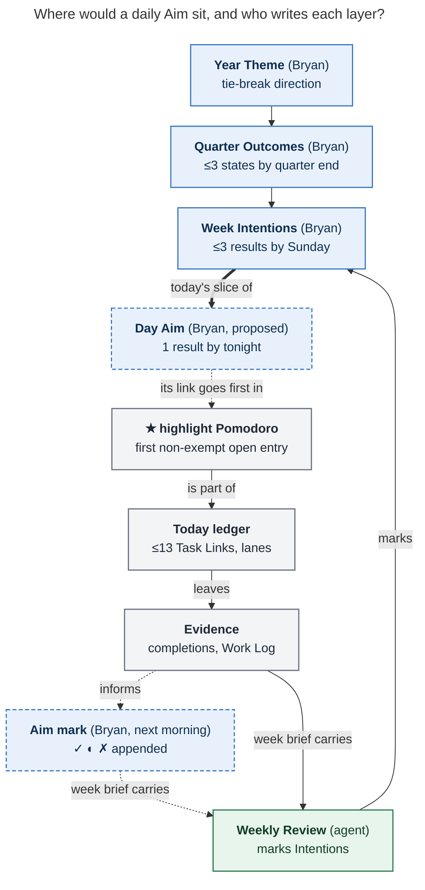

# A daily layer for the period tree: one user-owned Aim, not a commitment list

Lead-researcher consolidation · 2026-11-17 (Tuesday of 2026-W47). This report merges
five independent research reports — `__cdx`, `__cld`, `__grk`, `__mus`, and `__gem`,
all in this directory — with the lead's own verification of every disputed mechanism
against bob-cli at `3236ceef`, the live `~/.config/bob/config.yml`, and read-only looks
at `~/bob/gtd_daily.md` and `~/bob/_templates/daily.md`. Nothing in the vault or any
codebase was changed.

## Bottom line

**Yes, add the daily layer — but as one user-owned result line, not a list of daily
commitments.** Four of the five researchers independently converged on the same shape:
a single, Bryan-authored sentence in the daily note stating what will be true tonight
that makes today count. The fifth (`gem`) argued for fixing the ledger's ★ highlight
instead of adding prose; its telemetry is the strongest evidence in the swarm that the
gap is real, but its no-prose conclusion loses to the others because the ★ is a moving
execution pointer that cannot record a choice, a reason, or a result.

- **Call it the Aim** (`## Aim` in the daily note). "Commitments" is rejected by every
  researcher who checked collisions: the morning walk's footer already says
  "Commitments done" every day (verified at `docs/freshness.md:522` and live
  `gtd_daily.md:13`). "Highlight", "Focus", "Intentions", "Outcomes", and "Theme" are
  all taken (see [Naming](#naming)). "Aim" has zero uses in bob-cli and completes the
  ladder **Theme (year) → Outcomes (quarter) → Intentions (week) → Aim (day)**.
- **Cap: one line, soft, and empty is valid.** Not three. The vault's own 2024
  `## Goals` experiment shows what a daily list becomes: 4.7 lines a day, 28% done,
  56% carried forward, abandoned after nine weeks. Median Worked is about 3.5 h/day;
  that funds one real result, not three.
- **Shape:** `<state true by tonight> → [[note#^id]] · I#` — a finished state, one
  task link, and which weekly Intention it serves. Mark it the next morning by
  appending ` — ✓`, ` — ◐ part`, or ` — ✗ why`. Never rewrite the line; never carry it
  forward automatically.
- **Policies:** Bryan alone writes it (same ownership rule as weekly Intentions). It
  never changes a task's lane, Today membership, freshness, priority, or schedule. No
  daily Review, Reflection, or agent draft — the weekly Review is the rollup.
- **Ritual:** amend the existing Morning review row's stale clause
  `highlight chosen (≤3 themes, highlight first)` — the theme cap it cites was retired
  from the code — rather than adding a new checklist row. If the trial shows the
  clause gets skipped, promote it to one dedicated staged `#post` row
  (`post_stages: [periods, aim]`); the staging mechanism is verified real and live.
- **Add carryover triage** (from `gem`, a justified addition to the request): the same
  Morning review edit should include sweeping yesterday's unworked Today links —
  elevate one to the Aim, split it, or release it — because the measured carryover is
  what actually buries the week's Intentions.
- **Order of work:** a zero-code two-week trial (template heading + one checklist
  edit), judged 2026-11-30 together with the week-old Intentions practice. Only then a
  small bob-cli read path (the week brief carries each day's Aim and mark). Display
  surfaces last, and never as a score.

## What exists today

All five researchers verified the same baseline; the lead re-verified the load-bearing
pieces in source.

### The period tree has setpoints; the day has only an actuator

From `docs/periods.md` ("Note anatomy and ownership") and `src/native/periods/`:

| Horizon | Bryan-owned section | Agent-owned | Day analog today |
| --- | --- | --- | --- |
| Year (`YYYY.md`) | `## Theme`, `## Outcomes` | `## Review` | — |
| Quarter (`YYYY-Qn.md`) | `## Outcomes` | `## Review` | — |
| Week (`YYYY-Www.md`) | `## Intentions` | `## Review` (marks each line ✓ ◐ ✗ –) | — |
| Day (`YYYYMMDD.md`) | **nothing** | **nothing** ("Days have no Review", `periods/brief.rs`) | Pomodoro ledger, Today, ★ highlight, Events, closeout |

`grk`'s framing carries the whole argument: the week, quarter, and year sections work
because they are *setpoints* — authored prose naming a finished state that an agent
later marks against evidence. The day already has the *actuator*: Today is the open
tasks with dedicated Task Links under today's open Pomodoros, computed at read time
(`decisions:today-is-read-from-the-ledger`); lanes, caps, and the morning walk pace it.
What no mechanism answers is **"what will be true tonight that makes today count, and
which weekly Intention does it move?"**

Key verified facts:

- The ★ highlight is literally `entries[first].highlight = true` — the first open
  non-exempt Pomodoro in ledger order (`src/native/plan_budget/mod.rs:769`). It moves
  whenever that entry closes. It is an execution pointer, not a record of the
  morning's choice.
- The live Morning review row (`gtd_daily.md:13`) still says
  `highlight chosen (≤3 themes, highlight first)`. The ≤3-theme cap is retired: types
  are "listed, never budgeted" (`docs/plan.md`), and today five type names are open.
  The clause must be rewritten whichever design ships.
- Soft caps already bind the day: live config has `max_links: 13` (docs default 10),
  `max_pending: 8` (over cap at 11/8 today), `max_next: 13`, `max_ready: 21`, plus
  per-note Ready caps. No new numeric task cap is missing; all five researchers agree
  none should be added.
- `bob gcal sync` creates `## Events` "immediately above `## Pomodoros`"
  (`src/native/gcal/plan.rs:2313`), so a section placed above `## Pomodoros` in the
  template ends up ordered Aim → Events → Pomodoros — setpoint, then calendar, then
  sessions. Capture rewrites only Pomodoros; the Aim section stays Bryan's.
- PRE/POST checklist stages exist and are live (`docs/freshness.md` §4, schema 16;
  config `post_stages: [periods]`; "the Morning review stays unstaged, so last"). A
  staged `#post` row therefore walks *before* the unstaged Morning review — which
  resolves an apparent conflict between two researchers (see
  [Disagreements](#how-the-five-reports-disagreed-and-how-each-was-resolved)).

### What Bryan's days actually look like

`cld` and `gem` measured the same ledgers independently and agree:

- **Worked:** ~1 h 15 m to 6 h 25 m a day in November; median ≈ **3 h 30 m**. PLAN
  (gtd) takes a mean of ~59 m/day, about **28% of Worked**.
- **Fragmentation:** 9–23 closed on-clock sessions a day; median session 5–22 minutes.
  65.8% of closed on-clock Pomodoros in Nov 1–17 lasted ≤10 m — mostly SASE agent
  launches. Tasks receiving ≥30 m in a day: mean **0.7** (zero on 9 of 17 days).
- **Carryover (gem's distinctive finding):** closed days ended with a mean of **7.9
  unworked open Task Links**. Of 127 such link-ends, only **18.1%** were worked the
  next day; **49.6%** sat unworked two consecutive days. W47 Intention #3
  (`sase#^fix-decision-memory-web`) sat open and unworked six straight days. Today
  behaves like a rolling menu, not a bet.
- **The morning ritual is the reliable anchor:** closeout met ~26 of 28 recent days
  (94%). There is no evening ritual.

Design consequences: size the Aim as a **result, not a time block** (agents often
deliver it — "merged" and "decided" fit; "two hours on X" doesn't); attach everything
to the morning ritual; and pair the new choice with triage of yesterday's leftovers,
because a one-line bet written on top of an untriaged 8-link pile changes nothing.

### This vault has already run — and killed — daily goal lists

`cld` excavated the history; `grk` and `gem` corroborate pieces of it:

| Attempt | When | Outcome |
| --- | --- | --- |
| `## Goals` in daily notes | 55 notes, 2024-01-09 → 2024-03-14 | Started as outcome states; became task lines with `>` carry marks. **Mean 4.7 lines/day; 28% done; 56% carried.** Abandoned. |
| `## @GOAL` sized lists (L/M/S) | 2024-03-15 → 03-20 | Seven notes, then gone. |
| `#now` weekly-bet tag | 2026-09-30 | 73 tasks bulk-tagged and stripped the same day; the decision record calls it "a second marker with a manual lifecycle" that "repeats Today". |
| zorg `now_*`/`soon_*` horizon notes; zorg habit log | zorg era | "Hand-kept horizon lists had already died twice"; the habit log ran 826 daily files, then stopped. |

The failure mode is consistent: an uncapped daily list grows to ~5 lines, most lines
don't finish, carry-forward turns it into a backlog, and the backlog is abandoned. The
first week of 2024 shows the form that worked: a short list of **states**. The cap of
one and the no-carry-forward rule exist to hold that form. Also relevant: weekly
Intentions are **one week old** (W47 is the first real set; W46 reads `NOT SET`), so
this adds a second new habit on top of an unproven one — a reason to keep the daily
layer tiny and judge both together, not a reason to wait.

## Is this a good idea?

**Yes — as a one-line setpoint. No — as a daily todo system.** The original framing
("daily commitments", a commitment limit, a task in `gtd_daily.md`) points at the
second; every researcher redirected it to the first.

For it:

- **It closes the loop's gap.** Intentions are written Monday and currently not read
  again until the next Monday (`gem` verified Intention #2 had zero presence in
  today's note). A one-line Aim naming `· I1` is the cheapest way to touch the
  Intentions daily *and* record which one moved. Monitoring goal progress has a
  meta-analytic effect of d ≈ 0.40 (Harkin et al. 2016), larger when progress is
  recorded, and daily progress on meaningful work is the strongest driver of inner
  work life (Amabile & Kramer, ~12,000 diary entries).
- **Planning one result survives interruption; planning the hours does not.** Parke
  et al. (2018) found time planning's benefit weakens with interruptions while
  contingent planning holds — a precise fit for fragmented, agent-driven days. An
  optional `if <blocker>, then <fallback>` sub-bullet imports the implementation-
  intentions effect (Gollwitzer & Sheeran 2006, d = .65; Sheeran, Listrom & Gollwitzer
  2024, 642 tests).
- **A daily note can't become a pile.** Tomorrow's `## Aim` starts empty; nothing
  accumulates without a deliberate re-choice. That is the structural difference from
  `#now`, Next, and every list that died.

Against it — the risks the design must (and does) answer:

1. **Duplicating Today.** A list of tasks would be a fourth copy after the ledger,
   Next, and ★. Hence: one *result above* the tasks, pointing at one, never restating
   them.
2. **List growth.** Hence the cap of one and no carry-forward (the 2024 data).
3. **Ritual cost.** gtd is already ~28% of Worked; Bryan's own margin note rejects a
   "productivity diary". The Aim must cost under two minutes, the mark ~10 seconds,
   and there must be no daily Review/Reflection (365 agent runs a year for a rollup
   the weekly Review already does).
4. **Promise inflation and short-horizon bias** (`cdx`): calling preferences
   "commitments" turns reprioritization into failure, and a completion score favors
   small finishable work over research and rest. Hence the naming, the valid-empty
   rule, marks instead of scores, and a bounded-investigation framing for uncertain
   work.
5. **Unread sections die** (`mus`): weekly Intentions work because an agent must read
   them. The Aim's named readers are tomorrow-morning Bryan (the mark) and, in Phase
   1, the weekly brief.

Evidence calibration (`cdx`): the external research supports specific planning,
contingency thinking, realistic sizing, and recording choices. No source validates
this exact feature, an optimal item count, punitive misses, or a success threshold.
One-vs-three and the storage design are engineering judgments — made here from the
vault's own history.

## Naming

`cld` ran whole-word collision counts across bob-cli (`docs/` + `src/`), the vault
Markdown, and the deployed plugin bundles; the others' qualitative checks agree:

| Candidate | Collisions | Verdict |
| --- | --- | --- |
| **Commitments** | bob-cli 56 · vault 164 · plugins 92 — "Commitments done" boundary, commitment tiers, sticky commitment, commitment transfer | **Reject.** One word would mean both "the walk before ROTTEN" and "today's chosen result", in the same morning ritual. |
| Intentions (daily) | the weekly section's own word | Reject — the brief and Review would hold two kinds of "Intentions". |
| Highlight | bob-cli 1,946 · vault 5,445 — the moving ★, the Highlights PDF app, annotation highlights | Reject the word, keep the idea: the Aim's session should *be* the ★. |
| Focus | bob-cli 368 · plugins 566; also a type name in the tutorial vault | Reject (was `cdx`'s pick; `cdx` did not run counts). |
| Outcomes / Theme / Priority / Goal / Plan / Today / Next | each already load-bearing | Reject. |
| Win / Must-win | minor collisions; reads well | Runner-up if Aim displeases. |
| **Aim** | **bob-cli 0** · vault 43 (incidental verbs) · plugins 1 | **Recommend.** One syllable, forward-looking, about a result; "Aim ✓" reads well in a Review. |

Glossary term, when one is written: **Daily Aim** (aliases *aim*, *day aim*). The
ladder: **Theme → Outcomes → Intentions → Aim**. This is a way to think, not a foreign
key: an Aim may serve one Intention, several, or knowingly none (family, health, rest).

## The recommended design

### Template change

One edit to `~/bob/_templates/daily.md` (verified current shape: frontmatter, title,
nav, `^gtd` row, `bob-plan` fence, `## Pomodoros`). After the fence, before
`## Pomodoros`:

````markdown
```bob-plan

```
![[<% moment(tp.file.title, "YYYYMMDD").format("GGGG/GGGG-[W]WW") %>#Intentions]]

## Aim

## Pomodoros
````

- The **embed** of the week's Intentions gives daily contact with them without
  copying — directly fixing the measured "Intentions don't feed morning selection"
  failure. It sits outside `## Aim` so later parsing reads only Bryan's line. Verify
  it renders correctly in the first days (this is `cld`'s addition; the others would
  link rather than embed — either preserves the goal; the embed is cheaper to glance).
- **Keep the heading empty.** No prompt text: anything under the heading becomes
  Bryan's words the moment a brief copies it (the same rule period scaffolds follow).
- Placement is safe with bob's writers: gcal sync puts Events below Aim, capture
  rewrites only Pomodoros, and Aim lines are not tasks so they create no Task
  Mentions. Live order: Aim → Events → Pomodoros.
- **No backfill** of historical notes; an absent section means "predates the
  practice", never failure. bob does not start creating daily notes; Templater keeps
  that job.

### The line

```markdown
## Aim

- <state that's true by tonight> → [[note#^id]] · I<n>
```

Next morning, append the mark — never rewrite the line:

```markdown
- Zettels must declare a type: check merged → [[sase_blog#^zettel-require-type]] · I1 — ✓
- Decision-memory web fixed on athena and apollo → [[sase#^fix-decision-memory-web]] · I3 — ◐ apollo only
- Release-train readiness checklist closed → [[sase#^…-readiness]] · I2 — ✗ agent crash ate the morning
```

Six tests, ~30 seconds (merged from `cld` and `grk`):

1. **A state by tonight** — "merged / sent / decided and written / booked", not "work
   on". If it needs more than a day, it is a weekly Intention; today's Aim is the next
   visible piece.
2. **Roughly one focused block** (Make Time's 60–90 m is the gloss, not a rule — a
   20-minute protected personal activity is a legitimate Aim).
3. **One link** to the task or `^prj` where the evidence will appear; **markable**
   from the vault later.
4. **Mostly in Bryan's control** — "schema card merged" passes; "get the offer" is a
   quarter Outcome.
5. **Serves a week Intention (`· I1`) or knowingly doesn't.** Whole-life Aims are
   welcome. If no Aim all week serves an Intention, the Intentions need a look.
6. **Its session goes first**: after the morning review, the first open non-exempt
   Pomodoro — the ★ highlight — is the session that serves the Aim. If the ★ and the
   Aim disagree, the ledger is lying; reorder.

**Optional contingency** (use on days interruptions are likely): one indented
sub-bullet, `- if <likely blocker>, then <fallback>`.

### Constraints

| Constraint | Value | Enforcement (trial → later) |
| --- | --- | --- |
| Count | **1 line**, soft; never refused | Habit → optional report-only `bob plan` lint (`aim_over_cap`) |
| Empty | Valid — a blank Aim on a rest, travel, or obligation-eaten day is a choice, distinguishable in prose ("none — travel") when worth recording | — |
| Link | Exactly one task or `^prj` block link | Habit → lint (`aim_unlinked`) |
| In the ledger | The linked task has a dedicated Task Link under an open Pomodoro today, first | Habit → info hint only |
| Not a task | No `#task` / checkbox rows inside `## Aim` | Habit → lint mirroring period notes' `task_rows` |
| Task caps | **Unchanged** — no new numeric cap, no revived theme cap | — |

### Policies

1. **Ownership.** Bryan alone writes, amends, and marks the Aim. bob, plugins,
   capture, and agents never write it, auto-fill it from the ★/Today/Next, or score
   it. Agents may suggest wording only when asked.
2. **No task-state effects.** Writing, marking, or deleting an Aim never changes a
   task's lane, Today membership, freshness, keep streak, priority, or schedule.
   (Linking the task under a Pomodoro raises Ready to Next as usual — the ledger's
   rule, not the Aim's.)
3. **Marks, not grades.** ` — ✓`, ` — ◐ part`, ` — ✗ why`, appended the next morning.
   A ✗ with a reason is the most useful data the layer produces. Skipping the mark
   breaks nothing; weekly review states uncertainty. No streaks, percentages, or
   success badges — calibration guidance only: roughly 50–80% ✓ is healthy; 100%
   means the Aims are too safe, below ~40% too big.
4. **Changes during the day** are appended — `(changed 13:10: <reason>)` — never
   silent rewrites. Cosmetic wording fixes need no log.
5. **No automatic carry-forward.** An unfinished task stays in the task system, where
   lanes, decay, and review already apply. Re-choosing yesterday's ✗ is a deliberate
   fresh choice (GTD: rewriting lists onto each day is "demoralizing and a waste of
   time"; the 56% carry rate is what killed 2024's list).
6. **No daily Review, Reflection, or agent callout. Ever.** Days stay outside the
   period machinery; the weekly Review is the rollup.

### Ritual: one edit to the Morning review row

Replace the stale clause in `gtd_daily.md:13` —
`highlight chosen (≤3 themes, highlight first)` — with:

> yesterday's Aim marked (append — ✓ · ◐ part · ✗ why) · leftover TODAY links triaged
> (work it, split it, or release it — no zombies) · today's Aim written (glance at the
> embedded Intentions; one state true by tonight → link · I#, or knowingly blank) ·
> its session first (the ★ serves the Aim)

Why this and not the alternatives:

- **Not a new PRE row** (`mus`'s proposal): the Aim is a choice made *after* the
  landscape is visible — after the walk, CROWDED, and the calendar (a PRE `#browser`
  row already covers Events). PRE is intake.
- **Not an evening row**: there is no evening ritual to attach to, the morning one
  runs at 94%, and all `#gtd #post` rows — staged or not — walk during the *morning*
  `]s` walk, so an evening-intended row would either stall closeout or be checked off
  early.
- **A dedicated staged row is the prepared fallback** (`cld`'s design): one
  `#task #gtd #post #aim` row, staged via `post_stages: [periods, aim]` in the
  chezmoi-managed config, which verifiably walks after Monday's `#periods` row and
  before the unstaged Morning review. Adopt it if the trial shows the clause version
  being skipped — `cld` cites prior-research evidence that a clause buried in a long
  row (the old "set ≤3 Intentions") did get skipped, and the row above is undeniably
  long. The trigger: Aim written on fewer than ~8 of the 12 trial days.

### The whole picture



*Figure 1. The Aim is the only new box Bryan writes. It sits between the week's
Intentions and the ★ highlight: it turns one Intention into one result for the day,
puts that result first in the ledger, and the next morning's mark gives the weekly
Review a daily record to read. Dashed boxes and lines are proposed. (Diagram carried
from the `__cld` report; rendered there with Mermaid CLI 12.0.0 in the PDF
configuration: 552 × 1090 px, 81.9% fit.)*

## How the five reports disagreed, and how each was resolved

| Question | Positions | Resolution |
| --- | --- | --- |
| Name | Aim (`cld`, `grk`) · Focus (`cdx`) · Intentions or Focus (`mus`) · Highlight (`gem`) | **Aim** — the only candidate with zero collisions, backed by the only systematic count. Focus and Highlight are both heavily taken. |
| Cap | 0-or-1 (`cdx`) · 1 (`cld`, `grk`) · 1 + ≤2 bets (`gem`) · ≤3 (`mus`) | **1, empty valid.** The 2024 list data and ~3.5 h median Worked outvote the weekly-parallel ≤3; `gem`'s "bets" tier is dropped as quiet list growth. |
| Prose section vs ledger-native ★ fix | Prose section (4) · no prose, pin the ★ (`gem`) | **Prose section.** The ★ moves by construction and cannot hold a reason, a mark, or history. `gem`'s ★-pinning survives as a Phase 2 option; its telemetry and carryover triage are adopted now. |
| Ritual placement | Amend existing clause (`cdx`, `grk`, `gem`) · new staged `#post` row (`cld`) · new PRE row (`mus`) | **Amend the clause first** (majority, minimal); the staged row is the measured fallback. PRE is rejected: the Aim is a post-walk choice. |
| Evening vs morning marking | All five: morning | Morning — the 94%-reliable ritual; `gem`'s walk-order point makes an evening `#post` row self-defeating anyway. |
| Does a new staged `#post` row break closeout? | `gem` warned `#post` rows walk before Morning review; `cld` relied on exactly that | **Not a conflict.** Verified: staged POST rows sort before the unstaged Morning review (`docs/freshness.md` §4, schema 16). That ordering is wrong for an evening row and exactly right for a morning Aim row. |
| `max_links` 13 → 8 | Only `gem` proposes it | **Bryan's call, as a separate experiment.** The diagnosis (Today as overflow drawer) is solid, but no other researcher weighed the cost to rapid agent bursts, and bundling it with the Aim trial would confound both. If carryover triage alone doesn't shrink the 7.9-link residue, tighten then. |

## Explicit adjustments to the request

Each changes the request as stated, with the reason:

1. **"Daily commitments" → Daily Aim.** Name collision with the walk's "Commitments
   done" and lane commitment; a commitment is a promise about tasks, an aim is a
   result.
2. **A commitment limit → one line, soft; zero valid.** Five soft task caps already
   exist; the missing limit is on *results*, and it is 1. No new numeric cap, and the
   retired theme cap stays retired — its stale wording in the Morning review row is
   removed as part of this change.
3. **"A daily task in `gtd_daily.md`" → the checklist holds the prompt, never the
   content.** Exactly as the weekly row prompts `## Intentions` on the week note. The
   content lives in the daily note's `## Aim`. Phase 0 amends the existing row; a
   dedicated staged row only if the clause proves skippable.
4. **Mirror the period notes → mirror only the planning section.** No daily Review,
   Reflection, agent draft, or callout; days stay outside `bob periods`.
5. **No task-level state at all** — no tag, field, lane effect, or Today effect
   (`#now`'s fate; `today-is-read-from-the-ledger`; the inline-field parser hazard).
6. **No automatic carry-forward; marks instead of scores** — appended ✓/◐/✗ by Bryan
   the next morning; no streaks or success rates anywhere.
7. **Added (not requested): morning carryover triage.** `gem`'s measurements justify
   folding "triage yesterday's leftover Today links" into the same Morning review
   edit — the Aim names the day's bet; the triage clears the pile that would bury it.
8. **Build order: vault-only trial → read path → display.** No CLI, parser, plugin,
   or Mac-app work in Phase 0; Bob Mac Capture stays a thin client and the idle
   agenda is untouched until bob itself serves the Aim.

## Phased implementation

### Phase 0 — this week, zero code (~10 minutes, reversible in two edits)

1. Edit `_templates/daily.md` as above; type `## Aim` by hand into today's note if
   wanted. No backfill.
2. Rewrite the Morning review clause (Aim mark + carryover triage + Aim written +
   ★ serves it), removing the stale ≤3-themes text.
3. For the first days, check the Intentions embed renders and that gcal sync,
   capture, and reconcile leave the section alone.

### Phase 1 — small bob-cli read path (only after the trial passes)

- **Week brief:** day parts rows gain `aim` (the `## Aim` list items, verbatim) and
  `aim_mark` (✓/◐/✗/none parsed from the trailing mark); the Markdown brief prints
  `Tue 17 · Aim: … · ✓`. This is the main payoff — the weekly Review can rest
  Intention marks on the days' own records. Preserve missing/empty/explicit-none
  distinctions; never infer success from task status or minutes ("a task completed
  Tuesday does not prove Monday's focus was achieved Monday" — `cdx`).
- **Weekly callout v3:** teach the agent that `· I#` maps Aims to Intentions and that
  marks are Bryan's own record, reported as his. Bump `INSTRUCTIONS_VERSION`, then
  `bob periods ensure -R`.
- **`bob plan`:** optional report-only lints (`aim_over_cap`, `aim_unlinked`,
  `aim_not_today`, `aim_task_row`); never a status change.
- **Docs and memory:** `docs/reference/vault-format.md` + `docs/periods.md`
  paragraphs, a **Daily Aim** glossary term, and a decision record ("The Daily Aim is
  one user-owned result line, never task state") — via `/sase_memory_write`.

### Phase 2 — optional display, never a score

- Week parts table: day rows show the Aim and mark where week rows show a Headline
  (prefer Aim over `mostly_display`; fall back when empty).
- Day strip: a quiet Aim line with a bob-computed evidence chip (`done 14:20`,
  `worked 25m`) — evidence beside Bryan's mark, never instead of it.
- Mac Capture idle agenda: the Aim above Now/Next/Later, served in bob's
  `capture-pomodoros --tasks` JSON (thin-client rule).
- `gem`'s options if still wanted: a task-pinned ★ that survives entry close
  (`★ ✓` record), and a stale-carryover lint/badge in `bob plan`. With the Aim
  recording the day's bet in prose, pinning is a convenience, not a need.
- **Never:** `max_aims` refusals, capture grammar for Aim, Aim streaks or hit-rate
  chips, daily agent reviews, or completing POST gated on the mark.

## How to tell it's working

Trial window: Wed 2026-11-18 → Sun 2026-11-30 (rest of W47 + W48), judged at the W49
weekly review **together with** the weekly Intentions practice (if both lapse, the
layers must be distinguishable — the Aim row's skip rate vs the Intentions' NOT SET).

| Signal | Pass | Fail → action |
| --- | --- | --- |
| Aim written | ≥ 10 of 12 days (or every day the review closed) | < 8 → the clause is being skipped; promote to the dedicated staged `#post` row before abandoning |
| One line | ≤ 1 day/week with 2+ lines | Growth is the 2024 pattern → stop and rethink |
| Calibration | ~50–80% ✓ | 100% → too safe; < 40% → too big |
| Changed a choice | ≥ 2 nameable times the Aim made Bryan do, defer, or drop something | 0 → it's bookkeeping; delete the section |
| Cost | ≤ 2 min to write, ~10 s to mark; PLAN share doesn't rise | More → cut the mark step first |
| Carryover | Day-end unworked links trending below the 7.9 mean | Flat → consider `gem`'s `max_links` tightening as its own experiment |
| Upward link | W47/W48 Reviews can cite Aims as Intention evidence | They can't → the `· I#` habit or Phase 1 is missing |

Rollback is two edits: delete the heading + embed from the template, restore the old
clause. Empty history is not a debt.

## Open questions for Bryan

1. **Name:** Aim acceptable? (Runner-ups: Focus, Must-win. Please not "commitments".)
2. **Cap:** strictly one, or one plus an optional labelled personal line on
   work-heavy days? (Recommended: strictly one for the trial.)
3. **Ritual form:** start with the amended clause as recommended, or go straight to
   the dedicated staged `#post` row?
4. **Carryover triage and `max_links`:** adopt the triage clause now (recommended)?
   Tighten `max_links` 13 → 8 now, or only if triage alone doesn't move the 7.9-link
   residue?
5. **Scope:** whole-life Aims (recommended) or work only?
6. **Phase 1:** after the trial, should the week brief carry the Aims and marks (the
   main payoff), or do they stay private to the daily notes?

## Sources

**Primary evidence (verified by the lead against bob-cli `3236ceef`, live config, and
read-only vault reads, 2026-11-17):** `docs/periods.md` (anatomy/ownership; "Days have
no Review"); `docs/plan.md` (Today, ★ highlight, caps, types unbudgeted);
`docs/freshness.md` §4 + schema 16 (commitment tiers, "Commitments done",
`pre_stages`/`post_stages`, "the Morning review stays unstaged, so last");
`docs/reference/vault-format.md`; `src/native/plan_budget/mod.rs:769`
(`entries[first].highlight = true`); `src/native/gcal/plan.rs:2313` (Events
immediately above Pomodoros); `~/.config/bob/config.yml` (`post_stages: [periods]`,
`plan.max_links: 13`, lane caps); `~/bob/gtd_daily.md:13` (live stale clause) and
`:23` (weekly row = prompt/content split); `~/bob/_templates/daily.md`. Decision
records: `today-is-read-from-the-ledger`, `task-lanes-are-sticky`,
`now-tag-is-user-owned`, `mac-capture-is-a-thin-client`,
`idle-capture-shows-ledger-agenda`.

**Researcher measurements (not independently re-derived by the lead):** `cld`'s 2024
`## Goals` statistics, name-collision counts, and W43–W46 Worked medians; `gem`'s
Nov 1–17 session-duration and carryover telemetry; `grk`'s and `cld`'s W40–W47
period-note survey; prior research
`research:202611/what_to_write_in_period_notes/what_to_write_in_period_notes.md`
(Intentions formula, amendment rule, 2–4-week gate) and
`research:202611/period_note_tree_and_stats_strips/…` (days are ledgers; zorg
826-file habit log).

**External:** Gollwitzer & Sheeran 2006 (implementation intentions, d = .65,
DOI `10.1016/S0065-2601(06)38002-1`); Sheeran, Listrom & Gollwitzer 2024 (642 tests);
Parke et al. 2018 (daily planning under interruptions, DOI `10.1037/apl0000278`);
Harkin et al. 2016 (progress monitoring); Amabile & Kramer 2011 (*The Progress
Principle*); Masicampo & Baumeister 2011 (plan-making and cognitive interference,
DOI `10.1037/a0024192`); Buehler, Griffin & Ross 1994 (planning fallacy,
DOI `10.1037/0022-3514.67.3.366`); Leroy 2009 (attention residue); Ordóñez et al.
2009 (metric gaming); Knapp & Zeratsky, *Make Time* (one 60–90 m Highlight;
"Groundhog it"); David Allen, *GTD* (calendar rewriting is demoralizing); Laura Mae
Martin, *Uptime* (one top priority; Bryan's own `@REJECTED` productivity-diary note).
Library check (`cdx`, `grk`): none of the candidate articles are in indexed `ref/`;
the books exist as Bryan's `lit/` notes, where the quotes were read.

## Recommended solution

**Add a one-line, user-owned `## Aim` section to each daily note — the day's slice of
the week's Intentions — and rewrite the Morning review's stale highlight clause to
mark yesterday's Aim, triage yesterday's leftover links, write today's Aim, and put
its session first.**

Concretely: `## Aim` after the `bob-plan` fence under a read-only embed of the week's
Intentions; one line in the form `<state true by tonight> → [[task]] · I#`; soft cap
of one with empty valid; Bryan-only authorship; no task-state effects, no carry-
forward, no daily Review, no scores. Run it as a zero-code trial through 2026-11-30,
judged alongside the weekly Intentions practice; escalate the ritual to a dedicated
staged `#post` row only if the clause gets skipped; build the week-brief read path
(Aims and marks as attributed human context) only if the trial passes; keep display
integration last and score-free. The purpose is a better daily choice and a more
truthful weekly memory — not a fourth copy of Today, and not another backlog.
