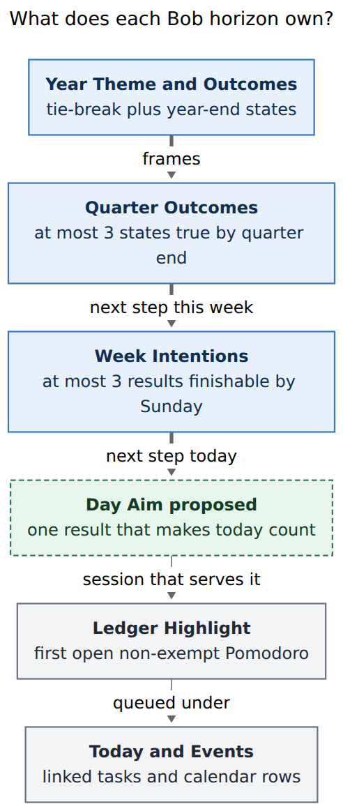
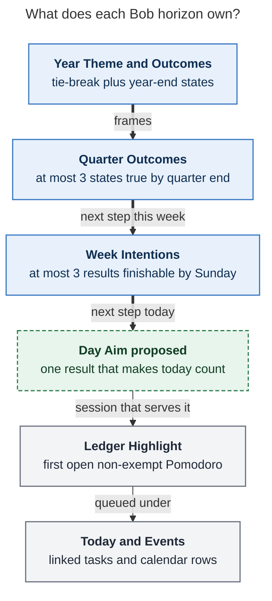
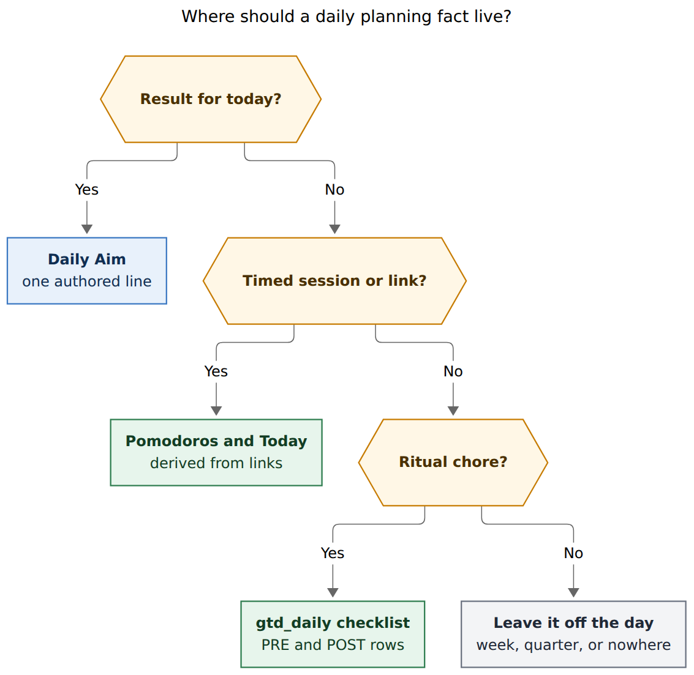
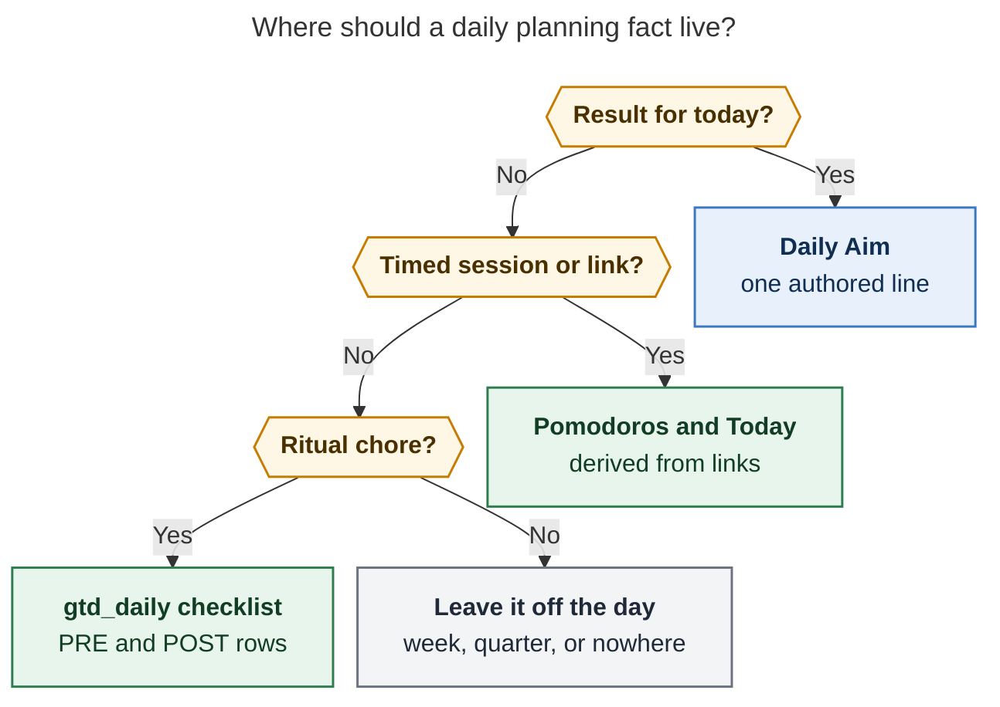

# Daily notes need an Aim, not a commitment list

> **Research query:** We already track Intentions in weekly period notes, Outcomes in
> quarterly period notes, and Themes in yearly period notes. What should the daily-file
> analog be called (daily commitments?), and which constraints (a commitment limit) and
> policies (a daily task in `~/bob/gtd_daily.md`) should support it? Critique the plan.
> Is this a good idea? Would a different approach be better? Call out justified
> requirement changes, and end with a recommended solution.

## Bottom line

**Build a daily meaning layer. Do not clone period notes onto the day, and do not add
a second task list.**

The weekly / quarterly / yearly sections work because they are *setpoints*: Bryan-owned
prose that names a finished state, which an agent later marks against vault evidence.
Daily files already have the *actuator*: the Pomodoro ledger, Today links, the derived
**Highlight** (first open non-exempt Pomodoro), Events, and the `gtd_daily.md` PRE/POST
walk. What they lack is one authored sentence that says what today is *for*.

Call that sentence **Aim**. One line. Soft cap of **1**. Empty is valid. It lives on the
daily note, not in `gtd_daily.md`. The existing POST clause "highlight chosen (≤3
themes, highlight first)" is the ritual; extend that clause rather than adding a new
checklist row. Do not add `## Review`, `## Reflection`, or an agent draft to daily
files. Do not enforce a commitment limit that refuses work.

**This is a good idea at the meaning layer, and a bad idea as a daily todo system.**
The original framing ("daily commitments", a commitment limit, a new `gtd_daily`
task) points at the bad idea. The adjustments below keep the good one.

**Do not write bob-cli for this until the weekly Intention loop has paid off for two
more weeks.** W47 is the first week with real Intentions. W46 is `NOT SET`. W40–W45
are empty. A daily writing habit on top of a one-week-old weekly habit is how this
vault's earlier planning layers died.

### The one-card version

> **Aim (day):** `<finished state by tonight> → [[note#^id]] · I#`
>
> Tests: finishable today · about 60–90 minutes · markable from the vault · mostly in
> my control · serves a weekly Intention (or I know why not) · the first open
> non-exempt Pomodoro is the session that serves it.
>
> Cap: **1**. Empty is valid. No checkbox. No `#task`. No daily Review.

## Verdict on the plan

| Original idea | Verdict |
| --- | --- |
| Something *similar* to Intentions / Outcomes / Theme on daily files | **Yes**, as one authored result |
| Name it "daily commitments" | **No** — "commitments" already names the review-walk tiers |
| A commitment limit of several items | **No** — one Aim; the ledger already has `max_links` |
| A new daily task in `gtd_daily.md` that *is* the commitments | **No** — that file holds the ritual, not the content |
| Clone period-note machinery (Review, agent draft, Reflection, callout) onto the day | **No** — days are ledgers; weeks are where meaning rolls up |
| Promote daily notes into period notes | **No** — glossary and `docs/periods.md` already draw that line |

Would I take a different approach? **Yes: Aim + existing Highlight, not a commitment
list.** The rest of this report is that approach.

## What already exists (verified 2026-11-17)

The daily analog is half-built. The missing half is a setpoint, not another queue.

### Period notes already own the meaning cascade

From `docs/periods.md` and the Period Note glossary:

| Horizon | Path | Bryan-owned section | Agent-owned | Cap already in `gtd_daily.md` |
| --- | --- | --- | --- | --- |
| Year | `YYYY.md` | `## Theme`, `## Outcomes` | `## Review` | Theme + ≤3 Outcomes (2nd Monday in January) |
| Quarter | `YYYY/YYYY-Qn.md` | `## Outcomes` | `## Review` | ≤3 Outcomes (1st Monday of the new quarter) |
| Week | `YYYY/YYYY-Www.md` | `## Intentions` | `## Review` | ≤3 Intentions (Monday POST) |
| Day | `YYYY/YYYYMMDD.md` | **none** | **none** | "highlight chosen (≤3 themes, highlight first)" on the daily POST row |

Period notes hold no task rows. Daily notes are **not** period notes. A day's parent is
its ISO week; the tree is already an exact partition of days. `bob periods ensure`
creates week/quarter/year/all_time one week ahead and never edits a note it did not
just create. Daily notes are created by Core Daily Notes plus Templater
(`_templates/daily.md`).

The week brief already has a slot for each day: Worked, closeout (`met` / `open` /
`missed`), and the top root-parent shares. Days have no Review, so JSON day parts omit
`review_state`, `headline`, and `reflection_lead` (`docs/periods.md`, Agent briefs v2,
item 4). Live `bob periods show 2026-W47` on Tuesday reads:

```text
met Mon Nov 16 3h 25m     bob 27% · gtd 24% · dev 22%
open Tue 17   3h 40m     gtd 36% · bob 27% · job 20%
```

That is a footprint (where time went). It is not a promise (what the day was for).

### Daily notes already own the actuator

Today's `2026/20261117.md` has, in order: frontmatter (`parent: [[2026/2026-W47]]`,
`type: [[day]]`), title, prev/week/next nav, the `^gtd` row linking `[[gtd_daily]]`,
the `bob-plan` fence (Day strip), `## Events`, `## Pomodoros`. Headings stop there.
There is no journal, no Aim, no Review, no Reflection.

The ledger contract (`docs/plan.md`, `docs/concepts/today-and-the-pomodoro-ledger.md`):

- **Today** is dedicated Task Links under today's *open* Pomodoros, computed at read
  time. It is never a tag, a task-line field, or a file-path filter
  (`decisions:today-is-read-from-the-ledger`).
- **Highlight** is the first open non-exempt Pomodoro in ledger order. PLAN is exempt.
  `bob plan -f json` today reports `highlight: true` on **WRITE**.
- **Running** is the open entry whose body starts with a time range.
- Caps (Bryan's config today): `max_links` 13, `max_next` 13, `max_pending` 8,
  `max_ready` 21. Defaults in docs are 10 / 15 / 10 / 100. All are **visibility**,
  never refusal. Crossing them lints.
- Types are listed, never budgeted. POST still asks for ≤3 themes. Today the open
  names are WRITE, READ, CHORE, FIX, MEET — **five**, already over that clause.

The idle capture agenda already paints this ledger. Mac Capture does not need a second
source of "what am I doing."

### `gtd_daily.md` already owns the ritual

`gtd_daily.md` is an area note (`type: [[area]]`, `parent: [[gtd]]`, `task_type: PLAN`)
whose summary is "The daily PRE/POST morning-review checklist, plus weekly, quarterly,
and yearly review chores." It is not a daily file. Recurring rows live here; the day's
`^gtd` task *stands for* that checklist (`docs/reference/vault-format.md`).

The POST **Morning review** row already contains the daily planning policy, in one
clause:

> highlight chosen (≤3 themes, highlight first)

The Monday POST **Weekly review** already contains the weekly analog:

> open this week's note, re-read the quarter's Outcomes (↑), and set ≤3 Intentions.

The quarterly and yearly rows already say "set ≤3 Outcomes" and "set the new year's
Theme and ≤3 Outcomes." Content lives on the period note. The checklist row is the
prompt to write it. That split is the pattern to copy.

### The weekly setpoint is one week old

Verified from the week notes themselves:

| Week | `## Intentions` |
| --- | --- |
| W40–W45 | empty |
| W46 | `- NOT SET` |
| W47 (this week) | three real lines: finish `[[sase_blog_zettel]]`; finish sase-1n6; fix decisions memory |

Q4 `## Outcomes` has three lines (sase_blog released, recruiter progress, a bob blog
post). 2026 `## Theme` and `## Outcomes` are empty, matching the earlier advice to
leave the year alone until 2027-01-11.

`research:202611/what_to_write_in_period_notes/what_to_write_in_period_notes.md`
already said: write a finished state plus an evidence link; three is a ceiling; run
the weekly loop 2–4 weeks before building anything; judge it by whether it changes a
choice. That report also mapped Make Time's "medium-sized highlights" onto "the morning
highlight should usually be Intention 1's next step." The daily Aim is that mapping,
written down.

### Caps and queues that would compete with a new list

A new "daily commitments" list would sit next to all of these, which already answer
"what am I doing":

- Today (ledger links)
- Highlight (first open non-exempt Pomodoro)
- Next lane (sticky weekly commitments; `#now` is retired)
- Pending / WIP
- Events (calendar, GTD's sacred calendar)
- PRE/POST checklist
- Review-walk "commitments" (the footer word for PRE → NEXT, before ROTTEN upkeep)
- `max_links`, `max_next`, `max_pending`, per-note Ready cap
- POST "≤3 themes"

`#now` was "a promise, not a footprint." It became a pile of ~73 bulk-tagged tasks and
was stripped the same day. Intentions recovered the promise role at *result* grain.
A daily commitment *list* would re-create the pile at day grain.

## Is this a good idea?

**Yes, if Aim is a setpoint. No, if it is a todo list.**

### Why a daily setpoint earns its place

1. **The cascade has a hole.** Year → quarter → week now has a place to write "what
   this period is for." The day has only "what this period *did*" (root-parent shares)
   and "what is queued" (the ledger). Without a setpoint, the week's Intention 1 has
   no daily counterpart, so Monday's Review can only describe what happened.
2. **Make Time is already in the vault.** Bryan's `lit/make_time.md` is one line:
   "Medium sized highlights are the best motivator." Knapp and Zeratsky's Highlight is
   one 60–90 minute activity, written down, chosen for urgency, satisfaction, or joy —
   not a to-do list. Bob already named the *session* "Highlight." The missing piece is
   the *result* that session is for.
3. **Uptime already describes this split.** `lit/uptime.md`: the Daily List's first
   section is "your absolute top priority: What task do you have to get done each
   day?" Other priorities come from the Weekly List and must sit on the hour-by-hour
   plan. Bob's hour-by-hour plan is the ledger. The missing section is the top
   priority *result*.
4. **GTD forbids the other design.** Bryan quoted Allen (`lit/gtd.md`): "Trying to
   keep a list in writing on the calendar, which must then be rewritten on another
   day if items don't get done, is demoralizing and a waste of time." Events are the
   calendar (time-specific). Next is the next-action pool. The ledger is today's
   time-block. A fourth list of "daily commitments" is the calendar-as-wishlist GTD
   tells you not to keep.
5. **Implementation intentions need a cue, not a list.** Gollwitzer and Sheeran
   (2006): if-then plans improve goal attainment with *d* = .65 over a goal intention
   alone. Sheeran, Listrom, and Gollwitzer (2024), 642 tests: effects .27 ≤ *d* ≤ .66,
   larger with contingent if-then form, high motivation, and rehearsal. A one-line Aim
   plus an optional "If the morning PLAN pomodoro closes, then I start Intention 1's
   session" sub-bullet is that technique. A three-item commitment list is not.

### Why cloning period notes onto the day would fail

Period-tree research already measured the failure mode: the zorg habit log ran **826
daily files, then stopped**. Numbers on period notes are automatic; prose is optional,
capped, and tied to a *weekly* ritual. An empty Review is a valid week note. An empty
Aim should be a valid day note the same way.

Bryan already rejected a productivity diary in his Uptime notes: "I already write too
much. I'm not keeping a 'productivity diary'." Daily `## Reflection` is that diary.
Weekly Reflection is the right grain.

Agent-drafted daily Reviews would be 365 drafts a year. The week brief already
summarizes each day. The week Review already marks Intentions. Daily Headlines would
either repeat the ledger or invent meaning the week then has to re-synthesize. The
period callouts exist because a later reader may see only the Headline in a parent
note. A day's parent already has seven children and a parts table. Adding 365 agent
contracts is how GTD time ate 49% of a measured week in earlier Stats research.

Daily notes are also *write-hot*: capture rewrites `## Pomodoros`, `bob gcal sync`
rewrites `## Events`, reconcile touches Today links, the `^gtd` row completes. A
Bryan-owned section has to sit *outside* those two machine sections. Period-note
ownership (bob writes scaffold once; Bryan writes Intentions; agents write Review
through `bob periods draft`) does not map onto a file two subsystems rewrite all day.

## Naming

Do not call it **commitments**.

| Candidate | Why it loses or wins |
| --- | --- |
| **Commitments** | Already the review-footer word for PRE → NEXT versus ROTTEN upkeep. "K commitments" is on the status bar every morning. A second use will be misread as "the walk." |
| **Highlight** | Already the first open non-exempt Pomodoro (`docs/plan.md`). Also the PDF app. Using it for a prose section would collide with both. Keep Highlight as the *session*. |
| **Intentions** | Weekly. Reusing it on the day erases the horizon. |
| **Outcomes / Theme** | Quarter / year. Wrong grain. Uptime's "daily themes" are weekday *buckets* (errands Friday), which Bob already has as Pomodoro types. |
| **MIT / One Thing / Frog** | Jargon from other systems. Fine as a gloss, bad as a heading. |
| **Focus / Stake / Bet** | `#now` was "this week's bet" and died. "Focus" is already a type name in the tutorial vault. |
| **Aim** | Wins. One syllable. Distinct from Theme / Outcomes / Intentions / Highlight. Echoes the GTD line Bryan saved: "Fanaticism consists of redoubling your efforts when you have forgotten your aim." |

The cascade, with Aim filled in:



*Figure 1. Year, quarter, and week already have Bryan-owned setpoints. The proposed
daily Aim is the day's setpoint. Highlight and Today stay derived from the ledger.
Rendered with Mermaid CLI 12.0.0: 328 × 776 px, fit 100%.*



## Constraints

### Cap: 1, not 3

**Adjustment.** A commitment limit of 3 (mirroring weekly Intentions) is too high for
a day.

- Make Time: 60–90 minutes, one Highlight.
- Uptime: one absolute top priority, then other items that *already have a calendar
  slot*.
- Weekly Intentions are already ≤3 results for ~10–15 focused hours. Three daily
  results would be a todo list, which GTD forbids rewriting onto the day.
- Today already has 11 of 13 on-clock links and five open types against a POST clause
  of ≤3 themes. The day is not short on planned work. It is short on a chosen result.
- Soft, like every other Bob cap: lint or a quiet POST reminder, never a refused
  capture, never a blocked save.

Empty is valid. A travel day, a sick day, or a day that is only Events can leave
`## Aim` blank. The week parts table already handles days with no Headline.

### Do not store Aims as tasks

No `- [ ]`, no `#task`, no block id required on the Aim line itself. Period notes
treat a task row as a `task_rows` problem (`bob periods list -p`). The same rule
should hold for `## Aim`: it *points at* a task (`→ [[note#^id]]`), it is not one.
A task in `gtd_daily.md` named "today's commitments" would either duplicate Today or
become a checklist of wishes.

### Do not write Today, Highlight, or Aim onto task lines

`decisions:today-is-read-from-the-ledger` retired `#today` and `#now` as membership
stores. Freshness stamps record review, not commitment. An `[aim::]` field would hit
the same Tasks right-to-left parse hazard that killed inline `[roadmap::]`. Keep Aim
as a section body, like Intentions.

### Do not add a hard type cap in code to match POST's "≤3 themes"

POST's "≤3 themes, highlight first" is a *choice* rule: pick the Highlight and keep
the open type set small. Types are deliberately unbudgeted (`docs/plan.md`). Today's
five open names show the clause is already a reminder, not a gate. Leave it in the
POST row. Do not invent `max_themes` enforcement; that knob was retired.

## Policies

### Home: the daily note, ritual: the existing POST row

**Adjustment.** Do not add a new daily task in `gtd_daily.md` whose body *is* the
commitments. Amend the Morning review POST clause.

Today:

> … · [[crowded|CROWDED]] at 0 … · highlight chosen (≤3 themes, highlight first) ·
> [[rotten|ROTTEN]] upkeep …

Proposed:

> … · [[crowded|CROWDED]] at 0 … · Aim written (one line, or knowingly blank) ·
> highlight chosen (first open non-exempt Pomodoro serves the Aim; ≤3 types) ·
> [[rotten|ROTTEN]] upkeep …

That matches weekly review: the POST row says "set ≤3 Intentions"; the text lives
under `## Intentions` on the week note.

Do not add a PRE row for Aim. PRE is intake (sync, bank, email, calendar, weather,
agent cleanup, reconcile). Aim is a *choice after* the landscape is visible, which is
POST, after CROWDED is cleared and before ROTTEN upkeep. Calendar review is already a
PRE `#browser` row, so Events are known before POST.

### Template: empty `## Aim`, same ownership as Intentions

`_templates/daily.md` currently ends:

````markdown
```bob-plan

```

## Pomodoros

- [ ] () — PLAN
	- [[#^gtd]]
````

Insert a bare heading after the plan fence and before `## Pomodoros`:

````markdown
```bob-plan

```

## Aim

## Pomodoros
````

Leave the body empty. Period scaffolds leave Intentions empty on purpose: any prompt
text would be copied into the week brief and marked as Bryan's words. The same rule
applies if the week brief later grows an Aim column.

`docs/reference/vault-format.md` requires `## Events` immediately above `## Pomodoros`
when it exists. `bob gcal sync` inserts Events above Pomodoros. With `## Aim` above
Pomodoros, the live order becomes Aim → Events → Pomodoros, which is the right
reading order: setpoint, then calendar landscape, then sessions. Capture keeps
rewriting only Pomodoros. Gcal keeps rewriting only Events. Aim stays Bryan's.

bob should **not** start creating daily notes. Period-tree research already decided
bob owns period creation because Templater-only months broke. Daily creation already
works via Core Daily Notes. `ensure` stays week-and-up.

### Rollup: show Aim in the week Days table (phase 1, not now)

Once the heading exists and has been used for two weeks, the week parts table should
prefer the Aim line over `mostly_display` (root-parent shares) for each day, the same
way a week child shows its Review Headline. Fallback: current `mostly_display` when
Aim is empty. The week brief's day rows can carry that line as evidence when marking
Intentions. **Do not** add daily review state, Headlines, or Reflection leads. Days
stay without a Review.

### Optional if-then, as a sub-bullet

Gollwitzer's effect is on *implementation* intentions, not on writing a goal. If the
Aim line is the goal intention, one indented sub-bullet can hold the if-then:

```markdown
## Aim

Ship the album schema card, unblocking the four empty sections → [[sase_blog_zettel#^schema-card]] · I1
- If the last PLAN pomodoro closes before 10:00, then start the WRITE Highlight on that card.
```

Keep the if-then off the marked line, matching the weekly-Intention advice in the
period-writing research. Skip it when the Highlight *is* the plan.

## Where a daily planning fact lives



*Figure 2. A result for today is an Aim. A timed session or Task Link belongs in the
ledger. A ritual chore belongs in `gtd_daily.md`. Everything else stays on a week or
quarter note, or is omitted. Rendered with Mermaid CLI 12.0.0: 754 × 736 px, fit
86.5%.*



## Requirement adjustments (explicit)

These are changes to the request, not extra features.

1. **Name it Aim, not daily commitments.** Commitments is taken. Highlight is taken.
   Aim is the daily sibling of Intentions / Outcomes / Theme.
2. **Cap of 1, not a multi-item commitment limit.** Three daily items is a todo list.
   One Aim is a setpoint. Soft: never refuse a write.
3. **Put the text on the daily note, not in `gtd_daily.md`.** The checklist holds the
   prompt. The period or day note holds the prose. This is already how Intentions work.
4. **Amend the existing POST Morning review clause. Do not add a new PRE or POST
   row.** New rows have a real cost: walk length, footer noise, and another recurring
   task that archives into `done/gtd_daily_done.md` every day.
5. **Do not add daily `## Review`, agent `bob periods draft`, `## Reflection`, or an
   `[!agent]` callout.** Those exist because a week is closed once and read from a
   parent. A day is the ledger. The week Review is the rollup.
6. **Do not promote daily notes to period notes.** The glossary already says period
   notes are above the day. `bob periods` stays week/quarter/year/all_time.
7. **Do not write Aim as a `#task` or a Dataview field.** Point at a task. Do not
   become one.
8. **Do not auto-fill Aim from the Highlight, Today, or Next.** Derived text in a
   Bryan-owned section would be a second copy of the ledger, with the same staleness
   `#today` had. If the Highlight already *is* the plan, leave Aim blank.
9. **Phase the work.** Template + POST text now. Week-table / brief / lint only after
   two weeks of use. No bob-cli schema, CLI flag, or plugin surface in phase 0.
10. **Keep POST's ≤3 types as a reminder, not a new code cap.** Types stay unbudgeted.

## What I would not build

- A `plan.max_aims` or `plan.max_commitments` that changes `bob plan` status.
- Capture grammar for Aim (`%a`, `@aim`, …). Type the line.
- Mac Capture idle-agenda Aim band. The agenda already shows the Highlight.
- Daily closeout that requires Aim to be marked ✓ before POST can complete. POST
  completing already records that morning review happened (`Review closed`).
- Carrying yesterday's unfinished Aim forward as a task. That is demoralizing calendar
  rewriting. If the result still matters, it is still a weekly Intention or a Next
  task; write a *new* Aim tomorrow (Make Time: "Groundhog it" is allowed, as a fresh
  choice).
- Scoring, streaks, or an Aim hit-rate chip. The week Review's Intention marks already
  score the results that matter. Daily gamification is how a setpoint becomes a pile.

## How to write an Aim

Formula, one physical line:

```markdown
## Aim

<finished state by tonight> → [[note#^id]] · I1
```

Tests, borrowed from the week-Intention tests and tightened for a day:

1. **Finishable today.** An end state, not "work on." If it needs more than one day,
   it is a weekly Intention; today's Aim is the next visible piece.
2. **About 60–90 minutes** of focused work (Make Time's medium highlight; Uptime's
   power-hour). Bigger than a 5-minute FIX. Smaller than a weekly result.
3. **Markable.** A later weekly Review can see it: a completed task, a Work Log line,
   a Pomodoro note, or a document that appeared. Link that target.
4. **Mostly in your control.** "Schema card merged" passes. "Get the job offer" is a
   quarter Outcome.
5. **Serves an Intention when one exists.** `· I1` / `· I2` / `· I3`. One Aim a week
   that serves none is fine (family, a fix, a rest day). If *no* Aim all week serves
   an Intention, the Intention or the week needs a look.
6. **The Highlight serves it.** After POST, the first open non-exempt Pomodoro is the
   session for this line. If WRITE is Highlight and the Aim is a job application, the
   ledger is lying; rename or reorder.

Weak vs stronger, using this week's actual Intentions:

| Weak | Why | Stronger |
| --- | --- | --- |
| "Work on the zettel album" | Activity | "Schema card merged, four empty sections unblocked → [[sase_blog_zettel#^…]] · I1" |
| "Do sase-1n6" | Not finishable today | "Restart-readiness note answers the four open questions → [[sase#^ref-sase-1n6-11-4-restart-readiness]] · I2" |
| Three Next-lane tasks | Copies Today | Pick the one result those tasks should add up to *today* |
| "Be focused" / "Less GTD" | Trait | The Aim *is* the focus. Time shares belong on the strip. |

Personal Aims are welcome. Swings and the grocery Event Tasks already show up under
Finished in the week brief. An Aim that will not leave a completed task or Event Task
is explained in the *weekly* Reflection, not in a daily diary.

## Recommended solution

### Phase 0 — this week, no bob-cli

1. Add empty `## Aim` to `_templates/daily.md` after the `bob-plan` fence, before
   `## Pomodoros`. Do not backfill old daily notes.
2. Amend the POST Morning review clause as in [Policies](#policies). Recurrence will
   pick it up on the next daily spawn.
3. Write today's Aim once, using the formula, after POST's CROWDED clause and before
   choosing the Highlight.
4. Keep weekly Intentions as they are. Aim is I1's next step on a workday, and
   whatever the day actually is on a family or recovery day.

Success test for two weeks (through Sunday 2026-11-30, end of W48):

- At least 6 of 10 weekdays have a non-empty Aim.
- On those days, the Highlight session is the Aim's type more often than not.
- At least one Aim changed a choice (reordered the ledger, declined a type, or
  protected a morning block).
- The weekly Intention marks for W47 and W48 are not all "– no evidence."

If those fail, delete the heading and the POST clause. Empty history is not a debt.
That is cheaper than building a daily period engine and then deleting it.

### Phase 1 — only if phase 0 pays off

1. Week parts table and `bob periods show` / brief: prefer the Aim line over
   `mostly_display` for each day; keep closeout and Worked as they are.
2. Optional lint on the daily note: more than one top-level bullet under `## Aim`, or
   a `#task` checkbox in that section. Report-only, like other plan lints.
3. Glossary: one sentence under Period Note or a new **Aim** strand: *the Bryan-owned
   one-line result on a canonical daily note; not the ledger Highlight; not a task.*
4. Docs: one paragraph in `docs/periods.md` (cascade) and one in
   `docs/guides/run-morning-review.md` (POST clause). No new CLI.

### Phase 2 — do not schedule

Agent-drafted daily Reviews, daily Reflection, `bob periods` growing a `day` kind,
capture grammar, Mac Capture UI, Aim streaks, or a refused-write cap. Reopen only if
phase 1 is in use for a quarter *and* the week Review is still blind to the day.

## Critique, compressed

The impulse is right: every horizon that Bob asks an agent to mark needs a setpoint
Bryan wrote. The week now has one. The day does not.

The original packaging is wrong in four places:

1. **"Daily commitments" names a list.** Lists at day grain are GTD's calendar
   wishlist, `#now`'s pile, and the ledger's job. The analog of Intentions is one
   result, not N tasks.
2. **A commitment limit copies the weekly cap onto the wrong grain.** ≤3 is for a
   week of 10–15 focused hours. A day gets one 60–90 minute Aim. The ledger already
   caps links.
3. **`gtd_daily.md` is the wrong home for the content.** It is the ritual engine.
   Putting the day's meaning there either duplicates Today or hides the setpoint off
   the file the week parts table reads.
4. **Cloning period-note machinery onto 365 files ignores why period notes exist.**
   They exist because days already have a ledger and needed a *rollup*. Daily Review
   plus daily Reflection is a second dying habit. Bryan has already declined a
   productivity diary in his own Uptime notes.

The conservative approach — one heading, one POST clause, two-week trial, no code —
is the one that matches how Intentions were supposed to start, and the one this vault
has evidence for.

## Sources

### Bob, vault, and prior research

- `docs/periods.md` — anatomy, ownership, day parts have no Review/Headline.
- `docs/plan.md` — Highlight, Today, caps, types unbudgeted.
- `docs/concepts/today-and-the-pomodoro-ledger.md` — ledger vs lane vs history.
- `docs/guides/run-morning-review.md`, `docs/freshness.md` — POST highlight clause.
- `docs/reference/vault-format.md` — Events above Pomodoros; `^gtd` stands for
  `gtd_daily`.
- Glossary: Period Note, Pomodoro, Day Strip, Morning GTD Review Footer, Today.
- Decisions: `today-is-read-from-the-ledger`, `task-lanes-are-sticky` (`#now`
  retired), `idle-capture-shows-ledger-agenda`.
- Live vault, 2026-11-17: `2026/20261117.md`, `2026/2026-W47.md` Intentions,
  `2026/2026-W46.md` `NOT SET`, W40–W45 empty, `2026/2026-Q4.md` Outcomes,
  `2026.md` Theme empty, `gtd_daily.md` POST/weekly/quarterly/yearly rows,
  `_templates/daily.md`, `bob periods show 2026-W47`, `bob plan -f json`.
- `research:202611/what_to_write_in_period_notes/what_to_write_in_period_notes.md`
  — Intention formula, "Highlight = Intention 1's next step", 2–4 week trial.
- `research:202611/period_note_tree_and_stats_strips/period_note_tree_and_stats_strips.md`
  — days are ledgers; weeks hold meaning; zorg 826-file daily habit died.
- `research:202611/gtd_checklist_stages_and_period_prep/gtd_checklist_stages_and_period_prep.md`
  — PRE/POST stages; period-prep rows launch drafts, they do not store Intentions.
- Bryan lit notes: `lit/make_time.md`, `lit/gtd.md` (calendar rewriting, "forgotten
  your aim"), `lit/uptime.md` (daily top priority, weekday themes, rejected
  productivity diary).

### External

- Jake Knapp and John Zeratsky, *Make Time* — one 60–90 minute Highlight, written
  down, chosen for urgency / satisfaction / joy; "Groundhog it"; not a to-do list.
- David Allen, *Getting Things Done* — calendar is time-specific only; next actions
  are not rewritten onto each day.
- Laura Mae Martin, *Uptime* — Daily List = one top priority plus hour-by-hour plan;
  "Score by the quarter, not the day" (cited in the period-writing research).
- Peter M. Gollwitzer and Paschal Sheeran, "Implementation intentions and goal
  achievement," *Advances in Experimental Social Psychology* 38 (2006): 94 tests,
  *d* = .65.
- Paschal Sheeran, Olivia Listrom, and Peter M. Gollwitzer, "The when and how of
  planning," *European Review of Social Psychology* 36 (2024): 642 tests,
  .27 ≤ *d* ≤ .66; larger for if-then form, high motivation, and rehearsal.
- Gary Keller, *The One Thing* — leverage question already used for quarter
  Outcomes; too coarse as a daily heading.
- Locke and Latham goal-setting theory, and Seijts and Latham on learning vs
  performance goals — already applied at quarter grain in the period-writing
  research; a daily Aim is a performance or learning *result*, not a count the
  strip already measures.

Library check: 0 of 10 title/URL candidates were in `ref/` (`bob ref find`). The
same works are present as Bryan's `lit/` notes (Make Time, GTD, Uptime, One Thing,
Feel-Good Productivity, 7 Habits), which is where the quotes above were read.
