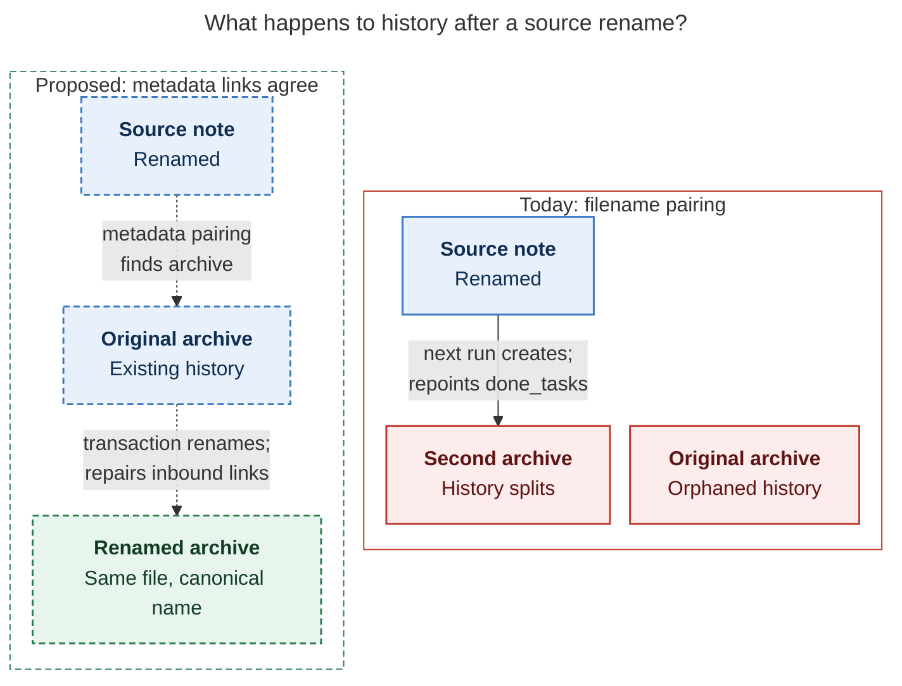
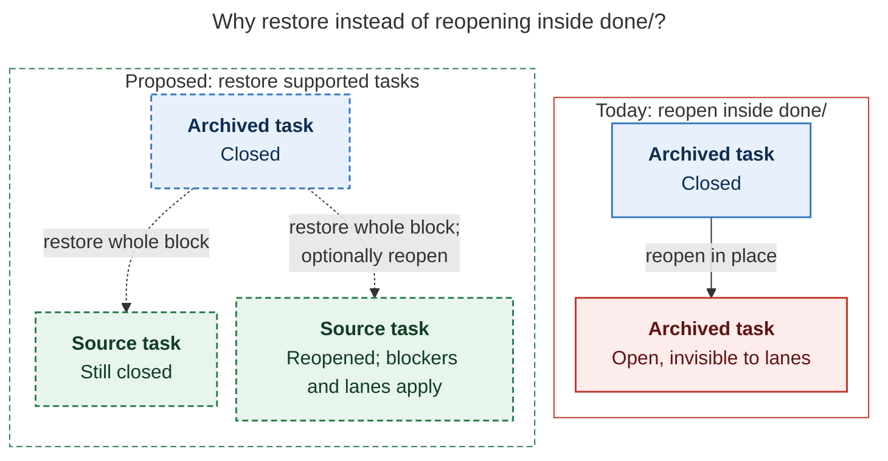

# Diagram proposals: Done notes: keep `done/<stem>_done.md`, fix the rule that feeds it

Proposals for the swarm linker, not a report. Each diagram restates only what the source
report says.

```yaml
source: research:202611/done_notes_archiving/done_notes_archiving__final.md
producer: research.3w.image
check: "mmdc 12.0.0 with the PDF-mirroring config rendered 2 of 2 Mermaid diagrams; PNGs visually reviewed; Puppeteer --no-sandbox"
```

## archive-rename-history

```yaml
anchor: |-
  When a source has been renamed, rename its archive to the canonical name
question: |-
  How does archive history change after a source rename?
illustrates: |-
  With resolving and agreeing metadata links, the proposed pairing resolver finds and renames the existing archive in the same transaction, preventing the split history caused by filename pairing.
caption: "After a source rename, filename pairing splits history; the proposed resolver finds and renames the existing archive in one transaction."
review: "737.453x577 px, fit 88.5%; reader question, source trace, labels, arrowheads and visual checks passed; 0 revisions"
```



## restore-versus-reopen

```yaml
anchor: |-
  Restore moves the whole block, reverses the link repair, and keeps the
question: |-
  How does restoring an archived task differ from reopening it in place?
illustrates: |-
  For supported tasks, proposed restore returns the whole block to its bound source and optionally reopens it, respecting blockers and lanes, while reopening inside done/ leaves a task invisible.
caption: "For supported tasks, proposed restore returns the block to its bound source; reopening in done/ today leaves it invisible."
review: "758x445 px, fit 86.1%; reader question, source trace, labels, arrowheads and visual checks passed; 0 revisions"
```


