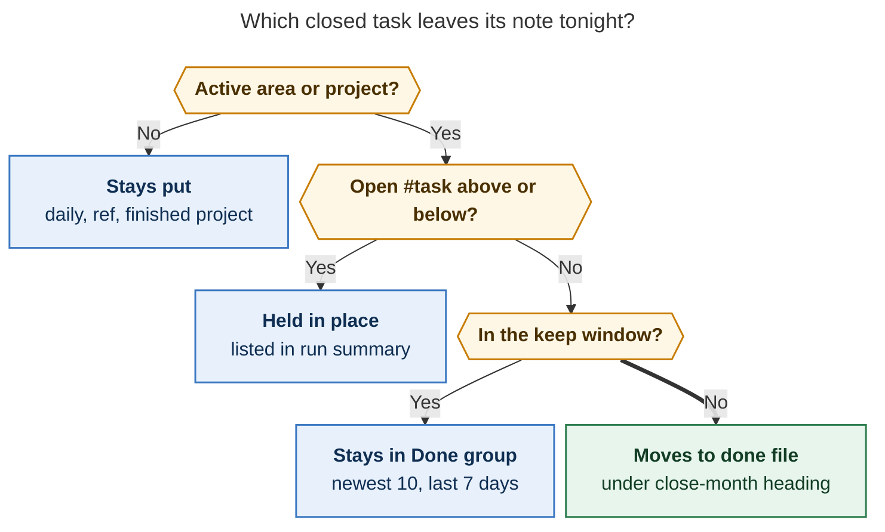
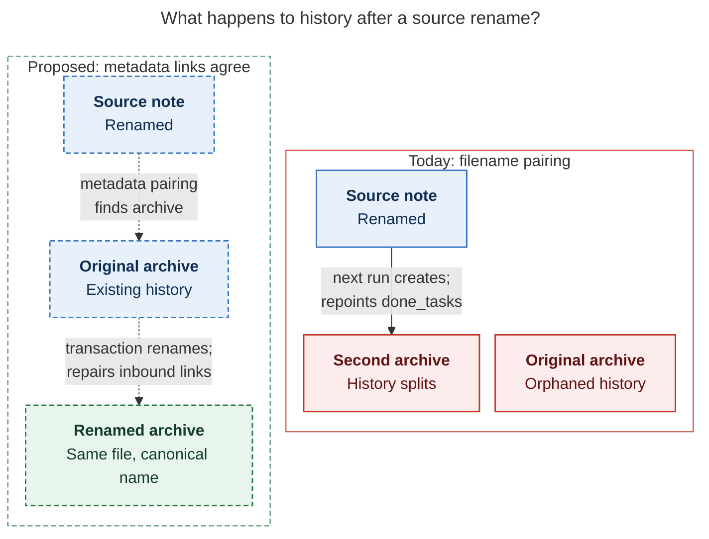
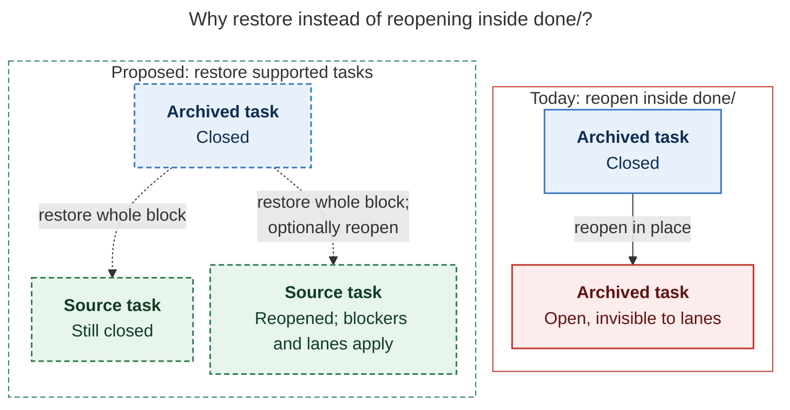

# Done notes: keep `done/<stem>_done.md`, fix the rule that feeds it

> **Research query:** How can Bob's handling of done notes, currently
> `done/<name>_done.md` files, be improved to fix existing bugs, make their management
> more reliable and intuitive, and add other useful improvements? How do other systems
> handle this, is there a better approach, and what changes (if any) should be made?

## Bottom line

**Keep the per-source archive.** All five researchers reached this
independently, and I agree. `done/<path>/<stem>_done.md` is Org mode's
default sibling-archive design. It fits Bob's `(note path, block id)` task
identity and the per-project `^prj` convention, and about 30 code paths
already depend on it. A global log, yearly files, one note per task, in-note
`## Archive` sections, or a database would each cost a migration without
fixing [any defect found here](#defects-ranked).

**What is wrong is the rule that decides what moves, from where, and when,
plus the writer that carries out the move.**

- **Selection is not hierarchy-aware.** An open subtask under a closed root
  is archived and disappears from every lane.
- **Selection is not context-aware.** Task lines inside fenced code blocks or
  `%%` comments are archived as real tasks.
- **Selection is not note-type-aware.** Daily notes, reference notes, and
  finished projects are all eligible. Today only the count of 10 protects
  them.
- **The gate counts rows instead of measuring age.** Busy notes are flushed
  every night, including work closed the evening before. Quiet notes keep
  closed rows for months.
- **The writer is less safe than every other Bob vault rewriter.** It takes
  no lock when run standalone and has no stale-file check, no recovery, and no
  dry-run. cdx reproduced a lost concurrent edit and a duplicated task after a
  failed run was retried.
- **The archive is paired with its source by filename.** Renaming the source
  orphans the archive. [One orphan](#what-the-live-vault-shows) already exists
  in the vault.
- **Archiving is one-way.** No command restores an archived task, and a task
  reopened inside `done/` becomes invisible.

**What would change for you if you adopt [the recommendations](#recommended-changes):**

- `Done & Canceled` in each area or project note would always mean the same
  thing: your newest closures from the last week, at most ten.
- Daily notes, reference notes, and finished projects would never be emptied.
- Nothing open would ever disappear into `done/`.
- Each archive would read as a logbook with month headings.
- An archived task could be brought back with one command.
- `bob task archive --dry-run` would show what tonight's run would do.

## How it works today

| Aspect | Current behavior |
| --- | --- |
| Trigger | `bob nightly` on athena at 03:30 runs vault-sync, then `task archive`, articles, period notes, and vault-sync again, all under `bob_sync.lock`. **The nightly sequence has no reconcile step.** |
| Selection | Every `[x]`/`[X]`/`[-]` list item that carries `#task`, **at any indent**, plus every deeper-indented line under it. `transform_markdown` does not track fences, comments, or frontmatter. |
| Gate | A note is processed only when it holds at least `-t` closed blocks (default **10**). Once it qualifies, **all** of its closed blocks move, including ones closed minutes earlier. |
| Sources | Every `.md` file outside `done/` and the always-excluded directories. Daily, period, `ref/`, `mail/`, record, and finished-project notes are all eligible. |
| Destination | `done/<source dir>/<stem>_done.md`, derived from the **filename**. Blocks are appended verbatim, with no heading, date, or context. A colliding block ID is renamed `^id-1`. |
| Pairing | The source gets `done_tasks: "[[done/…_done]]"`. The archive gets `parent: "[[source]]"` and `type: "[[done]]"`. These links are written, but most readers derive the pairing from the filename instead. |
| Link repair | Wikilinks, embeds, Markdown links, and `[id::]`/`[dependsOn::]` tokens across the vault are rewritten to the archive path. The repair self-heals stale links on every run. |
| Writes | Per file: archive first, then source, each via temporary file and rename. A standalone run takes no lock, does no stale check, and cannot roll back. A Git commit and push follow. |
| CLI | Only `-t/--threshold`. No `--dry-run`, no JSON output, no scoping. Sibling commands `move`, `merge`, `split`, and `reconcile` all have dry-run and JSON. |

**Readers.** `done/` is read as history by stats, `periods brief`, Pomodoro
homes, dependency resolution, relations, the capture similar-tasks corpus, the
closed-task picker (`capture-complete -C`), and the vault task-loss guard.
Reconcile, plan, Ready, Next, the review walk, and projects skip it entirely.

**Every run rewrites links in older notes.** The 2026-11-09 run touched 19
files:

- `bob.md`, `dev.md`, and `done/bob_done.md`;
- the Pomodoro Task Links in the four previous daily notes, for example
  `[[bob#^fix-bob-gmail-pull]]` → `[[done/bob_done#^fix-bob-gmail-pull]]` in
  `2026/20261108.md`;
- 12 `ref/chat/*` notes, whose managed embeds now point into `done/`.

## What the live vault shows

I recounted these on 2026-11-09. The researchers' figures disagreed, and the
row explaining why matters for the recommendation.

| Fact | Value |
| --- | --- |
| Archive files | 31 (`done/*.md` plus `done/2026/20260528_day_done.md`) |
| Largest archives | `gtd_daily_done.md` 1,084 tasks / 191 KB · `sase_done.md` 831 · `bob_done.md` 526. None has any heading. |
| Closed `#task` roots still in live notes, by note kind | `ref` 321 · day 168 · **finished project 243** · active project 156 · area 63 |
| …of which `ref` | All 317 `ref/` notes hold one closed legacy in-note `^ref` tracker. These are frozen v1 records and must never move. |
| …of which day | 150 daily notes (Event Tasks and `^gtd`), at most 4 per day. The threshold of 10 is all that keeps them in place. |
| …of which finished project | 55 of 57 terminal project notes still hold closed rows. 4 own archives. 2 have had their `^prj` line archived (`sase_install`, `sase_memory_audit`). |
| Notes at or above the threshold | 3: `gtd_daily` 18, `dev` 12, `sase` 10 |
| Ages of closed rows in area and project notes | 25 today · 55 within 1–7 days · 95 within 8–30 days · **287 older than 30 days** · 1 undated |
| Closures per day (Oct–Nov) | `bob` ≈ 9.4 · `sase` ≈ 9.0 · `gtd_daily` ≈ 7.5 |
| Archive commits | Near-daily, each touching 2–49 files. All 31 recent runs moved tasks; **none was metadata-only**. |
| Orphan archives | 1. `done/2026/20260528_day_done.md`: its source was renamed to `2026/20260528.md`. Both frontmatter links still agree, but the filename rule does not. |
| Latent hierarchy cases | 0 open `#task` under a closed root in live notes · 0 closed `#task` under an open parent · 0 open `#task` in `done/` |
| Archive-path checks in code | 7 named Rust predicates plus 26 inline `"done"` comparisons. The plugins use at least 3 more shapes (first segment, any segment, case-insensitive regex). |

**Why the "stuck rows" counts disagreed.**

- grk reported "564 notes stuck at 1–9 closed tasks". That figure is correct,
  but 317 of those notes are `ref/` trackers and 150 are daily notes. Neither
  kind should ever be archived.
- The area and project backlog is about 100 notes and 460 rows. cld's figure
  (469 rows in 104 notes) is in that range.
- More than half of those rows, 243, sit in **finished** projects.
- The practical consequence: **any lower threshold or age rule without a
  note-type filter is dangerous today.** `bob task archive -t 1`, which gem
  suggests running by hand and cdx used in its fixtures, would sweep all of
  the following into `done/`:
  - 317 reference trackers;
  - every daily note's Event Tasks and `^gtd` row (`bob gcal` then
    tombstones the missing rows as "removed by you");
  - every finished project's tasks and remaining `^prj` lines.

## Defects ranked

Severity reflects the worst plausible outcome, not how often it happens.
"Live" counts what exists in the vault now.

| # | Defect | Evidence | Severity · live |
| --- | --- | --- | --- |
| D1 | **No source eligibility.** Daily, period, `ref/`, `mail/`, record, and finished-project notes can all be archived. Moving Event Tasks off a daily note makes `bob gcal` tombstone them (`docs/gcal.md`: a row "deleted or moved away" is tombstoned once). Moving `^ref` trackers breaks the reference-note shape. | cld, grk, plus my `ref`/finished-project counts | High · latent; `-t 1` triggers it |
| D2 | **Open subtasks are archived with their closed root.** `task_block_end` takes every deeper-indented line without reading it. Bob's own close gesture leaves open subtasks open on purpose (SV5, `docs/task-dependencies.md:3738`), so this is reachable. The vault-loss guard does not flag it, because it scans `done/`. | cdx (reproduced), cld, gem, grk; fixture `nested_blocks.md` | High · 0 |
| D3 | **Concurrent edits are overwritten, and a standalone run ignores the lock.** Planned bytes are installed without checking the current file. | cdx (both reproduced), cld, mus | High · unknown |
| D4 | **A partial failure duplicates history on retry.** If the archive write succeeds and the source write fails, the next run archives the same block again as `^x` plus `^x-1`. | cdx (reproduced), cld | High · unknown |
| D5 | **Examples are archived as real tasks.** `- [x] … #task` inside a fenced code block or a `%%` comment is cut from the note. Reconcile already handles fences; the archiver does not. | cdx (reproduced); code confirmed | High · unknown |
| D6 | **Link-repair identity errors.** (a) An incoming `^x` renamed to `^x-1` keeps a local `[[#^x]]`, which now points at the *old* archived task. (b) An ID used twice in one batch skips repair entirely, and the run still exits 0. (c) Links inside code are rewritten, and case variants are not. (d) Same-note heading links are not rebased. | cdx (reproduced), grk, mus | Medium–High |
| D7 | **A source rename orphans its archive.** Pairing is computed by filename in the archiver, stats, and periods. The next run would create a second archive and repoint `done_tasks:`, splitting the history. | all five; cdx reproduced | Medium · 1 orphan |
| D8 | **A closed child of an open parent is detached.** It is appended, still indented, after whatever root was archived last, so Markdown, Tasks, and Dataview nest it under an unrelated task. | cld, gem; unit test asserts this behavior | Medium · 0 |
| D9 | **Archived `^prj` lines confuse readers.** The period-review drafts printed stale `[[sase_install#^prj]]` links (bead `bob-cli-gr.17` note #1). | my finding | Medium · 2 |
| D10 | **The count gate is unpredictable.** Busy notes lose last night's work; quiet notes keep closed rows for months. | all five; live ages above | Medium (UX) |
| D11 | **No restore path.** `bob task move` refuses `done/` endpoints. A task reopened inside `done/`, including through the plugin's transcluded-reopen path, disappears from every lane. | all five | Medium |
| D12 | **Stale Done groups.** The archive empties `Done & Canceled`, but the group heading and its `🟢 N` chip stay until some later reconcile, and nightly never reconciles. | grk, gem; nightly steps confirmed | Low |
| D13 | **The "is this under `done/`?" rule differs across code paths.** The Rust and plugin checks disagree on folders like `projects/done/`, on case, and on dot-directories. | cld; counts confirmed | Low today; a trap for new code |
| D14 | **Archives are flat dumps.** They have no headings and no source-section context, and 44 of 524 adjacent roots in `bob_done.md` are out of completion order. | cld, grk, gem | Low (UX) |
| D15 | **No contract page and no machine-readable output.** The archiver is documented only in scattered sentences. | grk, mus | Low |

### Claims I checked and set aside

- **"Metadata-only archive commits cause nightly churn" (mus).** Not observed:
  all 31 recent archive commits moved tasks. The code path exists, but it is
  idempotent once metadata is normalized.
- **"Hundreds of tiny daily-note archives" (mus).** False. There is exactly
  one, and it is the orphan. Excluding daily notes
  ([R1](#phase-1---stop-silent-damage)) removes the risk entirely, so no
  monthly consolidation is needed.
- **"Auto-flush finished projects at threshold 0" (gem).** This would archive
  the remaining `^prj` lines and reproduce D9 at scale. I recommend the
  opposite ([R1](#phase-1---stop-silent-damage)).
- **"Move whole finished project notes to an archive folder, PARA-style"
  (gem).** Rejected, in agreement with grk and cld:
  - a project note is an identity (`@route`, Pomodoro homes, `Sub-projects`
    lines, `root: true`);
  - basename links never search `done/`;
  - the clutter of 57 finished notes is better handled by filtering on
    `status: done|canceled` than by moving files.
- **"Stop extraction just before the open child line" (gem).** This splits a
  block in two. Hold the whole root instead
  ([R2](#phase-1---stop-silent-damage)).
- **"Canonical link aliasing, so `[[note#^id]]` keeps resolving after the
  move" (gem).** Obsidian cannot resolve such an alias, so the link rewrite is
  unavoidable while archives are separate files. The achievable part is a
  single shared reader-side resolver
  ([R5](#phase-2---make-the-writer-as-safe-as-its-siblings)); `periods brief`
  already does this locally since bead `bob-cli-h8.3`.
- **"Date headings by archive date" (gem).** Use the task's own close date
  instead, as cdx and cld argue. The archive date says nothing about the work.
- **Yearly or size-based sharding (mus, optional in grk).** Not justified at
  the current scale: the largest file is 191 KB. Month headings
  ([R7](#phase-3---the-policy-change)) give the navigation benefit without
  changing identity. Revisit only after measuring a real latency problem.

## How other systems handle this

| System | When items leave | Where they go | Hierarchy rule | Way back |
| --- | --- | --- | --- | --- |
| **Org mode** | Manual per subtree. A bulk prefix form offers only subtrees with no open TODOs, or whose timestamp is in the past. | Sibling `%s_archive` file by default (the manual's own example is `%s_done::`), an `Archive` sibling heading, or an in-place `:ARCHIVE:` tag that hides the subtree | Bulk form skips subtrees with open children | Context properties (origin file, outline path, archive time) make refiling possible |
| **Things / Nirvana / Bonobo** (Logbook) | A setting: immediately, daily, or manually | A Logbook *view*, grouped by completion date | — | Uncheck the item |
| **Todoist** | Completed tasks hide at once | Completed-tasks view inside the original project; project archiving is a separate action | — | Uncomplete; unarchive the project |
| **OmniFocus** | Manual "archive items completed before date X" | A separate archive file | Item level | Drag the items back |
| **Linear** | Automatically, after a closed period of inactivity | Team archive | **Skips** an issue whose parent is open, whose sub-issues are open, or that has recent activity | Restore |
| **Taskwarrior** | `gc` removes completed tasks from the working set | Same database; the UUID stays permanent | — | Change the status back |
| **todo.txt** | On `do` or `archive` | One global `done.txt` | Flat | Manual |
| **Obsidian Task Archiver** | On command, by rules | Same-note heading, or a separate file whose path template can use `{{sourceFileName}}` and the completion date | Archives a finished subtask on its own, **dedented**, and leaves the open parent | Manual |

**Lessons for Bob:**

1. **Age, not count.** Every automatic trigger I found is time-based. None
   gates on "N closed items in this file".
2. **Hierarchy guards are standard.** Linear and Org's bulk form both refuse a
   subtree that still has open children.
3. **Group history by completion date and keep its context.** Org's
   properties, the Logbook's date grouping, and the Archiver's heading chains
   all serve this.
4. **The way back is first-class everywhere.**
5. **Completing a task, archiving it, and closing a project are three
   different operations.** Bob already keeps them apart, and should keep them
   apart.

### Storage alternatives judged for Bob

| Option | Verdict |
| --- | --- |
| Per-source `done/…_done.md` (today) | **Keep.** Fix the selection rule and the writer. |
| Keep closed tasks in place, hidden (Logbook, `:ARCHIVE:` tag) | Already Bob's first stage, the `Done & Canceled` group. As the permanent store it would grow `bob.md` and `sase.md` by thousands of rows. |
| One global or yearly log | Every archived `^prj` would collide, and per-project history would be lost. Build chronological *views* instead. |
| Per-source yearly shards | Defer until a measured scale problem appears. |
| One note per task, or a database | Disproportionate. It competes with editable Markdown and the cross-host Git workflow. |

## Recommended policy

The decision rule below merges cld's age window, grk's "keep the most recent
few", and cdx's and cld's hierarchy guard. It also adds two rules from my own
evidence: finished projects become frozen records, and `^prj` never moves.

**Caption.** This is a proposed rule, not current behavior. Only active area
and project notes feed `done/`. Daily, period, `ref/`, `mail/`, record, and
finished-project notes are records and never move. A closed root with an open
`#task` above or below it waits. Every other closed root stays in
`Done & Canceled` while it is among the note's ten newest closures from the
last seven days, then files itself under its close month.

### The rules in full

1. **Eligible sources** are the notes that already get `## Tasks` status
   grouping: `[[area]]` and `[[project]]` notes. Inbox files are area notes.
   - A project is **frozen once its `^prj` is closed**. Its note becomes its
     own record, so no `^prj` line is ever archived, and reopening the
     project needs no restore step.
   - Untyped notes that already own an archive are grandfathered, and the run
     reports them.
2. **Archivable unit:** a closed root `#task` with no open `#task` ancestor and
   no open `#task` descendant.
   - A closed child of an open parent stays with that parent and leaves later
     with it. This is Linear's rule, and it needs no dedent.
   - A closed root with an open subtask is *held* and named in the summary.
   - Untagged checklist items and prose under the root travel with it, as
     today.
   - Lines inside fenced code blocks, `%%` comments, and frontmatter are never
     task lines.
3. **Keep window.** A root moves when it is **more than 7 days past its close
   date, or not among its note's 10 most recent closures**.
   - Undated rows count as oldest, and the run reports them.
   - Defaults would be `archive.keep_days = 7` and `archive.keep_max = 10`.
   - A per-note override in the existing `ready_cap: N|off` style (for
     example, `off` for a note you want kept as a complete log).
   - These names are proposals, not existing settings.
4. **Archive layout.** Append each root under a `## YYYY-MM` heading for its
   close month, creating the heading as needed. Block IDs and paths are
   unchanged, so link repair is unaffected.

### Why both a 7-day window and a cap of 10

- A pure 7-day window (cdx, cld, mus) would keep about 65 closed blocks in
  `bob.md`, `sase.md`, and `gtd_daily.md` at ~9 closures a day. That grows
  `bob.md` by roughly 40% and doubles `gtd_daily.md`.
- A pure "keep five" (grk) would let a quiet note keep closures from months
  ago.
- The combination keeps quiet notes current for a week and holds busy notes
  to about a day.
- It also preserves the existing "10" intuition with the sense inverted: from
  "flush everything at 10" to "keep the newest 10".
- Weekly reviews do not need the rows to stay in the source, because
  `periods brief` resolves both the original and the archive spelling.
- If you would rather the window line up with the weekly review, archiving
  everything closed before the start of the current ISO week is a reasonable
  alternative. It batches link rewrites weekly, but the visible window swings
  between 0 and 6 days.

### What the first run would do

I simulated this rule on today's vault:

- It would move about **149 closed roots out of 37 active area and project
  notes**, creating 21 new archive files for small projects.
- It would leave alone all 168 daily-note rows, 321 `ref/` rows, and 243
  finished-project rows.
- The scale is a reason to run `--dry-run` on the live vault before the first
  real run ([R4](#phase-2---make-the-writer-as-safe-as-its-siblings)).

## Recommended changes

Ordered by risk removed per unit of effort. Sizes: S ≈ up to a day,
M ≈ 1–3 days, L ≈ multi-phase. Command and flag names are proposals and must
follow `cli_rules.md`: every long option gets a short alias, and no existing
option is removed.

### Phase 1 - stop silent damage

Small, mostly local to `collect_done/`.

**R1. Source eligibility (D1, D9). S.**

- Reuse the status-grouping classifier, as described in rule 1 of
  [the recommended policy](#the-rules-in-full):
  `[[area]]`/`[[project]]` notes only, finished projects frozen, `^prj` never
  moved.
- Make the walker reuse reconcile's skip rules, which skip all
  dot-directories.
- This alone removes the `-t 1` hazard.

**R2. Hierarchy- and context-safe selection (D2, D5, D8). S–M.**

- Select roots as described in rule 2 of
  [the recommended policy](#the-rules-in-full), using the shared Markdown and
  task parser so that fences, inline code, `%%` comments, and frontmatter are
  respected.
- Flip `completed_child_moves_without_collecting_active_parent` and the
  `nested_blocks*.md` fixtures, which currently assert the defective
  behavior.
- Validate configured DONE and CANCELLED statuses against the hard-coded
  `[x]/[X]/[-]` set (cdx, mus). There is no observed mismatch yet, but a test
  costs little.

**R3. One `done/` path contract plus the one-time orphan fix (D13, D7). S.**

- Add a single `is_done_archive(rel)` function: the first path component
  equals `done` exactly, case-sensitive.
- Export one matching helper to the plugins.
- Pin both sides with shared vectors, following the existing cross-language
  fixture pattern. Example vectors: `projects/done/x.md` → false;
  `Done/x.md` → false.
- Rename `done/2026/20260528_day_done.md` to `done/2026/20260528_done.md`,
  and update `done_tasks:` and inbound links.

### Phase 2 - make the writer as safe as its siblings

**R4. Run the archive inside the shared `vault_rewrite` transaction (D3, D4,
D6, D12, D15). M.**

- **Lock and stale check.** Take `bob_sync.lock` with a bounded wait, check
  each file's before-image for staleness, write atomically with rollback, and
  verify the result. Verify that every moved ID resolves exactly once and
  that no open `#task` lands in `done/`. Commit once.
- **Replay detection.** Detect an identical block already in the archive and
  treat it as a replay, not a new task.
- **Preview and JSON.** Add `-n/--dry-run` and `-f/--format human|json`
  (`schema_version: 1`, like `move` and `merge`). The output should list
  moves, holds, skips by reason, ID renames, ambiguous IDs, and link-repair
  counts.
- **Reconcile in the same write.** Rerun status grouping on every touched
  source in the same transaction, so empty Done groups and chips leave with
  their tasks.
- **Correct the link repair.**
  - Resolve each moved block's local links *before* allocating destination
    IDs.
  - Qualify links to targets that stayed behind, including heading links.
  - Skip code spans and code blocks, and match the shared resolver's case
    rules.
  - Exit non-zero, with each affected note named, on ambiguous moved IDs.

**R5. One pairing resolver, and rename-following (D7). M.**

- Add a single resolver, `archive_pair::{for_source, for_archive}`:
  1. Use `done_tasks:`/`parent:` when they resolve and agree.
  2. Fall back to the filename rule otherwise.
  3. Refuse contradictory or doubly claimed bindings rather than
     overwriting them.
- Point stats, periods, link repair, reference-task residence, the
  status-hook archive reads, and the plugin dependency identity at it.
- When a source has been renamed, rename its archive to the canonical name
  and repair `[[done/old_done#^id]]` links inside the same transaction. This
  keeps the filename convention true for humans and for any reader not yet
  migrated.
- cdx would bind without renaming. I prefer renaming, because about 30 checks
  still assume the filename.

[The archive-rename diagram](#figure-archive-rename-history) follows history
after a source rename: today the next run would start a second archive; the
proposed resolver, when metadata links agree, renames the original archive.

_After a source rename, filename pairing splits history; the proposed resolver finds and renames the existing archive in one transaction._

**R6. An archive health check. S.**

Add these diagnostics to `bob vault-sync doctor` or to the nightly summary:

- `archive_orphan` and `archive_duplicate`;
- `open_task_in_archive`;
- duplicate block IDs in `done/`;
- undated closed rows.

They are read-only and never guess which of two copies is authoritative.

### Phase 3 - the policy change

Needs a decision record.

**R7. Replace the count gate with the keep window, and add month headings
(D10, D14). M.**

- Implement rules 3 and 4 of [the recommended policy](#the-rules-in-full).
- Keep `-t/--threshold` working as an optional minimum batch size, defaulting
  to off.
- Record the policy as a new `decisions` strand through `/sase_memory_write`.
  No current decision record governs done-archiving.
- Roll it out in this order:
  1. `--dry-run` on the live vault;
  2. one reviewed first run;
  3. a nightly run.
- Existing archives can stay flat. An optional one-time pass can regroup them
  under month headings, because block IDs do not change.

### Phase 4 - make history usable

**R8. Restore (D11). M.**

- Let the `bob task move` engine accept a `done/` source.
- Add a thin `bob task restore` that defaults the destination to the
  archive's bound source (through R5) and optionally reopens the task.
- Route the plugin's reopen-in-archive path through it.
- Restore moves the whole block, reverses the link repair, and keeps the
  task's logs and recorded time. It respects blockers and lanes, and never
  auto-links today's Pomodoros.
- Refuse recurring occurrences, merged-task tombstones, and `^prj` until each
  has explicit handling (cdx).

[The restore-versus-reopen diagram](#figure-restore-versus-reopen) contrasts
reopening inside `done/`, which hides a task from every lane, with proposed
restore returning a supported task's whole block to its source.

_For supported tasks, proposed restore returns the block to its bound source; reopening in done/ today leaves it invisible._

**R9. One-click history. S.**

- Add plugin commands "Open done archive" and "Open source", which follow
  `done_tasks:`/`parent:`.
- Optionally add a `📦 [[done/x_done|Archived tasks]]` line under an empty
  Done group.
- Do not change the four-chip badge grammar that the plugins parse, unless
  you treat that as a contract change.
- A searchable cross-project "history" report (cdx's proposed top-level
  `bob history`) is a reasonable later addition. Month headings, R9, and the
  existing `capture-complete -C` closed-task picker cover most of the need
  first.

**R10. Documentation and existing follow-ups. S.**

- Write `docs/task-archive.md` as the contract: selection, eligibility, keep
  window, pairing, link repair, lock, Git behavior, restore, and what
  reconcile still owns. Point the CLI help at it.
- Ship the existing bead `bob-cli-em`: a previewed `^id` backfill for about 20
  ID-less archived mention sources.

### Not recommended

- **Changing the `done/<stem>_done.md` path, the `_done` suffix, or the YAML
  join.** The suffix keeps basename links unambiguous.
- **A global or yearly `done` log, or in-note `## Archive` sections.** See
  [storage alternatives judged for Bob](#storage-alternatives-judged-for-bob).
- **Moving finished project notes.** Filter them by status instead.
- **Moving `done/` to a hidden folder, or deleting old history.**
- **Excluding `done/` from `bob query` by default (mus).** Stats deliberately
  include archives, and no double-counting was found.

## Decisions for you

1. **Keep-window defaults.** Should it be 7 days and 10 closures, or the
   [ISO-week alternative](#why-both-a-7-day-window-and-a-cap-of-10)?
2. **Finished projects as frozen records.** My recommendation leaves the 55
   finished projects' 243 closed rows in place permanently. The alternative is
   to archive their non-`^prj` rows like any other project's.
3. **Rename-following.** Should a renamed source rename its archive file (my
   pick), or only rebind it (cdx)?

## Evidence base and limits

Lead synthesis of five independent reports (`cdx`, `cld`, `grk`, `mus`, `gem`)
plus my own verification. Date: 2026-11-09.

**Evidence base.** bob-cli at `7fe12b33`, bob-plugins at `5e5e33b`, read-only
inspection of the live vault `~/bob`, closed and open task beads, and
first-party product documentation. cdx's reproductions ran against the
installed `bob 0.5.0` binary in disposable vaults; I confirmed the
corresponding code paths in the checkout. Every live-vault number in this
report is my own recount unless it is attributed to a researcher. Nothing was
implemented and the vault was not modified.

### Limits of this evidence

- cdx's write-failure, concurrency, fence, and link reproductions used the
  installed `bob 0.5.0` binary, whose exact source revision is not exposed.
  The code paths match the checkout.
- D2, D8, and D5 have no live instances today. D3 and D4 have no measured
  incidence.
- These product details are unverified:
  - Things' exact Logbook setting labels;
  - Linear's exact auto-archive range;
  - Org's `ARCHIVE_*` property names, which come from source mirrors rather
    than the manual.
- The first-run simulation approximates rule 2 with an indentation stack. It
  does not run the real parser.

## Sources

**Researcher reports**, in this directory:

- `done_notes_archiving__cdx.md`: reproductions, recovery, restore semantics;
- `__cld.md`: live-vault audit, cross-system table, acceptance vectors;
- `__grk.md`: recency gate, daily-note exclusion, history affordances (its
  figures are in `done_notes_task_archive__grk_assets/`);
- `__mus.md`: code walkthrough, grace period, safety UX;
- `__gem.md`: hierarchy bug, rename analysis, PARA comparison.

**bob-cli code:**

- `src/native/collect_done/{mod,plan,transform,archive,link_repair,git}.rs`
- `src/native/nightly.rs`
- `src/native/vault_rewrite/`
- `src/native/{projects/surface,task_dependencies/mod,task_complete/successors,task_complete/keep_moving,capture_complete/candidates,relation_labels/reverse,pomodoro_themes/migrate}.rs`

**bob-cli docs:**

- `docs/task-status-hooks.md` (Status Grouping)
- `docs/task-dependencies.md` (SV5)
- `docs/gcal.md` (tombstones)
- `docs/periods.md` (brief identity)
- `docs/task-move.md`

**bob-plugins:**

- `block-id-prompt/src/031-task-wikilink-rules.js`
- `bob-navigation-hotkeys/src/{130-fences-and-status,290-local-task-items}.js`
- `task-status-cycler/src/160-plugin-completion.js`

**Beads:**

- `bob-cli-gs` and `bob-cli-h8.3` (archived minutes in `periods brief`)
- `bob-cli-gr.1` and `bob-cli-gr.17` (period-review drafting notes)
- `bob-cli-em` (ID-less archived mentions)

**Live vault:** `~/bob` `done/`, live-note closed-row census, and archive
commit history, read-only on 2026-11-09.

**External:**

- [Org manual: Moving subtrees](https://orgmode.org/manual/Moving-subtrees.html)
  and [Internal archiving](https://orgmode.org/manual/Internal-archiving.html)
- [Things: Quick Find and Logbook](https://culturedcode.com/things/support/articles/2803584/)
- [Nirvana: Logbook](https://www.nirvanahq.com/help/how-to/logbook)
- [Todoist: completed tasks](https://www.todoist.com/help/todoist/features/view-completed-tasks-in-todoist-J19h2s)
- [OmniFocus: archiving](https://support.omnigroup.com/documentation/omnifocus/mac/2.7/en/archiving-and-backup/)
- [Linear: delete and archive issues](https://linear.app/docs/delete-archive-issues)
- [Taskwarrior: IDs](https://taskwarrior.org/docs/ids/)
- [todo.txt-cli usage](https://www.github.com/todotxt/todo.txt-cli/wiki/Usage)
- [Obsidian Task Archiver](https://github.com/ivan-lednev/obsidian-task-archiver)
- [Obsidian: links](https://obsidian.md/help/links)
