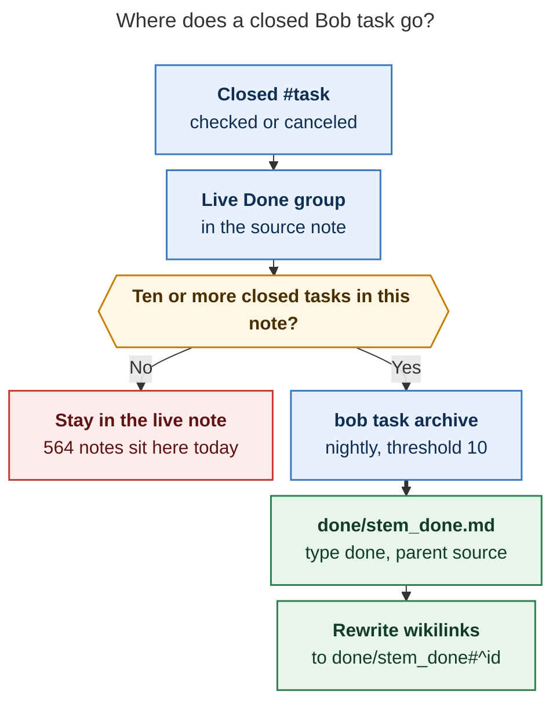
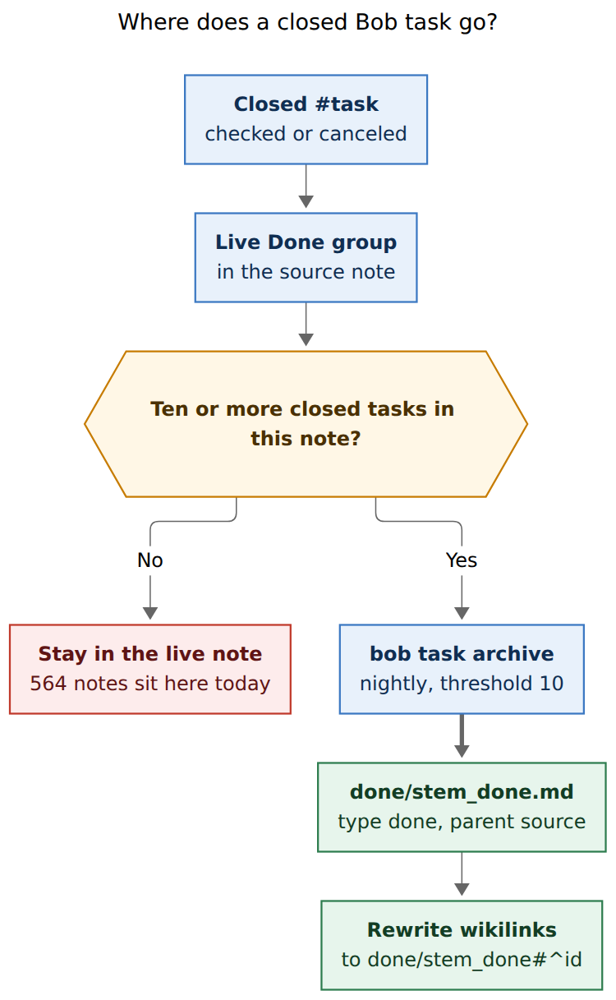
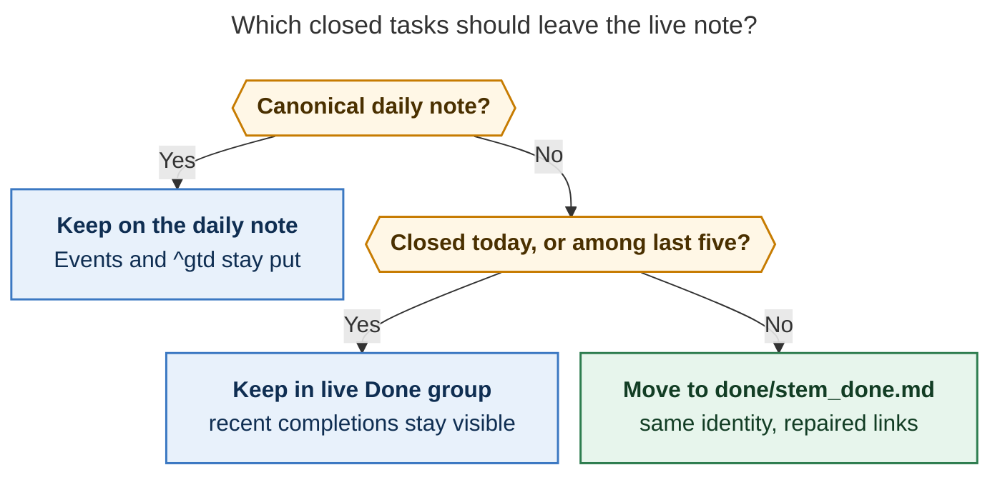
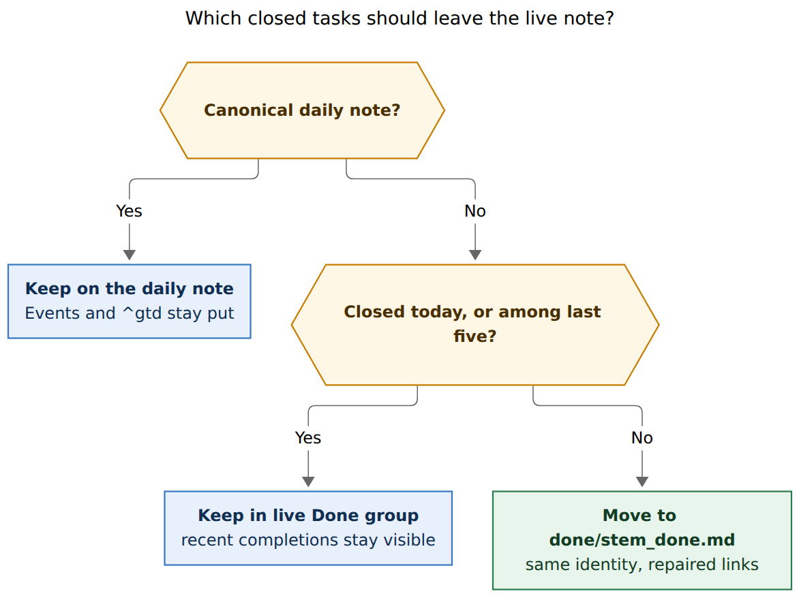

# Done notes: keep the per-source archive, change the gate

Researcher: `grk`. Independent report. Do not treat this as the swarm synthesis.

- **Question:** Bob currently files closed work in `done/<name>_done.md`. What bugs and reliability gaps exist, how do other systems archive completed work, and which changes would Bryan most likely find useful?
- **Evidence:** bob-cli `src/native/collect_done/` (plan, transform, archive, link repair, git), `src/native/nightly.rs`, `src/native/vault_task_loss.rs`, `src/native/task_move/plan.rs`, `src/native/projects/surface.rs`, `src/native/capture_related/corpus.rs`; docs `reference/cli/task.md`, `reference/vault-format.md`, `reference/json-outputs.md`, `pomodoro-homes.md`, `projects.md`, `task-status-hooks.md`, `task-move.md`, `task-relations.md`, `capture.md`, `highlights-create.md`, `develop/release-checklist.md`, `develop/migration-notes.md`; live vault `~/bob/done/` (31 notes, 2026-11-09); open bead `bob-cli-em`; closed bead `bob-cli-gs`; Org Mode archive manual; Things 3 Logbook; PARA Archives; Obsidian Task Archiver.
- **Date of evidence:** 2026-11-09. Nothing was implemented.

## Bottom line

Keep `done/<stem>_done.md`. That shape is the right archive for Bob: one history file per source note, `type: "[[done]]"`, `parent:` back to the live note, `done_tasks:` on the source, and vault-wide link repair of moved `^block-id`s. It is Org's default `%s_archive` adapted to a vault that already keys identity on note path plus block id.

Change the *gate*, not the file. The current rule — move every closed `#task` on a note once that note has 10 of them — leaves **564 live notes holding 1–9 closed tasks** (about 900 closed rows) and will one day vacuum Event Tasks off a busy daily note. Dual-stage archiving is correct: a live **Done & Canceled** group for recent completions, then a `done/` file for history. The count of 10 is the wrong hinge between those stages.

Do not PARA-move finished *project notes* into `done/`. Terminal projects already use `status: done` / `canceled` and stay valid pomodoro homes. Moving the note would be an identity migration, not an archive cleanup.

## What Bob does today

`bob task archive` (formerly `bob collect-done` / `bob move-done-tasks`) scans every Markdown note except `done/`, `_templates/`, `_generated/`, `_conflicts/`, `.bob/`, and other always-excluded directories. For each source it counts collectible closed task *blocks*: list items whose checkbox is `[x]`, `[X]`, or `[-]` and whose line contains a whole-token `#task`. Nested children, drawers, notes, and blank lines travel with the parent block. Open tasks stay.

When that count is at least **10** (override `-t/--threshold`, minimum 1):

1. The closed blocks are stripped from the source and appended to `done/<source-parent>/<stem>_done.md`.
2. The archive note is given (or repaired to) YAML `parent: "[[source]]"` and `type: "[[done]]"`.
3. The source note is given (or repaired to) `done_tasks: "[[done/…_done]]"`.
4. Unique moved block ids are rewritten across the vault, including existing `done/` notes, as `[[done/path_done#^id]]`. Dependency `[id::]` / `[dependsOn::]` tokens follow. Duplicate ids in one move are renamed (`id-1`) in the archive and **links to the ambiguous id are left untouched**.
5. In a git vault the touched paths are committed as `bob task archive YYYY-MM-DD` and pushed.

`bob nightly` runs this under the vault lock, between two `vault-sync` cycles, with the default threshold. Standalone `bob task archive` does the same writes **without** that lock, and without `--dry-run` or `-f json`. Sibling `bob task` commands (move, merge, split, reconcile, reroll) all have dry-run and JSON.

Archive notes are not homes. `docs/pomodoro-homes.md` R1 walks through `done/*_done.md` (`type: [[done]]`) to the live parent, so time on an archived task still attributes to `sase_blog` rather than to the dump file. Project surface, capture-targets, and task-move all refuse `done/` as a live note. Reconcile may *read* an exact `[[done/…#^id]]` ledger link so a just-archived task can be struck; basename search never looks in `done/`. Relation mirrors are never written into `done/` (LR7). Capture `-C/--closed-tasks` already lists closed rows from the whole vault, archives included, newest close date first.

**Two layers of "done" already exist and should stay distinct:**

| Layer | What it is | Where it lives | Who uses it |
| --- | --- | --- | --- |
| Closed *task blocks* | `[x]` / `[-]` `#task` lines | Live Done group, then `done/<stem>_done.md` | `bob task archive` |
| Terminal *project notes* | `status: done` or `canceled` | Same path as when they were wip | `bob projects sync`; capture-targets omit them |

The user-facing files named `done/<name>_done.md` are layer one. Layer two is a status, not a move.

### Live vault, 2026-11-09

| Fact | Count |
| --- | --- |
| Archive Markdown files | 31, all `*_done.md` |
| Nested archive | 1: `done/2026/20260528_day_done.md` |
| Source notes with `done_tasks:` | 34 (includes `_conflicts/` and a `.bob/ref-sources` snapshot) |
| Largest archives | `gtd_daily_done.md` 191 KB / 1084 tasks; `sase_done.md` 175 KB / 831 tasks; `bob_done.md` 130 KB / 526 tasks |
| Headings inside those dumps | none — append-only task lists |
| Open `#task` lines currently in `done/` | 0 |
| Live notes still holding closed `#task` | 567 notes, 952 rows |
| Of those, notes at or above threshold 10 | 3 (`gtd_daily.md` 18, `dev.md` 12, `sase.md` 10) |
| Notes stuck at 1–9 closed tasks | **564** |
| Live notes mentioning `Done & Canceled` | 95 |
| Terminal project notes (`status: done`) | 59, still at their original paths |
| Closed `#task` on recent daily notes | at most 4 in 2026; today's note already has the `^gtd` row plus Event Tasks |

`gtd_daily.md`'s 18 closed rows are completed recurring PRE/POST occurrences (`[repeat:: every day when done]`, yesterday and today). Archiving those occurrences into `gtd_daily_done.md` is the right idea — the live area should not become a multi-year chore log. The dump file is already 1,084 undifferentiated lines.

The one nested daily archive is a rename leftover. Source `2026/20260528.md` (`type: [[day]]`) points `done_tasks` at `done/2026/20260528_day_done`, whose `parent` is `[[2026/20260528]]`. Current `archive_relative_path` would name that file `done/2026/20260528_done.md`. That day's pomodoros are the Obsidian migration; the `_day` stem is from the old daily filename. Archive does not rename itself when the source is renamed.

**Caption.** Closed tasks wait in the live Done group until a note hits ten of them. Most notes never hit ten, so history stays mixed into the working file.

Rendered size: 499.7 × 812 px; fit scale: 100%.

## How other systems handle this

Four families show up again and again. Bob already implements two of them; the useful comparison is how they *choose what to move* and how they *keep history findable*.

### 1. Per-source sidecar file (Org Mode default — Bob's model)

Org's default `org-archive-location` is `%s_archive::`: `Projects.org` archives into `Projects.org_archive` in the same directory. A file-local `#+ARCHIVE: %s_done::` is the same idea with a `_done` suffix. Context (`ARCHIVE_FILE`, outline path, archive time) can be stamped onto the moved subtree via `org-archive-save-context-info`. Datetree filing (`::datetree/`) groups by CLOSED date. org-gtd's default is `gtd_archive_<year>::datetree/` — yearly files plus a calendar tree.

This is the closest cousin of `done/<stem>_done.md`. Bob already has the sidecar, the reverse parent link, and link repair. It does not stamp outline path or archive time on each block, and it does not group the dump by completion date.

### 2. In-file cold storage (Org `:ARCHIVE:`, Bob's Done group, Logseq)

Org can also keep finished trees in the same file under a heading tagged `:ARCHIVE:`, which drops them from the agenda while leaving search in place. EasyOrg documents a cutoff-date bulk move into that heading. Logseq and many Obsidian vaults hide completed tasks with a query (`NOT done`) and never move bytes.

Bob's generated **Done & Canceled** group is this pattern. It is the right *recent* store. It is a bad *forever* store, which is why stage two exists.

### 3. Immediate logbook (Things 3, Todoist completed view)

Things 3 completes a to-do or a whole project into the **Logbook**, grouped by completion date, kept indefinitely, searchable when you opt in. Cultured Code: the Logbook is "a complete reference for everything you've achieved in the past." The Obsidian *Things Logbook* plugin then dumps that history onto daily notes under `## Logbook`. Todoist hides completed items from the project immediately and exposes them through a completed-tasks view / activity log rather than a second file.

Bob already has a Logbook *picker*: `bob capture-complete -C` walks the whole vault including `done/`, newest close date first. What it lacks is a Logbook *place* you can open from a project note without knowing the YAML key `done_tasks`.

### 4. Move the whole container (PARA Archives)

PARA's fourth bucket is inactive items from Projects, Areas, and Resources. Forte's rule is actionability: when a project ends, drag the whole folder to Archives (often `Archives/YYYY/name`). GTD's completed-project list is the workflow cousin: finished projects leave the active project list; a logbook of completed items is optional evidence.

Bob should **not** adopt this for project *notes*. A Bob project note is an identity: capture route `@sase_blog`, parent walks, stats homes, Sub-projects lines, `root: true`. `docs/pomodoro-homes.md` even uses `done/sase_blog_done.md → sase_blog` as the worked example that archives are transparent. Moving `sase_blog.md` itself to `done/sase_blog.md` would collide with the task-archive naming scheme, break `@sase_blog`, and require a rename-keeps-identity migration of the kind Bob already paid for on refs. Terminal status plus omission from capture-targets is the PARA "out of the active list" move, without relocating the file.

A weaker PARA move — putting *task* dumps under `done/YYYY/` by completion year — is worth considering only for the three huge blobs, as a split of the existing sidecar, not as a new identity.

### 5. Plugin-land Obsidian

[ivan-lednev/obsidian-task-archiver](https://github.com/ivan-lednev/obsidian-task-archiver) is the community default: completed tasks can go to the same file, a sibling file, or a path built from `{{sourceFileName}}`, `{{date}}`, `{{obsidianTasksCompletedDate}}`, and heading chains. That is Org's location language with Tasks-plugin dates. Bob is stricter and better on identity (block ids, dependency tokens, git commit). The plugin is better on *dated filing* and on "archive this heading's done children." The cutoff-date / heading-aware rule is the piece to steal.

OmniFocus, for completeness, keeps completed items in place until you compact the database — a "make the working set small" pass, not a per-action move. That is closer to Bob's nightly batch than to Things.

**Takeaway.** The winning pattern for Bob is Org sidecar + Things recency + a visible logbook link. PARA folder-moves of whole projects are the wrong import.

## What is already good

These pieces should stay.

- **Per-source sidecar with a `_done` suffix.** The `done/` directory is how walkers skip archives (`collect_done::should_skip_directory`, project scan, clobber scan, randomize). The `_done` suffix is how Obsidian basenames stay unique: `sase` is the live note; `sase_done` is history. Capture's closed-task picker already forces the `done/…` path form; the suffix is still the human and basename guard. Do not flatten to `done/sase.md`.
- **Bidirectional YAML.** `parent:` on the archive and `done_tasks:` on the source is the right join. Tests cover backfill, stale parent repair, missing `type: [[done]]`, and idempotence.
- **Link repair, including self-heal.** Nightly will rewrite stale `[[sase#^id]]` to `[[done/sase_done#^id]]` even when no new tasks move. Same-note ids that still live in the source are left pointing at the source. Generated tag pages and templates are neither collected nor repaired.
- **Transparent homes.** Archived tasks keep attributing to the live project. Stats even have a regression that an archive move does not change metric values.
- **Task-loss guard knows about archives.** `vault_task_loss` comments "A task moved or archived elsewhere in the worktree is not lost" and scans `done/` so a relocated id is found. Closed rows with no inbound links are ignored.
- **Closed-task catalog.** `-C` plus similar-task matching against `done/*_done.md` mtimes in a 30-day window already treat archives as history, not as a black hole.
- **Terminal projects stay put.** Missing `^prj` is allowed once `status` is terminal; archive may later collect that checked `^prj` line. That is coherent.

`bob_done.md` even still holds the 2026-06-02 task that created this machinery: *Write script for `#git:bob` that moves done tasks to different files!* The design is five months old and has grown real link-repair and metadata repair around a still-naive selection rule.

## Bugs and reliability gaps

### 1. The threshold of 10 is a trap, not a batch

Default 10 means a note archives *all* of its closed tasks together, or none. After a dump, the next nine sit in the live Done group until the tenth arrives. Small project notes never dump. The live vault's 564 notes at 1–9 closed tasks are the measured result, not a hypothetical.

`gtd_daily.md` is the opposite problem: ~8 recurring completions per day, so it crosses 10 every day or two and the dump is a 1,084-line blob with no date headings. Recency, not cardinality, is what Bryan is using the live Done group for.

### 2. Canonical daily notes are eligible and should not be

`archive_relative_path("2026/20261109.md")` is `done/2026/20261109_done.md`. Collectible lines include Event Tasks (`#task`, `[type:: MEET]`) and the daily `^gtd` row. Today's note already has both. No 2026 daily currently has 8+ closed `#task` rows (max 4), so the landmine has not gone off. A busy GCal day with 10 born-done Event Tasks would move those rows out of `## Events`, against `decisions:calendar-events-are-daily-note-event-tasks` and `ended-synced-meetings-are-born-done`. Pomodoro ledger lines are safe: they do not carry `#task`. Event Tasks are not.

The existing `done/2026/20260528_day_done.md` is the proof that dailies *have* been collected, from the era when GTD chores lived on the daily note.

### 3. No dry-run, no JSON, standalone run has no lock

`docs/reference/json-outputs.md` lists `bob task archive` as human-only with `bob projects` and `bob nightly`. The command commits and pushes. The release checklist's only safety rail is "inspect `git -C ~/bob status --short`" before running it against the real vault. Nightly holds `ob::acquire_lock()`; `collect_done::run()` does not. `bob task move` / `merge` refuse to write without the maintenance lock, dry-run, and JSON. Archive should match them.

### 4. Empty Done groups wait for reconcile, and nightly never reconciles

`docs/task-status-hooks.md`: archive can empty `Done & Canceled`; the next `bob task reconcile` drops the empty heading and keeps the gap from growing. Nightly's steps are vault-sync → archive → articles → period notes → vault-sync. Touched notes therefore keep an empty managed group until some other reconcile runs. 95 live notes still mention `Done & Canceled`.

### 5. Reopen is a dead end

`bob task move` refuses any path under `done/` ("source … is under done/ and cannot be used"). `docs/highlights-create.md`: an explicit open status "cannot reopen a task archived in `done/`; reopen it where it lives first." There is no unarchive command. The practical path is cut-paste plus manual link fix. Things, Org, and PARA all treat archive as reversible.

### 6. Archive dumps are unnavigable

`gtd_daily_done.md`, `sase_done.md`, and `bob_done.md` have **zero headings**. Org datetree, Things Logbook, and the Obsidian Task Archiver all group by completion date. Bryan already stamps `[completion::]` / `[cancelled::]` on closed rows. The dump ignores them.

### 7. `done_tasks:` is invisible in the working UI

The join to history lives in YAML. Obsidian hides that in Properties. The Done chip links at the live (possibly empty) group, not at `[[done/sase_done]]`. Finding last quarter's work from `sase.md` is "know to open Properties, or run `-C`, or remember the filename."

### 8. Id-less archived mention sources stay silent

Open bead `bob-cli-em` (READY, medium): sources in `done/` are never minted (task-relations M8). A one-shot survey found ~20 id-less archived mention sources, mostly 2026-10-19 merge-cancels, so LINKED FROM does not list them. The epic accepted this as loss and filed the backfill as follow-up. It is still open.

### 9. Ambiguous block ids skip link repair

If one archive batch moves two tasks that share `^dup`, the second is renamed `dup-1` and **no** `[[note#^dup]]` is rewritten (`duplicate_moved_block_ids_do_not_rewrite_links`). The human scan line counts `ambiguous moved block ids` but the command still exits 0 and pushes. Callers with inbound links keep a pointer at the emptied source.

### 10. Rename drift is unrepaired

Only one live case (`20260528_day_done` vs source `20260528.md`), but the planner keys archives off the *current* source stem. A source rename does not move or relink the sidecar. `done_tasks:` can be edited by hand and then points at a name the next archive pass will not use.

### 11. Periods brief used to drop archived minutes

Closed bead `bob-cli-gs` / fix `bob-cli-h8.3`: `bob periods brief` ignored `done/` paths, so weekly Reviews printed dead `[[sase#^…]]` links and lost linked minutes. Fixed, and worth remembering: every new reader that resolves tasks by note path has to know about archives. The next one will forget.

### 12. No contract page

CLI help, the release checklist, and scattered sentences in homes / hooks / relations / json-outputs are the whole public description. There is no `docs/task-archive.md`. `docs/develop/migration-notes.md` is how you learn the command used to be called `collect-done`.

## Improvements Bryan is most likely to want

Ranked by how often they would show up in a week of real use, not by implementation size.

**A. Recency gate, daily-note exclusion.** This is the change that makes the existing files feel like a Logbook instead of a junk drawer. Steal Org's cutoff date and Things' "just completed stays in sight."

**Caption.** Daily notes are already a dated log. Everywhere else, keep today's work plus a short live tail, and let nightly file the rest into the sidecar that already exists.

Rendered size: 782.0 × 586 px; fit scale: 83.5%.

Concrete rule to implement (one sentence): *Never collect from a canonical daily note; on every other note, collect a closed `#task` whose close date is before today, except keep the five most recently closed rows in that note (undated rows sort last and still count toward the five).* `gtd_daily` then keeps today's PRE/POST completions visible overnight and dumps yesterday's into the 191 KB file the next nightly. Small project notes finally shed last month's `[x]` without waiting for a tenth.

Keep `-t/--threshold` as a backstop for undated piles, or retire it once recency is in.

**B. Make history one click from the live note.** When a `done_tasks:` target exists, the Done chip (or an empty Done heading) should link `[[done/stem_done]]`, not only `#Tasks#Done%20&%20Canceled`. A one-line `📦 [[done/sase_done|Archived tasks]]` under the group is even clearer and survives YAML being folded away. This is the Things Logbook affordance Bob is missing; the picker (`-C`) already exists.

**C. Dry-run, JSON, and the same lock as `bob task move`.** Safety for a command that rewrites links vault-wide and pushes. Matches `cli_rules.md` and every other `bob task` writer.

**D. Fold status-group rewrite into the archive write** (or run a scoped reconcile on touched notes before nightly's second sync). Empty Done headings are the thing you see after archive; they should not wait for a later command.

**E. Date headings in the dump.** On append, if the incoming block has `[completion:: YYYY-MM-DD]` or `[cancelled::]`, file it under `## YYYY-MM-DD` (create once). Org datetree / Things Logbook / Task Archiver `{{obsidianTasksCompletedDate}}`. Optional later split: `done/gtd_daily_done/2026.md` once a file crosses ~500 tasks. Do not change the note identity; split only the body.

**F. Unarchive is move-from-done.** Allow `bob task move` with a `done/` *source* (still refuse `done/` as destination), or a thin `bob task unarchive NOTE:id` that is that move plus flipping `[x]` to `[ ]` only when asked. Highlights overwrite can then reopen "where it lives" without a prose exception.

**G. Mint the `bob-cli-em` backfill.** Previewed, ids only, maintenance lock. About 20 silent mention edges. Cheap reliability.

**H. Do not move terminal project notes.** 59 finished projects at the vault root is file-explorer noise. The fix is a `bob projects list` / file-explorer filter on `status: done|canceled`, not a PARA drag. Prior research on collapsing `sase_blog_0` already needed the existing `done/sase_blog_0_done.md` sidecar to stay and be reparented — the archive follows the live note, the live note does not follow the archive.

## Recommended changes

Do these. Ordered.

1. **Write `docs/task-archive.md`** as the contract: collectible lines, path rule, YAML join, link repair, daily-note exclusion, lock, git, what reconcile still owns. CLI help stays generated; the contract is the missing page.
2. **Exclude canonical daily notes** from collection. Repair `done/2026/20260528_day_done.md` to `done/2026/20260528_done.md` or freeze it as a one-off leftover and stop collecting dailies. Event Tasks stay in `## Events`.
3. **Replace count-10 with the recency rule above** (keep today + last five; archive the rest). Keep `-t` as an undated backstop or document its retirement. This is the user-visible fix.
4. **Add `--dry-run` and `-f json`**, and take the maintenance lock on standalone `bob task archive`. JSON shape: files, task counts, renamed ids, ambiguous ids, link-repair counts, git. `schema_version: 1`, like move/merge.
5. **Rewrite status groups for every source the archive touches**, in the same transaction, so empty Done headings leave with the tasks.
6. **Point the live Done chip (or a 📦 line) at `done_tasks`.** YAML stays; the working UI gains a logbook door.
7. **Append under `## YYYY-MM-DD`** in archive files when a close date is present. No identity change.
8. **Allow move-from-`done/`** as the reopen path. Keep refusing `done/` as a destination.
9. **Ship `bob-cli-em`** (previewed `^id` backfill in `done/`).
10. **Warn-and-non-zero, or repair, on ambiguous moved ids** instead of silently skipping inbound links.
11. **Self-heal archive path when `parent:` / source stem disagree**, the way stale `type:` / `parent:` YAML is already repaired.

## Recommend no change to

- The `done/<stem>_done.md` path, `_done` suffix, `type: [[done]]`, `parent:`, and `done_tasks:` join.
- Walking archives for homes and stats.
- Leaving terminal project *notes* in place with `status: done`.
- Nightly as the batch writer (once the gate is recency, nightly is the right cadence).
- Refusing basename search into `done/` (exact `done/…#^id` only).
- The closed-task picker (`-C`) and the 30-day similar-task archive window.

A single vault-wide `archive.md` or `done/2026.md` dump would throw away per-source identity and make link repair and homes worse. Internal-only archiving (never moving to `done/`) would grow `sase.md` and `gtd_daily.md` without bound. PARA-moving project notes would spend a rename epic on a file-explorer complaint.

## Sources

- bob-cli `src/native/collect_done/{mod,plan,transform,archive,link_repair,git}.rs` and `tests/{plan,unit}.rs` — planner, path rule, threshold, link repair, ambiguous-id skip, YAML join.
- `src/native/nightly.rs` — lock-held sequence; archive has no reconcile step.
- `docs/reference/cli/task.md`, `docs/reference/json-outputs.md`, `docs/develop/release-checklist.md`, `docs/develop/migration-notes.md`.
- `docs/pomodoro-homes.md` R1; `docs/projects.md` terminal `^prj`; `docs/task-status-hooks.md` empty Done group and exact-`done/` ledger exception; `docs/task-move.md` `done/` refusal; `docs/task-relations.md` LR7 / M8; `docs/capture.md` `-C`; `docs/highlights-create.md` reopen; `docs/reference/vault-format.md` `done/` tree.
- Live vault `~/bob/done/` and source `done_tasks:` / closed-task counts, 2026-11-09.
- Bead `bob-cli-em` (READY): id-less archived mention sources.
- Bead `bob-cli-gs` (closed): periods brief vs `done/` paths.
- [Org Mode manual: Archiving / Moving subtrees](https://orgmode.org/manual/Archiving.html), `org-archive-location` default `%s_archive::`, `#+ARCHIVE: %s_done::`, datetree.
- [Things Support: Logbook](https://culturedcode.com/things/support/articles/4001304/) — completed/canceled to-dos and projects, kept indefinitely.
- PARA Archives as inactive Projects/Areas/Resources (Forte Labs; actionability, move the container).
- [ivan-lednev/obsidian-task-archiver](https://github.com/ivan-lednev/obsidian-task-archiver) — `{{sourceFileName}}`, `{{obsidianTasksCompletedDate}}`, same-file vs sidecar.
- org-gtd `org-gtd-archive-location` default `gtd_archive_<year>::datetree/`.
