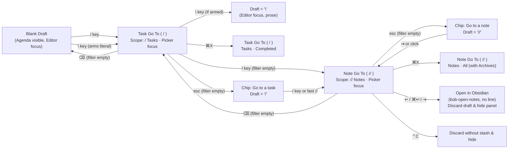

# Double-Slash (`//`) Vault Note Search in `bob-mac-capture`: Critique, Exclusions, UX & Architecture

> **Status:** Design & Feasibility Research (Recommendation)  
> **Scope:** `bob-cli`, `bob-mac-capture`, `bob-plugins` (`bob-navigation-hotkeys`)  
> **Decision constraints honored:** `decisions:mac-capture-is-a-thin-client`, `decisions:idle-capture-shows-ledger-agenda`, `bob-open-notes` URI contract

---

## Executive Summary

Extending `bob-mac-capture`'s blank-draft Go To trigger so that a **second actual `/`** (forming `//`) switches from Task Go To (`/`) to Vault Note Go To (`//`), while keeping `\` → `\` as a raw literal `\`, is a **strong, natural fit** for Bryan's global capture panel. It closes the last major global-navigation gap (Task Go To `/` and Today's Pomodoro `⌘\` already exist, while jumping straight to any note from anywhere on macOS still requires switching to Obsidian and invoking Quick Switcher `⌘O`) and mirrors Bob's existing doubled-sigil escalation (`(` → `((`, `@` → `@@`, `~` → `~~`).

However, a **naive implementation will fail on five real codebase traps**:

1. **The Focus-Transfer Trap:** After the first `/` (or `\`) opens `task_goto`, `bob-mac-capture` immediately locks the editor and moves keyboard focus into `CapturePickerFilterNSTextField`. The second `/` normally hits `pickerCommand` inside the filter field — never updating `plainDraft` to `"//"` and never reaching `bob capture-complete` — unless both the Swift picker router *and* `bob-cli` coordinate.
2. **The `RESULT_LIMIT = 20` & `NoteIndex::read` (~300 ms) Trap:** Reusing `capture_links::note_candidates` (`RESULT_LIMIT = 20`, full-vault line-by-line heading/block regex parse documented at ~300 ms in `src/native/capture_complete/shell.rs`) would truncate the local fuzzy index on empty queries and make `//` feel sluggish.
3. **The `bob-goto-task` `line=1` Trap:** `obsidian://bob-goto-task` requires a positive integer `line` and forces `ensureEditing: true`, which switches Reading View back to Source mode and yanks the cursor into line 1's YAML frontmatter. Note opens should use `obsidian://bob-open-notes` (with `line` omitted) instead.
4. **The `/Users/x` Prose Regression Trap:** `src/native/capture_language/tests/goto.rs` currently keeps `"//"`, `"/Users/x"`, and `"/r/rust"` literal via `count('/') != 1`. Changing that rule without precision would break `/` Unix path captures or block searching paths inside `//`.
5. **Vault Directory Clutter:** An unfiltered scan returns `.bob/`, `.obsidian/`, `.trash/`, `_conflicts/`, `_generated/`, `_templates/`, `done/*_done.md`, `ref_history/`, `old_lib/`, `mail/`, `file/clip-*.md`, and `generated_from_zorg: true` logs — drowning live notes (`bob.md` shadowed by `done/bob_done.md`, `attention.md` shadowed by `ref_history/...`, project searches flooded by email threads).

### Recommended Solution in One Glance

- **Trigger & State Machine:** Support `//` symmetrically across **all paths**: typing `/` inside an empty `task_goto` filter (whether opened via `/` or `\`), typing `/` in an Escape-chipped bare `/` draft, and fast/pasted `//...` in `bob-cli`. Keep `\` + `\` → literal `\` unchanged. Pressing `⌫` (`Backspace`) on an empty `//` filter deletes only the second `/` and steps smoothly back into `/` Task Go To.
- **Clarified Visual Naming:** Rename the single-slash capsule from `Go To` to **`Tasks`** (with a passive `/` `Notes` keycap hint in its empty footer) and give double-slash **`// Notes`**, with matching **`⌘X`** archive toggles (`Show Completed` in `/`, `Show Archives` in `//`).
- **Two-Layer Exclusions (`.md` + No Symlinks):**
  - *Hard-excluded always:* dot-directories (`.git`, `.obsidian`, `.bob`, `.trash`, ...), `_conflicts/`, `_generated/`, `_templates/`, `*.assets/`, `xlib/`, `lit_review/`, `lib/`, `img/`.
  - *Soft-excluded by default, revealed with `⌘X`:* `done/` (top-level only per `done_archive.rs`), `ref_history/`, `old_lib/`, `mail/` (`gmail.folder`), `file/`, `generated_from_zorg: true`, and `*_done.md`/`*_poms.md` siblings.
  - *Included & richly typed:* Areas, Projects (closed/canceled dimmed & demoted rather than hidden), Notebooks, Albums, Records, Articles, `ref/` library notes, Daily & Period notes (`YYYYMMDD`, weeks, quarters, years, `all_time`), Bank hub/month notes, and plain notes.
- **Fast Thin-Client Pipeline:** Add a dedicated `note_goto` completion context in `bob-cli` backed by a lightweight header-only walker + per-file `(mtime_ns, size)` fingerprint cache in `bob_cli_cache_dir()` (targeting sub-35 ms warm runs), rendered in `bob-mac-capture`'s existing `CapturePickerView` with semantic grouping (`Today & Recent`, `Areas & Projects`, `Notebooks, Albums & Articles`, `Vault Notes`) and multi-field `FuzzyMatcher` ranking, opening via `obsidian://bob-open-notes?count=1&path1=<abs>`.

---

## 1. Critique of the Plan & Design Alternatives

### 1.1 Is the `//` Plan a Good Idea?

**Yes — with targeted refinements.** Evaluating it against `bob-mac-capture` and `bob-cli` as built today:

**What makes `//` strong:**

- **Fills a real global-hotkey workflow hole:** `bob-mac-capture` already offers global-hotkey Go To for **tasks** (`/` or `\`) and **today's ledger** (`Command-\`), while `[[` note completion only exists inline inside a capture draft (where Return writes a capture item). There is no zero-write global hotkey path to open a specific Area, Project, Notebook, Album, Reference note, or past Daily/Period note from outside Obsidian.
- **Consistent with Bob's existing doubled-sigil grammar:**
  - `(` vs `((` — task wikilink completion escalates on the doubled opener.
  - `@` vs `@@` — per-item route vs draft-wide route.
  - `~` vs `~~` — `Links To` vs `Linked From`.
  - `/` vs `//` — narrower actionable unit (`Task`) vs broader container (`Note`).
- **Low finger cost and unambiguous `\` separation:** On an active keyboard home position, `/` → `/` is faster than a four-key modifier chord, and requiring an *actual* second `/` preserves `\` → `\` → literal `\` completely.

**Where the initial idea needs sharpening:**

1. **Discovery vs. accidental activation:** A bare second `/` has no visible UI affordance beforehand. Without a subtle hint inside `/`, only Bryan's memory surfaces it; and if someone bounces `/` twice accidentally, closing back to blank Agenda would feel punitive. *Fix:* Add a subtle `/` `Notes` keycap hint in `/` when empty, relabel `/` from `Go To` to `Tasks` so the `/` vs `//` pair is self-explanatory, and make `⌫` on empty `//` step back to `/` rather than wiping to blank.
2. **Focus & race-condition reality:** As detailed in Section 2, `/` immediately steals focus out of `NSTextView` into `CapturePickerFilterNSTextField`. Typing `//` in normal cadence happens across *two different AppKit controls*, whereas typing `//` fast (<40 ms) or pasting `//note` happens inside `NSTextView`. Both code paths must converge on one `bob-cli` truth.
3. **Opening the whole note without Task-Go-To side effects:** Task Go To assumes a line-level editing jump (`bob-goto-task`). Using that mental model for notes breaks reading state.

### 1.2 Evaluation of Credible Alternatives

| Approach | How it would work | Strengths | Why rejected (or how synthesized) |
| :--- | :--- | :--- | :--- |
| **A. Separate `//` Note Go To (Recommended)** | `/` stays Task Go To; typing `/` again (or `//`) switches cleanly to `note_goto` in the same panel card. | Keeps `/` clean, fast, and focused on open tasks; zero polling of note filesystem during `/` task lookups; mirrors `((` / `@@` / `~~`; supports instant `⌫` back to `/`. | Needs the picker-router transition + discoverability hint in `/` (both trivial to include). |
| **B. Unified `/` Omni-Picker (Tasks + Notes mixed)** | Every `/` shows open tasks AND all vault notes (or tabs via `⌘N`). | Single trigger (`/` only). | Pollutes `/` unfiltered task browse (Pomodoros → In Progress → Next) with ~1,000+ notes; forces full-vault note scan latency onto every task jump; short queries like `bob` trigger noisy path matches above tasks. **Partial synthesis:** Keep `//` distinct, but visually pair `/` (`Tasks`) ↔ `//` (`Notes`) seamlessly in one picker card with 1-key pivot (`/` forward, `⌫` back). |
| **C. Claim blank-draft `[[` for Note Go To** | Typing `[[` on a blank draft opens read-only Note Go To instead of inline wikilink completion. | Familiar Obsidian link syntax. | **Breaks existing valid captures.** Starting a captured task with a wikilink (e.g., `[[bob]] Check release pipeline @dev`) is valid prose/task capture; claiming `[[` at position 0 as read-only Go To creates syntax conflict. Meanwhile `///` or `// note` leaves `/` prose capture intact. |
| **D. Dedicated hotkey (e.g., `⌘O` inside Capture or `⌥\`)** | Bypass `/` altogether; bind a global or panel chord like `⌘O`. | Avoids double-tap edge cases. | Adds yet another chord to remember (`⌘\` for Pomodoro, new global chord for Notes, `/` for Tasks) and doesn't work in CLI/test drafts (`bob capture-complete`). (`⌘O` inside an already-open blank panel could still be added later as an alias to insert `"//"`, *on top of* `//`, never instead of it.) |
| **E. Obsidian `⌘O` Quick Switcher / Raycast / Alfred** | Rely on Obsidian's built-in Quick Switcher or OS launcher. | Zero `bob` code needed. | Obsidian `⌘O` only works when Obsidian is focused and relies on Obsidian UI/IndexedDB `userIgnoreFilters` rather than Bob's vault policies (`docs/obsidian-sync-exclusions.md`). Alfred/Raycast have no knowledge of Bob note kinds (`Area`, `Project`, `Notebook`, `Album`, `Ref`), frontmatter `aliases`/`title`/`summary`, `done/`/`ref_history/` semantics, or `bob-open-notes` tab-reuse rules. |

---

## 2. Technical Findings: Critical Constraints from the Codebase

Direct inspection across `bob-cli`, `bob-mac-capture`, and `bob-plugins` established seven concrete facts that shape every design choice:

1. **Thin-client rule (`decisions:mac-capture-is-a-thin-client`):** `bob-mac-capture` must **not** walk `~/bob`, hard-code vault exclusions, or parse note frontmatter. `bob-cli` owns file discovery, exclusions, metadata extraction, and parse/completion contracts; `bob-mac-capture` renders, filters locally (`FuzzyMatcher`), and dispatches the chosen open URL.
2. **Focus moves out of the editor on first `/` (`CapturePanelModel.swift:8475-8477`):** When `task_goto` opens, `CapturePanelModel.presentPicker` sets `editorInputLocked = true` and calls `requestFocus(.pickerFilter)`. Furthermore, `FuzzyQuery(filter, leadingSigil: "/")` (`FuzzyMatcher.swift:14-29`) strips one leading `/` from the filter string. Therefore:
   - Typing `/` when `task_goto` already has `pickerFilterText == ""` MUST be intercepted in `CaptureKeyCommandRouter.pickerCommand` (mirroring lines 1230–1240, which already intercept `\` for `.typeLiteralBackslash`).
   - Fast double-taps (`//` arriving in `NSTextView` before the first `capture-complete` reply sets `editorInputLocked`), Escape-then-`/`, and pasted `"//..."` go through `bob capture-parse` / `bob capture-complete`.
3. **Backslash literal guarantee (`CapturePanelModel.swift:6113-6126, 10209-10220` & `CapturePanelController.swift:1108-1128`):** Typing `\` on a blank draft inserts `/` and calls `armBackslashLiteral()`. If the next key is `\`, `CaptureKeyCommandRouter` fires `.typeLiteralBackslash`, rewriting `plainDraft` to `"\\"`. If the next key is an actual `/`, it is handled as `/` (escalating to Note Go To and clearing `backslashLiteralArmed`). Pressing `/` then `\` keeps `backslashLiteralArmed == false`, so `\` stays consumed while the filter is empty.
4. **Why `NoteIndex` (`src/native/capture_links.rs`) cannot be used as-is:**
   - `capture_links::note_candidates` caps results at `const RESULT_LIMIT: usize = 20` (`capture_links.rs:17`). Empty-query `//` and client-side progressive filtering in `bob-mac-capture` require the **complete eligible note set** in the initial snapshot (exactly like `task_goto` and `task_link`), not a truncated top-20 list.
   - `NoteIndex::read` reads every file in full and scans every body line for ATX headings and `BLOCK_ID_RE` matches; `src/native/capture_complete/shell.rs:46` explicitly notes `NoteIndex::read` takes **~300 ms**. Note Go To does not need headings or block IDs at all.
5. **`obsidian://bob-goto-task` vs. `obsidian://bob-open-notes` (`bob-plugins`):**
   - `675-plugin-goto-task-uri.js` (`docs/goto-task-uri.md`) requires `path` + positive `line` (`parseGoToTaskLine`) and always calls `focusTaskAnchor(..., ensureEditing: true)`, switching Reading View to Source mode and moving the caret to `line`. Passing `line=1` to open a whole note lands the cursor inside YAML frontmatter and destroys reading state.
   - `676-plugin-open-notes-uri.js` (`docs/open-notes-uri.md`) **already treats `lineK` as optional** (`line === null` at lines 274, 421–437, 461–485). When `line` is omitted, it reuses any already-open tab across windows (loading deferred background tabs, preferring main area over sidebars) or opens an empty tab / new far-right tab **without** forcing cursor placement (`openState = undefined`) and **without** forcing `ensureEditing: true`!
6. **Current prose test in `src/native/capture_language/tests/goto.rs:100-112`:** Today `"//"`, `"/Users/x"`, and `"/r/rust"` are asserted not to trigger `Need::TaskGoto` because `task_goto_query_token` (`tokens.rs:470-494`) checks `.filter(|b| *b == b'/').count() != 1`. Splitting the predicate so single-slash `task_goto` rejects `"//"` prefix while double-slash `note_goto` matches `token.text.starts_with("//") && !token.text.starts_with("///")` keeps `"/Users/x"`, `"/r/rust"`, `"// note"` (multi-token), and `"///"` safely in prose!
7. **Vault exclusion precedents already exist in `bob-cli`:**
   - `src/native.rs:3-16`: `ALWAYS_EXCLUDED_NOTE_DIRECTORY_NAMES` = `[".bob", ".git", ".obsidian", "_conflicts", "_generated", "_templates"]`.
   - `src/native/done_archive.rs:17-38`: top-level `done/` archive (`first_normal_component == "done"`, never nested `projects/done/` or `done.md`).
   - `src/native/gmail/vault_walk.rs:4-160`: `scan_vault_notes` skips dot-dirs, `ALWAYS_EXCLUDED_NOTE_DIRECTORY_NAMES`, top-level `done/`, configured `gmail.folder` (`mail/`), symlinks, and `generated_from_zorg: true`.
   - `docs/highlights-ref-sync.md:132, 683-691` & `docs/ref.md:86`: skips `ref_history/` and `*.assets/`.
   - `docs/vault-git-sync.md:168, 747-795` & `docs/obsidian-sync-exclusions.md:36-42`: `old_lib/`, `lit_review/`, `xlib/`.
   - `docs/attachments.md:42` & `docs/gmail.md:1136`: `file/clip-*.md`, `file/mail/...`, `img/`.

---

## 3. Explicitly Called-Out Requirement Adjustments

Before detailing the full spec, here are every adjustment and addition made to the original request, with the rationale for each:

| # | Original Assumption / Underspecified Area | Adjusted Requirement | Justification |
| :--- | :--- | :--- | :--- |
| **A1** | "Allow for a second `/` to be typed" | Trigger must work **both** when focus is inside the open `task_goto` picker filter (`pickerFilterIsEmpty == true`, including after `\` → `/`), in an Escape-chipped bare `/` editor state, **and** as `"//..."` in `bob-cli` (`capture-parse` / `capture-complete`). Once filter text is non-empty in `/`, `/` types normally into the filter. | Typing `/` or `\` at normal speed moves focus into `CapturePickerFilterField`; handling only `bob-cli` fails live typing, while handling only Swift fails fast typists, paste, chips, and CLI tests. |
| **A2** | Generic Go To labels | Rename `/` scope pill from `Go To` → **`Tasks`** (`Tasks · Completed`), name `//` **`Notes`** (`Notes · All`), and show a passive **`/` `Notes`** keycap hint in `/` when its filter is empty. | Gives `//` immediate discoverability without stealing screen real estate (`ViewThatFits` drops it on narrow widths) and makes it visually obvious which mode `/` vs `//` is active. |
| **A3** | Unspecified Backspace behavior in `//` | **`⌫` (`Backspace`) on an empty `//` filter deletes only the second `/`**, stepping smoothly back into **`/` Task Go To** (mirroring `((` → `(` in `.wikilinkTask`); a second `⌫` returns to the blank Agenda. | Rescues accidental `/` double-taps in one keystroke and creates exact spatial symmetry (`blank` ↔ `/` ↔ `//`). |
| **A4** | Single fixed exclusion list | Split exclusions into **Hard Infrastructure Exclusions (never shown)** and **Soft Archive/Noise Exclusions (`done/`, `ref_history/`, `old_lib/`, `mail/`, `file/`, `generated_from_zorg`) toggled via `⌘X`** (`Show Archives` ↔ `Hide Archives`). | Eliminates 90% of daily search clutter (email threads, `_done.md` twins, overwritten `ref_history` snapshots) while preserving a 1-chord escape hatch (`⌘X`) identical to `/` Task Go To's `Show Completed`. |
| **A5** | File scope (`all note files`) | Restrict `//` to **non-symlink `.md` files** by default (note `.canvas`/`.base` as an easy optional config flag later). | Matches Obsidian's note model and all `bob-cli` walkers; avoids polluting Go To with PDFs (`lib/`, `xlib/`), images (`img/`, `*.assets/`), audio (`.mp3`), and JSONL journals. |
| **A6** | Implicit reuse of `/` open path | Open notes via **`obsidian://bob-open-notes`** (`count=1&path1=<abs>`, **`line1` omitted**) instead of `obsidian://bob-goto-task`. | Preserves Reading/Source view mode and existing cursor/scroll position on open tabs; avoids landing inside YAML frontmatter line 1 on newly opened notes. |
| **A7** | Implicit reuse of `NoteIndex` | Add a **header-only vault scanner + `(mtime_ns, size)` fingerprint cache** in `bob-cli`, returning all eligible note rows for local `FuzzyMatcher` ranking. | Avoids `NoteIndex::read`'s ~300 ms full-body scan and 20-row truncation limit while keeping disk freshness 100% live-verified on every open. |
| **A8** | Escape-to-prose edge case (`///` and `/Users/x`) | Token rule claims leading `"//"` (without `"///"` and only on a single-token single-line draft); `"// note"` (with space), `"///..."`, `"/Users/x"`, and `"/r/rust"` remain capturable prose. | Preserves existing Unix-path capture tests and provides a clean literal escape if someone ever wants to capture a literal slash-prefixed line. |

---

## 4. Vault Exclusion & Inclusion Design

### 4.1 Guiding Principle

When you press `/` `/`, you want **notes you author, organize with, or consult as knowledge** — Areas, Projects, Notebooks, Albums, Records, Articles, References (`ref/`), Daily/Period notes, Bank notes, and topical `.md` files — **without** machine state, conflict clones, sync/intake queues, template scaffolds, duplicated historical snapshots, or raw inbox email dumps competing for top keystrokes.

At the same time, completely hiding `done/` or `mail/` with *no* way to reach them inside `//` would force a fallback to Obsidian's file explorer whenever you actually want an archived project note or saved email thread. Splitting exclusions into **Hard** vs. **Soft (`⌘X`)** solves both needs cleanly.

### 4.2 Complete Vault Directory & Note Taxonomy

| Vault Path / Pattern | Origin in `bob-cli` | Tier | Default `//` | Under `⌘X` | Why |
| :--- | :--- | :--- | :---: | :---: | :--- |
| `.git/`, `.obsidian/`, `.bob/`, `.trash/`, any `.*` dir | `src/native.rs`, `capture_links.rs` | **Hard Exclude** | ❌ | ❌ | System metadata, JSONL journals, plugin assets, Obsidian trash. Never user-navigable notes. |
| `_conflicts/` | `vault_sync.rs`, `src/native.rs` | **Hard Exclude** | ❌ | ❌ | Quarantined clobber/sync copies (`sync_conflicts.md`, timestamped conflict files). Searching these risks editing stale conflicted clones instead of the real note. |
| `_generated/` (e.g., `tag_pages/...`) | `collect_done`, `src/native.rs` | **Hard Exclude** | ❌ | ❌ | Regenerated machine views whose filenames intentionally mirror real note stems (e.g., `_generated/tag_pages/topic/sase.md` vs `sase.md`). |
| `_templates/` | `src/native.rs`, `task-types.md` | **Hard Exclude** | ❌ | ❌ | Templater/note scaffolds containing unrendered placeholder syntax and collision stems (`project.md`, `daily.md`). Rarely opened directly; accidental edits break templates. |
| `*.assets/`, `img/`, `lib/`, `xlib/`, `lit_review/` | `highlights-ref-sync.md`, `attachments.md`, `vault-git-sync.md` | **Hard Exclude** | ❌ | ❌ | Binary PDF/image/audio directories and intake queues (`xlib/` is host-local/gitignored). Pruning before traversal eliminates thousands of `stat` syscalls. |
| Non-`.md` files & all symlinks | `capture_links.rs`, `gmail/vault_walk.rs` | **Hard Exclude** | ❌ | ❌ | Matches "note files", avoids JSON/CSV/PNG/PDF/MP3 noise, and guarantees vault boundary safety. |
| Top-level `done/` (`done/*_done.md`, `done/YYYY/...`) | `done_archive.rs` (`is_archive_path`) | **Soft Exclude** | ❌ | ✅ *(Archived)* | Almost every project `foo.md` has an archive twin `done/foo_done.md`. Showing both by default doubles result noise. Note: only top-level `done/` counts (nested `projects/done/` or `done.md` stay included!). |
| `ref_history/` | `ref.md`, `highlights-ref-sync.md` | **Soft Exclude** | ❌ | ✅ *(Archived)* | Frozen pre-overwrite snapshots (`<stem>__<date>.md`). Explicitly not live library members (`highlights-ref-sync.md:691`); including by default creates duplicate hits for refreshed papers/blogs. |
| `old_lib/` | `obsidian-sync-exclusions.md` | **Soft Exclude** | ❌ | ✅ *(Archived)* | Historical archival library explicitly split out of normal sync. Keep out of daily search clutter, reachable via `⌘X`. |
| `mail/` (or configured `gmail.folder`) | `gmail/vault_walk.rs`, `docs/gmail.md` | **Soft Exclude** | ❌ | ✅ *(Mail)* | Saved Gmail threads (`bob gmail sync/link`). `bob gmail link -a` itself treats `mail/` as an excluded folder. Email subjects heavily overlap project/person words and overwhelm personal notes at scale. *(See §4.3 note on user override.)* |
| `file/` (`file/clip-*.md`, `file/mail/...`) | `attachments.md`, `gmail.md` | **Soft Exclude** | ❌ | ✅ *(Clip)* | Captured clipboard snippet dumps and email attachment extracts linked from tasks, not standalone authored notes. |
| Frontmatter `generated_from_zorg: true` | `gmail/vault_walk.rs` | **Soft Exclude** | ❌ | ✅ *(Zorg)* | Legacy generated logs excluded across Bob's vault walkers. |
| `*_done.md` / `*_poms.md` outside `done/` | `docs/task-types.md:47` | **Soft Exclude** | ❌ | ✅ *(Archived)* | Legacy task/pomodoro archive siblings. |
| `inbox.md`, `type: [[area]]`, `type: [[project]]` (`wip`, `planned`, & closed `done`/`canceled`) | `capture_targets.rs`, `projects.md` | **Include** | ✅ | ✅ | Core GTD / Bob destinations. Keep `done`/`canceled` project notes (that haven't moved to `done/`) **included** with a muted status badge and lower rank than `wip`, so closed projects remain findable by name. |
| `type: [[notebook]]`, `type: [[album]]`, `type: [[record]]`, `type: [[article]]` | `notebooks.md`, `records.md`, `articles.md` | **Include** | ✅ | ✅ | First-class curated knowledge notes and records (`eat/...`). |
| `ref/` (Reference library, non-`.assets`) | `ref.md` | **Include** | ✅ | ✅ | Active curated reading notes (papers, books, blogs, docs, talks, videos). Search matches both filename stem (`Slug`) and frontmatter `title:`. |
| Daily & Period notes (`YYYY/YYYYMMDD*.md`, `YYYY/YYYY-Www.md`, `YYYY/YYYY-Qn.md`, `YYYY.md`, `all_time.md`) | `periods.md` | **Include** | ✅ | ✅ | High-frequency temporal lookups (`20261114`, `W46`, `Q4`). Today/recent days & current period rank high; historical daily notes sort below curated notes on non-date queries so they never bury projects/topics. |
| `bank.md` & `bank/YYYY-MM.md` | `bank.md` | **Include** | ✅ | ✅ | Active financial hub & monthly transaction ledgers. |
| Root & subfolder general `.md` notes (e.g., `zk/...`, `org.md`, dashboards, guides) | Vault standard | **Include** | ✅ | ✅ | Freeform Obsidian notes and Zettels with no special Bob frontmatter type. |

### 4.3 Optional User Config Escape Hatch

Add an optional configuration block in `~/.config/bob/config.yml` (`docs/reference/configuration.md`) — e.g.:

```yaml
capture:
  note_goto_exclude: []          # extra relative prefixes/globs soft-excluded by default
  note_goto_include_mail: false  # opt-in to show `mail/` in default // without ⌘X
```

Calling out `note_goto_include_mail` explicitly acknowledges the one judgment call in the table above: if Bryan opens saved Gmail threads directly by subject often enough that pressing `⌘X` feels like an extra step, flipping one config boolean promotes `mail/` into default `//` (still ranked below authored Areas/Projects/Notebooks). Otherwise, excluding `mail/` by default keeps `//` focused and surgical.

---

## 5. UX, Interaction Design & Visual System

### 5.1 Complete Keystroke & State Transition Machine



Every edge case fits cleanly into this state machine:

- **Typing `/` then `/` (normal cadence):** First `/` opens `/ Tasks` (focus in filter field). Second `/` hits `pickerCommand` (`pickerSourceIsTaskGoto && pickerFilterIsEmpty && draftIsBareGotoSigil`) → updates `plainDraft` atomically to `"//"` and transitions the *existing* picker card smoothly into `// Notes` without closing/reopening the window or dropping focus.
- **Typing `\` then `\` (literal backslash):** First `\` runs `.openGotoFromBackslash` (inserts `/`, sets `backslashLiteralArmed = true`). Second `\` sees `backslashLiteralArmed == true` → `replaceGotoSigilWithLiteralBackslash()` sets `plainDraft = "\\"` and closes the picker. Unchanged.
- **Typing `\` then `/` (actual slash after backslash):** First `\` opened `/ Tasks`; second key is `/`, which clears `backslashLiteralArmed` and enters `// Notes`! Directly honors *"an actual `/` must be typed to trigger this new functionality"*.
- **Typing `/` then `\`:** `backslashLiteralArmed` is `false` (opened via `/`, not `\`), so `pickerCommand` consumes `\` while `pickerFilterIsEmpty`, matching today's behavior. Once the user types filter characters (say `//bob\`), both `/` and `\` type normally into the filter string so path searches like `ref/papers` work effortlessly.
- **Typing `/` then filter text then `/`:** Because `pickerFilterIsEmpty` is `false` once query text exists (e.g., `"fix"`), pressing `/` while filtering `/ Tasks` types `/` into the task filter rather than unexpectedly switching modes.
- **Fast typeahead (`//` or `//sase` before `/ Tasks` opens) or pasted `//sase`:** `plainDraft` arrives directly at `bob capture-parse` / `bob capture-complete` as `"//"` or `"//sase"`, which returns `Need::NoteGoto` / `context = "note_goto"`, opening `// Notes` immediately (and seeding `filterText = "sase"` for `"//sase"`).
- **Backspace (`⌫`) in empty `// Notes`:** `removePickerTrigger()` checks `picker.source == .noteGoto`, deletes ONLY the second `/` (leaving `"/"`), and lets analysis/transition return immediately to `/ Tasks`. A second `⌫` in empty `/ Tasks` removes the remaining `/` and restores Today's Agenda.
- **Escape (`esc` or `⌃[`):** First press clears a non-empty filter; second press collapses into a `Go to a note` chip above `"//"` in the editor (`⌘\` / `⇥` / click reopens cleanly).
- **`Control-C`:** `draftIsNoteGoto` shares `draftIsTaskGoto`'s discard rule (`CapturePanelModel.swift:5491-5523`) so abandoning a note search never pollutes `CanceledDraftStash`.

### 5.2 Visual Design in `CapturePickerView`

Reusing `CapturePickerView`'s existing geometry (`46pt` filter bar, `34pt` single-line rows, `26pt` section headers, `80pt` detail strip, `CapturePickerHeightPolicy` with `3..11` row viewport bounds) ensures `//` feels cohesive with every other picker in `bob-mac-capture` — zero bespoke chrome bloat, maximum legibility:

```text
╭───────────────────────────────────────────────────────────────────────────────────╮
│  ( // Notes )   Search notes by name, alias, folder, or type          842 notes   │
├───────────────────────────────────────────────────────────────────────────────────┤
│  TODAY & RECENT                                                           5 notes │
│   [calendar•green]  2026-11-15  (TODAY)                     2026/20261115.md     │
│   [tray•accent]     Inbox                                           inbox.md     │
│   [calendar•green]  2026-W46 · Nov 9 – 15  (Week)            2026/2026-W46.md    │
│   [folder•brown]    bob_mac_capture  (WIP)                 bob_mac_capture.md    │
│   [books•orange]    OpenAI Codex & Symphony  (Ref)       ref/blogs/codex...md    │
│  AREAS & PROJECTS                                                        24 notes │
│   [square.stack]    Dev  (Area)                                        dev.md    │
│   [folder•brown]    sase  (WIP)                                       sase.md    │
│   [folder•secondary] old_migration  (Done)                    old_migration.md   │
│  NOTEBOOKS, ALBUMS & ARTICLES                                            18 notes │
│   [book.closed•teal] Linux  (Notebook)                               linux.md    │
│   [🍽️]              Eat  (Album)                                       eat.md    │
├───────────────────────────────────────────────────────────────────────────────────┤
│  ref/blogs/open_source_codex_orchestration_symphony.md · → sase → dev · 2h ago   │
│  Open-source orchestration patterns; aliases: symphony                            │
│  Pick a note to open it in Obsidian — nothing is written                          │
╰───────────────────────────────────────────────────────────────────────────────────╯
  ↑↓ Move   ↩ Open   ⌘↩ Open   ⌘X Show Archives   esc Clear / Cancel
```

#### Key Visual Details Grounded in `CaptureEditorPalette` & `CapturePickerView`

1. **Filter Bar (`CapturePickerFilterBar`):**
   - **Scope capsule:** Monospaced semibold `//` in `CaptureEditorPalette.color(for: .route)` (`.accentColor`) + semibold **`Notes`** (or **`Notes · All`** when `⌘X` includes archives/mail).
   - **Count badge:** `"842 notes"` (empty) → `"12 of 842"` (filtered) in `.monospacedDigit()`.
2. **Row Icons & Semantic Palette (matching existing `CapturePickerView` & `CaptureEditorPalette`):**
   - `today` (`YYYYMMDD == today`): `"calendar"` in `.green` + pink **`TODAY`** capsule (reusing Pomodoro `NOW`'s pill styling!).
   - `inbox`: `"tray"` in `.accentColor` (`.route`).
   - `area`: `"square.stack"` in `.purple` (`.section`).
   - `project`: `"folder"` in `CaptureEditorPalette.color(for: .projectNoteName)` (`.systemBrown` manila wash feel for active `wip`/`planned`; muted `.secondary` with `0.7` opacity and `Done`/`Canceled` pill for terminal projects).
   - `notebook`: `"book.closed"` in `.teal` (`.directive`).
   - `album` / `record`: renders the album's custom `emoji` when present (matching `RouteCandidate.emoji` in `model.rs:49`), else `"rectangle.stack"` / `"doc.richtext"`.
   - `article`: `"newspaper"` in `.indigo` (`.blockID`).
   - `ref`: `"books.vertical"` in `.orange` (`.priority`, visually distinct library warmth).
   - `period` (`week` / `quarter` / `year` / `all_time`): `"calendar"` in `.green` if current period, else `.secondary`.
   - `bank` / `bank_month`: `"banknote"` in `.green`.
   - `mail` (only in `⌘X`): `"envelope"` in `.secondary` at `0.65` row opacity + `Mail` pill.
   - `archive` (`done/`, `ref_history/`, `old_lib/`, `file/` in `⌘X`): `"archivebox"` in `.secondary` at `0.55` row opacity (matching `row.isHidden` dimming in `CapturePickerView.swift:854`) + `Archived` pill.
   - `other`: `"doc.text"` in `.secondary`.
3. **Display Title + Alias Transparency:**
   - Primary row text displays `title` (when frontmatter `title:` is present — essential for `ref/`, `article`, and `record` notes whose titles like `"Attention Is All You Need"` are much friendlier than filenames!) or `stem`, with fuzzy-matched character runs highlighted using the existing accent wash (`CapturePanelModel.swift:8926`).
   - When the best query match hit a frontmatter `alias` rather than `title`/`stem`/`path`, display a compact teal **`aka <alias>`** badge so you immediately see why typing `sym` surfaced `open_source_codex_orchestration_symphony.md`.
4. **Right-Aligned Path Locator:**
   - Shows vault-relative path (`maxWidth: 260`, `.monospaced`, `.caption`, **`.truncationMode(.middle)`** instead of `.tail` — crucial so `ref/papers/...tion_2026.md` keeps *both* its top folder prefix and its filename stem legible instead of hiding the filename under ellipses!).
5. **Detail Strip (`80pt`):**
   - *Line 1:* Full un-truncated `note_path` · root/parent breadcrumb (`→ sase → dev` when present) · relative modification time (`Edited 2h ago`).
   - *Line 2:* Frontmatter `summary:` if present, else `Aliases: ...`, else folder/kind context (or `Archived under done/` / `Mail note` when `⌘X` shows an excluded item).
   - *Line 3:* `"Pick a note to open it in Obsidian — nothing is written"` (exact sibling of Task Go To).
6. **Footer Key Hints:**
   - Default `//`: `↑↓ Move` · `↩ Open` · `⌘↩ Open` · `⌘X Show Archives` (flips to `Hide Archives`) · `esc Clear / Cancel`.
   - Default `/` (`task_goto`): add `("/", "Notes")` into `keyHintVariants` right before `esc` (so `ViewThatFits` drops it on narrow widths cleanly without resizing anything).

---

## 6. Empty-Filter Grouping & Filtered Ranking Model

Because empty `//` displays at most 11 rows above the fold (`pickerMaxRows = 11`), **initial ordering determines 90% of perceived elegance**. Alphabetical sorting (`2024/20240101.md` at the top) is unusable.

### 6.1 Empty-Filter Sections (Ordered Above-the-Fold First)

1. **`Today & Recent`**
   - Always pins **Today's Daily Note** (if it exists), **`inbox.md`**, and **Current ISO Week** (`YYYY-Www`) first, followed by the top ~6–8 **most recently modified (`mtime`) non-excluded notes** (deduplicated). Makes jumping back to whatever note you edited 10 minutes ago a two-tap `//` `↓` `↩` flow.
2. **`Areas & Projects`**
   - Areas sorted first, then active `wip` / `planned` projects (each sorted by recent `mtime` / route order), followed by closed/canceled project notes (dimmed).
3. **`Notebooks, Albums & Articles`**
   - Notebooks, album hubs, and authored `[[article]]` notes.
4. **`Reference Library & Notes`**
   - Active `ref/` library notes (newest `mtime` first), album `record` notes, bank notes, older daily/period notes, and other topical `.md` files.
5. **`Archives & Mail`** *(only present when `⌘X` active)*
   - `done/`, `ref_history/`, `old_lib/`, `mail/`, `file/`, and `generated_from_zorg` notes, sorted newest `mtime` first.

### 6.2 Filtered Ranking (`FuzzyMatcher` Multi-Field Weighted Scoring)

When the filter string is non-empty, sections collapse into one ranked flat list (matching `TaskLinkPickerIndex`):

- **AND semantics across whitespace tokens** (matching `FuzzyQuery`): `"ref att"` matches `"ref/"` in `path` AND `"attention"` in `title`/`stem`.
- **Per-token best field multiplier (weighted descending):**
  1. **Exact `stem` or `title` match** (+ large tier boost so `//bob` guarantees `bob.md` beats `bob_mac_capture.md` and `done/bob_done.md`).
  2. **`stem` or `title` FuzzyMatcher score × 4.0** (leverages `startBoundaryBonus = 10`, `separatorBoundaryBonus = 8`, `transitionBoundaryBonus = 6`, `consecutiveBonus = 8` on underscore/space boundaries!).
  3. **`aliases` FuzzyMatcher score × 3.2**.
  4. **`note_path` FuzzyMatcher score × 2.0** (supports `/`-delimited folder+file queries like `eat/ramen` or `2026/W45`).
  5. **`kind` / `parent` / `summary` FuzzyMatcher score × 1.0** (lets `"notebook linux"` or `"area dev"` filter by note type naturally).
- **Tie-breakers on equal/close scores:**
  1. Non-archived beats archived (`⌘X` items never outrank a live note of comparable match).
  2. Curated note-kind priority tier: `Inbox / Area / Active Project > Notebook / Album / Article / Ref > Today & Current Period / Bank / Record > Closed Project / Plain Note > Historical Daily/Period > Archived/Mail`.
  3. More recent `mtime` (so `2026/20261114.md` beats `2024/20241114.md` when typing `1114`!), then shorter path length, then `bobIndex` order.

---

## 7. Architecture, Contracts & Reliability

### 7.1 `bob-cli`: Parsing, Completion & Fast Fingerprinted Note Index

1. **Grammar & Parsing (`src/native/capture_language/`):**
   - `tokens.rs`: Add `note_goto_query_token(item)` alongside `task_goto_query_token`:
     - Single physical line, single whitespace-free token covering `item.source.trim()`.
     - Starts with `"//"` and does **not** start with `"///"` (triple-slash stays literal prose; `"// comment"` has multiple tokens so it stays literal prose; `"/Users/x"` and `"/r/rust"` keep failing `task_goto` because of `>`1 slash and fail `note_goto` because they don't start with `"//"`, keeping all existing `tests/goto.rs` guarantees intact!).
     - Query slice starts cleanly at byte index `token.start + 2`.
   - `editor_model.rs`: Add `Need::NoteGoto` (`"note_goto"`), `CompletionContext::NoteGoto` (`"note_goto"`).
   - `editor_parse.rs` & `completion.rs`: Precedence check alongside `task_goto` (leading single-item token → `"interactive_placeholder"` span covering `"//..."`, `replacement` covers `"//..."`).
   - `item.rs` & `markers.rs`: Refuse capture on `note_goto_query_token` with "`{token}` opens the Note Go To picker; pick a note to open it in Obsidian — it never captures".
   - `notebook.rs`: Add `note_goto_query_token` to `item_has_explicit_operation` so `@@notebook` globals don't absorb `"//"`.
2. **Completion Engine & Flag (`src/native/capture_complete/`):**
   - Add CLI flag `--include-archives` / `-A` on `capture-complete` (mirroring `--closed-tasks` / `-C` cleanly without conflating closed tasks and archived notes).
   - New context `"note_goto"` returning `Candidates::NoteGoto(Vec<NoteGotoCandidate>)` with fields:
     - `replacement: String` (always `""`)
     - `note_path: String` (unique vault-relative path with `.md`)
     - `target: String` (canonical absolute path for `ObsidianOpenURL`)
     - `stem: String`, `title: Option<String>`, `aliases: Vec<String>`
     - `kind: NoteGotoKind` (`inbox`, `area`, `project`, `notebook`, `album`, `record`, `article`, `ref`, `day`, `week`, `quarter`, `year`, `all_time`, `bank`, `bank_month`, `mail`, `archive`, `other`)
     - `status: Option<String>`, `emoji: Option<String>`, `summary: Option<String>`, `breadcrumb: Option<Vec<String>>`
     - `modified_unix: i64`, `group: NoteGotoGroup`, `excluded_reason: Option<String>`
   - Update `docs/reference/configuration.md`, `cli.rs` help/examples, and `docs/command-catalog.md` (consulting `sase/memory/cli_rules.md` & `docs.md` during implementation).
3. **Why a Dedicated Fast Index Instead of `NoteIndex::read` (~300 ms):**
   - Build `capture_note_goto.rs` using a **prefix-only reader + disposable local fingerprint cache** at `bob_cli_cache_dir()/note-goto-v1.json` (proven pattern from `docs/task-types.md` §PT3 `themes/catalog-v1.json`):
     - On every invocation, traverse the vault live with `read_dir` (pruning hard-excluded dirs *before* descending, pruning soft-excluded dirs unless `--include-archives` is set, ignoring symlinks).
     - Compare each `.md` file's live `(mtime_ns, size)` against the cache. Only read and parse frontmatter (reading up to closed `---` frontmatter + first optional H1, capped at e.g. 8 KB) for newly added or modified files — in parallel on cold builds (like `stats/index.rs::read_markdown_parallel`), and 0 file reads on unchanged notes!
     - Because the directory walk is always live, created, deleted, or moved notes reflect **immediately** on the very next `//` with zero stale-path opens, while avoiding the ~300 ms full-vault heading/block scan.
     - Note `title:` / `aliases` / `type` / `parent` / `status` / `summary` / `generated_from_zorg` reuse Bob's shared YAML frontmatter helpers (respecting both `"[[area]]"`, `[[area]]`, and list forms per `docs/plan.md:725`).

### 7.2 `bob-mac-capture`: State, Scope Toggle & Safe Concurrency

1. **Models (`Sources/CaptureCore/`):**
   - Extend `CaptureCompletionCandidate` with optional additive `note_goto` fields (backward-compatible decoding).
   - Add `CapturePickerSource.noteGoto` (keyed by `note_path`, never `replacement` which is `""` — paralleling `TaskLinkPickerIndex.key(for:mode:)`), `NoteGotoPickerIndex`, `CaptureNoteGotoScopeState` (reusing `CaptureTaskGotoScopeState`'s `sessionID` + `generation` pattern so rapid `⌘X` toggles or `//` transitions can never apply stale out-of-order Bob replies!).
   - Extend `FuzzyQuery` for `.noteGoto` with `leadingSigil: "//"` so a draft-seeded `"//foo"` becomes `"foo"` while `"//"` becomes empty!
2. **Router & Panel (`Sources/BobMacCapture/`):**
   - `CaptureKeyCommandRouter.swift`: Add `.escalateGotoToNotes` in `pickerCommand` when `Self.isTypedSlash(event:modifiers:)` && `!context.editorHasMarkedText` && `context.pickerSourceIsTaskGoto` && `context.pickerFilterIsEmpty` && `context.draftIsBareGotoSigil` (non-repeat, unmodified `/`). Route `KeyCode.x` with `.command` for both `.taskGoto` and `.noteGoto`.
   - `CapturePanelModel.swift`:
     - `escalateGotoToNotes()`: clears `backslashLiteralArmed`, updates `plainDraft` to `"//"`, `draftSnapshot` to `"//"`, switches `picker?.source` smoothly or opens pending `.noteGoto` spinner + spawns `capture-complete -f json -c 2 -- '//'`.
     - **Latency polish:** Optionally warm/keep the last `note_goto` candidate snapshot in-session while the Capture panel remains open (invalidated on panel close/vault change via existing `CaptureAgendaStore` / refresh hooks, or revalidated quietly in background) so `/` → `/` transition feels instantaneous even on first press!
     - `removePickerTrigger()` for `.noteGoto`: deletes byte `1..<2` (`"//"` → `"/"`), schedules analysis at cursor `1` so `/` Task Go To reopens immediately.
     - `draftIsNoteGoto`: treats `"//..."` identically to `draftIsTaskGoto` — skips doomed live preview dry-runs (`pickerNeed`) and discards without stashing on `^C`.
     - `acceptNoteGotoRow(id:)`: builds `obsidian://bob-open-notes?count=1&path1=...` (with `line1` omitted!) via `ObsidianOpenURL`, dispatches through `noteOpener` / `taskGotoOpener`, discards draft, and dismisses panel on success (keeping panel open with `"Couldn't open Obsidian"` on failure).
3. **Compatibility Matrix (`docs/protocol.md` style):**

| Bob CLI | Mac Capture | `bob-plugins` | Resulting Behavior |
| :--- | :--- | :--- | :--- |
| **New** | **New** | **New / Existing** | Full `//` experience + `⌘X` Archives + `bob-open-notes` tab-safe opening. |
| **Old** | **New** | Any | Typing `/` then `/` sends `"//"` to old Bob, which reports prose; Mac Capture detects `"//"` without `note_goto` need or `unsupported` and shows calm hint `"Update bob to search notes with //"`. Zero crash or accidental capture! |
| **New** | **Old** | Any | Old Mac Capture won't intercept `/` inside `/` filter, and ignores unknown `"note_goto"` context gracefully. |
| **New** | **New** | **Very Old** (no `bob-open-notes`) | Optional fallback in `noteOpener`: if `bob-open-notes` URL fails to launch, fall back to `ObsidianOpenURL.url(forAbsolutePath:)` (`obsidian://open?path=...`). |

### 7.3 `bob-plugins` (`bob-navigation-hotkeys`): Optional Minor Enhancement

Because `676-plugin-open-notes-uri.js` **already works out-of-the-box** when `line1` is omitted (`count=1&path1=<abs>`), **zero mandatory `bob-plugins` changes block shipping `//`**.

One small, high-value follow-up polish in `676-plugin-open-notes-uri.js` (`focusBobOpenNotesPrimary` around lines 455–485): today `handleBobOpenNotesUri` already captures `jumpContext = this.captureGoToTaskJumpContext()` at line 562, but only pushes it to Vim's jump history when `Number.isInteger(line)`. When `line === null` (`//` Note Go To), pushing `jumpContext` onto the workspace/Vim jump list if the active note changed — and focusing the Markdown editor without changing scroll or Reading/Source mode — lets Bryan press `<C-o>` in Vim mode to hop straight back to the note he was reading before `//`!

---

## 8. Phased Delivery & Verification Plan

1. **Phase 1 — `bob-cli` Core Contract & Fast Cache:**
   - Implement `note_goto_query_token`, `Need::NoteGoto`, `CompletionContext::NoteGoto`, `--include-archives`, and `capture_note_goto` (hard vs. soft exclusions + `(mtime_ns, size)` header cache).
   - Update `src/native/capture_language/tests/goto.rs` (verifying `"//"`, `"//bob"`, `"//ref/paper"` claim `NoteGoto`, `"//"` refuses `bob capture`, and `"/Users/x"`, `"/r/rust"`, `"// comment"`, `"///"` remain literal prose).
   - Add unit & integration tests verifying every hard/soft exclusion rule (including top-level `done/` vs `projects/done/` vs `done.md`, `ref_history/`, `old_lib/`, `mail/`, `file/`, `generated_from_zorg`, `_templates/`, symlinks, non-`.md` files, and cache invalidation on create/edit/delete).
2. **Phase 2 — `bob-mac-capture` Picker, Transitions & Ranking:**
   - Add `.noteGoto` source, `NoteGotoPickerIndex`, weighted `FuzzyMatcher` scoring, semantic icons/pills/middle-truncated locators, and detail strip.
   - Wire `CaptureKeyCommandRouter` (`/` in empty `/`, `\` → `\` preserved, `\` → `/` works, `⌫` steps back to `/`, `⌘X` toggles archives, `↩`/`⌘↩` opens via `bob-open-notes`).
   - Add XCTests covering `/`→`/`, `\`→`\`, `\`→`/`, `/`+query+`/`, fast `//` before picker open, `⌫` back to `/`, stale generation guards on `⌘X`, `^C` non-stashing, and ranking (`stem` exact > `title` > `alias` > `path`, recent `mtime` tie-break).
3. **Phase 3 — Optional `bob-plugins` Polish:**
   - Wire Vim `<C-o>` jump context on line-less `bob-open-notes` opens in `676-plugin-open-notes-uri.js` and run plugin tests + manual macOS Obsidian GUI open checks (`Reading` view preservation, already-open background tab reuse across windows, and `//` non-clobbering scroll preservation).
