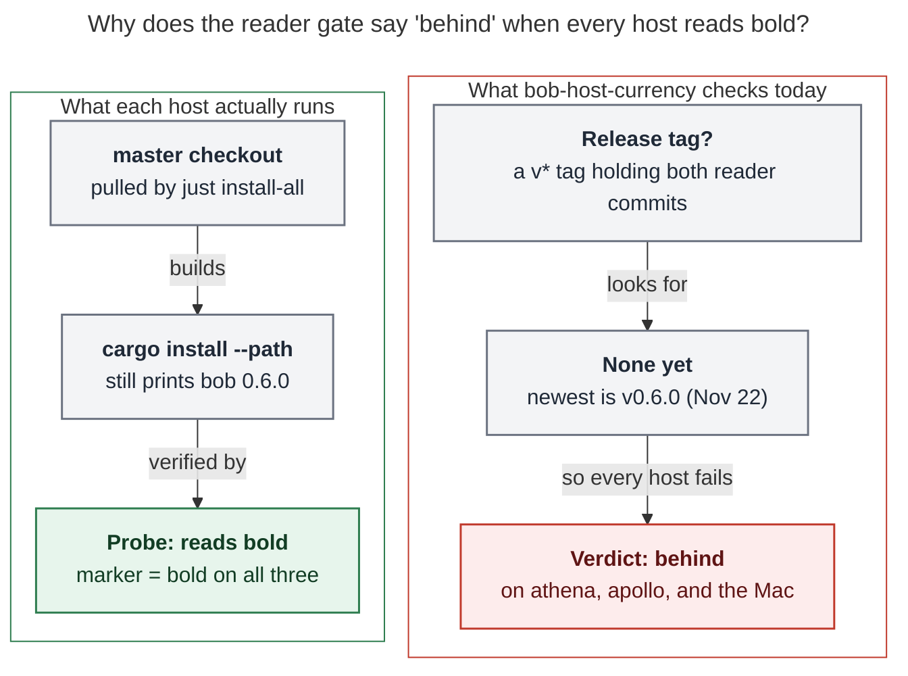
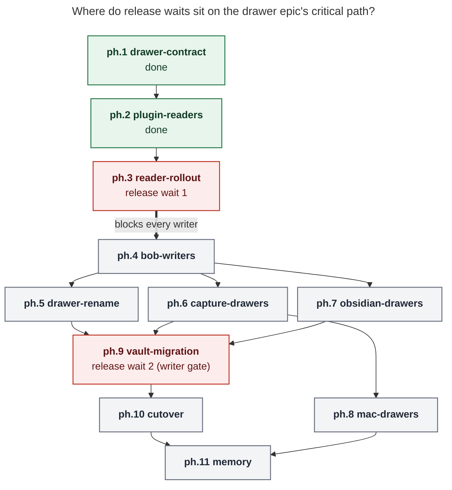

# Can the drawer epic move without waiting for a release?

_As of 2026-11-24 16:30 EST. Covers `bob-cli-ph` (true-case drawers). Its `ph.3`
reader-rollout gate holds every writer phase until a `v*` release contains the reader
commits `37b2080e` and `c25d92fd`._

## Short answer

- **Yes. What the gate is meant to prove is already true.** `ph.3` exists to show that
  every host's `bob` reads `- **Title**` drawers before any writer emits them. I ran a
  bold-drawer probe on athena, apollo, and the Mac at 21:25 UTC, and all three answered
  `"marker":"bold"`. The plugin readers were already current on all three hosts
  (`ph.3` note #6).
- **The gate fails on a stand-in check, not on the hosts.**
  `scripts/dev/bob-host-currency` asks whether a release containing the commits is
  installed. But every host builds `bob` from a master checkout (`just install-all`
  runs `cargo install --path`). That build prints `bob 0.6.0` no matter which commit it
  came from. So the script marks hosts "behind" when they are actually a day ahead.
- **The release train protects nothing here.** The risk the plan names is host skew:
  one host writes bold drawers before another can read them. Skew starts when a host
  *installs* a writer, and hosts install from master, not from releases. Releases only
  reach crates.io users, and each of them runs a single host, so they can't have skew.
- **Two release waits sit on the critical path.** The same release check also guards
  the writer gate (`ph.9` step 0). Each wait costs about a day, plus a reinstall on
  every host, which means the Mac has to be awake.
- **Recommendation:** replace the release check with a behavior probe, close `ph.3` on
  that evidence through a gate, and start `ph.4` today.

## Why the gate says "behind"



_The script tests release versions, but the hosts run master builds. The version number
stays at 0.6.0, so it can't tell the two apart._

### Evidence, 2026-11-24

| Host         | `bob --version` | Built from                             | Built (UTC) | Both reader commits? | Probe                            |
| ------------ | --------------- | -------------------------------------- | ----------- | -------------------- | -------------------------------- |
| athena       | 0.6.0           | an agent workspace on master (`bce96060` tree) | 11-24 17:11 | yes                  | ✅ `bold`                         |
| apollo       | 0.6.0           | main checkout at `8d82c621`            | 11-24 11:57 | yes                  | ✅ `bold`                         |
| mac          | 0.6.0           | main checkout at `2b3817fe`            | 11-24 20:45 | yes                  | ✅ `bold`                         |
| `v0.6.0` tag | 0.6.0           | release                                | 11-22 18:18 | **no**               | ❌ its source has no drawer `marker` |

`cargo install --list` shows a `path+file://` install of `bob-obsidian v0.6.0` on every
host. The probe is read-only and uses a throwaway vault:

```bash
v=$(mktemp -d); mkdir -p "$v/.obsidian"
printf -- '- [ ] Probe task #task ^bar\n    - **Future Work**\n        - a note\n    - NOTES\n        - legacy note\n' > "$v/foo.md"
bob capture-drawers -b "$v" -r foo -i bar -f json
# every host: "drawers":[{"title":"Future Work","marker":"bold",...},
#                        {"title":"NOTES","marker":"legacy_caps",...}]
```

Waiting for a release doesn't fix the stand-in check either. Today's scheduled train
(run `45485415920` at `2b3817fe`) is in flight, with only the macOS test left. Even if it
publishes, hosts keep printing `0.6.0` until each one pulls the release-plz version
bump and reinstalls. So the gate would stay red until all three hosts reinstall,
including the Mac.

## What the waits cost the epic



_Arrows mean "depends on", and where several arrows meet, all of them must finish
first. Both red gates use the same release check, so one fix clears both._

## Options

| Option                                    | When `ph.4` can start                                     | Also clears wait 2?      | Cost                                                                      |
| ----------------------------------------- | --------------------------------------------------------- | ------------------------ | ------------------------------------------------------------------------- |
| **A. Probe-based gate** ⭐                 | **today**, after one small script commit                  | **yes**, with a writer probe | Edits one dev script. Departs from plan §9 ("wait for the train"), so Bryan must approve it |
| B. Build commit in `bob --version`        | after it lands and every host reinstalls                  | yes, for any feature     | `build.rs` work and a version-output contract change; the most durable fix |
| C. Bryan vouches for the hosts in a gate (no code) | today                                             | no, repeat at `ph.9`     | Needs Bryan each time and leaves no machine evidence                      |
| D. Manually trigger a release             | about 1 h of CI, then all 3 hosts reinstall               | no                       | Bends the daily-train decision, and the gate still checks the wrong thing |
| E. Keep waiting (status quo)              | today if the macOS test passes, else tomorrow; then all 3 hosts reinstall | no       | About a day, twice, on the critical path                                  |

## Recommended path

1. **Approve the change.** In a one-line gate, Bryan approves dropping §9's "wait for
   the train" for host-build probes. Hosts track master, so the probe checks the
   condition the plan actually cares about.
2. **Change the script.** In `bob-host-currency`, replace the release row with a
   per-host probe row. It runs the snippet above and marks a host current only when
   `marker == "bold"`. Keep the plugin-marker rows. The release row can stay as
   information, but it no longer decides the result.
3. **Close `ph.3`.** Re-run the script, store the passing table as an artifact, and
   close the phase. Stop monitor `yze12k21fh57` so its follow-up doesn't close the
   phase a second time.
4. **Start `ph.4`.** Then add a matching writer probe for `ph.9` step 0: a dry-run
   capture that should emit `- **Notes**`. That way the second gate also takes minutes.
5. **Later, optionally, do B.** If `bob` reports its build commit and whether the tree
   was dirty, future gates can check `git merge-base --is-ancestor` instead of needing a
   probe for each feature.

## Caveats

- **Downgrades.** A host that later installs an older build, such as an old release
  archive or a stale workspace, loses the readers. Athena's current binary came from an
  agent workspace, not its main checkout, so where builds come from is ad hoc. The risk
  is low now, and the writer probe re-checks every host before migration.
- **The Mac is best-effort.** It was awake today. If it's asleep at gate time, the
  plan's existing fallback still applies: Bryan confirms its version through a gate.
- **If the release gate must stay,** the cheapest parallel work is the parts of later
  phases that write no drawer headers: the `place.rs` refactor (`ph.6` step 1), the
  read-only legacy inventory (`ph.5` step 4), and Obsidian rendering (`ph.7` step 1).
  But that means re-cutting the phases, and it saves less time than fixing the gate.
