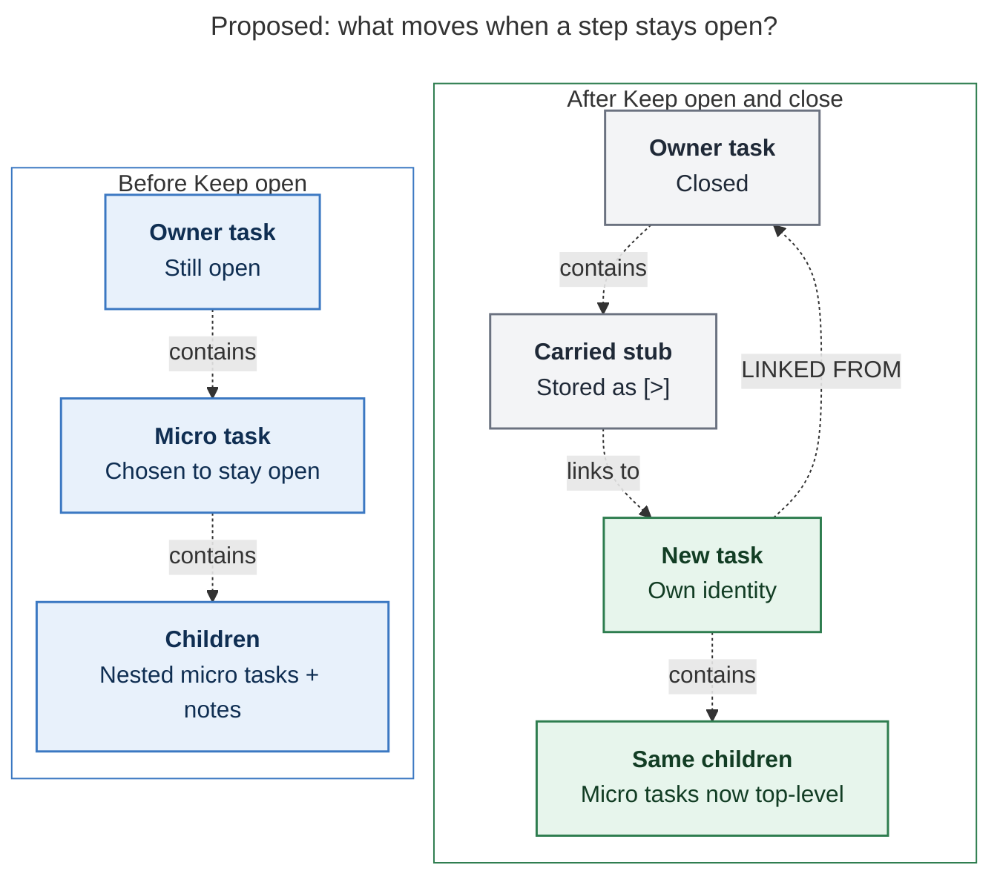
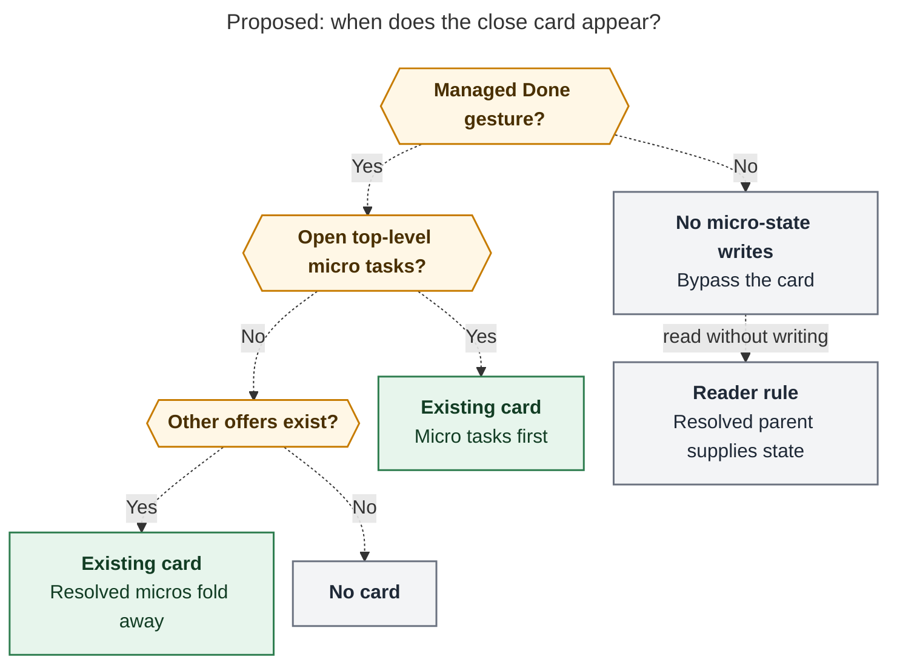
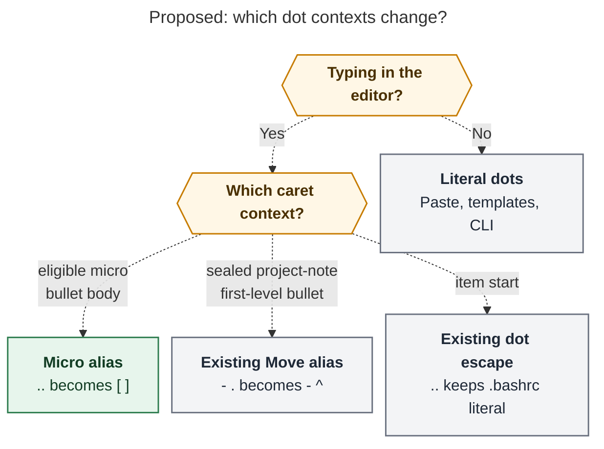

# Diagram proposals: Explicit micro tasks: consolidated design and recommendation

Proposals for the swarm linker, not a report. Each diagram restates only what the source
report says.

```yaml
source: research:202611/explicit_micro_tasks/explicit_micro_tasks__final.md
producer: research.5n.image
check: "mmdc 12.0.0 with the PDF-mirroring config rendered 3 of 3 Mermaid diagrams; Puppeteer --no-sandbox; deliberately broken input exited nonzero"
```

## keep-open-subtree

```yaml
anchor: |-
  children travel byte for byte, nested micro tasks become the
question: |-
  What moves and what links remain when a micro task is kept open?
illustrates: |-
  Keep open runs Task Split: children travel byte for byte into a new task while the closed parent and carried work retain two-way provenance.
caption: Keep open moves children unchanged into a new task, leaving a carried stub in the owner and a generated backlink in the new task.
review: 676.328x745 px, fit 96.5%; question, labels, arrowheads, reading order and source checks passed; 1 layout revision; 2 visual look rounds
```



## close-card-routing

```yaml
anchor: |-
  closing tree contains a task with ≥ 1 **open top-level** micro task
question: |-
  Which closes produce a micro-task review card, and which use reader fallback?
illustrates: |-
  Managed Done gestures put open top-level micro tasks first on the existing successor card, while bypasses leave micro states unwritten and use the reader rule.
caption: Managed Done gestures audit open top-level micro tasks; other exits leave micro bytes untouched and use the reader rule.
review: 705.944x832 px, fit 92.5%; question, labels, arrowheads, branches and source checks passed; 0 revisions; 1 visual look round
```



## capture-dot-contexts

```yaml
anchor: |-
  currently literal at bullet-body starts. Two exceptions stand: sealed project-note
question: |-
  When do typed dots create a micro task, and when are dots kept or handled by existing aliases?
illustrates: |-
  The .. micro alias applies at eligible bullet-body starts, while sealed project-note Move, item-start escape, paste, templates and bob capture retain their existing behavior.
caption: Only eligible bullet-body typing gains the micro alias; project Move, item-start escape, and non-typed dots keep existing behavior.
review: 643.857x658 px, fit 100.0%; question, labels, arrowheads, contexts and source checks passed; 0 revisions; 1 visual look round
```


