# Explicit micro tasks: marker, rendering, close card, promotion, and merge

**Researcher:** cld · **Date:** 2026-11-20 · **Repos read:** bob-cli, bob-plugins,
bob-mac-capture, the live Bob vault (read-only)

## The question

Bob currently treats every non-drawer sub-bullet of a task as a would-be task: promoting
the task to a project note (**Create project note from task**, `Ctrl+Shift+Alt+N`) turns
each one into a `#task` row. Bryan wants:

- an explicit marker for these **micro tasks**, with every other bullet treated as a note;
- nested micro tasks, shown as `##`, `###`, and so on;
- fast capture authoring (`..` alias, a `Ctrl+G T` toggle);
- close-time successor rows that are Done by default, with `Ctrl+X` to open one as a
  real task, `Ctrl+Shift+X` to cancel it, and `Space`/`Tab` to pull it in;
- merges that write the source as a micro task of the target;
- a glossary term.

This report asks what the marker should be, whether the plan is sound, and what to build.

## TL;DR: the recommendation

1. **Mark a micro task with a plain Markdown checkbox and no `#task`**: `- [ ] Write the
   parser`, as a direct child of a `#task` line or of another micro task. Every other
   plain bullet is a note. This replaces the proposed `TASK:` / `#task` prefixes
   (**adjustment A1**). The checkbox stores state natively (`[ ]` open, `[x]` done, `[-]`
   not done, `[>]` carried to its own task), which neither prefix can. Obsidian Tasks
   ignores it because the vault's global filter is `#task`. Bob's split engine already
   turns an unchecked `- [ ] text` into an open task. Promotion already keeps a checkbox
   child's status when it makes the task. And it reads correctly with no plugin at all.
2. **Render it as one more hash than its owner task.** bob-ledger-tools already draws
   every `#task` as one teal `⌗`, so a micro task draws `⌗⌗` and a nested one `⌗⌗⌗`. The
   hashes sit right after the checkbox, in the owner's hash ink. Depth is computed from
   the nesting, never stored, so re-indenting can't make it wrong.
3. **Keep notes as plain bullets; don't make capture write a physical `NOTES` drawer**
   (**A3**). Unmarked bullets *are* the implicit notes drawer. Promotion sends them, plus
   any explicit `NOTES` drawer, to a `## Notes` section. Writing a hidden drawer would
   break the accepted "draft reads like the block it writes" rule
   (`decisions:capture-bullets-mirror-the-task-block`).
4. **Add a "Micro tasks" group at the top of the existing successor card**, which
   already has the Leave / Pull in / Done / Cancel verdicts. Each open top-level micro
   task is a row whose default is ✓ Done:
   - `Ctrl+X` flips a row between Done and **Keep open**. Keep open runs Task Split at
     close time, leaving `[>]` plus a link in the closed task.
   - `Ctrl+Shift+X` marks it not done (`[-]`, with an optional reason).
   - `Space`/`Tab` pulls it in, and on a Done row also switches it to Keep open.
   - Nested rows are shown but not focusable; they follow their parent row.
5. **Merging into a task** writes the source's title as an open micro task. The source's
   own micro tasks nest one level deeper, so their rendering goes from `⌗⌗` to `⌗⌗⌗` on
   its own. Merges into a drawer or a section still write notes (**A7**).
6. **Build it in this order:** marker, rendering, and authoring, together with the merge
   change; then a one-time review of existing loose bullets; then the promotion switch;
   then the close card. The close card is the most expensive piece: three surfaces
   (Obsidian card, Obsidian cycler, Mac card) over two close engines (Rust capture and
   the JS cycler).

The full recommended solution is at the end, in [§17](#17-recommended-solution).

---

## 1. What exists today (evidence)

### 1.1 Promotion turns every loose bullet into a task, including images

`buildProjectSeedFromChildBullets` (bob-plugins
`plugins/bob-navigation-hotkeys/src/110-project-seed.js`) sorts a task's direct children
into four buckets:

- managed logs, which go under `^prj`;
- drawers (an unchecked ALL-CAPS bullet with nested list items), which become `##`
  sections;
- every other child, which becomes a top-level `#task`;
- anything it can't represent, which makes the conversion "lossy" and refuses it.

`buildProjectTaskLineFromChildBullet`
(`plugins/bob-navigation-hotkeys/src/100-yank-and-paths.js`) keeps an existing checkbox
status. Otherwise it writes `- [ ] #task <body> [created::DATE]`. So `- ![[img/….png|400]]`,
a Gmail link bullet, or "Use Hammerspoon for this?" each become a `#task` today.

The reverse gesture (running the command on a `^prj` line,
`buildTaskBlockFromProjectNote` in `src/210-rename-and-line-context.js`) restores the
project's tasks as **nested `#task` lines** under the restored task. Bob otherwise
treats those as real subtasks; for example, task merge refuses a source with open
subtasks (`merge_source_open_subtasks`).

### 1.2 Most loose sub-bullets are notes, not steps

I scanned open (`[ ]`, `[/]`, `[*]`, `[?]`) `#task` lines outside daily notes, `done/`,
`_generated/`, and templates in the live vault:

| Measure | Count |
| --- | --- |
| Open tasks scanned | 565 |
| Tasks with at least one loose (non-drawer, non-managed) direct child | 166 |
| Loose direct children | ~245 |
| …that open like an imperative step (`Add…`, `Use…`, `Make…`, `Fix…`) | 51 (upper bound, ~21%) |
| …images, links, Gmail links | 18 |
| …questions | 17 |
| …`Merged from: …` bullets | 16 |
| …`tick::` fields and dated remarks | 9 |
| …other prose (context, examples, requirements) | 134 |
| Drawers in use | 4 (`REQUIREMENTS`, `MOTIVATION`, `NOTES:`, `DONE`) |
| Checkbox children under open tasks | 0 |
| Nested `#task` lines outside `done/` and chat sources | 1 |

Even the 51 "imperative" bullets are often notes ("Use this to spread out tasks…",
"Use Hammerspoon for this?"). So the implicit rule is wrong at least 79% of the time, and
in practice nearer 90%. The task that tracks this work (`bob.md` `^micro-tasks`) already
leans this way in its own notes: "Normal bullets should be migrated to a 'Notes' H2
section when promoting", and "`- ..` should expand to `- ##`". Its original title was
"Require that task sub-bullets be prefixed with `TASK:`/`ALSO:`?!".

Two more facts make a checkbox marker safe today: no open task has checkbox children, and
nested `#task` subtasks are essentially unused. That leaves the checkbox position free.

### 1.3 Pieces the design can reuse

| Existing behavior | Where | Why it matters |
| --- | --- | --- |
| Tasks plugin `globalFilter: "#task"`, `removeGlobalFilter: false` | vault `.obsidian/plugins/obsidian-tasks-plugin/data.json` | A plain checkbox is not a Tasks task, so it never appears in `dash.md` (which reads `getTasks()`) |
| Rust task parsers honor the global filter | `src/native/note_tasks.rs`, `task_status_hooks/parse.rs`, `task_move/plan.rs` | Plain checkboxes never enter lanes, reconcile, moves, or merge subtask counts (`task_merge/payload.rs::open_subtask_count`) |
| Split accepts unchecked plain checkboxes | `docs/task-split.md` §1: "An unchecked `- [ ] text` without `#task` is also splittable, and it becomes an open task"; a checked one is `split_not_splittable` | Keep open at close is Task Split with a different stub |
| Promotion keeps a checkbox child's status | `buildProjectTaskLineFromChildBullet` | Micro → project task needs no new status mapping |
| `#task` renders as one teal `⌗` | `docs/task-tag-marks.md`, bob-ledger-tools `src/138-task-tag-marks.js` + `src/264-plugin-task-tag-marks.js` | `⌗⌗` / `⌗⌗⌗` continue an established visual |
| A "plain checklist" checkbox has no glyph | `docs/task-tag-marks.md` ("`- [ ] Pack charger` (plain checklist: no glyph, unchanged)") | Checkboxes outside a task stay untouched |
| Successor card verdicts: Leave, Pull in, Done (`Ctrl+X`, toggles back to Leave), Cancel (`Ctrl+Shift+X` + optional reason) | `docs/task-dependencies.md` §12.22, nav `src/206c-successor-picker-verdicts.js`, Mac `docs/capture-previews.md` "Successor offers" | Bryan's keys map cleanly onto the existing card |
| Merge writes S's description as **one plain title bullet** in the container | `docs/task-merge.md` §1–2 | Changing that bullet to a micro task is a one-line writer change |
| Capture already accepts `- [ ] text` bullets | `bob capture --dry-run` writes them as literal children | No grammar conflict today |
| `.` stays literal "at a bullet-body or checkbox start" | `bob capture-rewrite --help` | `- ..` is free to become an alias (with one exception, §6.1) |
| `Ctrl-G` is a one-key editor leader with only `u` bound | Mac `docs/keyboard.md` | `Ctrl-G T` slots in, and the footer already teaches the leader |
| The cycler treats **any** checkbox line as status-cyclable | `task-status-cycler/src/010-core.js` `TASK_LINE_RE`; bank rows needed `192-bank-row-guard.js`, applied at about 6 call sites | Micro tasks need the same kind of guard |

Prior art points the same way:

- **Things 3:** converting a to-do to a project turns each checklist item into its own
  to-do. That is Bryan's definition of a micro task, almost word for word.
- **Org-mode:** `org-enforce-todo-checkbox-dependencies` blocks DONE while checkboxes are
  unchecked, and statistics cookies count them. This matches the "did I really finish?"
  goal.
- **Bullet Journal:** `>` is the migrated-forward signifier, a natural fit for "carried
  to its own task".

---

## 2. Is this a good idea? (critique)

**Yes. The core idea is sound, and the evidence above makes it overdue.** It fixes a real
data-quality bug: promotion mints `#task` lines from images and context notes. It gives
Bob a vocabulary for "steps of one commitment" without turning every step into a tracked
task with lanes, freshness, reviews, and caps. And it is the missing representation for
project ⇄ task round-trips.

The concerns, roughly by weight:

1. **The proposed markers can't represent state.** With `#task` or `TASK:` on a plain
   bullet, done, cancelled, and forwarded must be encoded with `~~strike~~` plus ad hoc
   notes. A done micro task under an open parent can't be represented at all, yet that is
   the basic case when converting an open project with some finished tasks back into a
   task, which is one of the stated motivations. → §3, A1.
2. **`#task` on a plain bullet collides with three existing contracts:**
   - the tag-marks invariant that an exact `#task` means a tracked task;
   - capture's first-level `- #…` drawer shortcut, where `#tasks` is even a reserved
     drawer name, so `- #task` sits one edit from a `reserved_drawer` refusal;
   - every tag search, Dataview tag query, and plugin regex that tests for `#task`
     without checking for a checkbox (merge already had to special-case "a plain authored
     note containing `#task` is not a task row").
3. **A physical `NOTES` drawer adds noise and duplicates the implicit rule.** It nests
   every note one level deeper, puts a `NOTES` header on most tasks, splits notes between
   hand-typed loose bullets and capture-written drawer bullets, and breaks the
   capture-mirrors-block rule. → §7, A3.
4. **Done by default can become a rubber stamp.** If `Return`/`Esc` silently confirms
   everything, the card won't do its job as a checkpoint. Two mitigations: let micro tasks
   be ticked *while working*, and fold ticked ones out of the card, so the remaining rows
   are exactly the unconfirmed ones; and, optionally, give the card a "Not done yet"
   action that aborts the close. → §8, A8, A11.
5. **"Cross it out" should not mean editing the text.** Wrapping a line in `~~` can't tell
   cancelled from carried. It also corrupts link and mention parsing and the text digests
   used as offer keys. The checkbox character carries the state, and Obsidian strikes
   non-space checkboxes by default. → A4.
6. **Cost.** Close planning runs in two engines (Rust capture, JS cycler) and is presented
   on three surfaces (Obsidian nav card, cycler, Mac card). Micro rows add a new group,
   new verdict semantics, new writes (split at close), and a capability gate on each.
   That is the bulk of the work, so it should ship last, after the cheap,
   high-value text changes.
7. **Scope gaps to define now:** what happens on cancel, on raw checkbox clicks, on
   automated closes, on reopen, and for recurring owners (§11).

**Would I take a different approach?** Same direction, different marker, and a
different order. I considered these designs and rejected each as the primary one:

- **No marker; choose at promotion time.** Promotion would open a Move-card-style
  picker of child bullets. That is cheap and fixes promotion, but it gives no close-time
  checkpoint, no merge semantics, and no project → task representation.
- **Real nested `#task` subtasks.** Every step would become a tracked task with lanes,
  NEW review, Ready caps, and merge refusals. That is too heavy, and it is exactly the
  noise micro tasks should avoid.
- **A `TASKS` (or `STEPS`) drawer holding the steps.** `TASKS` is a reserved non-drawer
  name. A per-bullet toggle would have to move lines in and out of the drawer. Drawer
  entries are one line each in capture, and depth rendering still needs per-line logic.

---

## 3. Choosing the marker

The table scores each candidate against what the marker has to do. ✓ = good,
~ = workable, ✗ = blocking.

| Criterion | `- [ ] text` (checkbox, no `#task`) | `- #task text` | `- TASK: text` | New tag `- #micro text` | Literal `- ## text` |
| --- | --- | --- | --- | --- | --- |
| Encodes state (open / done / not done / carried) | ✓ native `[ ] [x] [-] [>]` | ✗ strike + notes | ✗ | ✗ | ✗ |
| Depth stays correct when lines are re-indented | ✓ structural | ✓ | ✓ | ✓ | ✗ depth is stored |
| Free of Tasks / Dataview / tag-search collisions | ✓ Tasks ignores it; Dataview `file.tasks` lists it, as it lists Pomodoros and bank rows | ✗ `#task` tag hits | ✓ | ~ new tag | ✗ becomes a heading in a list item (outline, `[[#heading]]` links) |
| Free of capture-grammar collisions | ✓ already literal | ✗ `- #` drawer shortcut, `#tasks` reserved | ~ near the `OPTIONS:` drawer-title rule | ✗ `- #` drawer shortcut | ✗ `- #` drawer shortcut |
| Existing engines already understand it | ✓ split, promotion | ~ | ✗ | ✗ | ✗ |
| Readable with no plugin (mobile, GitHub, `cat`) | ✓ a to-do list | ~ | ✓ | ~ | ~ |
| Keystrokes | 4 (`[ ] `), or `..` | 6 | 6 | 7 | 3 |
| Natural "tick it while working" | ✓ click or `Ctrl+Enter` | ✗ | ✗ | ✗ | ✗ |
| Supports the future project → task conversion | ✓ status round-trips | ✗ | ✗ | ✗ | ✗ |

**Recommendation (A1): a micro task is a checkbox list item without `#task` whose parent
is a `#task` line or another micro task.** A checkbox anywhere else is left alone: under
a note bullet, inside a drawer, in a notebook, as a Pomodoro, or as a bank row.

Why "parent is a task or a micro task", rather than "any checkbox inside the task block"?

- It matches the existing drawer contract: a drawer's "entries are plain bullets with no
  checkbox, `#task`, or `created` field".
- It keeps a quoted checklist inside a note from becoming work by accident.
- It makes depth well defined: count the micro-task ancestors up to the owner.

---

## 4. Vocabulary and reader rules

- **Owner:** the nearest `#task` ancestor. Any task can own micro tasks: an area or
  project task, an Event Task, a `^gtd` row, a `#ref` reading task, or a `^prj` line.
- **Depth:** 1 for a direct child of the owner (rendered `⌗⌗`, called a *top-level* micro
  task); each micro-task ancestor adds one (`⌗⌗⌗`, …).
- **States**, written only as these four characters:
  - `[ ]` open;
  - `[x]` (or `[X]`) done;
  - `[-]` not done (cancelled);
  - `[>]` carried: the line's body is a link to the task it became.

  Any other character (`[/]`, `[*]`, `[?]`) reads as open and is reported by a lint, not
  silently rewritten.
- **Inheritance rules, for readers:**
  - An open micro task under a *closed* owner reads as resolved with that owner: done
    under `[x]`, not done under `[-]`.
  - An open micro task under a resolved micro task reads as that micro task's state.

  Writers make the state explicit wherever they can (§8.3). The reader rule covers raw
  checkbox clicks, automation, and hand edits.
- **What a micro task never has:** no `#task`, `[created::]`, lane, freshness, priority,
  schedule, dependencies, Task Links, review-walk row, Ready-cap count, Today
  membership, or stats. It may carry a trailing `^anchor`; Keep open then reuses it as the
  new task's ID, per the split rule.
- **Never planned:** a Pomodoro Task Link or `@route:id` that targets a micro task's
  anchor is refused with "Micro tasks aren't planned. Link `‹owner›`, or press
  Ctrl+Shift+T to make it a task." This keeps Today and lanes truthful.
- **Notes:** every other plain child bullet of the owner or of a micro task is a note.
  Drawers, managed lines, and Task Link stubs keep their current meaning.

The glossary term should stay **micro task**. Two other names are taken:

- **"Checklist"** already names GTD PRE/POST checklist tasks (`docs/task-tag-marks.md`
  §"GTD checklist tasks").
- **"Subtask"** already names nested `#task` lines and embedded subtasks (close trees in
  `src/native/task_complete/tree.rs`).

"Step" makes a good alias.

---

## 5. Rendering: consistent, concise, and beautiful

### 5.1 Obsidian (bob-ledger-tools, display only)

The marks below sit right after the checkbox, exactly where a task line's `⌗` sits:

```text
☐ ⌗ Ship the export command                       ▮▮▮  + Nov 20
    ☐ ⌗⌗ Write the parser
        ☐ ⌗⌗⌗ Handle CRLF
    ☑ ⌗⌗ Pick a flag name                         (Obsidian's checked style: muted, struck)
    ⊘ ⌗⌗ Benchmark against v1                     (muted, struck)
    → ⌗⌗ Update the docs ↗                        (muted, struck; the link stays clickable)
    • The old flag confused people                (a note: plain bullet, no hash)
```

- **Glyph.** Reuse the tag-marks soft slanted hash mask ("one glyph definition, a CSS
  mask shared by every host"). The hash count is depth + 1, so the column of hashes
  echoes the owner's single `⌗`, like org-mode stars. Beyond five hashes, show
  `⌗⌗⌗⌗⌗+`.
- **Ink.** Use the owner's hash ink: teal identity, or the explicit `[type::]` ink. That
  ties the family together visually. As tag-marks requires, ink never encodes state.
- **State** comes from Obsidian's own checkbox styling. It already strikes any non-space
  status. Add small CSS for `data-task="-"` (⊘, muted) and `data-task=">"` (→, muted,
  with the trailing link kept active).
- **Hover.** For example: `micro task · step 2 of 4 of “Ship the export command” ·
  Ctrl+Enter ticks · Ctrl+Shift+T makes it a task`.
- **Truthful and reversible.** Draw marks only when the owner rule holds, and never write
  to the vault. Source mode shows the raw text, and the existing session toggle hides the
  marks. Without the plugin you see an ordinary Markdown to-do list.
- **Optional, phase 3b:** a derived progress chip at the end of the owner line,
  `⌗⌗ 2/4`, counting top-level micro tasks, like org-mode statistics cookies. It is
  hidden when there are none and muted when all are resolved. It would read well in the
  `]s` walk and on embeds.

I considered replacing the checkbox with the hashes, as a literal reading of "render
`##`" would suggest. I reject that as the default: it drops the native click and the
at-a-glance done state. It could ship later as a CSS variant if Bryan prefers it.

### 5.2 Successor card (nav picker and Mac)

Rows use the same `⌗⌗` glyph (on the Mac, the SF Symbol `number` repeated, in the owner's
ink) and are indented by depth. §8 has the full card.

### 5.3 Capture panel (Mac)

The editor keeps the literal `[ ] `, as the thin-client rule requires. `capture-parse`
returns a new `micro_task` span (with `depth`) so the app can tint the marker in hash ink.
The preview card shows the rendered `⌗⌗` row. Glyph substitution inside the NSTextView is
possible but fragile when editing, so it isn't recommended.

---

## 6. Authoring

### 6.1 Capture (bob-cli owns the grammar; the Mac presents it)

- **Where a micro task may appear:**
  - a first-level `- [ ] text` bullet under a new task, or under a note-less
    `@route+id` list (one micro task per bullet);
  - a nested `  - [ ] text` under a first-level micro task;
  - the same-line note form, `[ ] Write tests @bob+export`;
  - nested bullets under a project-note capture's task bullets (`  - [ ] …`).

  The existing two-level authored grammar caps capture depth at two. Deeper nesting is
  authored in Obsidian; the decision record's "reopens when authored bullets gain a third
  level" still applies.
- **New refusals.** Each is reported on the bullet's byte range by `capture-parse` as
  soon as it is typed:

  | Code | When | Teaching copy |
  | --- | --- | --- |
  | `micro_task_in_drawer` | a `[ ]` bullet inside a drawer, or with `@route+id#drawer` | "Drawers hold notes; drop `#drawer` to add a micro task" |
  | `micro_task_parent` | a `[ ]` nested under a note bullet | "A micro task's parent is the task or another micro task" |
  | (existing) | a `[ ]` on a notebook route | notebooks already never hold checkboxes |

  A checked `[x]` in a draft is refused too (`micro_task_state`), because capture
  authors open steps only.
- **`..` alias (rule `expand_micro_marker`, alias id `micro`).** Typing a second `.`
  immediately after `- .` at a bullet-body start, where a micro task may stand, replaces
  `..` with `[ ] `. Undo restores `..`.
  - A single `.` there stays literal, as today. That keeps `- .gitignore …` and
    `- .env …` notes safe, which is why `..` beats a one-key alias.
  - **Exception:** on the first-level bullets of a *sealed project-note* item, `- .`
    already becomes `- ^` (the Move picker) and `- ^.` becomes `- ^^`. That meaning
    stays. Those bullets are new project tasks, so a micro marker means nothing there,
    while nested bullets (`  - ..`) do get it.
  - `..` at an *item* start keeps its current meaning (`.` → `@`). Use `Ctrl-G T` there.
  - **Typing tip:** when `[ ] ` is typed by hand, `sigil_alias_tip` teaches `..`.
- **`Ctrl-G T` (Mac leader) is delegated to bob.** It calls
  `bob capture-rewrite --cursor N -t/--toggle-micro` (rule `toggle_micro_task`). Bob
  toggles `[ ] ` after the bullet marker, or at the body start of a `@route+id`
  same-line note. On an ineligible line it answers `changed: false` with a reason that
  the footer shows (and the app beeps).
  - A multi-line selection toggles every touched bullet in one direction, as `U` does.
  - The footer reads `⌃G · U toggle line case · T toggle micro task · esc cancel`.
  - Delegating keeps the thin-client rule (`decisions:mac-capture-is-a-thin-client`):
    the app never decides where a micro task may stand.

### 6.2 Obsidian

- **Toggle.** Hand-typing `- [ ] ` works, and Obsidian's built-in *Toggle checkbox
  status* already turns a bullet into `- [ ]`. Add a nav command, **Toggle micro task**,
  that strictly adds or removes the open marker. It refuses on `#task` lines, drawer
  titles, managed lines, and checkboxes that aren't micro tasks. The vault binds it
  (Bryan's choice of key; a two-key leader would need new modal plumbing).
- **Tick while working.** `Ctrl+Enter` (cycler) on a micro line toggles `[ ]` ↔ `[x]`.
  It writes no fields, no ledger entries, and no successors. `Alt+]` / `Alt+[` and the
  Task Card refuse with `Micro task · Ctrl+Enter ticks it · Ctrl+Shift+T makes it a
  task`. This is a micro guard shaped like the bank-row guard.
- **Split now (`Ctrl+Shift+T`) on an open micro task** writes the new task as today. The
  micro line becomes `- [>] [[#^id|Alias]]` instead of a bare stub, so the slot still
  reads as a carried step (§8.3). The `[>]` form is identical to a Keep open written at
  close time.

---

## 7. Notes, and why there is no default `NOTES` drawer (A3)

**Rule:** a loose bullet is a note. That is the implicit `NOTES` drawer.

- `@foo+bar <note>` keeps writing a loose bullet, byte for byte as today.
- `@foo+bar#notes` still writes into an explicit `NOTES` drawer for anyone who wants one.
- On promotion, loose notes and any `NOTES` drawer merge into one `## Notes` section.
  Section titles already merge by normalized title.

Why not write a physical drawer by default:

- The draft would no longer read like the block it writes, which breaks
  `decisions:capture-bullets-mirror-the-task-block`.
- Every captured note would gain a level of nesting and most tasks a `NOTES` header.
- Notes would end up in two places depending on how they were typed.

If Bryan still wants the grouping, it can be a later, separate decision, for example a
`capture.note_drawer` setting.

---

## 8. Close time: the micro-task rows on the successor card

### 8.1 When rows appear

Every task that a **managed Done gesture** closes contributes one `micro` group, provided
it has at least one **open top-level** micro task. That covers the root and every
embedded subtask closed in the same tree. The gestures are those in §12.1 of
`docs/task-dependencies.md`:

- `Ctrl+Enter` on a Task Link, on a task line, or on a Pomodoro line;
- the PRE/POST walk's `Ctrl+Enter`;
- `Alt+]` into Done;
- capture `!note:id` and `x` closes that complete links;
- complete-label commits.

The rows:

- Micro tasks that are already resolved (`[x]`, `[-]`, `[>]`) don't get rows. They
  collapse into a fold line: `· 2 ticked earlier · 1 carried earlier`.
- If every micro task is already resolved and there are no other offers, **no card
  opens**. Ticking steps as you go therefore keeps closes fast.
- The group comes **first** in the card. It is about the task being closed, so it
  belongs before hand-offs and pull-ins.

Cancel, park (`x*`), reopen, raw checkbox clicks, reconcile, and automated closes
(gcal past-day sync, collect-done) never open the card. For these, the reader rule (§4)
decides what the micro tasks mean, and nothing is written (A10).

### 8.2 Card model and keys

```text
Micro tasks of “Ship the export command”                     Done with it unless you say otherwise
  ⌗⌗  Write the parser                          ✓ done
      ⌗⌗⌗ Handle CRLF                           ✓ follows
  ⌗⌗  Update the docs                           → keep open · own task in bob · pulled in → FIX
  ⌗⌗  Benchmark against v1                      ⊘ not done · “superseded by the new bench”
  · 1 ticked earlier
──────────────────────────────────────────────────────────────────────────────
⌃X keep open · ⌃⇧X not done · ⇥ pull in · ↵ apply        ✓ 1 done · → 1 kept open · ⊘ 1 · pull in 1
```

| Key on a top-level micro row | Effect |
| --- | --- |
| (nothing) | ✓ **Done** (default) |
| `Ctrl+X` | Toggle ✓ Done ↔ → **Keep open**. This is the same "flip between Done and stays-open" meaning `Ctrl+X` has on every row; only the default differs (A5) |
| `Ctrl+Shift+X` | ⊘ **Not done**, with the inline optional reason field and Log Recall history. Pressing it again returns to ✓ |
| `Space` / `Tab` | Mark for pull-in. On a ✓ row it also switches the row to Keep open, because pulling a step into today means it isn't done (A5). Unmarking leaves it kept open |
| `Ctrl+Shift+Enter` | Pick a Pomodoro destination for a pulled-in row (existing) |
| Nested rows | Displayed, indented, never focusable; `Tab` skips them. Each shows `follows “‹parent›”` and mirrors its parent row's glyph, unless it was already resolved |

Return and Esc follow the existing rules, with one clarification. Micro defaults are not
"staged verdicts": they don't disable Return's highlighted-row fallback for ordinary
offers and don't arm the double-Esc warning. Explicit micro changes do both. Esc with no
explicit changes closes the owner with every micro task Done.

The verdict is called **Keep open** rather than "open" because "Open" already means
"open the note" (`⌃↩ Open` on the Mac, Ctrl+Return in pickers). Keep open names what
happens to the work.

**Optional (A11): a `Not done yet` footer action, for example `Ctrl+Backspace`.** It
aborts the whole close before anything is written; the picker already runs before the
commit. That is the honest escape when the card shows a step you forgot. Without it the
answer is Undo, or Keep open.

### 8.3 What each verdict writes

All writes are planned in the gesture's existing pass, against preimages captured when
the card opened. A worked example before and after (the owner was linked in a FIX
Pomodoro):

```markdown
- [*] #task Ship the export command ^export
	- [ ] Write the parser
		- [ ] Handle CRLF
	- [x] Pick a flag name
	- [ ] Update the docs
		- The README table needs a new row
	- [ ] Benchmark against v1
	- The old flag confused people
	- 🛠️ **WORK LOG**
```

```markdown
- [x] #task Ship the export command [completion:: 2026-11-20] ^export
	- [x] Write the parser
		- [x] Handle CRLF
	- [x] Pick a flag name
	- [>] [[#^update-the-docs|Update the docs]]
	- [-] Benchmark against v1
		- *2026-11-20* — ⊘ superseded by the new bench
	- The old flag confused people
	- 🛠️ **WORK LOG**
- [*] #task Update the docs [created:: 2026-11-20] ^update-the-docs
	- 🪢 **LINKED FROM:** [[#^export]] (💬 mentions)
	- The README table needs a new row
```

- **✓ Done** writes `[x]` on the micro line and on every open descendant micro task.
  Writing it explicitly (A4) makes the history self-describing, and it's what a later
  project ⇄ task conversion needs.
- **⊘ Not done** writes `[-]` on the micro line and every open descendant. A nonblank
  reason becomes the micro task's first child note, in the Cancel Log entry grammar
  (`*date* — ⊘ reason`). Micro tasks have no Cancel Log of their own.
- **→ Keep open** runs the **Task Split planner** (`src/native/task_split/plan.rs` and
  its JS twin) on that bullet. The planner already handles each of these:
  - **The new task** is `- [ ] #task <text> [created:: today] ^<id>`. An existing
    `^anchor` becomes its ID; otherwise one is minted. It lands right after the owner's
    block, or in the root note's `## Tasks` / the inbox when the owner lives in a daily
    note.
  - **Its children** travel byte for byte. Nested micro tasks become the new task's
    top-level micro tasks, and their `⌗⌗⌗` renders as `⌗⌗` automatically.
  - **The stub** differs from today's split: the micro line becomes
    `- [>] [[#^id|Alias]]`, not the bare `- [[#^id|Alias]]`. That gives Bryan his
    "crossed out with a link", with no `~~` edits.
  - **The back-reference** is the generated `🪢 LINKED FROM: [[owner]] (💬 mentions)`
    on the new task, so no authored provenance note is needed (A6).
  - **Inheritance:** nothing is inherited, as with split. The task sits in the owner's
    note, so it inherits the same note-level type anyway.
- **Pull in** on a kept-open row links the new task with the owner's §12.3 anchor (slot
  or closing), raises it to Next, and **does not** stamp it fresh, as the rule for tasks
  a gesture creates requires. It is Today now and walks NEW tomorrow if left unlinked.
- **The owner** closes exactly as today.

Concurrency follows the existing offer-close rules.

- **Keys:** `‹owner key›/micro/‹digest of path-of-indices + text›`, revalidated against
  the preimage.
- **Capture** is all-or-nothing: a stale micro row aborts the batch.
- **Obsidian** is best-effort: a stale row is refused alone, the others apply, and the
  owner close is not rolled back.
- **Undo:** the guarded all-or-nothing Undo covers the micro writes and any created
  tasks.
- **Reopening the owner** never reopens resolved micro tasks.

### 8.4 Contracts (additive)

- **Bob JSON.** Micro rows join the numbered offer list so that `n` is shared with every
  other offer. Each row gets `group: "micro"` and
  `micro: {depth, owner_key, parent_key?, state, default: "done"}`. The `pull_in`
  envelope gains `micro: {"supported": true}`. Receipts gain
  `micro_outcomes[{key, outcome: "done"|"kept_open"|"not_done", task?, reason?}]`. Text
  comes from Bob's copy table:
  - `✓ Done with “{Owner}”`
  - `→ Becomes its own task in ‹{note}› · linked from “{Owner}”`
  - `⊘ Not done · stays struck under “{Owner}”`
  - `follows “{Parent}”`
- **CLI (`bob capture`).**
  - Defaults apply with no flags. That is a close write, not an auto-link, so the rule
    "bob capture never auto-links" still holds.
  - Add `-k, --keep-open <PICKS>`, sorted between `-i` and `-m`.
  - `-X N[=why]` marks a micro row not done. `-p N` on a micro row implies keep open.
    `-x N` on a micro row is accepted as a no-op.
  - Human output gains `✓ 3 micro tasks done with it · -k N keeps one open`.
- **Capability gates.**
  - The cycler attaches micro groups only when nav reports
    `api.successors.version >= 5`.
  - The Mac passes a hidden capability flag before micro rows count toward
    `--require-pull-in-choice`.
  - An older client therefore never shows an empty or half-understood card, and the safe
    fallback (✓ Done) is exactly the reader rule.
- **Shared vectors.** Bob-cli owns `tests/fixtures/micro_tasks/vectors.json`, which
  covers recognition, depth, state reading, the writes for each verdict, refusals, and
  staleness. bob-plugins copies it byte for byte, as it already does with `offer_close`.
- **In-card Done of an ordinary offer that itself has open micro tasks** resolves them
  Done too, with no nested card. Its scope note reads `· its 2 micro tasks close with it`.

```mermaid
---
title: "Which gesture writes each micro task state?"
accTitle: "Micro task lifecycle"
accDescr: "An open micro task becomes done, cancelled, carried to its own task, or a project task; the owner's close card defaults to done."
---
stateDiagram-v2
  direction TB
  state "Open  [ ]" as OPEN
  state "Done  [x]" as DONE
  state "Cancelled  [-]" as CANCELLED
  state "Carried  [>]<br/>links its new task" as CARRIED
  state "Project task<br/>in new ## Tasks" as PROJECT
  [*] --> OPEN: authored
  OPEN --> DONE: tick
  DONE --> OPEN: untick
  OPEN --> DONE: card ✓ (default)
  OPEN --> CANCELLED: card ⌃⇧X
  OPEN --> CARRIED: card ⌃X
  OPEN --> CARRIED: split ⌃⇧T
  OPEN --> PROJECT: promote owner
```



*Figure 1. Only the owner's close card writes Not done and Carried, and its default is
Done. Ticking while working and promotion are the other two ways out of Open. (⌃ = Ctrl,
⇧ = Shift; "authored" means capture `- [ ]` / `..`, `Ctrl-G T`, the Toggle micro task
command, a merge, or a hand edit.)*

---

## 9. Promotion (Create project note from task)

The new seed rule, in `buildProjectSeedFromChildBullets`:

| Direct child of the promoted task | Today | Proposed |
| --- | --- | --- |
| Open micro task `[ ]` (with nested micro tasks and notes) | — | `## Tasks` row `- [ ] #task …`; its nested micro tasks stay micro tasks of that row |
| `[x]` / `[-]` micro task | — | `## Tasks` row with that status (existing status-keeping writer) |
| `[>]` carried micro task | — | A line in `## Notes`, kept verbatim, because it points at a task that already exists |
| Loose plain bullet (note) | becomes a `#task` | `## Notes` section, merged with any `NOTES` drawer |
| ALL-CAPS drawer with nested items | `## Title Case` section | unchanged |
| Managed logs | under `^prj` | unchanged |

Example:

```markdown
- [ ] #task Launch the newsletter ^newsletter
	- [ ] Pick a platform
		- [ ] Compare Buttondown and Ghost
	- [x] Draft the first issue
	- ![[img/mock.png|400]]
	- Readers asked for a monthly cadence
	- REQUIREMENTS
		- Custom domain
```

```markdown
## Tasks
- [ ] #task Pick a platform [created::2026-11-20]
	- [ ] Compare Buttondown and Ghost
- [x] #task Draft the first issue [created::2026-11-20]

## Notes
- ![[img/mock.png|400]]
- Readers asked for a monthly cadence

## Requirements
- Custom domain
```

Today the image and the cadence note would both become `#task` rows. The promotion
successor offers, which offer the new project's open tasks, are unchanged.

**Edge case:** a task with only notes promotes to a project with an empty `## Tasks`.
The notice should say so (`3 notes → ## Notes · no micro tasks to make tasks · mark steps
with ⌃G T or Toggle micro task first`). Section bullets stay splittable later with
`Ctrl+Shift+T`.

The **reverse** conversion (project → task) is unchanged in this change. §16 sketches how
micro tasks unlock the future version.

---

## 10. Merge

When the container is **the target task itself**, the source S's title bullet becomes an
open micro task, `- [ ] <S description>`. S's authored children are copied beneath it
with their structure kept:

- S's micro tasks become nested micro tasks (depth + 1);
- S's notes stay notes;
- S's drawers come along as ALL-CAPS note groups, and promotion would turn them back into
  drawers.

```markdown
- [ ] #task Ship the export command ^export
	- [ ] Add a --json flag            ← was task ^json, merged into ^export
		- [ ] Pick field names
		- Agents want this
```

Rendered, that is `⌗⌗ Add a --json flag` / `⌗⌗⌗ Pick field names`.

What else changes, beyond adding the marker:

- **Status:** open S states (`[ ]`, `[/]`, `[*]`, `[?]`) all become an open `[ ]` micro
  task. S's Work, Rotten, and Schedule logs stay on the cancelled tombstone, as today.
- **Provenance:** keep the merge doc's rule of no link back to S. Provenance stays in T's
  *merged from* chip.
- **Drawer or section containers** (`@foo+bar#future-work`, `-s Section`) keep writing a
  plain title bullet. Drawers and sections hold notes by contract (A7).
- **A `^prj` target with no drawer** writes a micro task under the `^prj` line, as a
  project-level step. That is legal, and it surfaces when the project closes.
- **Refusals:** `merge_source_open_subtasks` still counts only `#task` lines, so open
  micro tasks never block a merge. That is already true, because the count comes from
  `note_tasks`, which applies the global filter.
- **Copy:** the Links-stage consequence strip and capture `>` / `<` previews say
  "becomes a micro task of “T”". The `merged`, `unchanged`, and `already_closed` verdicts
  keep their meanings.
- **Legacy bullets:** the 16 `Merged from: …` bullets under open tasks are offered in the
  rollout review (§13), not auto-converted.

---

## 11. Edge cases

| Situation | Behavior |
| --- | --- |
| Checkbox under a note bullet or inside a drawer | Not a micro task: rendered as a plain checkbox. Capture refuses it; Obsidian tolerates it and a lint reports it |
| `#task` nested under a micro task | It's a real task, and the micro chain stops there. Lint `task_under_micro` |
| Owner closed by a raw click, Tasks-plugin toggle, or automation | No card and no writes. Open micro tasks read as done |
| Owner cancelled (Task Card, `Alt+[`, cancel label) | No card. Open micro tasks read as not done. Optional follow-up: offer Keep open on cancel ("salvage") |
| Owner reopened | Micro states unchanged |
| Recurring owner | Rows appear as usual. Kept-open tasks are independent. The next occurrence doesn't copy micro tasks: a follow-up "reset micro tasks on recurrence" feature, which matches `^better-recur`'s "Support pinned sub-bullets!" |
| Owner is an Event Task in a daily note | Keep-open tasks go to the `[root::]` note's `## Tasks`, or the inbox (split rule) |
| Owner is `^prj` | Its micro tasks are project-level steps, shown when the project closes |
| Micro task with `^anchor` | Keep open reuses the anchor as the task ID, so existing links resolve to the task |
| Unknown status character on a micro line | Reads as open; lint |
| Task Card, `Alt+N`, `Alt+F`, or Task Link toggle on a micro line | Refused with a teaching notice (micro guard) |
| `bob query … file.tasks` | Lists micro tasks, as it lists Pomodoros and bank rows. Queries that mean tasks should filter `#task` |
| `bob task archive` | Moves micro tasks with their owner and already rewrites pathless `[[#^x]]` links inside moved blocks (`docs/task-archive.md`) |
| Capture depth greater than 2 | Not expressible (the two-level authored grammar); author it in Obsidian |
| An owner that is itself an embedded subtask closed by an `x` tree | It contributes its own micro group to the union card |

---

## 12. Requirement adjustments (called out)

| # | Original requirement | Adjustment | Why |
| --- | --- | --- | --- |
| A1 | Mark micro tasks with `TASK:` or `#task` | `- [ ] text`: a checkbox without `#task`, parented by a task or micro task | Native state, no grammar, tag, or Tasks collisions, existing engine support, and round-trip readiness (§3) |
| A2 | Render as 2+ `#` | `⌗⌗`, `⌗⌗⌗` in the shared slanted-hash glyph, placed after the checkbox, in the owner's ink | Continues the existing `#task` → `⌗` mark; depth is derived; state stays with the checkbox |
| A3 | Captured notes go into a `NOTES` drawer by default | Loose bullets *are* the notes; capture writes them loose; promotion sends them to `## Notes` | Keeps the mirror rule; no added nesting or noise; one canonical form |
| A4 | Cross out cancelled and opened micro tasks | Status characters `[-]` and `[>]`; Done writes `[x]` explicitly; no `~~` edits | Lossless, unambiguous, struck by default in Obsidian |
| A5 | `Ctrl+X` "opens" a micro task; check it to pull it in | Name it **Keep open**; `Ctrl+X` toggles Done ↔ Keep open; `Space`/`Tab` on a Done row implies Keep open | Same `Ctrl+X` meaning on every row; one key instead of two; avoids clashing with "Open note" |
| A6 | "A note … that links to the original parent task" | `[>] [[#^new|Text]]` in the owner, plus the generated LINKED FROM mention on the new task | Both directions are linked with no authored duplicate. I read the original sentence as meaning both links; please confirm |
| A7 | Merges create a micro task | Only when merging into the task itself; drawer and section merges stay notes | Drawers and sections hold notes by contract |
| A8 | (new) | Micro tasks can be ticked while working (`Ctrl+Enter` or click). Ticked ones fold out of the card, and a fully ticked task closes with no card | Makes the card a real checkpoint and keeps it fast |
| A9 | Non-top-level rows shown but not actionable | Kept, but already-resolved nested rows keep their own state rather than following the parent's | Nested ticks aren't lost |
| A10 | (scope) | Only managed Done gestures open the micro group; cancel, park, raw, and automated closes rely on the reader rule | Keeps the existing "cancel never offers" contract and stays robust |
| A11 | (optional, new) | `Not done yet` card action aborts the close; a `⌗⌗ 2/4` progress chip on owner lines | The honest escape; at-a-glance progress |
| A12 | `- ..` alias | Fires at bullet-body starts only. First-level bullets of a sealed project-note item keep `- ^^`; item starts keep `.` → `@` | Avoids breaking two shipped aliases |
| A13 | `Ctrl+G T` toggle | Delegated to `bob capture-rewrite --toggle-micro` | Thin-client decision: bob owns where a micro task may stand |

---

## 13. Rollout and migration

The promotion change reinterprets existing loose bullets, so stage it:

1. **Ship the marker first:** recognition, rendering, authoring (capture, the Obsidian
   toggle, the cycler guard, split-to-`[>]`), and the merge writer. None of these change
   what existing bullets mean.
2. **Review the existing bullets once.** An agent prepares a reviewable diff that marks
   likely steps among the ~245 loose bullets on the 166 open tasks:
   - start from the 51 imperative-looking bullets and Bryan's own "Next action:" lines;
   - offer each of the 16 `Merged from: X (created D)` bullets as `- [ ] X` with a
     `merged from …` note.

   Bryan approves the diff through a gate. Nothing is converted without approval. Expect
   roughly 15–40 accepted.
3. **Switch promotion** to micro → task and notes → `## Notes`.
4. **Ship the close card**, with micro groups behind the version and capability gates.
5. **Optional extras:** the progress chip and `Not done yet`.

---

## 14. Implementation plan (repos and seams)

| Phase | Repo | Work |
| --- | --- | --- |
| P1 contract | bob-cli | `docs/micro-tasks.md`: grammar, owner and depth, states, reader rules, refusals, copy, MT vectors. Updates to `capture.md` (Authored sub-bullets, Sub-bullets under existing tasks, the `capture-rewrite` aliases), `task-merge.md` §1–2, `task-split.md` §2 (the `[>]` stub for micro tasks), `projects.md` and the nav doc (promotion), `task-dependencies.md` §12 (micro group, §12.13 v5, §12.14 `-k`), and `task-tag-marks.md` (hash marks). New glossary strand and decision record (§15), written through `/sase_memory_write` |
| P2 recognizer | bob-cli | `src/native/micro_tasks.rs`: a pure recognizer over a task block (owner, depth, state, parent, digest) plus `tests/fixtures/micro_tasks/vectors.json` |
| P3 capture | bob-cli | Grammar acceptance and refusals (`capture_parse.rs`, `capture/sub_bullet.rs`), the `micro_task` span with depth, the `..` alias and `-t/--toggle-micro` rewrite (`capture_rewrite.rs`), the typing tip; the merge writer (`src/native/task_merge/`) emits the micro title bullet |
| P4 rendering and guards | bob-plugins | bob-ledger-tools hash marks for Live Preview and Reading (next to `264-plugin-task-tag-marks.js`), `data-task` CSS for `-` and `>`; a cycler micro guard modeled on `192-bank-row-guard.js` (`Ctrl+Enter` ticks; `Alt+]`/`Alt+[` refuse); nav **Toggle micro task**; Task Card refusal; split writes `[>]` for micro tasks; an audit of the 31 files using `TASK_LINE_RE`-style "any checkbox is a task" patterns, routed through one shared `isMicroTaskLine` helper |
| P5 promotion | bob-plugins | `110-project-seed.js` and `100-yank-and-paths.js`: micro tasks → tasks, notes → `## Notes`, `[>]` → notes; notice copy |
| P6 close (Rust) | bob-cli | `src/native/task_complete/`: micro rows, verdict writes (Done, Not done, Keep open through `task_split::plan`), `-k/--keep-open`, JSON and receipts, the capability flag, human output |
| P7 close (JS) | bob-plugins | Cycler planning twin (the `085*`–`089*` successor fragments) and nav picker v5 (`206-successor-picker-modal.js`, `206a`, `206c`, `206d`): micro group rendering, keys, defaults, fold line |
| P8 Mac | bob-mac-capture | `Ctrl-G T` through bob's rewrite, the `micro_task` span tint, micro rows in the successor card (indent, glyph, default ✓, `Control-X` / `Control-Shift-X` / `Space` / `Tab`), the capability flag, footer copy. macOS CI is the gate |
| P9 rollout | vault | §13 review diff, through a gate |

P1–P5 deliver most of the value (correct promotion, merges, authoring, rendering) at
low risk. P6–P8 are the expensive part.

---

## 15. Memory drafts (to be written later through `/sase_memory_write`)

### 15.1 Glossary strand: Micro Task

> **Micro Task** — *aka step, microtask, `⌗⌗` task.* An unticked or resolved Markdown
> checkbox bullet without `#task` (`- [ ] Write the parser`) whose parent is a `#task`
> line or another micro task. It names one step of its owner task's committed work
> without being a task: no `#task`, `created`, lane, freshness, priority, schedule,
> dependencies, Task Links, review row, Ready-cap count, or stats. Depth is structural. A
> direct child of the task is a top-level micro task, drawn `⌗⌗` after its checkbox in
> the owner's hash ink, and each micro-task ancestor adds a hash. States are `[ ]` open,
> `[x]` done, `[-]` not done, and `[>]` carried (its body links the task it became). An
> open micro task under a closed owner reads as resolved with it. Every other plain child
> bullet of a task is a note. When a managed Done gesture closes its owner, each open
> top-level micro task is a successor-card row, Done by default: Ctrl+X keeps it open as
> its own task (Task Split at close), Ctrl+Shift+X marks it not done, and Tab/Space pulls
> it in. Promotion turns micro tasks into `## Tasks` rows and notes into `## Notes`;
> merging a task into a task writes it as a micro task. In capture, write `- [ ] ` or
> type `..` at a bullet start; Ctrl-G T toggles it. Not a GTD PRE/POST checklist task, a
> Pomodoro, a bank row, a drawer entry, a nested `#task` subtask, or an embedded subtask.
> See `docs/micro-tasks.md` and [[decisions:micro-tasks-are-checkbox-bullets]].

Related strands need small edits: **Task Drawer** (micro tasks are never drawer
entries), **Task Merge**, **Task Split**, **Successor Offer**, **Task Successor**,
**Project Note Capture**, and **Capture Alias** (the `..` alias).

### 15.2 Decision record: Micro Tasks Are Checkbox Bullets Under A Task

- **Applies to:** bob-cli, bob-plugins, Bob Mac Capture, vault.
- **Claim:** a micro task is a checkbox list item without `#task` whose parent is a task
  or micro task. Its state lives in the checkbox and its depth in the nesting. Every
  other plain child is a note, and capture writes notes loose.
- **Why:** §1.2's evidence and §3's comparison.
- **Rejected alternatives:**
  - `#task` or `TASK:` prefixes: no state, plus tag and grammar collisions;
  - a new tag: the drawer-shortcut collision and no state;
  - a literal `##`: becomes a heading and stores depth;
  - a `TASKS` drawer: reserved, clumsy toggle;
  - nested `#task` subtasks: too heavy;
  - a default `NOTES` drawer: breaks the mirror rule.
- **Cost:**
  - the cycler and plugin "any checkbox is a task" paths need a guard;
  - two close engines and three card surfaces;
  - a one-time review of existing loose bullets.
- **Reopens when:** Obsidian or Tasks starts treating non-filter checkboxes as tasks;
  micro tasks need their own fields (dates, owners); or authored capture bullets gain a
  third level.

---

## 16. Looking ahead: project → task with micro tasks (out of scope)

The checkbox marker makes the future "convert any project into an equivalent task"
nearly lossless:

| Project element | Equivalent task element |
| --- | --- |
| `^prj` line | the owner task line (status, `scheduled`, Depends-On) |
| `## Tasks` row `[ ]` / `[x]` / `[-]` | micro task with the same status |
| A task's notes and micro tasks | carried beneath, so depth + 1 is rendered automatically |
| Sub-project | a micro task (its `^prj` text) with its tasks as nested micro tasks |
| `## Notes` | loose notes |
| Other `##` sections | drawers |

The lossy parts to design then:

- task fields (`created`, priority, schedule, dependencies, freshness, lanes);
- live Pomodoro Task Links, and other tasks' Depends-On links, that point at project
  tasks. These must be refused or repaired, because micro tasks are never planned and
  can't be prerequisites.

Keeping each task's `^id` on its micro line preserves ordinary links.

---

## 17. Recommended solution

1. **Adopt micro tasks as checkbox bullets without `#task`**, parented by a task or
   another micro task. States are `[ ]` / `[x]` / `[-]` / `[>]`, and depth is
   structural. Every other plain child is a note.
2. **Render `⌗⌗`, `⌗⌗⌗`, …** after the checkbox in the owner's hash ink, reusing the
   tag-marks glyph. Leave state to Obsidian's checkbox styling plus small `-` and `>`
   CSS. Optionally add a derived `⌗⌗ 2/4` progress chip.
3. **Author them easily:**
   - capture `- [ ] ` or `..` at bullet-body starts, with the project-note first-level
     exception;
   - Mac `Ctrl-G T` through `bob capture-rewrite -t/--toggle-micro`;
   - Obsidian **Toggle micro task**, `Ctrl+Enter` to tick, and `Ctrl+Shift+T` to carry a
     step now.
4. **Keep notes loose.** No default `NOTES` drawer; `@foo+bar#notes` stays available;
   promotion collects notes into `## Notes`.
5. **Add a "Micro tasks" group at the top of the existing successor card** for every
   managed Done close. Rows default to ✓ Done. `Ctrl+X` toggles Keep open (Task Split at
   close, leaving `[>]` + link), `Ctrl+Shift+X` marks a row not done (with a reason),
   and `Space`/`Tab` pulls a row in (implying Keep open). Nested rows are shown, not
   focusable. Ticked steps fold away, and a fully ticked task closes with no card.
   Contracts are additive and gated, with `-k/--keep-open` in the CLI.
6. **Promotion:** micro tasks → `## Tasks` rows (status kept, nesting kept); notes →
   `## Notes`; drawers → sections, as today.
7. **Merge into a task:** write the source as an open micro task, with its own micro
   tasks one level deeper. Drawer and section merges stay notes.
8. **Ship in the §13 order:** marker, rendering, authoring, and merge → reviewed
   migration of existing bullets → promotion switch → close card → optional extras.
   Record the decision and glossary strand (§15) with the first phase.

## Sources

- bob-cli docs: `docs/task-dependencies.md` §12, §12.13, §12.14, §12.22;
  `docs/task-merge.md`; `docs/task-split.md`; `docs/capture.md` (Authored sub-bullets,
  Sub-bullets under existing tasks); `docs/task-tag-marks.md`; `docs/projects.md`;
  `docs/task-archive.md`; `bob capture-rewrite --help`; `bob capture --help`; a
  `bob capture --dry-run` probe.
- bob-cli code: `src/native/note_tasks.rs`, `src/native/task_status_hooks/parse.rs`,
  `src/native/task_move/plan.rs`, `src/native/task_merge/payload.rs`,
  `src/native/task_complete/{tree,offer_close}.rs`.
- bob-plugins code and docs: `plugins/bob-navigation-hotkeys/src/{100-yank-and-paths,110-project-seed,210-rename-and-line-context,667-plugin-project-promotion,206-successor-picker-modal,206c-successor-picker-verdicts}.js`;
  `plugins/task-status-cycler/src/{010-core,192-bank-row-guard}.js`;
  `docs/bob-navigation-hotkeys.md` (project conversion).
- bob-mac-capture docs: `docs/keyboard.md` (Ctrl-G leader), `docs/capture-previews.md`
  (Successor offers).
- Memory: glossary `task-drawer`, `successor-offer`, `task-successor`, `task-merge`,
  `task-split`, `capture-alias`, `project-note-capture`;
  `decisions:capture-bullets-mirror-the-task-block`,
  `decisions:unblocked-tasks-are-offered`, `decisions:mac-capture-is-a-thin-client`.
- Vault (read-only): Tasks plugin settings; `bob.md` `^micro-tasks` and `^task-to-project`;
  a scan of open-task children (§1.2).
- External prior art:
  - [Cultured Code — Things support: convert a to-do with a checklist to a project](https://culturedcode.com/things/support/articles/8491676/)
  - [The Sweet Setup — Simple guide to managing tasks in Things](https://thesweetsetup.com/simple-guide-to-managing-tasks-in-things)
  - [Org manual — Checkboxes](https://orgmode.org/manual/Checkboxes.html)
  - [Org manual — TODO dependencies](https://www.gnu.org/software/emacs/manual/html_node/org/TODO-dependencies.html)
  - [Bullet Journal — Migration](https://bulletjournal.com/pages/migration)
