# Explicit micro tasks: consolidated design and recommendation

**Lead researcher:** final (consolidating cdx, cld, grk, mus, gem) · 2026-11-20
**Question:** How should Bob make "micro tasks" — the sub-bullets that become real
tasks when their parent is promoted to a project — explicit, nested, easy to type,
reviewed at close time, written by merges, and beautiful? Is the requested plan sound?

**Verdict: build it.** All five researchers, working independently, reached the same
core judgment: the feature is overdue, the close-time audit is its heart, and the two
markers the request proposed (`#task` and `TASK:`) are the two spellings that collide
with live grammar. They split four ways on what the marker should be. After verifying
the disputed claims in the code and the vault, I recommend **cld's marker — a plain
Markdown checkbox without `#task` (`- [ ] Write the parser`), parented by a `#task`
line or another micro task — rendered as `⌗⌗`, `⌗⌗⌗`, … in the existing tag-marks
glyph language.** It is the only candidate that stores state natively, which the close
card, tick-while-working, and the future project → task conversion all need, and the
vault is empirically clean for it today. The rest of the consolidated design keeps the
swarm's unanimous choices: unmarked bullets are notes, the close card defaults every
top-level micro task to Done, Keep open is a Task Split at close, nested rows ride
along non-actionable, task-target merges write a micro task, and promotion maps micro
tasks to `## Tasks` and notes to `## Notes`.

## 1. What every report agreed on

Five independent researchers converged on these points, which I treat as settled:

1. **The idea is good and fixes a real bug.** Promotion
   (`buildProjectSeedFromChildBullets`, bob-plugins
   `plugins/bob-navigation-hotkeys/src/110-project-seed.js`) turns every non-drawer,
   non-managed direct child into a `#task` row today — including images, Gmail links,
   and prose. cld's vault scan (565 open tasks, 166 with loose children, ~245 loose
   bullets) found at most ~21% of those bullets even look like steps; the implicit
   "every sub-bullet is a would-be task" rule is wrong at least four times out of five.
2. **Neither requested marker should land as proposed.** `#task` on a plain bullet
   collides with the Tasks global filter, the capture `- #<drawer>` shortcut, the
   tag-marks invariant, and tag indexing (all five reports). `TASK:` parses as a valid
   drawer title and sits one letter from the reserved `TASKS` key (grk, mus; verified
   below — the two reports that picked it needed a carve-out).
3. **Don't store depth.** Indentation already encodes nesting; a stored `##`/`###` run
   desyncs on every move and reads as Markdown heading syntax (cdx, cld, mus, gem
   against grk). Render the hash count from the tree.
4. **Unmarked bullets are notes.** The semantic core of the request — explicit marks
   for work, everything else is information — is right, whatever the physical NOTES
   representation (see §6, the one place I adjust the request).
5. **Reuse, don't invent.** Keep open at close time is Task Split
   (`src/native/task_split/plan.rs`) with a different stub; micro rows are a new group
   on the existing successor card (`docs/task-dependencies.md` §12.22), not a new
   panel; merges flow through the shared `plan_task_merge` planner; the hash rendering
   extends bob-ledger-tools tag marks; `Ctrl+G T` extends the existing Mac editor
   leader; bob owns all of it and the Mac stays a thin client.
6. **Nested micro tasks are shown but never independently actionable** on the close
   card; their fate follows their top-level root.
7. **Pull-in should be one keystroke, not two.** The request's "Ctrl+X to open, then
   Space/Tab to check" is a two-step trap; every report collapsed Space/Tab into
   "keep open and pull in" in one action.
8. **No silent vault rewrite.** Existing loose bullets change meaning only through a
   reviewed, gated migration (plus an optional doctor/lint), never a flag-day pass.
9. **Capability-gate everything** across the two close engines (Rust capture, JS
   cycler) and three card surfaces (Obsidian nav picker, cycler, Mac), bump
   `GRAMMAR_REVISION` (currently 28, verified), and mark the contract break with `!`
   on the release train.

## 2. Facts I verified (resolving the disputed claims)

I re-checked every load-bearing claim the reports disagreed on or asserted singly, in
bob-cli, bob-plugins, and the vault (read-only):

| Claim | Verdict | Evidence |
| --- | --- | --- |
| `TASK:` is a valid drawer title | **Confirmed.** `:` is accepted exactly as the final character | `src/native/capture_drawers.rs` (`is_drawer_rest`: `character == ':'` → `is_last`) |
| `TASKS` is a reserved drawer key | Confirmed | `reserved_drawer_keys()` inserts `"TASKS"` |
| Bob task scanners require the `#task` global filter | Confirmed — a plain checkbox is invisible to lanes, moves, merges, reconcile | `src/native/note_tasks.rs` (`global_filter` checks) |
| Tasks plugin ignores plain checkboxes | Confirmed: `globalFilter: "#task"`, `removeGlobalFilter: false` | vault `.obsidian/plugins/obsidian-tasks-plugin/data.json` |
| Split already promotes a plain unchecked checkbox to an open task | Confirmed | `docs/task-split.md` §1 ("An unchecked `- [ ] text` without `#task` is also splittable…"); checked ones refuse (`split_not_splittable`) |
| Successor card: `Ctrl+X` stages Done, `Ctrl+Shift+X` cancel + optional reason | Confirmed | `docs/task-dependencies.md` §12.22 (line ~3657) |
| The cycler treats **any** checkbox as cyclable, and a row guard is the established fix | Confirmed: `TASK_LINE_RE` matches any `[.]`; the bank-row guard exists | `plugins/task-status-cycler/src/010-core.js:13`, `192-bank-row-guard.js` |
| bob-ledger-tools `freshnessTaskStatus` matches any checkbox line (gem's objection to the checkbox marker) | **Confirmed — a real cost.** The checkbox marker needs a micro-aware guard here too | `plugins/bob-ledger-tools/src/080-freshness-placement.js:153` |
| No plain-checkbox descendants under *open* `#task` lines exist in the vault (cld) | **Confirmed by an independent scan** (0 hits outside `done/`, `_generated/`, templates). The checkbox position is free | vault scan, 2026-11-20 |
| `- .` at a sealed project-note first-level bullet is the Move alias; item-start `..` is the `.bashrc` escape; `.` stays literal at bullet-body starts | Confirmed — `- ..` is free exactly at bullet-body starts, with the project-note exception | `docs/reference/cli/capture-rewrite.md`; audited `glossary:capture-alias` |
| `GRAMMAR_REVISION` is 28 | Confirmed | `src/native/capture_language/mod.rs:63` |

Two vault finds the swarm partially saw, worth stating plainly:

- **Bryan already invented this feature once.** The legacy zorg-format notes
  (`now_dev.md`, `soon_*.md`, …) use `* TASKS:` drawers holding plain `- [ ]` / `- [X]`
  checkbox steps beside `* NOTES:` drawers — e.g. `* TASKS:` → `- [ ] page #3`,
  `- [ ] page #4` under an open zorg task. The checkbox-as-micro-step idiom is Bryan's
  own historical convention, not an import.
- **The live tracking task agrees with the swarm's direction.** `bob.md` `^micro-tasks`
  ("Require that task sub-bullets be prefixed with `TASK:`/`ALSO:`?!") already notes:
  successors "with a default closed state", rendering "as `##`, `###`, etc", "`- ..`
  should expand to `- ##`", and is explicitly undecided between migrating normal
  bullets to a Notes H2 "when promoting" versus "immediately added to a `NOTES` …
  drawer?!". The request's open questions are genuinely open in Bryan's own notes.

## 3. The marker: why the checkbox wins

The four proposals, scored on what the verification showed:

| Criterion | `- [ ]` (cld) | `TASK:` (cdx, gem) | stored `##` (grk) | `›` U+203A (mus) |
| --- | --- | --- | --- | --- |
| Stores state (open/done/not done/carried) | **✓ native `[ ] [x] [-] [>]`** | ✗ needs receipt fields or strikes | ✗ strikes only | ✗ strikes only |
| Grammar collisions | cycler + freshness-placement guards needed (precedented) | drawer-title carve-out; `TASKS` near-trap | heading syntax; drawer `- #` adjacency | none found |
| Depth survives re-indent | ✓ structural | ✓ structural | ✗ stored, rots | ✓ structural |
| Existing engines already understand it | **✓ split promotes it; promotion keeps its status** | ✗ | ✗ | ✗ |
| Tick while working | ✓ click / Ctrl+Enter | ✗ | ✗ | ✗ |
| Readable with no plugin | ✓ a to-do list | ~ shouts | ~ heading fragment | ~ cryptic |
| Typable anywhere (Obsidian hand edits) | ✓ | ✓ | ✓ | ✗ alias/IME only |
| Project → task round-trip (done tasks representable) | **✓** | needs added metadata later | ✗ | ✗ |
| Vault reinterpretation risk today | **none** (0 checkboxes under open tasks, verified) | none | none | none |

Three considerations decide it:

1. **State is not optional.** The close card must record *done*, *not done*, and
   *carried* distinguishably (a bare strike cannot tell cancelled from carried — cdx
   and gem both landed on auxiliary encodings to fix this). The stated motivation —
   converting any project back into an equivalent task — requires representing a
   project's already-completed tasks as completed micro tasks. Only the checkbox gets
   all of this for free, byte-visible, with Obsidian's native styling.
2. **The engines already speak it.** Split promotes an unchecked plain checkbox into
   an open task; promotion preserves a checkbox child's status. "Keep open at close"
   and "promote to project" are therefore writer changes, not new engines.
3. **The costs are bounded and precedented.** The cycler and bob-ledger-tools match
   any checkbox and need a micro guard — exactly the shape of the existing bank-row
   guard. cld's audit obligation (the ~31 plugin files with "any checkbox is a task"
   patterns, routed through one shared `isMicroTaskLine` helper) is the honest price,
   and it is cheaper than a drawer-grammar carve-out plus a parallel state encoding.

**Definition.** A **micro task** is a checkbox list item *without* `#task` whose
parent is a `#task` line or another micro task. A checkbox anywhere else — under a
note bullet, inside a drawer, in a notebook, a Pomodoro, a bank row, a pasted
checklist — is untouched. This parent rule is what keeps quoted checklists inert and
makes depth well-defined (count the micro ancestors up to the owner). Verified: the
live vault has zero plain-checkbox children under open `#task` lines, so nothing
existing is reinterpreted; the checkboxes that do exist under *closed* legacy tasks
read as resolved-with-owner, which is the correct reading anyway.

**States**, stored only as these four characters: `[ ]` open · `[x]` done · `[-]` not
done · `[>]` carried (the body is a link to the task it became). Any other character
reads as open and is reported by a lint, never silently rewritten.

**What a micro task never has:** `#task`, `[created::]`, lane, freshness, priority,
schedule, dependencies, Task Links, review-walk rows, Ready-cap membership, Today
membership, or stats. A Pomodoro Task Link targeting a micro task's anchor is refused
with a teaching notice ("Micro tasks aren't planned. Link the owner, or Ctrl+Shift+T
makes it a task."). It may carry a trailing `^anchor`, which Keep open reuses as the
new task's ID, so existing links survive extraction.

## 4. Rendering: the `##` request, honored structurally

Reuse the tag-marks system (`docs/task-tag-marks.md`, bob-ledger-tools
`src/138-task-tag-marks.js` / `264-plugin-task-tag-marks.js`): every `#task` already
draws one slanted teal `⌗`. A micro task draws **depth + 1 hashes right after its
checkbox, in the owner's hash ink** (type ink included) — `⌗⌗` for a top-level micro
task, `⌗⌗⌗` nested, capped visually at five with an exact-depth tooltip and
accessible label:

```text
☐ ⌗ Ship the export command
    ☐ ⌗⌗ Write the parser
        ☐ ⌗⌗⌗ Handle CRLF
    ☑ ⌗⌗ Pick a flag name            (Obsidian's checked style: muted, struck)
    ⊘ ⌗⌗ Benchmark against v1        (data-task="-" CSS: muted, struck)
    → ⌗⌗ Update the docs ↗           (data-task=">": muted, struck, link live)
    • The old flag confused people   (a note: plain bullet, no hash)
```

Depth is computed, never stored, so re-indenting cannot lie. State styling comes from
Obsidian's own checkbox CSS plus two small rules for `-` and `>`. Marks draw only when
the parent rule holds, never write the vault, and disappear with the plugin — leaving
an ordinary Markdown to-do list, which is the best possible no-plugin fallback. Live
Preview, Reading view, the capture preview (via a new `micro_task` span with `depth`
from `capture-parse`), and the successor card all use the same glyph. An optional
later extra: a derived `⌗⌗ 2/4` progress chip on the owner line (org-mode statistics
cookie style), useful in the `]s` walk.

(grk's "source bytes equal rendered bytes" aesthetic was the one argument for storing
hashes; it loses to depth-rot and heading semantics, 4 reports to 1.)

## 5. Capture and editing

- **Draft grammar.** A `- [ ] text` bullet is valid wherever a micro task may stand:
  first level under a new task or a note-less `@route+id`, nested under another micro
  bullet, the same-line form `[ ] Write tests @bob+export`, and nested under a
  project-note capture's task bullets. The two-level authored grammar stays in v1
  (deeper nesting is authored in Obsidian; the
  `capture-bullets-mirror-the-task-block` reopen clause — "authored bullets gain a
  third level" — is *not* triggered). New refusals, reported on the bullet's byte
  range: a checkbox inside a drawer or on a `#drawer` route
  (`micro_task_in_drawer` — "Drawers hold notes"), under a note bullet
  (`micro_task_parent`), or pre-checked (`micro_task_state` — capture authors open
  steps only).
- **`..` alias.** Typing the second `.` of `- ..` at a bullet-body start, where a
  micro task may stand, rewrites `..` → `[ ] ` through `bob capture-rewrite --cursor`
  (rule `expand_micro_marker`); Undo restores the dots. Verified free: `.` is
  currently literal at bullet-body starts. Two exceptions stand: sealed project-note
  first-level `- .` keeps the Move alias (`- .` → `- ^`), and item-start `..` keeps
  the `.bashrc` escape. Hand-typing `[ ] ` earns a `sigil_alias_tip` teaching `..`.
  Pasted text, templates, and `bob capture` keep literal dots, as with every alias.
- **`Ctrl+G T` (Mac).** Extend the existing one-key editor leader (only `u` is bound)
  with `t` → `bob capture-rewrite --toggle-micro`: adds or removes `[ ] ` on the
  touched bullet(s), multi-line selections toggle one direction, ineligible lines
  answer `changed: false` with a reason the footer shows. Bob decides eligibility —
  the thin-client rule holds. Footer: `⌃G · U case · T micro task · esc cancel`.
- **Obsidian.** A nav command **Toggle micro task** (same rule; refuses `#task`
  lines, drawer titles, managed lines, non-micro checkboxes). No default hotkey:
  Obsidian's hotkey manager cannot bind two-key chords (gem), so `Ctrl+G T` there
  would need a CM6 leader listener — Bryan's call, not a blocker.
- **Tick while working.** `Ctrl+Enter` (cycler) on a micro line toggles `[ ]` ↔ `[x]`
  and writes nothing else — no fields, no ledger, no successors. `Alt+]`/`Alt+[`, the
  Task Card, Alt+N, and Alt+F refuse with a teaching notice (the micro guard, shaped
  like the bank-row guard). This is cld's A8 and the best answer to the
  rubber-stamp risk: steps confirmed during the work fold out of the close card, and
  a fully ticked task closes with no card at all.
- **Carry now.** `Ctrl+Shift+T` on an open micro task splits it today, leaving
  `- [>] [[#^id|Alias]]` — byte-identical to a close-time Keep open.

## 6. Notes: unmarked bullets are the NOTES drawer (one real adjustment)

The request asked that non-micro bullets be treated "as if they were placed in a
NOTES drawer" and that captured notes land in a physical `NOTES` drawer by default.
The swarm split 4–1 for a physical drawer (created on demand, grk's `ensure_drawer`
design); cld dissented. **I side with the dissent, and this is the design's one
deliberate departure from the request:**

- **Rule:** a loose plain bullet under a task or micro task *is* a note — the
  implicit NOTES drawer. Capture keeps writing `@foo+bar <note>` as a loose bullet,
  byte for byte. `@foo+bar#notes` still files into an explicit `NOTES` drawer for
  anyone who wants one (`NOTES` stays an ordinary, unreserved drawer name). Promotion
  merges loose notes *and* any explicit `NOTES` drawer into one `## Notes` section.
- **Why:** a default physical drawer nests every captured note one level deeper, puts
  a `NOTES` header on most tasks, splits notes into two populations (~245 legacy
  loose bullets versus new drawer-filed ones) until a migration nobody asked for, and
  breaks the audited `capture-bullets-mirror-the-task-block` rule that the draft
  reads like the block it writes. With an explicit micro marker, the drawer adds no
  disambiguation — the marked/unmarked split already carries the meaning. Bryan's own
  `^micro-tasks` note holds both options with a `?!`, so this is a genuinely open
  choice, and the loose-notes reading honors the "as if" phrasing.
- **Reversible:** if Bryan wants the physical grouping after living with this, it is
  a `capture.note_drawer` setting plus grk's insertion rules — a small, additive
  follow-up, and the promotion mapping does not change either way.

## 7. The close card: audit, then close

**When.** Every managed Done gesture (Ctrl+Enter closes, `Alt+]` into Done, capture
`!note:id` / `x` closes, complete labels — `docs/task-dependencies.md` §12.1) whose
closing tree contains a task with ≥ 1 **open top-level** micro task contributes a
**Micro tasks group, first** on the existing successor card — before hand-offs,
because it audits the task being closed before choosing what's next. The group alone
is enough to open the card. Already-resolved micro tasks fold into one line
(`· 2 ticked earlier · 1 carried earlier`); if everything is resolved and no other
offers exist, no card opens. Cancel, park, reopen, raw checkbox clicks, reconcile,
and automated closes (gcal past-day sync, collect-done) never open the card and never
write micro states — the reader rule covers them (§7.3).

**Keys.** One philosophy, Bryan's requested chords, row-aware copy:

| Key on a top-level micro row | Effect |
| --- | --- |
| *(nothing)* | ✓ **Done** — the default |
| `Ctrl+X` | Toggle ✓ Done ↔ → **Keep open**. Same meaning it has everywhere on the card — flip the row between resolved and open — only the default differs by row type. The footer follows the highlighted row: `⌃X keep open` on a micro row, `⌃X done` on an ordinary offer; never one global legend |
| `Ctrl+Shift+X` | ⊘ **Not done**, with the existing optional inline reason; again returns to ✓ |
| `Space` / `Tab` | Pull in. On a ✓ row this also flips it to Keep open — pulling a step into today means it isn't done. One keystroke, no two-step trap |
| `Ctrl+Shift+Enter` | Pick the Pomodoro destination for a pulled-in row (existing) |
| Nested rows | Shown, indented, with their `⌗⌗⌗` badges and `follows "<parent>"`; never focusable or selectable; they mirror the parent's staged verdict — except nested rows already resolved keep their own state |

"Keep open" is the verdict's name ("Open" already means "open the note"). Return and
Esc keep today's card semantics: micro defaults are not staged verdicts (Esc with no
explicit changes closes the owner with its micro tasks Done); explicit changes arm
the existing double-Esc warning. An optional footer action, **Not done yet**
(`Ctrl+Backspace`), aborts the whole close before anything is written — the honest
escape when the card shows a forgotten step (cld A11; cheaper than cdx's full staged
close, see §12).

**Writes.** Planned in the gesture's existing pass against preimages captured when
the card opened, keys per the offer-close conventions
(`<owner key>/micro/<digest of index-path + text>`), revalidated before apply:

- **✓ Done** writes `[x]` on the line and every open micro descendant. Explicit
  bytes, not inference: history stays self-describing and project ⇄ task conversion
  can read it.
- **⊘ Not done** writes `[-]` down the subtree; a nonblank reason becomes the micro
  task's first child note in the Cancel Log entry grammar (`*date* — ⊘ reason`).
- **→ Keep open** runs the **Task Split planner** on the bullet: new task
  `- [ ] #task <text> [created:: today] ^<id>` (reusing a trailing `^anchor`), placed
  by split's rules (after the owner's block; root-note `## Tasks` or inbox for
  daily-note owners); children travel byte for byte, nested micro tasks become the
  new task's top-level micro tasks and their `⌗⌗⌗` renders as `⌗⌗` with zero edits;
  the micro line becomes `- [>] [[#^id|Alias]]`; the new task gets the generated
  `🪢 LINKED FROM: [[owner]] (💬 mentions)` line. That resolves the request's
  ambiguous "note that links to the original parent": provenance is two-way — the
  closed parent points forward at the carried work, the new task points back —
  reusing split's exact shape with no authored duplicate and no self-link ring.
  Nothing is inherited (split's rule): no type, priority, schedule, or freshness.
- **Pull in** links the new task with the gesture's §12.3 anchor and raises it to
  Next; as a task the gesture created, it is not stamped fresh.
- **The owner closes exactly as today.** Reopening it never reopens resolved micro
  tasks.

**Ordering and recovery (the reliability consensus).** Apply kept-open splits
(bottom-to-top per note) and persist each new task **before** writing its `[>]` stub
and the parent's close, then pull-ins last, so unfinished work always has a surviving
active representation; capture stays all-or-nothing, Obsidian rows stay best-effort,
guarded Undo covers the batch. A closed owner later found with open receipt-less
micro rows (raw edits, third-party writers, a failed partial apply) is flagged
**micro review needed** by lint/doctor with a recovery action — reconcile never
auto-resolves, extracts, or erases.

```mermaid
---
title: "Which gesture writes each micro-task state?"
accTitle: "Micro-task lifecycle"
accDescr: "An open micro task becomes done, not done, carried to its own task, or a project task; the owner's close card defaults to done."
---
stateDiagram-v2
  direction LR
  state "Open  [ ]" as OPEN
  state "Done  [x]" as DONE
  state "Not done  [-]" as NOTDONE
  state "Carried  [>]<br/>links its new task" as CARRIED
  state "Project task<br/>new Tasks row" as PROJECT
  [*] --> OPEN: authored
  OPEN --> DONE: tick, or card default
  DONE --> OPEN: untick
  OPEN --> NOTDONE: card Ctrl+Shift+X
  OPEN --> CARRIED: card keep open, or split
  OPEN --> PROJECT: promote owner
```



*Figure 1. Only the owner's close card writes Not done (`[-]`) and the card's Keep
open — like an explicit `Ctrl+Shift+T` split — writes Carried (`[>]`); the card's
default and in-flight ticking write Done (`[x]`), and promoting the owner turns an
open micro task into a project task. "Authored" covers capture `- [ ]` / `..`,
`Ctrl+G T`, the Obsidian toggle, a merge, or a hand edit. (Rendered with mermaid-cli
12.0.0 under the PDF config; 743 × 440 px, fit 87.8%.)*

### 7.3 Closes that bypass the card: the reader rule

For unmanaged or non-Done exits, readers (promotion, lints, future conversions) apply
one rule instead of expecting writes: an open micro task under a **closed** owner
reads as resolved with it — done under `[x]`, not done under `[-]`; an open micro
task under a resolved micro task reads as its parent's state. Parent cancellation
opens no card and strikes nothing: the commitments survive a reopen (grk ADJ-13; an
optional later "salvage" card on cancel is a follow-up). Recurring owners get rows as
usual and kept-open tasks are independent, but the next occurrence never copies micro
states — occurrence reset is explicitly follow-up work (`^better-recur`'s pinned
sub-bullets idea), and until it exists, managed micro settlement on recurring tasks
should be conservative.

## 8. Promotion and merge: one model, both directions

**Promotion (`Ctrl+Shift+Alt+N`)**, new seed rule:

| Direct child of the promoted task | Today | Proposed |
| --- | --- | --- |
| `[ ]` micro task (with nested micros/notes) | — | `## Tasks` row `- [ ] #task …`; its nested micro tasks **stay micro tasks** of that row |
| `[x]` / `[-]` micro task | — | `## Tasks` row with that status (the existing status-keeping writer) |
| `[>]` carried | — | a `## Notes` line, verbatim — it points at a task that already exists |
| Loose bullet (note) | becomes a `#task` | `## Notes`, merged with any explicit `NOTES` drawer |
| ALL-CAPS drawer | `## Title Case` section | unchanged |
| Managed logs | under `^prj` | unchanged |

Promote **one ownership level at a time** (cdx): nested micro tasks are not flattened
into nested `#task` lines (status grouping already warns on those), and a promoted
micro root can itself be promoted later. A notes-only task promotes to an empty
`## Tasks` with a teaching notice. The reverse (project → task) conversion is
unchanged now; the §9 mapping is what the checkbox marker buys for later.

**Merge.** When the container is **the target task itself** — through every gesture
that reaches the shared planner (`merge_labels`, capture `>` and `<`, `bob task
merge`), not just merge labels — the source's title bullet becomes an open micro
task, `- [ ] <S description>` (guard the writer against double-marking). S's authored
children copy beneath with structure kept: its micro tasks nest one level deeper
(rendering shifts `⌗⌗` → `⌗⌗⌗` by itself), notes stay notes, drawers come along, all
open source states collapse to `[ ]`. Everything else about merge is untouched:
tombstone + `merged into` cancel, dependent repair, anchor/field stripping, the
`merge_source_open_subtasks` refusal (which counts only `#task` lines, so micro tasks
never block a merge — verified via the global-filter scanners), and no backlink to S.
**Drawer and section containers keep writing plain note bullets** — drawers hold
notes by contract; the preview copy says which of the two is happening. The merged
work then surfaces in T's close card, which is exactly the "sub-commitment of T"
semantics the request wanted.

## 9. The future project → task conversion (why this design prepares it)

Out of scope to build, in scope to not foreclose. With statusful micro tasks the
mapping is near-lossless:

| Project element | Task-block equivalent |
| --- | --- |
| `^prj` line | the owner task line |
| `## Tasks` row `[ ]`/`[x]`/`[-]` | micro task, same status |
| a task's notes and micro tasks | carried beneath, depth + 1 renders itself |
| sub-project | micro task whose children are nested micro tasks |
| `## Notes` | loose notes |
| other `##` sections | drawers |

The honestly lossy parts to design then: task fields (created, priority, schedule,
dependencies, freshness), and live Task Links or Depends-On edges pointing at project
tasks — micro tasks are never planned and can't be prerequisites, so those must be
repaired or refused. Keeping each task's `^id` on its micro line preserves inbound
links through the round-trip.

## 10. Contracts, compatibility, and tests

- **JSON:** micro rows join the numbered offer list (`group: "micro"`,
  `micro: {depth, owner_key, parent_key?, state, default: "done"}`), receipts gain
  `micro_outcomes[…]`, copy comes from Bob's table. CLI: defaults apply bare;
  `-k/--keep-open <PICKS>`, `-X N[=why]` not-done, `-p N` implies keep open.
- **Gates:** cycler attaches micro groups only at `api.successors.version >= 5`; the
  Mac passes a capability flag; an old client's fallback (✓ Done) is exactly the
  reader rule, so nothing half-renders. `GRAMMAR_REVISION` 28 → next, `!` on the
  train.
- **Shared vectors:** bob-cli owns `tests/fixtures/micro_tasks/vectors.json`
  (recognition, depth, states, verdict writes, refusals, staleness); bob-plugins
  copies byte for byte, as with `offer_close`. The plugin audit routes every "any
  checkbox is a task" pattern through one `isMicroTaskLine` helper.
- **Acceptance evidence to demand** (condensed from cdx §10): marker edge cases
  (code, quotes, unknown status chars); ≥ 3 nesting levels with notes and drawers;
  every disposition × pull-in selection with identical titles present; extraction
  into ordinary and daily owners with anchored descendants; retry/duplicate-apply
  and partial-write recovery; promotion of notes-only owners; all merge gestures
  agreeing; old/new client combinations; macOS CI green on the exact SHA.

## 11. Rollout (cheap, high-value text changes first)

1. **Contract + recognizer** (`docs/micro-tasks.md`, `src/native/micro_tasks.rs`,
   vectors; glossary strand and decision record through `/sase_memory_write`).
2. **Authoring + rendering + merge writer:** capture grammar and refusals, `..`,
   `--toggle-micro`, hash marks, cycler micro guard, Obsidian toggle,
   `Ctrl+Shift+T` → `[>]` stub, merge title-bullet change. None of this reinterprets
   existing bullets.
3. **Reviewed migration:** a gated, agent-prepared diff over the ~245 loose bullets
   (seeded from the ~51 imperative ones, `Next action:` lines, and the 16
   `Merged from:` bullets). Nothing converts without approval.
4. **Promotion switch** (micro → `## Tasks`, notes → `## Notes`).
5. **Close card**, Rust engine → JS cycler/nav → Mac, behind the gates.
6. **Extras:** progress chip, Not done yet, salvage-on-cancel, recurrence reset.

## 12. Requirement adjustments (all called out)

| # | Request | Consolidated adjustment | Why |
| --- | --- | --- | --- |
| A1 | `TASK:` or `#task` prefix | Plain checkbox without `#task`, parent = task or micro task | Native state; verified collisions in both proposed spellings; engine reuse; round-trip (§3) |
| A2 | Render 2+ `#` by nesting | `⌗⌗`, `⌗⌗⌗` in the shared tag-marks glyph, after the checkbox, owner's ink; depth computed | Continues the `#task` → `⌗` language; stored depth rots |
| A3 | Captured notes default into a `NOTES` drawer | Loose bullets *are* the notes; promotion merges them with any `NOTES` drawer into `## Notes`; physical default available later as a setting | Mirror rule, nesting noise, two-population split (§6) — **the one departure from the request's letter** |
| A4 | Cross out cancelled/opened micros | Status characters `[-]` and `[>]`; Done writes `[x]`; no `~~` edits | Lossless three-way history; Obsidian strikes non-space states natively |
| A5 | `Ctrl+X` opens; then Space/Tab checks | `Ctrl+X` toggles Done ↔ Keep open (row-aware footer); `Space`/`Tab` pulls in and implies Keep open in one keystroke | One key philosophy across the card; kills the two-step trap |
| A6 | "Note next to it linking to the original parent" | `[>] [[#^new|Alias]]` forward link + generated LINKED FROM back-link | Two-way provenance via split's existing shape; no self-link |
| A7 | Merge creates a micro task | Yes — for task containers, across **all** merge gestures; drawer/section merges stay notes | One planner, one meaning; drawers hold notes by contract |
| A8 | *(new)* | Micro tasks tick while working; ticked rows fold out; fully ticked tasks close with no card | Turns the default-Done card into a real checkpoint instead of a rubber stamp |
| A9 | Nested rows non-actionable | Kept; already-resolved nested rows keep their own state | Nested ticks aren't lost |
| A10 | *(scope)* | Only managed Done gestures open the group; cancel/park/raw/automated closes use the reader rule | Preserves "cancel never offers"; robust to raw edits |
| A11 | `..` alias and `Ctrl+G T` | Kept, scoped: bullet-body starts only; project-note `- .` Move and item-start `..` escape stand; the toggle is a bob rewrite | Verified free positions; thin-client rule |
| A12 | *(new)* | No silent vault rewrite: reviewed gated migration + doctor | The implicit rule is being removed, not re-guessed |

## 13. What I did not adopt, and from whom

- **cdx:** the `TASK:` spelling and `[micro::]` receipt fields (the checkbox encodes
  the same outcomes in one character); staging the parent's closure until Apply with
  Esc aborting the close (it changes established close semantics for every gesture —
  the write-ordering guarantee, the Not-done-yet abort, and the repair lint cover the
  loss cases at far lower cost). Kept: the one-level-at-a-time promotion rule, the
  two-way provenance reading, the acceptance-evidence table, much of the guard
  analysis.
- **cld:** adopted nearly whole; trimmed the optional progress chip and Not done yet
  to the extras phase.
- **grk:** stored `##` runs (depth rot, heading syntax — outvoted 4–1) and
  strikethrough as the cancel encoding. Kept: the drawer-title verification that
  killed `TASK:`, ADJ-4's one-keystroke pull-in, cancel-never-strikes (ADJ-13), group
  ordering (micro first, alone sufficient), and the "`Ctrl+Shift+T` is in-note Open"
  framing.
- **mus:** the `›` glyph (no state, typing friction, no engine reuse). Kept: the
  picker-reuse argument against four new global chords (resolved by row-aware copy
  instead), the no-mass-rewrite migration stance, the open-questions discipline.
- **gem:** `Ctrl+O`/`Ctrl+Shift+T` as the card's open chord (Bryan asked for
  `Ctrl+X`; the toggle framing keeps one philosophy without a new chord — gem's own
  Option 2). Kept: the freshness-placement collision find (now a verified cost on the
  winning design), the `..`-alias feasibility trace, the bottom-to-top apply
  ordering, the subtree-moves-on-split analysis, the isomorphism table.

## 14. Glossary entry (draft, to be written via `/sase_memory_write` with phase 1)

> **Micro Task** — *aka step, micro, `⌗⌗` task.* A Markdown checkbox bullet without
> `#task` (`- [ ] Write the parser`) whose parent is a `#task` line or another micro
> task. It names one step of its owner's committed work without being a task: no
> `#task`, `created`, lane, freshness, priority, schedule, dependencies, Task Links,
> review row, Ready-cap count, or stats. Depth is structural: a direct child of the
> task is a top-level micro task, drawn `⌗⌗` after its checkbox in the owner's hash
> ink, and each micro ancestor adds a hash. States are `[ ]` open, `[x]` done, `[-]`
> not done, and `[>]` carried — its body links the task it became. An open micro task
> under a closed owner reads as resolved with it. Every other plain child bullet is a
> note. When a managed Done gesture closes the owner, each open top-level micro task
> is a successor-card row, Done by default: Ctrl+X keeps it open as its own task (a
> Task Split at close), Ctrl+Shift+X marks it not done, Space/Tab pulls it in. Ticking
> one while working (Ctrl+Enter) folds it out of that card. Promotion turns micro
> tasks into `## Tasks` rows and notes into `## Notes`; merging a task into a task
> writes it as a micro task. Capture types `- [ ] ` or `..` at a bullet start;
> Ctrl+G T toggles it. Not a GTD PRE/POST checklist task, a Pomodoro, a bank row, a
> drawer entry, a nested `#task` subtask, or an embedded subtask.

("Checklist" and "subtask" are taken — GTD PRE/POST rows and nested `#task` lines;
"step" is the safe alias.) A companion decision record ("Micro Tasks Are Checkbox
Bullets Under A Task", with the rejected alternatives above and reopen conditions:
Obsidian/Tasks starts indexing non-filter checkboxes; micro tasks need their own
fields; authored capture bullets gain a third level) ships with phase 1, alongside
small edits to Task Drawer, Task Merge, Task Split, Successor Offer, Task Successor,
Project Note Capture, and Capture Alias.

## 15. Open questions for Bryan

1. **Notes:** accept the loose-notes reading (§6), or insist on the physical `NOTES`
   drawer? Everything else survives either answer; promotion maps both to `## Notes`.
2. **Ctrl+X polarity:** the recommended Done ↔ Keep-open toggle with a row-following
   footer — or gem's separate `Ctrl+O` open chord if the same-key-opposite-default
   feels risky in practice?
3. **Checkbox vs literal `##` look:** happy with hashes *beside* the checkbox, or
   should a CSS variant replace the checkbox with the hash run (losing the native
   click and at-a-glance done state)?
4. **Salvage on cancel:** should cancelling a parent ever offer Keep open for its
   micro tasks, or stay silent (recommended v1)?

## Sources

- The five swarm reports consolidated here: `explicit_micro_tasks__cdx.md`,
  `__cld.md`, `__grk.md`, `__mus.md`, `__gem.md` (this directory).
- bob-cli (verified this run): `src/native/capture_drawers.rs` (`is_drawer_title`,
  colon rule, `reserved_drawer_keys`), `src/native/note_tasks.rs` (global filter),
  `src/native/capture_language/mod.rs` (`GRAMMAR_REVISION = 28`),
  `docs/task-split.md` §1, `docs/task-dependencies.md` §12.22,
  `docs/reference/cli/capture-rewrite.md`.
- bob-plugins (verified this run): `plugins/task-status-cycler/src/010-core.js`
  (`TASK_LINE_RE`), `192-bank-row-guard.js`,
  `plugins/bob-ledger-tools/src/080-freshness-placement.js` (`freshnessTaskStatus`),
  `plugins/bob-navigation-hotkeys/src/110-project-seed.js`.
- Vault (read-only, verified this run): Tasks plugin `data.json`
  (`globalFilter: "#task"`); an independent scan finding zero plain-checkbox
  descendants under open `#task` lines; legacy zorg `* TASKS:` / `* NOTES:` drawers
  with `- [ ]` steps (`now_dev.md` and siblings); `bob.md` `^micro-tasks`.
- Audited memory (this run): `decisions:capture-bullets-mirror-the-task-block`,
  `decisions:unblocked-tasks-are-offered`, `glossary:task-drawer`,
  `glossary:successor-offer`, `glossary:task-split`, `glossary:capture-alias`.
