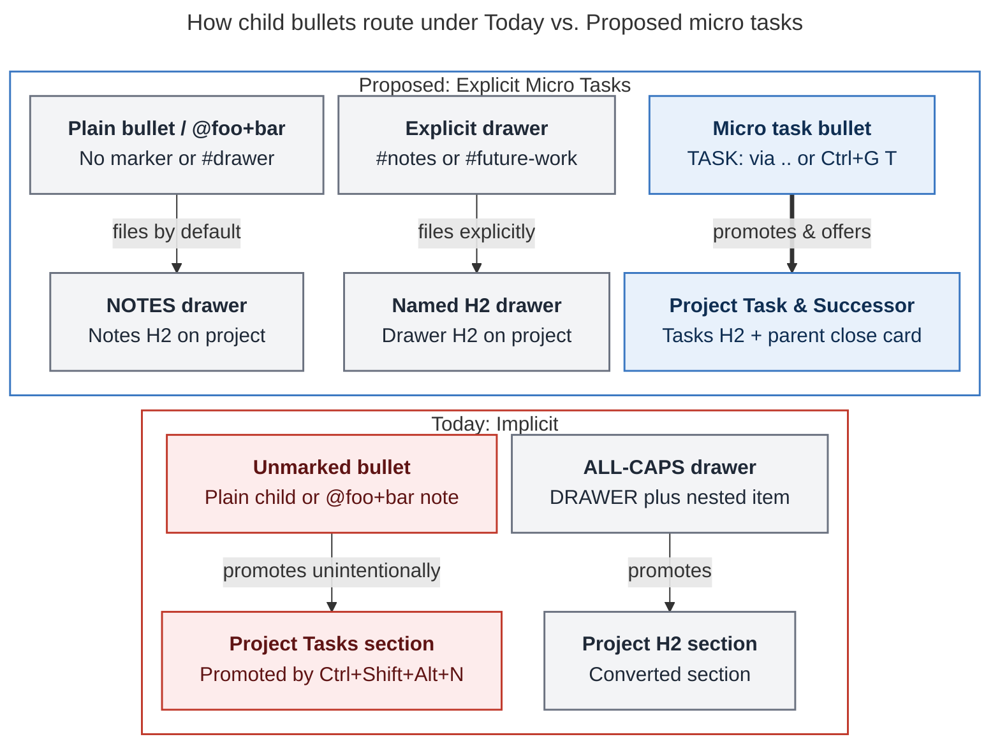
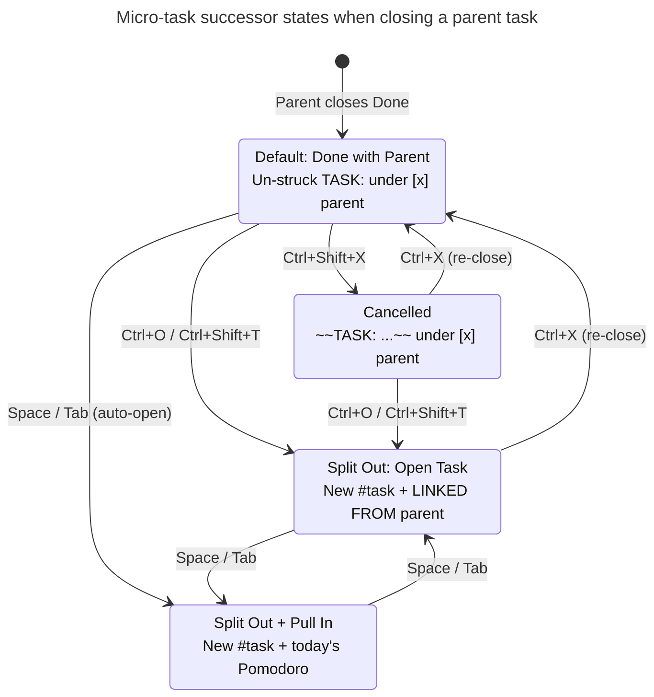

# Explicit Micro Tasks in Bob: Architecture, Critique, and Design Proposal

## Executive Summary

Promoting every unmarked, non-drawer child bullet of a task into a full `#task` during `<ctrl+shift+alt+n>` project creation conflates **context notes** with **sub-commitments**. Making **micro tasks** an explicit, first-class concept while routing ordinary unmarked bullets into a `NOTES` drawer resolves that ambiguity, turns parent task completion into a genuine commitment check via micro-task successors, unifies `task merge` (`merge_labels`, `>`, `<`, and CLI), and creates the exact structural foundation required for future bidirectional `project <-> task` isomorphism.

Our core recommendation adjusts four details of the initial concept for safety, ergonomics, and consistency across `bob-cli`, `bob-plugins`, and Bob Mac Capture:

1. **Mark micro tasks canonically in Markdown with `- TASK: <text>`, not `- #task <text>`.** Using `#task` on plain bullets collides directly with capture's leading `- #<drawer>` syntax (`src/native/capture_language/drawer_bullet.rs`), pollutes Obsidian's global `#task` tag index and Tag Pane, and violates the contract in `docs/task-tag-marks.md` that `#task` on non-checkbox lines marks an ignored non-task line. By contrast, `- TASK:` is already rejected as a drawer title by `capture_drawers::is_drawer_title` (requiring only an explicit exclusion for empty `TASK` / `TASK:`), stays 100% invisible to Obsidian Tasks' `global_filter`, and preserves clean strikethrough semantics.
2. **Keep the Markdown marker depth-invariant (`TASK:`) and compute visual `#` multiplicity dynamically.** `bob-ledger-tools` should render `TASK:` under a `#task` ancestor as **two** (`##`), **three** (`###`), or more hash glyphs stacked in the `--bob-task-tag-hue` visual language based on list nesting depth (`N + 1`). Keeping depth out of raw text means indenting, outdenting, splitting a `##` micro task out to a top-level `#task`, merging `#task` into a `##` micro task, and future sub-project demotion require **zero string rewriting** on descendant bullets.
3. **Preserve backwards compatibility for legacy unmarked bullets and unify `@foo+bar` captures around `NOTES`.** New `@foo+bar` captures should file plain notes into `NOTES` (or `## Notes` on `^prj` notes) by default unless `#drawer` or a micro-task marker is specified. For existing tasks in the vault without a `NOTES` drawer, `<ctrl+shift+alt+n>` (`createProjectNoteFromTask`) should treat remaining unmarked, non-drawer child bullets **as `NOTES` entries** (`## Notes`) rather than discarding them or failing.
4. **Resolve successor UX collisions explicitly.** Inside the shared Successor Picker (`SuccessorOfferPickerModal` and `CapturePullInChoiceView`), `<ctrl+x>` already means **Done (`✓ Done`)** on regular successor rows. Overloading `<ctrl+x>` to mean **Open / Split Out** on micro-task rows inside a mixed picker creates a dangerous mode error. We recommend keeping `<ctrl+x>` idempotent as **Done / Re-close**, binding **`<ctrl+o>`** (or **`<ctrl+shift+t>`**, matching `bob task split`) to **Open / Split Out**, and allowing **`<space>` / `<tab>`** on a closed-by-default micro task to **auto-open + mark Pull-In** in one keystroke.

---

## Current State & Why Change Is Needed

Across `bob-cli` and `bob-plugins`, a `#task`'s child bullets currently fall into four buckets (`src/native/task_children.rs`): managed links (`Depends-On`, `BLOCKS`, `LINKS`, `LINKED FROM`, `SUB-PROJECTS`), managed logs (`Schedule Log`, `Work Log`, `Rotten Log`, `Cancel Log`), ALL-CAPS **drawers** (`capture_drawers::is_drawer_title`), nested `#task` checkboxes (`note_tasks::scan`), and catch-all `TaskChildKind::Authored` bullets. Three existing workflows expose the design seam:

1. **Project promotion (`<ctrl+shift+alt+n>`)**: `buildProjectSeedFromChildBullets` (`bob-plugins`: `plugins/bob-navigation-hotkeys/src/110-project-seed.js`) treats any direct child ALL-CAPS bullet with nested list items as a `##` drawer section, and promotes **every other direct child bullet** unconditionally into `- [ ] #task ... [created::YYYY-MM-DD]` under `## Tasks`. A childless `NOTES` bullet or an ordinary context note like `- Ask Alex about schema` becomes a full GTD task.
2. **Project reversal asymmetry**: `splitProjectNoteForReversal` (`plugins/bob-navigation-hotkeys/src/210-rename-and-line-context.js`) restores `## Tasks` items directly as indented `- [ ] #task` lines under the parent task while restoring other `##` headings into `- SECTION` drawers. Any nested `- [ ] #task` left in the vault is indexed globally by `note_tasks::scan` (`src/native/note_tasks.rs`) as an independent peer task rather than a private sub-step of its parent.
3. **Capture, Split, and Merge**: Single-note and multi-note `@foo+bar` captures (`src/native/capture/plan.rs`) append plain child bullets directly beneath the target task when no `#drawer` is given; `task split` (`src/native/task_split/plan.rs`) allows splitting any unchecked, non-`#task` child bullet; and `task merge` (`src/native/task_merge/payload.rs`) copies the merged source task `S` as a plain `- <S.description>` bullet beneath target `T`, losing any distinction between merged work (`S`) and passive notes.



*Caption: Separating unmarked note bullets (`NOTES`) from explicit `TASK:` micro tasks stops accidental task promotion while aligning capture, splitting, and project promotion around one structure.*

---

## Design Critique & Architecture Decisions

### 1. Micro-Task Marker Syntax: `TASK:` vs. `#task` vs. Alternatives

Choosing the raw Markdown token is the highest-leverage decision in this design because Bob stores truth in plain Markdown notes and coordinates across Rust (`bob-cli`), CodeMirror/Markdown post-processing (`bob-plugins`), Obsidian core/Tasks/Dataview, and Swift (`bob-mac-capture`).

| Criterion | `- TASK: Text` *(Recommended)* | `- #task Text` | `- [ ] Text` (no `#task`) | `- #micro Text` | `- ## Text` |
| --- | --- | --- | --- | --- | --- |
| Capture `- #drawer` collision (`drawer_bullet.rs`) | **None** | **Collides** (`- #t...` opens drawer completion) | None | **Collides** (`- #m...` opens drawer completion) | None |
| Drawer predicate (`capture_drawers::is_drawer_title`) | Safe with body; exclude empty `TASK` / `TASK:` | Not a drawer | Rejected by `has_task_checkbox` | Not a drawer | Not a drawer |
| Obsidian Tag Pane / Dataview `#task` pollution | **None** (`#task` stays 100% pure) | **High** (indexes every micro task under `#task`) | None | Pollutes with `#micro` tag | N/A |
| `task-tag-marks.md` & `freshnessTaskStatus` isolation | **Clean** (`freshnessTaskStatus` returns `null`) | Breaks "honest pill on non-task lines" rule | **Collision**: `freshnessTaskStatus` matches all `- [.]` | Clean | N/A |
| Markdown / Reading View safety | Plain list item; clean `~~...~~` strikethrough | Plain list item; tag stays live inside strikethrough | Renders checkbox UI clutter inside notes | Plain list item | **Broken**: `## ` renders an H2 heading inside `<li>` |
| Cross-tool / CLI legibility (`grep`, git, mobile) | Self-explanatory prose prefix | Looks like malformed `#task` | Ambiguous with casual Markdown checklists | Extra non-standard tag | Looks like broken heading |
| Future `project <-> task` & `task split` parity | Depth-invariant; promotes cleanly by adding `- [ ] #task` | `task_split` currently checks `.contains("#task")` (`split_already_task`) | Indistinguishable from note checkboxes | Requires stripping `#micro` on promote | Unusable |

#### Detailed Trade-offs

- **Why `- #task` should be rejected**:
  - In `src/native/capture_language/drawer_bullet.rs` (`scan_leading`), any `#` that opens a first-level child bullet (`- #...`) is lexed exclusively as a **drawer shortcut** (`- #requirements` -> `- REQUIREMENTS`, `- #future-work` -> `- FUTURE WORK`). Supporting `- #task` as a micro-task prefix forces either a special-case carveout inside `- #t` drawer completion (blocking drawers like `TASKS` or shadowing prefixes like `- #t` for `TEAM` / `TESTING`) or ambiguous parsing depending on trailing whitespace.
  - In `src/native/task_split/plan.rs` (`validate_candidates`) and `src/native/task_status_hooks/parse.rs`, Bob checks `contains("#task")` directly. Worse, `docs/task-tag-marks.md` explicitly preserves raw `#task` pills on non-task lines as the visual signal that Obsidian Tasks ignores them; changing that breaks an explicit UI invariant.
  - Indexing every micro task as an Obsidian `#task` tag inflates tag panes and Dataview `FROM #task` queries with non-Tasks sub-bullets.
- **Why `- [ ]` without `#task` should be rejected**:
  - Although `note_tasks::parse_task_line` (`src/native/note_tasks.rs`) ignores checkboxes lacking `#task`, `bob-ledger-tools`'s `freshnessTaskStatus` (`plugins/bob-ledger-tools/src/080-freshness-placement.js`) matches **any** `- [.] <text>` regardless of `#task`. Moreover, Markdown notes frequently contain casual `- [ ]` checklists inside pasted references or `NOTES` drawers, violating your requirement to make micro tasks **explicitly distinct from notes**.
- **Why `- TASK: <text>` is superior (with two minor rules)**:
  1. **Exclude empty `TASK` / `TASK:` from drawers**: In `src/native/capture_drawers.rs`, `is_drawer_title` accepts `:` only as the **final** character (`OPTIONS:` qualifies; `NOTE: X` does not). Once text follows (`TASK: Migrate schema`), `parse_drawer_title` returns `None`. Explicitly excluding `"TASK"` and `"TASK:"` in `is_drawer_title` (and `isTaskSplitDrawerTitle` in `plugins/bob-navigation-hotkeys/src/256-task-split-plan.js`), matching the documented `TASKS` exclusion in `glossary:task-drawer`, prevents an empty `- TASK:` line (e.g., mid-typing) from registering as a drawer.
  2. **Canonical uppercase match, exact prefix**: Require `- TASK: ` (canonical `- `, `* `, or `+ ` bullet marker + optional whitespace? Wait: standardize writer output as `- TASK: `, accept optional bullet marker `[-*+]` + exact `TASK:` followed by whitespace or end-of-line in parsers) so lowercase prose (`- task: follow up on email`? Actually, matching **only uppercase `TASK:`** avoids false positives on conversational prose while `- ..` and `<ctrl+g>t` always insert `TASK: `!).

---

### 2. Nesting & Dynamic `##` / `###` Rendering

Your intuition to render nested micro tasks using **2 or more `#` characters depending on nesting level** pairs organically with Bob's existing teal hash identity glyph (`#` for a `#task` line, documented in `docs/task-tag-marks.md` and styled in `plugins/bob-ledger-tools/styles.css`).

#### Critical Architectural Choice: Store Depth-Invariant Text, Compute Hash Count at Render Time

Do **not** encode nesting depth into the raw Markdown prefix (e.g., avoid `TASK2:`, `##task`, etc.). Instead:

- **Raw Markdown** always stores `- TASK: <description>` at every micro-task nesting depth:
  ```markdown
  - [ ] #task Launch authentication v2 ^launch-auth
  	- TASK: Finalize session schema
  		- TASK: Benchmark Redis lookup latency
  			- Measure p99 under 5k RPS
  		- TASK: Rotate signing keys [p::1]
  		- REQUIREMENTS
  			- Must support 7-day refresh TTL
  	- TASK: Update client SDK
  	- NOTES
  		- Staging cluster rebuilt on 2026-11-18
  ```
- **Visual Rendering (`bob-ledger-tools`)** computes the nesting depth `d >= 1` relative to the nearest enclosing `#task` ancestor line (counting intermediate `- TASK:` bullet ancestors along the indent chain):
  - Level `d = 1` renders `TASK:` as **`##`** (2 hashes: one parent `#` + one micro-task `#`).
  - Level `d = 2` renders `TASK:` as **`###`** (3 hashes).
  - Level `d = k` renders `k + 1` hashes (e.g., capped gracefully or displayed cleanly up to practical depths like 4–5 `#`, with tooltip `Micro task (level k)` and `aria-label` carrying the level).
- **Why this pays off**:
  1. **Zero text churn on structure edits**: Indent/outdent (`Tab`/`Shift+Tab`) updates the hash count live without touching neighboring lines.
  2. **Promote/Split/Merge stability**: Splitting a `##` micro task out to top-level turns `TASK:` into `- [ ] #task` and its `###` children automatically render as `##` with zero child edits. Merging `#task` source `S` into `T` wraps `S` as `- TASK: S`, and `S`'s existing `##` children automatically render as `###`.
  3. **Live Preview & Reading View parity**: Reuse `bob-ledger-tools`'s `Decoration.replace` pattern (`plugins/bob-ledger-tools/src/264-plugin-task-tag-marks.js`, `Prec.highest`) so touching the `TASK:` token with the cursor (`selection.from <= absTo && selection.to >= absFrom`) reveals raw `TASK:` for editing, and reuse `--bob-task-tag-glyph` SVG masks (`styles.css:2153`) arranged in a compact `gap: 0.04em` inline flex/grid span (using `.8em` scaling cleanly so `###` reads cleanly without bloating line height). On closed/cancelled parent tasks (`[x]`, `[X]`, `[-]`) and on struck-out `~~TASK: ...~~` micro tasks, fade the hashes to the same resting mix (`color-mix(..., 40%, var(--text-faint))` at `0.75` opacity, `styles.css:2241-2249`).

---

### 3. `NOTES` Drawer & Default `@foo+bar` Capture Behavior

#### Default Capture Filing (`@foo+bar`)

Currently in `src/native/capture/plan.rs` (`plan_multi_note_sub_bullet_item` and single-note `CaptureKind::SubBullet` calling `plan_sub_bullet_capture` in `src/native/capture/sub_bullet.rs`), when no `#drawer` (`section`) is supplied on `@foo+bar <note>` or `@foo+bar\n- <note>`, the note appends directly under the parent task before managed logs.

Under the explicit micro-task model:

1. **Single-note `@foo+bar Check API quota`**: Unless `#<drawer>` is specified or the note carries a micro-task marker (`@foo+bar .. Check API quota` or `@foo+bar TASK: Check API quota`), route through `capture_drawers::ensure_drawer(..., "NOTES")` on a normal task (or `## Notes` H2 via `is_prj_parent` on a `^prj` task).
2. **Multi-note `@foo+bar` without glued `#drawer`**:
   ```markdown
   @dev+launch-auth
   - TASK: Write rollback script
   - Staging Redis URL changed yesterday
     - Now on port 6380
   - #future-work
     - Add hardware key support
   ```
   - First-level `TASK:` bullets insert **directly under the parent task** (just before `NOTES` / other drawers or before managed logs, keeping tasks visually clustered at the top of the task block!). Wait: should `TASK:` bullets land *above* `NOTES` or just in insertion order before managed logs? Placing new `TASK:` bullets **above drawers (or right after existing micro tasks and before drawers/managed logs)** matches `## Tasks` preceding `## Notes` on a project note, keeping a task's action checklist visually scannable at the top!
   - First-level plain bullets (plus their nested sub-bullets, like `- Staging Redis URL changed yesterday / - Now on port 6380`) insert into `NOTES` (creating `- NOTES` automatically if absent, matching `capture_drawers::ensure_drawer`).
   - First-level `- #drawer` shortcuts or explicit ALL-CAPS drawer groups (`- FUTURE WORK` + children) file into their specified drawer as today.
3. **Glued `@foo+bar#drawer`**: Everything stays inside `#drawer` (including `- #notes` explicitly). **Recommendation**: refuse `TASK:` inside an explicit drawer (`@foo+bar#notes\n- ..`), with an error explaining that micro tasks live directly under the task, not inside drawers. This preserves the invariant needed for future project isomorphism (`## Tasks` holds tasks; H2 drawers hold notes).
4. **Reserved `NOTES` key?** Do **not** reserve `NOTES` against `capture_drawers::is_drawer_title` — users *must* be able to target `#notes`, type `- NOTES`, view `bob capture-drawers`, and promote `NOTES` <-> `## Notes` uniformly just like `REQUIREMENTS` or `FUTURE WORK`. Instead, reserve `TASK` / `TASK:` only, and let `NOTES` act as the canonical default drawer name! (If a task already has `- NOTES`, append to it; check near-duplicate ambiguity cleanly if a user weirdly had `NOTE` vs `NOTES`.)

#### Placement Ordering & Legacy Unmarked Child Bullets

- **New canonical block ordering inside a `#task`**:
  1. Dependencies & Links (`Depends-On:`, `BLOCKS:`, `LINKS:`, `LINKED FROM:`, `SUB-PROJECTS:`) — or wherever managed dependency lines sit today
  2. Top-level micro tasks (`- TASK: ...` with optional nested `- TASK:`, nested note bullets, or nested drawers)
  3. Drawers (`- NOTES`, `- REQUIREMENTS`, `- FUTURE WORK`, ...)
  4. Managed logs (`- Schedule Log:`, `- Work Log:`, `- Rotten Log:`, `- Cancel Log:`)
- **Project Promotion (`<ctrl+shift+alt+n>` in `110-project-seed.js`)**:
  - Top-level (`depth 1`) `- TASK: Foo` bullets become `- [ ] #task Foo [created::YYYY-MM-DD]` in `## Tasks`, carrying any nested `- TASK:` / child bullets indented cleanly beneath them (`normalizeNestedChildLine`).
  - Explicit ALL-CAPS drawers (`NOTES`, `FUTURE WORK`, etc.) with nested items become `## Title Case` H2 sections (`## Notes`, `## Future Work`), excluding empty drawers as today.
  - **Legacy unmarked direct child bullets**: Rather than failing promotion (`childConversionLossy`) or keeping accidental task promotion, route any unmarked plain direct child bullet (no `TASK:`, not a checkbox, not a drawer) into the `NOTES` group so it merges smoothly into `## Notes`! An explicit `- [ ]` checkbox without `TASK:` at direct depth can either convert cleanly as an open/done task (preserving `[ ]`/`[x]` like `110-project-seed.js` does today, or emitting a warning/converting to `NOTES`) — wait: treating bare `- [ ]` under a legacy task either as explicit task-like promotion or requiring `TASK:` is a policy toggle; recommending **converting plain unmarked bullets to `## Notes` and keeping legacy bare checkboxes `[ ]`/`[x]` promotable with a migration notice (or also requiring `TASK:`)** gives zero surprise on existing vaults.

---

### 4. Capture Ergonomics: `..` Alias & `<ctrl+g>t` Keymap

#### `..` -> `TASK: ` Alias in `bob capture-rewrite`

Code inspection of `src/native/capture_language/rewrite.rs` (`item_start_alias_position_ok`, `spaced_alias_position_ok`, `expand_dot_block_id_alias`, `expand_dot_route_alias`, `expand_dot_dependency_alias`) and `CaptureKeyCommandRouter.swift` (`typedEqualsProbeKey`) / `CapturePanelModel.swift` (`applyEqualsProbeRewrite`) confirms **there is NO collision with Bob's existing `..` double-tap escape**:

- Existing `.` -> `@` / `&` aliases **explicitly do not fire** right after a bullet marker (`- .` keeps its literal dot because `item_start_alias_position_ok` refuses bullet-prefixed lines and `spaced_alias_position_ok` requires non-empty `prefix` after stripping `- ` and optional `[ ]`).
- Existing `- ^.` -> `- ^^` only fires after `- ^`.
- The 350ms fast double-tap collapse (`..` -> `.` in `CapturePanelModel.swift`) ONLY fires when `response.rule == "expand_sigil_alias"` rewritten the *first* `.` to `@` or `&`. Because `- .` triggers no rewrite, `equalsProbe` is never armed there!

**Exact proposed rule (`expand_dot_micro_task_alias` in `src/native/capture_language/rewrite.rs`)**:
- **Trigger**: Caret immediately follows `..` at the start of a list-item bullet's body at any indentation depth (`^[ \t]*[-*+][ \t]+\.\.$` at cursor, on `line_index >= 1` inside a task / sub-bullet item — NOT on `line_index == 0` where `.` is `@route`, and NOT after `^` where `^.` -> `^^`, and NOT inside odd backticks).
  - Wait: what about single-line `@foo+bar .. Ship docs`? If spaced `.` after `@foo+bar ` already triggers `. -> &` or stays literal (`@foo+bar .` — wait: if `@foo+bar` already has a route, `alias_item_is_routed` returns `true` so `. -> &` tries Depends-On, and on `CompletionContext::TaskDependency` fails after a SubBullet target unless valid!). Keeping `..` scoped to **bullet-body starts (`- ..`, `  - ..`, `* ..`)** plus optionally `<ctrl+g>t` avoids breaking spaced `.` -> `@` / `&` double-tap escape after prose words (`- Waiting on server ..` -> `- Waiting on server .`)!
- **Rewrite**: Replace `..` (`start - 1 .. cursor`, matching either trailing `.` typed after `- .` or `- ..`) with `TASK: ` (`- ..` -> `- TASK: `, `\t- ..` -> `\t- TASK: `), leaving caret right after `TASK: `.
- **Escape hatch for literal ellipsis (`- ...`)**: If a user occasionally wants a literal ellipsis starting a bullet, native AppKit undo (`Cmd+Z`) after the `expand_dot_micro_task_alias` edit (matching `. -> @` undo behavior) or Space-restore reverts `- TASK: ` -> `- ..`, allowing `- ...`.

#### `<ctrl+g>t` Toggle Keymap Across Surfaces

- **Bob Mac Capture (`bob-mac-capture`)**:
  `CaptureKeyCommandRouter.swift` (`587-589`, `979-1005`) already implements `Ctrl+G` as an editor leader (`editorLeaderBindings = ["u": .toggleLineCase]`, backed by `CaptureLineCaseToggle`). Extending this exact mechanism:
  - Add `.toggleMicroTask` to `CaptureKeyCommand` and `"t": .toggleMicroTask` to `editorLeaderBindings`.
  - Implement pure transformation in `CaptureCore` (reusing multi-line range semantics from `CaptureLineCaseToggle`): for every physical bullet line touched by the selection (`- `, `* `, `+ `):
    - If `line_index == 0` on a top-level new-task / `#task` / Pomodoro line -> no-op (or announce `"Top-level item is already a task"`).
    - If body begins with `TASK: ` -> strip `TASK: ` (`- TASK: Foo` -> `- Foo`; `- TASK: ` -> `- `).
    - If body is a drawer header or checkbox (`[ ]`) -> either strip/convert cleanly or skip/refuse with status message.
    - Otherwise -> insert `TASK: ` immediately after the bullet marker (`- Foo` -> `- TASK: Foo`, `- ` -> `- TASK: `), adjusting caret/selection offsets cleanly inside `NSTextView` (`insertText(..., replacementRange:)` + `breakUndoCoalescing()`).
- **Obsidian (`bob-plugins`, `bob-navigation-hotkeys`)**:
  - Add command `"toggle-micro-task"` (`Toggle micro task`) using the same pure bullet rule: refuses/ignores `- [ ] #task` lines and drawer headers with nested children; toggles `TASK: ` on bullet lines (both single cursor line and multi-line editor selection). Also allow triggering `<ctrl+g>t` if desired — **important caveat**: Obsidian's built-in Hotkey manager only accepts **single keystrokes** (e.g., `Ctrl+Shift+M` or `Alt+T`), NOT Emacs two-key chords like `Ctrl+G t`. If literal `<ctrl+g>t` inside Obsidian is required without Karabiner/Vim macros, `bob-navigation-hotkeys` will need a lightweight CodeMirror 6 keymap / `Ctrl+G` chord listener (matching `CaptureKeyCommandRouter`'s `u` / `t` leader table!). Otherwise, register `toggle-micro-task` with no conflicting default + optional CM6 `Ctrl-G` chord handler.

---

### 5. Micro-Task Successors on Parent Close

This is the behavioral heart of your feature. Below is the recommended state model, followed by critical critiques of keybindings, strikethrough + link details, nested micro tasks, and cross-client parity.



*Caption: Top-level (`##`) micro tasks start Done with their parent and can transition to Split Out (with optional auto Pull-In) or Cancelled; nested (`###+`) micro tasks inherit their `##` parent's resolution.*

#### Critique 5A: Resolving the `<ctrl+x>` Keymap Clash Inside `SuccessorOfferPickerModal`

Look closely at what existing successor code does today (`plugins/bob-navigation-hotkeys/src/206c-successor-picker-verdicts.js`, `206d-successor-picker-verdict-render.js`, `bob-mac-capture`: `CaptureKeyCommandRouter.swift:919-924`):

- On all existing successor groups (`hand_off`, `relation`, `project`, `project_finished`, `keep_moving`, `note_pull`):
  - Default = **Leave** (stays open as-is, unchecked)
  - **`<space>` / `<tab>`** = toggle **Pull in** (insert Task Link into today's Pomodoro)
  - **`<ctrl+x>`** = stage **Done (`✓ Done`)** verdict (clears Pull-in mark)
  - **`<ctrl+shift+x>`** = stage **Cancel (`⊘ Cancel`)** verdict with optional reason (clears Pull-in mark)

Now examine the conflict in your proposal:
- You want top-level micro tasks to be **closed (`✓ Done`) by default**, and pressing `<ctrl+x>` to **open** them into standalone tasks.
- **Why this clashes**: In a closing parent that *both* unblocks a downstream task (`Depends-On`) *and* has micro tasks, `<ctrl+x>` on row 1 means **"mark Done"** while `<ctrl+x>` on row 2 means **"mark Open"**! A single user double-tapping `<ctrl+x>` down the list (or forgetting row polarity) could accidentally spawn tasks instead of closing them or vice versa.
- **Two clean resolutions** (we strongly recommend **Option 1**, while **Option 2** honors literal `<ctrl+x>` if polarity inversion is intentional):
  - **Option 1 *(Recommended — Semantic Consistency)*:** Keep `<ctrl+x>` = **✓ Done** and `<ctrl+shift+x>` = **⊘ Cancel** *everywhere* in the Successor Panel. Micro-task rows arrive pre-rendered with a subtle **`✓ Done (with parent)`** default badge (so pressing `Enter` right away confirms all micro tasks Done!).
    - Press **`<ctrl+o>`** (Open) or **`<ctrl+shift+t>`** (Split Out, matching Bob's `task split` mnemonic) to flip a micro task to **Open (Split Out)**.
    - Press **`<space>` / `<tab>`** directly on a default-closed micro task to **Auto-Open + Mark Pull-In** in a single keystroke! (Pressing `Space`/`Tab` again unchecks Pull-In while keeping the row **Open** — or press `<ctrl+x>` to re-close it back to `✓ Done`!)
    - Notice `CaptureKeyCommandRouter.swift:868-932` leaves both `Ctrl+O` and `Ctrl+Shift+T` completely unbound in `pullInChoiceCommand` today!
  - **Option 2 *(Row-Scoped Toggle)*:** Bind `<ctrl+x>` on micro-task rows as a **Done <-> Open** toggle (viewing `x` as "toggle `[x]` check state", matching checkbox toggle intuition), update the dynamic footer hint line in `206d-successor-picker-verdict-render.js` when a micro-task row is highlighted (`Ctrl+X open` vs `Ctrl+X done`), and allow `<space>` / `<tab>` either after opening (your literal wording) or as one-step auto-open. We advise against Option 2 due to mixed-list mode errors, though its implementation cost is identical if you strongly prefer `<ctrl+x>`.

#### Critique 5B: Exact Markdown Edits on Split-Out (`Open`) and `Cancel`

Notice the exact phrasing in your prompt:
> *"in which case a new Obsidian task should be created for that micro task. The micro task bullet in the original task should be crossed out and an appropriate note should be placed next to it that links to the original parent task."*

Let's unpack **two important subtleties** here:

1. **Both directions of linking (`stub -> new task` AND `new task -> original parent task`)**:
   Wait — the crossed-out bullet *already sits inside* the original parent task! Placing a link **to the original parent task** directly inside the original parent task itself would be a self-link. What makes the relationship navigable in both directions (matching `docs/task-split.md`) is:
   - **On the original closed parent task**: Cross out the micro-task bullet and append a link right next to it pointing to the **newly created task** (`[[#^new-id|Alias]]` or cross-note `[[TargetNote#^new-id|Alias]]`). For example:
     ```markdown
     - [x] #task Launch authentication v2 [completion:: 2026-11-20] ^launch-auth
     	- ~~TASK: Update client SDK~~ → [[#^update-client-sdk|Update client SDK]]
     	- ~~TASK: Optional telemetry cleanup~~
     	- TASK: Finalize session schema
     ```
     Notice how scannable that closed parent becomes:
     - Un-struck `- TASK: Finalize session schema` = **Done as part of parent**.
     - `~~TASK: Optional telemetry cleanup~~` = **Cancelled (never done)**. (Optionally include italic cancel reason if supplied in `Ctrl+Shift+X`, e.g., `*(deferred until Q1)*` or reuse compact parent inline note without cluttering `#task` logs!)
     - `~~TASK: Update client SDK~~ → [[#^update-client-sdk|Update client SDK]]` = **Split out to a live standalone task at close time**.
   - **On the newly created Obsidian task**: Mint a `^parent-id` on the original parent task first if it didn't have one (exact `task split` SP4 rule in `src/native/task_split/plan.rs`), place the new task using `task_split::choose_placement` (`below_owner` inside area/project notes; `root_note` `## Tasks` or `inbox` `## Tasks` when closing from a daily note), and attach a `LINKED FROM` child line pointing back to the **original parent task** using Bob's existing mention format (`docs/task-split.md`, `docs/task-relations.md` §19):
     ```markdown
     - [ ] #task Update client SDK [created:: 2026-11-20] ^update-client-sdk
     	- 🔗 LINKED FROM: [[auth_v2#^launch-auth|Launch authentication v2]] (💬 mentions)
     ```
     *(Or plain `LINKED FROM:` matching your vault's `linked_from_mentions` / `linked_from_lines` config in `task_split/plan.rs`!)*
     Using `task split`'s exact placement, block-ID minting, and `LINKED FROM` writer keeps the entire vault link graph consistent!

2. **What happens to nested children (`###` micro tasks, notes, drawers) when a `##` micro task is Split Out vs. Cancelled vs. Done?**
   - **Split Out (`Open`)**: **Move** all nested children (`###` micro tasks, child note bullets, nested drawers) onto the **newly created standalone task** (just as `bob task split` moves child lines!), rather than duplicating them inside the closed parent. Leaving unstruck `###` children under a struck-out `##` bullet in `[x] Parent` would falsely suggest those sub-steps were completed under the parent and cause immediate drift once work continues on the new task. Inside the new task, those `###` micro tasks automatically become `##` (top-level micro tasks) without changing a single byte of their `TASK:` text!
   - **Cancelled (`Ctrl+Shift+X`)**: **Strike out** the `##` bullet AND all nested `###` micro-task bullets beneath it (`- ~~TASK: Child~~`) while keeping child note bullets untouched beneath them, so reopening or reviewing the closed task shows the whole skipped branch was cancelled together.
   - **Done (default)**: Leave the `##` bullet and its nested `###` children un-struck under `[x] Parent` — because the parent is `[x]`, `bob-ledger-tools` CSS automatically dims the whole subtree (`li.task-list-item[data-task="x"]`), and no noisy edits clutter the closed task.

#### When the Successor Panel Opens & Non-Actionable Children

- **Trigger condition**: Closing a task as **Done** (`[x]` via `<ctrl+enter>`, `Ctrl+Shift+M` settle, Task Card Done, `bob capture` `x!`, etc.) must trigger the successor flow **whenever >= 1 un-struck top-level (`##`) micro task exists**, even if zero downstream `Depends-On` / relation / project offers exist. Previously-struck (`- ~~TASK: ...~~`) micro tasks are ignored so re-closing or clean closing doesn't re-prompt.
- **Display of nested (`###`, `####`) micro tasks**:
  - Render nested micro tasks directly underneath their `##` parent row as indented, non-selectable child rows (`selectable: false`, `OfferGroup::MicroTask`), reusing `CapturePullInOfferRow`'s tree indentation / subdued styling in both `SuccessorOfferPickerModal` and `CapturePullInChoiceView`.
  - Mirror the parent micro-task row's live state onto its nested children visually (`✓ Done with parent` -> `↗ Moves with parent` -> `⊘ Cancelled with parent`), so there is never any doubt what happens to the whole subtree before hitting `Enter`.
- **Execution order guarantee**: When applying choices in `089i-successor-offer-close-apply.js` (Obsidian) and `src/native/task_complete/successors.rs` + `offer_verdicts.rs` (`bob-cli`), process micro-task **Split Out** (`task_split`) and **Cancel** (`~~...~~`) updates **after** computing line offsets carefully (or in bottom-to-top line order per note) **before** running `Pull-In` so newly created tasks have valid file paths, line numbers, and `^block-id` anchors ready to receive a today's Pomodoro Task Link!

---

### 6. Task Merge (`merge_labels` and Beyond)

Today, **every** merge path in Bob—`merge_labels` from capture (`src/native/capture/relations_merge.rs`), `merge_labels` from Obsidian Links (`plugins/bob-navigation-hotkeys/src/429a-relation-merge-commit.js`), `>`, `<`, and `bob task merge`—funnels through one pure planner: `src/native/task_merge/plan.rs` (`plan_task_merge`) and `src/native/task_merge/payload.rs` (`build_payloads`).

Look closely at what `build_payloads` (`payload.rs:566-600`) does today vs. what needs to happen now:

1. **Title conversion (`build_payloads`)**: Currently emits `format!("{}- {}{ending}", destination.title_indent, source.prepared.title)`. Change this to `format!("{}- TASK: {}{ending}", destination.title_indent, source.prepared.title)`!
2. **Critique — Apply to ALL task-level merges, not only `merge_labels`**: Having `bob capture` `<` or `bob task merge` produce a plain bullet (`NOTES` semantic!) while `merge_labels` produces `- TASK:` would create two incompatible merge behaviors through the same planner. Make `MergeContainer::Task` emit `- TASK: <title>` for **all** merge gestures.
3. **CRITICAL Edge Case — `MergeContainer::Drawer` & `MergeContainer::Section`**:
   `src/native/task_merge/containers.rs` (`resolve_destination`) allows merging into a specific **drawer** (`MergeContainer::Drawer`, e.g. `^target#future-work`) or note section (`MergeContainer::Section`). Remember our invariant: **drawers hold notes, not `TASK:` micro tasks!**
   - **Recommendation**: For `MergeContainer::Drawer` (explicit drawer target like `#future-work`), **do not** insert `TASK:` inside the drawer (keep plain `- <title>`, or emit a gentle warning / refuse merging open task-as-work into a non-`TASKS` drawer unless demoted to a note). For `MergeContainer::Section`: on `## Tasks` on a project note, wait — `Section` today creates a `#task` or note bullet depending on section (`section_container`). Only `MergeContainer::Task` creates a micro task!
4. **"Might be more work involved": Handling Source `S`'s Subtree!**
   When source task `S` has children (`source.child_fragments` collected via `task_children::classify_direct_children` in `payload.rs:479`), copying `S` under `- TASK: <S.title>` exposes subtle child-shape cases:
   - **Case A — `S` has existing micro tasks (`- TASK: Sub`)**: Rebased one indent deeper (`\t\t- TASK: Sub`), they automatically become `###` nested micro tasks under `S` (`##`)!
   - **Case B — `S` has drawers (`- NOTES`, `- REQUIREMENTS`)**: Copied one indent deeper beneath `- TASK: <S.title>` as **micro-task-scoped drawers**! (Note: Ensure `capture_drawers::drawers` scopes drawers by direct children of a `#task`, so nested drawers under a micro task do NOT pollute the outer parent `T`'s drawer picker `#` menu — which `direct_child_list_indexes` in `capture_drawers.rs:1691` ALREADY enforces automatically because it checks `nearest_shallower_list_item_parent == Some(parent_index)`!)
   - **Case C — `S` had legacy unmarked plain note bullets**: Rebased beneath `- TASK: <S.title>` (or wrapped into a nested `- NOTES` drawer under `S`!). Wrapping legacy plain bullets of `S` cleanly into `- NOTES` under `- TASK: <S.title>` ensures `S`'s notes don't look ambiguous inside `T`, OR keeping them as child notes of `- TASK: <S.title>` stays lossless!
   - **Case D — `S` had task-line metadata (`#fix`, `[p::1]`, `[due::...]`)**: Verify how `source_payload` in `payload.rs` preserves or cleans `S`'s title: strip `#task`, `[ ]`, `[created::...]`, and `^block-id` (already stripped per `docs/task-merge.md`), while preserving type/priority tags or prose cleanly onto `- TASK: ...`.
   - **Case E — Duplicate `TASK:` prevention**: Guard `build_payloads` so if `source.prepared.title` somehow already starts with `TASK: `, don't double-prefix `TASK: TASK: ...`!

---

## Future Lookahead: Bidirectional `project <-> task` Isomorphism

Although full complex-project-to-task conversion is out of scope for this change, this design makes the future isomorphism clean and nearly effortless:

| Project Concept (`type: [[project]]`) | Equivalent Task Block Concept |
| --- | --- |
| Project lifecycle line `- [ ] #task #prj Ship X ... #hide ^prj` | Root task line `- [ ] #task Ship X ... ^ship-x` |
| Direct task in `## Tasks` (`- [ ] #task Step A`) | Top-level micro task (`\t- TASK: Step A`, rendered `##`) |
| Sub-project (`SUB-PROJECTS:` / `parent: "[[Parent]]"`) | Top-level micro task (`\t- TASK: Sub-Project`) |
| Tasks inside a Sub-Project's `## Tasks` | Nested micro tasks (`\t\t- TASK: ...`, rendered `###`) |
| Grandchild Sub-Project | Depth-3 micro task (`\t\t\t- TASK: ...`, rendered `####`) |
| `## Notes`, `## Requirements`, etc. on Project / Sub-Project | `- NOTES`, `- REQUIREMENTS` drawers directly under `#task` or under that Sub-Project's `- TASK:` line |

**One thing to keep in mind for that future phase**: Today we keep `- TASK: ...` free of checkboxes `[x]` / `[-]` / metadata bloat. When you eventually demote a live project containing *already-completed `[x]` tasks alongside open `[ ]` tasks*, you will need a compact way to preserve done `[x]` or cancelled `[-]` states on demoted micro tasks (e.g., strikethrough `~~TASK: ...~~` for cancelled, and either omitting closed tasks / keeping a `[done::YYYY-MM-DD]` pill or checkmark glyph on `- TASK: ...`). Nothing in the current design blocks adding optional completion/status metadata later.

---

## Proposed Glossary Entry (`glossary:micro-task`)

Prepared in Bob's glossary web format (`sase/memory/glossary/`):

```markdown
# Micro Task

aka micro-task, subtask, `TASK:` bullet

An explicit sub-commitment authored directly beneath a `#task` line—or nested beneath another micro task—using the canonical `TASK:` bullet prefix (`- TASK: ...`). Distinct from descriptive notes filed in `NOTES` or other [[task-drawer|task drawers]], a micro task represents concrete work required to finish its owning task. Obsidian (`bob-ledger-tools`) renders the raw `TASK:` prefix as stacked teal hash marks matching its nesting depth below the owning `#task` (`##` at depth 1, `###` at depth 2, and so on) while keeping the raw prefix depth-invariant so indenting, outdenting, splitting, and merging need no child rewrites.

In the [[capture-panel]] or CLI capture, typing `- ..` at a bullet start expands to `- TASK: `, and `<ctrl+g>t` toggles the `TASK:` prefix on bullet lines. Plain notes captured via `@foo+bar` file into the `NOTES` drawer by default unless `#drawer` or a micro-task marker is specified. Task merges (`bob task merge`, `>`, `<`, and configured `merge_labels`) fold a source task into the target task as a `- TASK:` micro task with its subtree nested beneath it.

Top-level (`##`) micro tasks are never indexed by Obsidian Tasks (`#task`) or `bob` backlogs while nested; instead, they surface as **closed-by-default** [[task-successor|micro-task successors]] when their parent task closes Done, letting the user confirm completion, cancel unfinished items via `<ctrl+shift+x>` (strikethrough), or split unfinished items out via `<ctrl+o>` / `<ctrl+shift+t>` (or `<space>`/`<tab>` to split out and pull into today). Nested (`###+`) micro tasks display beneath their `##` parent as non-actionable rows that inherit its resolution. Forward promotion (`<ctrl+shift+alt+n>`) turns top-level `TASK:` bullets into full `- [ ] #task` tasks in the new [[project-note|project note's]] `## Tasks` section while keeping unmarked bullets in `## Notes`.

See [[task-drawer]], [[task-split]], [[task-merge]], [[successor-offer]], and `docs/task-tag-marks.md`.
```

---

## Recommended Implementation Plan

| Layer / Repo | Target Modules | Core Changes |
| --- | --- | --- |
| **1. Core Grammar & Scanners (`bob-cli`)** | `src/native/capture_drawers.rs`<br>`src/native/task_children.rs`<br>`src/native/micro_tasks.rs` *(new)* | Exclude `"TASK"` / `"TASK:"` from `is_drawer_title`; add `TaskChildKind::MicroTask { cancelled, depth, body }` parsing (`- TASK: ` and `- ~~TASK: ...~~`); expose recursive micro-task tree walker for successors & promotion. |
| **2. Capture Rewrite & Planning (`bob-cli`)** | `src/native/capture_language/rewrite.rs`<br>`src/native/capture_language/drawer_bullet.rs`<br>`src/native/capture/plan.rs`<br>`src/native/capture/sub_bullet.rs` | Add `expand_dot_micro_task_alias` (`- ..` -> `- TASK: `); route unmarked `@foo+bar` single & multi-note captures to `NOTES` via `ensure_drawer` (`## Notes` on `^prj`); route `TASK:` capture bullets directly under the task above drawers; refuse `TASK:` inside glued `#drawer` items. |
| **3. Merge & Split (`bob-cli`)** | `src/native/task_merge/payload.rs`<br>`src/native/task_split/plan.rs`<br>`src/native/task_split/command.rs` | Update `build_payloads` for `MergeContainer::Task` to emit `- TASK: <title>` (and preserve nested drawers/micro tasks); add a `MicroTask` split option/helper that strikes out `- ~~TASK: ...~~ → [[#^id|Alias]]` in the parent while transferring nested subtree + adding `LINKED FROM` on the new task via shared `choose_placement`. |
| **4. Successor Planner & Offers (`bob-cli`)** | `src/native/task_complete/successors.rs`<br>`src/native/task_complete/offer_close.rs`<br>`src/native/capture/offer_verdicts.rs` | Add `OfferGroup::MicroTask` rows (top-level actionable with `default_verdict: "done"`, nested non-selectable children); always surface card when `>= 1` open top-level micro tasks exist on Done close; execute Open -> Split Out -> Pull-In and Cancel -> Strikethrough verdicts cleanly; support CLI flags (`--open-offer` / `--complete-offer` / `--cancel-offer` / `-p`). |
| **5. Visual Rendering (`bob-plugins`)** | `plugins/bob-ledger-tools/src/138-task-tag-marks.js`<br>`264-plugin-task-tag-marks.js`<br>`styles.css` | Extend mark builder to detect `TASK:` bullets anchored to a `#task` ancestor, compute nesting depth `d >= 1`, and render `d + 1` compact teal `#` glyphs (`##`, `###`, ...); support Live Preview cursor-touch reveal, Reading View post-processing, and struck/closed dimming. |
| **6. Obsidian Editing, Promotion & Picker (`bob-plugins`)** | `plugins/bob-navigation-hotkeys/src/100-yank-and-paths.js`<br>`110-project-seed.js`<br>`206c/206d` successor picker<br>`plugins/task-status-cycler/src/085b/089g/089i` | Add `toggle-micro-task` editor command; update `buildProjectSeedFromChildBullets` so only top-level `TASK:` bullets promote to `## Tasks` and unmarked bullets route into `## Notes`; mirror Rust's `OfferGroup::MicroTask` rows, non-actionable nested children, `<ctrl+o>`/`<ctrl+shift+t>` Open, `<space>`/`<tab>` Auto-Open + Pull-In, `<ctrl+x>` Re-Close, and `<ctrl+shift+x>` Cancel in `SuccessorOfferPickerModal`. |
| **7. Mac Capture Client (`bob-mac-capture`)** | `CaptureCore` + `CaptureKeyCommandRouter.swift`<br>`CapturePanelController.swift`<br>`CapturePullInChoiceView.swift` | Bind `"t": .toggleMicroTask` in `editorLeaderBindings` (`Ctrl-G T`); pass through `bob capture-rewrite` for `- ..`; render `MicroTask` rows with default-closed pill, nested child indentation, Open/Pull-In/Cancel shortcuts, and dynamic status line in `CapturePullInChoiceView`. |
| **8. Documentation & Memory (`bob-cli`)** | `sase/memory/glossary/micro-task.md`<br>`docs/capture.md`, `docs/task-dependencies.md`, `docs/task-merge.md`, `docs/task-tag-marks.md`, `docs/projects.md` | Author glossary entry via `/sase_memory_write`, update cross-repo docs, and lock behavior with shared golden vectors (`task_split`, `task_merge`, `capture`, `successor_offers`). |

---

## Risks & Open Questions to Confirm Before Implementing

1. **Modal verdict keybinding choice**: Confirm whether you prefer **Option 1** (`<ctrl+o>` / `<ctrl+shift+t>` = Open, `<ctrl+x>` = Done everywhere, `<space>`/`<tab>` = auto-open + Pull-In) for cross-row consistency, or **Option 2** (`<ctrl+x>` = Open toggle specifically on micro-task rows).
2. **Legacy bare `- [ ]` checkboxes under tasks**: When running `<ctrl+shift+alt+n>` on old tasks containing `- [ ] sub` (without `TASK:` or `#task`), should those promote to `#task` for backwards compatibility with `110-project-seed.js`, or also require `TASK:`?
3. **Obsidian `<ctrl+g>t` chord mechanism**: Confirm whether Obsidian needs an embedded CM6 two-key `Ctrl+G` leader listener or a single-chord command hotkey (since Obsidian's native hotkey settings don't bind two-key sequences).
4. **Parent cancellation behavior**: When explicitly **cancelling** a parent task (`[-]`) that still holds un-struck micro tasks, should micro-task successors stay silent (recommended, keeping cancel fast) or also surface to rescue unfinished sub-items?
