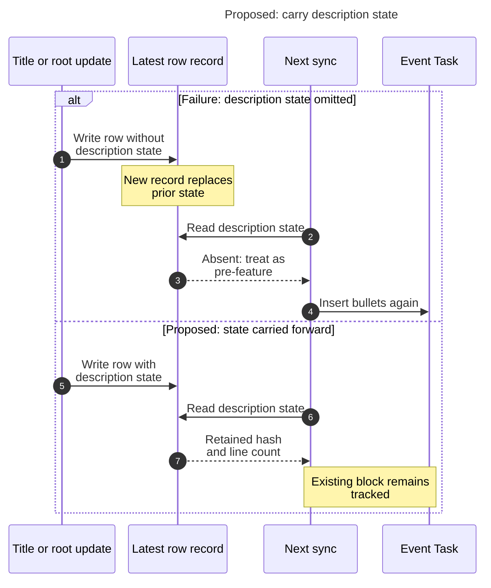
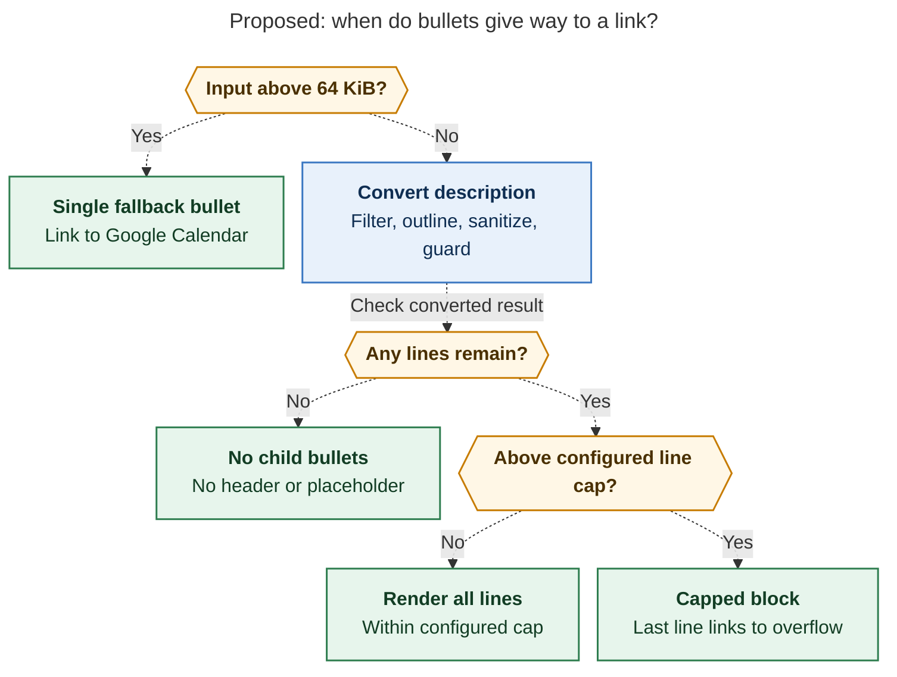

# Diagram proposals: Google Calendar descriptions as Event Task bullets: consolidated design

Proposals for the swarm linker, not a report. Each diagram restates only what the source
report says.

```yaml
source: research:202611/gcal_event_description_notes/gcal_event_description_notes__final.md
producer: research.5o.image
check: "mmdc 12.0.0 with the PDF-mirroring config rendered 2 of 2 Mermaid diagrams"
```

## journal-carry-forward

```yaml
anchor: |-
  On the next run the row would look pre-feature and get its bullets
question: |-
  Why must every later row record carry the description state?
illustrates: |-
  A title or root update that omits description state replaces the folded row record and makes the next sync treat it as pre-feature, while required carry-forward keeps the block tracked.
caption: Every row update must retain description state; omitting it can make the next sync insert duplicate bullets.
review: "770x807 px, fit 84.8%; question, source tracing, arrow and visual checks passed; 1 revision"
```



## description-output-routes

```yaml
anchor: |-
  Render at most `description_lines` lines, the last of
question: |-
  When does sync write full bullets, an overflow link, a fallback link, or nothing?
illustrates: |-
  With description bullets enabled for Event Tasks, the 64 KiB input bound, empty filtered result, and configurable eight-line default choose different outputs at different stages.
caption: Oversized input yields one source link; empty content yields nothing; capped output includes an overflow link within the configured line limit.
review: "761.4x1008 px, fit 85.7%; question, source tracing, arrow and visual checks passed; 0 revisions"
```



