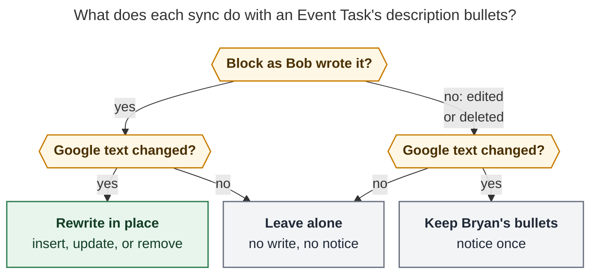

# Google Calendar descriptions as Event Task bullets: consolidated design

*Lead researcher: final synthesis · 2026-11-02 · bob-cli `master` @ `311b1514`*

**Inputs.** Five independent reports, kept alongside this one:
[`__cdx`](gcal_event_description_notes__cdx.md) (creation-time snapshot in a
`CALENDAR DESCRIPTION` drawer), [`__cld`](gcal_event_description_notes__cld.md)
(flat bullets that follow Google until edited),
[`__grk`](gcal_event_description_notes__grk.md) (flat bullets proposed once),
[`__mus`](gcal_event_description_notes__mus.md) (a `📝 From Google` agenda
block that follows Google until edited), and
[`__gem`](gcal_event_description_notes__gem.md) (an `AGENDA` drawer written
once). I verified their disputed claims against the code, the vault, and the
decision records. I also added findings that none of the five reports had.

---

## Bottom line

**Build it.** I recommend changing the request in a few deliberate ways
(see [Requirement adjustments](#requirement-adjustments)).

Ship **flat, sanitized, filtered, capped bullets as the first children of
each Event Task**. They hold the human part of the Google description. Like
every other part of the row Google fills in, the bullets **follow Google
until Bryan edits them**. After an edit or deletion, the bullets are his for
good.

Here is the motivating case. It is real: today's 08:00 event has the
description `And retainers!\n\n@love #offclock`.

```markdown
- [*] #task **0800-0815** Swings! [📅](… "Open in Google Calendar") #offclock [root:: love]
	- And retainers!
```

The directive line still drives `#offclock` and `[root:: love]`. The human
line becomes the bullet. A description that holds only directives writes
nothing. A Teams or Zoom invite whose description is all vendor boilerplate
also writes nothing. Its row stays exactly as it is today.

**The rule in one sentence (for docs and help):**

> Whatever you write in a Google event's description, except Bob's directive
> lines and video-call boilerplate, appears as bullets at the top of that
> meeting's Event Task, and keeps following Google until you edit those
> bullets.

---

## Is this a good idea?

**Yes. Every report agrees, and so do I.** The daily note is where Bryan
works. Today the description's human text is fetched and then thrown away.
`gog.rs` already requests `description`, and `GcalEvent::from_google` keeps
only `description_directives()`. Bryan already writes reminders there. In
cld's read-only sample of his primary calendar (2026-10-01 → 2026-11-15),
6 of 17 events had a description:

- 3 held directives only.
- 2 held a short human line.
- 1 was pure Microsoft Teams boilerplate.

All five reports also agree that **the literal request would fail on day
one**. These are the failure modes:

| Failure mode of a literal "paste the description" | Evidence |
| --- | --- |
| **Boilerplate.** The one external invite in the sample would become about 9 junk bullets: separators, a join URL, a meeting ID, a passcode, and help links. The `📹` badge already carries the join link. | cld's calendar sample; `model.rs` derives `join_link` from `hangoutLink`, then the video `conferenceData` entry point, then a location URL |
| **Executable vault syntax.** The vault has inline DataviewJS on (`enableInlineDataviewJs: true`, prefix `$=`). A description containing `` `$= …` `` would run JavaScript in Obsidian. | Verified in `~/bob/.obsidian/plugins/dataview/data.json` |
| **Bob's scanners read children.** A 🍅 anywhere in a row's block makes `row_untouched` false, which blocks Google-side cancels. A literal `🍅` in a description is enough. | Verified `lifecycle.rs:336-341` |
| **Lost links and structure.** The current HTML normalizer turns `<br>`/`<p>`/`<div>`/`<li>` into line breaks and strips every other tag. It drops `<a href>` targets and list nesting. It also keeps the *text* inside `<style>`/`<script>`. | Verified `model.rs::replace_html_tags` |
| **Ownership collision.** `docs/gcal.md` says "Child bullets (meeting notes): You, never touched." Writing children reopens that promise. | `docs/gcal.md` § Who owns each part of a row |

**Would I take a different approach?** Not a different *feature*. I would
take a different *contract* than "sub-bullets":

- One defined block.
- Event Tasks only.
- Filtered and sanitized.
- Capped.
- Owned by Google until Bryan edits it.

The rejected alternatives are listed at the end, with the reasons.

---

## What the reports agreed on (settled)

| Point | Consensus |
| --- | --- |
| Scope | Event Tasks only. Context rows (Maybe, free, all-day, multi-day) stay one line. A Maybe→Yes upgrade gains the bullets at upgrade time. |
| Directive exclusion | Drop **whole directive lines** using the existing rule (every whitespace/comma token is `@route`, an off-clock alias, or `±N[m]`). A mixed line such as `Ask @job about +15 minutes` is prose and stays. |
| Write path | Write the row and its bullets in **one** planned note write (`WorkingNote::insert_block`). Never append them in a second pass. Never put `\n` inside a `WorkingNote.lines` element. |
| Time changes | `reslot_block` already moves the row together with its whole child block, so the bullets travel with it. |
| Checkboxes | Description checklists never become tasks. `[ ]` is rendered inert. |
| Links | `<a href>` becomes `[text](url)`. Links are the most valuable part of an agenda. |
| JSON | Never carries description text, as `docs/gcal.md` § JSON output promises. A line count is enough. `-d` is the preview of the actual words. |
| Empty | Empty, directive-only, or all-boilerplate input writes nothing: no header, no placeholder. |

---

## Where the reports disagreed, and how I resolved each point

### 1. Ownership: write once, or follow Google until edited?

- **Write once** (cdx, grk, gem): the bullets are born with the row and the
  vault owns them from then on. This is simple, and it matches the current
  "children: never touched" row of the ownership table.
- **Follow Google until edited** (cld, mus): sync rewrites the block while it
  still matches what Bob last wrote.

**Resolution: follow Google until edited.** Three verified facts decide it.

1. **Write once is the failure mode the project already reversed.** The
   record `decisions:gcal-root-follows-google-until-edited` exists because
   write-once roots left the 2026-10-31 Halloween row at `[root:: meet]`
   after Bryan added `@love` to the Google event, "with no warning." Every
   other Google-derived part of the row now follows Google until edited:
   time, title, badges, `#offclock`, `[buffer::]`, and `[root::]`. If
   descriptions alone stayed write-once, Bryan would get exactly that silent
   staleness again. The title would update on a re-sync and the agenda would
   not.
2. **The update path fires when Bryan expects it.** Ledger Tools runs
   `bob gcal sync -q -f json` once, when today's daily note is created. After
   that, sync runs only on demand (`docs/gcal.md` § Where it runs: "There is
   no periodic sync"). So bullets are born in the morning. A later
   description change lands only when Bryan himself runs sync again, which is
   the moment he expects Google-side changes to land.
3. **The reports' main objection does not hold.** cdx, grk, and gem feared
   that a live block would clobber or freeze Bryan's in-meeting notes. Two
   facts answer that:
   - Under cld's window search, Bryan's *sibling* notes never touch the
     block. Only an edit *inside* it makes it his.
   - There are no such notes yet. No Event Task in the daily notes from
     2026-10-20 through 2026-11-02 has a single child bullet. I checked every
     `## Events` section.

**What this costs:** one journal record, one block-location routine, and one
notice. That is roughly the size of the buffer feature. This is the most
debatable call in this report. Phase 2 below ships *birth-time* bullets
first, and that phase is write-once by construction. If Bryan prefers the
simpler contract, he can stop after phase 2.

**Refinement over cld and mus: report a conflict only when it matters.** The
span merge reports `kept_edit` once even when only Bryan changed something
(`plan.rs::apply_span_updates`). For bullets that would be noise, because
editing them is the expected flow. Follow the `kept_root` model instead:
report `kept_description` once only when **Google's text changed after
Bryan's edit**. That is the one case where he is missing information. Hash
the *rendered* bullets, never the raw HTML. Then Google re-wrapping its HTML
cannot cause a false conflict, which was grk's concern.

### 2. Shape: flat bullets, a drawer, or a labeled header?

- **Drawer:** cdx (`CALENDAR DESCRIPTION`) and gem (`AGENDA`).
- **Labeled header:** mus (`📝 From Google`).
- **Flat:** cld and grk.

**Resolution: flat first children.**

- **The common case is one line.** A header or drawer doubles a one-line
  reminder, and every human description in the sample is short.
- **Drawers mean "part of one task's work."** Per `glossary:task-drawer`,
  their titles feed capture's drawer catalog, and capture's
  `@route+id#drawer` *files Bryan's notes into them*. An `AGENDA` drawer on
  every meeting would become a top recent for *all* tasks. Capturing into it
  would also mix Bryan's words into Google's block. Under the live model,
  that edit would hand the block to Bryan and stop updates without him
  meaning to.
- **gem's folding argument is wrong.** Folding a list item in Obsidian hides
  its children, not the item. Folding the Event Task leaves its time, title,
  and badges visible.
- **The badge and position already show provenance.** The `📅` badge marks
  Google's row. The rule "Google's description sits at the top; your notes go
  under it" is easy to remember.

**What this costs:** with flat bullets, a long agenda and Bryan's own notes
have no visual boundary between them. If that turns out to matter, Bryan can
add his own `NOTES` drawer under the bullets. The drawer is his, so it is
never touched.

### 3. Boilerplate: strip it or keep it?

cdx keeps everything (dial-ins "can be the only way to join") and relies on
folding. The other four strip it.

**Resolution: strip conservatively, and keep the join link when the badge
lacks it.**

- Drop recognized vendor *blocks*, anchored on their headers and fences (see
  [Pipeline](#pipeline)). Never drop single substrings in prose.
- If the row has **no** `📹` badge, keep the join URL as a link. The phone
  and PIN directory stays dropped.
- The full original text is always one click away through `📅`.

### 4. Size: truncate, fall back, or no limit?

The caps proposed were 8 bullets (cld), 8 first-level bullets plus 200
characters per line (grk), 10 (gem), and 12 lines / 1,200 characters (mus).
cdx instead copies nothing past a limit and shows a fallback line.

**Resolution:**

- **8 rendered lines, including one overflow line**
  `*…N more lines in [Google Calendar](…)*`. Configurable.
- No mid-line truncation.
- A **64 KiB input bound** keeps parsing bounded. Larger input renders a
  single fallback bullet that links to Google Calendar.

The overflow line is visible and links to the source, so the truncation is
not silent. That was cdx's real concern.

### 5. Backfill of rows synced before the feature

cdx and gem say no backfill. cld, grk, and mus say yes.

**Resolution: yes, and it follows from the live model.** A row whose journal
record has no description is treated as a tracked *empty* block. Its bullets
appear on the next sync of that day. That is today's note by default, so on
ship day only today's rows change, and `-d` previews them.

There is one guard. If the row's children already contain a window that
matches the fresh render, for example because Bryan hand-copied the
description, sync adopts that window instead of inserting a copy.

### 6. Where the state lives in the journal

The proposals were a fourth key inside `spans` (mus), a once-flag (grk),
nothing (cdx), and a sibling key (cld).

**Resolution: a sibling key on `gcal.row`, carried forward on every
record.** I verified three things:

- `spans` means "parts of the row line." `upgrade_context_row` and
  `remove_lifecycle_context` compare `split_row_spans(line).hashes()` with
  the journaled map for **exact equality** (`plan.rs:851`, `:1083`). The
  description belongs outside that map.
- `journal.rs::parse_record` reads fields with `object.get`, so older
  binaries ignore an unknown sibling key. Downgrade is safe. By contrast, a
  *new `gcal.*` kind* would appear as malformed in an older host's `doctor`.
- **This trap is new and none of the five reports caught it.** The latest
  `gcal.row` record *replaces* the folded `RowRecord`. Consider a title
  update or a root reroute that appends `gcal.row` without the description
  state. On the next run the row would look pre-feature and get its bullets
  inserted again. Make `PlannedRow.description` a *required* field so the
  compiler flags every construction site: `rows_added`, `rows_updated`,
  `rows_upgraded`, and `rows_adopted`.

### 7. HTML parser: hand-rolled or `html5ever`?

cdx prefers `html5ever`. cld, grk, and mus prefer a small tokenizer. gem's
sketch is regex-like.

**Resolution: a hand-rolled structural tokenizer, in the style of the
existing `replace_html_tags` and `decode_html_entities`.** The key point is
that **safety lives in the sanitizer, not the parser.** Whatever the parser
emits is plain text, and the sanitizer makes all text inert. A parser
mistake can make the output ugly but never unsafe. That makes a small parser
acceptable. Google's own editor emits a tiny tag set: links, lists, `<br>`,
bold and italic, and headings.

The tokenizer must **drop the contents** of `<script>`, `<style>`, `<head>`,
and comments. Today's stripper keeps that text. If Outlook's
`<html><body class=MsoNormal>` input turns out to be common, revisit
`html5ever`.

### 8. Tasks-plugin emoji: neutralize or leave alone?

grk and mus neutralize them with U+200B, as titles do. cld leaves them.

**Resolution: leave them, but enforce it with a test.**

- The bullets are not tasks. No checkbox is ever written, and `#task` is
  escaped. The Tasks global filter is `#task`.
- The scanner-isolation test (see [Tests](#tests-and-acceptance-gate))
  includes `Due 📅 2026-11-03`. If any Bob or plugin scanner reads it as a
  date, switch to the title neutralizer.

### 9. Configuration

The options were none (grk), one enum (cld, mus), and several keys (gem).

**Resolution:** two keys.

- `gcal.description: bullets | off` (default `bullets`). This is a kill
  switch that needs no downgrade.
- `gcal.description_lines: 8`.

Both mirror the existing `tentative: context | task` style. `off` writes
nothing new, leaves existing bullets in place, and stops reconciling them.

---

## New findings from verification

| Finding | Consequence | Evidence |
| --- | --- | --- |
| Bold text matching a managed log label **is** a managed log. `parse_managed_task_log_label` accepts `**WORK LOG**`, `**Schedule log:**`, and similar. An HTML `<b>Work log</b>` rendered as `- **Work log**` would become a fake Work Log that capture's writers could append to. | The bold emitter must refuse reserved labels and render them as plain escaped text. | `capture/sub_bullet.rs:523-530, 613-630` |
| Drawer titles allow only `A-Z0-9`, space, tab, and `&'(),./-`. `*` and `:` are not allowed. | A heading rendered **bold** (`- **AGENDA**`) or kept with its colon (`- Agenda:`) can never parse as a drawer. That gives a structural guard with no title-casing of the organizer's text. | `capture_drawers.rs::is_title` |
| Event Task children are absent in practice. Daily notes are tab-indented: 51 tab lines vs 2 two-space lines on 2026-11-01. | The bullets will usually be the only children. Indent with `dominant_indent_unit` (tab fallback), as capture does. | Vault scan, `capture/sub_bullet.rs:676` |
| The CANCEL LOG writer hard-codes **two-space** indentation (`{task_indent}  `). | In a tab-indented note, a later CANCEL LOG and tab-indented bullets will mix indent styles in one block. This is a pre-existing inconsistency. Hash bullets without their indent characters, and check nesting in the visual review. | `task_cancel/line.rs:125-129` |
| Obsidian Linter runs on save, but only `add-blank-line-after-yaml` is enabled. | Nothing rewrites list items on save, so the bullets will not look "edited" just because a note was saved. | `~/bob/.obsidian/plugins/obsidian-linter/data.json` |
| `escape_child_text` (task-line hazards plus leading markers, thematic breaks, and fences) still lives in `gkeep::render`. `escape_task_text` was already lifted to `task_text_escape.rs` "so every importer (gkeep, gcal) escapes … the same way." | Lift `escape_child_text` next to it and build the description escaper on top. Do not make gcal depend on gkeep. | `gkeep/render.rs:145`, `task_text_escape.rs:1-5` |

---

## Requirement adjustments

These are explicit changes to the request as stated:

| # | Adjustment | Why |
| --- | --- | --- |
| **A1** | **Event Tasks only.** Context rows never get bullets. A Maybe→Yes upgrade adds them. | Context rows are not tasks. The removal rule "a context row with children is Bryan's" stays true. |
| **A2** | **The exclusion goes beyond directive lines.** It also drops recognized conferencing blocks, separator-only lines, blank lines, and lines that only repeat the `📹` or `📍` target. | A real Teams invite would otherwise produce about 9 junk bullets. |
| **A3** | **The bullets follow Google until edited.** This is neither write-once nor "children are yours." An edit, a nested note, or a deletion makes the block Bryan's for good. A notice appears once, and only if Google changes afterward. | Consistent with every other Google-derived part of the row. It avoids the Halloween-style silent staleness. **This partly supersedes** the children clause of `decisions:bob-gcal-is-read-only-and-proposes-once` and needs a new decision record. |
| **A4** | **One shape: flat first children.** No drawer and no header. | The common case is one line. Drawers pollute capture's catalog and invite merges. |
| **A5** | **Description text is inert data.** The pipeline includes a sanitizer, structural guards, and a scanner-isolation gate. | Inline DataviewJS is enabled, and Bob's own scanners read children. |
| **A6** | **Capped at 8 rendered lines**, with a linked overflow line. | Keeps the Events section scannable. |
| **A7** | **Rows synced before the feature get bullets** on the next sync of their day. Matching existing content is adopted, never duplicated. | The feature shows up immediately with no duplication risk. |
| **A8** | **JSON stays free of description text.** `list` and `sync` report only `description_lines`. | This is a documented privacy promise. |
| **A9** | **The directive grammar does not change.** `Bring shoes #offclock` stays prose. The row stays on-clock, and the bullet shows the escaped token. | One predicate decides, so a line is never both a directive and a bullet, and never neither. |
| **A10** | **A kill switch:** `gcal.description: off`. | Rollback without a downgrade. |

---

## Recommended design

### Rendered shape

**Work meeting, HTML from Google's web editor.** The description:

`<b>Agenda:</b><ul><li>Intros</li><li>System design – <a href="https://www.google.com/url?q=https://docs.google.com/document/d/1AbC/edit&sa=D">prep doc</a></li></ul>Bring laptop &amp; ID<br>@job -15`

```markdown
- [*] #task **1400-1500** Onsite interview [📅](…) [📍](…) [buffer:: -15m] [root:: job] [type:: MEET] ^onsite-interview
	- **Agenda:**
		- Intros
		- System design – [prep doc](https://docs.google.com/document/d/1AbC/edit)
	- Bring laptop & ID
```

What this shows:

- The Google redirect is unwrapped.
- The list nests under its lead-in.
- The directive line `@job -15` is consumed. It drives `[buffer:: -15m]` and
  `[root:: job]`, and it does not appear as a bullet.

**Later, after Bryan adds a note and the meeting is cancelled:**

```markdown
- [-] #task **1400-1500** Onsite interview [📅](…) … [cancelled:: 2026-11-03] ^onsite-interview
  - ❌ **CANCEL LOG**
    - *2026-11-03* — Declined in Google Calendar
	- **Agenda:**
		- Intros
		- System design – [prep doc](…)
	- Bring laptop & ID
	- Asked recruiter to reschedule
```

Managed first children such as the CANCEL LOG and a Depends-On line go
above the bullets. Bryan's notes go below them. The two-space versus tab mix
shown here is the pre-existing CANCEL LOG indentation noted above.

**Long description** (cap of 8):

```markdown
	- Welcome to the loop! Here is what to expect…
	- …6 more bullets…
	- *…5 more lines in [Google Calendar](https://www.google.com/calendar/event?eid=…)*
```

**Hostile organizer text** becomes inert in Source mode and plain in
Reading view:

| Description line | Bullet written |
| --- | --- |
| `` Run `$= dv.el("b", 1)` now `` | ``- Run \`$= dv.el("b", 1)\` now`` |
| `- [ ] RSVP #task by Friday` | `- \[ ] RSVP \#task by Friday` |
| `See [[Secret Note]] ` | `- See \[\[Secret Note]] !\[](https://t.example/p.png)` |
| `<b>Work log</b>` | `- Work log` (bold refused: it is a reserved managed-log label) |
| `Bring 🍅 salad` | `- Bring &#127813; salad` (still renders 🍅) |
| `Room:: 4B` | `- Room\:\: 4B` |
| `[click](obsidian://advanced-uri?…)` | `- click` (scheme not allowed; text kept) |

### Pipeline

The pipeline is one parse with two consumers: directives and bullets. It
lives in a new pure module, `src/native/gcal/description.rs`. Directive
verdicts and bullets come from the same parse, so a line can never be
counted as both or as neither.

1. **Bound and detect.** Cap the input at 64 KiB. Treat the input as HTML if
   it contains a known tag
   (`</?(a|b|strong|i|em|u|br|p|div|span|ul|ol|li|font|h[1-6]|table|tr|td)\b`,
   case-insensitive). Otherwise use the plain-text path. Normalize CRLF to LF
   and NBSP to a space, and collapse internal runs of spaces.
2. **Tokenize into structured lines.** The output is
   `DescriptionLine { depth, kind, inlines }`.
   - `<br>`, `<p>`, `<div>`, and `<li>` end a line.
   - `<ul>` and `<ol>` nesting sets the depth.
   - `<a href>` becomes a link. Unwrap `google.com/url?q=` redirects with
     the `url` crate, which is already a dependency.
   - `<b>`/`<strong>` and `<i>`/`<em>` become emphasis.
   - `<h1>`–`<h6>` become a bold label line.
   - A `<tr>` becomes one line, with its cells joined by ` · `.
   - `` keeps only its alt text.
   - The contents of `<script>`, `<style>`, `<head>`, and comments are
     dropped.
   - Plain-text markers (`-`, `*`, `•`, `◦`, `‣`) and leading indentation
     set the depth.
3. **Classify directives.** Project each line to plain text and run today's
   `is_directive_token` test on every token. `description_directives` is
   reimplemented on top of this parse.
   - **Gate:** `tests/fixtures/event_buffer/vectors.json` stays
     byte-identical and green. It is a cross-repo contract mirrored in
     bob-plugins' `bob-ledger-tools`.
   - New cases go in a separate bob-cli-only vectors file. One example: a
     plain-text Outlook `text<https://x>` autolink, which the old stripper
     read as a tag.
4. **Filter.**
   - Drop directive lines, blank lines, and separator-only lines (3 or more
     of `-_=*~`, or Google's `-::~:~::~…::-` fence).
   - Drop lines that only repeat the `📹` or `📍` target.
   - Drop vendor blocks. Each block is anchored on a header, from that
     header to the next fence or blank paragraph (an unfenced vendor footer
     runs to the end of the description). The headers are:
     - **Meet:** `Join with Google Meet`, `Join by phone`, `More phone numbers`.
     - **Zoom:** `Join Zoom Meeting`, `Meeting ID:`, `Passcode:`, `One tap mobile`, `Dial by your location`.
     - **Teams:** `Microsoft Teams meeting`, `Need help?`, `Meeting options`.
     - **Webex:** its header phrases.
   - Each vendor gets one fixture with fake IDs.
   - If the row has no `📹` badge, keep the block's join URL as a link.
   - Never match a single substring in prose. "Meeting ID: decide whether to
     publish" is a real agenda line.
5. **Outline.**
   - Each remaining line or paragraph becomes one bullet.
   - Do not fold lines together heuristically. RFC 5545 unfolding already
     happens upstream, and joining would merge real short lines such as
     addresses.
   - **Lead-in rule:** a list that directly follows a line ending in `:`, or
     a heading, nests under it.
   - Depth is capped at 2 (child and grandchild). Anything deeper flattens to
     depth 2, matching capture's two-level authored grammar.
   - Ordered items render as `- 1\. Intros`.
   - Leading checkbox glyphs (`[ ]`, `[x]`, `☐`, `☑`) are stripped, as in
     Keep imports.
6. **Sanitize every text node.** Use `escape_note_text`, built on the lifted
   `escape_child_text`. It covers the existing `%%`, `::`, `#task`, trailing
   `^id`, and leading-marker rules, plus:

   | Hazard | Treatment |
   | --- | --- |
   | `` ` `` anywhere | `` \` `` (inline DataviewJS / DQL, code spans and fences) |
   | `[[`, `![[`, `![` | `\[\[`, `!\[` (backlinks, Task Mentions, embeds, tracking pixels) |
   | `<` outside the links we build | `&lt;` (raw HTML) |
   | A `#` that starts a tag token | `\#` (tag pane, phantom `#task`, a misleading `#offclock`) |
   | Two or more `$` on one line | `\$` (inline math such as `$5-$10`) |
   | `🍅` | `&#127813;` (`row_untouched` substring match) |
   | Leading `#`, `>`, `[ ]`, `+`/`*`/`-` + space, `N.`/`N)` + space | leading `\` |

   Text inside a link we build is escaped. The URL itself is
   scheme-allowlisted (`http`, `https`, `mailto`, `tel`) and percent-encoded
   the way `render.rs` encodes badge URLs. Structure that Bob emits is
   trusted. Google's text is not.
7. **Apply structural guards.**
   - A depth-1 bullet that has children and whose text passes `is_title` is
     rendered bold, so it never becomes a drawer.
   - Bold is refused for any label in `MANAGED_TASK_LOG_LABELS`, so no fake
     logs appear.
8. **Beautify links.** A link whose text equals its URL is treated as a bare
   URL. Bare URLs of 40 characters or fewer stay bare, and Obsidian
   autolinks them. Longer ones render as `[host](url)`. A 200-character
   token wrapping across three lines is the ugliest thing a description can
   do.
9. **Cap and render.** Render at most `description_lines` lines, the last of
   which may be the overflow line. Indent with the note's
   `dominant_indent_unit`, falling back to tab. The same input always yields
   the same bytes.

### Ownership and lifecycle

**Journal record.** `gcal.row` gains a sibling of `spans`:

```json
{"kind":"gcal.row", "…": "…",
 "spans":{"time":"…","title":"…","badges":"…"},
 "description":{"hash":"3f1c9a0d6b2e8a71","lines":2}}
```

| State | Meaning |
| --- | --- |
| Key absent | Pre-feature row. Treated as an empty tracked block (`lines: 0`), so it backfills. |
| `{"hash","lines"}` | Tracked: what Bob last wrote. The hash is the 16-hex `span_hash` of `(depth, text)` pairs, ignoring indent characters. |
| `null` | Hands-off: a crash-adopted row whose bullets could not be matched. Never touched. |

**Locating the block.** Search inside the row's child block
(`child_block_end_line`) for the first window of `lines` lines that meets
all three conditions:

- It starts at a depth-1 line.
- The line after it is at depth 1 or shallower. So a note Bryan nests
  *under* a Google bullet makes the block his.
- Its hash equals the recorded hash.

A window of `lines: 0` is always found, at the insertion point. The
insertion point is the first child position after any leading managed lines
(Depends-On, LINKS, CANCEL LOG, managed logs).

Run this step **before** `apply_span_updates`. The block's edits are below
the row line, so the row's `line_index` stays valid, and a later re-slot
moves the updated block along with the row.



**Caption.** For a journaled Event Task whose description state is not
`null`, sync rewrites the bullets only while the recorded window is still
present. An edited or deleted block stays Bryan's for good, and he hears
about it once, only when Google's text changes later. A pre-feature row
counts as an empty block that is still Bob's. *(Rendered with Mermaid CLI
12.0.0 at 731.6 × 562 px; fit scale 89.2%.)*

**"Google text changed"** means that the fresh render's hash differs from
the recorded hash. When the block is rewritten, sync journals the new hash
and line count. When the block is kept, the old record stays, so the block is
never re-added. The notice is the flag `kept_description`, written through
`push_kept_once`, so it appears once per occurrence and day.

| Situation | Behavior |
| --- | --- |
| New Event Task (any phase) | Row and bullets in one `insert_block`, in the same write as the MEET link. |
| Maybe→Yes upgrade | Bullets go under the upgraded row at the first-child insertion point. |
| Context row | Never gets bullets. |
| Google edits the description; the block is untouched | Replaced in place. The row reads as `~ task` in output. |
| Google clears the description; the block is untouched | The block is removed. |
| Bryan edits, nests under, or deletes the block | His for good. Silent unless Google later changes, then one `kept_description` notice. |
| Bryan adds sibling notes above or below | The block is still Google's and still found by the window search. |
| Time change | The block re-slots with the row (existing behavior). |
| Cancel, decline, or a move to another day | The CANCEL LOG is prepended as the first child. The bullets stay as history. The occurrence has left the snapshot, so updates stop. |
| Done or worked row | Still follows Google while untouched, the same as title and root, so a recording link added afterward still lands. |
| Crash adoption (row without a journal record) | If a window matches the fresh render, journal it. Otherwise journal `null`. **Adoption never writes bullets.** |
| Pre-feature row | Treated as an empty tracked block, so the bullets are inserted. An existing matching window is adopted instead. |
| Recurring series | Each occurrence is its own row and record. Nothing is keyed by series. |
| `gcal.description: off` | Nothing new is written. Existing bullets are left in place and no longer reconciled. |

### Command surfaces

- **`sync -d`:** the existing unified diff already shows the exact bullets.
  This is the preview and the only place description text appears in output.
- **Human `sync` rows:** add a dim `≡ N` suffix when the run wrote or
  updated N lines, for example
  `+ task  08:00–08:15  Swings!  ● love  via @love  ≡ 1`.
- **`list` table:** add a dim `≡ N` after the title, so `list` keeps
  previewing what sync would write.
- **JSON (additive; `schema_version` stays 1):** `sync` rows and `list`
  events gain `description_lines` (an integer), never text. Ledger Tools
  consumes `sync -f json`, and the change is additive for it.
- **Config:** `gcal.description` and `gcal.description_lines`. A wrong type
  is a setup error that names the key, as with the other `gcal.*` keys.

### Code touch points

| File | Change |
| --- | --- |
| `src/native/gcal/description.rs` (new) | Detect, tokenize, classify, filter, outline, guard, cap. Pure, with unit vectors. |
| `src/native/gcal/model.rs` | `GcalEvent` carries the structured `description` lines. The raw text is still dropped after parsing, so it never leaks through `Debug`. `description_directives` is folded from the same parse. Update the module doc comment. |
| `src/native/task_text_escape.rs` | Lift `escape_child_text` from gkeep and add `escape_note_text`. |
| `src/native/gcal/render.rs` | `render_description_block(lines, indent, cap, html_link) -> Vec<String>` and `description_hash`. |
| `src/native/gcal/plan.rs` | Bullets in the insert, upgrade, and adoption paths. A new `apply_description_update` before `apply_span_updates`. A **required** `PlannedRow.description`. The `kept_description` notice. |
| `src/native/gcal/journal.rs` | The tri-state `description` sibling in `RowRecord`/`NewRow`, read and written. |
| `src/native/gcal/sync.rs`, `list.rs` | The `≡ N` suffix and `description_lines`. |
| `src/native/gcal/config.rs` | The two keys and their validation. |
| `docs/gcal.md` | A new "Description bullets" section. The ownership table splits into "Description bullets: Google until you edit them" and "Other child bullets: You, never touched." Notes for JSON and Known limits. |
| `docs/reference/configuration.md`, `json-outputs.md`, `vault-format.md` | The keys, the field, and an Event Task example with one bullet. Read `sase/memory/docs.md` and `cli_rules.md` before editing. |
| Decision record (via `/sase_memory_write`) | **"Gcal Description Bullets Follow Google Until Edited."** It partly supersedes the children clause of `bob-gcal-is-read-only-and-proposes-once`. Draft below. |

### Tests and acceptance gate

- **Converter vectors** (`tests/fixtures/gcal_description/vectors.json`,
  bob-cli only). Each case maps an input to its directives and its exact
  bullet lines:
  - Plain, HTML, and mixed input.
  - Nested and ordered lists, and the lead-in rule.
  - Redirect unwrapping, long bare URLs, and `text<url>` autolinks.
  - Meet, Zoom, Teams, and Webex fixtures.
  - The "Meeting ID: decide…" prose false positive.
  - Separators, the cap and overflow line, and the 64 KiB fallback.
  - `<style>`/`<script>` contents dropped.
  - Every sanitizer hazard in both directions: neutralized when hostile,
    byte-identical when ordinary.
- **The shared `event_buffer/vectors.json` is unchanged and green.**
- **Scanner-isolation gate.** This is the reliability backstop. Render a
  hostile corpus under an Event Task and run Bob's *real* consumers on the
  result: the drawer scanner, the managed-log and Depends-On parsers, the
  relation and mention scanners, `capture_pomodoros::scan`, `row_untouched`,
  and the task-status hooks. Assert that none of them detects anything. The
  corpus includes `- [ ]`, `#task`, `^id`, `%%`, `::`, `[[#^x]]`,
  `**WORK LOG**`, `AGENDA` with children, `🍅`, `$=`, and `Due 📅 2026-11-03`.
- **`tests/gcal_sync.rs`:**
  - Bullets on created rows in all three phases.
  - A second run is a byte-identical no-op.
  - The `-d` output.
  - `description: off`.
  - Tab and space notes.
  - New rows still land after the previous row's bullets.
  - JSON carries `description_lines` and no text (extend the existing
    "no descriptions or attendees leak" test).
- **`tests/gcal_lifecycle.rs`:**
  - A Google edit updates the block in place.
  - A Bryan edit is kept, silently. A later Google change yields
    `kept_description` once, and never again.
  - A deletion is never re-added.
  - A nested note is kept.
  - Sibling notes and a WORK LOG above or below the block don't hide it.
  - A time change re-slots the row with its bullets.
  - An upgrade gains bullets.
  - A cancel keeps the bullets under the CANCEL LOG.
  - Crash adoption never duplicates bullets.
  - A pre-feature row backfills.
  - **A title or root update carries the description record forward.**
    Without this, the row would backfill twice.
  - A 🍅 in the description doesn't count as worked.
  - Context rows never get bullets and are still removed on decline.
- **Visual review before release.** Check one-line, agenda, long, and
  hostile output in Source mode, Live Preview, and Reading view. Check that
  folds, links, and tab nesting look right next to a later CANCEL LOG.
  Check whether the MEET `[[#^id]]` hover preview shows the bullets.
  Obsidian's list-item block previews include nested children, but this
  needs confirming in Bryan's vault.

### Phasing

1. **Converter, sanitizer, and vectors.** Pure code with no vault writes.
   `description_directives` is rebuilt on the shared parse and gated by the
   existing vectors.
2. **Birth-time bullets.** Insert and upgrade paths, the journal record with
   the required carry-forward, config, and output. This phase is
   write-once-safe on its own.
3. **The live lifecycle.** Update while untouched, the `kept_description`
   notice, backfill, and adoption matching. Docs and the decision record
   land with this phase, because this is the phase that changes the
   ownership contract.

Phases 2 and 3 can ship in one daily release train. If they are split, the
hashes recorded in phase 2 make the upgrade seamless.

### Decision record draft

- **Claim.** Sync writes an Event Task's non-directive, non-boilerplate
  description as sanitized, capped first-child bullets. The bullets follow
  Google while they match Bob's journaled block hash. Bryan's edit, nested
  note, or deletion makes them his: kept, never re-added, and reported once
  only if Google later changes. Other children remain his. JSON carries only
  counts.
- **Why.** Write-once would repeat the Halloween silent-staleness failure
  that `gcal-root-follows-google-until-edited` fixed for roots. Every other
  Google-derived part of the row already follows Google until edited.
- **Rejected alternatives:**
  - Write-once snapshots (they go stale silently).
  - A wrapper drawer or header (one-line chrome, catalog pollution, capture
    merges).
  - Inline ownership markers (visible, and fragile under copy and paste).
  - Positional ownership (breaks when logs are inserted).
  - Bullets on context rows (conflicts with the context-removal rule).
  - Per-bullet three-way merges (no stable IDs).
  - Two-way sync (the grant is read-only).
- **Cost.** One journal sibling key, plus a block-location routine.
  Google-side description edits rewrite unedited bullets, including on done
  rows.
- **Reopens when.** Context rows need details, deleting one occurrence's
  bullets should teach the series, or the bullets need a visible boundary
  from Bryan's own notes.

---

## Alternatives considered

| Alternative | Who proposed it | Verdict |
| --- | --- | --- |
| Paste the raw remainder of the description | (the literal request) | ✗ Vendor walls, lost links, phantom tasks and drawers, executable Dataview. |
| Write-once snapshot, flat | grk | ◐ Safe and simple, but silently stale, which is the Halloween failure. This is **phase 2** of the recommended plan, so it remains a valid stopping point. |
| Write-once snapshot in a `CALENDAR DESCRIPTION` drawer | cdx | ✗ Heavy for one-line descriptions, pollutes the drawer catalog, and is stale. |
| `AGENDA` drawer, written once | gem | ✗ The same drawer problems. Its folding rationale is incorrect. |
| A `📝 From Google` header block that follows Google until edited | mus | ◐ Same ownership model as recommended, but with an extra line and level on every event. Its anchor is the header text, which Bryan can edit. |
| Live hover or `list` view with no vault write | (cdx, cld, grk as an option) | ✗ Not searchable and not in the note. `📅` already provides the live view. A fine *extra* later. |
| Per-bullet merge, or two-way sync | (rejected by all) | ✗ No stable bullet IDs, and the grant is read-only. |
| An AI summary or extracted action items | (rejected by cdx) | ✗ Can drop or invent content, varies between runs, and sends private text to another service. |

---

## Risks and open questions

| Item | Risk / question | Mitigation or recommendation |
| --- | --- | --- |
| Live vs write-once | **Decision for Bryan.** Is the consistency with titles and roots worth one journal key and a window search? | I recommend live. Phase 2 alone gives write-once if not. |
| Vendor boilerplate drift | A new vendor format slips through as a few junk bullets. | Fixture-driven filters, with a vector added for each new format seen. Bryan can delete junk bullets, and deletion is permanent. |
| Cap default | Is 8 lines right? | Start at 8, configurable. No character truncation in v1. |
| Long-URL labels | `[docs.google.com](…)` hides which document it is. | Keep host labels. Hovering shows the URL, and Google Docs URLs have no readable slug anyway. |
| Mixed indentation | The CANCEL LOG writes two spaces into tab-indented notes. | Pre-existing. Verify the nesting in the visual review. If it misnests, fix the CANCEL LOG writer to use `dominant_indent_unit` as a separate change. |
| A directive token inside prose | Bryan may expect `Bring shoes #offclock` to work. | The bullet shows the escaped `\#offclock` and the row stays on-clock. The visible escape explains why. |
| Recurring repetition | A long static series description repeats on every occurrence's note. | Bounded by the cap. Each daily note holds one occurrence. "Deleting teaches the series" is v2, if needed. |
| Privacy | Phone numbers and addresses now land in the git-synced vault. | Acceptable for the private vault. The boilerplate filter removes passcodes and dial-in lists. JSON, logs, and the journal stay free of description text. |

---

## Recommended solution

Ship **flat, sanitized, filtered, capped description bullets as the first
children of sync-created Event Tasks**:

- **Source.** One structured description parser feeds both the existing
  directive verdicts and the bullets. The verdicts stay byte-compatible with
  the shared `event_buffer` vectors.
- **Filtering and caps.** Directive lines, conferencing boilerplate,
  separators, and badge duplicates are dropped. The block is capped at 8
  lines, with a linked overflow line.
- **Safety.** Every text node is sanitized as inert data, guarded against
  drawer and managed-log look-alikes, and proven inert by a scanner-isolation
  test against Bob's real parsers.
- **Ownership.** The bullets follow Google until edited, tracked by a
  `description` sibling key on `gcal.row` that every row record carries
  forward. They are located by a window search bounded to the row's subtree.
  They are reported once, and only when Google changes after Bryan's edit.
- **Surfaces.** Event Tasks and Maybe→Yes upgrades only. Pre-feature rows
  backfill on their day's next sync. JSON carries counts, not text. Human
  output shows a quiet `≡ N`. `gcal.description: off` is the kill switch.
- **Governance.** A new decision record partly supersedes "children are
  yours, never touched."

The motivating case stays one line ("And retainers!" right under
"Swings!"). External invites look exactly as they do today. The inline
DataviewJS and fake-log hazards are closed. The behavior fits in one
sentence that matches how every other Google-derived part of the row already
works.
