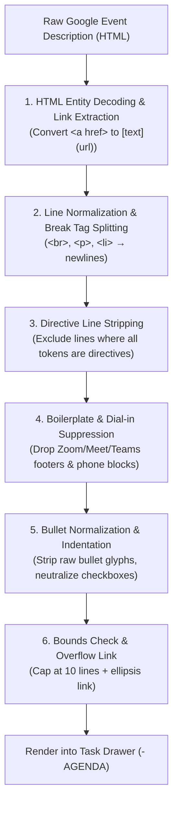
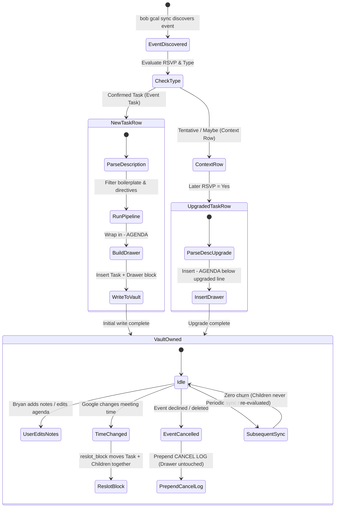

# Architectural Research & Design: Google Calendar Event Description Sub-bullets in `bob gcal sync`

**Researcher:** `research.gem`  
**Date:** November 2026  
**Target:** `bob-cli` (`bob gcal sync`), Bob Vault Architecture, Obsidian GTD  
**Document ID:** `gcal_event_description_subbullets__gem`

---

## 1. Executive Summary

This research investigates extending `bob gcal sync` to convert Google Calendar event descriptions—excluding currently parsed directives (`@route`, `#offclock`, `[buffer::]`)—into structured sub-bullets attached to synced Event Tasks in canonical daily notes.

### Core Verdict
Integrating calendar descriptions into daily note Event Tasks is **a high-value enhancement**, but a **naive implementation would be disastrous**. In the wild, Google Calendar descriptions are dominated by auto-generated video conferencing footers (Zoom/Teams/Meet dial-in directories, phone numbers, meeting IDs, and legal disclaimers) and raw rich-text HTML. Blindly translating raw event descriptions into child bullets would severely clutter the daily note, destroy Bryan's GTD scanning cadence, risk turning description checklists into phantom active tasks, and threaten vault-ownership invariants established in **Decision 9 (`bob-gcal-is-read-only-and-proposes-once`)**.

### Recommended Design
1. **Encapsulate in a Task Drawer (`- AGENDA`):** Rather than loose, uncontained child bullets that blur with Bryan's personal notes, format the converted description inside a native Bob **Task Drawer** (`- AGENDA` or `- DETAILS`). This enables native Obsidian list folding, clean visual separation between organizer context and personal meeting notes, and integration with Bob Mac Capture drawer addressing (`@today+id#agenda`).
2. **Execute a Multi-Stage Cleansing Pipeline:**
   - **Directive Extraction:** Strip all directive lines already parsed by Bob.
   - **Boilerplate Suppression:** Ruthlessly identify and discard video conference footers (Zoom, Google Meet, Microsoft Teams, Webex) and dial-in lists. Bob already renders a clean camera badge `[📹](url)` on the task line.
   - **Rich Markdown Conversion:** Convert `<a href="...">` to Markdown links `[text](url)` so Google Docs, Notion, and Figma agenda links remain functional, while decoding HTML entities and converting formatting (`<b>`, `<i>`, `<code>`).
   - **Task Checkbox Neutralization:** Convert any checklist items (`[ ]`, `<input type="checkbox">`) into plain bullets (`- `) to prevent accidental creation of phantom GTD tasks in Dataview and review walks.
3. **Strict Creation-Only Lifecycle (Write-at-Birth):** Descriptions are converted and written **once** when the Event Task is first created (or when a context row is upgraded). Once created, the vault owns the child block completely; subsequent syncs never rewrite or delete child bullets, eliminating any risk of overwriting Bryan's live meeting notes.

---

## 2. Critique of the Proposal

### 2.1 The Value Proposition: The Single Command Center
In Bryan's GTD workflow, the daily note's `## Events` section acts as the schedule backbone for the day. Under current behavior:
```markdown
- [ ] #task **1000-1100** Architecture Review [📅](...) [📹](...) [root:: eng] [type:: MEET] ^arch-rev
```
The task row tells Bryan *when* the meeting is, *what* it is named, *where* it is attributed (`[root::]`), and provides links to Google Calendar and video calls. However, to see the agenda, read prep docs, or check discussion topics, Bryan must leave Obsidian, click the `[📅]` badge, and read the description in Google Calendar.

Bringing the agenda directly into the daily note:
- Provides immediate context during morning review (`]s` walk) and daily planning.
- Eliminates context switching right before or during a meeting.
- Allows Bryan to jot personal notes and action items directly adjacent to the organizer's agenda items.

### 2.2 Critical Risks of a Naive Implementation

#### Risk 1: The "Dial-In Telephone Directory" Catastrophe
Modern calendar descriptions rarely contain only the agenda. Over 80% of enterprise and personal meeting invites automatically append boilerplate conferencing text:
```text
Join Zoom Meeting
https://zoom.us/j/987654321?pwd=...

Meeting ID: 987 654 321
Passcode: 123456

One tap mobile
+16465588656,,987654321# US (New York)
+13126266799,,987654321# US (Chicago)

Dial by your location
+1 646 558 8656 US (New York)
+1 312 626 6799 US (Chicago)
+1 301 715 8592 US (Washington DC)
... (15 more lines of international phone numbers) ...

Find your local number: https://zoom.us/u/abcedf
```
If `bob gcal sync` converts this naively into sub-bullets, a single 30-minute sync will produce 25 lines of sub-bullets containing dial-in phone numbers. A day with four meetings would add 100+ lines of garbage to `## Events`, completely dwarfing the Pomodoro ledger and turning the daily note into a telephone book.

#### Risk 2: The Lost Hyperlink Problem (HTML vs. Plain Text)
Google Calendar's web interface uses a rich text editor that serializes descriptions as HTML (e.g. `<p>Review doc <a href="https://docs.google.com/document/d/xyz">Q4 Architecture Spec</a> before meeting.</p>`).
If Bob applies its current directive sanitizer (`replace_html_tags`, which replaces break tags with `\n` and strips all other tags), the link tag is stripped:
```text
Review doc Q4 Architecture Spec before meeting.
```
The URL is permanently lost! Given that meeting agendas frequently link to PRs, design docs, slides, and dashboards, destroying hyperlinks strips out the most valuable part of the description.

#### Risk 3: Checkbox Contamination & GTD Task Pollution
Google Calendar allows users to create checklists in descriptions. If these are translated into Markdown checklist items:
```markdown
- [ ] #task **1000-1100** Architecture Review ... ^arch-rev
  - [ ] Review RFC 42
  - [ ] Finalize schema migration
```
In Obsidian Dataview and GTD parsers, **any `- [ ]` is an actionable task**. 
- These description items would be picked up by global task searches.
- They would register in `bob` task counting queries.
- They could contaminate GTD review walking and lane statistics.
Description items are contextual reference material, **not** Bryan's personal GTD commitments. They must never be rendered as checkboxes.

#### Risk 4: Sync Conflicts and Violation of Decision 9
Decision 9 (`bob-gcal-is-read-only-and-proposes-once`) establishes a foundational invariant:
> *"The Google Calendar grant is read-only, and Bob writes each row and link once: Google-owned spans (time, title, badges) update in place only while the row is untouched; the vault owns the checkbox, `[root::]`, children, and the row itself."*

`docs/gcal.md` explicitly specifies:
> `| Child bullets (meeting notes) | You | Never touched |`

If `bob gcal sync` attempts to "keep descriptions updated" on subsequent sync runs:
- What happens if Bryan types meeting notes under the task during the meeting?
- If the organizer edits the Google Calendar description later, does Bob overwrite Bryan's notes?
- Does Bob attempt a three-way merge on child bullets?
Any mechanism that mutates existing child bullets after initial creation creates severe data-loss hazards for Bryan's hand-written notes and violates Decision 9.

---

## 3. Justified Requirement Adjustments

To make this feature intuitive, reliable, and beautiful, we must expand the prompt's initial scope beyond "convert descriptions excluding parsed directives." The following adjustments are essential:

```
┌────────────────────────────────────────────────────────────────────────┐
│                        REQUIREMENT ADJUSTMENTS                         │
├────────────────────────────┬───────────────────────────────────────────┤
│ Requirement                │ Adjustment / Specification                │
├────────────────────────────┼───────────────────────────────────────────┤
│ 1. Noise Elimination       │ Auto-detect & strip video conference      │
│                            │ footers, dial-in numbers, & disclaimers.  │
├────────────────────────────┼───────────────────────────────────────────┤
│ 2. Rich Conversion         │ Convert `<a href>` into `[text](url)` and │
│                            │ format basic typography (`**`, `*`, `\``). │
├────────────────────────────┼───────────────────────────────────────────┤
│ 3. Structural Housing      │ Place sub-bullets in a Task Drawer        │
│                            │ (`- AGENDA`), never loose child bullets.  │
├────────────────────────────┼───────────────────────────────────────────┤
│ 4. Checkbox Neutralization │ Enforce plain bullets (`- `); neutralize  │
│                            │ any `[ ]` or `[x]` checkboxes.           │
├────────────────────────────┼───────────────────────────────────────────┤
│ 5. Length Safeguards       │ Cap at N lines (default: 10) with an      │
│                            │ overflow link to Google Calendar.         │
├────────────────────────────┼───────────────────────────────────────────┤
│ 6. Strict Write-at-Birth   │ Write once at task creation. The vault    │
│                            │ owns all child bullets thereafter.        │
└────────────────────────────┴───────────────────────────────────────────┘
```

### Adjustment 1: Automated Boilerplate & Dial-In Stripping
Bob already parses video conference links (`join_link`) from `hangoutLink`, `conferenceData`, and location URLs, rendering them cleanly as the `[📹](url)` camera badge on the task row. The description's conferencing text is completely redundant.
Sync must truncate or filter out recognized video conference footers (Zoom, Google Meet, Teams, Webex) and dial-in phone patterns.

### Adjustment 2: Markdown Link & Formatting Extraction
Instead of stripping HTML tags, the normalization engine must parse `<a>` tags and preserve them as Markdown hyperlinks:
- `<a href="https://example.com/doc">Spec</a>` $\to$ `[Spec](https://example.com/doc)`
- `<a href="https://example.com">https://example.com</a>` $\to$ `<https://example.com>`
Formatting tags like `<b>`, `<strong>`, `<i>`, `<em>`, and `<code>` should be converted to their Markdown equivalents.

### Adjustment 3: Housing Sub-bullets in a Task Drawer (`- AGENDA`)
Rather than placing description bullets directly under the `#task` row, nest them under a designated **Task Drawer**:
```markdown
- [ ] #task **1000-1100** Architecture Review [📅](...) [root:: eng] ^arch-rev
  - AGENDA
    - Review RFC 42: [RFC 42](https://github.com/...)
    - Discuss database migration timeline
```
*(Detailed architectural defense of this choice is provided in Section 4).*

### Adjustment 4: Absolute Checkbox Neutralization
Any checklist item or leading bracket syntax (`[ ]`, `[x]`, `* [ ]`, `- [ ]`) within the description body must be stripped of its checkbox state and converted into a plain `- ` bullet.

### Adjustment 5: Length Bounds & Truncation
Descriptions can sometimes span several pages (e.g. copied RFCs or full release notes). A hard cap of **10 to 12 bullets** must be enforced. If content exceeds this limit, Bob appends a final bullet:
```markdown
    - ... [more in Google Calendar](https://www.google.com/calendar/event?eid=...)
```

### Adjustment 6: Creation-Only Lifecycle (Write-at-Birth)
To strictly uphold **Decision 9**, description sub-bullets are inserted **only** when `bob gcal sync` creates an Event Task (either a newly discovered event or an upgraded context row). On subsequent syncs, the child block is completely ignored by the sync engine, guaranteeing that Bryan's hand-written notes are never disturbed.

---

## 4. Structural Presentation: Direct Bullets vs. Task Drawers

A central design choice is how sub-bullets should physically sit beneath the Event Task.

### 4.1 Side-by-Side Comparison

```carousel
<!-- slide -->
### Option A: Flat Direct Child Bullets
```markdown
- [ ] #task **1000-1100** Architecture Review [📅](...) [root:: eng] ^arch-rev
  - Review RFC 42: [RFC 42](https://github.com/...)
  - Discuss database migration timeline
  - Questions from Kelly on API stability
  - Need to follow up with Ops on latency (Bryan's note)
```
- **Visuals:** Blends organizer description with user notes.
- **Folding:** Folding the task collapses the entire event row.
- **Capture:** Capture targeting `@today+arch-rev` appends sibling bullets.
<!-- slide -->
### Option B: Native Task Drawer (Recommended)
```markdown
- [ ] #task **1000-1100** Architecture Review [📅](...) [root:: eng] ^arch-rev
  - AGENDA
    - Review RFC 42: [RFC 42](https://github.com/...)
    - Discuss database migration timeline
    - Questions from Kelly on API stability
  - Need to follow up with Ops on latency (Bryan's note)
```
- **Visuals:** Clean, structured hierarchy; immediate recognition of source.
- **Folding:** Clicking the triangle next to `- AGENDA` collapses all 3 bullets into one tidy line while keeping the event visible.
- **Capture:** Fully addressable via `@today+arch-rev#agenda` or `@today+arch-rev#notes`.
````

### 4.2 Why the Task Drawer (`- AGENDA`) is the Superior Design

1. **Obsidian List Folding Ergonomics:**
   In Obsidian, list items fold independently. With Option A, Bryan cannot collapse the 8-line agenda without collapsing the parent Event Task itself (which hides the time, title, and block ID). With Option B, Bryan can fold `- AGENDA`, leaving a single compact line:
   ```markdown
   - [ ] #task **1000-1100** Architecture Review [📅](...) [root:: eng] ^arch-rev
     - AGENDA ...
   ```
   The event remains visible in the schedule, but the agenda is tucked away until needed.

2. **Clean Boundary for Bryan's Meeting Notes:**
   When Bryan attends the meeting, he writes notes. Under Option A, Bryan's notes sit as peer bullets to the organizer's agenda; after a few edits, it is impossible to tell what was on the original calendar invite and what Bryan authored during the call. Under Option B, the boundary is unmistakable:
   ```markdown
   - [ ] #task **1000-1100** Architecture Review ... ^arch-rev
     - AGENDA
       - Review RFC 42
       - Migration timeline
     - NOTES
       - Bryan's note: Ops approved migration window for Sunday
       - Action: send PR to security team
   ```

3. **Alignment with Bob Vault Architecture (Decision 12):**
   Decision 12 (`capture-bullets-mirror-the-task-block`) and `glossary:task-drawer` define drawers as direct non-checkbox ALL-CAPS child bullets of a `#task` line. Bob's capture parser and tooling already treat ALL-CAPS child bullets as drawers with specialized semantics. Using `- AGENDA` conforms directly to existing vault conventions.

4. **Capture Routing Integration:**
   Bob Mac Capture and CLI capture support routing to drawers via `#drawer` syntax. With an `- AGENDA` drawer present, Bryan can capture directly to the event's agenda via `@today+arch-rev#agenda` or add meeting notes via `@today+arch-rev#notes`.

5. **Drawer Title Selection: `AGENDA` vs. `DETAILS`:**
   - `AGENDA` is standard and instantly recognizable for meetings.
   - For non-meeting events (e.g. `Flight to SFO`, `Dentist appointment`), `AGENDA` can feel slightly awkward, whereas `DETAILS` is universal.
   - **Recommendation:** Use `AGENDA` when the event is a meeting (`[type:: MEET]` or has attendees/join link), and `DETAILS` for other event types; or provide a simple config setting `gcal.drawer: "AGENDA"`. Defaulting to `AGENDA` for all Event Tasks with descriptions is clean, predictable, and simple.

---

## 5. The Cleansing & Normalization Pipeline

The conversion engine must transform raw, potentially hostile Google description HTML into beautiful Markdown sub-bullets.



### 5.1 Pipeline Steps in Detail

#### Step 1: HTML Link & Formatting Extraction
Instead of stripping all tags with a regex, parse `<a>` tags:
```rust
// Matches <a ... href="URL" ...>TEXT</a>
// Emits [TEXT](URL) if TEXT != URL, or <URL> if identical.
```
Convert `<b>`, `<strong>` $\to$ `**text**`; `<i>`, `<em>` $\to$ `*text*`; `<code>` $\to$ `` `code` ``.  
Decode entities (`&nbsp;` $\to$ `' '`, `&amp;` $\to$ `'&'`, `&lt;` $\to$ `'<'`, `&gt;` $\to$ `'>'`, `&#39;` $\to$ `'\''`, `&quot;` $\to$ `'"'`).

#### Step 2: Line Splitting & Tag Stripping
Treat `<br>`, `</p>`, `</div>`, `</li>`, `<tr>` as line separators. Strip all remaining HTML tags (`<span>`, `<font>`, `<ul>`, `<ol>`, `<table>`).

#### Step 3: Directive Line Exclusion
Bob already contains logic in `src/native/gcal/model.rs`:
```rust
fn is_directive_token(token: &str) -> bool {
    parse_route_token(token).is_some()
        || is_off_clock_token(token)
        || parse_buffer_token(token).is_some()
}
```
If every token on a line is a directive token (e.g. `@eng #untracked -15m`), that line was consumed to set the task's root, off-clock flag, or buffer. **Drop this line completely.**

#### Step 4: Video Conferencing Boilerplate Suppression
Detect and discard conference join footers. If a line matches any of the following triggers, truncate the remainder of the description (or skip the block):
- **Dividers:** `-::~:~::~...`, `________________`, `----------------`
- **Conference Headers:**
  - `Join Zoom Meeting`
  - `is inviting you to a scheduled Zoom meeting`
  - `Join with Google Meet`
  - `To join the video meeting, click this link`
  - `Microsoft Teams meeting`
  - `Join on your computer, mobile app or room device`
- **Conferencing Details:**
  - `Meeting ID: ...`
  - `Passcode: ...`
  - `One tap mobile`
  - `Dial by your location`
  - `Find your local number:`
  - `Phone Conference ID:`
  - Lines composed primarily of phone dial-in numbers (`+1 ...`, `(800) ...`).
- **Disclaimers:** Lines matching email confidentiality notices (`"This email and any attachments are confidential..."`).

#### Step 5: Bullet Formatting & Checkbox Neutralization
For each surviving line:
1. Trim leading and trailing whitespace.
2. Strip existing leading bullet characters so we don't double-bullet (`- `, `* `, `• `, `1. `, `a. `).
3. If the line begins with `[ ]` or `[x]`, strip the bracket notation so it cannot render as an Obsidian checkbox.
4. If the line is empty, discard it (collapse multiple blank lines).

#### Step 6: Bounds Check and Truncation
Cap at a maximum of 10 bullets. If truncated, append:
```markdown
    - ... [more in Google Calendar](https://www.google.com/calendar/event?eid=...)
```
If no valid lines remain after filtering, **do not emit a drawer at all**.

---

## 6. Lifecycle & Vault Synchronization Model

To ensure 100% reliability, the relationship between Google Calendar descriptions and the Obsidian vault must strictly honor the Bob ownership architecture.



### 6.1 Creation-Only (Write-at-Birth) Contract

```
┌────────────────────────────────────────────────────────────────────────┐
│                      LIFECYCLE MUTATION MATRIX                         │
├───────────────────────┬──────────────┬─────────────────────────────────┤
│ Event State           │ Sub-bullets? │ Action                          │
├───────────────────────┼──────────────┼─────────────────────────────────┤
│ New Event Task        │ YES          │ Insert task row + AGENDA drawer │
├───────────────────────┼──────────────┼─────────────────────────────────┤
│ Context Row (Maybe)   │ NO           │ Context rows carry no drawers   │
├───────────────────────┼──────────────┼─────────────────────────────────┤
│ Upgraded Row (to Yes) │ YES          │ Add AGENDA drawer on upgrade    │
├───────────────────────┼──────────────┼─────────────────────────────────┤
│ Existing Untouched    │ NO           │ Leave child block 100% alone    │
├───────────────────────┼──────────────┼─────────────────────────────────┤
│ Existing Touched/Edit │ NO           │ Leave child block 100% alone    │
├───────────────────────┼──────────────┼─────────────────────────────────┤
│ Cancelled Task        │ PRESERVED    │ Prepend CANCEL LOG; keep drawer │
├───────────────────────┼──────────────┼─────────────────────────────────┤
│ Re-slotted (Time chg) │ PRESERVED    │ `reslot_block` moves entire blk │
└───────────────────────┴──────────────┴─────────────────────────────────┘
```

1. **New Event Tasks (`rows_added`):**
   `WorkingNote::insert_block` inserts the Event Task row followed immediately by the `- AGENDA` drawer and its nested child bullets.
2. **Context Rows (Maybe/Free/All-Day):**
   Context rows do not receive drawers. If a context row is later upgraded to an Event Task (`rows_upgraded`), the upgrade process replaces the context line with the Event Task row and inserts the `- AGENDA` drawer beneath it.
3. **Subsequent Syncs (Idempotency):**
   Once an Event Task exists in the daily note, `bob gcal sync` **never touches the child block again**. Even if the organizer updates the description in Google Calendar, Bob respects vault ownership.
   *Why this is essential:* If Bob attempted to update the description, it would have to diff against Bryan's potential hand-written notes, risking catastrophic loss of user notes. If Bryan wants to see Google's latest text, the `[📅]` badge is always present.
4. **Reslotting on Time Change (`reslot_block`):**
   In `src/native/gcal/plan.rs`, `reslot_block` uses `child_block_end_line(&spans, line_index)` to locate the entire child block and moves all lines together to the new time slot. Because the drawer is part of the task's child block, it moves seamlessly.
5. **Cancellations (`cancel_task_row`):**
   In `src/native/gcal/lifecycle.rs`, when an event is cancelled, `cancel_task_row` calls `edit_source_create_log`. This prepends the `❌ **CANCEL LOG**` directly after the task row and before the `- AGENDA` drawer. The agenda remains intact for historical reference.

---

## 7. Technical Implementation Architecture in `bob-cli`

### 7.1 Data Structures (`src/native/gcal/model.rs`)
Extend `GcalEvent` to hold parsed agenda bullets:
```rust
pub(crate) struct GcalEvent {
    // ... existing fields ...
    pub agenda_bullets: Vec<String>,
}
```
Add description normalization functions:
```rust
pub(crate) fn extract_agenda_bullets(
    description: &str,
    html_link: Option<&str>,
) -> Vec<String> {
    let normalized = normalize_description_markdown(description);
    let mut bullets = Vec::new();
    let mut in_boilerplate = false;

    for line in normalized.lines() {
        let trimmed = line.trim();
        if trimmed.is_empty() {
            continue;
        }
        // Exclude directive lines
        let tokens: Vec<&str> = trimmed
            .split(|ch: char| ch.is_whitespace() || ch == ',')
            .filter(|t| !t.is_empty())
            .collect();
        if !tokens.is_empty() && tokens.iter().copied().all(is_directive_token) {
            continue;
        }
        // Detect video conference boilerplate triggers
        if is_conference_boilerplate_trigger(trimmed) {
            in_boilerplate = true;
            break;
        }
        if in_boilerplate {
            continue;
        }
        // Neutralize checkboxes and strip leading bullet markers
        let clean_line = clean_bullet_content(trimmed);
        if !clean_line.is_empty() {
            bullets.push(clean_line);
        }
        if bullets.len() >= 10 {
            if let Some(link) = html_link {
                bullets.push(format!("... [more in Google Calendar]({link})"));
            }
            break;
        }
    }
    bullets
}
```

### 7.2 Planner Extensions (`src/native/gcal/plan.rs`)
Extend `PlannedOccurrence`:
```rust
pub(crate) struct PlannedOccurrence {
    // ... existing fields ...
    pub agenda_bullets: Vec<String>,
}
```
Update row insertion logic in `plan.rs`:
```rust
let text = render_occurrence(occurrence, &block_id);
working.ensure_events_section();
let slot = insert_slot(&working, occurrence.all_day, occurrence.start_min);

if occurrence.agenda_bullets.is_empty() {
    working.insert_row(slot, &text);
} else {
    let mut block = vec![text];
    block.push("  - AGENDA".to_string());
    for bullet in &occurrence.agenda_bullets {
        block.push(format!("    - {bullet}"));
    }
    working.insert_block(slot, &block);
}
```

### 7.3 Configuration Settings (`src/native/config/gcal.rs`)
Add optional configuration under `gcal:` in `.bob/config.yml`:
```yaml
gcal:
  # Controls description rendering: "drawer" (default), "direct", or "off"
  descriptions: drawer
  # Drawer name to use when descriptions: drawer (default: "AGENDA")
  description_drawer: "AGENDA"
  # Max lines to extract (default: 10)
  max_description_lines: 10
```
This allows Bryan to customize or disable the feature easily if desired.

---

## 8. Verification Strategy & Test Vectors

A complete test suite must be added to `tests/gcal_sync.rs` and `src/native/gcal/plan/tests.rs`:

```
┌────────────────────────────────────────────────────────────────────────┐
│                        VERIFICATION MATRIX                             │
├─────────────────────────┬──────────────────────────────────────────────┤
│ Test Case               │ Verification Target                          │
├─────────────────────────┼──────────────────────────────────────────────┤
│ 1. Zoom/Meet Truncation │ Verify dial-in numbers & conference headers  │
│                         │ are stripped; camera badge remains on row.   │
├─────────────────────────┼──────────────────────────────────────────────┤
│ 2. Link Preservation    │ Verify `<a href="...">` becomes `[text](url)`│
│                         │ without dropping the destination URL.        │
├─────────────────────────┼──────────────────────────────────────────────┤
│ 3. Checkbox Neutrality  │ Verify `- [ ] item` in description renders as│
│                         │ plain `    - item`, not a task checkbox.     │
├─────────────────────────┼──────────────────────────────────────────────┤
│ 4. Directive Exclusion  │ Verify `@route #offclock -15m` lines do not  │
│                         │ appear inside the `- AGENDA` drawer.         │
├─────────────────────────┼──────────────────────────────────────────────┤
│ 5. Sync Idempotency     │ Verify second sync run produces 0 diff and   │
│                         │ does not overwrite hand-added notes.         │
├─────────────────────────┼──────────────────────────────────────────────┤
│ 6. Time Reslotting      │ Verify `reslot_block` moves the Event Task   │
│                         │ and its `- AGENDA` drawer together.          │
├─────────────────────────┼──────────────────────────────────────────────┤
│ 7. Task Cancellation    │ Verify cancel prepends `CANCEL LOG` above    │
│                         │ `- AGENDA` without corrupting either drawer. │
└─────────────────────────┴──────────────────────────────────────────────┘
```

---

## 9. Conclusion & Final Recommendation

Converting Google Calendar event descriptions into daily note sub-bullets is an excellent addition to Bob that makes daily notes a more capable command center. However, it must be implemented with disciplined sanitization and structural containment.

### Summary of Recommendations:
1. **Never dump raw description lines as loose bullets.** Always wrap them in a native **Task Drawer** (`- AGENDA`), providing Obsidian foldability and protecting Bryan's personal notes.
2. **Deploy an aggressive conference sanitizer.** Suppress video conference dial-in blocks and legal disclaimers.
3. **Preserve hyperlinks via rich Markdown conversion.** Convert HTML anchors into `[text](url)` links.
4. **Neutralize all checkboxes.** Prevent description bullet items from registering as GTD tasks.
5. **Enforce write-at-birth vault ownership.** Never overwrite or re-sync child bullets once the task is created.
