# Google descriptions as Event Task notes: propose once, then the vault owns them

> **Research query.** Have `bob gcal sync` convert Google Calendar event
> descriptions (excluding the special syntax already parsed from
> descriptions) into sub-bullets on the Event Tasks this command creates.
> Lead the design so the result is intuitive, reliable, and beautiful.
> Critique the plan, call out justified requirement adjustments, and end
> with a recommended solution.

**Researcher.** `grk` (independent swarm report).
**Date.** 2026-11-02.
**Scope.** Research only. No bob-cli, plugin, chezmoi, vault, or memory
files were changed. This file is the deliverable.

**Primary evidence in this repo.**
`docs/gcal.md` §§ Sync, Who owns each part of a row, Off-clock events,
Buffers, JSON output, Known limits;
`docs/reference/vault-format.md` §§ Events section and Event Tasks,
machine-owned direct children;
`src/native/gcal/model.rs` (`description_directives`,
`normalize_description_html`);
`src/native/gcal/plan.rs` (`insert_row`, `insert_block`, `reslot_block`,
`upgrade_context_row`);
`src/native/gcal/render.rs`;
`src/native/gcal/journal.rs`;
`src/native/gcal/lifecycle.rs`;
`src/native/gkeep/render.rs` (`escape_child_text`, note-as-children);
`src/native/capture/sub_bullet.rs` (`MANAGED_TASK_LOG_LABELS`,
`dominant_indent_unit`);
`tests/fixtures/gcal/events.json` (dentist `Bring insurance card\n@job`);
`tests/fixtures/event_buffer/vectors.json`;
`tests/gcal_sync.rs` (`no descriptions or attendees leak`);
decisions `bob-gcal-is-read-only-and-proposes-once`,
`gcal-root-follows-google-until-edited`,
`calendar-events-are-daily-note-event-tasks`,
`capture-bullets-mirror-the-task-block`,
`event-buffers-widen-the-span`.

**External evidence.**
[Google Calendar API Events resource](https://developers.google.com/workspace/calendar/api/v3/reference/events)
(`description` may contain HTML; `conferenceData` is a separate join
structure, with `conferenceData.notes` capped at 2048 characters);
[Stack Overflow on Calendar HTML](https://stackoverflow.com/questions/49307014/html-formatted-text-in-google-calendar-event-description)
(native editor subset: links, lists, `<br>`, `<b>`/`<i>`/`<strong>`/`<em>`,
headings; images and interactive tags fail).

---

## Bottom line

**Build it. Copy the human remainder of a Google description onto the
Event Task as ordinary note bullets, once, then never touch those
children again.**

The need is real. The dentist fixture already carries `Bring insurance
card\n@job`. Sync reads `@job` as a root and discards the rest. During
the meeting Bryan is in the daily note, not in Google Calendar. The
📅 badge is a click away; the agenda should already be under the row.

The current ownership table is the design, not an obstacle:

| Part | Owner | Sync behavior |
| --- | --- | --- |
| Child bullets (meeting notes) | You | Never touched |

Google descriptions become the *first* meeting notes. After that write,
they are vault notes with the same status as anything Bryan captures
onto the row. Google later editing the event description does not
rewrite the vault. The 📅 badge remains the live Google view.

The beautiful object is a short, already-cleaned outline under the
row, indistinguishable from notes Bryan would have typed:

```markdown
- [*] #task **1830-1900** Dentist [📅](https://calendar.google.com/event?eid=dentist "Open in Google Calendar") [📍](https://www.google.com/maps/search/?api=1&query=Main%20St%20Dental "Main St Dental") [root:: body] [type:: MEET] ^dentist
	- Bring insurance card
```

A longer agenda keeps the same shape, with at most two list levels and
title-case headers rather than ALL-CAPS drawers:

```markdown
- [*] #task **1400-1500** Design review [📅](…) [📹](…) [root:: job] [type:: MEET] ^design-review
	- Please skim the RFC beforehand
	- Agenda
		- API freeze date
		- Error-code table
		- Who writes the changelog
	- Doc: [RFC 12](https://example.com/rfc-12)
```

Do **not** dump the raw Google field. Do **not** invent a Google-owned
`NOTES` drawer that re-syncs. Do **not** mint nested tasks from
`[ ]` lines. Directives, join URLs already expressed as 📹, locations
already expressed as 📍, and Meet/Zoom/Teams boilerplate stay out.

---

## 1. Is this a good idea?

**Yes, once "convert the description into sub-bullets" is sharpened
into propose-once notes.** The naive reading — paste Google's
`description` under every Event Task and keep it in sync — would fight
the gcal contract and make daily notes ugly. The sharpened reading
fits Bob as it already works.

### 1.1 Why yes

Event Tasks already have a child-block grammar. Cancel writes
`❌ **CANCEL LOG**` as the first child. Capture appends notes using
the note's indent unit (tab in a typical daily note). `reslot_block`
already moves a row together with its children when Google changes
the time. The missing piece is a create-time writer for the human
text Google already sent.

The dentist and gym fixtures are the proof cases:

| Google description | Today | After this feature |
| --- | --- | --- |
| `Bring insurance card\n@job` | `@job` becomes `[root:: body]` via the title token; `Bring insurance card` is dropped | one note, `Bring insurance card` |
| `Bring shoes\n#untracked` | `#untracked` becomes `#offclock`; `Bring shoes` is dropped | one note, `Bring shoes` |
| `Stretch\n-15` on a Maybe class | `-15` becomes `[buffer:: -15m]` on upgrade; `Stretch` is dropped | on the Yes upgrade, one note, `Stretch` |
| `@love #offclock -30` only | route, off-clock, buffer; nothing else | no children (correct) |

`bob gkeep pull` already solved the sibling problem: a foreign
plaintext body becomes escaped note children, never markup, never
capture grammar, never nested `#task` rows. Gcal should reuse that
child-escaping, with one extra front-end because Calendar descriptions
are HTML.

### 1.2 Where the original plan is underspecified

"Convert descriptions into sub-bullets on the event tasks this command
creates" leaves four decisions open. Each one, left implicit, produces
a worse product:

1. **Create versus update.** The phrasing names creates. Existing
   rows from last week's sync, and rows Bryan already annotated, need
   an explicit rule.
2. **Notes versus tasks versus drawers.** A first-level ALL-CAPS
   bullet with nested items is a task drawer
   (`decisions:capture-bullets-mirror-the-task-block`). A
   `- [ ]` line is a nested checkbox. Either would leak Google text
   into Bob's task/drawer engines.
3. **HTML and conferencing junk.** Google's `description` "can contain
   HTML". Meet, Zoom, and Teams paste join instructions into that
   field even when `hangoutLink` / `conferenceData.entryPoints`
   already feed the 📹 badge. The current HTML normalizer exists only
   to recover directive lines (`<br>`/`<p>`/`<div>`/`<li>` → newline,
   other tags stripped). It loses links and list nesting.
4. **JSON and logs.** `docs/gcal.md` forbids descriptions and
   attendees in JSON. Meeting notes often hold phone numbers, clinic
   instructions, and doc links. The vault is the right place; stdout
   JSON is not.

The rest of this report closes those four.

### 1.3 Would I take a different approach?

The approach I would actually ship is the one below: propose-once
notes, with a sanitizer in front. Two nearby designs are tempting
and worse.

**Live fetch on the Task Card / `bob gcal list`.** Always fresh,
zero vault clutter. The meeting happens in the daily note, often
with the Mac capture panel or the Obsidian task card already open,
and a live fetch needs the network plus a new JSON field that today's
security contract refuses. The 📅 badge already is that live view.

**A Google-owned `NOTES` drawer that updates like `[buffer::]`.**
Looks "synced." It would three-way-merge Bryan's in-meeting notes
with Google's next description edit, or clobber them. Children are
already declared vault-owned. `[buffer::]` is a single field on the
task line with a journal hash; a drawer of free text is not.

Keep pull's "ordinary pulls never rewrite existing tasks" is the
precedent that matches propose-once. Follow it.

---

## 2. Justified requirement adjustments

Call these out as changes to the request as stated.

| # | Stated request | Adjustment | Why |
| --- | --- | --- | --- |
| A | Add sub-bullets when sync *creates* the Event Task | Also write on a Maybe→Yes upgrade (that is the create of the task), and once-backfill an existing Event Task whose child block is empty and whose journal has no `notes_proposed` flag | Upgrades are creates (`upgrade_context_row` already re-renders the line in place). Strict create-only would leave today's already-synced dentist without "Bring insurance card", and tombstones mean deleting the row does not bring it back |
| B | "Sub-bullets" | Ordinary **notes**, never nested checkbox tasks, never ALL-CAPS drawers, never managed-log labels | Capture grammar and the closed machine-child registry (`CANCEL LOG`, `WORK LOG`, `LINKS`, …) would otherwise misfire on Google text |
| C | Exclude special syntax already parsed | Drop **whole directive lines** (the existing parse unit: every token is `@route`, `#offclock`/`#off-clock`/`#untracked`, or `±N`/`±Nm`). Leave mixed lines (`Lunch at noon -30 +15`) as notes, because today they are not directives | Matches `description_directives` and `event_buffer/vectors.json` (`ordinary-text-kills-the-line`, `phone-line-is-ignored`) |
| D | *(implicit: copy the rest as-is)* | Strip join URLs that already feed 📹, location strings that already feed 📍, and known Meet/Zoom/Teams boilerplate blocks | Beauty. A raw Zoom dump is the failure mode of this feature |
| E | *(implicit: every event)* | Event Tasks only. Context rows (Maybe, free, all-day, multi-day) stay childless | Context rows have no checkbox and are not Event Tasks. The request named event tasks |
| F | *(unspecified caps)* | Cap at 8 first-level notes, 200 characters per line, 2 list levels. Truncation ends with `… more in Google Calendar` | Google HTML descriptions run to thousands of characters; ICS wrapping and add-on templates are worse. Capture's authored grammar is two levels |
| G | *(unspecified JSON)* | Keep descriptions out of JSON. Human `sync -f json` may add `notes: <count>` (integer, no text). The `-d` diff is the preview of the words | Existing leak test: `no descriptions or attendees leak` |
| H | *(unspecified config)* | No `gcal.*` flag. The sanitizer makes default-on correct; empty-after-strip writes nothing | One right behavior. A flag would hide Zoom junk instead of stripping it |
| I | *(unspecified later Google edits)* | No `kept_description` warning. Journal `notes_proposed` so a later empty child block is not refilled after Bryan deletes the notes | Description drift is frequent (Meet rewriting the HTML wrapper). 📅 is the Google source of truth. Title `kept_edit` warnings exist because the title is on the row; notes that Bryan deleted should stay gone |

Adjustment A is the one most likely to look like scope creep. It is
the buffer-field migration pattern already documented: rows synced
before a feature gain the new Google-owned span on the next run
*while they are still untouched*. For children the analog is
emptiness. The moment any child exists (user note, cancel log, a
previous proposal), the vault owns the block.

---

## 3. Current contract (what the writer must not break)

### 3.1 Propose-once, with Google-owned spans as the exception

`decisions:bob-gcal-is-read-only-and-proposes-once`: the grant is
read-only; Bob writes each row and link once; Google-owned spans
(time, title, badges) update in place only while the current text
still matches the journal hash; the vault owns the checkbox,
`[root::]` (now: until edited), **children**, and the row itself;
deleted rows are tombstoned; incomplete snapshots write nothing.

`#offclock` and `[buffer::]` later joined that Google-owned run.
They are single tokens on the task line. Description notes are a
child *block*. They belong with "children: You, never touched"
after the one proposal.

### 3.2 The planner already knows how to attach children

`WorkingNote::insert_row` inserts one line. `insert_block` already
exists for moving a row-plus-children on a time change
(`reslot_block` uses `child_block_end_line`). `insert_slot` skips
child blocks when placing the next event, so new notes will not
land between someone else's children.

`upgrade_context_row` currently replaces the context line in place
and does not attach children. That is the second write site.

Lifecycle already refuses to delete a context row that has children
(`kept a context row with your notes`). After this feature, an
Event Task's notes are the same kind of "your notes."

### 3.3 Descriptions are fetched and then thrown away

`gog.rs` already requests `description` in the Calendar `fields`
projection. `GcalEvent::from_google` parses it only through
`description_directives` (route, off-clock, buffer) and drops the
string. Extending `GcalEvent` with a `notes: Vec<NoteBullet>` (or
computing it at plan time from a retained remainder) is an additive
model change. No new Google field is required.
`conferenceData.notes` (admin legal text, 2048 chars) is not in the
projection and should stay out: it is not the event description.

JSON output is a hard no: `docs/gcal.md` § JSON output, and
`tests/gcal_sync.rs` asserts the dentist location string and
`attendees` do not appear on stdout.

### 3.4 HTML is already normalized, but only for directives

```273:363:src/native/gcal/model.rs
pub(crate) fn description_directives(
    description: &str,
) -> DescriptionDirectives {
    let normalized = normalize_description_html(description);
    // …
}

/// Turn Google HTML descriptions into plain directive text: `br`/`p`/
/// `div`/`li` boundaries become line breaks, other tags are stripped,
/// then common entities are decoded.
```

That walker is the right *start* for notes and the wrong *end*.
`<a href="url">RFC 12</a>` becomes `RFC 12`. `<ul><li>A</li><li>B</li>`
becomes two lines with no list marker and no nesting. A notes
converter should share the entity decoder and break-tag list, then
additionally:

- `<a href="url">text</a>` → `[text](url)` (percent-encode the URL
  the way badges already do)
- `<b>`/`<strong>` → wrap with `**` on the text node, not the line
- `<i>`/`<em>` → wrap with `*`
- nested `<ul>`/`<ol>`/`<li>` → indent depth, capped at 2
- `<h1>`–`<h6>` → header lines (title-cased, no ALL-CAPS)
- `<hr>`, `<table>`, ``, unknown tags → drop / flatten

No new HTML crate. Google's native editor subset is small. Outlook
and Docs pastes are messier; unknown tags already strip, and that
is the correct fallback.

---

## 4. Recommended solution

### 4.1 Ownership: propose once



**Caption.** Sync writes Google description notes once: when it
creates an Event Task, when a Maybe context row upgrades to Yes, or
when it backfills an empty child block that has never been proposed.
Any existing children stay vault-owned.

Rendered size: 572 × 1152 px; fit scale: 77.5%. Mermaid CLI 12.0.0.

Journal a `gcal.flag` of `notes_proposed` on the occurrence+day
whether or not the outline was empty. That single flag is the
propose-once bit:

- Empty outline still counts as proposed, so a later Google add of
  "Bring card" does not sneak children onto a row Bryan already
  lived with as childless.
- Bryan deleting the notes leaves an empty child block; the flag
  stops a refill.
- Crash recovery (`rows_adopted`) of a row that already has the
  notes from a partial previous write will see children and skip.
- Adoption of a pre-feature row with an empty child block and no
  flag is the backfill path.

Do not store the description text in `.bob/gcal/<host>.jsonl`. A
flag is enough. Hashes of note text would invite a later "update
while untouched" feature that this design rejects.

### 4.2 Pipeline: remainder, then outline, then Keep-grade escaping



**Caption.** HTML is normalized, directive lines and conferencing
boilerplate are dropped, remaining text becomes at most two levels
of escaped note bullets under the Event Task.

Rendered size: 489 × 926 px; fit scale: 96.4%. Mermaid CLI 12.0.0.

Pure function, testable with vectors next to
`tests/fixtures/event_buffer/vectors.json`:

```text
description_notes(description, join_link, location) -> Vec<NoteBullet>
```

`NoteBullet { text: String, children: Vec<String> }` — one nesting
level of grandchild strings, already escaped. The planner only
indents.

**Step 1 — HTML.** Shared with directives. Preserve links, lists,
and emphasis as above.

**Step 2 — Directive lines.** Reuse `is_directive_token`. A line
whose every whitespace/comma token is a directive is dropped
whole. `Bring shoes\n#untracked` keeps `Bring shoes`.
`@love #offclock -30` keeps nothing.

**Step 3 — Duplicates of badges.** If a remaining line, trimmed, is
exactly `join_link` or `location` (or the Maps URL we would render),
drop it. A line that is only `Join with Google Meet` / `Join Zoom
Meeting` / `Microsoft Teams meeting` immediately followed by that
join URL drops as a block.

**Step 4 — Boilerplate blocks.** Conservative, anchored on known
headers, not on phone-number regexes in arbitrary prose (the
directive parser already ignores `Dial +1 555-1212` as a buffer
line; that line can remain as a note if it is the actual agenda).
Drop from a header through the next blank line:

- Google Meet: `Join with Google Meet`, `Join by phone`, `More phone
  numbers`, `Or dial`
- Zoom: `Join Zoom Meeting`, `Meeting ID:`, `Passcode:`, `One tap
  mobile`, `Dial by your location`, `Join by SIP`, `Find your local
  number`
- Teams: `Microsoft Teams meeting`, `Click here to join the
  meeting`, `Need help?`, `Learn More`, `Meeting options`

If the 📹 badge is present, be more aggressive (the join info is
already on the row). If it is absent, still drop the template
headers and phone-PIN run, and keep a remaining `https://…` join
URL as a markdown link — that is the rare event with a join URL
only in the description. Today's `from_google` already promotes
`hangoutLink`, video `entryPoints`, and URL locations to 📹, so
this case is uncommon.

**Step 5 — Outline.**

- Collapse 3+ blank lines to one; drop leading/trailing blanks.
- Unbulleted runs: fold wrapped lines into one note until a blank
  line (ICS 70-column wrap). A line that looks like a list item
  breaks the paragraph.
- List items: leading `- ` / `* ` / `• ` / `1. ` / `1) ` / `– `.
  Extra indent nests, capped at one child level; deeper items
  flatten into that child.
- Header lines (`<h1>`–`<h6>`, or a line that is ALL-CAPS, or a
  line that is Title-case and ends in `:`): emit as a first-level
  note in Title Case with the trailing colon stripped, and nest
  following list items under it until the next header or blank
  paragraph. This avoids the drawer parser (drawers are ALL-CAPS
  direct children with nested notes).
- Strip a leading checkbox glyph (`[ ]`, `[x]`, `[X]`, `☐`, `☑`,
  `□`) so Google "checklists" become notes, matching Keep list
  items.
- After stripping, skip empty lines.

**Step 6 — Escape.** Each text node goes through Keep's
`escape_child_text` (task-line hazards plus leading `#` / `>` /
`N.` / `|` / `+ ` / `- ` / `* `, thematic breaks, fences). Extra
gcal pass, same as titles: neutralize Tasks emoji with U+200B so a
description `Due 📅 2026-11-02` cannot parse as a due date.
Refuse to emit a first-level body that, after escape, is a reserved
drawer/log key (`CANCEL LOG`, `WORK LOG`, `SCHEDULE LOG`,
`ROTTEN LOG`, `LINKS`, `LINKED FROM`, `BLOCKS`, `Depends-On`,
`TASKS`); prefix `Note: ` in that one case.

Do not run `escape_child_text` on a markdown link we ourselves
built from `<a href>`; escape the *link text* and encode the URL.
A leading `*` from `*italic*` would otherwise become `\*italic*`.
Structure we emit is trusted; Google text nodes are not.

**Step 7 — Caps.** 8 first-level notes, 200 characters per line
(ellipsis if clipped), 2 levels. If the outline exceeded the cap,
append one first-level `… more in Google Calendar` (no second 📅;
the parent already has it). If the outline is empty, return
`vec![]` and still set `notes_proposed`.

### 4.3 Where the planner writes

Three sites, one helper `attach_description_notes(working, line_index, bullets, indent)`
that inserts after the task line and before any later sibling.
Indent is `dominant_indent_unit` of the daily note, else tab,
matching Keep and capture.

1. **New Event Task** (`insert_row` in the `None` journal branch).
   Insert the row, then the notes. Same write, same lock.
2. **Maybe→Yes upgrade** (`upgrade_context_row`). After replacing
   the line, attach notes. Context rows are specified childless, so
   the child block is empty.
3. **Backfill.** After span updates, if the row is a task, the
   child block ends on the task line, and the occurrence has no
   `notes_proposed` flag, attach notes. Worked / done / cancelled
   rows still qualify when childless: the notes are information,
   not a status change. A cancelled row that already has
   `❌ **CANCEL LOG**` has children and is skipped.

Never attach to context rows. Never attach during adoption of a
row that already has children. Never rewrite notes on a later
sync, including when the Google description hash would have
changed.

`reslot_block` continues to move the whole child block on a time
change, so notes follow the dentist from 18:30 to 19:00.

### 4.4 What the daily note looks like

The vault-format Event Task example should gain one child, using
the dentist — the smallest real case — so the contract shows the
common path, not the Zoom path:

```markdown
## Events

*↻ synced 14:05 · [you@example.com](https://calendar.google.com/calendar/r/day/2026/10/30?authuser=you%40example.com)*
- [/] #task **0800-0830** Product interview [📅](…) [📹](…) [root:: job] [type:: MEET] ^product-interview
- [*] #task **1830-1900** Dentist [📅](…) [📍](…) [root:: body] [type:: MEET] ^dentist
	- Bring insurance card
```

The ownership table in `docs/gcal.md` stays:

> Child bullets (meeting notes) | You | Never touched

Add one sentence under it: Google description notes are proposed
into that space once (create, upgrade, or empty-child backfill)
and are then ordinary vault notes.

### 4.5 Surfaces that stay quiet

| Surface | Behavior |
| --- | --- |
| `bob gcal list` | Unchanged. No description column |
| `bob gcal sync -f json` | `notes: N` integer on task rows that received notes this run; never the text |
| `bob gcal sync` human | Unchanged one-line `+ task 18:30–19:00  Dentist`. The `-d` diff shows the bullets |
| `bob gcal sync -d` | Unified diff includes the new child lines. This is the preview |
| JSON schema_version | Stays 1 with an additive optional `notes` count |
| Idle capture agenda / `capture-pomodoros --tasks` | Event Tasks appear as MEET links. Note children are not Task Links, so they stay off the agenda |
| Task Card / Obsidian | Existing child rendering. Notes fold with the list |
| Plugins (close-by-clock, buffers, off-clock) | Read the task line and span; children are already ignored |
| Mac Capture | Thin client of bob; no parser change |

### 4.6 Implementation sketch

Keep this inside bob-cli. No plugin contract, no Mac contract, no
memory-web change until the behavior ships (then one decision
record: *Gcal description notes are proposed once as vault
children*).

| Piece | Where |
| --- | --- |
| `description_notes` + HTML extras | `src/native/gcal/model.rs` next to `description_directives`, or a sibling `src/native/gcal/notes.rs` if the walker grows |
| Shared vectors | `tests/fixtures/gcal/description_notes/vectors.json` (HTML, directives, Meet dump, Zoom dump, dentist, empty, hostile `#task` / `^id` / `[ ]` / `WORK LOG` / ALL-CAPS header) |
| `escape_child_text` | Import from `gkeep::render` or lift both to `task_text_escape` / a small `child_text` module so gcal does not depend on gkeep |
| Planner attach + flag | `src/native/gcal/plan.rs`; `OccurrenceState.flags` already stores once-flags |
| Render indent | Reuse `dominant_indent_unit`; Event Task lines are column 0 |
| Docs | `docs/gcal.md` ownership + one Sync paragraph; vault-format example; `just docs-gen` only if help grows a sentence |
| Help | One clause on `bob gcal sync`: "and copies the event description under new Event Tasks as notes" |
| Tests | Extend `tests/gcal_sync.rs` and `tests/gcal_lifecycle.rs`: dentist child present; second sync byte-identical; user-edited child kept; user-deleted child not restored; upgrade gains `Stretch`; context row stays childless; Meet dump → no join boilerplate next to 📹; JSON has `notes: 1` and no `Bring insurance` |

Lift `escape_child_text` rather than duplicating it. Keep's
normalization (drop `\r`, tabs to space, strip U+200B–U+200D /
U+FEFF, trim) should apply to each text node before escape.

Estimated size: one focused epic, two phases (pure converter +
planner wiring). The converter is the beauty and the risk; it
should land first with golden vectors, then the planner consumes
it.

---

## 5. Alternatives, with costs

| Alternative | What it gets right | Why it loses |
| --- | --- | --- |
| Raw dump of the remainder | Simple | Zoom walls, lost links, nested tasks, drawers |
| Google-owned `NOTES` drawer, hashed like `[buffer::]` | Later Google agenda edits appear | Fights in-meeting notes; extends the closed machine-child registry; children are vault-owned today |
| Wrapper `NOTES` drawer, write-once | Groups long agendas; capture `#notes` merges | Heavy for `Bring insurance card`; `NOTES` is a real user drawer in the catalog tests, so merge semantics get surprising |
| Nested checkbox tasks from `[ ]` lines | Feels like an agenda checklist | Daily-note tasks, review-walk leakage, `#task` filter mismatch, R9, Ready caps |
| Show description only in `list` / Task Card via live fetch | Always fresh, no vault clutter | Network during the meeting; JSON leak; 📅 already is this |
| Update notes while the child block still matches last write | "True sync" | Requires storing the proposed markdown; a single captured note under the row would freeze or fork the block; title-style three-way merge does not scale to outlines |
| Config flag default off | Safety | Hides the feature; sanitizer is the safety |
| `kept_description` warnings | Surfaces Google edits | Noisy (Meet rewrites HTML wrappers); Bryan already has 📅 |
| Fetch `conferenceData.notes` | Admin legal text | Not the description; 2048-char boilerplate; new API field |
| Third list level | Faithful to deep Google lists | Capture grammar is two levels; flatten instead |
| Paragraph-per-visual-line, no folding | Lossless | ICS-wrapped descriptions become three chopped notes |

---

## 6. Beauty rules (the actual product)

These are the acceptance tests I would refuse to ship without.

1. **Dentist is one line.** `Bring insurance card\n@job` → one child,
   no `@job`, no empty `NOTES` header.
2. **Meet next to 📹 is quiet.** A description that is only the
   Google Meet template plus `@body` produces no children.
3. **Links survive.** `<a href="https://example.com/rfc-12">RFC 12</a>`
   becomes `Doc: [RFC 12](https://example.com/rfc-12)` or a first-level
   `[RFC 12](https://example.com/rfc-12)`, clickable in Obsidian.
4. **Agendas nest once.** A Google bullet list under "Agenda:"
   becomes a `Agenda` note with nested items, not eight column-0
   children and not a `AGENDA` drawer.
5. **Hostile text stays data.** `#task`, trailing `^id`, `%%`, `::`,
   `📅 2026-11-02`, `- [ ] intro`, `WORK LOG` cannot mint tasks,
   fields, due dates, or managed logs.
6. **Second sync is a no-op.** Byte-identical note, no new journal
   row beyond the usual stamp-at-new-minute.
7. **Bryan's extra note is sacred.** After he captures `asked about
   the crown` under Dentist, Google adding "arrive 10 minutes early"
   does not rewrite, reorder, or append.
8. **Empty is empty.** A description of only directives writes
   nothing, and does not leave a blank child or a stub drawer.

If a converter cannot satisfy (2) and (5) for a given input, it
should drop that input and write nothing. Silence is prettier than
a bad outline.

---

## 7. Risks

- **False-positive boilerplate stripping.** A real agenda line
  "Meeting ID: decide whether to publish" could match `Meeting ID:`.
  Anchor boilerplate on a header *block* (header plus URL / PIN
  lines), not on a single substring in prose.
- **ICS wrapping vs. real short lines.** Paragraph-folding joins
  wrapped sentences; a poetically line-broken agenda becomes one
  note. Prefer slightly joined over slightly chopped; Bryan can
  split a note faster than he can rejoin three fragments.
- **HTML from Outlook.** Full `<html><body>` with `MsoNormal` will
  strip to plaintext. Acceptable. Do not take a general
  HTML-to-Markdown dependency for one importer.
- **Recurring series.** Each day's occurrence is a new Event Task,
  so a standing 1:1 with a long description copies the outline onto
  every daily note. The cap (8 × 200) bounds the damage. That copy
  is correct: each occurrence is its own row, and the agenda is
  that day's notes.
- **Backfill surprise.** The first sync after ship will add notes
  under today's still-empty Event Tasks. `-d` on that run is the
  preview; Ledger Tools' quiet sync will write them. Mention this
  in `docs/gcal.md` so the first morning is expected.
- **Indent mix.** A daily note that already mixes tabs and spaces
  uses `dominant_indent_unit`. New notes will match the note, as
  capture does.

---

## 8. Recommended solution (ship this)

**Propose-once, sanitised note bullets on Event Tasks.**

1. Add `description_notes` beside the existing directive parser.
   Golden-test it until dentist, Meet-only, Zoom-dump, HTML list,
   and hostile text are boring.
2. Attach those bullets in the same `bob gcal sync` write that
   creates an Event Task, upgrades Maybe→Yes, or backfills an
   empty never-proposed child block.
3. Journal `notes_proposed`. Leave children vault-owned forever
   after.
4. Keep JSON description-free. Let `-d` be the preview.
5. Document the ownership sentence and the dentist example.
   Record a decision once the behavior ships.

That is the intuitive product (the agenda is under the meeting),
the reliable product (propose-once, Keep-grade escaping, no nested
tasks), and the beautiful product (one clean outline, Zoom junk
gone, links clickable, two-level lists). The original request,
read as "paste Google into the daily note and keep it synced,"
would be a bad idea. Read as "give the Event Task the notes Google
already wrote, once, in Bob's voice," it is a small, sharp
extension of a contract that is already right.
