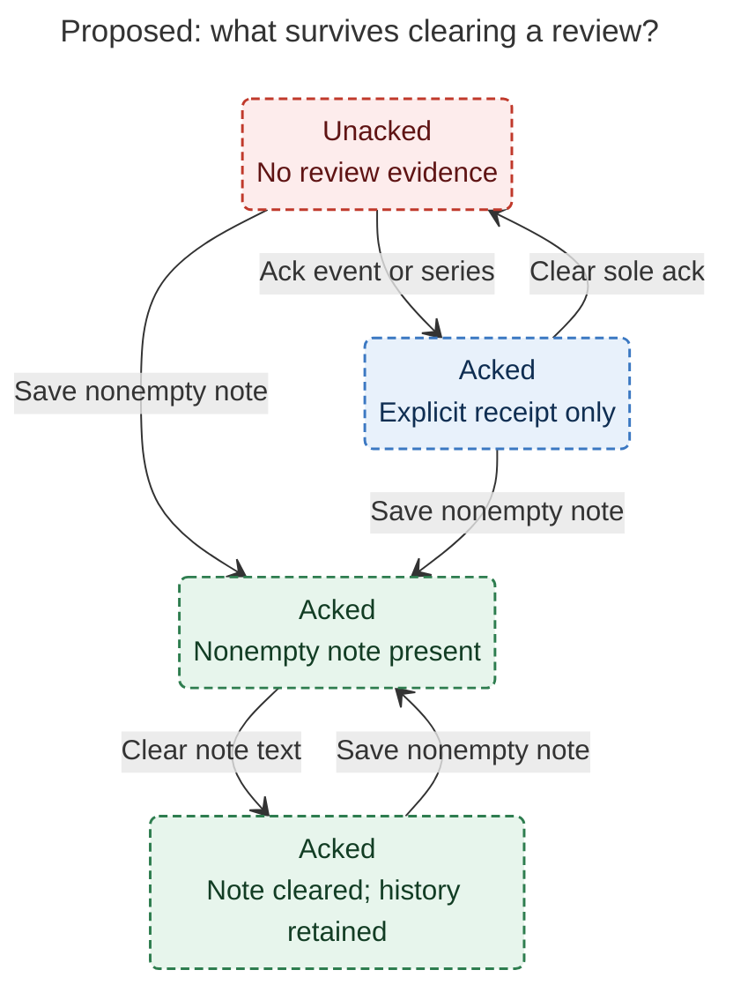
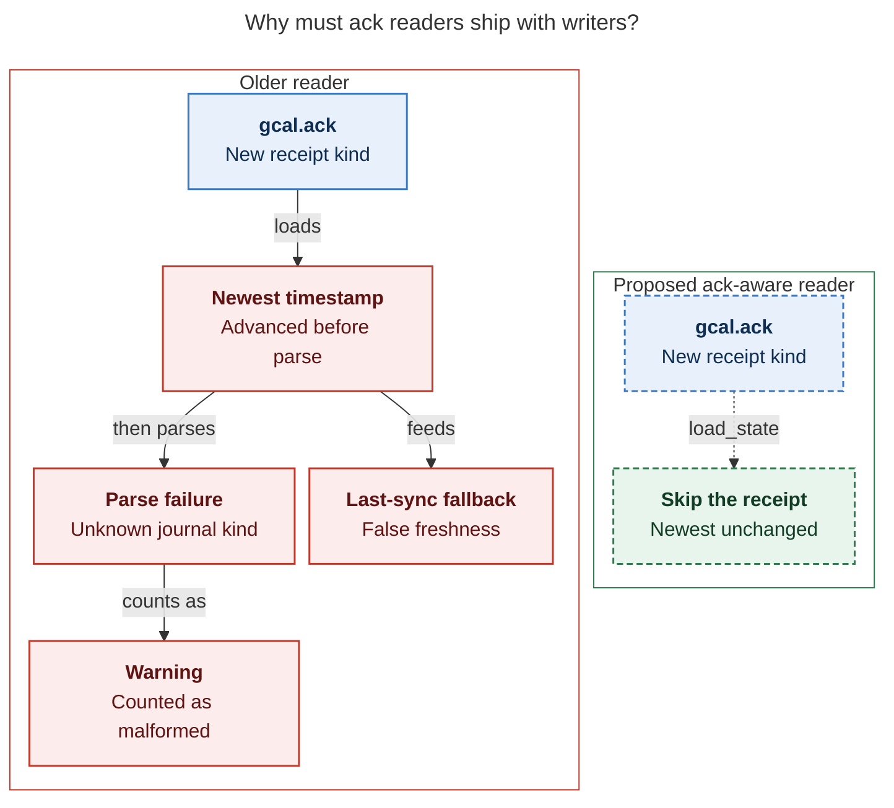

# Diagram proposals: Ack external Google Calendar events

Proposals for the swarm linker, not a report. Each diagram restates only what the source
report says.

```yaml
source: research:202611/gcal_external_event_ack/gcal_external_event_ack__final.md
producer: research.4h.image
check: "mmdc 12.0.0 with the PDF-mirroring config rendered 2 of 2 Mermaid diagrams; --no-sandbox; SVG and PNG visually reviewed"
```

## review-evidence

```yaml
anchor: |-
  Deleting travel instructions does not undo having reviewed the event
question: |-
  Does clearing a note or an explicit ack erase review?
illustrates: |-
  Historical nonempty note evidence survives clearing current text, while clearing the sole explicit ack returns an event with no other review evidence to unacked.
caption: "Historical nonempty notes preserve review after text is cleared; clearing the sole explicit ack reopens review only when no note evidence remains."
review: "453.185x758 px, fit 100.0%; question, source-trace and visual checks passed; 0 revisions; either incoming action suffices; scoped to one applicable event/series with no other evidence."
```



## journal-reader-compatibility

```yaml
anchor: |-
  `gcal.ack` line is a per-line warning *and* a bogus freshness signal.
question: |-
  Why must ack-aware readers ship with ack writers?
illustrates: |-
  Older readers count gcal.ack as malformed and advance newest, while the proposed load_state skip prevents ack receipts from becoming occurrence state or a bogus last-sync signal.
caption: "Ship ack-aware readers with writers, upgrading the writer Mac first: older readers turn ack receipts into malformed warnings and bogus freshness."
review: "771.766x781 px, fit 84.6%; question, source-trace and visual checks passed; 1 revision; scoped to occurrence loading, with separate ack validation outside the figure."
```


